# Bayesian superradiance constraints on ultralight-boson masses and self-interactions from full black-hole mass–spin posteriors: M33 X-7 and IRAS 09149-6206

## Abstract

We turn the physics of black-hole (BH) superradiance into a probabilistic statement that uses the **full joint posterior** of BH mass and spin, including its correlations, rather than point estimates. The headline statistic is the posterior probability that the BH has **not** been spun down by a scalar ultralight boson (ULB) of mass μ within a timescale t:

P_surv(μ) = 1 − ∫ p(M, a* | d) 1[(M, a*) ∈ U(μ, t)] dM da*,

where U is the region of the Regge plane that superradiance would have depleted. A mass μ is excluded at 95% when P_surv < 0.05.

**M33 X-7.** For the 1838 posterior samples of this stellar-mass BH, and the Salpeter timescale t = 4.5×10⁷ yr used in the related work:
- We exclude **1.9×10⁻¹³ eV ≲ μ ≲ 8.4×10⁻¹² eV** at 95%.
- With an astrophysically motivated, log-uniform age prior over [10⁵, 3×10⁶] yr the window shrinks to **3.5×10⁻¹³–6.4×10⁻¹² eV**.
- If the M–a* correlation (ρ = 0.88) is ignored, by permuting a* relative to M or using a diagonal Gaussian, the upper edge drops by ≈ 0.07 dex. Using the median point estimate inflates the window to 1.6×10⁻¹³–1.2×10⁻¹¹ eV.

**IRAS 09149-6206.** This supermassive BH has a 0.25-dex mass uncertainty and yields **no 95% exclusion** for t ≤ 4.5×10⁷ yr (min P_surv = 0.22). Only an optimistic t = 10¹⁰ yr excludes 2.0–5.5×10⁻¹⁹ eV. A naive point-estimate analysis would wrongly claim an exclusion at 4.5×10⁷ yr.

**Self-interactions.** We extend the analysis to a quartic self-interaction λ = μ²/f², i.e. a coupling g ≡ 1/f in GeV⁻¹. We use two saturation prescriptions: a modern level-mixing quasi-equilibrium of the 211/322 network and the classic bosenova cap.
- For M33 X-7 we find that **couplings 1/f < g_max(μ) are excluded at 95%**; larger couplings are allowed because they quench superradiance.
- For example, for μ = 2.0×10⁻¹² eV and t = 4.5×10⁷ yr, **1/f < 6×10⁻¹⁴ GeV⁻¹ (f > 1.6×10¹³ GeV) is excluded** in the level-mixing model. The more aggressive bosenova cap with c₀ = 5 excludes a wider band, 1/f < 6×10⁻¹² GeV⁻¹.

**Calibration.** In injection–recovery tests the P_surv < 0.05 rule falsely excludes the true μ in ≤ 4.4% of mocks, and the Bayes-factor rule in ≤ 0.8%. The best-fit-point rule does so in up to 44%.

---

## 1. Introduction and related work

A massive bosonic field around a Kerr BH forms hydrogen-like bound states with gravitational fine-structure constant α = GMμ/(ħc). Levels satisfying ω < mΩ_H grow exponentially by extracting the BH's rotational energy (Arvanitaki & Dubovsky 2011, `related_work/paper_000`). The BH therefore spins down onto the "Regge trajectory" a*_sat(α, m) whenever the instability time is shorter than the relevant astrophysical timescale. Fast-spinning BHs consequently exclude ranges of μ.

The related work in this folder has three relevant parts:
- **Stott (2018) proceedings** (`paper_001`). This uses a statistic P_ex(μ) built from the overlap between the BH measurement and the instability region, with the Salpeter time t_Sal ≃ 4.5×10⁷ yr as the reference timescale and a 95% threshold. It works in the limit of weak self-interactions, f ≳ 10¹⁴ GeV.
- **Arvanitaki & Dubovsky (2011)** (`paper_000`). This gives:
  - the analytic rate (Detweiler-type matching, their Eq. 18);
  - the bosenova onset (Eq. 48);
  - the shutdown of superradiance due to level mixing induced by self-interactions (Eq. 53).
- **Arvanitaki et al. (2017)** (`paper_002`) and **Witek et al. (2013)** (`paper_003`). These give the phenomenology of self-interactions and numerical Kerr bound-state frequencies for validating rates.

**Contribution.** We construct a statistically explicit version of the posterior-overlap statistic and its relatives, and apply it to the two supplied posteriors:
- (i) P_surv(μ), computed exactly by Monte Carlo over posterior samples;
- (ii) a Bayes factor with a Regge pile-up term;
- (iii) a two-dimensional extension to the self-coupling 1/f.

We quantify the effects of the following, and validate the decision rules by injection:
- the M–a* correlation;
- Gaussian and point-estimate approximations;
- age and rate systematics.

## 2. Data

Two posterior-sample files were provided (`data/`):

| Quantity | M33 X-7 (N = 1838) | IRAS 09149-6206 (N = 10000) |
|---|---|---|
| M [M☉], mean ± std | **15.67 ± 1.49** | **(1.20 ± 0.71)×10⁸** |
| M median [16, 84]% | 15.66 [14.17, 17.17] | 1.06×10⁸ [0.56, 1.80]×10⁸ |
| M 95% interval | [12.78, 18.55] | [3.1×10⁷, 3.0×10⁸] |
| log₁₀M, mean ± std | 1.193 ± 0.042 | 8.008 ± 0.252 |
| a*, mean ± std | **0.829 ± 0.055** | **0.933 ± 0.022** |
| a* median [16, 84]% | 0.836 [0.777, 0.885] | 0.936 [0.910, 0.955] |
| a* 95% interval | [0.709, 0.915] | [0.883, 0.967] |
| Pearson corr(M, a*) | **0.885** | 0.010 |
| corr(ln M, a*) / Spearman | 0.893 / 0.889 | −0.002 / −0.003 |
| unique M values | 523 (digitised) | 8551 |
| skewness (log M, a*) | −0.24, −0.63 | −0.18, −0.62 |

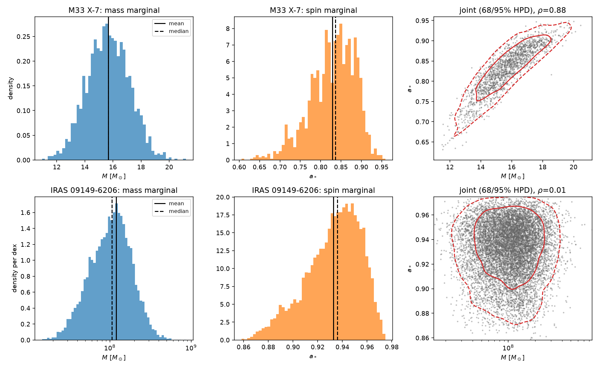

*Figure 1. Marginal and joint posteriors (68/95% HPD contours from a KDE in (log M, a*)). M33 X-7 (top) has a strong positive mass–spin correlation inherited from the continuum-fitting degeneracy. It was digitised from Liu et al. (2008), so only 523 distinct mass values occur and a KDE is needed wherever a density is required. IRAS 09149-6206 (bottom) has an uncorrelated, roughly lognormal (0.25 dex) mass posterior from GRAVITY and a high, tightly measured spin from X-ray reflection.*

The two objects are complementary. M33 X-7 has a precise mass (≈ 0.04 dex) but strongly correlated errors. IRAS 09149-6206 has a precise spin but a mass uncertainty of ≈ 0.25 dex. Because the superradiant instability depends on M only through α ∝ Mμ, the mass uncertainty smears the instability window in μ.

## 3. Physics model

### 3.1 Spectrum, superradiance condition and Regge trajectories

We use scalar levels with l = m = 1…6 and n = l + 1, which are the fastest for each m. The spectrum is ω_R ≈ (μ/ħ)(1 − α²/2n²). The superradiance condition is ω_R < mΩ_H with Ω_H = a*/(2r₊), r₊ = M(1 + √(1 − a*²)). Saturation occurs at

a*_sat(α, m) = 4x/(1 + 4x²),  x = Mω_R/m.

### 3.2 Growth rates and the relativistic correction

The analytic (Detweiler / Brito–Cardoso–Pani) rate of the field amplitude is

Mω_I = 2 r̃₊ C_nl g_lm (mΩ̃_H − Mω_R) α^{4l+5},

with C_nl = 2^{4l+1}(n+l)! / [n^{2l+4}(n−l−1)!] · [l!/((2l)!(2l+1)!)]² and g_lm = Π_{k=1}^{l} [k²(1−a*²) + (a*m − 2r̃₊Mω_R)²]. Its small-α limit, Mω_I → a*α⁹/48, is recovered; the code returns 0.89× this at α = 0.01, a* = 0.5, as expected from the finite-α factors. The occupation number grows at Γ = 2ω_I.

**Rate check (Fig. 2, left).** The pure leading-order formula overshoots the numerical result by ≈ 50× at α = 0.42. The full analytic expression instead undershoots: it peaks at Mω_I = 2.0×10⁻⁸ at α = 0.35, about 7.3× below the numerical peak of ≈ 1.5×10⁻⁷ at α ≈ 0.42 for a* = 0.99 (Dolan 2007; Witek et al. 2013 confirm the long-lived Kerr bound states numerically).

We therefore adopt a **calibrated fiducial rate**, Γ_cal = K_l(α)·Γ_analytic with K_l = 7.32^{[α/(0.352 l)]²}. This tends to 1 for α ≪ l, where the analytic expansion is accurate, and reproduces the numerical l = 1 peak to within 30%: 2.0×10⁻⁷ at α = 0.40. The uncalibrated rate is retained as a systematic.

**Spin-down time without self-interactions.** Spinning the BH down from a* to a*_sat requires N_need = (M/M_Pl)²(a* − a*_sat)/m bosons. Growing from a single quantum takes t_sd = ln N_need / Γ. A sample is *unstable* at (μ, t) if t_sd < t for any level.

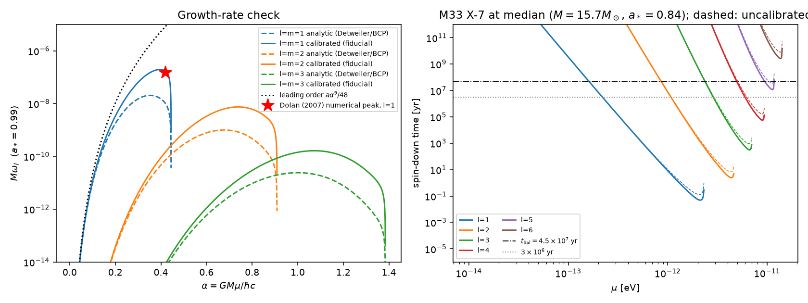

*Figure 2. Left: Mω_I at a* = 0.99 for l = 1, 2, 3: analytic (dashed), calibrated fiducial (solid), leading order (dotted), and the numerical l = 1 peak (star). Right: spin-down times at the M33 X-7 posterior median. Solid lines use the fiducial rates and dashed lines the uncalibrated ones. The edges of the region where any level is below the horizontal timescale lines set the excluded window. The lower edge is rate-limited (t_sd ∝ α⁻⁹). The upper edge is set by kinematics (a* < a*_sat for all l ≤ 6) and therefore barely depends on the rate model.*

### 3.3 Self-interactions: coupling g ≡ 1/f

For an axion-like potential V = μ²f²[1 − cos(φ/f)], the quartic term is −λφ⁴/4! with **λ = μ²/f²**. We quote the coupling as **g ≡ 1/f in GeV⁻¹**. The attractive self-interaction stops exponential growth once the cloud reaches an occupation N_s ≪ N_need. After that point angular momentum is extracted only at a rate ~ΓN_s, so

t_sd = [ln min(N_need, N_s) + max(0, N_need − N_s)/N_s] / Γ.

We implement two prescriptions for N_s:

**(a) Level-mixing quasi-equilibrium (fiducial).** This follows the structure of Baryakhtar et al. (2021) and the level-mixing mechanism in Arvanitaki & Dubovsky (2011, §3.2.2). The 211 cloud sources the 322 level through 211×211 → 322×BH, with rate coefficient κ_a. The 322 level returns quanta through 322×322 → 211×∞, with κ_b:

dN₁/dt = Γ₁N₁ − 2κ_aN₁²N₂ + κ_bN₂²N₁,  dN₂/dt = Γ₂N₂ + κ_aN₁²N₂ − 2κ_bN₂²N₁.

Setting Γ₂ ≈ 0 gives the fixed point

N₁^eq = (2/√3) √(Γ₁κ_b)/κ_a,  N₂^eq = √(Γ₁/(3κ_b)).

We take κ_a = 4.3×10⁻⁷ α⁷ and κ_b = 1.1×10⁻⁸ α⁸ in units of (M_Pl/f)⁴(M_Pl/M)⁴ r_g⁻¹, with M_Pl the non-reduced Planck mass. This gives N₁^eq ≈ 58 √a* α^{1.5} (f/M_Pl)²(M/M_Pl)², with an expected ∝ f² scaling. These are order-of-magnitude coefficients recalled from the literature; we could not recover them from the supplied PDFs.

Because the Planck-mass convention (reduced vs. non-reduced) and the coefficients are uncertain, we bracket the normalisation with c ∈ {1/25, 1, 25}, which is (8π)^{±1} in N_eq.

The equilibrium is derived only for the 211/322 system. We therefore apply it to the l = 1 cloud. For l ≥ 2 we fall back to the bosenova cap with c₀ = 5. Extrapolating the 211 coefficients to l ≥ 4 would produce the unphysical result that self-interactions matter even at f > M_Pl; our f → ∞ consistency test detected this and we removed it.

**(b) Bosenova cap (comparison).** This is Arvanitaki & Dubovsky Eq. (48), in the normalisation of Arvanitaki et al. (2015): N_BN = c₀ (n⁴/α³) (f/M_Pl)² (M/M_Pl)², with c₀ ∈ {0.5, 5, 50}. After each bosenova the cloud regrows on a timescale ~1/Γ, so the same t_sd formula applies.

For M33 X-7 near α ≈ 0.2, N₁^eq/N_BN ~ 10⁻³. The level-mixing equilibrium is reached long before the bosenova threshold, so model (a) gives **weaker** (more conservative) constraints than (b).

Self-interactions can only *slow* spin-down. Hence P_surv(μ, g) is non-decreasing in g, and the exclusion in each μ column is a band 0 < g < g_max(μ).

## 4. Statistical framework

### 4.1 Headline statistic: probability of not having been spun down

For posterior samples {(M_i, a_i)}_{i=1}^{N} with weights w_i (all equal here):

P_surv(μ, g | t) = 1 − Σ_i w_i 1[(M_i, a_i) ∈ U(μ, g, t)] / Σ_i w_i.

**Decision rule:** exclude μ (or (μ, g)) if P_surv < 0.05. Because the integral runs over the *joint* sample cloud, the M–a* correlation is propagated exactly and no Gaussian or box approximation is needed.

**Timescale.** The timescale is a nuisance. We report:
- **fiducial:** t = t_Sal = 4.5×10⁷ yr, as in the related work;
- **alternatives:**
  - M33 X-7: 3×10⁶ yr, the approximate age of the binary;
  - IRAS 09149-6206: 10¹⁰ yr, optimistic;
- **age-marginalised:** P_surv = ∫ P_surv(t) p(t) dt with a log-uniform prior:
  - M33 X-7: [10⁵, 3×10⁶] yr, the time since BH formation must be below the binary age;
  - IRAS 09149-6206: [10⁶, 4.5×10⁷] yr.

### 4.2 Comparison statistics

All of the following are evaluated at the fiducial t:
1. **Uncorrelated posterior.** a* is randomly permuted relative to M (5 seeds), which keeps both marginals but destroys the correlation.
2. **Gaussian approximation in (ln M, a*)** with the full sample covariance (20000 draws).
3. **The same Gaussian approximation with diagonal covariance.**
4. **Median point estimate.** Exclude μ if the median (M, a*) is unstable.
5. **1σ / 2σ box rule.** Exclude μ only if the whole box is unstable.

### 4.3 Extension: Bayes factor with Regge pile-up

Let H_μ be the hypothesis that a boson exists and H₀ that none does. Both use an initial spin prior a₀ ~ U(0, 1).

Under H_μ the spin distribution has two parts: a flat part on the stable set S(M, μ, t), and point masses ("pile-up") on the Regge trajectories a*_sat,l(M), with weights w_l(M) equal to the fraction of initial spins that are driven onto level l. Using a posterior derived under a flat spin prior, the evidence ratio is exactly

**B(μ) = P_surv(μ) + Σ_l ∫ d ln M w_l(M) p̂(ln M, a*_sat,l(M) | d) ≥ P_surv(μ).**

Here p̂ is a 2-D Gaussian KDE in (ln M, a*), reflected at a* = 1, with Scott bandwidth; ×0.5 and ×2 are tested. The pile-up weights are computed by evolving 400 initial spins per mass through the sequential level cascade.

B is more conservative than P_surv. A BH observed *on* a Regge trajectory is evidence *for* a boson, not against it. This produces the narrow non-excluded gaps seen near the l = 2 → 3 trajectories in Fig. 6.

### 4.4 Numerical settings

- **1-D scans:** 241 log-spaced μ values per BH.
- **2-D scans:**
  - M33 X-7: 121 μ values in [1.5×10⁻¹³, 1.5×10⁻¹¹] eV;
  - IRAS 09149-6206: 91 μ values in [3×10⁻²¹, 3×10⁻¹⁸] eV;
  - both × 51 g values in [10⁻²⁰, 10⁻¹⁰] GeV⁻¹;
  - × 6 model/normalisation choices × 2 fixed ages; for M33 X-7 we additionally use 9 marginalisation ages.

All code is in `code/` and is described in Section 10.

## 5. Results I: boson mass without self-interactions

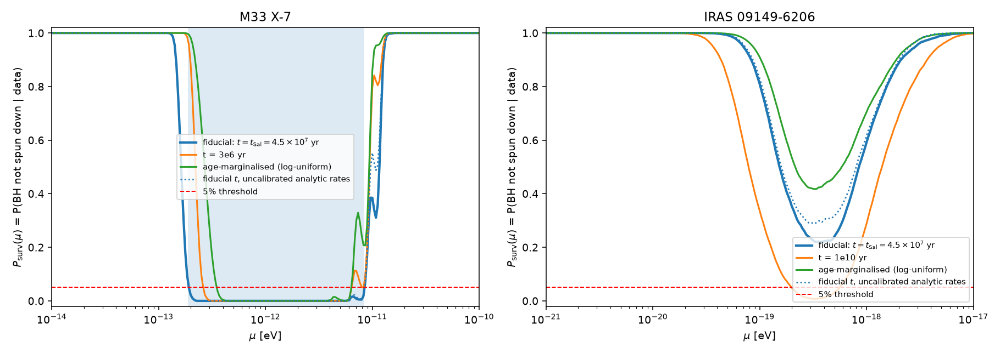

*Figure 4. Headline result: P_surv(μ) on a linear [0, 1] axis, with the 5% threshold. The shaded band is the fiducial 95% excluded region. Left: M33 X-7. Right: IRAS 09149-6206.*

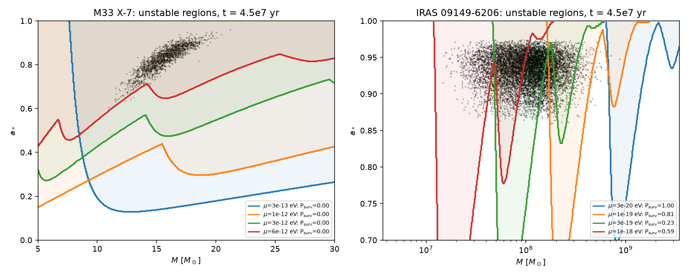

*Figure 3. Instability regions (t = 4.5×10⁷ yr) in the Regge plane for selected μ, overlaid on the posterior samples. For M33 X-7 the whole posterior cloud lies inside the unstable region for 3×10⁻¹³–6×10⁻¹² eV. For IRAS 09149-6206 the instability windows are narrow in M compared with the 0.25-dex mass posterior, so a sizable fraction of samples (≥ 22%) always remains stable.*

**Table 1. 95% excluded boson-mass intervals (P_surv < 0.05 unless stated).**

| Case | M33 X-7 | IRAS 09149-6206 |
|---|---|---|
| **Fiducial: full posterior, t = 4.5×10⁷ yr, calibrated rates** | **[1.88×10⁻¹³, 8.41×10⁻¹²] eV** | **none** (min P_surv = 0.22 at 3.7×10⁻¹⁹ eV) |
| t = 3×10⁶ yr (M33) / 10¹⁰ yr (IRAS) | [2.66×10⁻¹³, 6.43×10⁻¹²] ∪ [8.10, 8.41]×10⁻¹² | [1.96×10⁻¹⁹, 5.52×10⁻¹⁹] |
| Age-marginalised (log-uniform) | [3.48×10⁻¹³, 6.43×10⁻¹²] | none (min 0.42) |
| Uncalibrated analytic rates, fiducial t | [1.96×10⁻¹³, 8.41×10⁻¹²] | none (min 0.29) |
| **Uncorrelated posterior (a* permuted; 5 seeds, all identical)** | **[1.88×10⁻¹³, 7.22×10⁻¹²]** | none (min 0.216–0.222) |
| Uncorrelated, age-marginalised | [3.48×10⁻¹³, 5.31×10⁻¹²] | none |
| Gaussian, full covariance | [1.88×10⁻¹³, 8.41×10⁻¹²] | none (min 0.20) |
| Gaussian, diagonal covariance | [1.88×10⁻¹³, 7.22×10⁻¹²] | none (min 0.20) |
| Median point estimate (P_surv ∈ {0, 1}) | [1.62×10⁻¹³, 1.19×10⁻¹¹] | **[1.50, 4.38]×10⁻¹⁹ ∪ [5.11, 9.09]×10⁻¹⁹** (spurious) |
| Whole 1σ box unstable | [1.81×10⁻¹³, 7.50×10⁻¹²] | none |
| Whole 2σ box unstable | [1.96×10⁻¹³, 6.19×10⁻¹²] | none |
| Bayes factor B < 0.05, fiducial t | [1.88×10⁻¹³, 5.96×10⁻¹²] ∪ [6.94, 7.79]×10⁻¹² | none (min B = 0.37) |
| B < 0.05, t = 3×10⁶ / 10¹⁰ yr | [2.66×10⁻¹³, 5.73×10⁻¹²] | [2.03×10⁻¹⁹, 4.38×10⁻¹⁹] |
| B < 0.05, age-marginalised | [3.48×10⁻¹³, 4.06×10⁻¹²] ∪ [4.55, 5.73]×10⁻¹² | none (min 0.55) |

### 5.1 Effect of the mass–spin correlation

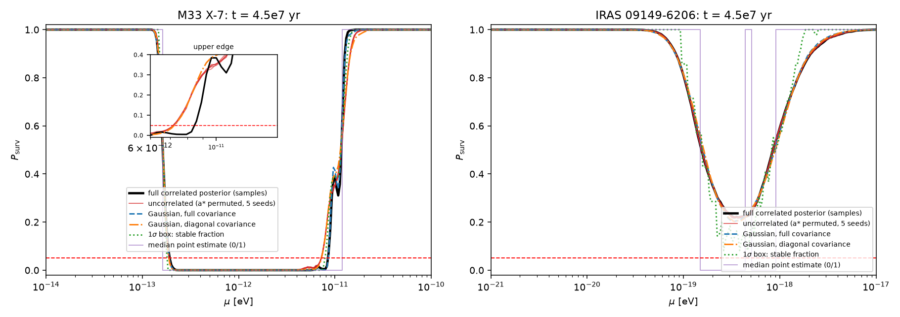

*Figure 5. Full correlated posterior (black) compared with: the uncorrelated (permuted) posterior, Gaussian approximations with full and diagonal covariance, the 1σ box (stable fraction) and the median point estimate. The inset zooms on the M33 X-7 upper edge.*

**Lower edge.** For M33 X-7 the lower edge (≈ 1.9×10⁻¹³ eV) is rate-limited. There, essentially every sample is unstable once α exceeds a threshold that depends only weakly on a*, so the correlation is irrelevant.

**Upper edge.** The upper edge is kinematic: the BH escapes only if a* < a*_sat for every l ≤ 6 that can grow within t. The points that escape first lie at **high mass and low spin**, where α is larger. The strong positive correlation (ρ = 0.88) means the true posterior contains almost no such points. Destroying the correlation populates that corner and lowers the upper edge from 8.4×10⁻¹² to 7.2×10⁻¹² eV (−0.07 dex). Age-marginalised, the edge moves from 6.4×10⁻¹² to 5.3×10⁻¹² eV (−0.08 dex).

A Gaussian with the *full* covariance reproduces the sample result exactly. A diagonal Gaussian reproduces the uncorrelated result. For M33 X-7, therefore, correctly propagating the covariance matters at the 20% level in μ_max. The non-Gaussian tails of the digitised samples do not matter at our resolution.

For IRAS 09149-6206, ρ ≈ 0 and all sample-based curves coincide (within ±0.003 between seeds).

**Point estimates are unsafe.**
- For M33 X-7 the median-point rule over-extends the window by 0.15 dex at the top, to 1.19×10⁻¹¹ eV.
- For IRAS 09149-6206 it produces a **spurious exclusion** of [1.5, 9.1]×10⁻¹⁹ eV at t = 4.5×10⁷ yr, where the posterior-based P_surv never drops below 0.22.

This is the main pitfall the posterior framework removes.

### 5.2 Bayes factor (extension)

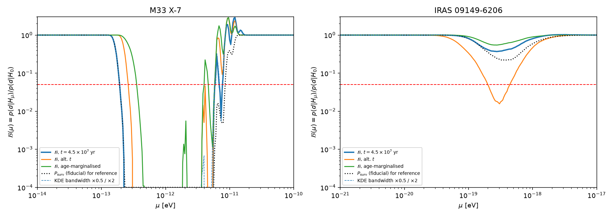

*Figure 6. Bayes factor B(μ) on a log axis, with P_surv for reference (dotted). B ≥ P_surv by construction. The difference is the pile-up term, which rises sharply where the posterior overlaps a Regge trajectory: near 4–7×10⁻¹² eV for M33 X-7 (the l = 2/3 trajectories cross the posterior), and around the l = 1 → 2 transition (~2×10⁻¹² eV) in the age-marginalised curve. B ≈ 1–3 just above the M33 window reflects samples sitting close to the l = 3 trajectory. This is mild and not significant. KDE bandwidth ×0.5/×2 changes B negligibly except in the deep tails.*

## 6. Results II: self-interaction coupling 1/f

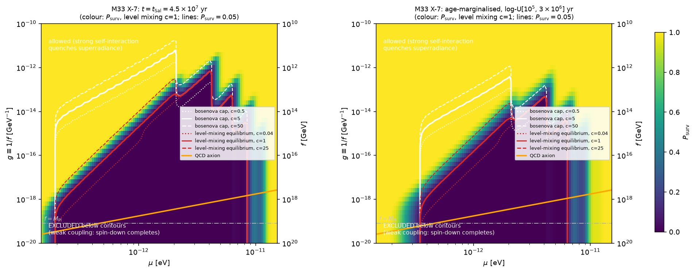

*Figure 8. M33 X-7 in the (μ, g ≡ 1/f) plane. The colour map is P_surv for the fiducial level-mixing model (c = 1). The contours are P_surv = 0.05 for:*
- *the level-mixing model (red; c = 1/25 dotted, 1 solid, 25 dashed);*
- *the bosenova cap (white; c₀ = 0.5 dotted, 5 solid, 50 dashed).*

*Left: t = 4.5×10⁷ yr. Right: age-marginalised over log-U[10⁵, 3×10⁶] yr. The region **below** each contour (weak coupling, large f) is excluded. Above it, self-interactions saturate the cloud and spin-down is too slow. The orange line is the QCD axion (f = 5.7×10⁶ GeV · eV/μ) and the dash-dotted line is f = M_Pl. The right-hand axis shows f.*

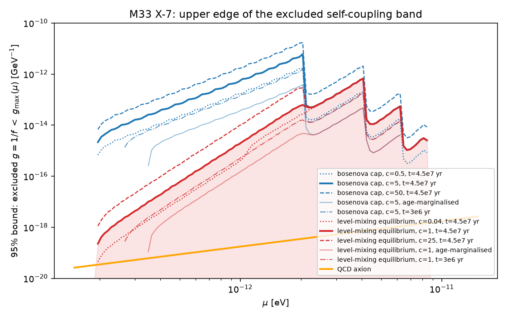

*Figure 9. The upper edge g_max(μ) of the excluded coupling band for M33 X-7, for both models, the normalisation brackets and three timescale treatments. The red shaded region is excluded in the fiducial model. The saw-tooth structure follows the hand-over from l = 1 (μ ≲ 2×10⁻¹² eV) to l = 2 (2–4×10⁻¹² eV) and l = 3 (4–6×10⁻¹² eV). Near a hand-over the dominant level has a small rate and is easily quenched.*

**Table 2. M33 X-7: 95% upper edge g_max of the excluded self-coupling band.** For each μ, couplings **1/f < g_max are excluded**, i.e. f > 1/g_max. All values are in GeV⁻¹ unless noted; λ = μ²/f² = (μ g)² with μ in GeV.

| μ [eV] | α at M = 15.7 M☉ | **level mixing, c = 1, t = 4.5×10⁷ yr** | level mixing, c ∈ [1/25, 25] | bosenova c₀ = 5, t = 4.5×10⁷ yr | bosenova c₀ ∈ [0.5, 50] | level mixing c = 1, t = 3 Myr | level mixing c = 1, age-marginalised | λ_max (level mixing c = 1) | λ_max (bosenova c₀ = 5) |
|---|---|---|---|---|---|---|---|---|---|
| 1.96×10⁻¹³ (lower edge) | 0.023 | **2.3×10⁻¹⁹** | 4.5×10⁻²⁰ – 1.1×10⁻¹⁸ | 2.2×10⁻¹⁵ | 6.8×10⁻¹⁶ – 6.8×10⁻¹⁵ | — | — | 2.0×10⁻⁸¹ | 1.8×10⁻⁷³ |
| 2.99×10⁻¹³ | 0.035 | **4.3×10⁻¹⁸** | 8.4×10⁻¹⁹ – 2.1×10⁻¹⁷ | 1.6×10⁻¹⁴ | 4.6×10⁻¹⁵ – 4.6×10⁻¹⁴ | 1.0×10⁻¹⁸ | — | 1.7×10⁻⁷⁸ | 2.4×10⁻⁷¹ |
| 9.83×10⁻¹³ | 0.115 | **1.8×10⁻¹⁵** | 3.8×10⁻¹⁶ – 9.4×10⁻¹⁵ | 5.1×10⁻¹³ | 1.7×10⁻¹³ – 1.7×10⁻¹² | 4.6×10⁻¹⁶ | 1.4×10⁻¹⁶ | 3.1×10⁻⁷² | 2.5×10⁻⁶⁷ |
| 2.04×10⁻¹² (strongest l = 1) | 0.239 | **6.2×10⁻¹⁴** | 2.7×10⁻¹⁴ – 2.9×10⁻¹³ | 6.1×10⁻¹² | 1.7×10⁻¹² – 1.7×10⁻¹¹ | 1.6×10⁻¹⁴ | 4.8×10⁻¹⁵ | 1.6×10⁻⁶⁸ | 1.6×10⁻⁶⁴ |
| 2.99×10⁻¹² | 0.351 | **1.6×10⁻¹³** | (l ≥ 2: bosenova c₀ = 5) | 1.6×10⁻¹³ | 4.9×10⁻¹⁴ – 4.9×10⁻¹³ | 4.2×10⁻¹⁴ | 1.1×10⁻¹⁴ | 2.4×10⁻⁶⁷ | 2.4×10⁻⁶⁷ |
| 4.07×10⁻¹² (strongest, fiducial model) | 0.477 | **6.7×10⁻¹³** | (l ≥ 2: bosenova c₀ = 5) | 6.7×10⁻¹³ | 2.0×10⁻¹³ – 2.0×10⁻¹² | 1.7×10⁻¹³ | 4.7×10⁻¹⁴ | 7.5×10⁻⁶⁶ | 7.5×10⁻⁶⁶ |
| 5.97×10⁻¹² | 0.700 | **4.5×10⁻¹⁴** | (l ≥ 2: bosenova c₀ = 5) | 4.5×10⁻¹⁴ | 1.6×10⁻¹⁴ – 1.6×10⁻¹³ | 1.2×10⁻¹⁴ | 3.5×10⁻¹⁵ | 7.4×10⁻⁶⁸ | 7.4×10⁻⁶⁸ |
| 8.44×10⁻¹² (upper edge) | 0.989 | **2.5×10⁻¹⁵** | (l ≥ 2: bosenova c₀ = 5) | 2.5×10⁻¹⁵ | 8.4×10⁻¹⁶ – 8.4×10⁻¹⁵ | — | — | 4.6×10⁻⁷⁰ | 4.6×10⁻⁷⁰ |

An entry "—" means that μ is not excluded even for f → ∞ under that timescale assumption. Above μ ≈ 2.2×10⁻¹² eV the l ≥ 2 levels dominate, and the fiducial model then reduces to the bosenova cap with c₀ = 5 (§3.3).

**Statements of the bound (95%, M33 X-7):**
- For **μ = 2.0×10⁻¹² eV** and t = 4.5×10⁷ yr, couplings **1/f < 6×10⁻¹⁴ GeV⁻¹** (f > 1.6×10¹³ GeV; λ < 1.6×10⁻⁶⁸) are excluded in the level-mixing model. The normalisation bracket gives 3×10⁻¹⁴–3×10⁻¹³ GeV⁻¹. The bosenova cap (c₀ = 5) gives 1/f < 6×10⁻¹² GeV⁻¹ (f > 1.6×10¹¹ GeV).
- For **μ = 1.0×10⁻¹² eV**: 1/f < 1.8×10⁻¹⁵ GeV⁻¹ (f > 5.6×10¹⁴ GeV) in the level-mixing model, and 1/f < 5×10⁻¹³ GeV⁻¹ in the bosenova model.
- For **μ = 4.1×10⁻¹² eV**, the largest excluded coupling in the window for the fiducial model: **1/f < 7×10⁻¹³ GeV⁻¹** (f > 1.5×10¹² GeV). In the bosenova model the largest excluded coupling is 6×10⁻¹² GeV⁻¹ (c₀ = 5) at μ ≈ 2×10⁻¹² eV.
- With the age-marginalised (≤ 3 Myr) timescale the bounds weaken by ≈ 13–16×. The requirement t_sd ≈ N_need/(ΓN_s) < t gives g_max ∝ t^{1/2} for the bosenova cap; for the l = 1 equilibrium, N_eq ∝ f² as well. The 3-Myr fixed age weakens them by ≈ 4× (= (4.5×10⁷/3×10⁶)^{1/2}).
- **Weak-coupling limit and QCD axion.**
  - The f → ∞ limit of the 2-D scan reproduces the 1-D P_surv exactly (maximum difference 0.000 over all 121 μ columns).
  - Along the QCD-axion line, self-interactions are negligible: the excluded range [1.9×10⁻¹³, 8.6×10⁻¹²] eV equals the no-self-interaction range on the same grid. This corresponds to QCD-axion decay constants **f ≈ 6.6×10¹⁷ – 3.0×10¹⁹ GeV** (t = 4.5×10⁷ yr).
- Bounds below g ≈ 1/M_Pl ≈ 8×10⁻²⁰ GeV⁻¹ (only at the very edges of the window) correspond to super-Planckian f and are shown only for completeness.

**IRAS 09149-6206 (Fig. 10).**
- For t = 4.5×10⁷ yr no (μ, g) point is excluded, because min P_surv = 0.22 even at g → 0.
- For the optimistic t = 10¹⁰ yr, the bands are:
  - **level mixing (c = 1):** 1/f < 4×10⁻¹⁷ GeV⁻¹ at μ ≈ 5×10⁻¹⁹ eV, and 1/f < 7×10⁻¹⁸ GeV⁻¹ at 2.9×10⁻¹⁹ eV;
  - **bosenova (c₀ = 5):** 1/f < 1.6×10⁻¹⁵ GeV⁻¹ at μ ≈ 3.2×10⁻¹⁹ eV.

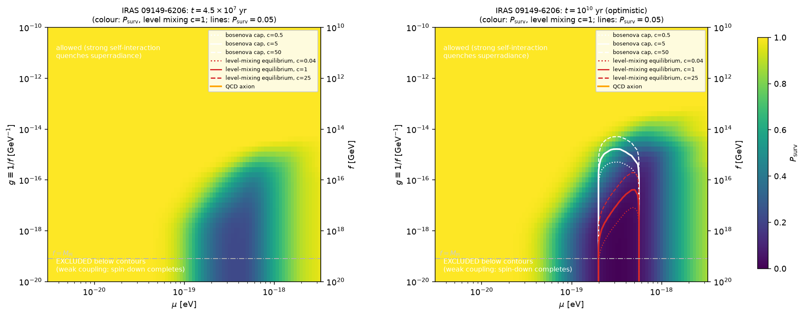

*Figure 10. As Fig. 8 for IRAS 09149-6206 at t = 4.5×10⁷ yr (left; no exclusion) and t = 10¹⁰ yr (right). The QCD-axion line lies far below the plotted range (f ~ 10²⁵ GeV).*

## 7. Validation and calibration

**Limits.**
- P_surv → 1 and B → 1 far from the sensitive windows: checked at μ = 10⁻¹⁵ and 10⁻⁹ eV (M33 X-7) and 10⁻²² and 10⁻¹⁶ eV (IRAS 09149-6206), with t = 10¹⁰ yr.
- The f → ∞ limit of the 2-D scan reproduces the 1-D result exactly.
- The 2-D bounds scale as g_max ∝ √c, as expected.

**KDE.**
- The reflected 2-D KDE integrates to 1.0000000 (M33 X-7) and 0.9999999 (IRAS 09149-6206) over ln M × [0, 1].
- Changing the bandwidth by ×0.5 or ×2 changes the B-excluded edges by ≤ 0.02 dex.
- The 1-D P_surv does not depend on the KDE at all.

**Injection–recovery (Fig. 11).**

*Setup.* For each true μ we generated mock BHs as follows:
- M from the observed mass marginal;
- a₀ ~ U(0, 1), evolved through the level cascade for 4.5×10⁷ yr;
- a mock Gaussian posterior with the *real* (ln M, a*) covariance, centred on a noisy realisation.

We used 500 mocks per mass for M33 X-7 and 300 for IRAS 09149-6206. We recorded how often each rule excludes the **true** μ, and the "power": the exclusion rate for no-boson mocks.

*False-exclusion rates (worst case over μ):*

| Rule | M33 X-7 | IRAS 09149-6206 |
|---|---|---|
| P_surv < 0.05 | **≤ 4.4%** | 0% |
| B < 0.05 | **≤ 0.8%** | 0% |
| whole 1σ box unstable | ≤ 3.6% | ≤ 0.3% |
| best-fit point unstable | **up to 43.6%** | up to 10% |

*Power.* The power of the P_surv rule reaches 76% for M33 X-7-like errors, versus 71% for B. For IRAS 09149-6206-like errors it is ≤ 0.3%: a 0.25-dex mass uncertainty essentially precludes any 95% exclusion at 4.5×10⁷ yr.

*Mean of 1/B.* For IRAS 09149-6206 mean(1/B) = 0.97–1.04, consistent with the identity E_{H_μ}[1/B] = 1. For M33 X-7 it ranges over 0.4–3. This reflects the mismatch between the narrow generating mass distribution and the implicit flat ln M prior of a posterior-based evidence, together with heavy tails of 1/B.

*Interpretation.* P_surv < 0.05 behaves as an approximately calibrated 95% rule. It is not a strict frequentist test, but its false-exclusion rate stays ≤ 5%. B is conservative. Point-estimate rules are badly miscalibrated.

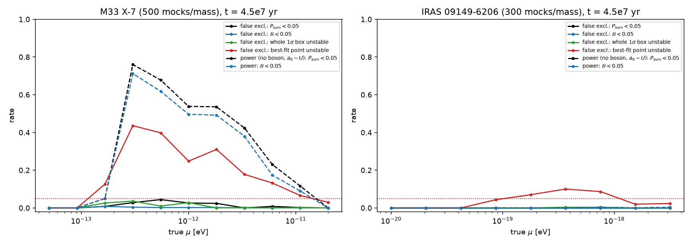

*Figure 11. False-exclusion rates (solid) and power (dashed) versus true μ.*

## 8. Systematics

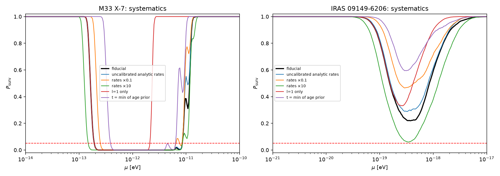

*Figure 7. Sensitivity of P_surv to rate model, rate normalisation, level truncation and timescale.*

| Variation | M33 X-7 excluded window | IRAS 09149-6206 min P_surv |
|---|---|---|
| Fiducial | [1.88×10⁻¹³, 8.41×10⁻¹²] | 0.22 |
| Uncalibrated analytic rate | [1.96×10⁻¹³, 8.41×10⁻¹²] | 0.29 |
| Rates ×0.1 | [2.46×10⁻¹³, 6.43×10⁻¹²] ∪ [7.50, 8.41]×10⁻¹² | 0.47 |
| Rates ×10 | [1.50×10⁻¹³, 8.41×10⁻¹²] | 0.059 (still no exclusion) |
| l = 1 only | [1.88×10⁻¹³, 2.11×10⁻¹²] | 0.33 |
| t = 10⁵ yr (minimum of age prior) | [3.91×10⁻¹³, 6.43×10⁻¹²] | 0.60 (t = 10⁶ yr) |
| t = 3×10⁶ yr | [2.66×10⁻¹³, 6.43×10⁻¹²] ∪ [8.10, 8.41]×10⁻¹² | — |

**Main findings.**
- The **lower edge** of the M33 X-7 window scales as t^{−1/9} and Γ^{−1/9} (rate ∝ α⁹). A ×10 change in rates or age moves it by ≈ 0.1 dex.
- The **upper edge** is kinematic. It is insensitive to the rate calibration (identical with and without it), but it requires the l ≥ 2 levels: with l = 1 only, the edge collapses to 2.1×10⁻¹² eV.
- The IRAS 09149-6206 null result is robust to every variation except a combination of rates ×10 and t ≥ 4.5×10⁷ yr, which approaches but does not cross the threshold. It is broken only by assuming t = 10¹⁰ yr.
- For self-interactions, the c and c₀ brackets give g_max ∝ √c (Table 2). The **choice of model** (level mixing vs. bosenova) changes the l = 1-dominated bounds by 2–4 orders of magnitude in g (largest near the lower edge of the window, where N_eq/N_BN is smallest). This is the largest theoretical uncertainty in the coupling limits.

## 9. Discussion and limitations

**Using the full posterior pays off in two ways.**
- **Correlations.** For M33 X-7 the strong continuum-fitting M–a* correlation shapes the upper edge of the window. A diagonal-covariance or marginal-only analysis is conservative there by 0.07–0.08 dex. The full covariance is equivalent to the full sample set.
- **Honest null results.** For IRAS 09149-6206 the probabilistic treatment returns "no constraint" where a point-estimate analysis would claim an exclusion of almost a decade in μ. The injection study confirms that this is the correct behaviour for a 0.25-dex mass error.

**Self-coupling bounds.** These are the first output of the 2-D extension. For M33 X-7 at μ ≈ 1–4×10⁻¹² eV, weakly self-interacting bosons with 1/f ≲ 10⁻¹⁵–10⁻¹² GeV⁻¹ (f ≳ 10¹²–10¹⁵ GeV) are excluded, with the exact value depending on μ and on the saturation model. Strongly self-interacting ULBs evade the superradiance bound. The QCD axion itself is in the weak-coupling regime throughout the window.

**Limitations.**
1. **Rates.** The rates are non-relativistic analytic expressions with a simple, α-dependent calibration to the numerical l = 1 peak. SuperRad-quality relativistic rates for all l, and relativistic corrections to a*_sat and to ω_R, were not available offline. Because the M33 X-7 upper edge is kinematic, and the lower edge moves only ∝ Γ^{−1/9}, we expect these to change the edges by ≲ 0.05–0.1 dex.
2. **Self-interaction prescription.**
   - The level-mixing equilibrium uses literature coefficients that we could not verify from the supplied papers, so we bracket its normalisation by (8π)^{±1}.
   - It is applied only to the 211/322 system, with the bosenova cap used for l ≥ 2.
   - Higher-level networks, 322 superradiance during equilibrium, and the possibility that self-interactions *reopen* growth of other levels are neglected.
   - The coupling numbers in Table 2 are therefore order-of-magnitude statements conditional on the model.
3. **Timescale.** All numbers depend on t. For M33 X-7 the binary is only ~3 Myr old, so the Salpeter-time results (used for comparability with the related work) are optimistic. The age-marginalised results are the astrophysically conservative alternative. Accretion, which could spin the BH back up, is ignored.
4. **Priors.** P_surv implicitly uses the measurement's own priors. The Bayes factor assumes a flat initial-spin prior and a posterior obtained under a flat spin prior.
5. **Physics not included.** Vector bosons, gravitational-wave emission from the cloud, and multiple fields are not included. The two BHs are analysed separately; a joint analysis would be P_surv,joint = Π_k P_surv,k under independence.

## 10. Reproducibility

| Script (in `code/`) | Purpose | Output |
|---|---|---|
| `pdf_extract.py` | pure-Python PDF text extraction (FlateDecode, ObjStm, ToUnicode) for the related work | `outputs/papers/*.txt` |
| `data_overview.py` | posterior statistics and Fig. 1 | `outputs/posterior_summary.json` |
| `physics.py` | spectrum, rates (analytic + calibrated), spin-down times, self-interaction saturation, Regge evolution | — |
| `stats.py` | P_surv, comparison approximations, reflected KDE, Bayes factor with pile-up, interval finder | — |
| `scan1d.py` | all 1-D curves and systematics (≈ 35 min, dominated by the IRAS B factor) | `outputs/scan1d.npy`, `outputs/scan1d_intervals.json` |
| `scan2d.py M33` / `scan2d.py IRAS` | (μ, 1/f) grids (≈ 3 min / 5 min) | `outputs/scan2d_*.npy` |
| `injection.py` | calibration mocks | `outputs/injection_*.json` |
| `validate_kde.py` | KDE normalisation and far-limit checks | `outputs/validation_kde.json` |
| `fig_physics.py`, `fig_results.py`, `fig_coupling.py`, `fig_injection.py`, `make_tables.py` | figures and tables | `report/images/*.png`, `outputs/coupling_results.json`, `outputs/coupling_table.md` |

Random seeds are fixed (permutations: seeds 0–4; Gaussian draws: seed 1; injections: seed 42). Only numpy, scipy and matplotlib are required.
