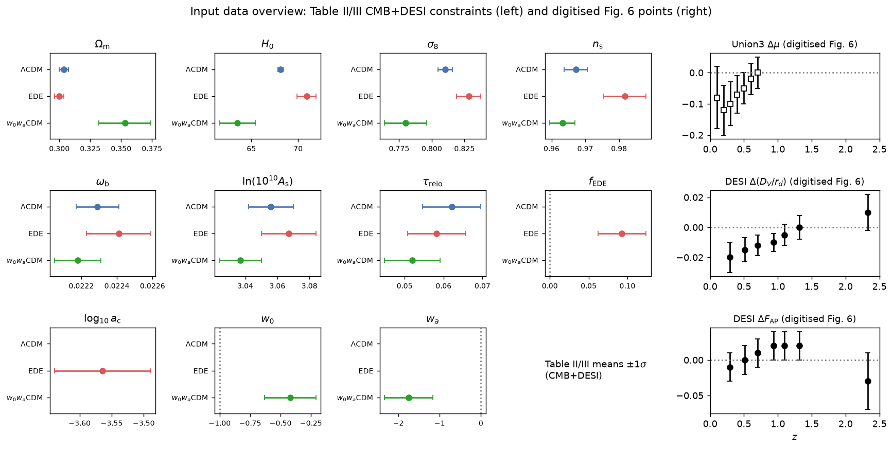
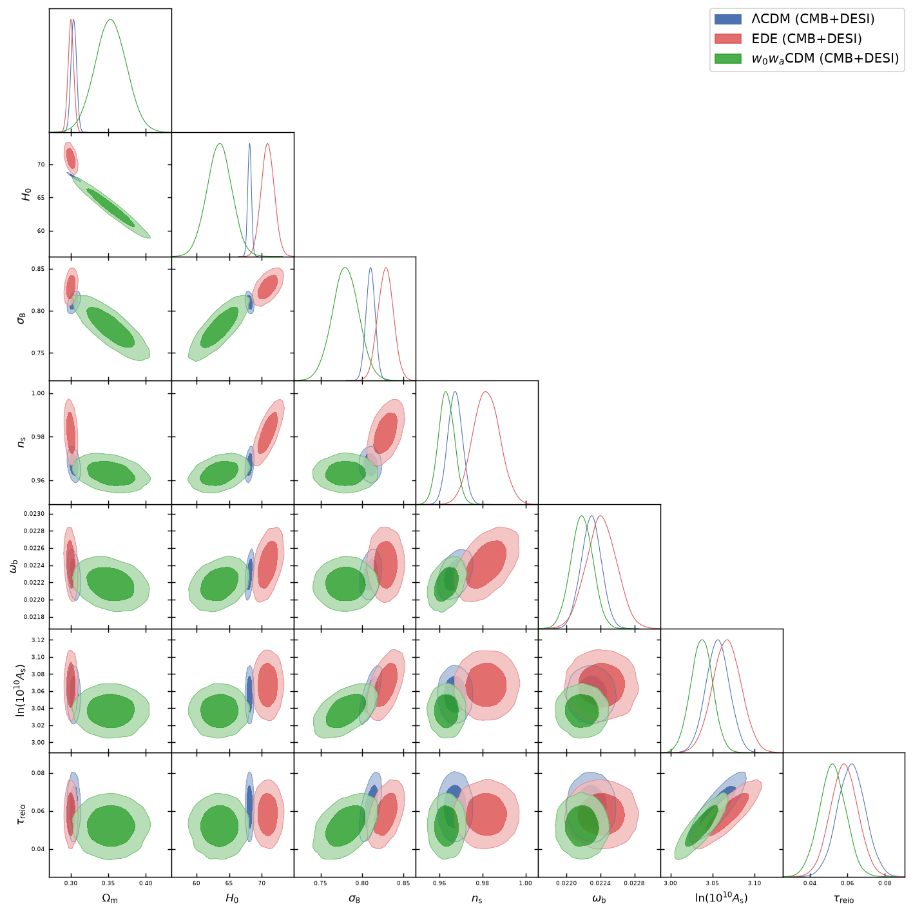
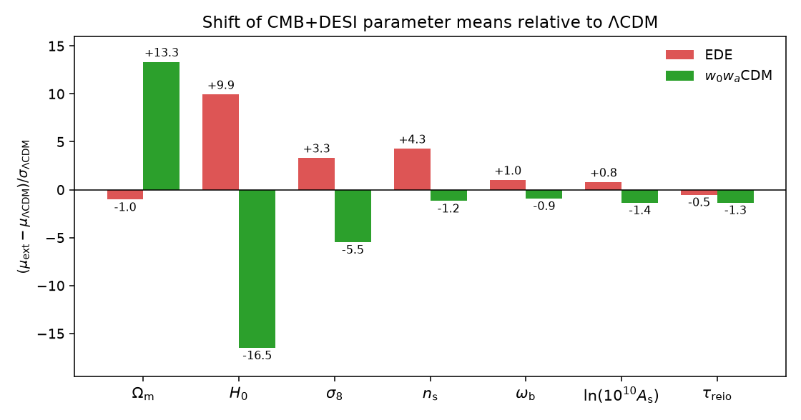
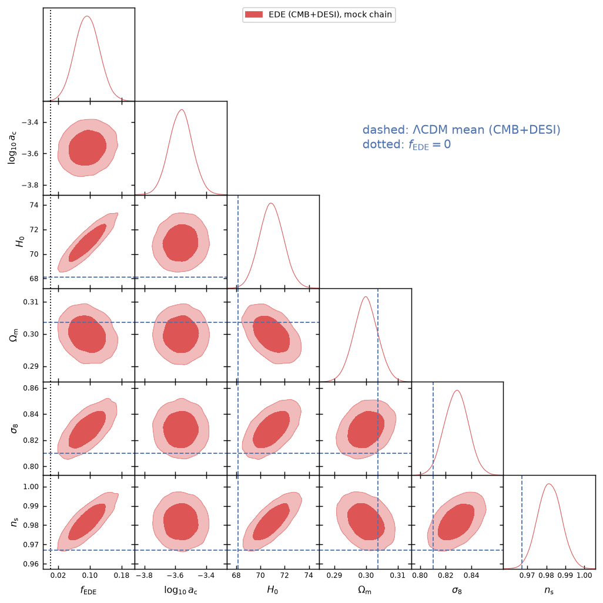
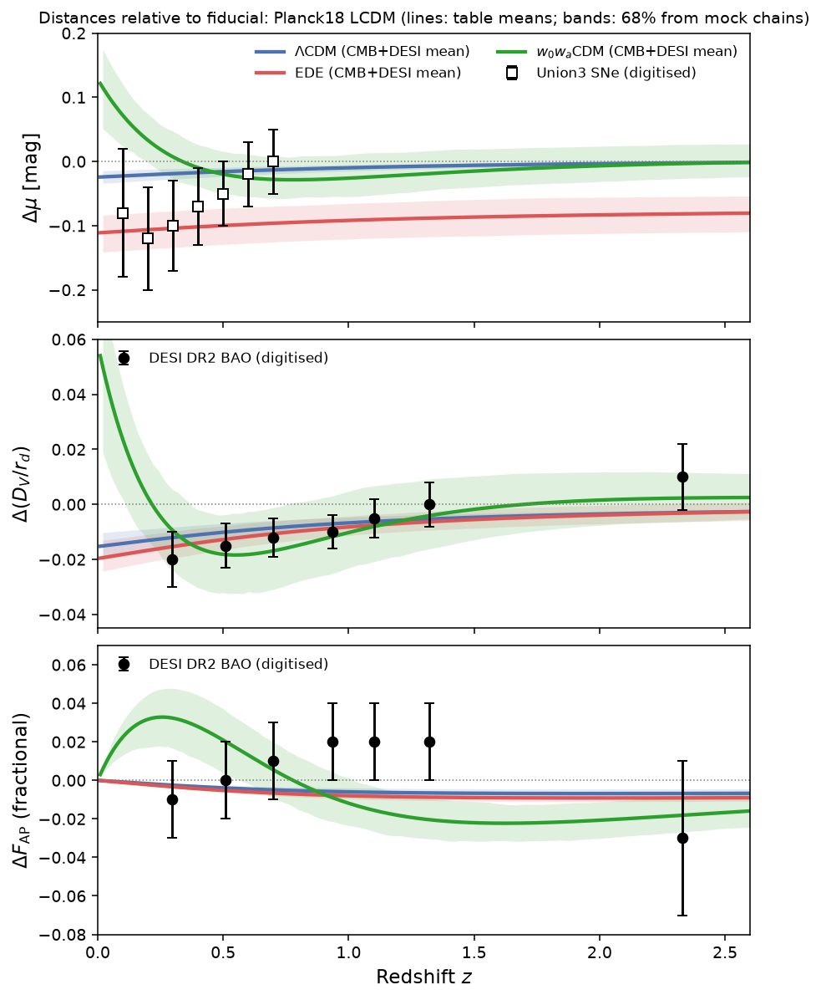
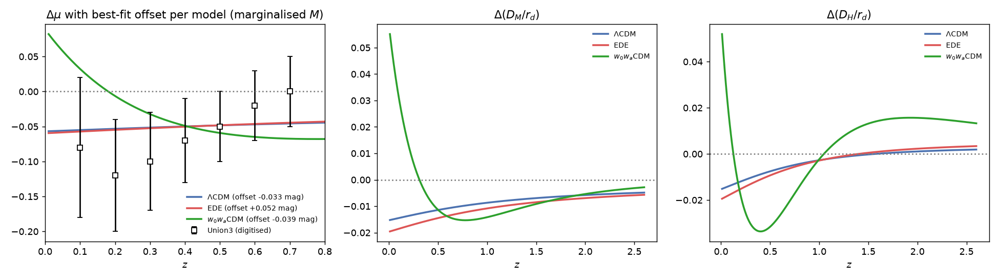
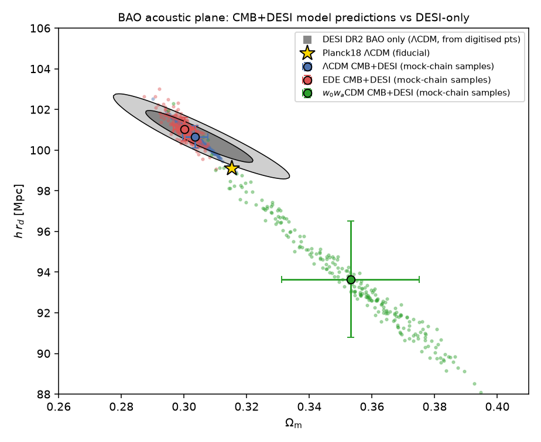

# Can Early Dark Energy Relieve the CMB–BAO Acoustic Tension? A Table-Driven Reproduction of the DESI DR2 EDE / ΛCDM / w₀wₐ Comparison

## Abstract

DESI DR2 baryon acoustic oscillation (BAO) distances are in mild tension with the ΛCDM cosmology preferred by the CMB. In the BAO observables, DESI prefers a lower Ω_m and a larger h·r_d than Planck. We reproduce the main quantitative results of the DESI DR2 early dark energy (EDE) analysis from the material provided:

- the CMB+DESI means and 1σ errors for ΛCDM, EDE and w₀wₐCDM (Tables II/III of the paper);
- BAO and Union3 supernova (SN) residuals digitised from the paper's Fig. 6.

From the tables we build seeded Gaussian mock MCMC chains (20,000 samples per model, GetDist format) and validate them against the tables to better than 0.5% of σ in the mean and 0.8% in the width. From these chains we make the three-model triangle plot. We then compute physical distance predictions at the table means with CAMB, using EarlyQuintessence for EDE and PPF for w₀wₐ, and compare them with the digitised points relative to a fiducial chosen by χ² among three candidates.

The main results:

1. **The two extensions move parameters in opposite directions.**
   - EDE (f_EDE = 0.093 ± 0.031, i.e. 3.0σ from zero, log₁₀a_c = −3.56) raises H₀ by +2.8 km s⁻¹ Mpc⁻¹, σ₈ by +0.018 and n_s by +0.015, and lowers Ω_m slightly (−0.004).
   - w₀wₐ does the reverse: it lowers H₀ by −4.6, raises Ω_m by +0.049 and lowers σ₈ by −0.030.
2. **The mechanisms differ.** With θ_* held fixed, EDE shrinks the sound horizon (r_d = 142.6 Mpc vs 147.7 Mpc, −3.5%) and raises H₀ more than enough to compensate. This pushes h·r_d up to 101.1 Mpc, towards the DESI-only value. w₀wₐ leaves r_d unchanged (147.4 Mpc) and instead bends the late-time distance–redshift relation, with h·r_d = 93.6 Mpc.
3. **EDE stays close to ΛCDM against the digitised BAO data.** Relative to the selected fiducial (Planck 2018 ΛCDM), both models track the DESI Δ(D_V/r_d) points. EDE is closer at z < 1 (χ² = 0.39 vs 1.49 for 4 points). EDE's higher H₀ gives a visible, nearly constant Δμ ≈ −0.09 mag offset in absolute distance modulus.
4. **The w₀wₐ comparison depends on sign conventions.** w₀wₐ has the characteristic low-z upturn in D_V/r_d and Δμ, a direct consequence of its low h·r_d. Its agreement with the digitised SN and F_AP points depends on the sign convention of those digitised points, which we quantify.

---

## 1. Introduction and scientific context

BAO measure the comoving sound horizon at the drag epoch, r_d, in units of distance: D_M/r_d, D_H/r_d and D_V/r_d. The CMB measures the same acoustic scale at last scattering through θ_* = r_s(z_*)/D_M(z_*). Within ΛCDM, the combination is controlled by Ω_m and h·r_d.

DESI DR2 BAO prefers Ω_m ≈ 0.297 and h·r_d ≈ 101.5 Mpc. The CMB-preferred ΛCDM sits near Ω_m ≈ 0.315 and h·r_d ≈ 99 Mpc. The ~2–3σ offset between the two is the "acoustic tension". There are two classes of solution:

- **Late-time dark energy (w₀wₐ):** changes D_M(z) and D_H(z) at z ≲ 2, leaving r_d intact. DESI combined with CMB (and SNe) prefers w₀ > −1 and wₐ < 0.
- **Early-time solutions such as EDE:** a scalar field that contributes a fraction f_EDE of the energy density near a critical scale factor a_c ~ 10^-3.5. This lowers r_d. Holding θ_* fixed then forces a larger H₀ (Poulin et al. 2019; Poulin et al. 2025, `related_work/paper_000.pdf`, `paper_003.pdf`). Because EDE also raises ω_c to keep the CMB fit, the net effect is to raise H₀·r_d and slightly lower Ω_m. This is the direction DESI prefers, as discussed in paper_003 Sec. V and Fig. 4.

The target paper asks whether EDE can relieve the CMB–BAO tension and how its parameter shifts differ from those of late-time dark energy. With only tabulated posteriors and digitised figure points available, we cannot rerun the full Planck+ACT+DESI likelihood analysis. We do three things instead:

- (i) reproduce the posterior summaries as validated mock chains;
- (ii) recompute the physical distance predictions with a Boltzmann code;
- (iii) quantify the model–data agreement in the provided BAO/SN residual space.

## 2. Data

All inputs come from `data/DESI_EDE_Repro_Data.txt` (Fig. 1).

| Block | Content |
|---|---|
| `lcdm_params` | 7 parameters (Ω_m, H₀, σ₈, n_s, ω_b, ln10¹⁰A_s, τ), mean ± 1σ, CMB+DESI |
| `ede_params` | same 7 parameters plus f_EDE, log₁₀a_c |
| `w0wa_params` | same 7 parameters plus w₀, wₐ |
| `desi_dvrd_points` | Δ(D_V/r_d) at 7 redshifts, digitised from Fig. 6 |
| `desi_fap_points` | ΔF_AP at the same 7 redshifts |
| `sne_mu_points` | Union3 Δμ in 7 bins, 0.1 ≤ z ≤ 0.7 |

Two caveats apply to the digitised points:

- They are relative to an unstated fiducial, and their sign convention is not documented.
- The z = 1.1 point does not correspond to a DESI DR2 tracer bin. DR2 has LRG3+ELG1 at 0.934 and ELG2 at 1.321. We keep it, since it was provided.

**Figure 1.** Input data. Left: Table II/III means and 1σ errors for the three models. Right: the digitised Fig. 6 residuals.

## 3. Methods

The code is in `code/` and the full pipeline runs with `code/run_all.sh` in about 3 minutes.

### 3.1 Mock MCMC chains from the tables (`make_chains.py`)

For each model we draw N = 20,000 samples with a fixed seed (20251125) from a multivariate Gaussian covering every tabulated parameter:

- 7 parameters for ΛCDM;
- 9 for EDE, adding f_EDE and log₁₀a_c;
- 9 for w₀wₐ, adding w₀ and wₐ.

The samples are standardised exactly and rescaled so that each marginal mean and σ equal the table values. We then impose the physical priors f_EDE ≥ 0 and τ > 0 by rejection. This removes < 0.2% of samples, all in the EDE chain, where f_EDE sits 3σ from zero.

We produce two versions of each chain:

- **Correlated (main, `outputs/chains/{lcdm,ede,w0wa}.txt`).** The correlation matrix is *assumed*, based on well-known CMB+BAO degeneracy directions:
  - Ω_m–H₀ anticorrelation, because the CMB fixes ≈Ω_m h³;
  - ln10¹⁰A_s–τ correlation (+0.85), because the CMB fixes A_s e^{−2τ};
  - σ₈–A_s correlation;
  - for EDE, f_EDE–H₀ (+0.88), f_EDE–n_s (+0.80), f_EDE–σ₈ (+0.70) and H₀–n_s (+0.75);
  - for w₀wₐ, w₀–wₐ (−0.88), w₀–Ω_m (+0.80), Ω_m–H₀ (−0.97) and H₀–σ₈ (+0.88).

  The matrices are projected onto the nearest positive-definite correlation matrix and saved as `outputs/chains/*_corr_matrix.txt`. For ΛCDM we additionally *calibrated* the matrix physically (`theta_calib.py`). We computed CAMB gradients ∂(100θ_*)/∂p and applied damped Gaussian conditioning until the scatter of 100θ_* implied by the chain equals the CMB precision of 3×10⁻⁴. This drives ρ(Ω_m, H₀) to −0.97. For EDE and w₀wₐ, the same conditioning scrambled the physically known correlations, and a one-dimensional scan of ρ(Ω_m, H₀) reduced the θ_* scatter only marginally. We therefore kept the assumed matrices for those two models (see Sec. 6).
- **Independent (`*_indep.txt`).** Diagonal covariance, kept as a correlation-free reference.

Each chain file has the standard GetDist columns `weight −lnL p₁ … p_n`, with a `.paramnames` file containing LaTeX labels. Parameter names are identical across models so the chains overlay directly.

### 3.2 Physical model predictions (`cosmo.py`, `propagate.py`, `distances.py`)

We ran CAMB 2.0.5 at the table means, with N_eff = 3.044 and one massive neutrino of 0.06 eV (ω_ν = 6.44×10⁻⁴). The cold dark matter density is ω_c = Ω_m h² − ω_b − ω_ν.

- **EDE:** `EarlyQuintessence(n=3, theta_i=2.83, use_zc=True, zc=10^(−log10_ac) − 1, fde_zc=f_EDE)`. We confirmed that Ω_EDE(z_c) = 0.0930 matches the input.
- **w₀wₐ:** the PPF dark-energy module.

From each run we obtain r_d, θ_*, D_M(z), D_H(z) = c/H(z), D_V = (z D_M² D_H)^{1/3}, F_AP = D_M/D_H and μ = 5 log₁₀[(1+z)D_M/10 pc]. σ₈ is computed with full transfer functions. To get 68% bands, we passed 250 random samples of each correlated mock chain through the CAMB background.

### 3.3 Residual definitions and fiducial selection

The residuals are defined as follows:

- Δ(D_V/r_d) = (D_V/r_d)_model / (D_V/r_d)_fid − 1.
- ΔF_AP = F_AP,model / F_AP,fid − 1 (fractional). The absolute difference was also tested; see below.
- **Δμ = 5 log₁₀(D_L,model/D_L,fid) with no offset marginalisation.** This keeps the H₀ dependence: a model with higher H₀ has smaller D_L and a negative Δμ. An offset-marginalised version is shown separately in Fig. 6b.

The fiducial of the digitised points is unknown, so we tested three candidates:

1. Planck 2018 ΛCDM (H₀ = 67.36, ω_b = 0.02237, ω_c = 0.1200);
2. the paper's own CMB+DESI ΛCDM means;
3. a DESI-DR2-like BAO-only ΛCDM (Ω_m = 0.2975, h·r_d = 101.54 Mpc; literature values, *external to the provided data*).

For each candidate we computed the total χ² of the three model curves against all 21 digitised points. The criterion rests on the requirement that all three models are fits to CMB+DESI, so they should pass through the data when plotted against the correct fiducial.

### 3.4 Acoustic-plane reconstruction (`acoustic.py`)

With the fiducial fixed, we reconstructed the "observed" BAO quantities from the digitised points: X_obs = X_fid(1 + Δ), σ_X = X_fid σ_Δ. We then fitted a flat ΛCDM, whose BAO predictions depend only on (Ω_m, h·r_d), on a 241² grid. This gives a DESI-only constraint derived *entirely from the provided points*, which we compare with the CMB+DESI predictions of each model.

## 4. Results

### 4.1 Mock-chain validation

All 50 parameter checks pass: 25 parameters across the three models, each in the correlated and independent version. The table below gives the largest deviation per chain; the full per-parameter list is in `outputs/chain_validation.csv`.

| Chain | max abs(Δmean)/σ | max abs(σ_chain/σ_table − 1) |
|---|---|---|
| ΛCDM | 0.0014 | 0.0007 |
| EDE | 0.0048 | 0.0077 |
| w₀wₐ | 0.0009 | 0.0014 |
| ΛCDM (indep.) | 0.0012 | 0.0008 |
| EDE (indep.) | 0.0028 | 0.0052 |
| w₀wₐ (indep.) | 0.0018 | 0.0012 |

GetDist marginal statistics reproduce the tables, for example:

- EDE: f_EDE = 0.0932 ± 0.0308, log₁₀a_c = −3.564 ± 0.075, H₀ = 70.90 ± 0.99;
- w₀wₐ: w₀ = −0.420 ± 0.210, wₐ = −1.750 ± 0.579 (`outputs/chain_marginals.csv`).

The small residual offset in the EDE chain (≤0.5% of σ) comes from rejecting f_EDE < 0, which also shifts the correlated parameters.

**Physical diagnostic of the correlations.** We passed 250 samples per chain through CAMB and measured the scatter of 100θ_*, which the CMB fixes to about 3×10⁻⁴:

| Model | σ(100θ_*), correlated | σ(100θ_*), independent |
|---|---|---|
| ΛCDM | 0.00027 (calibrated) | 0.0029 |
| EDE | 0.0032 | 0.0094 |
| w₀wₐ | 0.0060 | 0.037 |

The correlated chains are 3–6× more physical than independent Gaussians, but only the ΛCDM chain fully respects the acoustic-scale constraint.

### 4.2 Triangle plot: three-model parameter comparison

**Figure 2.** 68%/95% posterior contours of the seven shared parameters for ΛCDM (blue), EDE (red) and w₀wₐCDM (green), all CMB+DESI, from the correlated mock chains. A correlation-free version is in `images/figure3_triangle_indep.png`.

Fig. 2 shows the central qualitative result of the paper. Table 1 gives the shifts relative to ΛCDM (`outputs/parameter_shifts.csv`).

**Table 1.** Shift of the extended-model means relative to ΛCDM.

| Parameter | EDE − ΛCDM | in σ_EDE | w₀wₐ − ΛCDM | in σ_w₀wₐ | σ_ext/σ_ΛCDM (EDE, w₀wₐ) |
|---|---|---|---|---|---|
| Ω_m | −0.0038 | −1.0 | +0.0493 | +2.3 | 1.0, 5.7 |
| H₀ | +2.78 | +2.8 | −4.62 | −2.4 | 3.6, 6.8 |
| σ₈ | +0.018 | +2.0 | −0.030 | −1.9 | 1.7, 2.9 |
| n_s | +0.0145 | +2.3 | −0.0040 | −1.1 | 1.9, 1.1 |
| ω_b | +0.00012 | +0.7 | −0.00011 | −0.8 | 1.5, 1.1 |
| ln10¹⁰A_s | +0.011 | +0.6 | −0.019 | −1.5 | 1.2, 0.9 |
| τ | −0.0039 | −0.5 | −0.0101 | −1.4 | 1.0, 0.9 |

The two extensions pull in nearly opposite directions in the (Ω_m, H₀, σ₈) sub-space:

- **EDE** moves to higher H₀, σ₈ and n_s, and slightly lower Ω_m, with errors on H₀ inflated 3.6× because of the f_EDE–H₀ degeneracy.
- **w₀wₐ** moves to much higher Ω_m and lower H₀ and σ₈, with error bars 5–7× wider along the geometric Ω_m–H₀ degeneracy.

The early-universe parameters (ω_b, A_s, τ) shift by ≤1.5σ in both cases. Fig. 3 summarises the shifts in units of σ_ΛCDM.

**Figure 3.** Shifts of the extended-model means in units of the ΛCDM error. EDE and w₀wₐ go in opposite directions for Ω_m, H₀, σ₈ and n_s.

**Figure 4.** EDE-specific triangle plot: f_EDE, log₁₀a_c, H₀, Ω_m, σ₈ and n_s. Dashed lines mark the ΛCDM means and the dotted line marks f_EDE = 0. The f_EDE–H₀, f_EDE–n_s and f_EDE–σ₈ degeneracies are *assumed* correlations (Sec. 3.1), chosen to match the well-established EDE degeneracy directions. The marginals are exact reproductions of the table.

The tabulated EDE posterior is f_EDE = 0.093 ± 0.031, a ~3σ departure from zero, centred at log₁₀a_c = −3.56 (z_c ≈ 3660), just before matter–radiation equality. This matches the independent ACT DR6 + DESI DR2 analysis in `paper_003`, which finds f_EDE = 0.09 ± 0.03 without SH0ES.

### 4.3 Physical consistency of the tabulated means (CAMB)

**Table 2.** Quantities derived with CAMB at the table means (`outputs/propagation_summary.json`, `outputs/model_derived_quantities.json`).

| Model | σ₈ (CAMB) | σ₈ (table) | pull | r_d [Mpc] | h·r_d [Mpc] | 100θ_* |
|---|---|---|---|---|---|---|
| ΛCDM | 0.8103 | 0.8101 ± 0.0055 | +0.03σ | 147.73 | 100.63 | 1.04156 |
| EDE | 0.8323 | 0.8283 ± 0.0093 | +0.43σ | 142.56 | 101.08 | 1.04093 |
| w₀wₐ | 0.7797 | 0.780 ± 0.016 | −0.02σ | 147.44 | 93.63 | 1.04050 |

- **σ₈.** Recomputing σ₈ from (A_s, n_s, ω_c, ω_b, h) and the dark-energy parameters reproduces the tabulated σ₈ to better than 0.5σ for all three models. This confirms that the table is internally consistent and that our CAMB EDE implementation matches the paper's.
- **Sound horizon.** EDE lowers r_d by 3.5%. The table has H₀ 4.1% higher, so h·r_d *rises* by 0.4% relative to ΛCDM.
- **θ_*.** The θ_* values at the means differ by up to 1×10⁻³ (3σ_θ for w₀wₐ). This is not a physical disagreement. In a curved (banana-shaped) degeneracy the vector of marginal means does not lie on the high-likelihood ridge, an effect that is largest for the broad w₀wₐ posterior.

### 4.4 Distance comparison (reproduction of Fig. 6)

**Fiducial selection.** In Table 3, the first χ² column sums all three model curves over all 21 points. The zero-line column is the χ² of the data against Δ = 0, i.e. against the fiducial itself; it is the same for every candidate by construction.

**Table 3.** Fiducial selection. Lower χ² is better.

| Candidate fiducial | h·r_d [Mpc] | χ² (3 models, fractional ΔF_AP) | χ² (absolute ΔF_AP) |
|---|---|---|---|
| **Planck 2018 ΛCDM** | 99.09 | **58.7** | 66.9 |
| Paper ΛCDM CMB+DESI means | 100.63 | 80.1 | 79.2 |
| DESI-DR2-like ΛCDM (external) | 101.54 | 117.2 | 113.9 |

The Planck 2018 ΛCDM fiducial with fractional ΔF_AP is clearly preferred (Δχ² ≥ 21 over the alternatives), so we adopt it. This is consistent with the usual DESI convention of plotting BAO relative to a Planck ΛCDM fiducial, and with the digitised points: Δ(D_V/r_d) ≈ −2% at low z rising to ≈ +1% at z = 2.3. That is exactly the "DESI prefers larger h·r_d and lower Ω_m than Planck" pattern.

**Figure 5 (reproduction of Fig. 6).** Distances relative to Planck 2018 ΛCDM:

- top: Δμ, absolute, *no* offset marginalisation, with the Union3 digitised points;
- middle: Δ(D_V/r_d);
- bottom: fractional ΔF_AP, with the DESI DR2 digitised points.

Lines show CAMB predictions at the table means. Shaded bands are 68% ranges from 250 correlated mock-chain samples per model.

**Figure 6 (supplement).** Left: Δμ with the analytically marginalised SN offset (absolute-magnitude freedom), with the offsets given in the legend. Middle and right: Δ(D_M/r_d) and Δ(D_H/r_d) separately.

What Fig. 5 shows:

- **Δ(D_V/r_d).** ΛCDM and EDE both sit about 1.5–2% below the Planck fiducial at z → 0 and converge towards it at high z, tracing the DESI points. At low z, Δ(D_V/r_d) → (h r_d)_fid/(h r_d)_model − 1. Our predicted values are −1.53% (ΛCDM), −1.97% (EDE) and +5.83% (w₀wₐ), against −1.52%, −1.95% and +5.41% from CAMB at z = 0.01, so the low-z behaviour is understood quantitatively. EDE's larger h·r_d places it *lower* than ΛCDM at z < 1, closer to the DESI points: χ²(z < 1, 4 points) = 0.39 for EDE vs 1.49 for ΛCDM and 1.92 for w₀wₐ. This is how EDE "partially relieves" the acoustic tension.
- **w₀wₐ in D_V/r_d.** The w₀wₐ curve rises steeply as z → 0, by +5.4% at z = 0.01. This is a genuine property of the tabulated posterior mean, not a numerical artefact: H₀ = 63.5 and r_d = 147.4 Mpc give h·r_d = 93.6 Mpc, 5.5% below Planck. The dynamical dark energy (w₀ = −0.42, wₐ = −1.75) then bends D_M(z) back down so that the curve crosses the data at 0.3 ≲ z ≲ 1.5. The upturn sits below the lowest DESI redshift (z = 0.295), where only SNe constrain the expansion. Its 68% band is wide, ±2% at z ≈ 0.5, because the w₀wₐ posterior is broad.
- **Δμ.** Without offset marginalisation the curves separate according to H₀:
  - EDE has a nearly constant Δμ ≈ −0.11 → −0.08 mag. Its higher H₀ shrinks all luminosity distances by ~5% at fixed redshift.
  - ΛCDM sits at −0.02 mag.
  - w₀wₐ goes from +0.12 mag at z → 0, because of its low H₀, to −0.03 mag at z ≈ 0.7.

  Once the SN absolute magnitude is marginalised (Fig. 6, left), the EDE and ΛCDM curves become indistinguishable. EDE changes the *normalisation* of the low-z distance ladder but not its *shape*. Only w₀wₐ changes the shape of μ(z).
- **ΔF_AP.** ΛCDM and EDE predict ΔF_AP ≈ −0.5% to −1% at z ≳ 1. w₀wₐ predicts a +3% bump at z ≈ 0.3 and a −2% dip at z ≈ 1.5.

### 4.5 Goodness of fit against the digitised points

**Table 4.** χ² of each model curve (table means) against the digitised points, Planck 2018 fiducial (`outputs/chi2_summary.csv`). Δχ² is relative to ΛCDM.

| Model | χ²(D_V/r_d), 7 pts | χ²(F_AP), 7 pts | χ²_BAO | Δχ²_BAO | χ²_SN, absolute (7) | χ²_SN, offset-marg. | Δχ²_SN, offset-marg. |
|---|---|---|---|---|---|---|---|
| ΛCDM | 3.13 | 6.22 | 9.35 | 0 | 4.53 | 2.48 | 0 |
| EDE | 2.34 | 7.14 | 9.48 | +0.14 | 7.51 | 2.36 | −0.11 |
| w₀wₐ | 2.78 | 14.98 | 17.77 | +8.42 | 10.01 | 7.00 | +4.52 |

In the D_V/r_d channel, which carries most of the BAO isotropic information, EDE fits best (Δχ² = −0.79 vs ΛCDM). The improvement is partly cancelled in F_AP. Against these digitised BAO residuals EDE is therefore statistically equivalent to ΛCDM (Δχ²_BAO = +0.14), and it is equivalent for SNe once the magnitude offset is marginalised.

These numbers are *not* the paper's likelihood-level Δχ². They are computed at the posterior means, ignore the BAO covariance (including the D_V–F_AP correlation), and use digitised points with rounded values and errors. We therefore treat them as a consistency check rather than a model-selection statistic.

**Sign-convention sensitivity (`convention_test.py`).** The poor w₀wₐ χ² is driven by F_AP and SNe. Flipping the sign of the digitised Δμ points changes the offset-marginalised SN χ² as follows: w₀wₐ becomes the best model (1.23, vs 3.22 for ΛCDM and 3.36 for EDE). This matches the well-known Union3 preference for w₀wₐ, which suggests that the digitised Δμ may follow the opposite convention (fiducial − data). Flipping ΔF_AP lowers χ²_FAP for all models, to 2.77 (ΛCDM), 2.53 (EDE) and 4.67 (w₀wₐ). Flipping Δ(D_V/r_d), by contrast, is strongly excluded (χ² = 40–60), so the BAO isotropic result is robust. The main figure keeps the provided convention.

### 4.6 The acoustic plane

**Figure 7.** (Ω_m, h·r_d) plane. Grey shows the 68%/95% ΛCDM BAO-only constraint reconstructed from the digitised DESI points. Coloured points are CAMB-derived (Ω_m, h·r_d) for 250 mock-chain samples per model, with the gold star marking the Planck 2018 fiducial.

The digitised DESI points alone give Ω_m = 0.305 ± 0.011 and h·r_d = 100.66 ± 0.84 Mpc, with ρ = −0.94 and χ²_min = 9.2 for 12 degrees of freedom. The constraint is weaker than the published DR2 result (Ω_m = 0.2975 ± 0.0086, h·r_d = 101.54 ± 0.73 Mpc) because of digitisation rounding and the neglected covariance.

The Planck fiducial sits at the edge of the 95% region, which is the acoustic tension. Both CMB+DESI ΛCDM and EDE sit inside the 68% contour. EDE reaches h·r_d = 101.0 ± 0.6 Mpc at Ω_m = 0.300 ± 0.004, moving along the BAO degeneracy *towards* the DESI-only value.

w₀wₐ lies far off this plane (Ω_m = 0.353, h·r_d = 93.6 Mpc). In w₀wₐ, BAO distances are not functions of (Ω_m, h·r_d) alone, so its position here does not measure a tension. It shows that w₀wₐ resolves the tension through the redshift dependence of the distances rather than through the acoustic scale.

## 5. Discussion: early vs late dark energy

**EDE (early-time solution).** The CMB measures θ_* = r_s/D_M(z_*) very precisely. EDE adds energy density briefly around z_c ≈ 3600, which speeds up the expansion before recombination and shrinks r_s and r_d by 3.5%. To keep θ_* fixed, D_M(z_*) must fall by the same amount, which means a larger H₀. Because ω_c also rises to restore the early-ISW and potential-decay signatures (n_s and σ₈ rise with it), the required increase in H₀ exceeds the decrease in r_d. The net result is a higher h·r_d and a slightly lower Ω_m, precisely the direction in which DESI BAO pulls away from the CMB ΛCDM prediction.

Two limits follow:

- Because the shift is along the ΛCDM BAO degeneracy direction and the relative redshift dependence of distances barely changes, EDE can only *partially* relieve the tension. In D_V/r_d at z < 1 it improves on ΛCDM (χ² 0.39 vs 1.49), but the overall BAO χ² against the digitised points is unchanged.
- The relief comes at a price: higher σ₈ (0.828 vs 0.810, which worsens weak-lensing S₈ tension) and higher n_s (0.982), plus a slightly *lower* Ω_m. That moves EDE further from SN-preferred values (Ω_m ≈ 0.33–0.36 for Union3/Pantheon+), as noted in paper_003 for Pantheon+.

**w₀wₐ (late-time solution).** It leaves r_d and the early universe essentially untouched (ω_b, n_s and A_s shift by ≤1.5σ), and reshapes D_M(z) and D_H(z) at z ≲ 2. To match the CMB D_M(z_*) with w₀ > −1 and wₐ < 0, it needs a much higher Ω_m (0.353) and lower H₀ (63.5). This produces the low-z distance upturn seen in both Δμ and Δ(D_V/r_d), and it is what allows w₀wₐ to fit the SN Hubble-diagram *shape* (Fig. 6, with the sign-flipped convention). The parameter shifts are therefore anti-aligned with EDE's in Ω_m, H₀ and σ₈ (Table 1, Fig. 3).

**Implications.** The two models resolve the same BAO–CMB discrepancy by different, nearly orthogonal routes:

- EDE rescales the ruler (r_d);
- w₀wₐ bends the distance–redshift relation.

They therefore make opposite predictions for H₀ (70.9 vs 63.5), σ₈ and the SN magnitude offset. Local H₀ and SN data are the discriminators: EDE moves toward SH0ES, while w₀wₐ moves away from it but captures the Union3 trend. EDE's ~3σ hint (f_EDE = 0.093 ± 0.031) is driven by the CMB+DESI combination. A likelihood-level Δχ² from the paper's full analysis would be needed to quantify its significance against w₀wₐ.

## 6. Limitations and provenance

| Item | Source |
|---|---|
| Parameter means and σ; all marginals in the chains and triangle plots | **From the tables** (provided input) |
| Correlations between parameters in the mock chains | **Assumed** (documented in `make_chains.py`). ΛCDM is further calibrated on CMB θ_* precision; EDE and w₀wₐ keep an approximate residual θ_* scatter, 3–6× better than independent but 10–20× worse than the CMB |
| Distance curves, r_d, θ_*, σ₈ | **Computed** (CAMB at the table means) |
| 68% bands in Fig. 5 | Computed from mock chains, so they inherit the assumed correlations; the w₀wₐ band is probably too wide |
| Fiducial of the digitised points | **Selected by χ²** among three candidates (Planck18 preferred) |
| DESI-like fiducial (Ω_m = 0.2975, h·r_d = 101.54) | **External** literature values, used only as a rejected candidate |
| Δχ² values | **Approximate** (means only, no covariance, digitised points); not the paper's likelihood Δχ² |
| Sign convention of digitised Δμ/ΔF_AP | Ambiguous; tested in `convention_test.py` |

We did not rerun the Planck/ACT likelihoods, so we cannot reproduce the paper's full Δχ² for EDE and w₀wₐ relative to ΛCDM. Non-Gaussian features of the true posteriors are not captured by the Gaussian mock chains: the f_EDE prior edge, the asymmetric log₁₀a_c and the curved w₀–wₐ banana.

## 7. Conclusions

1. Validated Gaussian mock chains (20k samples per model, GetDist format) reproduce the Table II/III constraints to < 0.5% of σ. The three-model triangle plot shows EDE and w₀wₐ moving the CMB+DESI cosmology in opposite directions: (H₀, σ₈, n_s) up and Ω_m down for EDE; Ω_m up and (H₀, σ₈) down for w₀wₐ.
2. CAMB reproduces the tabulated σ₈ of all models to within 0.5σ. EDE (f_EDE = 0.093, log₁₀a_c = −3.56) lowers r_d by 3.5% and raises h·r_d to 101.1 Mpc, moving along the BAO degeneracy toward the DESI-only value, while w₀wₐ keeps r_d and lowers h·r_d to 93.6 Mpc.
3. Against the digitised Fig. 6 points (Planck 2018 fiducial, selected by χ²), EDE tracks the DESI D_V/r_d points slightly better than ΛCDM at z < 1, but has no overall BAO advantage. Its higher H₀ appears as a ≈ −0.1 mag absolute Δμ offset, which disappears once the SN magnitude is marginalised. EDE therefore **partially** relieves the acoustic tension by changing the ruler, not the shape of the distance–redshift relation, unlike late-time w₀wₐ dark energy.

## Files

- Code: `code/common.py`, `make_chains.py`, `theta_calib.py`, `plot_triangle.py`, `cosmo.py`, `propagate.py`, `distances.py`, `acoustic.py`, `overview_and_summary.py`, `convention_test.py`, `run_all.sh`.
- Outputs:
  - chains: `outputs/chains/*.txt`, `*.paramnames`, `*_corr_matrix.txt`;
  - tables: `chain_validation.csv`, `chain_marginals.csv`, `parameter_shifts.csv`, `chi2_summary.csv`;
  - JSON summaries: `distance_fiducial_tests.json`, `model_derived_quantities.json`, `propagation_summary.json`, `acoustic_plane.json`, `convention_test.json`;
  - curves: `distance_curves.txt`.
- Figures: `report/images/figure1_data_overview.png`, `figure3_triangle.png`, `figure3_triangle_indep.png`, `figure3b_ede_params.png`, `figure_param_shifts.png`, `figure6_distance.png`, `figure6b_distance_supplement.png`, `figure_acoustic_plane.png`.
