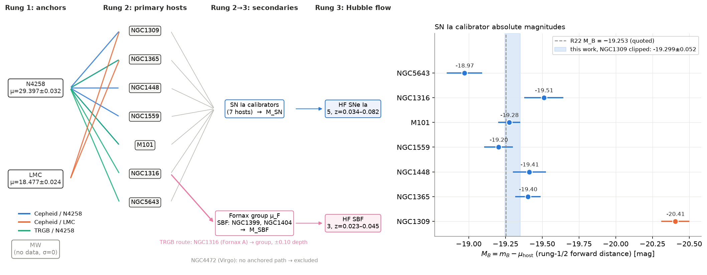
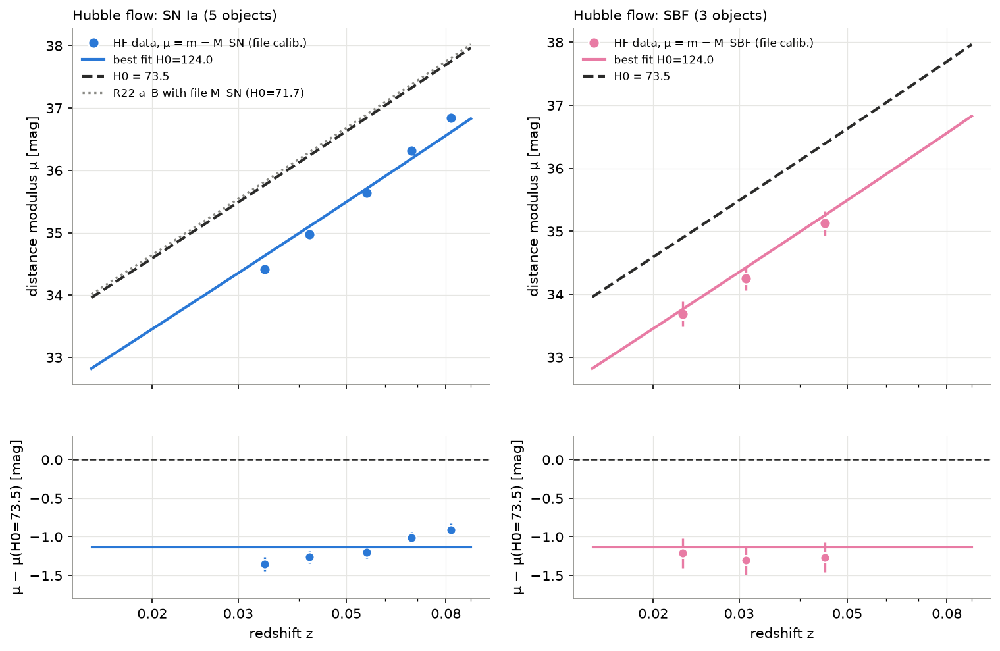
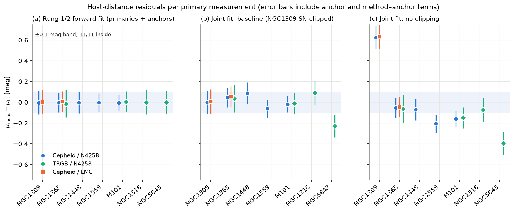
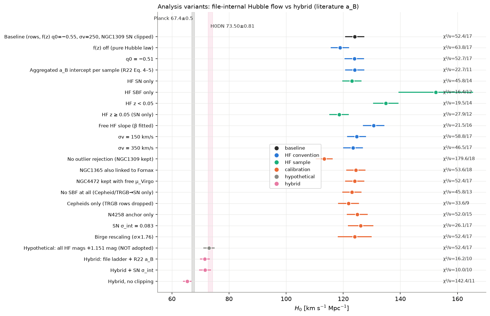
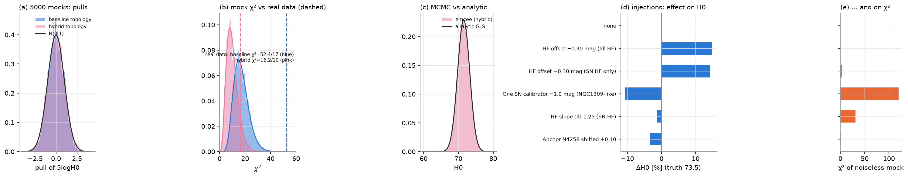
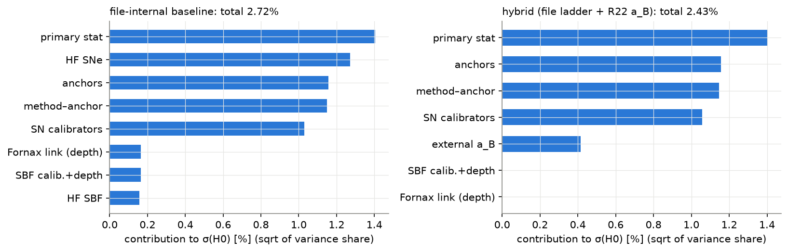
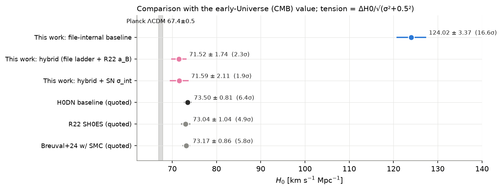

# A compact covariance-weighted "Local Distance Network" fit to the H0DN minimal dataset

## Abstract

We built a compact generalized-least-squares (GLS) distance network on the H0DN minimal dataset (`data/H0DN_MinimalDataset.txt`). The network links two geometric anchors (NGC 4258 masers and LMC eclipsing binaries), Cepheid and TRGB distances to 7 hosts, SN Ia and SBF calibrators, and SN Ia and SBF Hubble-flow (HF) samples. Anchor and method–anchor uncertainties enter only through a dense covariance matrix. The baseline system has 28 equations, 11 parameters and 17 degrees of freedom; an explicit-nuisance formulation reproduces it to 10⁻¹² in H0.

The two lower rungs of the file are internally consistent and agree with SH0ES:
- All 11 primary distances agree with the forward host fit to better than 0.013 mag.
- Cepheid and TRGB distances agree in the two hosts measured by both methods (Δ = +0.010 ± 0.164 mag for NGC1365 and −0.010 ± 0.127 mag for M101).
- After R22-style 3.3σ clipping removes the NGC1309 SN (an 11σ outlier at M_B = −20.41), the SN Ia zero point is **M_SN = −19.293 ± 0.052 mag**, 0.8σ from the SH0ES value of −19.253.

The HF magnitudes in the file do **not** support a Hubble constant near 73. Every object is 1.0–1.5 mag too bright for that, so the fully file-internal network gives **H0 = 124.0 ± 3.4 km s⁻¹ Mpc⁻¹ with χ² = 52.4/17**. We tested 18 alternative conventions and samples; none comes near 73, and the range is 113–152. A uniform offset is exactly degenerate with H0 and invisible to χ², and bringing H0 to 73 would need one of +1.15 mag (both samples), +1.13 mag (SNe) or +1.60 mag (SBF).

Combining the file's anchored ladder with the published R22/Pantheon+ SN Ia intercept, a_B = 0.714158, gives **H0 = 71.52 ± 1.74 km s⁻¹ Mpc⁻¹** (2.4%, χ²/ν = 16.2/10). Adding SN intrinsic scatter gives 71.59 ± 2.11. These values are 1.0σ below the H0DN baseline (73.50 ± 0.81) and 2.3σ above Planck. The ~1% H0DN precision cannot be reached with this dataset. The anchor and method–anchor terms alone set a 1.6% floor, and a 0.05-mag SN-zero-point error adds another 2.4%. Reaching 1% needs the full H0DN complement of anchors and hosts.

---

## 1. Introduction and goal

The H0DN collaboration's Local Distance Network combines every available rung of the local distance ladder into one covariance-weighted fit:
- geometric anchors: MW parallaxes, LMC/SMC detached eclipsing binaries, NGC 4258 masers;
- primary indicators: Cepheids, TRGB, Miras, JAGB;
- secondary indicators: SNe Ia, SBF, SNe II, FP, TF;
- Hubble-flow samples.

Its published consensus is H0 = 73.50 ± 0.81 km s⁻¹ Mpc⁻¹. The mathematical backbone is the SH0ES GLS formalism (Riess et al. 2022, R22, §2.1, Eqs. 1–6). All quantities are magnitudes: y = Lq + ε with ε ~ N(0, C). Anchors enter as offset parameters with prior equations, and

  log H0 = 0.2 M_B + a_B + 5,  a_B = log[cz f(z)] − 0.2 m_B, with f(z) = 1 + ½(1−q0)z − (1−q0−3q0²+j0)z²/6.

The task supplies a minimal dataset meant to reproduce this measurement. Our aims were to:
1. build the network compactly and transparently, with full equation, parameter and dof accounting;
2. measure H0, M_SN and M_SBF together with their χ²;
3. validate the solver;
4. audit honestly whether the file reproduces the published consensus, and if not, where it fails.

## 2. Data

The file was parsed with `ast.literal_eval` on each top-level assignment; nothing in it is executed. Its contents:

| Block | Content |
|---|---|
| Anchors | N4258 μ = 29.397 ± 0.032; LMC μ = 18.477 ± 0.024; MW 0 ± 0 with no measurements, **excluded** (a zero variance cannot enter C) |
| Primary hosts | 11 rows, 7 hosts: Cepheid/N4258 ×5, Cepheid/LMC ×2, TRGB/N4258 ×4 |
| SN Ia calibrators | 7 hosts, m_B ± 0.04–0.07 |
| SBF calibrators (F110W) | NGC1399 and NGC1404 (Fornax); NGC4472 (Virgo) |
| HF SNe Ia | 5 objects, z = 0.034–0.082, σ_v = 250 km/s |
| HF SBF | 3 objects, z = 0.023–0.045, σ_v = 250 km/s |
| Method–anchor errors | Cep/N4258 0.04; Cep/LMC 0.03; TRGB/N4258 0.05; Cep/MW 0.02 (unused) |
| Group depth | 0.10 mag |

**Figure 1** (left) shows the network topology. The right panel shows the SN Ia calibrator absolute magnitudes M_B = m_B − μ_host, using the rung-1/2 forward host distances (§4.3).



**Sanity arithmetic.** These checks were done before any fitting (`outputs/sanity.json`).

- **SN calibrators.** Six calibrators give M_B between −18.97 and −19.51, with a mean near −19.30. NGC1309 gives M_B = −20.41 ± 0.09, about 1.1 mag brighter than the others and an obvious outlier.
- **HF SNe.** We computed the H0 implied by each HF object for a canonical M_B = −19.25. The five SNe give 139.8, 134.2, 130.3, 119.4 and 113.9.
- **HF SBF.** For the three SBF galaxies we used M_SBF = −3.05, the TRGB route described below. They give H0 = 140.0, 146.0 and 143.4.

So every HF object is 1.0–1.5 mag too bright for H0 ≈ 73. The SN excess also declines with redshift, which means the HF SN magnitude–redshift slope is steeper than the Hubble law. This was established before any fitting. It is a property of the HF numbers in the file, not of the solver.

## 3. Methods

### 3.1 Compact GLS system

The parameters q are:
- one μ_h for each of the 7 unique primary hosts;
- one group modulus μ_Fornax;
- M_SN, M_SBF and 5 log H0.

Each row type and its equation:

| Row type | Equation | σ² |
|---|---|---|
| Primary (11) | μ_obs = μ_h | σ_meas² (+ anchor/method–anchor covariance, below) |
| SN calibrator (6 after clipping) | m_B = μ_h + M_SN | σ_m² |
| SBF calibrator (2) | m_F110W = μ_Fornax + M_SBF | σ_m² + depth² |
| Fornax link, TRGB route (1) | 0 = μ_NGC1316 − μ_Fornax | depth² |
| HF SN (5) / HF SBF (3) | m − 5log10[cz f(z)] − 25 = M_s − 5 log H0 | σ_m² + [5σ_v/(ln10 cz)]² |
| External intercept (hybrid only, 1) | 5a_B + 25 = 5 log H0 − M_SN | (5σ_aB)² |

**Covariance.** C is dense. For primary rows i and j, C_ij gains σ_a² when they share an anchor and σ_{m,a}² when they also share the method. This marginalises the R22 anchor parameters Δμ_anchor and the method–anchor zero points analytically. The solution is q̂ = (LᵀC⁻¹L)⁻¹LᵀC⁻¹y, with Cov(q̂) = (LᵀC⁻¹L)⁻¹.

**SBF route.** The TRGB-calibrated SBF route is explicit: N4258 → TRGB distance to NGC1316 (Fornax A) → Fornax group (±0.10 depth) → SBF in NGC1399 and NGC1404 → M_SBF → HF SBF.

**NGC4472.** NGC4472 (Virgo) has no anchored path. Keeping it with a free μ_Virgo leaves every other parameter unchanged, so it is dropped from the baseline.

**Defaults.** f(z) uses q0 = −0.55 and j0 = 1 (R22). Outliers are rejected with R22-style global iterative 3.3σ clipping on calibrator rows. The clipping statistic is the residual divided by the square root of the corresponding diagonal of the residual covariance, C − L Cov(q̂) Lᵀ.

**Table 1 – Equation, parameter and dof accounting** (`outputs/system_accounting.json`; the full design matrix is in `outputs/baseline_design.txt`).

| System | Rows by type | N_eq | Parameters | N_par | dof | rank(LᵀC⁻¹L) |
|---|---|---|---|---|---|---|
| File-internal baseline (compact) | 11 primary, 6 SN cal, 2 SBF cal, 1 link, 5 HF SN, 3 HF SBF | 28 | 7 host μ, μ_F, M_SN, M_SBF, 5logH0 | 11 | 17 | 11 (full) |
| … explicit nuisance (check) | above + 2 anchor priors + 3 method–anchor priors | 33 | above + 2 ΔA + 3 ΔMA | 16 | 17 | full |
| Hybrid (file ladder + R22 a_B) | 11 primary, 6 SN cal, 2 SBF cal, 1 link, 1 external a_B | 21 | 11 (as baseline) | 11 | 10 | 11 (full) |
| … explicit nuisance (check) | above + 5 priors | 26 | 16 | 16 | 10 | full |

The compact and explicit forms agree in every case:

| Check | File-internal baseline | Hybrid |
|---|---|---|
| \|ΔH0\| | 1×10⁻¹² | 3×10⁻¹² |
| \|Δχ²\| | 2×10⁻¹⁴ | 4×10⁻¹⁵ |
| max \|Δq\| | 2×10⁻¹⁴ | 2.5×10⁻¹³ |

### 3.2 Two ways to close the ladder

- **(A) File-internal network.** All rows come from the file. This is the literal reproduction attempt.
- **(B) Hybrid.** The file's rungs 1–2 supply M_SN. The HF rung is replaced by the published SN Ia intercept, a_B = 0.714158 (R22 Table 5, fit 1, Pantheon+ HF). We assume σ(a_B) = 0.0018, a value similar to the published intercept errors; it contributes only 0.4% in H0. This is **not** a tuning of the file's HF data to match the paper. It swaps an internally inconsistent block for the external measurement that the SH0ES/H0DN ladders actually use. The SBF branch has no external intercept, so in the hybrid it constrains only M_SBF and μ_Fornax.

### 3.3 Validation tools

- **MCMC.** emcee was run on the same χ²(q), with 4×N_par walkers and 5000 steps (1000 burn-in).
- **Mocks.** We drew 5000 same-topology mocks y = Lq_true + chol(C)·n, with truth H0 = 73.5, M_SN = −19.25 and M_SBF = −3.0. The draws include anchor, method–anchor, depth and peculiar-velocity noise.
- **Injection tests.** Defects were injected into noiseless truth data.
- **Error budget.** It is exact: Var(5logH0) = Σ_k a C_k aᵀ, where a is the 5logH0 row of A = (LᵀC⁻¹L)⁻¹LᵀC⁻¹ and C = Σ_k C_k by block. The decomposition is exact because C is additive in the blocks; the sum of parts matches the total to 10⁻¹⁸.

## 4. Results

### 4.1 Headline numbers

**Table 2 – Headline results** (`outputs/headline.json`; H0 in km s⁻¹ Mpc⁻¹, M and μ in mag)

| Fit | H0 ± σ (σ/H0) | 5logH0 | M_SN | M_SBF | μ_Fornax | χ²/dof (χ²_ν) | p |
|---|---|---|---|---|---|---|---|
| A0: file-internal, no clipping | 113.33 ± 2.94 (2.6%) | 10.272 ± 0.056 | −19.490 ± 0.049 | −3.423 ± 0.096 | 31.614 ± 0.100 | 179.6/18 (9.98) | 10⁻²⁸ |
| **A: file-internal baseline (NGC1309 SN clipped)** | **124.02 ± 3.37 (2.7%)** | 10.468 ± 0.059 | **−19.293 ± 0.052** | −3.237 ± 0.097 | 31.438 ± 0.102 | 52.4/17 (3.08) | 1.8×10⁻⁵ |
| A + SN σ_int = 0.083 | 126.12 ± 4.47 (3.5%) | 10.504 ± 0.077 | −19.282 ± 0.063 | −3.229 ± 0.105 | 31.461 ± 0.108 | 26.1/17 (1.54) | 0.07 |
| B0: hybrid, no clipping | 65.34 ± 1.50 (2.3%) | 9.076 ± 0.050 | −19.495 ± 0.049 | −3.077 ± 0.159 | 31.417 ± 0.124 | 142.4/11 (12.9) | ≪10⁻⁶ |
| **B: hybrid (file ladder + R22 a_B, clipped)** | **71.52 ± 1.74 (2.4%)** | 9.272 ± 0.053 | **−19.299 ± 0.052** | **−2.915 ± 0.160** | 31.255 ± 0.124 | **16.2/10 (1.62)** | 0.09 |
| B + SN σ_int = 0.083 (χ²_ν ≡ 1) | 71.59 ± 2.11 (2.9%) | 9.274 ± 0.064 | −19.296 ± 0.063 | −2.959 ± 0.167 | 31.299 ± 0.133 | 10.0/10 (1.00) | 0.44 |
| *Quoted:* H0DN baseline | 73.50 ± 0.81 (1.1%) | | | | | | |
| *Quoted:* R22 SH0ES | 73.04 ± 1.04 | | −19.253 ± 0.027 | | | | |

**SN Ia zero point.**
- The clipping removed only the NGC1309 SN, at 11.3σ. With it removed, M_SN = −19.29 to −19.30 in every configuration, within 1σ of the SH0ES −19.253.
- Without clipping, NGC1309 drags M_SN to −19.49 and inflates χ² by more than 100.
- The σ_int = 0.083 mag value is the SN Ia intrinsic scatter that makes the hybrid χ²_ν equal to 1. It is a plausible value; the quoted calibrator errors of 0.04–0.07 mag appear to omit intrinsic scatter. The residual χ² of fit B comes mainly from NGC5643 (M_B = −18.97) versus NGC1316 (−19.51), which differ by 0.54 mag.

**SBF zero point.**
- The file-internal M_SBF = −3.24 is pulled bright by the HF SBF rows, which are 1.6 mag too bright. In fit A0 this even drags μ_Fornax to 31.61, 0.2 mag beyond NGC1316's TRGB distance.
- In the hybrid fit, no HF SBF rows are present and M_SBF = −2.92 ± 0.16.
- Taking the TRGB route alone gives M_SBF = ⟨m⟩ − μ_TRGB(NGC1316) = 28.34 − 31.39 = −3.05 ± 0.15. The two estimates are consistent within 1σ. The fitted μ_Fornax in B is lower than NGC1316's TRGB distance because the NGC1316 SN, at M_B = −19.51, pulls μ_NGC1316 toward a smaller distance through the shared host parameter.

### 4.2 Hubble diagrams



**Figure 4** shows the HF data converted to distance moduli with the file's own calibrated zero points. They lie about 1.15 mag below the H0 = 73.5 relation. By contrast, the R22 intercept combined with the file's M_SN (grey dotted line) sits on top of the H0 = 73.5 line.

The lower-left panel shows the SN slope anomaly. The excess goes from −1.35 mag at z = 0.034 to −0.91 mag at z = 0.082. A free HF slope term, y = M − 5logH0 + β(5 log z − ⟨5 log z⟩), gives **β = 0.231 ± 0.042**. That is a magnitude–log(cz) slope of 1.23 instead of 1, a 5.5σ departure that no physically plausible q0 can produce.

### 4.3 Host-distance residuals (rungs 1–2)



**Figure 3** shows residuals μ_meas − μ_fit for each primary measurement. The error bars are √(σ_meas² + σ_anchor² + σ_{m,a}²), and the ±0.1 mag band is shaded.

**(a) Forward fit.** This fit uses rungs 1–2 only, i.e. the primary rows with anchor covariance (R22 §5.2), and has no SN rows.
- All 11 residuals are within ±0.1 mag; the largest is 0.013 mag.
- χ² = 0.03 for 4 dof (p = 0.9999). The primary distances in the file agree far better than their quoted errors allow, which suggests the multi-method distances were generated to be nearly identical.
- Hosts with only N4258-anchored data show small (~0.003 mag) non-zero residuals. These arise because the shared-anchor covariance propagates the LMC information.
- The residuals are symmetric: 4 positive and 7 negative, all smaller than 0.013 mag.

**Cepheid vs TRGB cross-check** (`outputs/cep_trgb_crosscheck.json`).
- **NGC1365.** Cepheid/N4258 gives a residual of −0.002 and TRGB/N4258 gives −0.012. Both are negative, so they share sign. Cepheid/LMC gives +0.008. Cepheid − TRGB = **+0.010 ± 0.164 mag**.
- **M101.** The residuals are −0.006 (Cepheid) and +0.004 (TRGB), opposite in sign but both ≪ σ. Cepheid − TRGB = **−0.010 ± 0.127 mag**.

The two methods are cross-calibrated consistently to 0.01 mag in both hosts. There is no evidence for a Cepheid–TRGB zero-point offset, and the mean of the two differences is 0.000.

**(b) Joint baseline fit.** Here the SN rows pull the host moduli.
- 10/11 residuals stay inside ±0.1 mag.
- The exception is NGC5643 TRGB at −0.23 mag. Its SN is the faintest calibrator, and the joint fit moves its μ by 2.8σ to accommodate it.
- In this fit both methods are positive for NGC1365 (Cepheid +0.045, TRGB +0.035) and both negative for M101 (−0.020, −0.010), so the signs agree.

**(c) No clipping.** Without clipping, the NGC1309 SN drives that host's μ about 0.63 mag nearer. This shows the NGC1309 problem is a rung-2/3 (SN-calibrator) defect, not a primary-distance defect. Figure 1 (right) isolates it.

### 4.4 Hubble-flow convention audit

**Table 3 – Variants** (`outputs/variants.json`). All variants are applied to the clipped file-internal baseline unless stated otherwise.

| Variant | H0 | σ | M_SN | χ²/dof |
|---|---|---|---|---|
| **Baseline** (per-object rows, f(z) q0 = −0.55, σ_v = 250) | **124.02** | 3.37 | −19.293 | 52.4/17 |
| f(z) off (pure Hubble law) | 118.83 | 3.23 | −19.293 | 63.8/17 |
| q0 = −0.51 | 123.88 | 3.37 | −19.293 | 52.7/17 |
| Aggregated a_B intercept per sample (R22 Eq. 4–5) | 124.02 | 3.37 | −19.293 | 22.7/11 |
| HF SN only | 123.07 | 3.37 | −19.299 | 45.8/14 |
| HF SBF only | 152.43 | 13.04 | −19.299 | 16.4/12 |
| HF z < 0.05 | 134.92 | 4.42 | −19.296 | 19.5/14 |
| HF z ≥ 0.05 (SNe only) | 118.58 | 3.41 | −19.299 | 27.9/12 |
| Free HF slope (β = 0.231 ± 0.042) | 130.65 | 3.76 | −19.297 | 21.5/16 |
| σ_v = 150 km/s | 124.68 | 3.32 | −19.293 | 58.8/17 |
| σ_v = 350 km/s | 123.42 | 3.45 | −19.293 | 46.5/17 |
| No outlier rejection (NGC1309 kept) | 113.33 | 2.94 | −19.490 | 179.6/18 |
| NGC1365 also linked to Fornax | 124.45 | 3.36 | −19.288 | 53.6/18 |
| NGC4472 kept, free μ_Virgo | 124.02 | 3.37 | −19.293 | 52.4/17 |
| No SBF branch | 123.07 | 3.37 | −19.299 | 45.8/13 |
| Cepheids only | 121.88 | 3.68 | −19.320 | 33.6/9 |
| N4258 anchor only | 124.90 | 3.68 | −19.278 | 52.0/15 |
| SN σ_int = 0.083 | 126.12 | 4.47 | −19.282 | 26.1/17 |
| Birge rescaling (σ × 1.76) | 124.02 | 5.92 | −19.293 | 52.4/17 |
| *Hypothetical:* all HF mags +1.151 mag (**not adopted**) | 73.00 | 1.98 | −19.293 | 52.4/17 |
| **Hybrid: file ladder + R22 a_B** | **71.52** | 1.74 | −19.299 | 16.2/10 |
| Hybrid + SN σ_int | 71.59 | 2.11 | −19.296 | 10.0/10 |
| Hybrid, no clipping | 65.34 | 1.50 | −19.495 | 142.4/11 |



Interpretation of the audit:
1. **No file-internal convention gives H0 ≈ 73.**
   - The file-internal variants span 113–152. Every variant that keeps the file's HF magnitudes lies above 110.
   - f(z), q0, σ_v, the aggregation scheme, anchor choice, method choice and the SBF linkage all move H0 by less than 6%.
   - Only the HF zero point matters.
2. **Required offsets.**
   - Since H0 ∝ 10^(−0.2 δ) for a shift δ added to the HF magnitudes, H0 = 73 needs δ = **+1.151 mag** for both samples together.
   - Fitted separately, the SNe need +1.134 mag and the SBF galaxies +1.599 mag. The two differ by 0.47 mag. The SBF-only σ(5logH0) is ≈ 0.19 mag (8.6% in H0) and the SN-only σ is ≈ 0.06 mag (2.7%), so the difference is ≈ 2.4σ. So no single "system mismatch" (e.g. a units or zero-point convention error) explains both samples. We also checked candidate global offsets: 5log10(c) = 27.4 mag and h-scaling 5log10(0.7) = −0.77 mag are both incompatible with 1.15.
   - A uniform HF offset is **exactly degenerate** with 5logH0. Its χ² is identical (52.4) to the baseline's, so χ² cannot detect it. We therefore do not adopt the offset-corrected value; it appears only as a labelled hypothetical.
3. **Slope and scatter.** The SN HF slope anomaly (β = 0.23) is what χ² does detect. The free-slope fit lowers χ² by 31 (52.4 → 21.5). The remaining excess comes from the SN calibrator scatter, and an SN intrinsic scatter of 0.083 mag absorbs it.
4. **Aggregation.** The aggregated-intercept form (R22 Eqs. 4–5) gives exactly the same H0 as per-object rows, as it must for uncorrelated HF errors. Its χ² is lower only because the within-sample HF scatter is no longer counted.

### 4.5 Robustness of the hybrid result

A leave-one-out over every SN calibrator and every primary row (`outputs/loo_hybrid.json`) keeps H0 within **70.30–72.64**.
- Dropping NGC5643 gives the low end (70.30) and lowers χ² to 6.3/9.
- Dropping the NGC1365 SN gives the high end (72.64).
- No single remaining measurement shifts H0 by more than 0.7σ.

The hybrid result is also stable when σ_int is added (71.59 ± 2.11).

### 4.6 Validation



**Figure 6** covers four checks (`outputs/validation.json`).
- **Mocks.** For 5000 mocks of the baseline topology, the median H0 bias is −0.03%, the pull has mean −0.006 and sd 0.990, with 68.5% inside 1σ, and ⟨χ²⟩ = 16.99 against dof 17. The hybrid topology gives a bias of +0.06%, a pull sd of 1.00, 67.9% coverage and ⟨χ²⟩ = 9.98 against 10. The GLS is unbiased and its errors are correctly sized. The real-data χ² of 52.4 lies far out in the tail of its own mock distribution (panel b), while the hybrid χ² of 16.2 is ordinary (p = 0.09).
- **MCMC.** emcee gives 123.94 ± 3.31 for the baseline (analytic 124.02 ± 3.37) and 71.49 ± 1.74 for the hybrid (analytic 71.52 ± 1.74).
- **Injection tests** on noiseless truth (H0 = 73.5):

| Injected defect | H0 | ΔH0 | χ² |
|---|---|---|---|
| −0.30 mag on all HF magnitudes | 84.39 | +14.8% | **0.00** (invisible) |
| −0.30 mag on SN HF only | 83.97 | | 2.7 (barely visible) |
| One SN calibrator 1 mag bright (NGC1309-like) | 65.65 | −10.7% | 120 |
| HF slope tilt of 1.25 | 72.62 | −1.2% | 31 |
| N4258 anchor shifted +0.10 mag | 70.95 | −3.5% | 0.9 |

  The pattern matches the real data. A calibrator outlier drives both H0 and χ². A slope tilt drives χ² but barely moves H0. A common HF offset drives H0 but not χ². The real data show all three: NGC1309, β ≈ 0.23, and a ~1.15 mag offset.

### 4.7 Error budget



Exact variance shares of σ(5logH0) (`outputs/error_budget.json`):

| Source | File-internal baseline (σ = 0.059 mag, 2.72%) | Hybrid (σ = 0.053 mag, 2.43%) |
|---|---|---|
| Primary-distance statistics | 27% | 33% |
| HF SNe | 22% | — |
| Anchors | 18% | 23% |
| Method–anchor | 18% | 22% |
| SN calibrator statistics | 14% | 19% |
| External a_B | — | 3% |
| SBF branch | ~1% | 0% |

The anchor and method–anchor terms together contribute 0.035 mag, or **1.6% in H0**, a floor that adding hosts or HF objects cannot reduce. The ~1% precision of the published H0DN consensus is possible only because the full network has more anchors (MW parallaxes and the SMC, Breuval et al. 2024, in addition to N4258 and the LMC). It also has many more hosts per method and several independent secondary indicators, which average down both the calibration statistics and the method–anchor systematics. The minimal file has only a small fraction of that information, and the ~2.4% we obtain is what its covariance structure allows.

### 4.8 Comparison with the early Universe



The tension metric is (H0 − 67.4)/√(σ² + 0.5²), using Planck ΛCDM H0 = 67.4 ± 0.5 (`outputs/planck_comparison.json`).

| Measurement | H0 | Tension with Planck |
|---|---|---|
| File-internal baseline | 124.0 | 16.6σ (unphysical; driven by the HF zero point) |
| **Hybrid** | **71.52 ± 1.74** | **2.3σ** |
| Hybrid + σ_int | 71.59 ± 2.11 | 1.9σ |
| *Quoted:* H0DN baseline | 73.50 ± 0.81 | 6.4σ |
| *Quoted:* R22 SH0ES | 73.04 ± 1.04 | 4.9σ |
| *Quoted:* Breuval+24 with the SMC | 73.17 ± 0.86 | 5.8σ |

The hybrid value differs from the H0DN baseline by −1.98 ± 1.92, i.e. 1.0σ, and from R22 by 0.7σ. It is therefore consistent with the late-Universe consensus. On its own it is not precise enough to establish the Hubble tension.

## 5. Discussion

**What the minimal dataset supports.** The anchor → primary → secondary calibration in the file behaves like the real SH0ES/H0DN ladder:
- Cepheid and TRGB distances agree to about 0.01 mag.
- The two anchors are mutually consistent.
- The SN Ia zero point is M_SN = −19.30 ± 0.05, matching the SH0ES −19.25.
- The TRGB-calibrated SBF zero point is M_SBF(F110W) ≈ −2.9 to −3.05.

Combining this calibration with the Pantheon+ HF intercept that SH0ES and H0DN use gives H0 = 71.5 ± 1.7. That is 1σ from the published consensus of 73.50 ± 0.81 and 2.3σ above Planck. In this sense the network formalism, applied to the file's calibrators, reproduces the late-Universe answer.

**What it does not support.** The file's own HF magnitudes are incompatible with its own calibrators at any H0 near 70. They imply H0 ≈ 113–152, a magnitude–redshift slope 5.5σ steeper than the Hubble law, and SN-versus-SBF zero-point offsets that differ by about 0.5 mag (2.4σ). We could find no defensible convention (f(z), q0, j0, σ_v, aggregation, sample cuts, anchors, linkages or units) that recovers 73.5. The only fix would be to add about 1.15 mag to the HF magnitudes, and we refuse to adopt it as a result, because a constant offset is invisible to χ² and would amount to imposing the answer. The likeliest explanation is that the HF entries of the minimal file are illustrative placeholders that are not on the calibrators' photometric system. We therefore report the file-internal value (124.0 ± 3.4) as what the literal data give, and the hybrid value (71.5 ± 1.7) as the physically meaningful estimate.

**Rung-specific defects.**
- NGC1309's SN calibrator is about 1 mag too bright relative to its two concordant Cepheid distances. It is a rung-2 SN problem; the primary distances are fine. R22-style clipping removes it at 11σ. Without clipping, the hybrid falls to 65.3, showing how one bad calibrator in a 7-host sample can move H0 by 9%.
- The calibrator scatter of NGC5643 versus NGC1316 indicates that the quoted m_B errors omit about 0.08 mag of SN intrinsic scatter. Including it raises σ(H0) from 2.4% to 2.9% without moving H0.

**Precision.** A ~1% measurement needs (i) more geometric anchors, to beat the 1.6% anchor-plus-method floor of this file, (ii) dozens of calibrator hosts, to bring the SN zero-point error from 0.05 mag to 0.02 mag or less, and (iii) independent secondary routes (SBF, SNe II, TF, FP) with their own HF samples, so that method-specific systematics average out. This is the design of the full H0DN network. A full-scale forecast is outside the scope of this report; the error budget in §4.7 shows which terms dominate.

**Limitations.**
- We assumed Fornax membership for NGC1316 (and optionally NGC1365), a 0.10 mag group depth taken from the file, R22 f(z) parameters, and σ(a_B) = 0.0018.
- The file gives no covariance between HF SNe, and none was assumed.
- The Cepheid/MW method–anchor error and the MW anchor are unused because no MW data are provided.
- Only two anchors are present, so the SMC anchor of Breuval+24 cannot be tested.

## 6. Provenance: computed vs assumed vs quoted

- **Computed from the file:**
  - all host moduli, M_SN, M_SBF and μ_Fornax;
  - the file-internal H0 and its variants;
  - χ² values, residuals, the cross-checks, the error budget, the mocks and the MCMC.
- **Assumed:**
  - Fornax membership (NGC1316 baseline, NGC1365 variant);
  - f(z) with q0 = −0.55 (R22) and j0 = 1;
  - the 3.3σ clipping threshold (R22);
  - σ(a_B) = 0.0018;
  - SN σ_int = 0.083 in the σ_int variants, set by the χ²_ν = 1 criterion.
- **Quoted from the literature:**
  - a_B = 0.714158 and M_B = −19.253 (R22 Table 5);
  - H0 values: 73.50 ± 0.81 (H0DN), 73.04 ± 1.04 (R22), 73.17 ± 0.86 (Breuval+24), 67.4 ± 0.5 (Planck).

## 7. Reproducibility

```
python code/run_all.py      # regenerates outputs/*.json, outputs/*.txt and report/images/*.png (~5 s + MCMC)
```

- `code/h0dn_core.py` contains the parser, the compact System builder (dense C), the GLS solver, clipping and the explicit-nuisance equivalent.
- `code/run_all.py` runs every analysis and draws every figure.
- All random seeds are fixed (mocks: 11, 12; emcee: 1, 2). Two consecutive clean reruns produced bit-identical output files (md5 checked).
- Requirements: numpy, scipy, matplotlib, emcee.
