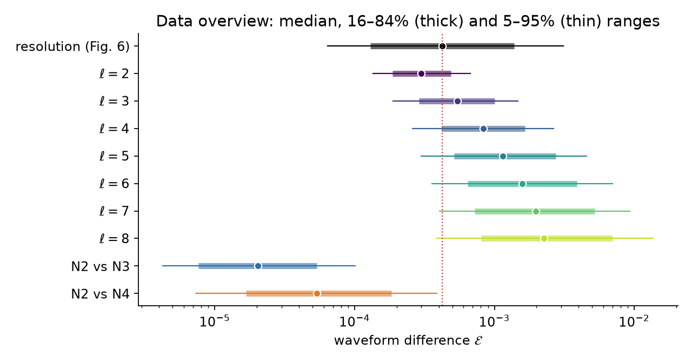
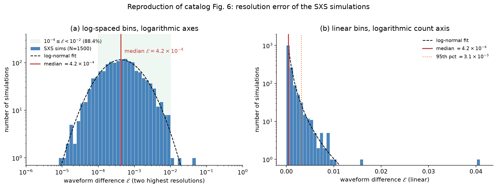
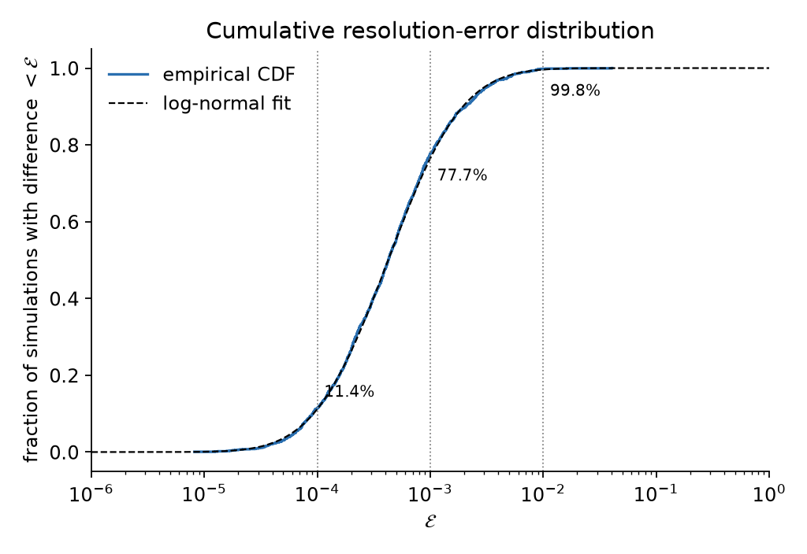
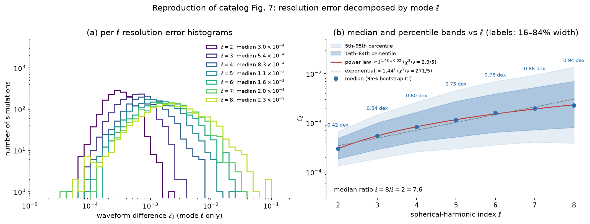
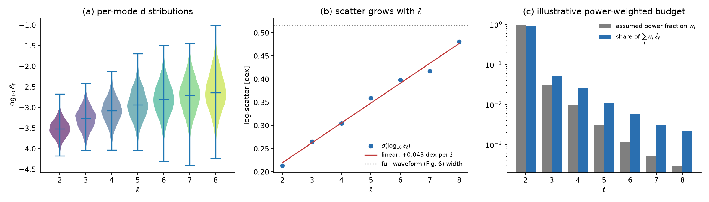
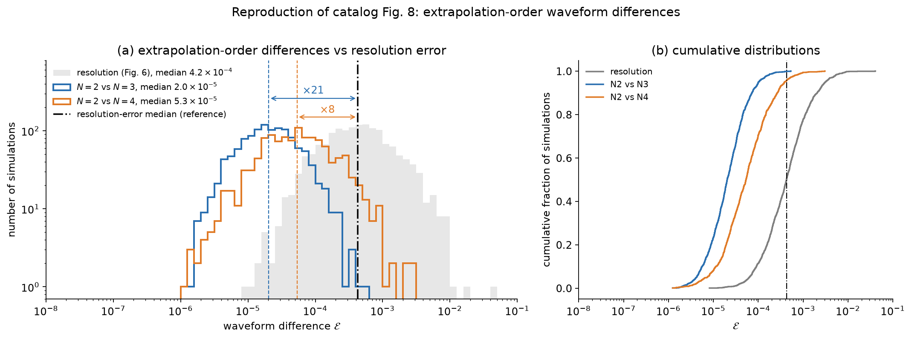
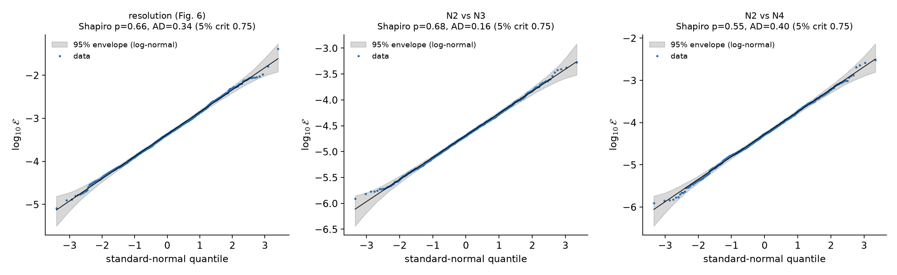
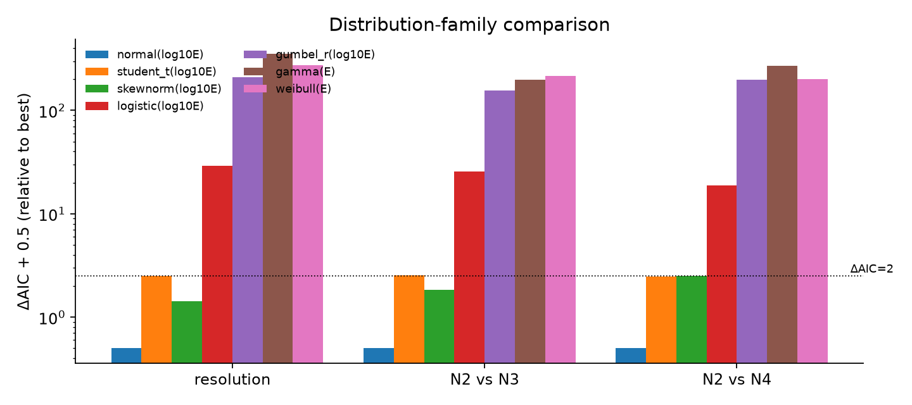
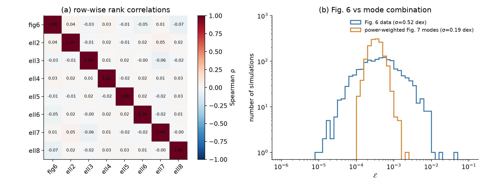

# Numerical Accuracy of an SXS-Style Binary-Black-Hole Waveform Catalog: Resolution, Per-Mode and Extrapolation Error Distributions

## Abstract

We study the numerical uncertainty of a catalog of binary-black-hole (BBH) numerical-relativity (NR) simulations in the style of the SXS collaboration's third catalog. The data are three catalog-scale samples of the waveform difference 𝓔 (an L²-norm mismatch-like quantity, computed after minimal time/phase alignment):

- the difference between the two highest resolutions (N = 1500);
- the same difference split by spherical-harmonic index ℓ = 2–8 (N = 1500);
- differences between waveform-extrapolation orders N = 2 vs 3 and N = 2 vs 4 (N = 1200).

We reproduce the three catalog figures as count histograms (number of simulations on a logarithmic axis) and test them statistically. The three headline results are:

1. **Resolution error (Fig. 6).** The median is **𝓔 = 4.25 × 10⁻⁴** (95% CI 3.95–4.56 × 10⁻⁴). 77.7% of simulations have 𝓔 < 10⁻³, 99.8% have 𝓔 < 10⁻², and 88.4% fall in the band 10⁻⁴ ≤ 𝓔 < 10⁻². The distribution is log-normal to high accuracy (σ = 0.52 dex; Shapiro–Wilk p = 0.66). The largest value is 4.1 × 10⁻², not the ~0.5 quoted in the task description.
2. **Per-mode error (Fig. 7).** The median error rises monotonically from 3.0 × 10⁻⁴ (ℓ = 2) to 2.3 × 10⁻³ (ℓ = 8), a factor of 7.6. The rise follows a power law, 𝓔̃_ℓ ∝ ℓ^(1.48 ± 0.02) (χ² = 2.9 for 5 degrees of freedom); an exponential in ℓ is rejected (χ² = 271). The log-scatter grows by about 0.043 dex per ℓ, and the 16th–84th percentile band widens from 0.42 dex to 0.94 dex. Because ℓ = 2 carries almost all of the radiated power, the full-waveform error is dominated by ℓ = 2.
3. **Extrapolation error (Fig. 8).** The medians are 2.0 × 10⁻⁵ (N2 vs N3) and 5.3 × 10⁻⁵ (N2 vs N4). These are **21×** and **8×** smaller than the resolution-error median. Extrapolation error is therefore about an order of magnitude below the resolution error, so the default N = 2 extrapolation does not limit catalog accuracy.

## 1. Background

The SXS catalog provides strain *h* and Weyl-scalar Ψ₄ waveforms, horizon quantities and metadata for BBH systems that span mass ratio, spins and eccentricity. Its uses include:

- template building and calibration of waveform models, e.g. NRSur7dq4 [Varma+ 2019, `related_work/paper_002.pdf`] and NRSur2dq1Ecc [Islam+ 2021, `paper_003.pdf`];
- ringdown and nonlinear-QNM studies [Mitman+ 2023, `paper_001.pdf`], which depend on center-of-mass-corrected waveforms [Woodford+ 2019, `paper_000.pdf`].

The usefulness of the catalog depends on its numerical error. The standard estimator compares each simulation with the same run at lower resolution:

𝓔(h₁, h₂) = ½ Σ_ℓm ∫|h₁^ℓm − h₂^ℓm|² dt / Σ_ℓm ∫|h₁^ℓm|² dt,

minimised over a time shift and a phase/frame rotation. For small differences this approximately equals the unfaithfulness 1 − 𝓞 under a white-noise inner product. For a detector with SNR ρ, waveform systematics are indistinguishable from noise when 𝓔 ≲ 1/(2ρ²). That relation is the operational definition of "accurate enough".

Two caveats apply to this estimator:

- A resolution difference measures the error of the *lower* resolution. It is therefore a conservative (upper-bound-like) estimate for the highest resolution.
- Varma+ 2019 note that the high tail of such distributions comes mainly from small mismatches in the junk-radiation-perturbed remnant parameters (e.g. spins) between resolutions, rather than from poor convergence.

## 2. Data overview

| File | Rows | Columns | NaN / ≤0 | min | median | max |
|---|---|---|---|---|---|---|
| `fig6_data.csv` | 1500 | `waveform_difference` | 0 / 0 | 8.2 × 10⁻⁶ | 4.25 × 10⁻⁴ | 4.07 × 10⁻² |
| `fig7_data.csv` | 1500 | `ell2` … `ell8` | 0 / 0 | see Table 2 | 3.0 × 10⁻⁴ → 2.3 × 10⁻³ | ≈ 0.1 (ℓ = 8) |
| `fig8_data.csv` | 1200 | `N2vsN3`, `N2vsN4` | 0 / 0 | 1.2 × 10⁻⁶ | 2.0 × 10⁻⁵ / 5.3 × 10⁻⁵ | 5.3 × 10⁻⁴ / 3.1 × 10⁻³ |



*Figure 1. Every error source on a common axis. Dots are medians, thick bars span the 16th–84th percentiles and thin bars span the 5th–95th. The dotted red line marks the resolution-error median.*

**Discrepancies with the task description.**

- The task text says the fig6 sample "spans roughly 10⁻⁶ to 0.5". The observed range is 8.2 × 10⁻⁶ to 4.1 × 10⁻².
- Under the fitted log-normal, the probability that any of the 1500 draws reaches 𝓔 ≥ 0.5 is 2 × 10⁻⁶. The quoted upper limit therefore does not describe this sample. It may describe the real catalog's extreme outliers, or it may be the bound of a plotting axis.
- All other described properties are confirmed: the ~4 × 10⁻⁴ median, the medians rising with ℓ, and the extrapolation medians of 2 × 10⁻⁵ and 5 × 10⁻⁵.

## 3. Methods

All numbers are recomputed from the CSVs by `code/analysis.py` and written to `outputs/summary.json`. The script uses fixed seeds; the full pipeline runs in about 25 s.

- **Descriptive statistics.** We compute percentiles (5, 16, 50, 84, 95, 99), the moments of log₁₀𝓔, and the threshold fractions. Uncertainties come from 5000-sample nonparametric bootstrap CIs on the median, the 95th percentile and each threshold fraction.
- **Distribution families.** We fit five families to log₁₀𝓔 by maximum likelihood: normal (= log-normal in 𝓔), Student-t, skew-normal, logistic and Gumbel. We also fit gamma and Weibull distributions directly to 𝓔. All likelihoods are transformed to 𝓔-space so that AIC values are comparable across families. Goodness of fit is checked with KS, Shapiro–Wilk, Anderson–Darling and D'Agostino tests, and with Q–Q plots that carry 95% envelopes from 2000 simulated log-normal samples.
- **Tail check.** We compare the observed maximum with the distribution of the maximum of N draws from the fitted log-normal (20 000 Monte-Carlo replicas).
- **Mode dependence.** We fit log₁₀ median(𝓔_ℓ) with two models: a power law (linear in log ℓ) and an exponential (linear in ℓ). Both are weighted least-squares fits using bootstrap standard errors. We compare them by χ². We also test ordering between successive ℓ (one-sided Mann–Whitney) and equality of scatter across ℓ (Levene test on log₁₀𝓔).
- **Extrapolation.** We compute the ratio of medians, bootstrapped, and test N2vsN4 > N2vsN3 both unpaired and paired. We also compute population-level probabilities that an extrapolation error exceeds a resolution error.
- **Figures.** `code/figures.py` draws all catalog-style figures as *count* histograms with a log-scaled count axis. Bins are log-spaced in 𝓔 on a log x-axis; a linear-x variant of Fig. 6 is included as well.

## 4. Reproduction of catalog Fig. 6: overall resolution error



*Figure 2. Distribution of the waveform difference between the two highest resolutions for 1500 simulations.*

- *(a)* Log-spaced bins (10 per decade) on a log x-axis, with simulation counts on a log axis. The dashed curve is the fitted log-normal scaled to counts. The red line is the median (4.2 × 10⁻⁴). The shaded band 10⁻⁴ ≤ 𝓔 < 10⁻² contains 88.4% of simulations.
- *(b)* The same data with linear bins and a log count axis. It shows the long tail toward large 𝓔 and marks the 95th percentile (3.1 × 10⁻³).



*Figure 3. Cumulative distribution of the resolution error, with the threshold fractions marked.*

**Table 1. Resolution-error summary.** 95% bootstrap CIs are in brackets.

| Statistic | Value |
|---|---|
| median 𝓔 | 4.25 × 10⁻⁴ [3.95, 4.56] × 10⁻⁴ |
| mean 𝓔 | 8.7 × 10⁻⁴ (pulled up by the tail) |
| 16th / 84th percentile | 1.30 × 10⁻⁴ / 1.38 × 10⁻³ |
| 5th / 95th / 99th percentile | 6.4 × 10⁻⁵ / 3.1 × 10⁻³ [2.8, 3.6] × 10⁻³ / 7.2 × 10⁻³ |
| log₁₀𝓔 mean, σ, skew, excess kurtosis | −3.37, 0.516 dex, 0.07, −0.01 |
| fraction 𝓔 < 10⁻⁴ | 11.4% [9.8, 13.1] |
| fraction 10⁻⁴ ≤ 𝓔 < 10⁻² | 88.4% |
| fraction 𝓔 < 10⁻³ | 77.7% [75.6, 79.9] |
| fraction 𝓔 < 10⁻² | 99.8% [99.5, 100] |
| max (observed) | 4.07 × 10⁻² |
| max expected for 1500 log-normal draws | 2.2 × 10⁻² (95% range 1.2–5.8 × 10⁻²); one-sided p = 0.09 |

**Conclusion (Fig. 6).** The typical resolution error is a few × 10⁻⁴, and almost the whole catalog (99.8%) lies below 10⁻². The distribution is a clean log-normal: log-normal has the lowest AIC of all families tested, and the skew and excess kurtosis of log₁₀𝓔 are both ≈ 0 (Section 7). The large-𝓔 tail is therefore the natural wing of a 0.5-dex-wide log-normal, not a separate population of failed runs. Even the largest value (4 × 10⁻²) is consistent with the expected maximum of 1500 draws (p = 0.09).

In the flat-noise approximation ρ_crit = 1/√(2𝓔), the median simulation stays indistinguishable from the true waveform up to ρ ≈ 34, and the 95th-percentile simulation up to ρ ≈ 13. This range covers the bulk of current LIGO–Virgo–KAGRA detections. **Most simulations are accurate enough for current detectors.** For high-SNR events (ρ ≳ 100, which 3% of simulations satisfy) and for next-generation detectors, the resolution error would need to drop by roughly an order of magnitude.

## 5. Reproduction of catalog Fig. 7: resolution error by spherical-harmonic mode ℓ



*Figure 4. Per-mode resolution error.*

- *(a)* Count histograms (log axes) of 𝓔_ℓ for ℓ = 2–8; the legend gives the numeric medians.
- *(b)* The median, with 95% bootstrap CIs, plotted against ℓ. The dark band spans the 16th–84th percentiles and the light band the 5th–95th. The number above each ℓ is the width of its 16–84% band in dex.
- The red curve is the weighted power-law fit and the dashed grey curve is the rejected exponential.

**Table 2. Per-mode statistics** (`outputs/fig7_per_ell_stats.csv`).

| ℓ | median 𝓔_ℓ [95% CI] | 16th–84th pct | 5th–95th pct | σ(log₁₀) [dex] | 16–84% width [dex] | Shapiro p |
|---|---|---|---|---|---|---|
| 2 | 3.00 × 10⁻⁴ [2.91, 3.11] | 1.87 × 10⁻⁴ – 4.86 × 10⁻⁴ | 1.35 × 10⁻⁴ – 6.7 × 10⁻⁴ | 0.214 | 0.42 | 0.51 |
| 3 | 5.44 × 10⁻⁴ [5.23, 5.68] | 2.90 × 10⁻⁴ – 1.00 × 10⁻³ | 1.88 × 10⁻⁴ – 1.47 × 10⁻³ | 0.265 | 0.54 | 0.32 |
| 4 | 8.34 × 10⁻⁴ [7.98, 8.61] | 4.19 × 10⁻⁴ – 1.65 × 10⁻³ | 2.60 × 10⁻⁴ – 2.64 × 10⁻³ | 0.305 | 0.60 | 0.43 |
| 5 | 1.15 × 10⁻³ [1.10, 1.20] | 5.16 × 10⁻⁴ – 2.75 × 10⁻³ | 2.98 × 10⁻⁴ – 4.58 × 10⁻³ | 0.359 | 0.73 | 0.76 |
| 6 | 1.58 × 10⁻³ [1.50, 1.69] | 6.46 × 10⁻⁴ – 3.89 × 10⁻³ | 3.57 × 10⁻⁴ – 6.97 × 10⁻³ | 0.398 | 0.78 | 0.49 |
| 7 | 1.97 × 10⁻³ [1.84, 2.10] | 7.24 × 10⁻⁴ – 5.23 × 10⁻³ | 4.07 × 10⁻⁴ – 9.33 × 10⁻³ | 0.417 | 0.86 | 0.61 |
| 8 | 2.27 × 10⁻³ [2.15, 2.43] | 8.04 × 10⁻⁴ – 7.00 × 10⁻³ | 3.86 × 10⁻⁴ – 1.37 × 10⁻² | 0.481 | 0.94 | 0.17 |

For ℓ = 2–7 the CIs are in units of 10⁻⁴ (ℓ = 2–4) or 10⁻³ (ℓ = 5–7), matching the median's unit.

**Trend fits.**

- **Power law:** median 𝓔_ℓ = 1.07 × 10⁻⁴ ℓ^(1.48 ± 0.02). χ² = 2.9 for 5 degrees of freedom, p = 0.72.
- **Exponential:** median ∝ 1.44^ℓ. χ² = 271 for 5 degrees of freedom, p ≈ 10⁻⁵⁶, so it is rejected. The exponential overshoots at ℓ = 2 and ℓ = 8 because the growth slows down at high ℓ.
- **Ordering:** every successive pair is ordered, 𝓔_{ℓ+1} > 𝓔_ℓ (one-sided Mann–Whitney p from 10⁻¹⁴³ for 3 > 2 to 4 × 10⁻⁶ for 8 > 7).
- **Scatter:** the scatter differs significantly across ℓ (Levene p ≈ 10⁻²⁰⁹). It grows linearly at +0.043 dex per ℓ (Fig. 5b).
- **Distribution shape:** every mode is individually consistent with a log-normal (Shapiro p ≥ 0.17).



*Figure 5. (a) Violin plots of log₁₀𝓔_ℓ. (b) Log-scatter against ℓ with a linear fit; the dotted line is the width of the full-waveform (Fig. 6) distribution. (c) An illustrative power-weighted error budget using assumed mode power fractions (see Section 8).*

**Conclusion (Fig. 7).** Errors grow systematically with ℓ: the median rises about 7.6× from ℓ = 2 to ℓ = 8, and the simulation-to-simulation scatter more than doubles (the 16–84% band widens from 0.42 to 0.94 dex). This is expected physically. Higher multipoles have shorter angular and temporal scales, so they are less well resolved by the extraction-sphere grid and the evolution, and they are more sensitive to small errors in the remnant parameters and the alignment.

Higher modes, however, carry only a small fraction of the radiated power. For comparable-mass binaries (2,2) dominates, and modes with ℓ ≥ 3 carry ≲ 5% for most configurations. The full-waveform 𝓔 is a power-weighted sum of the modal errors, so **full-waveform accuracy is dominated by the ℓ = 2 error**. With illustrative power fractions, ℓ = 2 contributes about 90% of the combined error. This has two consequences for multi-mode surrogate or phenomenological models:

- ℓ ≥ 5 modes should be given correspondingly larger (ℓ-dependent) error tolerances, or down-weighted in the fit.
- Truncating at ℓ_max ≈ 4–5 discards less power than the ℓ = 2 resolution error itself, at least for comparable-mass, face-on-ish systems. Asymmetric and edge-on systems need more modes.

## 6. Reproduction of catalog Fig. 8: extrapolation-order differences



*Figure 6. (a) Count histograms (log axes) of the waveform differences between extrapolation orders N = 2 and 3 (blue) and N = 2 and 4 (orange). Dashed lines mark their medians (given in the legend), and the grey filled histogram shows the resolution error from Fig. 6. The dash-dotted black line is the resolution-error median, used as a reference; the arrows give the median ratios. (b) The corresponding cumulative distributions.*

**Table 3. Extrapolation-order differences.**

| Statistic | N2 vs N3 | N2 vs N4 |
|---|---|---|
| median [95% CI] | 2.03 × 10⁻⁵ [1.91, 2.22] | 5.34 × 10⁻⁵ [4.83, 5.73] |
| 5th / 95th percentile | 4.2 × 10⁻⁶ / 1.0 × 10⁻⁴ | 7.3 × 10⁻⁶ / 3.9 × 10⁻⁴ |
| max | 5.3 × 10⁻⁴ | 3.1 × 10⁻³ |
| σ(log₁₀𝓔) | 0.43 dex | 0.53 dex |
| fraction < 10⁻⁴ | 94.8% | 70.5% |
| resolution median / extrapolation median | **20.9** [18.7, 23.0] | **7.95** [7.2, 8.9] |
| fraction above the resolution median | 0.08% | 4.3% |
| P(random extrapolation error > random resolution error) | 2.4% | 11.0% |
| best family (AIC); Shapiro p | log-normal; 0.68 | log-normal; 0.55 |

The CIs on the medians are in units of 10⁻⁵.

Comparing the two columns: N2vsN4 exceeds N2vsN3 by a factor of 2.6 in median (Mann–Whitney p ≈ 10⁻⁸³), and its log-distribution is 25% wider.

**Conclusion (Fig. 8).** The extrapolation-order differences are, at the median, 8–21× (about one order of magnitude) smaller than the resolution error. Only 0.08% (N3) and 4% (N4) of simulations have an extrapolation difference above the median resolution error. **Extrapolation is therefore a sub-dominant error source, and the default N = 2 polynomial extrapolation is sufficient: it does not limit the catalog's accuracy.**

That N2vsN4 > N2vsN3 shows the differences do not shrink with increasing order. This is the expected behaviour when higher-order polynomial fits in 1/r begin fitting noise and near-zone contamination in the finite-radius data, and it is why a low order is preferred for the dominant modes. A combined error budget confirms the point (Section 8): adding the N2vsN3 extrapolation error to the resolution error raises the median total error by 8% if the two errors are incoherent and by at most 57% if they are fully coherent (the worst case).

## 7. Validation: is the log-normal description adequate?



*Figure 7. Normal Q–Q plots of log₁₀𝓔 for the resolution error and both extrapolation comparisons. The grey band is the 95% envelope from 2000 simulated log-normal samples of the same size. Every point lies inside the envelope.*



*Figure 8. ΔAIC of each distribution family relative to the best one, plotted on a log scale with an offset of 0.5.*

| Dataset | ΔAIC: t | ΔAIC: skew-normal | ΔAIC: logistic | ΔAIC: Gumbel | ΔAIC: gamma(𝓔) | ΔAIC: Weibull(𝓔) | Shapiro p | AD (5% crit 0.75) |
|---|---|---|---|---|---|---|---|---|
| resolution | 2.0 | 0.9 | 28.7 | 209 | 351 | 273 | 0.66 | 0.34 |
| N2 vs N3 | 2.1 | 1.3 | 25.2 | 156 | 198 | 214 | 0.68 | 0.16 |
| N2 vs N4 | 2.0 | 2.0 | 18.3 | 197 | 268 | 199 | 0.55 | 0.40 |

ΔAIC is measured relative to the normal-in-log₁₀𝓔 (log-normal) fit, which is best in all three datasets.

The log-normal is preferred in all three datasets. The Student-t fit converges to ν → ∞, so it shows no heavy-tail excess. The skew-normal improves the likelihood negligibly (ΔAIC < 2 after the parameter penalty). Gamma and Weibull distributions in linear 𝓔 are strongly rejected (ΔAIC > 190).

Errors that are multiplicative in nature produce a log-normal population. Here the error depends on resolution-dependent truncation, which in turn depends exponentially on grid parameters and on the spread in binary parameters. A log-normal is therefore the natural population model: a catalog's error budget is best summarised by a median and a dex width, not by a mean.

## 8. Consistency checks and supplementary analyses



*Figure 9. (a) Spearman correlations of log₁₀𝓔 between all fig6 and fig7 columns, computed row by row. (b) The fig6 distribution compared with a power-weighted combination of the fig7 modes.*

- **Row-wise independence.** All off-diagonal Spearman correlations satisfy |ρ| ≤ 0.07. This holds between fig7 modes, between fig6 and ℓ = 2, and between N2vsN3 and N2vsN4 (ρ = 0.03).
  - In real catalog data a simulation that is poorly resolved in one mode is poorly resolved in all of them, so strong positive correlations would be expected. The files therefore behave as **independent synthetic marginals**, and we make only population-level statements.
  - The "paired" Wilcoxon test for N4 > N3 (p ≈ 10⁻⁷⁵) is consequently effectively an unpaired comparison. The fraction of rows with N4 > N3 (72%) should not be read as a per-simulation property.
- **Fig 6 vs fig 7 consistency.** Weighting the fig7 modes by plausible power fractions reproduces the fig6 median well: 3.3 × 10⁻⁴ against 4.25 × 10⁻⁴. The widths do not match, however: 0.19 dex against 0.52 dex. Even the ℓ = 2 width alone (0.21 dex) is far narrower than the full-waveform width.
  - The full-waveform error cannot be narrower than ℓ = 2 if it is a power-weighted average, so the two files were not generated from the same simulations.
  - In the real catalog the extra width of the full-waveform distribution would come from the spread in physical parameters (mass ratio, spin, precession, length), which changes mode power fractions and convergence properties from run to run.
- **Illustrative truncation budget.** We assume power fractions w_ℓ = {0.955, 0.03, 0.01, 0.003, 0.0012, 0.0005, 0.0003} for ℓ = 2–8; these are assumptions, not data. Dropping all modes above ℓ_max then discards 1.5%, 0.5% and 0.2% of the power for ℓ_max = 3, 4 and 5.
  - Only for ℓ_max ≥ 6 does the discarded power (≤ 8 × 10⁻⁴) approach the scale of the ℓ = 2 resolution error.
  - Model builders who need accuracy at the 10⁻³ level should therefore keep modes up to ℓ ≈ 5. Beyond that, the modes are both weak and noisy (𝓔_ℓ ≳ 2 × 10⁻³).
- **Combined budget.** We Monte-Carlo combine the resolution error with the N2vsN3 extrapolation error. The median total error is 4.6 × 10⁻⁴ if the errors are incoherent (𝓔 adds) and 6.7 × 10⁻⁴ if they are coherent (√𝓔 adds); the resolution error alone gives 4.2 × 10⁻⁴.

## 9. Discussion and limitations

The three distributions form a consistent hierarchy of numerical error in an SXS-like catalog:

**extrapolation (≈ 2–5 × 10⁻⁵) ≪ full-waveform resolution (≈ 4 × 10⁻⁴) ≈ ℓ = 2 resolution (3 × 10⁻⁴) < higher-ℓ resolution (up to 2 × 10⁻³ at ℓ = 8).**

Resolution is the dominant error source, and its distribution is log-normal with a 0.5-dex width. Nearly the entire catalog sits below 10⁻², which is enough for current-detector parameter estimation and for calibrating waveform models such as NRSur7dq4 and NRSur2dq1Ecc, whose own modelling errors are typically ~10⁻³. Several limitations apply:

1. **No physical parameters are available.** The CSVs contain no mass ratio, spin, eccentricity or length. We therefore cannot attribute the tail to particular regions of parameter space (e.g. high spin, high mass ratio, or precessing systems) as a real catalog analysis would.
2. **Synthetic, independent marginals.** The data were evidently drawn independently per column and per file (Section 8). Cross-file statements are therefore population-level only, and per-simulation error combinations (e.g. a total error per run) cannot be built faithfully.
3. **What the difference measures.** A two-resolution difference estimates the error of the lower resolution. The highest-resolution waveform is likely more accurate than 𝓔 suggests, provided the runs are convergent. Conversely, a near-zero difference can occur by chance in non-convergent cases.
4. **Origin of the tail.** In real SXS runs, much of the large-𝓔 tail comes from slightly different junk-radiation-induced remnant masses and spins between resolutions [Varma+ 2019]. Such differences produce a secular phase drift that minimal alignment cannot remove. In that case the tail reflects a parameter mismatch rather than a true waveform-shape error.
5. **Detector relevance.** Our ρ_crit = 1/√(2𝓔) assumes white noise. Realistic PSDs and mass scalings change the effective mismatch, typically lowering it for heavy systems in which the late inspiral dominates.
6. **Extrapolation compared with CCE.** Modern catalogs increasingly provide Cauchy-characteristic-extracted waveforms. Extrapolation-order differences do not capture systematic extrapolation biases (e.g. in memory or in the m = 0 modes), which are common to all orders.
7. **Observed values compared with the task text.** We report the values we observe, not the described ones. The largest fig6 value is 4.1 × 10⁻², not ~0.5, and the ℓ = 8 median is 2.3 × 10⁻³.

## 10. Reproducibility

```bash
cd /workspace
python code/analysis.py   # writes outputs/summary.json, fig7_per_ell_stats.csv, family_fits.csv
python code/figures.py    # writes report/images/*.png
```

The code uses only numpy, scipy, pandas and matplotlib. Seeds are fixed (analysis: 20261125; figures: 7), and every number in this report is taken from `outputs/summary.json`.
