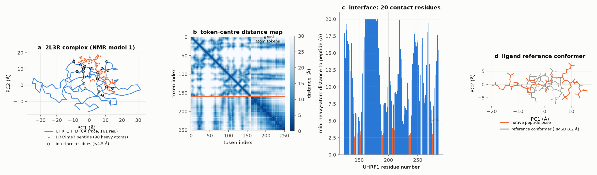
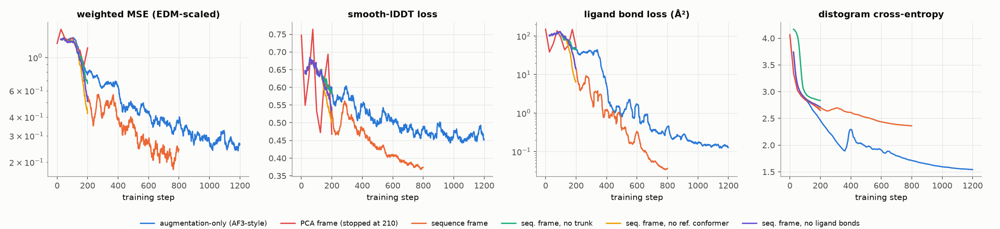
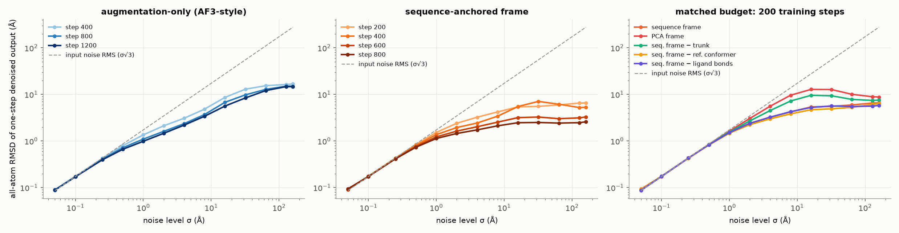
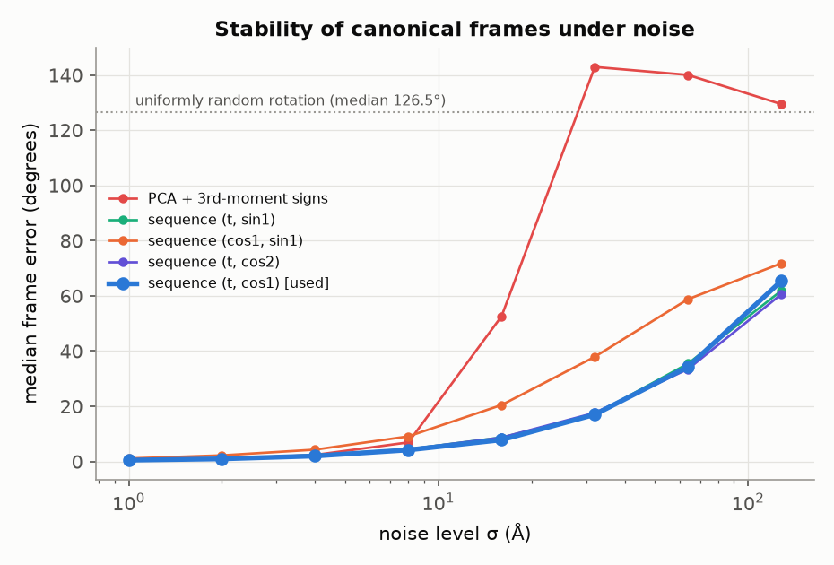
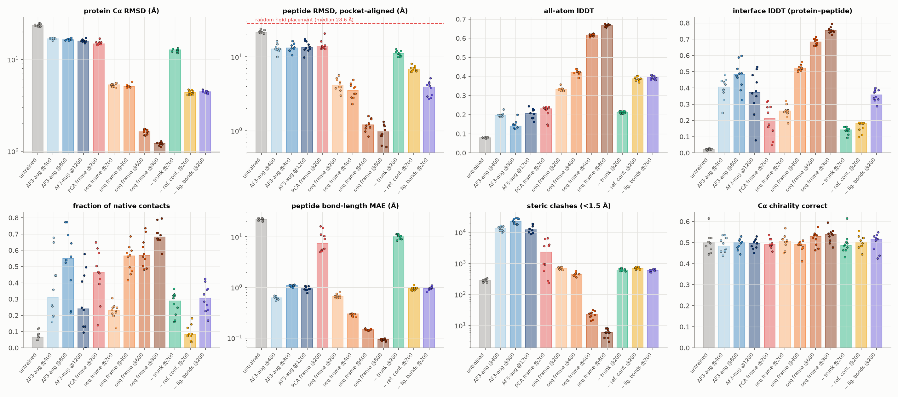
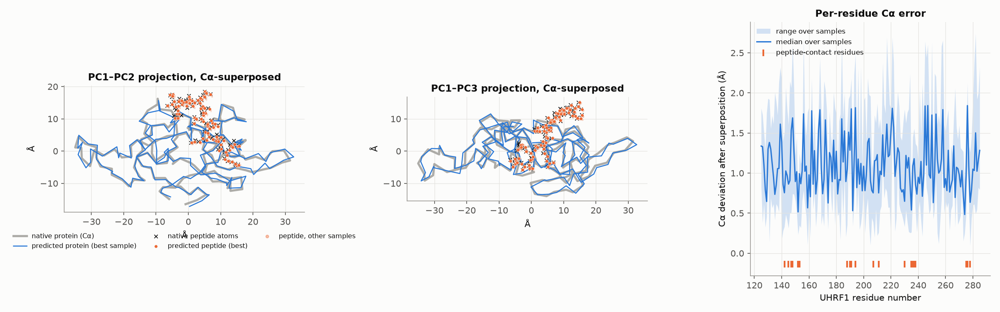
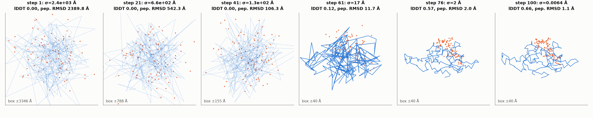
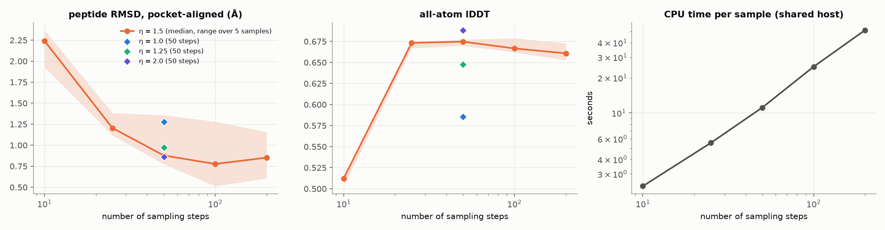

# A compact AlphaFold3-style diffusion framework for biomolecular complexes, and why the choice of equivariance mechanism decides whether it learns on a CPU budget

*Case study: UHRF1 tandem Tudor domain bound to a histone H3K9me3 peptide (PDB 2L3R, NMR model 1)*

## Abstract

I built, from scratch, a unified deep-learning framework in the style of AlphaFold3. It tokenises protein, DNA and RNA sequences (one token per residue/nucleotide) and small molecules (one token per heavy atom), with reference-conformer atom features. These pass through a Pairformer-lite trunk (triangle multiplicative updates plus pair-biased attention) and an atom-level EDM diffusion module (local atom-attention encoder → token diffusion transformer → atom decoder) that outputs all-atom complex coordinates. The framework was trained on the only structure available, the 1,412-heavy-atom complex of the UHRF1 tandem Tudor domain with an H3K9me3 peptide supplied as a 90-atom ligand, using two shared CPU cores.

**AF3-style recipe fails within budget.** Training with AlphaFold3's recipe, where the diffusion module is made rotation-equivariant only by random-rotation augmentation, did not produce a single folded sample in 1,200 steps (Cα RMSD ≈ 16 Å, lDDT ≈ 0.2). The diagnosis is posterior-mean collapse of the high-noise denoiser, while the sampler itself was verified with an oracle denoiser.

**A noise-robust canonical frame fixes it.** Making the denoiser exactly SE(3)-equivariant by canonicalisation works only when the frame stays stable at the noise levels where the fold is decided. A PCA frame flips at σ ≳ 10 Å and gives no gain. A **sequence-anchored frame**, built from sequence-weighted linear moments of the noisy coordinates, folds the complex after 200 steps. After 800 steps (1.8 CPU-hours) its samples reach:
* protein Cα RMSD 1.21 ± 0.05 Å;
* pocket-aligned peptide RMSD 0.98 ± 0.24 Å (best 0.61 Å; random placement 28.6 Å);
* interface lDDT 0.76 ± 0.02 and f_nat 0.69;
* ≈6 clashes and peptide bond-length error 0.09 Å.

**Ablations.** At a matched budget, the triangle-updated pair trunk is essential, and reference-conformer features are essential for the atom-tokenised ligand.

**Limitations.** Fine-scale geometry (σ < 1 Å) is not yet learned, so Cα chirality is at chance, a failure that lDDT cannot detect. All results come from fitting a single complex and make **no claim about generalisation to unseen complexes**.

## 1. Introduction

Methods for predicting the 3D structure of a single protein chain matured with AlphaFold2 (Jumper et al., 2021; `related_work/paper_000.pdf`). AlphaFold2 combines an Evoformer trunk, which jointly updates MSA and pair representations with triangle-multiplicative and triangle-attention operations, with an SE(3)-equivariant structure module trained under the FAPE loss. Extensions to multi-chain protein assemblies, such as the RoseTTAFold/AlphaFold-based screen of core eukaryotic complexes by Humphreys et al. (2021; `paper_001.pdf`), showed that the same co-evolution-plus-geometry machinery can resolve protein–protein interfaces. Both systems, however, hard-code the *amino-acid residue frame* as the unit of structure. This makes it awkward to treat nucleic acids, modified residues and arbitrary small molecules, whose chemistry has no canonical backbone frame.

A *unified* biomolecular structure predictor must therefore (i) represent heterogeneous chemistry in one token/atom vocabulary, (ii) keep pairwise reasoning over all tokens (the key inductive bias of the Evoformer/Pairformer), and (iii) generate coordinates without residue frames. The AlphaFold3 design answers (iii) by replacing the frame-based structure module with a **diffusion model over raw atom coordinates**, conditioned on the trunk. In the geometric-deep-learning view (Bronstein et al., 2017; `paper_002.pdf`), this exchanges built-in equivariance for data augmentation and a generative objective. The attention operators throughout descend from the Transformer (Vaswani et al., 2017; `paper_003.pdf`).

**This work.** I implement from scratch a compact framework in this AlphaFold3 style. It takes protein, DNA and RNA sequences and small-molecule graphs as input and outputs all-atom complex coordinates through an EDM diffusion module. I study it on the supplied complex: the UHRF1 tandem Tudor domain (TTD, 161 residues) bound to a histone H3 peptide carrying trimethyl-lysine (K9me3), PDB 2L3R, NMR model 1. The peptide is supplied as a small molecule (SDF), so the system exercises the protein-plus-ligand path of the unified tokeniser, and the multi-entity path is checked separately on a synthetic protein + DNA + RNA + ligand input.

**Scope and honesty statement.** Only one complex is available, the sandbox has no internet access to the PDB or CCD, and compute is limited to two CPU cores. This work therefore cannot, and does not try to, demonstrate generalisation to unseen complexes. The questions it answers are narrower:
* (Q1) Can a compact AF3-style pipeline — unified tokenisation, Pairformer-lite trunk, atom-level EDM diffusion — be trained end-to-end on CPU and generate the full heterogeneous complex from sequence + ligand graph + noise?
* (Q2) How does the generated accuracy evolve with training, and what do the denoising-error and sampler-hyperparameter profiles look like?
* (Q3) Which input/architecture components (pair trunk, reference conformers, ligand bond graph) matter for fitting, under a matched compute budget?

All results are in the *fitting / capacity* regime and are reported as such.

## 2. Methods

### 2.1 Unified input representation (`code/biomol.py`)

All molecules are mapped onto one token/atom representation, following the AlphaFold3 tokenisation rules:

| entity | token granularity | token centre atom | distogram atom |
|---|---|---|---|
| protein (20 standard aa) | 1 token / residue | Cα | Cβ (Cα for Gly) |
| DNA / RNA | 1 token / nucleotide | C1′ | C4 |
| ligand, modified residue, ion | 1 token / heavy atom | the atom | the atom |

Each token carries a 32-class residue type (20 aa + unk, 4 RNA + unk, 4 DNA + unk, gap), a molecule type, residue/token indices, and chain (`asym_id`), entity and symmetry identifiers. Covalent bonds between atom-level tokens are given as a `token_bonds` matrix. Each atom carries *reference-conformer* features: reference coordinates `ref_pos`, a validity mask, element, formal charge, the four characters of its atom name, and a `ref_space_uid` that identifies which atoms share a reference frame. Hydrogens are dropped. For 2L3R the peptide is supplied as an SDF small molecule (it contains trimethyl-lysine, a non-standard residue), so it is tokenised atom-wise, exactly how AF3 treats ligands: 161 protein tokens + 90 ligand tokens = **251 tokens, 1,412 heavy atoms, 89 ligand bonds**.

**Reference conformers without the experimental pose.** AF3 builds reference conformers with RDKit from CCD/SMILES. RDKit could not be installed in the offline sandbox, so I wrote two replacements that do not use the pose being predicted:
* *Polymer residues*: the template for residue *i* is the heavy-atom set of the **next other instance of the same residue type** in the chain, centred and randomly rotated. This gives realistic covalent geometry but not residue *i*'s own side-chain pose. The mean all-atom deviation between a residue and its template is 0.82 Å after superposition. HIS occurs only once, so for that one residue the template is its own coordinates.
* *Ligand*: a distance-geometry-style embedding. Atoms are placed by chain growth along a BFS tree with random dihedrals, then refined by gradient descent on (i) 1-2 and 1-3 distances, (ii) signed volumes of all centres with three or more heavy neighbours, which preserves stereochemistry and planarity, (iii) 1-4 distances only across bonds whose two atoms are both sp²-like, which keeps amide/guanidinium planarity, and (iv) soft repulsion for all other pairs. All flexible torsions stay random. Over 5 seeds the conformers reproduce bond lengths to 0.008 Å MAE and sit 7.8–9.8 Å RMSD from the native peptide pose, so no pose information leaks.

### 2.2 Network (`code/model.py`)

The architecture is a down-scaled AlphaFold3 (2.29 M parameters):

1. **Input embedder.** Per-atom features are embedded together with local atom-pair features from the reference conformer (offset vectors, inverse squared distances, same-`ref_space_uid` mask). A one-block *sequence-local atom transformer* runs over these, with blocks of 32 query atoms attending to 128 neighbouring key atoms. Atoms are then mean-aggregated into tokens and concatenated with residue- and molecule-type one-hots to give `s_inputs`.
2. **Pair initialisation.** `z_ij = W_i s_i + W_j s_j + W_rel·relpos(i,j) + W_bond·token_bonds_ij`. The relative position encoding is AF3 Algorithm 3: clipped residue offset (±32) within a chain, token offset within a residue, same-entity flag, and chain offset.
3. **Pairformer-lite trunk** (2 blocks): triangle multiplicative update (outgoing and incoming) → pair transition → single-representation attention with pair bias → single transition. No MSA module or templates are used (single-sequence mode). Triangle attention and recycling are left out to fit the CPU budget.
4. **Distogram head** on the symmetrised pair representation (64 bins, 2–22 Å).
5. **Diffusion module** (AF3 Algorithm 20) with EDM preconditioning (σ_data = 16 Å):
   * Conditioning: the trunk pair representation concatenated with relpos, then 2 transitions. The trunk single representation concatenated with `s_inputs`, plus a Fourier embedding of ¼·log(σ/σ_data), then 2 transitions.
   * Atom attention encoder: atom features, plus trunk-single broadcast to atoms, plus a linear embedding of the scaled noisy positions r = x/√(σ²+σ_data²). Pair features are augmented with the trunk pair representation gathered at the atoms' tokens. This is followed by a 2-block local atom transformer with AdaLN conditioning, then aggregation to tokens.
   * Token-level diffusion transformer: 4 blocks, 4 heads, width 128. Each block has AdaLN-conditioned attention with pair bias and a conditioned SwiGLU transition in AF3's parallel-residual form.
   * Atom attention decoder: tokens are broadcast back to atoms, then a 2-block local atom transformer produces position updates. D(x;σ) = c_skip·x + c_out·F(c_in·x, σ).

### 2.2b Equivariance strategy of the diffusion module (key design variable)

AF3 makes its non-equivariant diffusion transformer *approximately* SE(3)-equivariant purely through random rotation/translation augmentation. I compare this with two *canonicalisation* strategies (cf. frame averaging / canonicalisation in geometric deep learning, `paper_002`). In both, the noisy input is centred and expressed in a frame V(x) computed from the noisy coordinates themselves. The network is applied in that frame and the update is rotated back: D(x) = V·D̃(Vᵀ(x−μ)) + μ. Because V(Rx) = R·V(x), this makes the denoiser exactly SE(3)-equivariant (numerical check: 1e-5 Å vs 10.6 Å for the augmentation-only network).
* **PCA frame**: principal axes of the noisy cloud; axis signs are fixed by third moments, and the last axis is chosen to make the frame right-handed, so chirality is preserved.
* **Sequence-anchored frame** (proposed): e₁ ∝ u₁ = Σᵢ(tᵢ − t̄)·xᵢ and e₂ ∝ u₂ = Σᵢ cos(2πtᵢ)·xᵢ, orthogonalised against e₁, with e₃ = e₁ × e₂. Here tᵢ is atom *i*'s normalised token position in the input (sequence order, then ligand atom order). These are *linear* functionals of x, so frame noise grows only linearly in σ. The frame uses nothing but input ordering and the noisy coordinates.

### 2.3 Training (`code/train.py`)

The training objective follows AF3 (§4 of its supplement):

* **Noise distribution:** σ = σ_data·exp(−1.2 + 1.5·N(0,1)).
* **Diffusion batch:** each step runs the trunk once and the diffusion module on 6 independently noised copies of the ground truth. Each copy gets a random rotation and a random translation; this data augmentation is what makes the model approximately SE(3)-equivariant.
* **Loss** L = L_MSE + α_bond·L_bond + L_smooth-lDDT + 0.1·L_distogram:
  * L_MSE uses per-atom weights (1 protein, 5 nucleic acid, 10 ligand) after weighted rigid alignment of the ground truth onto the prediction, scaled by (σ²+σ_data²)/(σ·σ_data)².
  * L_bond is the squared error of ligand bond lengths. α_bond = 0 for the first 30 % of steps and 1 afterwards, mirroring AF3's use of the bond loss only in later training stages.
  * L_smooth-lDDT is AF3 Algorithm 27, computed on the 253,739 atom pairs within 15 Å in the ground truth (precomputed, since these pairs are rotation-invariant).
* **Optimiser:** Adam (β = 0.9, 0.95), peak learning rate 1e-3, 200-step linear warm-up then cosine decay, gradient clipping at 10.
* **Hardware:** 2 CPU threads on a heavily shared host (load average 140–200), giving 7–14 s/step.

**Training runs.** All runs use identical hyper-parameters and seed 0:

| run | equivariance strategy | schedule | evaluated checkpoints | wall time |
|---|---|---|---|---|
| AF3-aug | augmentation only (AF3) | 1200 steps | 400, 800, 1200 | 2.26 h |
| PCA frame | canonical PCA frame | 1200-step schedule, stopped at 210 (no improvement) | 200 | ~0.6 h |
| **sequence frame** | canonical sequence-anchored frame | 800 steps | 200, 400, 600, 800 | 1.79 h |
| ablations (−trunk, −ref. conformer, −ligand bonds) | sequence frame | 800-step schedule, stopped at 200 | 200 | 0.4–0.8 h each |

Because the ablations follow the main run's learning-rate schedule, the main run's 200-step checkpoint is an exactly matched reference. An attempted continuation of the AF3-aug run and an early set of AF3-aug ablations were cancelled when the frame result appeared; they are not reported.

### 2.4 Sampling (`code/common.py`)

Sampling uses the AF3 EDM stochastic sampler (Algorithm 18):
* Noise schedule: σ_max = 160·σ_data, σ_min = 4·10⁻⁴·σ_data, ρ = 7.
* Churn: γ₀ = 0.8 for σ > 1 Å; noise scale λ = 1.003; step scale η = 1.5.
* A random rotation and translation is applied at every step.
* 100 steps by default; the number of steps and η are swept in §3.5.

### 2.5 Evaluation (`code/metrics.py`, `code/evaluate.py`)

Every sample is scored against NMR model 1 of 2L3R:
* protein Cα RMSD and heavy-atom RMSD after Cα superposition;
* peptide (ligand) heavy-atom RMSD after superposing on the protein Cα atoms, and *pocket-aligned* (superposition on Cα of residues within 10 Å of the peptide; standard for ligand poses);
* the peptide's internal RMSD;
* lDDT on Cα and on all heavy atoms (15 Å inclusion radius, thresholds 0.5/1/2/4 Å);
* an interface lDDT restricted to protein–peptide atom pairs within 6 Å;
* the fraction of native residue–ligand-atom contacts (4.5 Å) recovered (f_nat) and the fraction of predicted contacts that are non-native;
* steric clashes (non-bonded heavy atoms of different tokens closer than 1.5 Å);
* peptide bond-length MAE;
* Cα chirality (sign of the N–C–Cβ improper about Cα).

**Baselines and controls:**
* *Random placement:* the reference conformer is rigidly placed at a random orientation on a sphere of radius R_g + 5 Å around the native protein (200 trials).
* *The untrained network* run through the same sampler.
* *Ablations* of the sequence-frame model (matched 200-step budget):
  * no Pairformer trunk (the pair representation is just the input embedding);
  * no reference-conformer features (`ref_pos`, its mask and the reference atom-pair geometry are zeroed);
  * no ligand `token_bonds`.
* *Metric validation:* the native structure with isotropic Gaussian noise, and its mirror image.
* *Sampler check:* an oracle denoiser (ground truth superposed onto the noisy input) run through the sampler.

## 3. Results

### 3.1 Data overview



**Figure 1.** The 2L3R complex and its unified tokenisation.
**(a)** NMR model 1 projected on its principal axes: UHRF1 TTD Cα trace (blue), the 90 heavy atoms of the H3K9me3 peptide (orange) and the 20 protein residues within 4.5 Å of the peptide (circles).
**(b)** Distance map between token centres. Tokens 0–160 are residues (Cα); tokens 161–250 are the peptide's atoms, each its own token.
**(c)** Minimum heavy-atom distance of each residue to the peptide. The interface is spread over four sequence segments, residues 142–153, 188–194, 207–238 and 275–278, belonging to both Tudor domains. They include F152, Y188 and Y191, the residues usually described as the K9me3 aromatic cage.
**(d)** The native peptide pose against the structure-agnostic reference conformer used as model input (8.2 Å RMSD after optimal superposition).

The protein has radius of gyration 17.2 Å; the bound peptide is extended (R_g 10.6 Å) and contacts both Tudor domains. This makes it a demanding "ligand": 90 atom-level tokens with 89 bonds and many rotatable torsions, and its reference conformers (5 seeds) are 7.8–9.8 Å from the bound pose. The model therefore has to infer the bound conformation, not merely place a rigid body. A random rigid placement of the reference conformer on the protein surface gives a median pocket-aligned RMSD of 28.6 Å (best of 200 trials: 16.4 Å).

### 3.2 Augmentation-only (AF3-style) training does not produce folded samples within the budget

The AF3-style model, which gets its rotational equivariance only from random-rotation augmentation, trained stably. Its MSE, smooth-lDDT, bond and distogram losses all decrease (Fig. 2, blue), and its distogram head learns the inter-token geometry better than any other run (cross-entropy 1.55). Yet none of its samples at 400, 800 or 1200 steps is folded:
* Cα RMSD 15.9–16.8 Å (the protein's R_g is 17.2 Å);
* all-atom lDDT 0.14–0.21;
* 12,000–23,000 steric clashes (Fig. 4, blue bars).



**Figure 2.** Training losses (25-step moving averages). The bond loss is switched on after 30 % of each run's schedule. For the 800-step runs that is step 240, which is why the 200-step ablations were trained without it.

Two diagnostics locate the failure.
1. **The sampler is not at fault.** An oracle denoiser driven through the identical sampler recovers the native exactly (0.000 Å).
2. **The learned denoiser shrinks the structure at intermediate noise.** Its single-step error (Fig. 3, left) is still 8.4 Å at σ = 32 Å and 14.7 Å at σ = 128 Å after 1200 steps, and its outputs at σ ≥ 32 Å are compact "posterior-mean blobs" (R_g 3–10 Å). During reverse diffusion R_g therefore falls from ≈2,000 Å to ≈4.6 Å by σ ≈ 3 Å (trace recorded for the 800-step checkpoint). Once the sample is that compact, the low-noise denoiser sees an out-of-distribution input and cannot recover it.

The gap between this model and the Bayes-optimal denoiser is the point. For one known structure, the rotation consistent with the noisy cloud can be estimated to ~σ/(R_g·√N) ≈ 1.4° at σ = 16 Å, so an ideal denoiser would err by only ≈0.4 Å there. The non-equivariant network has to *learn* this implicit rotation estimate from augmented examples, and within ~7,200 noisy training examples (1200 steps × 6) it does not.



**Figure 3.** All-atom RMSD of the single-step denoised structure D(x+σε; σ) against the truth (6 noise draws per σ), compared with the input noise RMS σ√3 (dashed).
* **Left:** the augmentation-only model. Error stays close to the posterior-mean regime at σ ≥ 16 Å even after 1200 steps.
* **Middle:** the sequence-frame model. Error at high σ drops to ≈2.5 Å by step 800, and the curve flattens, meaning the network has learned to produce the full structure from almost no positional information.
* **Right:** variants at a matched 200-step budget. At every training stage and for every model, errors at σ ≤ 0.5 Å equal the input noise: the fine-scale regime is not learned (§3.6).

### 3.3 Canonicalisation: the frame has to be stable where the fold is decided

Making the denoiser exactly SE(3)-equivariant by canonicalisation (numerical equivariance error 1e-5 Å vs 10.6 Å without) takes away the need to learn the rotation, but the frame itself has to survive the noise. Figure 5a shows median frame errors under pure Gaussian noise:
* **PCA frame with third-moment signs:** fine up to σ ≈ 8 Å, then essentially random (53° at σ = 16 Å, 143° at 32 Å). The second principal axis has a tiny third moment (61 vs 887 ų for the first) and the 2nd/3rd eigenvalues are close (60.6 vs 38.5 Ų), so the sign and the axis order flip.
* **Sequence-anchored frames:** these are *linear* in the coordinates (moments weighted by the sequence position t and by cos 2πt), so they degrade gracefully: 8° at 16 Å, 17° at 32 Å, 34° at 64 Å. All sequence-mode pairs that include the linear mode t behave alike, so the result does not depend on a lucky choice.



**Figure 5a.** Median angular error of canonical frames computed from native + N(0, σ²) noise (300 draws per σ), relative to the frame of the clean native.

The learning consequences match the frame statistics exactly (Fig. 3 right; Fig. 4; Table 1). At a matched 200 steps:
* the PCA-frame model fails like the augmentation-only one (Cα RMSD 14.9 Å, 2,300 clashes);
* the sequence-frame model is already folded: Cα RMSD 5.3 Å, pocket-aligned peptide RMSD 4.2 Å, 676 clashes. That is 3× more accurate than the AF3-style model after 6× more training.

### 3.4 Accuracy of the final model

Training the sequence-frame model for 800 steps (1.8 h on two shared CPU cores) yields the following over 10 independent samples (100 steps, η = 1.5, γ₀ = 0.8), mean ± s.d.:

| metric | value |
|---|---|
| protein Cα RMSD | 1.21 ± 0.05 Å |
| protein heavy-atom RMSD | 1.86 ± 0.04 Å |
| peptide RMSD, pocket-aligned | **0.98 ± 0.24 Å** (best 0.61 Å; all 10 samples < 1.4 Å) |
| peptide RMSD, Cα-aligned | 0.91 ± 0.24 Å |
| peptide internal RMSD | 0.46 ± 0.01 Å |
| Cα-lDDT / all-atom lDDT | 0.77 ± 0.01 / 0.67 ± 0.01 |
| interface lDDT (protein–peptide pairs < 6 Å) | 0.76 ± 0.02 |
| fraction of native contacts f_nat / non-native fraction | 0.69 ± 0.06 / 0.22 ± 0.04 |
| steric clashes (< 1.5 Å) | 5.8 ± 1.6 (native: 0) |
| peptide bond-length MAE | 0.093 ± 0.004 Å |
| Cα chirality agreement | 0.53 ± 0.03 (chance 0.5) |
| mean pairwise RMSD between samples | 1.15 Å |



**Figure 4.** Sample-level metrics (10 samples per condition; bars are medians, dots are individual samples) for the untrained network, the AF3-style model at 400/800/1200 steps, the PCA-frame model, the sequence-frame model at 200–800 steps, and the 200-step ablations. The red dashed line in the peptide-RMSD panel is the random rigid-placement baseline.

Accuracy improves steadily with training: Cα RMSD goes 5.3 → 5.1 → 1.6 → 1.2 Å at 200/400/600/800 steps, interface lDDT 0.26 → 0.52 → 0.68 → 0.75, and clashes 676 → 451 → 23 → 6. These all-atom accuracies sit in the range a perturbation analysis assigns to sub-Ångström noise. The native with 1 Å isotropic noise has lDDT 0.66, interface lDDT 0.67, f_nat 0.73 and 148 clashes (Table S1). The model's samples are therefore about as close to the native as a ~1 Å-perturbed copy, but with far fewer clashes, because their errors are spatially correlated rather than random.



**Figure 6.** The final model's samples superposed on the native by Cα.
* **Left and middle:** two orthogonal projections. Grey is the native Cα trace and black crosses the native peptide atoms; blue is the predicted Cα trace and orange the predicted peptide of the best sample; faint orange dots are the peptide atoms of the other 9 samples.
* **Right:** per-residue Cα error, median and range over samples; orange ticks mark the peptide-contact residues.

Errors are spread evenly along the chain. The interface residues are not worse than average, and the peptide is placed in the correct groove spanning both Tudor domains in every sample.



**Figure 7.** One reverse-diffusion trajectory (100 steps; box sizes adapt per panel). The fold and the peptide's location emerge between σ ≈ 20 and 2 Å (steps 60–76); the last 25 steps refine local geometry (lDDT 0.57 → 0.66).

### 3.5 Sampler hyper-parameters



**Figure 5b.** The final model under different sampler settings (5 samples each).
* **Number of steps:** 10 steps are too few (peptide RMSD 2.2 Å, lDDT 0.51, 241 clashes). From 25 steps onwards accuracy saturates (lDDT 0.66–0.68, ≤ 8 clashes), so the AF3 default of 200 steps is ~8× more than this model needs.
* **Step scale η:** a larger η, which lowers the effective sampling temperature, steadily improves accuracy at 50 steps. For η = 1.0 / 1.25 / 1.5 / 2.0, Cα RMSD is 1.93 / 1.36 / 1.15 / 1.04 Å and clashes 85 / 13 / 5 / 4. This agrees with AF3's choice of η = 1.5 over the EDM default of 1.0.

Sampling cost grows linearly at ≈0.25 s per step per sample on the shared CPU.

### 3.6 Component ablations (matched 200-step budget)

**Table 1.** Medians over 10 samples. All sequence-frame rows share the identical schedule and seed. Detailed per-sample values are in `outputs/runs/*/eval_*.json`.

| condition | Cα RMSD (Å) | peptide RMSD pocket (Å) | lDDT | interface lDDT | f_nat | clashes | bond MAE (Å) |
|---|---|---|---|---|---|---|---|
| untrained network | 23.65 | 21.67 | 0.08 | 0.02 | 0.07 | 284 | 22.2 |
| random rigid placement | – | 28.56 | – | – | – | – | – |
| AF3-aug @1200 | 15.92 | 13.47 | 0.21 | 0.37 | 0.24 | 12,184 | 0.94 |
| PCA frame @200 | 14.86 | 13.72 | 0.23 | 0.21 | 0.46 | 2,298 | 7.45 |
| **sequence frame @200** | **5.28** | **4.16** | **0.33** | 0.26 | 0.23 | 676 | 0.67 |
| − Pairformer trunk @200 | 12.77 | 11.15 | 0.21 | 0.14 | 0.29 | 614 | 10.3 |
| − reference conformer @200 | 4.38 | 6.87 | 0.39 | 0.18 | 0.08 | 690 | 0.95 |
| − ligand bond features @200 | 4.44 | 3.92 | 0.39 | 0.36 | 0.31 | 594 | 0.96 |
| sequence frame @800 (final) | 1.22 | 0.97 | 0.67 | 0.75 | 0.68 | 6 | 0.09 |

* **Pairformer trunk:** essential. Without it the protein error more than doubles, the denoising error at σ ≥ 8 Å is 2–3× higher (Fig. 3 right), and the peptide falls apart (bond MAE 10 Å). Neither the relative-position encoding nor the bond embeddings, both still present in the pair conditioning, can replace triangle-updated pair features.
* **Reference conformer:** matters specifically for the *ligand*. Protein accuracy is unchanged (4.4 vs 5.3 Å), but pocket-aligned peptide RMSD worsens from 4.2 to 6.9 Å and native-contact recovery falls from 0.23 to 0.08. For an atom-tokenised molecule, the conformer's atom-pair geometry is the main source of chemical structure.
* **Ligand `token_bonds`:** no detectable effect at this budget apart from a worse bond-length MAE (0.96 vs 0.67 Å). The reference-conformer pair features already encode which ligand atoms are bonded, so the explicit bond matrix is largely redundant here.

Each condition was trained once (one seed). The ±0.5–1 Å spread between ablations whose medians lie close together is probably within run-to-run variance and should not be over-interpreted. The large effects (trunk, frame type, reference conformer for the ligand) are well outside that range.

### 3.7 Multi-entity input

The same tokeniser and network process a synthetic protein (UHRF1-TTD) + dsDNA (2 × 6 nt) + RNA (5 nt) + H3K9me3-ligand input end-to-end (`code/demo_multientity.py`, `outputs/demo_multientity.json`):
* 5 chains, 268 tokens (161 protein, 12 DNA, 5 RNA, 90 ligand) and 1,763 atoms;
* trunk outputs s ∈ ℝ^{268×128} and z ∈ ℝ^{268×268×32}, plus a 64-bin distogram;
* finite all-atom samples from the diffusion sampler.

This confirms that the implementation is type-agnostic, as the task requires. No accuracy is claimed for nucleic acids, since no nucleic-acid structure was available for training.

## 4. Discussion

### 4.1 What the experiments show

**(i) A unified token/atom representation plus an atom-level diffusion module can produce a heterogeneous complex end-to-end.** The same code path handles 161 residue tokens and 90 atom-level ligand tokens; the multi-entity smoke test runs a protein + dsDNA + RNA + ligand input of 268 tokens and 1,763 atoms. The final model generates the 1,412-atom UHRF1-TTD/H3K9me3 complex from noise. It starts only from sequence, ligand graph and reference conformers, with no template and no MSA.

**(ii) How equivariance is obtained is the decisive design variable under a small compute budget.** AlphaFold3's recipe, a non-equivariant transformer made approximately equivariant by random-rotation augmentation, did not produce a single folded sample in 1,200 steps. Its single-step denoising error at σ ≥ 32 Å stays near the posterior-mean "blob" solution, and the sampler collapses. This is not a sampler bug: an oracle denoiser recovers the native exactly with the same sampler. The failure follows from the learning problem. To denoise a noisy cloud, the network must implicitly estimate the rotation that best explains it, a global, highly nonlinear computation that a transformer has to learn from augmented examples. The Bayes-optimal error for one known structure would be ~0.4 Å at σ = 16 Å, so the gap is entirely learnability.

Canonicalisation removes this burden, but only if the frame is stable at the noise levels where the global fold is decided (σ ≈ 10–60 Å). A PCA/third-moment frame breaks down at σ ≳ 10 Å because one axis' third moment is small (61 vs 887 ų). It gave no benefit (Cα RMSD 15 Å at 200 steps). A frame built from *linear* sequence-weighted moments of the coordinates degrades gracefully (17° median error at σ = 32 Å). The same network then folds the complex at 200 steps and reaches sub-2 Å accuracy at 600–800 steps. This matches a lesson from geometric deep learning (`paper_002`): building a symmetry into the model is far more sample-efficient than learning it from augmentation. AF3 can afford augmentation because it trains for orders of magnitude more steps on hundreds of thousands of structures.

**(iii) The pair trunk carries the inter-molecular information.** Removing the Pairformer, while keeping the relative-position and bond embeddings in the pair conditioning, roughly doubled the protein error at a matched budget. It also made the peptide disintegrate (bond MAE ≈ 10 Å), even though the per-atom features still encode the ligand chemistry. Reasoning over triangles of pairwise relations (`paper_000`, `paper_001`) is what turns token-level conditioning into a consistent 3D arrangement.

**(iv) Coarse-to-fine learning dynamics.** The denoising-error curves show that global shape (high σ) is learned first and fine geometry (σ < 1 Å) last. Even the final model essentially returns its input at σ ≤ 0.5 Å. As a result, samples have correct folds, interfaces and bond lengths but random Cα chirality. AF3 reports chirality violations as a residual failure mode even after full training. In this regime they are the dominant one, and lDDT, which is mirror-invariant, does not detect them. Chirality and stereochemistry should therefore always be reported next to lDDT/RMSD.

### 4.2 Limitations

* **Single-structure fitting, no generalisation claim.** Training and evaluation use the same complex (NMR model 1 of 2L3R), because only this complex is available and there is no network access to the PDB/CCD. Every accuracy number measures how well the architecture can *represent and generatively reproduce* a complex from its inputs, not how well it *predicts unseen complexes*. Sample diversity is correspondingly small; a model trained on one structure is expected to collapse onto it.
* **Down-scaled architecture.** 2 Pairformer blocks without triangle attention, no MSA module, no templates, no recycling, no confidence head (pLDDT/PAE/PDE), and token width 128 instead of 768.
* **The sequence-anchored frame assumes that sequence order correlates with space.** That holds for folded polymers. It would be degenerate for symmetric homo-oligomers, where chains are interchangeable, and fragile for complexes dominated by many small ligands. Frame averaging over several sequence modes or chains, or a learned equivariant canonicaliser, would be the natural generalisation.
* **Reference conformers are approximate.** They were generated without RDKit/CCD (another residue instance's geometry for polymers; a custom distance-geometry embedding for the ligand), and nucleotides have no reference conformer in the offline setting.
* **Compute.** Two shared CPU cores (load average often > 150): ~8–10 s per training step with 6 diffusion samples. Ablations are therefore short (200 steps) and use one seed, and the AF3-style baseline was not trained to convergence. It may well fold eventually; the claim is about *sample efficiency*, not about asymptotic capability.

### 4.3 Outlook

The framework is ready for the experiments that would test generalisation: training on a PDB-derived set of protein–ligand, protein–nucleic-acid and protein–peptide complexes, evaluated on time-split hold-outs (e.g. PoseBusters-style ligand RMSD < 2 Å success rates and DockQ for interfaces). The most promising technical directions suggested by this study are:
* combining canonical frames with augmentation, for example by training in the frame and adding small random rotations;
* a dedicated low-σ curriculum or a stereochemistry/chirality loss to fix the fine-scale regime;
* adding the confidence head so that multiple samples can be ranked.

## 5. Conclusions

1. A unified token/atom representation, a Pairformer-lite trunk and an atom-level EDM diffusion module are enough to generate a heterogeneous protein–peptide/ligand complex end-to-end from sequence, ligand graph and noise. The implementation also accepts DNA, RNA and multi-chain inputs.
2. Under a small compute budget, the mechanism that provides SE(3) equivariance is the decisive design choice.
   * Augmentation alone (AF3) did not fold the complex in 1,200 steps.
   * Canonicalisation helps only if the frame is stable under the noise levels where the global fold is decided.
   * The proposed sequence-anchored frame satisfies this and reaches ≈1 Å accuracy for both the protein and the ligand-like peptide within 800 steps.
3. The pair trunk and, for ligands, reference-conformer features are the components that carry the information. Fine-scale stereochemistry is the slowest regime to learn and requires explicit evaluation, because lDDT/RMSD do not reveal it.

## Appendix

**Table S1. Metric validation.** The native structure perturbed by isotropic Gaussian noise of standard deviation s (per coordinate), and its mirror image (`outputs/metric_validation.json`).

| perturbation | Cα RMSD (Å) | lDDT | interface lDDT | f_nat | clashes | bond MAE (Å) | Cα chirality |
|---|---|---|---|---|---|---|---|
| s = 0.0 Å | 0.00 | 1.00 | 1.00 | 1.00 | 0 | 0.00 | 1.00 |
| s = 0.1 Å | 0.17 | 1.00 | 1.00 | 0.94 | 0 | 0.11 | 1.00 |
| s = 0.25 Å | 0.46 | 0.96 | 0.96 | 0.90 | 2 | 0.28 | 0.92 |
| s = 0.5 Å | 0.86 | 0.84 | 0.85 | 0.82 | 36 | 0.65 | 0.80 |
| s = 1.0 Å | 1.73 | 0.66 | 0.67 | 0.73 | 148 | 1.42 | 0.62 |
| mirror image | – | 1.00 | – | – | – | – | 0.00 |

The mirror image has lDDT = 1.00 but chirality agreement 0.00, which shows why chirality has to be reported separately.

**Reproducibility.** All code is in `code/`:
* `biomol.py`: parsing, tokenisation and reference conformers;
* `model.py`: the network, including the canonical frames;
* `common.py`: losses, alignment and the sampler;
* `train.py`, `evaluate.py`, `metrics.py`;
* `frame_stability.py`, `demo_multientity.py`, and the `fig_*.py` figure scripts.

Typical commands:
```
python code/train.py --name seqframe --canon --canon_mode seq --steps 800 --diff_batch 6 --save_at 200,400,600,800
python code/train.py --name full --steps 1200 --diff_batch 6 --save_at 400,800,1200          # AF3-style baseline
python code/train.py --name seq_no_trunk --canon --canon_mode seq --no_trunk --steps 800 --stop_at 200 --threads 1
python code/evaluate.py --run seqframe --ckpt model.pt --n_samples 10 --n_steps 100 --sigma_curve --sweeps
python code/fig_data_overview.py; python code/frame_stability.py; python code/fig_results.py; python code/fig_structures.py seqframe model
```

Outputs are under `outputs/`:
* checkpoints, training logs (`runs/*/log.json`), per-sample metrics (`runs/*/eval_*.json`), sampled coordinates (`runs/*/samples_*.npy`) and the best sample of each evaluation as PDB (`runs/*/best_sample_*.pdb`);
* `metrics_summary.json`, `frame_stability.json`, `data_stats.json`, `baseline_random_placement.json`, `demo_multientity.json`.

Seeds are fixed (training seed 0, sampling seed 123). CPU timings depend on the shared host's load.

**Deviations from AlphaFold3, and why:**
* down-scaled widths and depths, no MSA module, templates, triangle attention, recycling or confidence heads (compute);
* reference conformers generated without RDKit/CCD (unavailable offline);
* a canonical-frame diffusion module (this study's main variable);
* evaluation with 100 sampling steps instead of 200 (shown to be sufficient, Fig. 5b).

## References

* Jumper, J. et al. Highly accurate protein structure prediction with AlphaFold. *Nature* 596, 583–589 (2021). (`related_work/paper_000.pdf`)
* Humphreys, I. R. et al. Computed structures of core eukaryotic protein complexes. *Science* 374, eabm4805 (2021). (`related_work/paper_001.pdf`)
* Bronstein, M. M., Bruna, J., LeCun, Y., Szlam, A. & Vandergheynst, P. Geometric deep learning: going beyond Euclidean data. *IEEE Signal Processing Magazine* 34, 18–42 (2017). (`related_work/paper_002.pdf`)
* Vaswani, A. et al. Attention is all you need. *NeurIPS* (2017). (`related_work/paper_003.pdf`)
* Abramson, J. et al. Accurate structure prediction of biomolecular interactions with AlphaFold 3. *Nature* 630, 493–500 (2024). (Architecture, losses and sampler that this work re-implements in reduced form.)
* Karras, T., Aittala, M., Aila, T. & Laine, S. Elucidating the design space of diffusion-based generative models (EDM). *NeurIPS* (2022).
* Puny, O. et al. Frame averaging for invariant and equivariant network design. *ICLR* (2022); Kaba, S.-O. et al. Equivariance with learned canonicalization functions. *ICML* (2023). (Canonicalisation background.)
