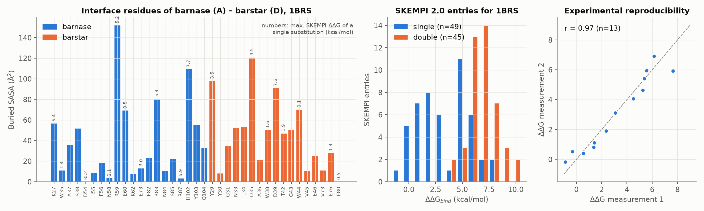
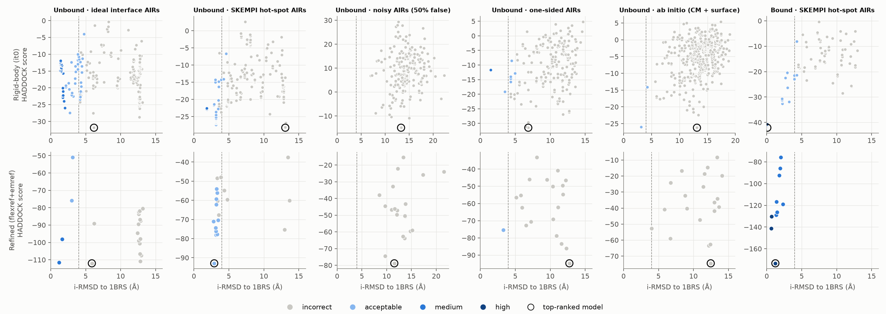
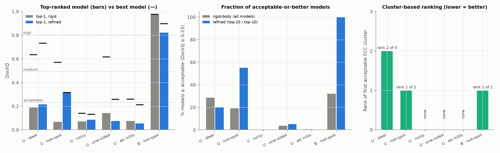
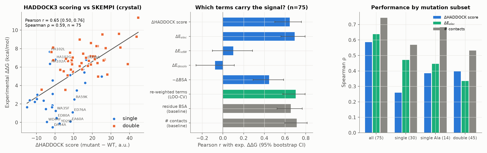
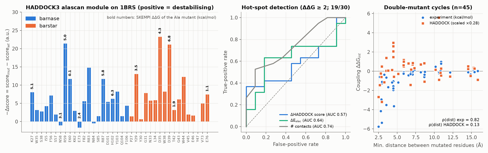
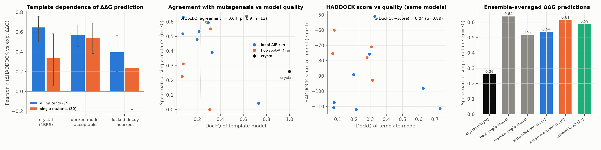

# Integrative modelling of the barnase–barstar complex with HADDOCK3: information-driven docking under different restraint scenarios, and validation of HADDOCK3 mutational scoring against SKEMPI 2.0

## Abstract

HADDOCK3 is a modular rewrite of the HADDOCK integrative-modelling platform. It takes atomic coordinates and optional experimental restraints, typically ambiguous interaction restraints (AIRs), and runs them through a user-defined workflow of sampling, refinement, scoring, clustering and analysis modules. This report applies HADDOCK3 (v2026.11.0, bundled CNS 1.3-UU) to the barnase–barstar complex (PDB 1BRS, chains A/D) and asks two questions.

**(i) How much does docking accuracy depend on the quality of the restraints?** The complex was re-docked from the unbound structures (1A2P/1A19) under five information scenarios: ideal interface AIRs, AIRs derived from SKEMPI mutagenesis hot spots, noisy AIRs with 50% false positives, one-sided AIRs, and ab initio docking. A bound-form control with hot-spot restraints was also run.

**(ii) How well do HADDOCK3 energetics capture experimental binding free-energy changes?** All 75 unique SKEMPI 2.0 mutants of 1BRS (30 single, 45 double) were scored with the HADDOCK3 minimise-and-score protocol used by the `alascan` module, and the `alascan` module itself was run on the crystal structure.

Docking findings:
- **Hot-spot restraints work as well as ideal ones.** With hot-spot restraints (7 residues), the top-ranked refined model was CAPRI-acceptable (DockQ 0.32), matching the outcome with ideal restraints (24 residues, best model medium quality at DockQ 0.73).
- **Ranking, not sampling, failed with ideal restraints.** The top-ranked ideal-restraint model was incorrect: it satisfies the restraints but has the partner in the wrong orientation.
- **Noisy restraints and ab initio docking failed** at the sampling depth affordable here (200–400 rigid-body models, 20 refined).
- **The unbound conformational change is the main difficulty.** The same hot-spot protocol applied to the bound partners yields a high-quality top-ranked model (DockQ 0.82).

Mutational-scoring findings:
- **Overall agreement with experiment is moderate.** ΔHADDOCK scores correlate with experimental ΔΔG at Pearson r = 0.65 (95% CI 0.50–0.76; Spearman ρ = 0.59, n = 75).
- **The signal is almost entirely electrostatic** (ΔE_elec r = 0.69). van der Waals and desolvation changes alone carry no signal.
- **Simple baselines do as well.** A contact-count baseline (r = 0.71) matches or beats the physics-based score.
- **HADDOCK misses the context dependence of double mutants.** Experimental double-mutant coupling energies are strongly distance dependent (ρ = 0.82 with inter-residue distance); the coupling predicted by HADDOCK is not (ρ = 0.13).
- **Single-model predictions are noisy.** On docked models, predictions vary strongly between near-identical poses.
- **Ensemble averaging helps but doesn't discriminate.** Averaging over models (ρ ≈ 0.54–0.61 on single mutants, against 0.26 for the crystal) improves agreement, but models with the wrong orientation give the same agreement as correct ones. Mutagenesis data tell you *which* residues are at the interface, not *how* the partners are oriented.

---

## 1. Introduction

Data-driven docking with HADDOCK encodes experimental knowledge about an interface as ambiguous interaction restraints (AIRs) and combines them with a physics-based force field during rigid-body sampling (it0), semi-flexible simulated annealing (it1) and final refinement (Dominguez et al. 2003; de Vries et al. 2007; van Zundert et al. 2016). HADDOCK3 recasts this pipeline as a set of interchangeable modules: `topoaa`, `rigidbody`, `flexref`, `emref`, `emscoring`, `caprieval`, `clustfcc`, `alascan`, and so on. These are chained in a user-defined workflow. The same platform can therefore do more than docking. It can score, analyse and (with `alascan`) predict the energetic effect of mutations, and it extends to other molecule types such as glycans (Ranaudo et al. 2024).

Barnase–barstar is one of the best-characterised protein–protein interactions. Its affinity is extremely high (Kd ≈ 10⁻¹⁴ M), its interface is strongly electrostatic, and decades of alanine scanning and double-mutant-cycle measurements (Schreiber & Fersht 1993, 1995; Frisch et al. 1997) are compiled in SKEMPI 2.0. That makes it a demanding testbed for an integrative platform. A good platform should (a) turn sparse, realistic experimental data into a correct model, and (b) produce energetics that agree with measured ΔΔG values.

**Hypotheses.**
- **H1.** Restraints derived purely from experimental mutagenesis hot spots (SKEMPI ΔΔG ≥ 2 kcal/mol) suffice for HADDOCK3 to dock the complex from unbound structures, approaching the performance obtained with ideal interface restraints. Corrupted (noisy) or missing (ab initio) information degrades performance.
- **H2.** HADDOCK3's ΔHADDOCK score (the `alascan` protocol) correlates with experimental ΔΔG, with the electrostatic term dominating for this highly charged interface.
- **H3.** Agreement with mutagenesis data depends on the accuracy of the structural template, so it might be usable to discriminate docking models.

## 2. Data

| Item | Description |
|---|---|
| `data/1brs_AD.pdb` | barnase (chain A, residues 3–110) – barstar (chain D, residues 1–89, C40A/C82A, residues 64–65 missing) crystal complex, 2.0 Å; 1 559 atoms incl. 67 H; used as reference and as template for scoring |
| `data/skempi_v2.csv` | SKEMPI 2.0; 94 entries for `1BRS_A_D` (49 single-, 45 double-point mutants; methods ITC, SFFL, IAFL, SPR; 298 K) |
| unbound structures (downloaded) | barnase 1A2P chain A; barstar 1A19 chain A (C82A; C40 truncated to Ala to match the pseudo-wild type in 1BRS), as used for 1BRS in the protein-docking benchmark |

**Note on residue numbering.** SKEMPI's `Mutation(s)_cleaned` column uses a numbering offset by −2 for barnase and for part of barstar (e.g. "KA25A" for barnase K27). The `Mutation(s)_PDB` column matches the PDB file and was used throughout (e.g. K27, R59, R83, R87, H102 in barnase; Y29, D35, D39, E76 in barstar).

**Experimental ΔΔG.** For each entry, ΔΔG = RT ln(Kd,mut / Kd,wt), using the wild-type Kd reported in the same publication. Repeated measurements of the same mutation (including measurements at 1 mM NaCl) were averaged, giving 75 unique mutations. Independent measurements of the same mutation agree at r = 0.97 (n = 13 pairs; Fig. 1, right), so the experimental noise ceiling is far above any of the correlations reported below.



**Figure 1.** *Left:* buried solvent-accessible surface area (Shrake–Rupley) of every interface residue (heavy atom within 5 Å of the partner). Numbers above the bars give the largest SKEMPI ΔΔG of a single substitution at that position. Total BSA is 1 556 Ų. The interface comprises 22 barnase and 19 barstar residues. *Middle:* distribution of SKEMPI ΔΔG values. *Right:* reproducibility of independent measurements.

The interface is dominated by charged residues: barnase K27, R59, R83, R87 and H102 against barstar D35, D39 and E76. The hot spots do not coincide simply with buried area. R87 and N58 bury less than 5 Ų yet give 5.8 and 3.1 kcal/mol, and E60 buries 69 Ų yet gives 0.1 kcal/mol.

## 3. Methods

All code is in `code/` and is numbered in execution order. Intermediate results are in `outputs/`.

### 3.1 Software

HADDOCK3 2026.11.0 was installed from the PyPI source distribution with its bundled CNS binary. No C/C++ compiler was available in the environment, so the two optional compiled helpers (`contact_fcc` and `fast-rmsdmatrix`) could not be built. FCC clustering was therefore re-implemented in Python following Rodrigues et al. (2012) (`code/06_analyse_docking.py`). Everything else (topology generation, CNS sampling and refinement, scoring, `caprieval`, `alascan`) used the unmodified HADDOCK3 modules. Hardware was limited to 2 CPU cores, which dictated the sampling depth below.

### 3.2 Restraint scenarios (`code/02_make_restraints.py`)

AIRs were written in standard HADDOCK `.tbl` format. Each active residue of one partner is restrained to the union of active and passive residues of the other (effective distance ≤ 2 Å, ±2 Å). Relative solvent accessibility (RSA) was computed on the free partners. Active residues had to have RSA ≥ 15%, and passive residues were surface residues (RSA ≥ 15%) within 6.5 Å of an active residue.

| Scenario | Active residues barnase / barstar | # passive (A/D) | Source of information |
|---|---|---|---|
| **ideal** | 11 / 13 (27, 37, 38, 59, 60, 82, 83, 85, 102–104 / 29, 31, 33–36, 38, 39, 42–44, 46, 76) | 19 / 17 | crystal interface, BSA ≥ 20 Ų |
| **hotspot** | 4 / 3 (K27, R59, R83, H102 / Y29, D35, D39) | 23 / 11 | SKEMPI: any single substitution with ΔΔG ≥ 2 kcal/mol (buried N58, E73, R87 removed by the RSA filter) |
| **noisy** | 8 / 6 = hot spots + equal number of random decoy surface residues far from the interface | 46 / 26 | 50% false-positive actives |
| **onesided** | 4 / 0 (barnase hot spots only) | 0 / 59 (whole barstar surface) | information on one partner only |
| **abinitio** | none: centre-of-mass + surface-contact restraints (`cmrest`, `surfrest`) | – | no information |

### 3.3 Docking workflow (`code/04_run_docking.py`)

```
topoaa → rigidbody (it0; sampling 200, or 400 for ab initio; random AIR removal 50%, 180° rotation sampling)
       → caprieval → seletop (20) → flexref (semi-flexible SA) → emref (EM refinement) → caprieval
```

All other parameters were HADDOCK3 defaults: HADDOCK score weights 0.01 vdW + 1.0 elec + 1.0 desolv + 0.01 AIR − 0.01 BSA at it0, and 1.0 vdW + 0.2 elec + 1.0 desolv + 0.1 AIR at the refinement stages. The main experiment docks the **unbound** structures, whose conformational change relative to the complex is modest: Cα RMSD 0.46 Å (barnase) and 0.44 Å (barstar), interface heavy-atom RMSD 1.10 and 0.89 Å (`code/07_conformational_change.py`). A **bound** control was run with hotspot restraints (100 rigid-body models, 10 refined). A second bound control (ab initio, 400/20) was started but stopped at the compute-time limit before it completed, so it is not reported. This sampling is 5–50× lower than the HADDOCK defaults (1 000/200 for restraint-driven docking, ≥ 10 000 for ab initio). The consequence is discussed in §5.

**Evaluation.** `caprieval` compared every model with 1BRS, using sequence alignment to map the unbound numbering, and reported i-RMSD, l-RMSD, Fnat and DockQ. Models were classified as high (DockQ ≥ 0.80), medium (≥ 0.49), acceptable (≥ 0.23) or incorrect. The refined models were FCC-clustered (contact cutoff 5 Å, FCC ≥ 0.60, minimum cluster size 2 for 20 models), and clusters were ranked by the mean score of their top-4 members, as in HADDOCK.

### 3.4 Mutational scoring (`code/05_score_mutants.py`, `code/08_skempi_validation.py`)

The `alascan` protocol was reproduced for arbitrary substitutions so that the whole SKEMPI set could be scored, including double mutants and non-Ala substitutions:

1. Truncate the side chain of the mutated residue to Cβ (to Cα for Gly) and rename the residue.
2. Let CNS (`topoaa`, inside `haddock3-score --full`) rebuild the missing atoms.
3. Energy-minimise and compute the HADDOCK score (1.0 E_vdW + 0.2 E_elec + 1.0 E_desolv).
4. Predicted change: ΔHADDOCK = score(mut) − score(WT), where the WT is processed the same way. Positive values mean destabilising.

The HADDOCK3 `alascan` module itself (`topoaa → emscoring → alascan`, `int_cutoff` 5 Å) was also run on the crystal structure for all 39 interface residues (`outputs/alascan/`).

Statistics:
- Pearson and Spearman correlations, with 95% percentile-bootstrap confidence intervals (2 000 resamples).
- ROC AUC for hot-spot detection (ΔΔG ≥ 2 kcal/mol, single mutants).
- Leave-one-out cross-validated linear re-weighting of the three energy terms.
- Double-mutant-cycle coupling energies, ΔΔG_int = ΔΔG_AB − ΔΔG_A − ΔΔG_B.
- Two structural baselines from the crystal: buried SASA, and the number of partner residues in contact with the mutated residue(s).

### 3.5 Template dependence and model discrimination (`code/11_model_discrimination.py`)

All 75 mutants were additionally scored on two docked models: the top-ranked acceptable model of the hotspot run and an incorrect decoy at i-RMSD 13 Å. The 30 single mutants were then scored on 13 refined models from the ideal and hotspot runs, spanning DockQ 0.07–0.73. Agreement with experiment was computed per model and for ensemble averages.

## 4. Results

### 4.1 Information-driven docking from unbound structures



**Figure 2.** HADDOCK score vs interface RMSD for every model, after rigid-body docking (top) and after flexible + EM refinement (bottom), for each restraint scenario. Colours give the CAPRI quality class; the black ring marks the top-ranked model; the dashed line marks the 4 Å acceptable i-RMSD threshold.



**Figure 3.** *Left:* DockQ of the top-ranked model (bars) and of the best model in the ensemble (black tick). *Middle:* fraction of models of acceptable or better quality. *Right:* rank of the first FCC cluster of acceptable quality.

**Table 1.** Docking performance (refined stage unless noted).

| Scenario | rigid-body: % ≥acc. / % ≥med. (best DockQ) | refined: top-1 DockQ (class), i-RMSD | refined: best DockQ | refined: % ≥acc. | acceptable in top-5 / top-10 | top-ranked cluster: size, mean DockQ |
|---|---|---|---|---|---|---|
| Unbound · ideal | 28.5 / 12.5 (0.63) | 0.21 (incorrect), 5.9 Å | 0.73 | 20 | yes / yes | 12, 0.07 |
| Unbound · hot-spot (SKEMPI) | 19.0 / 1.5 (0.57) | 0.32 (acceptable), 2.9 Å | 0.32 | 55 | yes / yes | 14, 0.28 |
| Unbound · noisy (50% false) | 0.0 / 0.0 (0.14) | 0.09 (incorrect), 11.5 Å | 0.13 | 0 | no / no | – |
| Unbound · one-sided | 3.5 / 0.5 (0.61) | 0.07 (incorrect), 12.7 Å | 0.26 | 5 | yes / yes | 2, 0.11 |
| Unbound · ab initio | 0.5 / 0.0 (0.26) | 0.05 (incorrect), 12.5 Å | 0.21 | 0 | no / no | 2, 0.12 |
| Bound · hot-spot (SKEMPI) | 32.0 / 18.0 (0.97) | 0.82 (high), 1.2 Å | 0.90 | 100 | yes / yes | 7, 0.83 |

Observations:

1. **Hot-spot restraints from mutagenesis are sufficient for an acceptable top-ranked prediction.** Restraints on only 7 residues, taken from SKEMPI, gave a correct (acceptable) top-ranked model, top-ranked cluster and 55% acceptable refined models (supports H1). The best rigid-body model was medium quality (i-RMSD 1.8 Å), but it ranked #27 at it0 and was not among the 20 models carried forward. The refined ensemble therefore plateaued at acceptable quality (best DockQ 0.32).
2. **Ideal restraints improve sampling, not ranking.** Ideal restraints raised the fraction of acceptable rigid-body models from 19% to 29% and that of medium models from 1.5% to 12.5%. The refined ensemble contained medium-quality models (best DockQ 0.73, i-RMSD 1.2 Å), the second-ranked refined model was medium quality (DockQ 0.73), and the second-ranked cluster was medium quality (mean DockQ 0.68).

   Yet the top-ranked model (i-RMSD 5.9 Å) and the largest, top-ranked cluster (12 members, i-RMSD 12.8 Å) were incorrect. The best-scoring members of that cluster satisfy the AIRs almost as well as the medium-quality models (E_AIR 6–11 vs 4–5). An interface-composition check (`code/12_decoy_interface_check.py`) shows they are orientation decoys on the correct binding faces. For the incorrect ideal-run models, a median of 89% of barnase and 68% of barstar contact residues belong to the true interface (95% and 100% for the medium models), but barstar is rotated (median l-RMSD 19 Å). AIRs specify *which* surfaces touch, not their relative orientation. With many active residues the restraint network becomes so permissive that orientation is decided by the force field, which at 20 refined models misranks these poses.
3. **False-positive information is the most damaging.** With 50% decoy active residues, not a single acceptable model was generated in 200 rigid-body trials (best DockQ 0.14). HADDOCK's random 50% restraint removal cannot recover the correct solution with so few trials when half the restraints point to the wrong surface.
4. **One-sided information is weaker but not useless.** Restraining the barnase hot spots to the whole barstar surface gave 3.5% acceptable rigid-body models (best DockQ 0.62), and an acceptable model at refined rank 5.
5. **Ab initio docking fails at this sampling depth.** 0.5% of the 400 rigid-body models were acceptable. Refinement produced a near-acceptable model (DockQ 0.21, rank 5), but nothing within the acceptable class was ranked first.
6. **The scoring function favours the native complex.** The energy-minimised crystal complex scores −148.8 under the same refinement-stage weights (`emscoring`), well below the best docked model (−112). Failures from unbound structures are therefore mostly a sampling/refinement limitation, not a scoring-function failure.

7. **Bound control: the unbound conformational change is the main difficulty.** Docking the *bound* partners with the same hot-spot restraints is close to trivial. 32% of the rigid-body models are acceptable or better, the top-ranked rigid-body model is essentially native (DockQ 0.98, i-RMSD 0.08 Å), and all 10 refined models are medium or high quality, with a high-quality top-ranked model (DockQ 0.82) and top cluster (mean DockQ 0.83). The partners differ from their unbound forms by only ~1 Å interface RMSD, mostly side-chain rearrangements. Even so, the same protocol drops from a high-quality to a merely acceptable top-ranked model when started from unbound structures. Flexible refinement also slightly *degrades* near-native bound poses (DockQ 0.98 → 0.82), which illustrates that the semi-flexible refinement without explicit water perturbs well-packed interfaces. (A bound ab initio control was started but was stopped at the compute-time limit before completion and is not reported.)

### 4.2 HADDOCK3 mutational scoring vs SKEMPI 2.0



**Figure 4.** *Left:* ΔHADDOCK score (crystal template) vs experimental ΔΔG for the 75 unique SKEMPI mutations (dots single, squares double); the line is an OLS fit. *Middle:* Pearson r (95% bootstrap CI) for the total score, the individual energy terms, cross-validated re-weighted terms and two crystal-structure baselines. *Right:* Spearman ρ by mutation subset.

**Table 2.** Correlation with experimental ΔΔG (crystal template).

| Predictor | all (n = 75) r [95% CI] | ρ | single (30) ρ | single Ala (14) ρ | double (45) ρ |
|---|---|---|---|---|---|
| ΔHADDOCK score | **0.65** [0.50, 0.76] | 0.59 | 0.26 | 0.38 | 0.40 |
| ΔE_elec | 0.69 [0.56, 0.79] | 0.64 | 0.47 | 0.45 | 0.34 |
| ΔE_vdW | 0.10 [−0.10, 0.29] | 0.10 | −0.28 | −0.02 | 0.11 |
| ΔE_desolv | −0.08 [−0.26, 0.11] | −0.05 | 0.17 | −0.06 | 0.15 |
| −ΔBSA | 0.45 [0.29, 0.59] | 0.39 | 0.40 | 0.40 | 0.12 |
| re-weighted vdW/elec/desolv (LOO-CV) | 0.70 [0.58, 0.80] | 0.66 | – | – | – |
| baseline: residue BSA | 0.65 [0.52, 0.77] | 0.62 | 0.48 | 0.52 | 0.33 |
| baseline: # partner contacts | 0.71 [0.60, 0.81] | **0.74** | **0.57** | **0.68** | **0.53** |

Findings:

* **There is a moderate correlation, and it is driven by electrostatics** (supports H2). Over all 75 mutants, ΔHADDOCK correlates with ΔΔG at r = 0.65. The electrostatic term alone correlates better (r = 0.69), while ΔE_vdW and ΔE_desolv are uncorrelated. Leave-one-out re-weighting of the three terms gives only a marginal gain (r = 0.70). The fitted weights are 0.036 kcal/mol per elec unit, 0.16 per desolv unit and ≈0 per vdW unit. The elec:desolv ratio (≈0.22) is essentially the default HADDOCK ratio (0.2 : 1.0); the main departure from the default score is that the vdW term (weight 1.0 by default) receives no weight. Because ΔE_elec values are an order of magnitude larger than ΔE_desolv values (Table 2, e.g. R59A: +127 vs −4.5), electrostatics dominates the fitted prediction.
* **Much of the overall correlation comes from double mutants.** Double mutants combine two interface charges, so they span a wider ΔΔG range (5–11 kcal/mol). Within single mutants the correlation is weak (ρ = 0.26, n.s.). Within the 14 Ala singles it is ρ = 0.38.
* **The simple structural baseline is at least as good.** The number of partner residues contacted by the mutated residue reaches ρ = 0.74 overall and ρ = 0.68 for Ala singles. HADDOCK's physics-based estimate thus adds no information beyond "how central is this residue in the interface" for this system.
* **There are two systematic failure modes**, both for residues whose role is electrostatic or catalytic and context dependent:
  - **His102 variants** (A/G/L/Q/D, experimentally 4.5–7.7 kcal/mol) are predicted neutral or slightly stabilising. The loss of electrostatic interaction (ΔE_elec +15 to +40) is offset by a *gain* of 9–16 units in vdW energy. This suggests the WT His102 side chain is strained, or under-charged under HADDOCK's default neutral-histidine treatment, while it actually stacks on barstar D39/Y29 with a water-mediated hydrogen-bond network.
  - **Glu73 variants** (A/C/F/Q/S/W/Y, 1.5–3.0 kcal/mol) are predicted stabilising (ΔHADDOCK −5 to −15). Removing the negative charge of this buried active-site residue relieves its electrostatic repulsion with barstar D35/D39 in the force field. Experimentally, E73 instead pre-organises the positively charged barnase active site (K27, R83, R87) through long-range and solvent-screened effects that a vacuum-like, distance-dependent dielectric cannot capture.
* **HADDOCK3 `alascan` module.** Running the module itself on the crystal reproduces these trends (Fig. 5, left). Its four largest destabilising Ala predictions are D35A (Δscore −23.2), R59A (−21.4), D39A (−21.1) and R83A (−14.8); D35, R59 and D39 are experimental hot spots (4.3–6.8 kcal/mol). It misses H102A and E73A. Over the 12 Ala mutants measured in SKEMPI and contained in the module's 5 Å interface definition, r = 0.42 (ρ = 0.40).
* **Hot-spot detection** (ΔΔG ≥ 2 kcal/mol, 19 of 30 single mutants) is weak. AUC is 0.57 for ΔHADDOCK, 0.64 for ΔE_elec and 0.74 for the contact-count baseline (Fig. 5, middle).



**Figure 5.** *Left:* HADDOCK3 `alascan` result for all 39 interface residues of 1BRS, with SKEMPI Ala-mutant ΔΔG in bold. *Middle:* ROC curves for hot-spot detection. *Right:* double-mutant-cycle coupling energies vs the minimum inter-residue distance. HADDOCK predictions are scaled to the experimental standard deviation.

**Double-mutant cycles.** For the 45 double mutants whose two single mutants were also measured, the experimental doubles are clearly sub-additive. Correlation between the measured double ΔΔG and the sum of the singles is r = 0.75, and the strongest coupling energies (−3 to −6 kcal/mol) occur for residue pairs in direct contact, e.g. R83Q/D39A, R87A/D39A, H102A/D39A and R59A/D35A. Coupling decays with distance (Spearman ρ = 0.82 between distance and ΔΔG_int, p = 4 × 10⁻¹²), reproducing the classic result of Schreiber & Fersht (1995).

HADDOCK's predicted coupling correlates only weakly with experiment (r = 0.32, ρ = 0.14) and shows no distance dependence (ρ = 0.13). Pairwise-additive force-field terms only generate coupling through the direct interaction between the two mutated side chains and through minimisation noise. That means they cannot reproduce the cooperative, electrostatically screened behaviour of the real interface.

### 4.3 Template dependence: are mutational predictions useful for model selection?



**Figure 6.** *Panel 1:* correlation of ΔHADDOCK with ΔΔG on the crystal, an acceptable docked model and an incorrect decoy. *Panel 2:* per-model Spearman ρ (30 single mutants) vs DockQ for 13 refined models. *Panel 3:* HADDOCK score vs DockQ for the same models. *Panel 4:* single-model vs ensemble-averaged predictions.

* **On all 75 mutants, accuracy degrades with template quality.** Correlation falls from r = 0.65 on the crystal to 0.57 on an acceptable docked model and 0.40 on an incorrect decoy. The decoy still retains signal, because its interface contains many of the same charged residues.
* **Per model, agreement does not track model quality** (H3 not supported). Across 13 refined models, the per-model Spearman ρ with the single-mutant data is unrelated to DockQ (ρ = 0.04, p = 0.90). Neither is the HADDOCK score itself in this small, restraint-selected set (ρ = 0.04).

  Predictions from near-identical models disagree strongly. The two medium-quality models (DockQ 0.73 and 0.63) give ρ = 0.04 and 0.64, and the mean pairwise rank correlation between predictions from the correct models is only 0.45 (range −0.12 to 0.82). Single-structure ΔΔG estimates are dominated by local side-chain and minimisation noise. Even the crystal structure, a single static conformation, gives only ρ = 0.26 on single mutants.
* **Ensemble averaging helps but doesn't discriminate.** Averaging predictions over the 7 correct models gives ρ = 0.54 and over all 13 models ρ = 0.59, about twice the single-crystal value. This supports the practice of the `alascan` module, which reports cluster-averaged values. The ensemble of 6 *incorrect* models gives an equally good ρ = 0.61. Most incorrect models here are restraint-satisfying rotated poses that bury the same residues. Mutagenesis data constrain the composition of the interface, which these models already share, so they can't separate orientations.

## 5. Discussion

**What HADDOCK3 achieved here.** One installation and one configuration language took us from experimental mutagenesis data to restraints, a docked model, CAPRI evaluation, and per-residue energetic analysis that could be checked directly against the same experimental database. This modularity is HADDOCK3's main selling point. Swapping restraint files, adding `caprieval` after any stage, or appending `alascan` required only a few configuration lines.

Information-driven docking with only 7 experimentally derived hot-spot residues produced a correct top-ranked model from unbound structures. Model quality depended mainly on the *correctness* of the information, not on its amount. Ideal restraints raised the fraction of good models, false-positive restraints destroyed performance, and partial information (one-sided) still gave acceptable solutions in the top 5. This ordering is consistent with HADDOCK's design philosophy and with the benchmark experience summarised in the HADDOCK 2.x papers.

**Limitations of this study.**
1. *Sampling.* With 2 CPU cores, sampling was 200–400 rigid-body models and only 20 refined models. That is 5× below HADDOCK defaults for restraint-driven runs and more than 25× below for ab initio. The ab initio, noisy-restraint and partly the ideal-restraint failures (correct models present but misranked) are partly sampling and selection artefacts. Medium-quality rigid-body poses existed in the hotspot run but were discarded at the 10% selection step.
2. *No water refinement and no clustering-based selection prior to refinement.* The `clustfcc` binary could not be built; it was replaced by a Python implementation applied after refinement only.
3. *A single, rigid-body-type complex.* Barnase–barstar changes conformation very little (interface RMSD ≈ 1 Å), so these docking conclusions may not transfer to flexible complexes.
4. *Mutational scoring uses a single static structure* with simple side-chain truncation followed by minimisation. There's no explicit solvent, no protonation-state change, and no conformational relaxation of the partner. This is precisely what fails for H102 and E73.
5. *Small n.* 30 single mutants and 13 docked models make the confidence intervals wide (e.g. single-mutant Pearson r 0.06–0.58).

**Implications for integrative modelling.** HADDOCK scores are designed to rank docking poses, not to give absolute free energies, and this study confirms it: as a ΔΔG predictor the HADDOCK score is no better than counting interface contacts. Its electrostatic term carries the useful signal for this interface. A re-weighted, ensemble-averaged score would be the most promising variant: ensemble averaging doubled the single-mutant correlation.

Conversely, the experimental data were most useful as input *restraints*, where they delivered a correct model. They were least useful as a *post hoc* filter, because orientation decoys share interface composition with the correct pose. Pairwise information, such as double-mutant cycles with strong coupling (R83–D39, R87–D39, H102–D39, R59–D35, all < 3 Å apart), would directly encode orientation. It could be added as unambiguous distance restraints, a natural extension within the HADDOCK3 framework that these data suggest.

## 6. Conclusions

1. HADDOCK3 docked barnase–barstar from unbound structures to a CAPRI-acceptable top-ranked model using restraints derived only from SKEMPI mutagenesis hot spots.
2. Correct information matters more than more information. Ideal restraints raised the fraction of good models but left ranking problems caused by orientation decoys, while 50% false-positive restraints or no restraints failed at the sampling depth used.
3. ΔHADDOCK scores from the `alascan` protocol correlate moderately with SKEMPI ΔΔG (r = 0.65 over 75 mutants). The correlation comes almost entirely from electrostatics, is weak for single mutants, and is matched by a contact-count baseline. HADDOCK does not reproduce the distance-dependent cooperativity seen in double-mutant cycles.
4. Single-structure mutational predictions are noisy. Ensemble averaging over docked models improves them substantially, but mutagenesis agreement cannot discriminate correct from orientation-flipped models when both bury the same residues.

## References

- Dominguez C., Boelens R., Bonvin A.M.J.J. (2003) HADDOCK: a protein–protein docking approach based on biochemical or biophysical information. *J. Am. Chem. Soc.* 125, 1731–1737.
- de Vries S.J. et al. (2007) HADDOCK versus HADDOCK: new features and performance of HADDOCK2.0 on the CAPRI targets. *Proteins* 69, 726–733.
- van Zundert G.C.P. et al. (2016) The HADDOCK2.2 web server: user-friendly integrative modeling of biomolecular complexes. *J. Mol. Biol.* 428, 720–725.
- Ranaudo A., Giulini M., Pelissou Ayuso A., Bonvin A.M.J.J. (2024) Modeling protein–glycan interactions with HADDOCK. *J. Chem. Inf. Model.* 64, 7816–7825.
- Jankauskaitė J. et al. (2019) SKEMPI 2.0: an updated benchmark of changes in protein–protein binding energy, kinetics and thermodynamics upon mutation. *Bioinformatics* 35, 462–469.
- Schreiber G., Fersht A.R. (1995) Energetics of protein–protein interactions: analysis of the barnase–barstar interface by single mutations and double mutant cycles. *J. Mol. Biol.* 248, 478–486.
- Rodrigues J.P.G.L.M. et al. (2012) Clustering biomolecular complexes by residue contacts similarity. *Proteins* 80, 1810–1817.
- Basu S., Wallner B. (2016) DockQ: a quality measure for protein–protein docking models. *PLoS One* 11, e0161879.

## Appendix: reproducibility

```
python code/01_interface_skempi.py            # interface + SKEMPI parsing
python code/02_make_restraints.py             # AIR scenarios
python code/03_prepare_unbound.py outputs/docking/unbound_raw outputs/docking/inputs
python code/04_run_docking.py                 # HADDOCK3 runs (≈5 h on 2 cores)
haddock3 outputs/alascan/alascan_xtal.cfg     # alascan module (run from outputs/alascan)
python code/05_score_mutants.py outputs/docking/inputs/ref_1brs.pdb outputs/mutscan/xtal_scores.csv 2
python code/06_analyse_docking.py
python code/07_conformational_change.py
python code/08_skempi_validation.py xtal hotspot_top1_acceptable hotspot_decoy_incorrect
python code/09_figures_validation.py
python code/10_figures_docking.py
python code/11_model_discrimination.py
python code/12_decoy_interface_check.py       # interface composition of decoys
```

Key outputs:
- `outputs/docking_summary.csv`, `outputs/docking_clusters.csv`, `outputs/docking_models.csv`
- `outputs/validation/correlations.csv`, `outputs/validation/double_mutant_cycles.csv`, `outputs/validation/model_discrimination.csv`
- `outputs/alascan/run_xtal/2_alascan/scan_emscoring_1.tsv`
