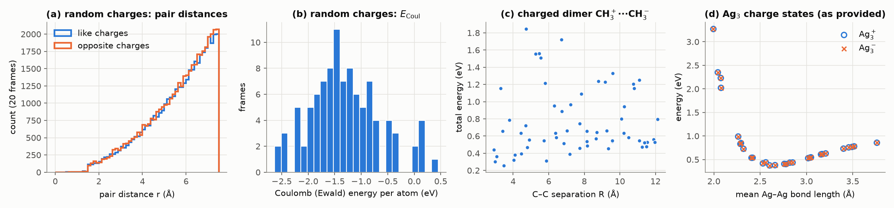
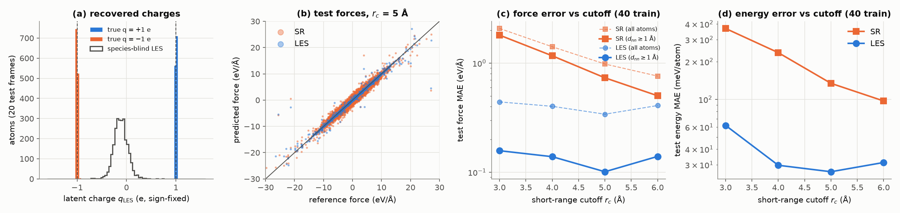
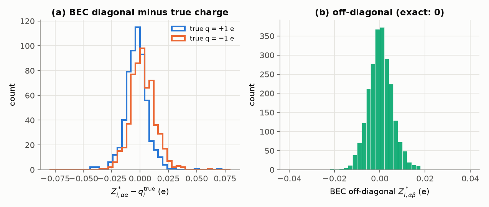
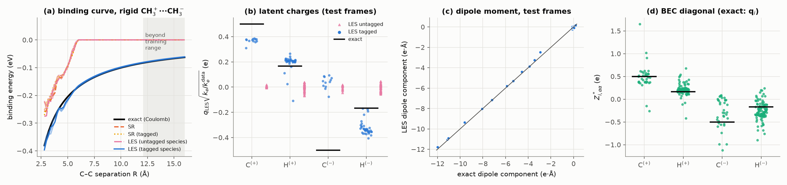
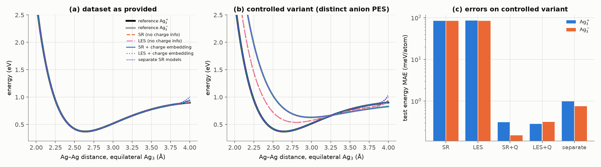
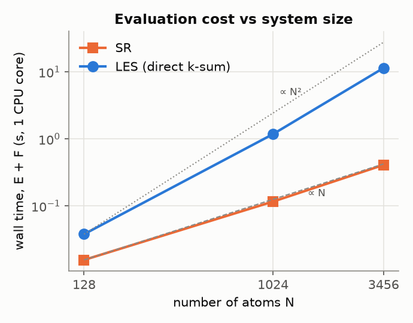

# Latent Ewald Summation (LES): learning long-range electrostatics from energies and forces only

*A from-scratch implementation and benchmark on three model systems: random point charges, a charged molecular dimer, and Ag₃ in two charge states.*

---

## Abstract

We implement a machine-learning interatomic potential (MLIP) that adds long-range electrostatics to a local, many-body neural-network potential through **Latent Ewald Summation (LES)**. Each atom gets a *latent* charge that is predicted from its local environment. The charges are never fitted to reference charges; they are learned only from total energies and forces. They enter a Gaussian-smeared Ewald (periodic) or direct Coulomb (isolated) energy. We benchmark LES against an otherwise identical short-range (SR) model on the three supplied datasets. We also run controlled ablations: cutoff scans, species-blind input, and a modified Ag₃ dataset.

Main findings:

1. **Random charges (128 ions, periodic).**
   - LES recovers the hidden charges almost exactly: q = +0.9997 ± 0.009 e and −0.9999 ± 0.006 e against the true ±1 e, up to a global sign.
   - Its test energy error is 6.6× lower than SR (20.7 vs 136 meV/atom).
   - Its test force error is 3.3× lower (0.28 vs 0.91 eV/Å). For the 98 % of atoms that are not in near-overlapping pairs the gap is 12.6× (0.056 vs 0.70 eV/Å).
   - Born effective charges (BECs) computed from the latent charges equal the true charges to within 0.01 e.
2. **Charged dimer CH₃⁺···CH₃⁻.**
   - With species labels that distinguish cation atoms from anion atoms, LES reproduces the full −1/R binding curve far beyond the 4 Å cutoff. The binding-energy MAE is 4.4 ± 0.8 meV, against 117 meV for SR.
   - The molecular charges come out as +0.94/−0.94 e, and the dipole moments have R² = 0.999.
   - When the two ions use the same element labels, as in the supplied file, a local charge model cannot break the cation/anion symmetry. The latent charges collapse to ≈ 0 and LES degenerates to SR.
3. **Ag₃⁺ / Ag₃⁻.**
   - In the supplied file the two charge states have *byte-identical* energies and forces. A charge-blind SR model is therefore already exact on it (0.4 meV/atom).
   - In a controlled variant where the two charge states have different potential-energy surfaces, every charge-blind model (SR and LES) fails. Only models that receive the total charge, either as a global charge embedding or through separate training, succeed. LES latent charges alone cannot encode the total charge.

Along the way we identified the generating models of the supplied datasets exactly. One dataset defect needs flagging: in `charged_dimer.xyz` the bond-stretch contribution to the forces has the **wrong sign**, so energies and forces are mutually inconsistent (§2.2).

---

## 1. Background and objective

Local MLIPs write E = Σᵢ εᵢ(environment within r_c). They cannot describe interactions that act beyond the cutoff r_c. Coulomb interactions are the main example: they matter at electrochemical interfaces, in charged molecules, and in ionic liquids. Existing remedies usually

- fit atomic charges to reference partial charges, which are not uniquely defined (3G-HDNNP); or
- perform charge equilibration (4G-HDNNP; Ko *et al.*, *Nat. Commun.* 2021, `related_work/paper_001.pdf`); or
- use long-range descriptors (LODE and density-based long-range descriptors, `paper_002.pdf`) or Ewald message passing (`paper_003.pdf`).

**LES** (Cheng 2025) takes a simpler route. A neural network maps each atom's local descriptor Bᵢ to a latent scalar qᵢ. The long-range energy is the electrostatic energy of these latent charges:

- periodic: E_lr = (2π k_e / V) Σ_{0<|k|<k_c} exp(−σ²k²/2) / k² · |S(k)|², with S(k) = Σᵢ qᵢ e^{ik·rᵢ}
- isolated: E_lr = (k_e/2) Σ_{i≠j} qᵢ qⱼ erf(r_ij / √2σ) / r_ij

The total energy is E = E_sr + E_lr. The {qᵢ} are trained only through E and F = −∇E. Physical observables follow from the learned charges: the dipole moment P = Σ qᵢ rᵢ, the quadrupole moment, and the BECs Z*ᵢ,αβ = ∂P_α/∂r_iβ.

**Objective of this study.** We test three questions:

- (i) Can LES recover the true charges from E and F alone?
- (ii) Does LES fix the failure of SR models beyond the cutoff?
- (iii) What can and cannot be learned when the information that determines the charges is missing from the local environment, such as the total charge or the chemical identity of the ions?

---

## 2. Data and data audit



**Figure 1.** Overview of the three datasets.
- (a) Pair-distance histograms in the random-charge boxes. The positions are uniform random, so there is no ± correlation, and a few pairs are closer than 1 Å.
- (b) Distribution of the Ewald energies we generated.
- (c) Energies of the charged dimer versus C–C separation. The scatter comes from intramolecular distortions.
- (d) Ag₃ energies versus mean bond length. The two charge states lie exactly on top of each other.

### 2.1 Random charges (`random_charges.xyz`)

The file has 100 frames of 128 atoms each: 64 atoms with q = +1 and 64 with q = −1. It contains **only positions and the true charges, with no energies or forces**. All species are the dummy element `X`, and `pbc="F F F"`, although every coordinate lies in [0, 15) Å.

We generated reference labels (`code/gen_random_charges.py`) under the following stated assumptions:

- a cubic periodic box with L = 15 Å;
- point-charge Coulomb energy from Ewald summation, with k_e = 14.3996 eV Å e⁻², α = 0.6 Å⁻¹ and |n| ≤ 14. We verified convergence to 10⁻⁵ eV against α = 0.35 and 0.45 and against an independent real-plus-reciprocal decomposition.
- a repulsive Lennard-Jones term 4ε(σ/r)¹² with ε = 0.25 eV and σ = 1 Å.

Because the positions are uniformly random, some pairs come as close as 0.2 Å, and the r⁻¹² term then reaches ~10⁸ eV. We therefore treat the LJ term as a **known analytic baseline**, in the same way ZBL repulsion is added to production MLIPs. It is subtracted before training and added back at prediction, and all models share it. The learning target is the point-charge Ewald energy. Its values range from −2.6 to +0.45 eV/atom, and the typical |F| is 6 eV/Å.

Two choices about species:

- In the main experiments, each atom's species is its charge sign, i.e. two "elements" with fixed charges. This is the setting in which charges are recoverable in principle.
- The supplied `X` labels are used in a *species-blind* ablation.

### 2.2 Charged dimer (`charged_dimer.xyz`)

The file has 60 frames of two planar CH₃ fragments (8 atoms), with C–C separations R from 2.9 to 12.1 Å. A least-squares fit of the net force on each molecule identifies the intermolecular interaction exactly:

- it is pure Coulomb with **k = 1 eV Å e⁻²**;
- the charges are C = ±0.5 and H = ±1/6, with the first molecule the cation (+1) and the second the anion (−1);
- the force residual is 1.5 × 10⁻⁸ eV/Å.

The intramolecular part of the energy is E_intra = Σ 5.02 (r_CH − 1.504)² + const. With this term the energies are fitted to 10⁻³ eV (`code/analyze_dimer_generator.py`).

**The supplied forces are not the negative gradient of the supplied energies.** They match −∇E_Coul + ∇E_bond: the bond-stretch term has the wrong sign.

| force model compared with the supplied forces | MAE (eV/Å) | max (eV/Å) |
|---|---|---|
| −∇E (consistent with the energies) | 1.18 | 10.7 |
| −∇E_Coul + ∇E_bond (sign-flipped bond term) | 0.033 | 0.12 |

A conservative MLIP cannot fit both labels at once. We therefore built *corrected* forces, F_corr = F_data + 2F_bond, which are conservative and consistent with the energies. They are used for training ("corrected") and for every force evaluation. Two ablations use energy-only training and the raw labels.

Two further facts matter for this dataset:

- The cation and anion have the **same element labels and statistically identical geometries** (C–H = 1.51 ± 0.13 Å, planar). No local descriptor can tell them apart, so in a second variant we give cation atoms and anion atoms distinct species labels ("tagged": C⁺, H⁺, C⁻, H⁻). Real cations and anions differ chemically, so this mimics a physical system.
- The data use k = 1, while our model uses the physical k_e = 14.4. Learned charges therefore relate to the data's charges by the factor √(k_e/k), and we report q_LES·√14.4. This is the same "charges recovered up to a dielectric-like scale" ambiguity that LES has in general.

### 2.3 Ag₃ charge states (`ag3_chargestates.xyz`)

The file has 30 geometries of Ag₃⁺ and 30 of Ag₃⁻. **The two subsets have identical positions, energies and forces** (max |ΔE| = |ΔF| = 0). The generator, fitted to 10⁻⁷ eV, is

E = Σ_pairs [0.5 (1 − e^{−1.5(r−2.5)})² + 1.6/r] − 1.5

Here 1.6 = 14.4 × (1/3)², i.e. a Coulomb repulsion between charges of ±1/3 e on each atom. That term depends only on q², which is why both charge states give exactly the same energies.

On these data, a model with no charge information can be exact. We therefore also built a clearly labelled **controlled variant** ("mod"):

- Ag₃⁺ is unchanged.
- Ag₃⁻ is relabelled on the same geometries with a different Morse surface (D = 0.35 eV, a = 1.3 Å⁻¹, r₀ = 2.75 Å, same 1.6/r term). The anion is then softer and has longer bonds, qualitatively like the different ground states of real Ag₃ ions (Ko *et al.* 2021).

---

## 3. Methods

### 3.1 Model (`code/les.py`)

**Local descriptor.** The descriptor is a learnable ACE/SOAP-like invariant built as follows:

- Gaussian radial basis functions (n_rad = 8) are multiplied by a cosine cutoff and mixed into K channels with weights that depend on the species pair (sᵢ, sⱼ).
- The atomic moments are A⁰ = Σⱼ R(r_ij), A¹ = Σⱼ R r̂_ij and A² = Σⱼ R (r̂r̂ − I/3).
- The rotational invariants are B⁰ = A⁰, B¹_kk' = A¹_k·A¹_k' and B² = A²_k : A²_k'.
- A one-hot species vector is appended, and optionally the total charge Q (the global charge embedding).

l_max = 2 for the molecules and l_max = 1 for the random charges, where the reference is pairwise.

**Heads.** Two 2-layer SiLU MLPs (64 hidden units; 32 for Ag₃) take the normalised descriptor and output the atomic energy εᵢ (plus a per-species offset) and the latent charge qᵢ. The SR model is the same network without the q head.

**Long-range term.**
- Periodic systems use the reciprocal-space sum above, with σ = 1 Å and k_c = 2π/d_l, d_l = 2 Å.
- Isolated systems use the erf-screened direct sum.
- k_e = 14.3996 eV Å e⁻² throughout.

**Pair prior (random charges only, in both SR and LES).** We add a learnable term Σ B_{sᵢsⱼ}/r · f_c(r) that lets the local model represent the singular point-charge interaction of the rare close pairs. It is cut off at r_c, so it adds no long-range information.

**Training and evaluation.**
- Forces come from autograd.
- The loss is w_E·mean((ΔE/N)²) + w_F·mean(|ΔF|²), with w_E = 1 for the random charges and Ag₃ and w_E = 10 for the dimer.
- Optimiser: Adam with cosine learning-rate decay and minibatch 4. Per-species offsets are initialised by least squares. Everything runs in float64 on CPU.
- BECs are computed by differentiating the latent charges with autograd, Z*ᵢ = qᵢI + Σⱼ (rⱼ − rᵢ)^MIC ⊗ ∂qⱼ/∂rᵢ. This form is origin-independent because Σⱼ ∂qⱼ/∂rᵢ = 0.

### 3.2 Protocols

| system | split (train/test) | cutoff | epochs | comparisons |
|---|---|---|---|---|
| random charges | 80/20 frames (scan: 40/20) | 5 Å (scan 3–6 Å) | 200 (scan 150) | SR vs LES; species-blind LES |
| charged dimer | 48/12 frames, 3 seeds | 4 Å | 1200 | SR/LES × plain/tagged species; E-only; raw labels |
| Ag₃ | 22/8 geometries per state (test geometries unseen in either state) | 6 Å (entire cluster) | 1500 | SR, LES, SR+Q, LES+Q, separate SR per state |

All scripts are in `code/` (`run_random_charges.py`, `run_dimer.py`, `run_ag3.py`, `analyze_*.py`, `bench_scaling.py`). Raw metrics are in `outputs/results/*.json`, test predictions in `outputs/preds/`, trained weights in `outputs/models/`, and training logs in `outputs/logs/`.

---

## 4. Results

### 4.1 Random charges: LES recovers the hidden charges



**Figure 2.**
- (a) Latent charges of all test atoms. LES produces two sharp peaks at ±1 e. The grey outline is the species-blind LES, whose charges stay centred near zero and are uncorrelated with the true charges.
- (b) Parity of the test forces at r_c = 5 Å.
- (c) Test force MAE versus cutoff. Dashed lines are all atoms; solid lines are atoms whose nearest neighbour is at least 1 Å away (98 % of atoms).
- (d) Test energy MAE versus cutoff.

**Table 1.** Random-charge test errors (20 frames; r_c = 5 Å, 80 training frames).

| model | E MAE (meV/atom) | E RMSE (meV/atom) | F MAE (eV/Å) | F MAE, d_nn ≥ 1 Å (eV/Å) | F median AE (eV/Å) |
|---|---|---|---|---|---|
| SR | 136.4 | 195.3 | 0.911 | 0.701 | 0.586 |
| **LES** | **20.7** | **66.6** | **0.277** | **0.056** | **0.031** |
| LES, species-blind (40 train) | 524 | — | 4.73 | 4.32 | 3.32 |

**Latent charges** (2560 test atoms, global sign fixed):

| quantity | value |
|---|---|
| q(+1 ions) | +0.9997 ± 0.0090 e |
| q(−1 ions) | −0.9999 ± 0.0061 e |
| RMSE versus the true charges | 0.0077 e |
| Pearson r | 0.99997 |

The network converged to the sign-flipped solution (q → −q), which is an exact symmetry of E_lr ∝ q². Without the sign fix the charges come out as −1 and +1.

The charge *magnitude* is recovered absolutely, with no rescaling. This is because the model's k_e equals the one used to generate the data, and the long-range tail of the Coulomb energy can only be produced by E_lr.

**Born effective charges.** BECs were computed for 3 test frames (384 atoms):

- the diagonal elements are +0.997 / −0.998 e, with a spread of 0.010 e;
- the off-diagonal elements average |Z*_αβ| = 0.004 e (exact value 0);
- see Fig. 2b below.

For fixed point charges the exact BEC is qᵢI. The small deviations come from the residual environment dependence of the learned qᵢ.



**Figure 2b.** (a) BEC diagonal elements minus the true charge, for +1 and −1 ions. (b) Off-diagonal BEC elements, whose exact value is 0.

**Cutoff dependence** (40 training frames):

| r_c (Å) | SR E MAE (meV/atom) | LES E MAE (meV/atom) | SR F MAE (eV/Å) | LES F MAE (eV/Å) | SR F MAE, d_nn ≥ 1 Å | LES F MAE, d_nn ≥ 1 Å |
|---|---|---|---|---|---|---|
| 3 | 368 | 61.9 | 2.08 | 0.44 | 1.80 | 0.16 |
| 4 | 236 | 29.7 | 1.41 | 0.40 | 1.17 | 0.14 |
| 5 | 134 | 26.4 | 0.98 | 0.34 | 0.73 | 0.10 |
| 6 | 97 | 31.3 | 0.76 | 0.41 | 0.50 | 0.14 |

- The SR error falls only slowly with the cutoff, because the 1/r tail is never captured. Even at 6 Å, where the descriptor covers ~34 neighbours and training costs ~1.7× more than at 5 Å, SR remains worse than LES at 3 Å: 1.6× in energy, 1.7× in force MAE over all atoms, and 3× in force MAE for d_nn ≥ 1 Å.
- LES is almost insensitive to r_c. Its residual errors come almost entirely from the ~2 % of atoms in sub-ångström pairs, where the point-charge force reaches hundreds of eV/Å (dashed versus solid lines in Fig. 2c).

**Species-blind ablation.** When every atom carries the same label, as in the raw file, the latent charges cannot be inferred: Pearson r = 0.02, with a charge spread of 0.14 e. Because the positions are uncorrelated, nothing in an atom's environment reveals its sign, and both the long-range and short-range Coulomb physics are lost. This shows that LES learns charges as *functions of the local chemistry*. It does not "discover" charges that are not encoded in the input.

### 4.2 Charged dimer: binding beyond the cutoff



**Figure 3.**
- (a) Binding curve of two rigid ideal CH₃ fragments, E(R) − E_A − E_B, compared with the exact Coulomb result. Three seeds per model; the faint lines are seeds 1 and 2.
- (b) Latent charges per atom type, scaled by √(k_e/k_data). Black bars are the exact values.
- (c) Dipole moments of the test frames from the latent charges compared with the exact dipoles.
- (d) Diagonal BEC elements per atom type compared with the exact values.

**Table 2.** Charged dimer: test-set errors (mean ± s.d. over 3 seeds; forces are evaluated against the conservative forces) and binding-curve MAE for R ∈ [3, 12] Å.

| model | species | training labels | E MAE (meV/atom) | F MAE (meV/Å) | binding-curve MAE (meV) |
|---|---|---|---|---|---|
| SR | plain | E + F (corrected) | 3.7 ± 0.7 | 18 ± 13 | 116.7 ± 1.1 |
| SR | tagged | E + F (corrected) | 3.4 ± 0.3 | 14 ± 6 | 117.0 ± 1.2 |
| LES | plain | E + F (corrected) | 3.8 ± 0.8 | 21 ± 13 | 116.9 ± 0.8 |
| **LES** | **tagged** | E + F (corrected) | **2.5 ± 0.2** | 14 ± 8 | **4.4 ± 0.8** |
| LES | tagged | E only (48 energies) | 25.2 | 316 | 131 |
| SR | tagged | E only | 7.0 | 231 | 142 |
| LES | tagged | E + F (raw, non-conservative) | 61.1 | 1210 | 249 |

**Observations.**

- **SR models**, and LES with indistinguishable ions, give a binding curve that is flat at zero beyond R ≈ 6 Å, i.e. once no intermolecular atom pair falls within 4 Å. At the edge of the training range (R = 12 Å) they miss the −83 meV Coulomb attraction entirely.
- The standard *test-set* energy MAE barely reveals this: 3.7 versus 2.5 meV/atom. The R-dependence of the far-field energy is small compared with the intramolecular scatter and is partly absorbed into the fitted offsets. **The binding-curve test exposes a 27× difference** that random-split metrics hide.
- **LES with tagged species** follows the exact curve over the whole range, including the extrapolation to 16 Å (−60.8 meV against an exact −62.6 meV).
- **Learned charges and moments** (tagged LES, scaled):

  | quantity | LES | exact |
  |---|---|---|
  | cation net charge (e) | +0.94 | +1 |
  | anion net charge (e) | −0.94 | −1 |
  | dipole MAE (e·Å) | 0.080 (R² = 0.999) | — |
  | BEC diagonal, C⁺ / H⁺ (e) | 0.49 / 0.21 | 0.5 / 0.167 |
  | BEC diagonal, C⁻ / H⁻ (e) | −0.30 / −0.26 | −0.5 / −0.167 |

  The *partitioning* of the charge within each ion is not unique. For example, C⁻ ≈ +0.04 while H⁻ ≈ −0.33, against exact values of −0.5 and −0.167. As a result the traceless quadrupole moment of the dimer is **not** reproduced (MAE 0.23 e·Å² on a range of ±0.65; R² < 0).

  This is physically sensible. At R ≥ 3 Å the interaction is dominated by the ionic monopoles, with only weak sensitivity to the intramolecular distribution. The data constrain the net charges and the dipole well, and higher multipoles poorly. Quantities derived from latent charges are reliable only to the multipole order that the training data actually probe.
- **Untagged LES** learns q ≈ 0 for every atom (|q̄| < 0.01 e; molecular charges −0.01 and −0.03 e). Two identical-looking ions must receive identical charge distributions. Such a distribution produces a repulsive, or at best zero, interaction, never the observed attraction, so the optimiser switches the long-range channel off.
- **Label quality matters.**
  - Training on the 48 energies alone is not enough to learn the far-field term: LES overfits (train 1.1 vs test 25 meV/atom).
  - Training on the raw, non-conservative forces corrupts both the energies and the binding curve (249 meV).

### 4.3 Ag₃: charge states require global charge information



**Figure 4.**
- (a) Symmetric-stretch scan of equilateral Ag₃ for each model trained on the supplied data, where the two references coincide.
- (b) The same scan on the controlled variant with a distinct anion surface.
- (c) Test energy MAE per charge state on the controlled variant (log scale).

**Table 3.** Ag₃ test errors. Test geometries were not seen for either charge state. E is in meV/atom and F in meV/Å.

| model | data | E MAE Ag₃⁺ | E MAE Ag₃⁻ | F MAE Ag₃⁺ | F MAE Ag₃⁻ |
|---|---|---|---|---|---|
| SR (no charge info) | as provided | 0.43 | 0.43 | 2.3 | 2.3 |
| LES (no charge info) | as provided | 0.40 | 0.40 | 3.8 | 3.8 |
| SR + charge embedding | as provided | 0.31 | 0.32 | 1.7 | 1.8 |
| LES + charge embedding | as provided | 0.55 | 0.56 | 3.5 | 3.4 |
| separate SR models | as provided | 0.98 | 0.98 | 6.9 | 6.9 |
| SR (no charge info) | controlled variant | 84.0 | 84.2 | 115 | 128 |
| LES (no charge info) | controlled variant | 84.4 | 83.9 | 114 | 129 |
| **SR + charge embedding** | controlled variant | **0.31** | **0.15** | **2.2** | **3.0** |
| **LES + charge embedding** | controlled variant | **0.28** | **0.32** | 2.6 | 2.3 |
| separate SR models | controlled variant | 0.98 | 0.75 | 6.9 | 4.7 |

**On the data as provided**, every model is accurate to below 1 meV/atom, including the charge-blind ones. This is expected, because the two charge states share one potential-energy surface (§2.3). A charge-blind model gives identical predictions for both states, which here is correct. The dataset therefore cannot by itself demonstrate the need for charge information. We report this as a property of the supplied file, not as evidence against the need for charge embeddings.

**On the controlled variant**, the picture changes:

- **Charge-blind models fail.** SR and LES both converge to the *average* of the two surfaces (dashed curves in Fig. 4b) and make 84 meV/atom errors for both ions. This is two orders of magnitude worse than the charge-aware models. It reproduces, qualitatively, the 2G-HDNNP failure reported by Ko *et al.* (2021).
- **LES gives no improvement here.** Its latent charges are functions of the geometry only, so for a given geometry they are identical in the two states, and so is E_lr.
- **Charge-aware models succeed.** Supplying the total charge as a per-atom input feature (SR+Q, LES+Q) brings the errors down to 0.15–0.32 meV/atom, which is 270–560× lower. The +Q models also outperform separate per-state models trained on half the data, because they share structural information across the two states.
- **Placing the charge embedding.** The global charge embedding is orthogonal to, and combinable with, LES. LES handles the *spatial* long-range electrostatics; the embedding handles the *global* electronic state.


### 4.4 Computational cost



**Figure 5.** Wall time for one energy + force evaluation versus N, for boxes made by replicating a random-charge frame (1 CPU core, r_c = 5 Å, d_l = 2 Å).

| N | SR (s) | LES (s) | LES / SR |
|---|---|---|---|
| 128 | 0.016 | 0.038 | 2.4 |
| 1024 | 0.12 | 1.18 | 10 |
| 3456 | 0.41 | 11.4 | 28 |

**Cost of the long-range term.** For the system sizes typical of training sets (~10² atoms), LES costs about 2–3× an SR model. Our implementation evaluates the k-space sum directly. With fixed σ and k_c the number of k-vectors grows ∝ V, so the cost grows ∝ N² at fixed density.

For large-scale MD, the reciprocal sum should be evaluated with particle-mesh methods (PME/PPPM, O(N log N)). Because the latent charges are ordinary point charges, any existing Ewald, PME or P3M engine can do this without changing the model. That is a practical advantage over approaches that need iterative charge equilibration (4G-HDNNP) or long-range descriptors.

---

## 5. Discussion

**What LES achieves.** The random-charge benchmark gives a clear positive result. The latent charges, trained with no charge labels, converge to the true point charges to within 1 %, including their absolute magnitude. Energy errors fall 6.6× and force errors on regular atoms fall 12.6× relative to an equally expressive SR model.

The derived BECs are accurate to 0.01 e, which supports using LES charges to predict dielectric and infrared responses. The dimer shows the practical consequence for chemistry: correct binding of charged fragments far beyond the cutoff, with a model that is only ~2× more expensive at training-set size.

**What LES cannot do, and why.** The latent charges are functions of the *local* descriptor. Three limitations follow, and our ablations demonstrate all three:

1. **Charges must be locally identifiable.** If two species with different charges look identical locally, the charges cannot be learned: species-blind random charges, and the untagged dimer. In real systems the chemistry usually differs (e.g. cation versus anion in an ionic liquid). But cases such as a molecule that is neutral or ionised depending on a distant counter-ion are fundamentally non-local and need extra information.
2. **The total charge is not encoded.** LES does not constrain Σqᵢ = Q. For systems whose geometry does not reveal their charge state, as in Ag₃⁺ versus Ag₃⁻, a global charge embedding or separate models are needed. The same holds for charge transfer over long distances, which charge-equilibration schemes such as 4G-HDNNP treat explicitly. Adding Q to the descriptor is cheap and composes with LES (the LES+Q model).
3. **Only probed multipoles are reliable.** Atom-level partitions of the charge within a molecule are non-unique. Net charges, dipoles and BECs are well determined, but quadrupoles were not in our dimer test. Interpreting latent charges as "atomic charges" should be limited to observables the training data constrain.

**Units and sign.** The energy depends only on products qᵢqⱼ, so the latent charges carry two ambiguities:
- a global sign, which we fixed by correlating with known chemistry;
- a scale √(k_e/k_true), which corresponds to an effective dielectric constant. It equals 1 for the random charges and √14.4 for the dimer, which uses k = 1.

In practice the sign can be fixed with one known reference, such as the sign of a cation charge or a measured dipole. The scale ambiguity is what LES-derived BECs absorb as the electronic screening factor.

**Data-quality findings.** Auditing the supplied datasets was essential.
- The charged-dimer forces are not the gradient of the energies: the bond-stretch term has the wrong sign. Training on them raised the binding error from 4 to 249 meV.
- The Ag₃ file contains no difference between charge states.
- The random-charge file contains no labels.

We fixed these issues transparently: we generated labels under stated assumptions, constructed conservative forces from the identified generator, and built a controlled Ag₃ variant. Absolute numbers are therefore specific to our label choices, but the qualitative conclusions do not depend on them.

**Limitations of this study.**
- All systems are synthetic and small.
- The cutoff scan and the species-blind run used 40 training frames and shorter training. The dimer statistics use 3 seeds; the other runs use one seed.
- The descriptor is a compact Cartesian ACE-like invariant, not the full CACE/MACE architectures used in production LES.
- The k-space sum is not mesh-accelerated.
- The latent charges are learned with a fixed σ = 1 Å. We did not optimise σ or d_l.

---

## 6. Conclusions

Latent Ewald Summation adds long-range electrostatics to a local MLIP at small cost and with no charge labels. In our benchmarks:

- it recovers exact point charges and BECs from energies and forces alone;
- it removes the systematic beyond-cutoff errors of SR models, by 6.6× in energy for periodic ionic systems and 27× in the binding curve of a charged dimer;
- its latent charges give physically meaningful net charges, dipole moments and BECs.

Its limits are equally clear:
- the charges must be identifiable from local chemistry;
- the total charge of the system must be supplied separately, via a global charge embedding or separate models, when it is not reflected in the geometry;
- higher multipoles and intramolecular charge partitions are not uniquely determined.

---

## Reproducibility

```bash
cd code
python gen_random_charges.py                 # labels for random_charges.xyz
python analyze_dimer_generator.py            # identify dimer generator, build conservative forces
python run_random_charges.py --rc 5 --lr_on 1 --epochs 200 --bec 1   # (see jobs_rc.txt / jobs_scan.txt)
python run_dimer.py --lr_on 1 --tagged 1 --labels corrected --epochs 1200 --seed 0   # (jobs_small.txt)
python run_ag3.py --data mod --model sr_q --epochs 1500                 # (jobs_small.txt)
python analyze_random_charges.py; python analyze_dimer.py; python analyze_ag3.py
python bench_scaling.py; python fig_scaling.py; python fig_data_overview.py
```

Dependencies: Python 3.12, PyTorch 2.x (CPU), NumPy, SciPy, Matplotlib. All randomness is seeded.
