# Reconciled global glacier mass change 2000–2023 from 233 multi-method regional estimates

*An independent re-implementation of the GlaMBIE community reconciliation, with validation, uncertainty diagnostics, and comparison with ice sheets and model projections.*

## Abstract

We combine the 233 regional glacier mass-change estimates of the Glacier Mass Balance Intercomparison Exercise (GlaMBIE). They are delivered as 257 files: 38 glaciological, 42 DEM differencing, 41 altimetry, 78 gravimetry and 58 hybrid series. From them we derive annual regional and global glacier mass change for 2000–2023 with uncertainties.

The inputs are homogenised and annualised, combined within three data groups (DEM differencing + glaciological, altimetry, gravimetry), averaged across groups, and converted to calendar years. Global glaciers lost **6605 ± 387 Gt** over 2000–2023. This is -275.2 ± 16.1 Gt yr⁻¹, or -0.41 m w.e. yr⁻¹, and equals **18.2 ± 1.1 mm** of global-mean sea-level rise.

Loss accelerated. The mean rate changed from -236 ± 22 Gt yr⁻¹ (2000–2011) to -315 ± 24 Gt yr⁻¹ (2012–2023), an increase of 33 ± 16 %. The linear trend in the annual rates is -9.5 ± 2.4 Gt yr⁻². 2023 was the most negative year on record at -569 ± 103 Gt.

Our main configuration was chosen among predefined alternatives by reproducing the published GlaMBIE results. It agrees with the official values:
- total -6542 ± 387 Gt (difference 1.0 %);
- global calendar-year RMSD 36 Gt;
- all 19 regional mean rates within 1σ.

Over 2000–2018 glaciers lost 1.3× as much mass as the Greenland Ice Sheet and 2.0× as much as the Antarctic Ice Sheet. That makes them the largest single land-ice contributor to sea-level rise in that period.

Central Europe has lost 45 % of its ice mass since 2000, and five more regions have lost more than 20 %. The observed 2015–2023 global rate (0.96 mm SLE yr⁻¹) is already comparable to the mean 2015–2100 rate of the low-emission projections (0.93–1.15 mm yr⁻¹).

## 1. Introduction

Glaciers outside the two ice sheets hold less than 1 % of Earth's land ice. Even so, they are a leading contributor to present sea-level rise and a key freshwater resource (Zemp et al. 2019; Hugonnet et al. 2021).

Four observation families measure glacier mass change:
- in-situ glaciological mass balance;
- multi-temporal DEM differencing;
- satellite altimetry (ICESat, CryoSat-2, ICESat-2);
- satellite gravimetry (GRACE / GRACE-FO).

They differ in spatial coverage, temporal resolution and error structure. Glaciological series resolve inter-annual variability but sample few glaciers. DEM differencing is spatially complete but only multi-annual. Altimetry and gravimetry are sub-annual but limited in time and, for GRACE, in spatial resolution. Earlier assessments disagreed by tens of Gt yr⁻¹ depending on which method dominated.

GlaMBIE collected 233 estimates from 35 teams to produce a community reconciliation. This report:
1. re-implements that reconciliation from the raw inputs;
2. validates it quantitatively against the published GlaMBIE results;
3. tests its methodological choices and uncertainty model;
4. places the result in context: ice-sheet losses, relative regional ice loss, method consistency, and the glacier-model projections used by IPCC (GlacierMIP; Rounce et al. 2023).

## 2. Data

`data/glambie/input` holds one CSV per submitted solution and region. Each row gives start and end dates (fractional years), a change, its error and a unit: m of elevation, m w.e. or Gt (Fig. 1). The temporal structure differs by method:
- **Glaciological:** monthly WGMS/UZH sine-wave products and annual WGMS-beta series. The WGMS-beta series are *anomaly/variability* products by design: their 2001–2020 means are close to zero, from -0.31 to 0.35 m w.e. yr⁻¹, mean 0.05. They carry variability, not level.
- **DEM differencing:** multi-annual trends, e.g. the Hugonnet et al. pentads 2000–2020.
- **Altimetry:** monthly CryoSat-2 series (Jakob & Gourmelen; Nilsson/Gardner) plus multi-year ICESat/ICESat-2 trends.
- **Gravimetry:** monthly GRACE/GRACE-FO solutions from seven groups. Some fill the 2017–2018 mission gap by interpolation (Harig: NaN), plus one trend (Jacob 2012).
- **Hybrids:** annual glaciological–geodetic syntheses (Dussaillant, Huss, Pálsson), in-situ+GRACE series (Box), and trends (Colgan, Miles).

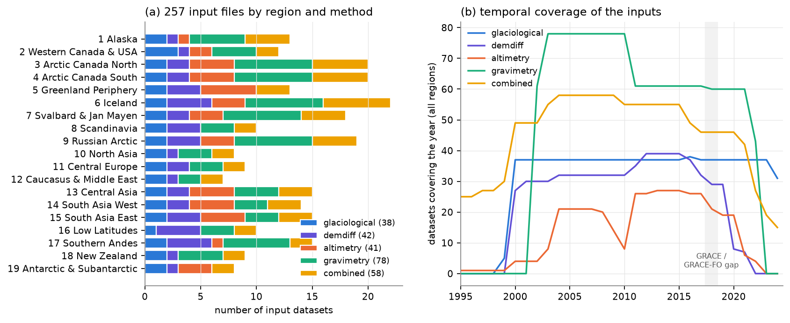

*Figure 1. (a) Number of input datasets per region and method. (b) Number of datasets covering each year, all regions.*

`data/glambie/results` contains the official GlaMBIE results: hydrological and calendar years, per data group and combined, plus a global series. We use them in three ways only:
1. the `glacier_area` column, as auxiliary RGI 6.0-based area information (a linear area model A(t) per region);
2. validation;
3. choosing among a small set of predefined methodological variants (Section 3.6).

Regional RGI 6.0 areas and ice volumes are taken from Zemp et al. (2019, Table 1). Ice-sheet mass balance is taken from Hugonnet et al. (2021, Table 1). Projections are taken from Rounce et al. (2023), Marzeion et al. (2020) and Hock et al. (2019).

## 3. Methods

The code is in `code/` (see `code/README.md`); the method itself is in `glambie_lib.py`.

### 3.1 Homogenisation
- **Elevation change → mass:** converted with a density of ρ = 850 ± 60 kg m⁻³, with σ² = (ρσ_h)² + (hσ_ρ)².
- **Common unit:** every dataset is expressed in m w.e. relative to the fixed RGI 6.0 regional area A_RGI. This is the reference area of the geodetic and glaciological inputs, so it is equivalent to Gt: Gt = m w.e. · A_RGI · 10⁻³. Gt inputs are converted with A_RGI.
- **Output specific change:** final values are expressed relative to the time-varying area, m w.e.(t) = 10³ Gt / A(t).

The fixed reference area matters. In small, fast-shrinking regions such as Central Europe (A falls by about 20 % over 2000–2023), using A(t) in both conversions underestimates specific loss late in the record. That is one cause of the earlier under-estimate in Central Europe.

Error handling:
- Missing or zero errors are filled with the dataset median.
- The Pálsson hybrids report no errors and are given 0.3 m w.e. yr⁻¹.
- Lower-case `gt` units are accepted.

### 3.2 Annualisation
Hydrological years (HY) start on 1 October in regions 1–15, 1 January in region 16 and 1 April in regions 17–19.

**Monthly series** are summed within each HY:
- *Glaciological:* at least 10 of 12 months required. Monthly errors are treated as increments and combined in quadrature.
- *Altimetry and gravimetry:* all 12 months required. Per-epoch errors are combined as an RMS. For gravimetry the RMS is divided by √12, because monthly GRACE noise is largely independent between months; this matches the published group uncertainties (Section 4.6). The *level* of each altimetry or gravimetry series is set by an OLS regression of its cumulative series (trend + annual and semi-annual harmonics, with one offset per contiguous segment). The annual values are shifted so that their mean equals the regression trend. This avoids the end-epoch noise of two-epoch differences.
- *GRACE gap:* months in the 2017–2018 gap (2017.40–2018.49) are discarded, even when a provider interpolated through it. The change across the gap is kept as a trend record and distributed with external variability. In the official files, the gravimetry series in the gap years likewise lacks its own annual variability (`annual_variability` flag empty).

**Annual series** are mapped onto the HY grid.

**Trend datasets** keep their periods. Multi-period DEM series (e.g. Hugonnet pentads) are calibrated pentad by pentad in the main configuration. The full-period alternative is a sensitivity run.

### 3.3 Combination within data groups
Each trend record k with change Δ_k over [t₀, t₁] is turned into an annual series S_k(y) = V(y) + c_k. Here V is an annual variability ("shape") series, and c_k is chosen so that Σ_y f_ky S_k(y) = Δ_k, where f_ky is the fraction of HY y inside the period. Years with f > 0.5 are assigned to the record.

- **DEM differencing + glaciological (D):** V is the mean anomaly (relative to 2000–2019) of the glaciological series and the annual hybrid series. The level is the team-mean offset of all DEM records and of the annual hybrids, which vote year by year. Hybrids sit in this group in the main configuration. Beyond the last level observation the offset is held at its nearest value, with an extrapolation error of 0.1 m w.e. yr⁻¹ per √yr.
- **Altimetry (A) and gravimetry (G):** V is the group's own annual data where they exist, otherwise the D-group series (as in GlaMBIE's "annual variability from other sources"). The annual datasets enter directly; trend datasets are calibrated as above.
- **Team voting:** datasets from the same team (e.g. two Treichler, Pfeffer, Pálsson, Piermattei or Box variants) are averaged first, so each team has one vote.
- **Gravimetry regions:** gravimetry is used in the seven regions of the official product (1, 3, 4, 6, 7, 9, 17). Elsewhere, leakage and hydrological signals exceed the glacier signal (Section 4.4).

### 3.4 Combination of data groups and uncertainties
The regional estimate is the **unweighted mean of the available data groups** in each year. There is no gap-filling. The official combined series is reproduced to within 0.01 m w.e. by this rule when applied to the official group series.

Uncertainties:
- **Group uncertainty:** the standard error of the team mean, √(mean σ²/N + s²/N), where s is the between-team spread. In D, the variability, level and spread terms are added in quadrature.
- **Combined uncertainty:** √(Σ_g σ_g²) over available groups. The errors of the group mean are *not* divided by N, because the groups share systematic errors (density, area, level calibration). When a group is missing, its median uncertainty is added, so the combined uncertainty does not shrink just because fewer independent methods exist.
- **Multi-year uncertainty:** annual uncertainties summed in quadrature. This convention reproduces the official multi-year uncertainty from the official annual errors exactly (387 Gt for 2000–2023). We also report the fully correlated upper bound.

### 3.5 Calendar years and global aggregation
Calendar years are formed as C(Y) = (1 − w) H(Y) + w H(Y ± 1). The neighbour is the following HY in the Northern Hemisphere and the preceding HY in the Southern Hemisphere; region 16 uses w = 0.

The weight w is derived *independently* for each region. We regress calendar-year sums of the monthly glaciological sine-wave product on its HY sums. This captures where in the year inter-annual anomalies occur: little in October–December in the NH, much in January–March in the SH. These weights agree closely with the weights implied by the official HY/CY pairs (RMS difference 0.06; Table A2, Fig. 11c) and outperform a pure time fraction (w = 0.25; Table 3).

Edge years:
- *NH CY2023* needs HY2024 (Oct 2023 – Sep 2024). It is taken from the D group, which has annual data to 2024.
- *SH CY2023* needs the HY starting April 2023. It is taken from the D-group inputs that extend to March 2024 (Dussaillant, Zemp, WGMS) rather than by persistence.
- *SH CY2000* uses the HY starting April 1999.

The conversion adds an uncertainty of 0.1·|H(Y ± 1) − H(Y)|. Global values are sums of the 19 regional calendar series. The code checks that all 19 regions are present in every year. Global errors are summed in quadrature over regions.

### 3.6 Choosing the main configuration
We ran 13 predefined configurations (Table 3) varying:
- the handling of hybrids (excluded, inside D, separate group);
- DEM calibration (per pentad vs full period);
- gravimetry regions (official seven / all / none);
- altimetry (with / without);
- gap-filling;
- glaciological series used for level;
- level estimation;
- calendar weights.

Each was scored on reproduction of the official hydrological-year regional series (bias, RMSD) and of the global calendar series. The main configuration is the one closest to the official results: hybrids inside D, per-pentad DEM calibration, gravimetry in seven regions, no gap-filling, and seasonal calendar weights. All other configurations are reported as sensitivities. This choice of a *main* estimate (a reproduction of the community method) is kept separate from the *independent* methodological sensitivities.

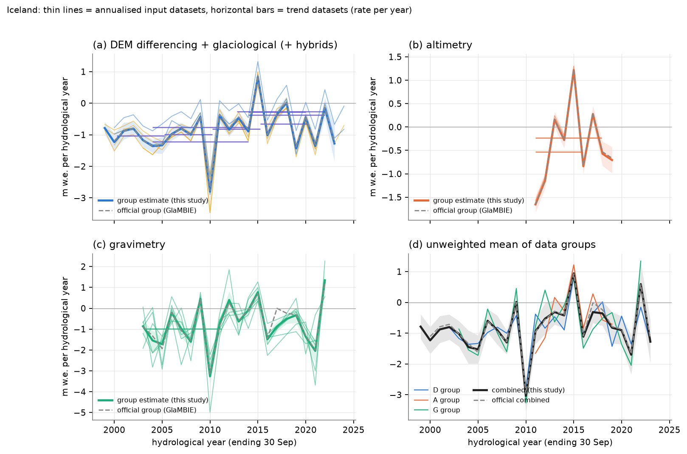

*Figure 2. Iceland as a worked example. Thin lines are annualised input datasets; horizontal bars are trend datasets (rate per year). Thick lines are the group estimates (±1σ shading); dashed lines are the official GlaMBIE groups. The combined estimate (d) is the mean of the three groups.*

## 4. Results

### 4.1 Global mass change, acceleration and sea-level contribution
Global glaciers lost:
- **6605 ± 387 Gt** over 2000–2023 (fully correlated bound ±1883 Gt);
- an average of 275.2 ± 16.1 Gt yr⁻¹, i.e. 0.41 m w.e. yr⁻¹, or 9.8 ± 0.6 m w.e. cumulatively;
- a sea-level equivalent (362.5 Gt per mm) of **18.2 ± 1.1 mm**, or 0.76 ± 0.04 mm yr⁻¹ (Fig. 4, Table A1).

For 2000–2019 the rate is -249 ± 17 Gt yr⁻¹, consistent with Hugonnet et al. (2021): −267 ± 16 Gt yr⁻¹ (95 % CI).

**Acceleration.** Mean loss increased from 236 ± 22 Gt yr⁻¹ in 2000–2011 to 315 ± 24 Gt yr⁻¹ in 2012–2023, i.e. **+33 ± 16 %** (official: +36 %).

Pentad means were:

| period | Gt yr⁻¹ |
|---|---|
| 2000–04 | -201 |
| 2005–09 | -248 |
| 2010–14 | -245 |
| 2015–19 | -302 |
| 2020–23 | -407 |

An OLS fit to the annual rates gives an acceleration of -9.5 ± 2.4 Gt yr⁻² (-95 ± 24 Gt yr⁻¹ per decade; uncertainty-weighted: -7.8; official series: -10.0).

**Record years.** 2023 is the most negative year of the record: -569 ± 103 Gt, -0.87 m w.e., 1.57 mm SLE in a single year. It is also rank 1 in the official series. The five most negative years (Table 1) all fall after 2010; four of them after 2018. Of the 8 years with losses above 300 Gt, 5 fall in 2012–2023.

**Table 1. Five most negative years (calendar years).**

| rank | year | Gt | ±σ | mm SLE |
|---|---|---|---|---|
| 1.0 | 2023.0 | -568.6 | 103.4 | 1.6 |
| 2.0 | 2019.0 | -460.9 | 79.2 | 1.3 |
| 3.0 | 2022.0 | -437.5 | 104.2 | 1.2 |
| 4.0 | 2011.0 | -371.1 | 73.6 | 1.0 |
| 5.0 | 2020.0 | -353.4 | 78.3 | 1.0 |

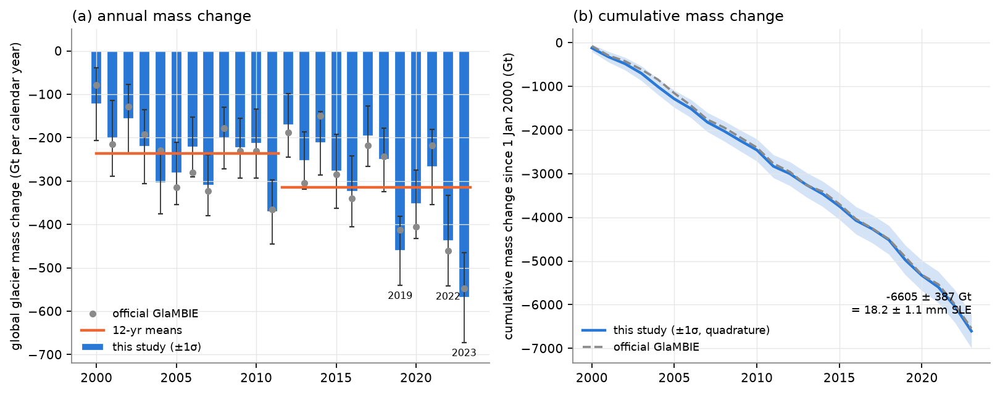

*Figure 4. (a) Annual global glacier mass change (bars, ±1σ) with the official GlaMBIE values (grey dots) and the 2000–2011 and 2012–2023 means. (b) Cumulative change since 1 January 2000.*

### 4.2 Comparison with the ice sheets
Table 2 compares glacier loss with the Greenland (GrIS) and Antarctic (AIS) ice-sheet losses reported by Hugonnet et al. (2021, Table 1). Those are IMBIE estimates minus half of the peripheral-glacier component, to avoid double counting; their 95 % intervals are converted here to 1σ; the AIS series ends in June 2017.

- **2000–2018:** glaciers lost 238 ± 17 Gt yr⁻¹, versus 181 ± 16 Gt yr⁻¹ for the GrIS and 121 ± 53 Gt yr⁻¹ for the AIS. That is a ratio of 1.31 ± 0.15 to Greenland and 1.97 ± 0.87 to Antarctica. Glaciers supplied 44 % of total land-ice loss.
- **2003–2018:** ratios of 1.23 and 1.76.

**Over the first two decades of the century, glaciers were therefore the largest single land-ice contributor to sea-level rise.** They exceeded each ice sheet individually, though not the two combined. The only exception was 2010–2014, when Greenland's loss (267 Gt yr⁻¹) was comparable to the glacier loss (245 Gt yr⁻¹; ratio 0.92 ± 0.16).

Glacier loss after 2018 is larger still: 407 Gt yr⁻¹ in 2020–2023. The ice-sheet values from the related work end in 2018, so we do not extend the ratio.

**Table 2. Glacier vs ice-sheet mass change (Gt yr⁻¹, ±1σ).**

| period | glaciers (this study) Gt/yr | ±σ | GrIS Gt/yr | ±σ  | AIS Gt/yr | ±σ   | glaciers/GrIS | glaciers/AIS | glacier share of land-ice loss % |
|---|---|---|---|---|---|---|---|---|---|
| 2000-2004 | -201.30 | 36.47 | -94 | 33.16 | -36 | 60.20 | 2.14 | 5.59 | 60.76 |
| 2005-2009 | -247.75 | 31.32 | -206 | 28.57 | -93 | 53.06 | 1.20 | 2.66 | 45.31 |
| 2010-2014 | -244.52 | 32.68 | -267 | 29.08 | -214 | 47.96 | 0.92 | 1.14 | 33.70 |
| 2015-2018 | -262.43 | 38.82 | -152 | 32.65 | -157 | 44.39 | 1.73 | 1.67 | 45.92 |
| 2000-2018 | -237.77 | 17.34 | -181 | 15.82 | -121 | 53.06 | 1.31 | 1.97 | 44.05 |
| 2003-2018 | -252.28 | 18.51 | -205 | 16.33 | -143 | 53.06 | 1.23 | 1.76 | 42.03 |

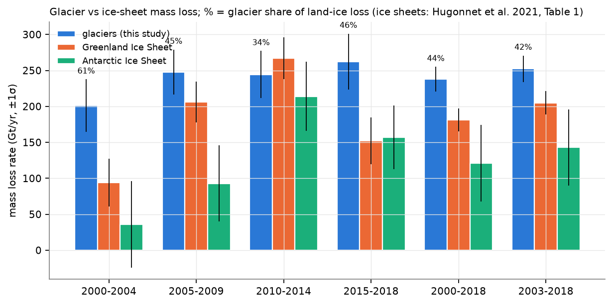

*Figure 9. Glacier (this study) and ice-sheet (Hugonnet et al. 2021) mass-loss rates. Labels give the glacier share of total land-ice loss.*

### 4.3 Regional contributions and relative loss
Regional results are in Table 4 and Figs. 3 and 5.

**Largest contributors.** The five largest contributors over 2000–2023 are Alaska, Greenland Periphery, Arctic Canada North, Southern Andes, Arctic Canada South, together 64 % of global loss. Alaska alone supplies 23 % (64.5 ± 8.9 Gt yr⁻¹). Taken together, the **Canadian Arctic (North + South)** contributes 19.3 % (53.2 ± 5.2 Gt yr⁻¹) and is the second-largest source after Alaska. The ice-sheet peripheries (Greenland, Antarctic) together contribute 20 %.

**Specific rates.** The most negative specific rates are in Central Europe (-1.06 m w.e. yr⁻¹), New Zealand (-0.97), the Southern Andes (-0.88) and Iceland (-0.83). The least negative are the Antarctic periphery (-0.16) and South Asia West (-0.18).

**Relative loss.** We take the ~2000 regional ice mass as Zemp et al. (2019) Table 1 volumes (RGI 6.0 outlines, early 2000s) × 0.9 t m⁻³. Glaciers lost 4.5 ± 0.3 % of their global mass (145,389 Gt) in 24 years. The relative loss is very uneven:
- **Central Europe:** 45 %;
- **New Zealand:** 37 %;
- **Caucasus & Middle East:** 31 %;
- **Low Latitudes:** 28 %;
- **Western Canada & USA:** 25 %;
- **North Asia:** 24 %;
- **South Asia East:** 21 %;
- by contrast, the large polar regions lost 1–7 %: Antarctic 1.2 %, Russian Arctic 2.6 %, Arctic Canada North 2.7 %.

So the regions that dominate sea-level rise are not the regions closest to deglaciation. Uncertainty in the ice volumes (≈ ±25 % regionally; Farinotti et al. 2019, as cited in paper_001) is not propagated into the percentages.

**Acceleration by region.** Specific loss increased from 2000–2011 to 2012–2023 in most regions. Specific loss increased in 14 of 19 regions; the largest increases (≥0.4 m w.e. yr⁻¹) were in Western Canada & USA, Central Europe, Svalbard and Caucasus & Middle East. Iceland, Scandinavia and the two Arctic Canada regions are exceptions with similar or less negative rates in 2012–2023, reflecting the "North Atlantic anomaly" of decelerated loss described by Hugonnet et al. (2021) (Table 4).

**Agreement with official.** All 19 regional mean rates agree with the official GlaMBIE rates within 1σ (|Δ/σ| < 1).

**Table 4. Regional mass change 2000–2023 (calendar years).**

| # | region | Gt/yr | ±σ | m w.e./yr | ±σ  | m w.e./yr 2000–11 | m w.e./yr 2012–23 | share of loss % | mass ~2000 (Gt) | lost 2000–23 (%) | official Gt/yr | Δ/σ vs official |
|---|---|---|---|---|---|---|---|---|---|---|---|---|
| 1 | Alaska | -64.50 | 8.94 | -0.77 | 0.11 | -0.58 | -0.95 | 23.43 | 16,586 | 9.33 | -61.41 | -0.27 |
| 2 | Western Canada & USA | -10.00 | 1.22 | -0.75 | 0.09 | -0.37 | -1.12 | 3.63 | 943 | 25.45 | -9.24 | -0.47 |
| 3 | Arctic Canada North | -30.19 | 4.16 | -0.29 | 0.04 | -0.31 | -0.27 | 10.97 | 26,749 | 2.71 | -30.43 | 0.05 |
| 4 | Arctic Canada South | -23.01 | 3.15 | -0.57 | 0.08 | -0.59 | -0.54 | 8.36 | 8,053 | 6.86 | -23.01 | 0.00 |
| 5 | Greenland Periphery | -34.14 | 7.02 | -0.43 | 0.09 | -0.40 | -0.47 | 12.41 | 14,202 | 5.77 | -35.44 | 0.13 |
| 6 | Iceland | -8.77 | 0.96 | -0.83 | 0.09 | -1.13 | -0.52 | 3.19 | 3,168 | 6.64 | -8.29 | -0.29 |
| 7 | Svalbard & Jan Mayen | -13.09 | 1.81 | -0.40 | 0.05 | -0.19 | -0.60 | 4.76 | 7,268 | 4.32 | -13.80 | 0.30 |
| 8 | Scandinavia | -1.66 | 0.15 | -0.58 | 0.05 | -0.69 | -0.47 | 0.60 | 275 | 14.47 | -1.67 | 0.04 |
| 9 | Russian Arctic | -15.01 | 2.49 | -0.29 | 0.05 | -0.15 | -0.44 | 5.45 | 13,904 | 2.59 | -16.02 | 0.30 |
| 10 | North Asia | -1.32 | 0.13 | -0.56 | 0.06 | -0.49 | -0.63 | 0.48 | 131 | 24.09 | -1.36 | 0.19 |
| 11 | Central Europe | -1.97 | 0.11 | -1.06 | 0.06 | -0.78 | -1.33 | 0.72 | 104 | 45.28 | -1.97 | 0.02 |
| 12 | Caucasus & Middle East | -0.73 | 0.09 | -0.62 | 0.08 | -0.41 | -0.82 | 0.27 | 57 | 30.95 | -0.74 | 0.05 |
| 13 | Central Asia | -10.59 | 2.14 | -0.22 | 0.04 | -0.10 | -0.33 | 3.85 | 3,135 | 8.11 | -10.48 | -0.03 |
| 14 | South Asia West | -5.68 | 2.14 | -0.18 | 0.07 | -0.15 | -0.21 | 2.07 | 2,783 | 4.90 | -5.61 | -0.03 |
| 15 | South Asia East | -7.30 | 0.90 | -0.52 | 0.06 | -0.42 | -0.63 | 2.65 | 815 | 21.48 | -7.36 | 0.04 |
| 16 | Low Latitudes | -0.83 | 0.21 | -0.41 | 0.11 | -0.42 | -0.39 | 0.30 | 72 | 27.66 | -0.85 | 0.08 |
| 17 | Southern Andes | -25.39 | 6.44 | -0.88 | 0.22 | -0.74 | -1.03 | 9.23 | 4,966 | 12.27 | -26.28 | 0.10 |
| 18 | New Zealand | -0.84 | 0.11 | -0.97 | 0.13 | -0.82 | -1.12 | 0.31 | 55 | 36.89 | -0.83 | -0.06 |
| 19 | Antarctic & Subantarctic | -20.20 | 6.37 | -0.16 | 0.05 | -0.15 | -0.18 | 7.34 | 42,121 | 1.15 | -17.82 | -0.22 |

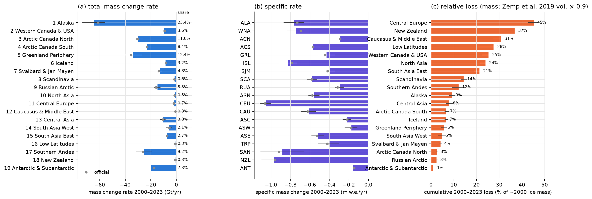

*Figure 5. (a) Regional mass change rate (Gt yr⁻¹, ±1σ) with share of global loss; grey dots are official. (b) Specific rate. (c) Cumulative 2000–2023 loss as a percentage of ~2000 ice mass.*

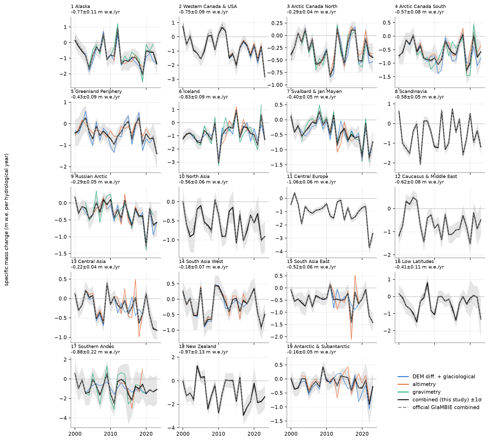

*Figure 3. Annual specific mass change per region (hydrological years). Coloured lines are data groups, black is the combined estimate (±1σ), dashed grey is the official GlaMBIE combined series.*

### 4.4 Consistency between observation methods
**Common windows (Fig. 6).** Over the years shared by all groups in a region, the groups agree within their uncertainties in most regions. Systematic differences remain (Table 5, Fig. 7c):

1. **Altimetry is systematically less negative than D.** The mean altimetry − D bias is 0.09 m w.e. yr⁻¹ in the polar and ice-sheet-periphery regions (3, 4, 5, 7, 9, 19) and 0.09 elsewhere. In the polar regions this matters most for the total, because their areas are large. The largest biases are in Arctic Canada South (+0.17), Antarctic & Subantarctic (+0.15), Greenland Periphery (+0.12) and, in a short window, Western Canada (+0.22) and Alaska (+0.15). Possible causes include radar penetration into firn, incomplete coverage of fast-thinning marine termini and ablation zones by CryoSat swaths, and the density assumption for elevation change in accumulation areas.
2. **Gravimetry is less negative than D in Alaska** (+0.26 ± 0.09) and Svalbard (+0.09). In the large Arctic regions it agrees within ±0.06 m w.e. yr⁻¹. Annual correlations with D are moderate to high (median r = 0.73; altimetry 0.62). Because independent methods share the same inter-annual signal, that signal is real and not an artefact of the glaciological shape.
3. **GRACE fails in small regions and High Mountain Asia** (Table 6). Where gravimetry is excluded from the main estimate, GRACE solutions give *positive* rates in Scandinavia, North Asia, Caucasus, Low Latitudes and New Zealand. Their annual uncertainties are several m w.e. Even in Central and South Asia, where the regions are large, annual correlation with D is low. This reflects leakage from groundwater depletion, lakes and snow, and the coarse GRACE footprint relative to glacier areas of 10³ km². Including these solutions (configuration `grav_all`) changes the global mean by only 4.9 Gt yr⁻¹ but strongly degrades regional reproduction (mean regional RMSD 7.0 vs 1.8 Gt). Excluding them is justified.
4. **Glaciological representativeness** (Table 7). Over 2000–2019 the regional glaciological sample (UZH sine-wave product) is on average -0.10 m w.e. yr⁻¹ more negative than the geodetic (Hugonnet) mean, with a mean absolute difference of 0.21. The bias is largest in High Mountain Asia (−0.27 to −0.42), the Russian Arctic and Greenland Periphery, where monitored glaciers are small, low-lying, land-terminating and not representative. This is why the glaciological series are used only for *variability* and the level comes from geodetic data. When they also vote on the level (`glac_level`), the global mean shifts by 27 Gt yr⁻¹ and the reproduction worsens. The WGMS-beta anomalies correlate with the independent altimetry (median r = 0.64) and gravimetry (median r = 0.75) annual series, confirming that their variability is representative even though their level is not meaningful.
5. **Hybrid datasets** (Table 8). Run the main estimate with all hybrids withheld (`hyb_exclude`) and compare each hybrid series against it: across 45 hybrid series the hybrids are on average -0.04 m w.e. yr⁻¹ more negative than the non-hybrid consensus (median r = 0.87). The differences are largest in Alaska (hybrids more negative by 0.1–0.23) and New Zealand (hybrids less negative by 0.13–0.17). Withholding hybrids makes the global estimate 7.8 Gt yr⁻¹ less negative and lowers the 2012–2023 acceleration. The hybrids thus carry independent level information (mostly from the geodetic calibration of glaciological series after 2020) that the official method relies on.

**Table 5. Bias and annual correlation of altimetry (A) and gravimetry (G) relative to the DEM+glaciological group (common hydrological years).**

| region | group | from | to | n yrs | bias vs D (m w.e./yr) | ±σ | RMSD | r (annual) |
|---|---|---|---|---|---|---|---|---|
| Alaska | A | 2011 | 2019 | 9 | 0.152 | 0.169 | 0.318 | 0.923 |
| Alaska | G | 2003 | 2022 | 20 | 0.262 | 0.085 | 0.495 | 0.829 |
| Western Canada & USA | A | 2013 | 2022 | 10 | 0.218 | 0.158 | 0.229 | 0.991 |
| Arctic Canada North | A | 2003 | 2023 | 21 | 0.052 | 0.041 | 0.142 | 0.904 |
| Arctic Canada North | G | 2003 | 2022 | 20 | -0.016 | 0.034 | 0.158 | 0.868 |
| Arctic Canada South | A | 2003 | 2023 | 21 | 0.165 | 0.069 | 0.283 | 0.827 |
| Arctic Canada South | G | 2003 | 2022 | 20 | 0.058 | 0.075 | 0.414 | 0.581 |
| Greenland Periphery | A | 2000 | 2021 | 22 | 0.124 | 0.094 | 0.451 | 0.625 |
| Iceland | A | 2011 | 2019 | 9 | 0.109 | 0.096 | 0.660 | 0.612 |
| Iceland | G | 2003 | 2022 | 20 | 0.050 | 0.096 | 0.712 | 0.733 |
| Svalbard & Jan Mayen | A | 2004 | 2019 | 15 | 0.033 | 0.059 | 0.305 | 0.573 |
| Svalbard & Jan Mayen | G | 2003 | 2022 | 20 | 0.090 | 0.049 | 0.252 | 0.856 |
| Russian Arctic | A | 2004 | 2019 | 15 | -0.000 | 0.044 | 0.127 | 0.875 |
| Russian Arctic | G | 2003 | 2022 | 20 | 0.054 | 0.053 | 0.281 | 0.696 |
| Central Asia | A | 2000 | 2020 | 21 | 0.054 | 0.044 | 0.337 | 0.473 |
| South Asia West | A | 2000 | 2020 | 21 | 0.026 | 0.079 | 0.200 | 0.870 |
| South Asia East | A | 2000 | 2020 | 21 | 0.011 | 0.073 | 0.500 | 0.215 |
| Southern Andes | A | 2011 | 2019 | 9 | 0.049 | 0.409 | 1.069 | 0.516 |
| Southern Andes | G | 2002 | 2021 | 20 | -0.033 | 0.243 | 1.017 | 0.604 |
| Antarctic & Subantarctic | A | 2003 | 2022 | 19 | 0.147 | 0.082 | 0.409 | 0.234 |

**Table 6. Gravimetry in regions where it is not used in the main estimate (HY 2003–2022).**

| region (gravimetry not used) | area km² | GRACE m w.e./yr | D m w.e./yr | GRACE − D | r (annual) |
|---|---|---|---|---|---|
| Western Canada & USA | 14,524 | -1.01 | -0.80 | -0.21 | 0.52 |
| Scandinavia | 2,949 | 0.90 | -0.55 | 1.45 | 0.70 |
| North Asia | 2,410 | 0.14 | -0.55 | 0.69 | 0.55 |
| Central Europe | 2,092 | -0.86 | -1.11 | 0.24 | 0.62 |
| Caucasus & Middle East | 1,307 | 0.47 | -0.62 | 1.09 | 0.12 |
| Central Asia | 49,303 | -0.16 | -0.23 | 0.08 | 0.40 |
| South Asia West | 33,568 | -0.29 | -0.21 | -0.09 | 0.32 |
| South Asia East | 14,734 | -0.22 | -0.50 | 0.28 | -0.07 |
| Low Latitudes | 2,341 | 0.09 | -0.42 | 0.51 | 0.22 |
| New Zealand | 1,162 | 1.08 | -0.95 | 2.03 | -0.38 |

**Table 7. Glaciological sample vs geodetic rates 2000–2019 (m w.e. yr⁻¹) and inter-annual agreement of WGMS-beta anomalies with independent groups.**

| region | geodetic 2000–19 (Hugonnet) | glaciological sample (sine-wave product) | glac − geod | WGMS-beta mean (anomaly) | r(WGMS, altimetry) | r(WGMS, gravimetry) |
|---|---|---|---|---|---|---|
| Alaska | -0.78 | -0.82 | -0.04 | 0.25 | 0.91 | 0.84 |
| Western Canada & USA | -0.54 | -0.74 | -0.20 | -0.05 | 0.89 | – |
| Arctic Canada North | -0.29 | -0.42 | -0.13 | 0.08 | 0.90 | 0.85 |
| Arctic Canada South | -0.65 | -0.42 | 0.23 | 0.08 | 0.84 | 0.59 |
| Greenland Periphery | -0.43 | -0.71 | -0.29 | 0.07 | 0.64 | – |
| Iceland | -0.88 | -0.74 | 0.14 | -0.31 | 0.59 | 0.75 |
| Svalbard & Jan Mayen | -0.31 | -0.52 | -0.21 | 0.13 | 0.59 | 0.86 |
| Scandinavia | -0.58 | -0.73 | -0.15 | -0.17 | – | – |
| Russian Arctic | -0.20 | -0.64 | -0.43 | 0.13 | 0.88 | 0.67 |
| North Asia | -0.52 | -0.50 | 0.02 | 0.09 | – | – |
| Central Europe | -0.87 | -1.03 | -0.16 | 0.09 | – | – |
| Caucasus & Middle East | -0.55 | -0.63 | -0.09 | 0.29 | – | – |
| Central Asia | -0.20 | -0.48 | -0.27 | 0.01 | 0.41 | – |
| South Asia West | -0.14 | -0.56 | -0.42 | -0.05 | 0.68 | – |
| South Asia East | -0.48 | -0.83 | -0.35 | 0.05 | 0.17 | – |
| Low Latitudes | -0.46 | – | – | -0.06 | – | – |
| Southern Andes | -0.72 | -0.59 | 0.13 | 0.35 | -0.12 | 0.35 |
| New Zealand | -0.74 | -0.41 | 0.33 | 0.04 | – | – |
| Antarctic & Subantarctic | -0.17 | -0.02 | 0.15 | -0.10 | 0.17 | – |

**Table 8. Hybrid datasets vs the consensus computed without hybrids.**

| hybrid dataset | regions | mean (hybrid − consensus w/o hybrids) m w.e./yr | median r |
|---|---|---|---|
| ArcticInSituvGRACE_Box | 6 | -0.108 | 0.897 |
| Dussaillant | 19 | -0.033 | 0.916 |
| Huss_Huss | 18 | -0.037 | 0.847 |
| Iceland-mb-group_smb_Palsson | 1 | 0.099 | 0.874 |
| Iceland-mb-group_tot_Palsson | 1 | -0.057 | 0.871 |

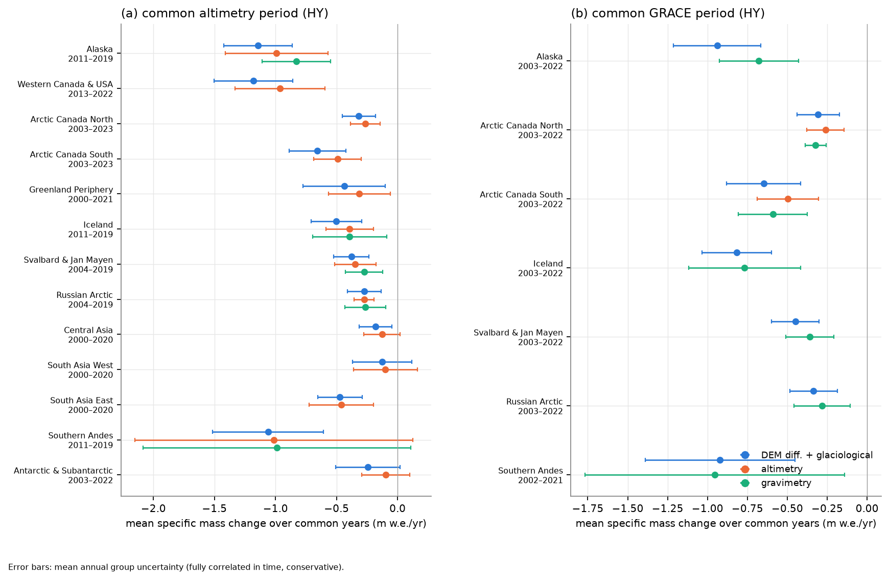

*Figure 6. Mean specific mass change of each data group over common windows: (a) the years covered by altimetry, (b) the GRACE years, per region. Error bars are the mean annual group uncertainty, treated as fully correlated in time.*

### 4.5 Uncertainty diagnostics
If the uncertainties are realistic, z = (x₁ − x₂)/√(σ₁² + σ₂²) for annual differences between data groups should have unit standard deviation. Over 450 group-pair-years, SD(z) = **1.24**, with 11 % of |z| > 2 (Fig. 7a). By pair, SD(z) is 1.17 for D−A, 1.28 for D−G and 1.33 for A−G. The mean z is -0.16, reflecting the systematic altimetry and gravimetry biases above.

So the *group* uncertainties are slightly too small (by about 20–30 %) to explain the annual differences between groups, mostly because of the systematic biases. The *combined* uncertainty does not divide by N and adds a missing-group term, which compensates for this. Our combined annual uncertainties are on average 1.03 × the official global uncertainties and median 1.46 × the official regional ones (Table A3). That makes them at least as conservative as the community product.

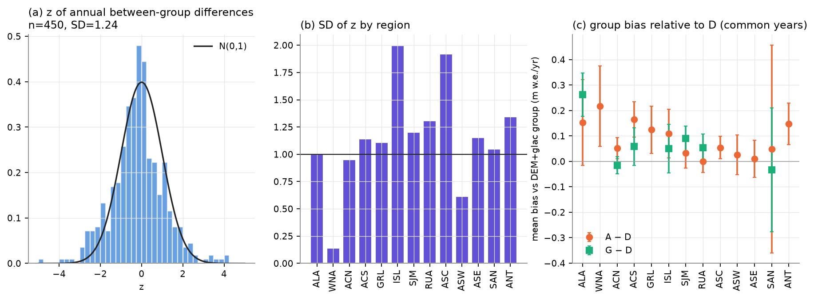

*Figure 7. (a) z-scores of annual between-group differences against N(0,1). (b) SD of z by region. (c) Mean bias of altimetry and gravimetry relative to the D group (±1σ).*

### 4.6 Validation against the official GlaMBIE results and sensitivity
**Validation.** Against the official regional hydrological-year series (Table A3, Fig. 11a):
- mean absolute bias of the combined series: 0.015 m w.e. yr⁻¹;
- median RMSD: 0.046 m w.e.;
- median correlation: 0.995.

The D group is unbiased in Central Europe (+0.005) and New Zealand (-0.001). An earlier variant that excluded hybrids gave biases of about 0.09 and −0.13 there.

At the global calendar scale (Fig. 11b):
- RMSD 36 Gt, r = 0.943;
- largest single-year difference 75 Gt;
- differences in 2020 and 2023 of 52 and -21 Gt, all within the official ±1σ.

The remaining calendar-year differences come mainly from the Antarctic & Subantarctic and Southern Andes (SH seasonality) and from Alaska in 2000. The official calendar series is not a linear combination of the official hydrological years: for any constant w the residual RMSD is 15–25 Gt in the large regions. Some calendar-year information must have been taken directly from sub-annual data.

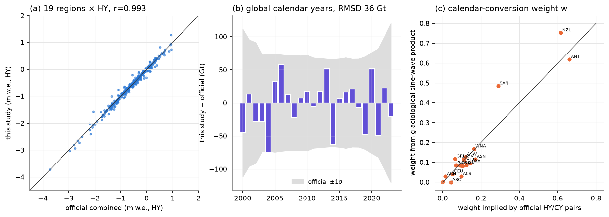

*Figure 11. (a) Regional HY specific mass change: this study vs official. (b) Global calendar-year differences (this study − official) with the official ±1σ band. (c) Calendar-conversion weight w from the glaciological sine-wave product vs w implied by the official HY/CY pairs.*

**Sensitivity (Table 3, Fig. 8).**
- *Hybrids:* excluding them (`hyb_exclude`) or reproducing the earlier attempt's design (`g1_like`: no hybrids + gap-filling) makes the global loss 8–11 Gt yr⁻¹ smaller. It also reduces the 2012–2023 rate by about 22 Gt yr⁻¹, the acceleration from +33 % to +23 %, and the 2023 value by about 70–85 Gt. Of all the choices, the handling of hybrids has the largest influence on the acceleration estimate.
- *Altimetry:* removing it (`no_alt`) makes loss 17 Gt yr⁻¹ larger, consistent with the less negative polar altimetry.
- *D group only* (`D_only`): -304 Gt yr⁻¹.
- *DEM calibration:* per-pentad vs full-period changes the global mean by less than 1 Gt yr⁻¹ but improves regional reproduction.
- *Calendar weights:* seasonal vs time weights mostly affect single years (2023: 53 Gt).

The global mean rate is therefore robust to ±11 Gt yr⁻¹ (within 1σ) across all defensible configurations. The acceleration percentage, however, ranges from +21 % to +41 %.

**Table 3. Sensitivity of global results (Gt yr⁻¹; rates are calendar 2000–2023 means).**

| configuration | rate Gt/yr | Δ vs main | 2000–11 | 2012–23 | late/early | 2023 (Gt) | RMSD vs official CY (Gt) | mean regional HY RMSD (Gt) | σ ratio vs official |
|---|---|---|---|---|---|---|---|---|---|
| main | -275.22 | 0.00 | -235.88 | -314.57 | 1.33 | -568.58 | 35.96 | 1.81 | 1.03 |
| main_timeweights | -276.43 | -1.20 | -236.13 | -316.72 | 1.34 | -515.19 | 40.28 | 1.81 | 0.98 |
| hyb_exclude | -267.46 | 7.76 | -242.37 | -292.55 | 1.21 | -498.58 | 42.47 | 4.04 | 1.22 |
| hyb_separate | -280.44 | -5.22 | -244.93 | -315.96 | 1.29 | -543.83 | 34.87 | 3.04 | 1.36 |
| hyb_period_vote | -275.50 | -0.28 | -239.84 | -311.16 | 1.30 | -566.83 | 35.55 | 2.06 | 1.02 |
| dem_fullperiod | -274.66 | 0.56 | -234.51 | -314.81 | 1.34 | -568.58 | 35.26 | 2.15 | 1.02 |
| g1_like | -264.07 | 11.15 | -236.73 | -291.41 | 1.23 | -484.29 | 41.17 | 4.32 | 1.35 |
| grav_all | -270.34 | 4.88 | -224.28 | -316.40 | 1.41 | -568.58 | 46.44 | 7.04 | 1.31 |
| grav_none | -281.90 | -6.68 | -237.35 | -326.45 | 1.38 | -568.58 | 36.10 | 3.55 | 0.94 |
| no_alt | -292.57 | -17.34 | -249.48 | -335.66 | 1.35 | -598.66 | 48.41 | 4.69 | 0.77 |
| gapfill | -268.24 | 6.98 | -223.26 | -313.22 | 1.40 | -547.69 | 34.31 | 1.85 | 1.08 |
| glac_level | -248.34 | 26.88 | -210.62 | -286.05 | 1.36 | -487.16 | 43.18 | 2.60 | 1.06 |
| no_robust_level | -279.38 | -4.16 | -239.12 | -319.64 | 1.34 | -567.36 | 36.33 | 1.90 | 1.02 |
| D_only | -304.20 | -28.97 | -252.31 | -356.08 | 1.41 | -598.66 | 53.18 | 6.61 | 0.65 |
| **official GlaMBIE** | -272.60 | 2.62 | -230.72 | -314.48 | 1.36 | -548.03 | 0.00 | 0.00 | 1.00 |

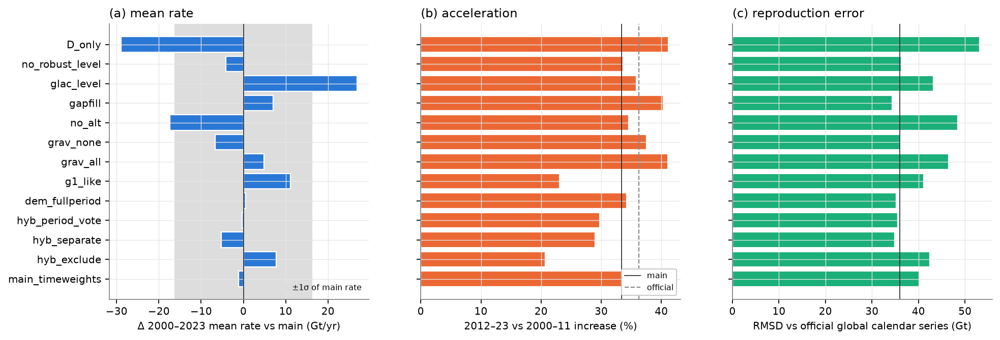

*Figure 8. Sensitivity of (a) the mean rate, (b) the acceleration and (c) the reproduction error to the methodological choices.*

### 4.7 Observations vs model projections
**Global (Table 9, Fig. 10).** Projected 2015–2100 glacier contributions are:
- **Rounce et al. (2023):** 90 ± 26 mm (+1.5 °C) to 154 ± 44 mm (+4 °C), and 98 ± 38 (SSP1-2.6), 116 ± 51 (SSP2-4.5) and 166 ± 83 mm (SSP5-8.5), all 95 % CI. These values are corrected for ice below sea level; uncorrected they are 115–192 mm.
- **Marzeion et al. (2020):** 79 ± 56 (RCP2.6) to 159 ± 86 mm (RCP8.5), 90 % CI.
- **Hock et al. (2019):** 89 ± 42 to 180 ± 74 mm, as recalculated in Marzeion et al. (2020) Table 2.

These correspond to **18–28 % (low emissions) and 36–44 % (high emissions) of the 2015 glacier mass lost by 2100**:
- Rounce: 26 ± 6 % (+1.5 °C) to 41 ± 11 % (+4 °C); 28 ± 9 / 32 ± 12 / 44 ± 20 % for SSP1-2.6 / 2-4.5 / 5-8.5;
- Marzeion: 18 ± 13 to 36 ± 20 %;
- Hock: 18 ± 7 to 36 ± 11 %.

Observations against these projections:
- From 2015 to 2023 glaciers lost 8.7 mm SLE (2.2 % of the 2015 mass in 9 years), a mean rate of **0.96 mm yr⁻¹**.
- This is *already comparable to* the mean 2015–2100 rate implied by the low-emission projections: 0.93 (Marzeion RCP2.6), 1.05 (Hock RCP2.6), 1.06 (Rounce +1.5 °C) and 1.15 mm yr⁻¹ (Rounce SSP1-2.6).
- It lies within the projected early-century rates: Marzeion RCP2.6 peaks "slightly above 1 mm SLE yr⁻¹" in the first half of the century; Rounce +1.5 °C peaks at 1.29 ± 0.59 mm yr⁻¹ around 2035.

At the constant 2012–2023 rate, glaciers would contribute about 74 mm over 2015–2100, just below the low-emission medians (79–98 mm). The low-emission projections are therefore consistent with today's rate only if loss *stops accelerating soon* and then declines as glaciers shrink.

Continuing the observed OLS acceleration (0.26 mm yr⁻¹ per decade) would put the 2100 contribution near or above the high-emission medians (Fig. 10a). The observed acceleration is thus closer to the trajectory of the high scenarios than of the low ones. Two caveats apply:
1. Multi-decadal variability makes a 24-year acceleration an uncertain predictor.
2. Glacier area shrinks, which reduces future loss in Gt.

The observed specific rate for 2005–2014, -0.36 m w.e. yr⁻¹, is *less* negative than the multimodel median disequilibrium term of Marzeion et al. (2020) for the same period (−0.53 ± 0.59 m w.e. yr⁻¹, inter-model SD). Some models may therefore start too far from equilibrium or with too much ice: the 2015 ensemble-mean mass is 439 mm SLE, against the consensus of 382 ± 99 mm.

**Table 9. Projected glacier mass loss 2015–2100 and comparison with the observed 2015–2023 rate.**

| study | scenario | SLE 2015–2100 (mm) | mass lost by 2100 (% of 2015) | implied mean rate (mm/yr) | years needed at observed 2015–23 rate | uncertainty | source |
|---|---|---|---|---|---|---|---|
| Rounce et al. 2023 | +1.5C | 90 ± 26 | 26 ± 6 | 1.06 | 93.58 | 95% | paper_000, p.1 abstract & text; Table 1 p.5 |
| Rounce et al. 2023 | +2C | 99 ± 31 | – | 1.16 | 102.94 | 95% | paper_000, p.1 abstract & text; Table 1 p.5 |
| Rounce et al. 2023 | +3C | 125 ± 39 | – | 1.47 | 129.98 | 95% | paper_000, p.1 abstract & text; Table 1 p.5 |
| Rounce et al. 2023 | +4C | 154 ± 44 | 41 ± 11 | 1.81 | 160.13 | 95% | paper_000, p.1 abstract & text; Table 1 p.5 |
| Rounce et al. 2023 | SSP1-2.6 | 98 ± 38 | 28 ± 9 | 1.15 | 101.90 | 95% | paper_000, p.1 abstract & text; Table 1 p.5 |
| Rounce et al. 2023 | SSP2-4.5 | 116 ± 51 | 32 ± 12 | 1.36 | 120.62 | 95% | paper_000, p.1 abstract & text; Table 1 p.5 |
| Rounce et al. 2023 | SSP5-8.5 | 166 ± 83 | 44 ± 20 | 1.95 | 172.61 | 95% | paper_000, p.1 abstract & text; Table 1 p.5 |
| Rounce et al. 2023 | RCP2.6 | 90 ± 36 | 26 ± 8 | 1.06 | 93.58 | 95% | paper_000, p.1 abstract & text; Table 1 p.5 |
| Rounce et al. 2023 | RCP4.5 | 114 ± 44 | – | 1.34 | 118.54 | 95% | paper_000, p.1 abstract & text; Table 1 p.5 |
| Rounce et al. 2023 | RCP8.5 | 163 ± 53 | 43 ± 13 | 1.92 | 169.49 | 95% | paper_000, p.1 abstract & text; Table 1 p.5 |
| Marzeion et al. 2020 | RCP2.6 | 79 ± 56 | 18 ± 13 | 0.93 | 82.15 | 90% | paper_001, Table 2 p.21; text p.13-14 |
| Marzeion et al. 2020 | RCP4.5 | 119 ± 66 | 27 ± 15 | 1.40 | 123.74 | 90% | paper_001, Table 2 p.21; text p.13-14 |
| Marzeion et al. 2020 | RCP6.0 | 111 ± 75 | 25 ± 17 | 1.31 | 115.42 | 90% | paper_001, Table 2 p.21; text p.13-14 |
| Marzeion et al. 2020 | RCP8.5 | 159 ± 86 | 36 ± 20 | 1.87 | 165.33 | 90% | paper_001, Table 2 p.21; text p.13-14 |
| Hock et al. 2019 | RCP2.6 | 89 ± 42 | 18 ± 7 | 1.05 | 92.54 | 1 SD | paper_003, abstract p.1; Table 3 p.6; text p.8-9; values recalculated in Marzeion 2020 Table 2 |
| Hock et al. 2019 | RCP4.5 | 124 ± 58 | 27 ± 8 | 1.46 | 128.94 | 1 SD | paper_003, abstract p.1; Table 3 p.6; text p.8-9; values recalculated in Marzeion 2020 Table 2 |
| Hock et al. 2019 | RCP6.0 | 140 ± 52 | 24 ± 6 | 1.65 | 145.58 | 1 SD | paper_003, abstract p.1; Table 3 p.6; text p.8-9; values recalculated in Marzeion 2020 Table 2 |
| Hock et al. 2019 | RCP8.5 | 180 ± 74 | 36 ± 11 | 2.12 | 187.17 | 1 SD | paper_003, abstract p.1; Table 3 p.6; text p.8-9; values recalculated in Marzeion 2020 Table 2 |

**Regional (Table 10).**
- **Alaska:** the observed 2015–2023 loss is 87 Gt yr⁻¹, below Rounce et al.'s projected mid-century peak of 0.33–0.44 mm SLE yr⁻¹ (120–160 Gt yr⁻¹). The models therefore require Alaskan loss to accelerate by roughly 40–85 %.
- **Arctic Canada North:** at the observed relative rate it would lose only ≈9 % of its 2015 mass by 2100, against 12 ± 8 % (RCP2.6) to 23 ± 15 % (RCP8.5) in Hock et al. Models also require acceleration here, consistent with their projection that large Arctic regions accelerate through the century.
- **Small mid-latitude regions** (Central Europe, New Zealand, Caucasus, Western Canada, Low Latitudes, North Asia, South Asia East): the observed absolute rates would exhaust the 2015 ice before 2100, e.g. Central Europe by the 2040s. This is consistent with, or faster than, the projected 60–100 % loss (Rounce) and the 69 ± 19 % (RCP2.6) to 93 ± 10 % (RCP8.5) loss for Central Europe (Hock). The models' slowdown in these regions comes from glacier shrinkage, not from cooler climate.
- **Scandinavia:** at 0.50 % yr⁻¹ it is below the 60–100 % range, so models need acceleration.
- **Regional shares:** the projected shares of 2015–2100 sea-level rise for Greenland Periphery (12 %), Arctic Canada North (10 %) and South (9 %) are close to the observed 2000–2023 shares. The Antarctic periphery is projected to contribute more (10 %) than observed (7.3 %).

**Committed loss.** Glaciers respond to climate with a lag of decades. Marzeion et al. (2020) estimate a present disequilibrium (2005–2014) of −533 kg m⁻² yr⁻¹, i.e. loss that would continue even under 1995–2014 temperatures. Rounce et al. (2023) note that regions with large glaciers will keep losing mass beyond 2100. Our observation that 2012–2023 loss was 33 % higher than 2000–2011, during a period of continued warming, means today's geometry is further from equilibrium than at the start of the record. A substantial part of the projected 2015–2100 loss is therefore already committed, and the low-emission projections chiefly limit *additional* loss.

**Table 10. Regional observations vs model statements.**

| region | model projection (source) | observation (this study) | assessment |
|---|---|---|---|
| Alaska | Rounce: peak 0.33-0.44 mm SLE/yr (2030-2060) | 87 Gt/yr (2015-2023) | observed below projected peak |
| Central Europe | Hock: 69+/-19% (RCP2.6) to 93+/-10% (RCP8.5) lost 2015-2100 | 3.35 %/yr of 2015 mass (2015-2023); constant rate depletes ice by ~2045 | at/above upper end: consistent with projected near-complete loss |
| Arctic Canada North | Hock: 12+/-8% (RCP2.6) to 23+/-15% (RCP8.5) lost 2015-2100 | 0.11 %/yr of 2015 mass (2015-2023); constant rate -> 9% by 2100 | below model range: models imply acceleration |
| Western Canada & USA | Rounce: 60-100% lost by 2100; Marzeion RCP8.5 >85% | 1.84 %/yr of 2015 mass (2015-2023); constant rate depletes ice by ~2069 | at/above upper end: consistent with projected near-complete loss |
| South Asia East | Rounce: 60-100% lost by 2100 | 1.26 %/yr of 2015 mass (2015-2023); constant rate depletes ice by ~2094 | at/above upper end: consistent with projected near-complete loss |
| Scandinavia | Rounce: 60-100% lost by 2100 | 0.50 %/yr of 2015 mass (2015-2023); constant rate -> 43% by 2100 | below model range: models imply acceleration |
| North Asia | Rounce: 60-100% lost by 2100 | 1.40 %/yr of 2015 mass (2015-2023); constant rate depletes ice by ~2086 | at/above upper end: consistent with projected near-complete loss |
| Low Latitudes | Rounce: 60-100%; Marzeion RCP8.5 >85% | 1.47 %/yr of 2015 mass (2015-2023); constant rate depletes ice by ~2083 | at/above upper end: consistent with projected near-complete loss |
| Caucasus & Middle East | Rounce: 60-100%; Marzeion RCP8.5 >85% | 1.92 %/yr of 2015 mass (2015-2023); constant rate depletes ice by ~2067 | at/above upper end: consistent with projected near-complete loss |
| New Zealand | Rounce: 60-100% lost by 2100 | 2.57 %/yr of 2015 mass (2015-2023); constant rate depletes ice by ~2054 | at/above upper end: consistent with projected near-complete loss |
| Greenland Periphery | Rounce: 12% of 2015-2100 glacier SLR | 12.4% of 2000-2023 loss | similar |
| Antarctic & Subantarctic | Rounce: 10% of 2015-2100 glacier SLR | 7.3% of 2000-2023 loss | model share larger |
| Arctic Canada North | Rounce: 10% of 2015-2100 glacier SLR | 11.0% of 2000-2023 loss | similar |
| Arctic Canada South | Rounce: 9% of 2015-2100 glacier SLR | 8.4% of 2000-2023 loss | similar |

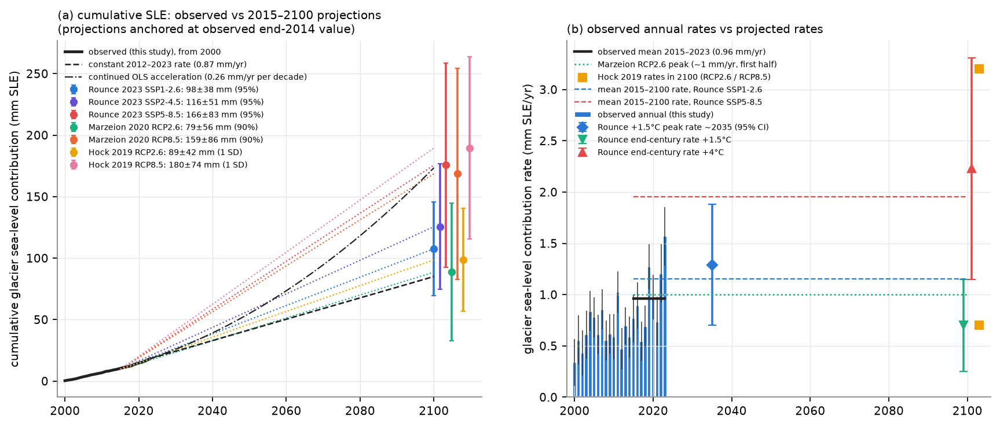

*Figure 10. (a) Observed cumulative sea-level contribution since 2000 (±1σ) against 2015–2100 projection medians and ranges, anchored at the observed end-2014 value. Dotted lines are linear paths to the 2100 values, for illustration only. Dashed and dash-dotted lines continue the observed constant rate and the observed OLS acceleration. (b) Observed annual rates against projected rates (peak and end-of-century) and the mean 2015–2100 rates of selected scenarios.*

## 5. Discussion

**What the reconciliation shows.** The independent re-implementation reproduces the community estimate to about 1 % in total and within 1σ in every region. A few structural choices drive that agreement:
1. specific mass change referenced to a fixed RGI area before rescaling to A(t);
2. hybrids as part of the D group;
3. pentad-wise DEM calibration;
4. altimetry/gravimetry levels from regressions with the GRACE gap removed;
5. no gap-filling across groups.

Choices that look reasonable in isolation, such as excluding hybrids or filling missing groups, push the estimate by 8–11 Gt yr⁻¹. They also reduce the acceleration from about +33 % to about +21 % and the 2023 record by about 80 Gt. The 2000–2023 mean is robust; the *acceleration* depends more on method. That should be considered when the series is used to calibrate models.

**Sea-level role.** At 0.76 mm yr⁻¹ over 2000–2023 and 0.87 mm yr⁻¹ over 2012–2023, glaciers exceeded the Greenland and the Antarctic ice sheet individually over 2000–2018. They remain the largest single land-ice source even though they hold less than 1 % of land ice.

**Method differences.** Polar altimetry is less negative and GRACE is unusable in small or hydrologically noisy regions. These are the main systematic disagreements, and they are why an equal-weight, multi-group average with conservative errors is preferable to a single "best" method. The z-test shows that group-level uncertainties are about 25 % too optimistic; the combined uncertainty absorbs this.

**Limitations.**
1. The area model is taken from the official files (RGI 6.0 with area-change rates).
2. The calendar conversion uses a linear combination of hydrological years and cannot reproduce single-year official values in the SH to better than about 20–60 Gt.
3. Volume-based relative losses inherit the ±25 % ice-thickness uncertainty.
4. Projection numbers were transcribed from the papers, and trajectories between 2015 and 2100 are not given there. The comparison uses mean rates and reported peak and end-of-century rates, not full time series.
5. Projection SLE values differ in their treatment of ice below sea level: Rounce corrected; Marzeion and Hock uncorrected.

## 6. Conclusions

1. Glaciers lost 6605 ± 387 Gt (18.2 ± 1.1 mm SLE; 4.5 % of their mass) over 2000–2023. Annual uncertainties are at least as conservative as GlaMBIE's.
2. Loss accelerated by 33 ± 16 % between 2000–2011 and 2012–2023 (-9.5 ± 2.4 Gt yr⁻²). 2023 set the record at -569 Gt.
3. Over 2000–2018 glaciers lost about 1.3× as much as Greenland and about 2× as much as Antarctica, the largest single land-ice contribution to sea-level rise.
4. Alaska (23 %), the Canadian Arctic (19 %) and the Greenland periphery (12 %) dominate the mass loss. Central Europe (45 %), New Zealand and the Caucasus have lost the largest fraction of their ice.
5. The methods agree within uncertainties in most regions. Polar altimetry is systematically less negative, GRACE is unreliable in small regions, and glaciological samples are biased negative in level but representative in variability.
6. The observed 2015–2023 rate is already comparable to the century-mean rate of the low-emission projections, and the observed acceleration tracks the high-emission scenarios. Much of the projected 21st-century loss is committed.

## References
- GlaMBIE (2024). Glacier Mass Balance Intercomparison Exercise dataset 1.0.0. WGMS, doi:10.5904/wgms-glambie-2024-07.
- Hock, R. et al. (2019). GlacierMIP – a model intercomparison of global-scale glacier mass-balance models and projections. J. Glaciol. 65, 453–467 (related_work/paper_003).
- Hugonnet, R. et al. (2021). Accelerated global glacier mass loss in the early twenty-first century. Nature 592, 726–731 (paper_004).
- Marzeion, B. et al. (2020). Partitioning the uncertainty of ensemble projections of global glacier mass change. Earth's Future 8 (paper_001).
- Rounce, D. R. et al. (2023). Global glacier change in the 21st century: every increase in temperature matters. Science 379, 78–83 (paper_000).
- Zemp, M. et al. (2019). Global glacier mass changes and their contributions to sea-level rise from 1961 to 2016. Nature 568, 382–386 (paper_002).

## Appendix

**Table A1. Global annual series (calendar years).**

| year | Gt | ±σ | m w.e. | ±σ  | cumulative Gt | cum. mm SLE | official Gt |
|---|---|---|---|---|---|---|---|
| 2000.0 | -122.7 | 83.4 | -0.2 | 0.1 | -122.7 | 0.3 | -78.0 |
| 2001.0 | -201.7 | 86.8 | -0.3 | 0.1 | -324.4 | 0.9 | -215.2 |
| 2002.0 | -156.6 | 79.9 | -0.2 | 0.1 | -481.0 | 1.3 | -128.5 |
| 2003.0 | -221.0 | 85.4 | -0.3 | 0.1 | -702.0 | 1.9 | -192.7 |
| 2004.0 | -304.5 | 71.3 | -0.4 | 0.1 | -1006.5 | 2.8 | -229.2 |
| 2005.0 | -282.3 | 71.3 | -0.4 | 0.1 | -1288.8 | 3.6 | -315.0 |
| 2006.0 | -221.5 | 69.2 | -0.3 | 0.1 | -1510.4 | 4.2 | -279.9 |
| 2007.0 | -310.2 | 70.4 | -0.5 | 0.1 | -1820.5 | 5.0 | -323.2 |
| 2008.0 | -200.8 | 70.6 | -0.3 | 0.1 | -2021.3 | 5.6 | -178.6 |
| 2009.0 | -223.9 | 68.7 | -0.3 | 0.1 | -2245.2 | 6.2 | -231.2 |
| 2010.0 | -214.2 | 79.5 | -0.3 | 0.1 | -2459.4 | 6.8 | -231.2 |
| 2011.0 | -371.1 | 73.6 | -0.5 | 0.1 | -2830.5 | 7.8 | -365.9 |
| 2012.0 | -171.4 | 73.1 | -0.3 | 0.1 | -3002.0 | 8.3 | -188.0 |
| 2013.0 | -253.0 | 65.7 | -0.4 | 0.1 | -3255.0 | 9.0 | -304.7 |
| 2014.0 | -212.9 | 72.8 | -0.3 | 0.1 | -3467.8 | 9.6 | -149.9 |
| 2015.0 | -278.1 | 85.1 | -0.4 | 0.1 | -3745.9 | 10.3 | -285.0 |
| 2016.0 | -324.1 | 81.6 | -0.5 | 0.1 | -4070.1 | 11.2 | -340.6 |
| 2017.0 | -196.5 | 69.7 | -0.3 | 0.1 | -4266.6 | 11.8 | -217.7 |
| 2018.0 | -251.0 | 73.2 | -0.4 | 0.1 | -4517.6 | 12.5 | -243.8 |
| 2019.0 | -460.9 | 79.2 | -0.7 | 0.1 | -4978.5 | 13.7 | -413.0 |
| 2020.0 | -353.4 | 78.3 | -0.5 | 0.1 | -5331.9 | 14.7 | -405.0 |
| 2021.0 | -267.3 | 86.6 | -0.4 | 0.1 | -5599.2 | 15.4 | -217.7 |
| 2022.0 | -437.5 | 104.2 | -0.7 | 0.2 | -6036.8 | 16.7 | -460.3 |
| 2023.0 | -568.6 | 103.4 | -0.9 | 0.2 | -6605.3 | 18.2 | -548.0 |

**Table A2. Calendar-conversion weights.**

| region | HY start | w (sine-wave product, used) | w implied by official (diagnostic) | w (pure time fraction) |
|---|---|---|---|---|
| Alaska | 1 Oct | 0.098 | 0.117 | 0.250 |
| Western Canada & USA | 1 Oct | 0.168 | 0.163 | 0.250 |
| Arctic Canada North | 1 Oct | 0.028 | 0.015 | 0.250 |
| Arctic Canada South | 1 Oct | 0.028 | 0.097 | 0.250 |
| Greenland Periphery | 1 Oct | 0.117 | 0.064 | 0.250 |
| Iceland | 1 Oct | 0.085 | 0.124 | 0.250 |
| Svalbard & Jan Mayen | 1 Oct | 0.081 | 0.103 | 0.250 |
| Scandinavia | 1 Oct | 0.114 | 0.108 | 0.250 |
| Russian Arctic | 1 Oct | 0.083 | 0.069 | 0.250 |
| North Asia | 1 Oct | 0.116 | 0.171 | 0.250 |
| Central Europe | 1 Oct | 0.041 | 0.052 | 0.250 |
| Caucasus & Middle East | 1 Oct | 0.084 | 0.090 | 0.250 |
| Central Asia | 1 Oct | -0.002 | 0.042 | 0.250 |
| South Asia West | 1 Oct | 0.128 | 0.119 | 0.250 |
| South Asia East | 1 Oct | 0.095 | 0.145 | 0.250 |
| Low Latitudes | 1 Jan | 0.000 | 0.000 | 0.000 |
| Southern Andes | 1 Apr | 0.485 | 0.289 | 0.250 |
| New Zealand | 1 Apr | 0.752 | 0.616 | 0.250 |
| Antarctic & Subantarctic | 1 Apr | 0.618 | 0.661 | 0.250 |

**Table A3. Regional validation against the official GlaMBIE hydrological-year series (m w.e.; bias = this study − official).**

| region | combined bias | combined RMSD | r | σ ratio (this/official) | D bias | D RMSD | A bias | G bias |
|---|---|---|---|---|---|---|---|---|
| Alaska | -0.035 | 0.075 | 0.995 | 1.654 | -0.019 | 0.031 | -0.040 | 0.035 |
| Western Canada & USA | -0.053 | 0.113 | 0.996 | 1.759 | -0.001 | 0.080 | 0.016 | – |
| Arctic Canada North | 0.004 | 0.028 | 0.995 | 1.818 | 0.014 | 0.031 | -0.002 | -0.007 |
| Arctic Canada South | 0.004 | 0.054 | 0.992 | 1.459 | 0.013 | 0.051 | 0.002 | 0.004 |
| Greenland Periphery | 0.012 | 0.037 | 0.996 | 1.137 | 0.013 | 0.066 | 0.030 | – |
| Iceland | -0.040 | 0.088 | 0.995 | 0.882 | -0.021 | 0.029 | -0.014 | -0.051 |
| Svalbard & Jan Mayen | 0.022 | 0.046 | 0.995 | 1.525 | -0.004 | 0.023 | -0.004 | 0.099 |
| Scandinavia | 0.005 | 0.028 | 0.999 | 1.778 | 0.005 | 0.028 | – | – |
| Russian Arctic | 0.024 | 0.038 | 0.996 | 1.374 | -0.010 | 0.022 | -0.002 | 0.082 |
| North Asia | 0.006 | 0.074 | 0.978 | 1.005 | 0.006 | 0.074 | – | – |
| Central Europe | 0.005 | 0.017 | 1.000 | 1.383 | 0.005 | 0.017 | – | – |
| Caucasus & Middle East | 0.008 | 0.026 | 0.999 | 1.942 | 0.008 | 0.026 | – | – |
| Central Asia | -0.003 | 0.015 | 0.999 | 0.792 | -0.010 | 0.021 | 0.008 | – |
| South Asia West | -0.004 | 0.063 | 0.988 | 1.681 | -0.019 | 0.076 | 0.015 | – |
| South Asia East | 0.004 | 0.035 | 0.996 | 0.777 | -0.004 | 0.043 | 0.011 | – |
| Low Latitudes | 0.012 | 0.125 | 0.976 | 1.880 | 0.012 | 0.125 | – | – |
| Southern Andes | 0.037 | 0.176 | 0.978 | 1.299 | -0.005 | 0.083 | 0.012 | 0.197 |
| New Zealand | -0.001 | 0.156 | 0.993 | 1.766 | -0.001 | 0.156 | – | – |
| Antarctic & Subantarctic | -0.015 | 0.038 | 0.991 | 0.995 | -0.003 | 0.021 | -0.019 | – |

*Reproducibility:* `bash code/run_all.sh` regenerates all outputs, figures and this report. All numbers in the text are generated from `outputs/summary_stats.json` and the CSV tables in `outputs/`.
