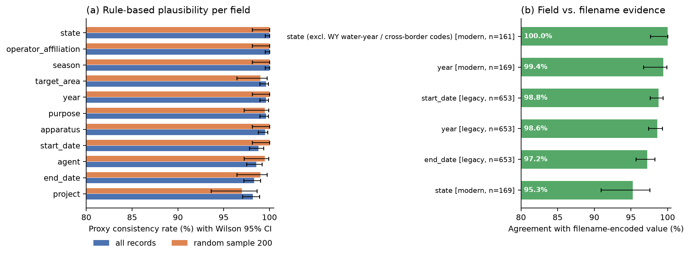
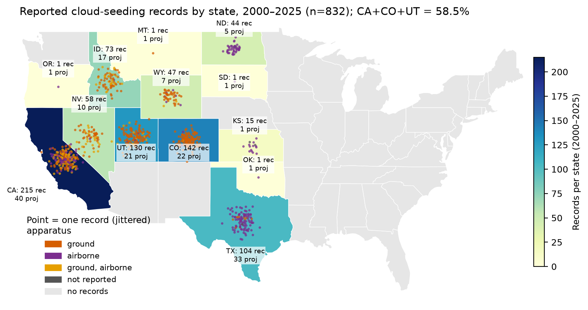
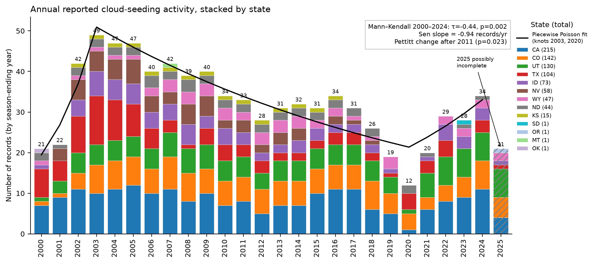
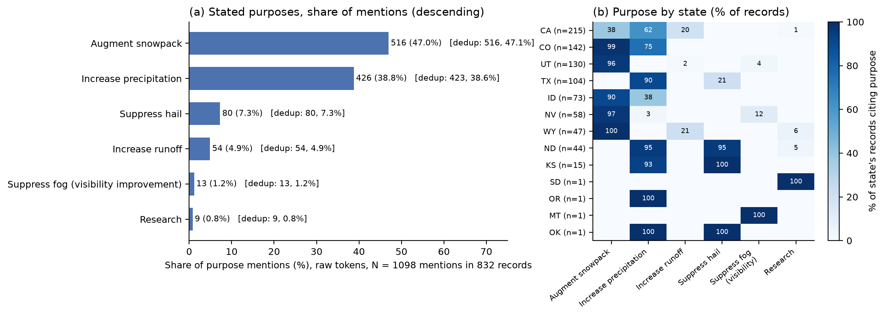
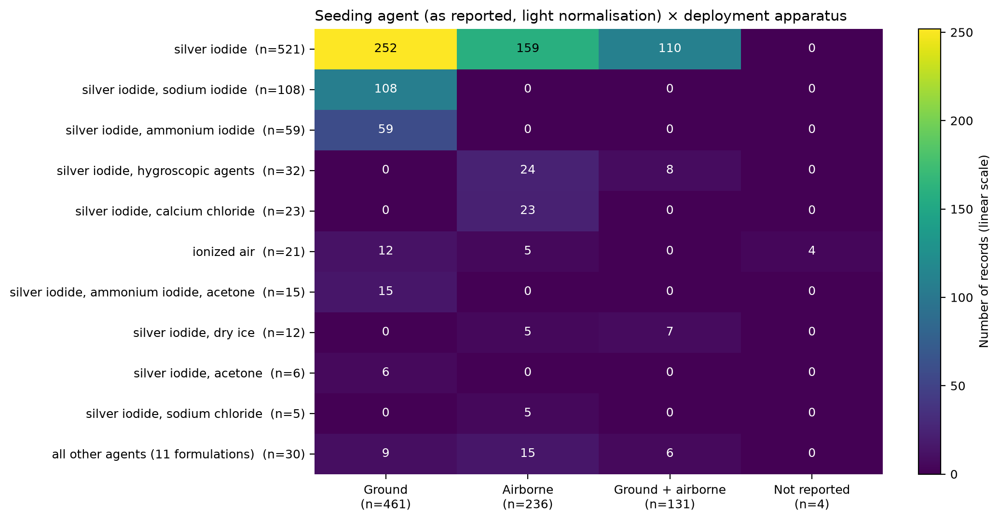
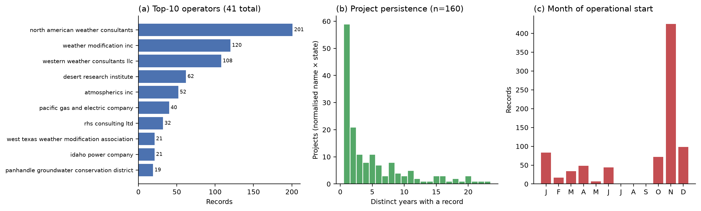
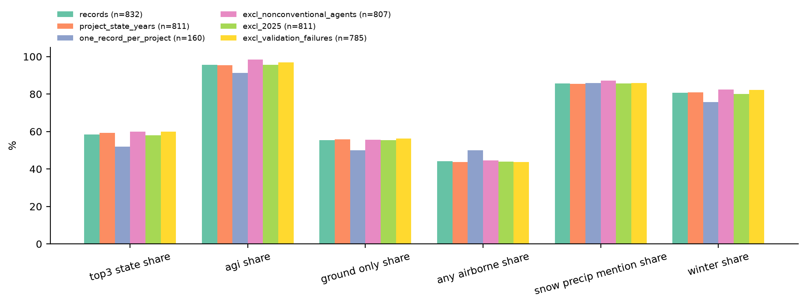

# Independent reproduction of the U.S. cloud-seeding records descriptor (NOAA weather-modification reports, 2000–2025)

## Abstract

We re-analysed the structured dataset released with the target data descriptor: 832 project-level cloud-seeding records from NOAA weather-modification reports, 2000–2025, with 12 extracted fields plus the source filename. The goal was to check whether the descriptor's main empirical conclusions follow from the public CSV alone. All results come from one deterministic script (`code/analysis.py`, fixed seed). Every number below is taken from `outputs/summary.json` or the `outputs/T*.csv` tables.

The four headline patterns all reproduce:

1. **Spatial concentration.** Records cluster strongly in the interior West. California, Colorado and Utah hold 58.5% of records. Eight western states hold 80.2%, and Texas (12.5%) is the main non-western cluster.
2. **Annual activity.** Activity peaked in the early 2000s (49 records in 2003). It declined significantly to a minimum in 2020 (12 records) and then partly rebounded in 2022–2024.
3. **Purposes.** Snowpack augmentation (47.0% of 1,098 purpose mentions) and precipitation increase (38.8%) dominate, together 85.8%. Hail suppression, runoff, fog suppression (visibility improvement) and research are minor.
4. **Agents and apparatus.** Silver iodide (AgI) appears in 95.6% of records. Plain AgI is the most frequent agent under every deployment mode (ground 461, airborne 236, ground + airborne 131 records).

We could not repeat the paper's extraction validation, a manual review of source PDFs, because the PDFs are not distributed. Instead we built a transparent **proxy validation**:

- The extracted fields agree with information encoded in the filenames in 95.3–100% of parsable cases, depending on field.
- Rule-based plausibility checks pass for 99.45% of field cells in a seeded random sample of 200 records.
- Most remaining discrepancies trace back to typos in the source filenames. A small, identifiable set looks like genuine extraction errors: day "15" read as "10", and "ionized air" assigned to aircraft programmes.

---

## 1. Data and methods

### 1.1 Data
- `data/dataset1_cloud_seeding_records/cloud_seeding_us_2000_2025.csv`: 832 rows × 13 columns. The columns are `filename` plus `project`, `year`, `season`, `state`, `operator_affiliation`, `agent`, `apparatus`, `purpose`, `target_area`, `control_area`, `start_date` and `end_date`.
- `us_states.geojson`: state polygons, used only for the map. Alaska, Hawaii and Puerto Rico are dropped.

### 1.2 Pre-processing
- **Text normalisation.** All text fields are lower-cased and whitespace-stripped, and comma separators are standardised to ", ". Missing values are filled with "not reported" only *after* this step, so normalisation cannot corrupt the placeholder.
- **Dates and multi-valued fields.** Dates are parsed as `m/d/yy`. Multi-valued fields (agent, purpose, season, apparatus) are split on commas.
- **Project identity.** Project names are normalised by removing punctuation, years and generic words ("program", "project", "cloud seeding", …) and by fixing a few spelling variants. Each normalised name is combined with the state to form a project key, which serves as the cluster unit for resampling.

### 1.3 Statistical tools
- Wilson 95% CIs for all proportions.
- Project-cluster bootstrap (B = 2,000) for state shares.
- Mann–Kendall trend test with Theil–Sen slope.
- Pettitt change-point test.
- Piecewise Poisson GLM with knots at the observed peak (2003) and trough (2020), excluding 2025. The Pearson dispersion was 0.63, so standard errors use scale = max(1, φ̂).
- χ² test (asymptotic and 2,000-permutation) with Cramér's V for agent family × apparatus.
- Project-cluster bootstrap for conditional airborne-use rates. A GEE/logit is completely separated in this table (Section 6), so it is not used.

---

## 2. Dataset scope and technical validation

### 2.1 Scope checks (verified from the data)
| Check | Value |
|---|---|
| Records | 832 |
| Year range | 2000–2025 |
| States | 13 (CA, CO, UT, TX, ID, NV, WY, ND, KS, SD, OR, MT, OK) |
| Distinct raw agent / purpose / season strings | 28 / 17 / 16 |
| Operators | 41 |
| Project names, raw → normalised | 211 → 159 (160 project × state keys) |
| Apparatus values | ground 461, airborne 236, ground + airborne 131, missing 4 |
| Missing values | apparatus 4, target_area 3, start_date 3, end_date 7, control_area 455 |

**What the `year` field means.** `year` equals the calendar year of `end_date` in 99.64% of records with an end date (n = 825). It equals the start-date year in only 31.7%. We therefore read `year` as the **season-ending (water) year**: a November 2002–April 2003 winter programme counts as 2003.

**Optional fields.** `control_area` is reported for only 45.3% of records. This fits its optional status on the NOAA form, since only programmes with a target/control evaluation design fill it in. It is excluded from the completeness checks.

### 2.2 Why a proxy validation
The descriptor validated its extraction pipeline by manually reviewing a sample of records against the source PDFs and reporting per-field accuracy. **That procedure cannot be repeated here, because the source PDFs are not distributed with the data.** We also do not quote or reconstruct the paper's accuracy figures.

Instead, we use two independent kinds of evidence that live in the released data. The rates below are therefore **proxy consistency rates, not ground-truth accuracy**:

- **(A) Filename evidence.** Filenames come from the NOAA archive, not from the extraction step.
  - 653 *legacy* filenames (`Project_NN-NNNN_MM.DD.YYYY-MM.DD.YYYY.pdf`) encode the report period.
  - 169 *modern* filenames (`2018CAKASP_….pdf`) encode a filing year and a two-letter state code.

  The regex tolerates malformed dates such as `06-31`, `04.31` and truncated years.
- **(B) Rule-based plausibility checks.** These are applied to all 832 records and to a seeded random sample of 200 records (`np.random.default_rng(20250101)`), which mirrors the design of a manual-review sample. The rules are:
  - controlled vocabularies for season, purpose and apparatus;
  - every agent token must be a recognised seeding material;
  - "ionized air" must not be assigned to aircraft;
  - no duplicated purpose tokens;
  - the reported season(s) must overlap the months of the operating period;
  - the year must match the end-date year;
  - start ≤ end and duration ≤ 366 days;
  - non-empty operator and target area;
  - for legacy files, the project name must be fuzzily consistent with the filename stem (difflib ratio ≥ 0.6).

### 2.3 Results

*Figure 1. Proxy extraction-reliability evidence. (a) Per-field pass rates for the rule-based plausibility checks, for all records and for the seeded random sample of 200 (Wilson 95% CIs). (b) Agreement between extracted fields and the values encoded in the source filenames.*

**Table 1. Agreement with filename evidence** (`outputs/T1_validation_filename_agreement.csv`)

| Field | Filename convention | n parsable | n agree | % agree [95% CI] |
|---|---|---|---|---|
| start_date | legacy | 653 | 645 | 98.8 [97.6, 99.4] |
| end_date | legacy | 653 | 635 | 97.2 [95.7, 98.2] |
| year (vs filename end year) | legacy | 653 | 644 | 98.6 [97.4, 99.3] |
| year (∈ {filing year, filing year + 1}) | modern | 169 | 168 | 99.4 [96.7, 99.9] |
| state (vs 2-letter code) | modern | 169 | 161 | 95.3 [90.9, 97.6] |
| state, excluding ambiguous codes | modern | 161 | 161 | 100.0 [97.7, 100.0] |

**Table 2. Rule-based plausibility pass rates** (`outputs/T2_validation_rule_pass_rates.csv`)

| Field | All records (n = 832) | Random sample (n = 200) |
|---|---|---|
| project | 98.2 [97.0, 98.9] | 97.0 [93.6, 98.6] |
| year | 99.6 [98.9, 99.9] | 100.0 [98.1, 100] |
| season | 100.0 [99.5, 100] | 100.0 [98.1, 100] |
| state | 100.0 [99.5, 100] | 100.0 [98.1, 100] |
| operator_affiliation | 100.0 [99.5, 100] | 100.0 [98.1, 100] |
| agent | 98.6 [97.5, 99.2] | 99.5 [97.2, 99.9] |
| apparatus | 99.5 [98.8, 99.8] | 100.0 [98.1, 100] |
| purpose | 99.6 [98.9, 99.9] | 99.5 [97.2, 99.9] |
| target_area | 99.6 [98.9, 99.9] | 99.0 [96.4, 99.7] |
| start_date | 98.8 [97.8, 99.3] | 100.0 [98.1, 100] |
| end_date | 98.3 [97.2, 99.0] | 99.0 [96.4, 99.7] |

- **Field level.** In the random sample, 2,188 of 2,200 field cells (99.45%) pass.
- **Record level.** 189 of 200 sampled records (94.5%, Wilson CI 90.4–96.9%) pass every check. Over all records the figure is 785 of 832 (94.35%).
- **Stricter season rule.** If we instead require the season containing the *midpoint* of the operating period to be listed, only 83.05% pass. Almost all of these failures are year-round permits (January–December) or water-year permits (October–September) labelled "winter". The label describes when seeding actually happens; the dates describe the permit or reporting period. This is a semantic difference, not a transcription error.

### 2.4 Source errors vs. probable extraction errors
We classified every discrepancy (`outputs/T1b_…disagreements.csv`, `outputs/T2b_…failures_classified.csv`). For the 44 field-level filename disagreements:

- **Filename typos; the extracted value is internally consistent (19 cases).** Examples: `High Uintas_…_12.01.2003-04.30.2003.pdf`, `Wind River…_11.15.2007-04.30.2006.pdf`, and the truncated `…03.13.200.pdf`. The record holds a coherent period (e.g. 12/1/2003–4/30/2004), so the extraction apparently read the correct dates from the form, not the filename.
- **Impossible filename dates → extracted date missing (6).** Examples: `06.31.2000` and `04.31.2015` (the Grand Mesa, Stanislaus and Upper Tuolumne reports). The pipeline returned null instead of inventing a date.
- **Ambiguous filename code (8).** In 2023–2025, seven California filenames use "WY" to mean *water year* (e.g. `2023WYKA-1.pdf`, the Kaweah project), not Wyoming. One file, `2021WYNSR-1.pdf`, is a Wyoming-sponsored aerial programme whose target area (the Never Summer Range) lies in Colorado, which is the extracted state. In all eight cases the extracted state is supported by the record's own fields.
- **Probable extraction errors (9).** Seven start dates and two end dates read day "15" as "10" (e.g. 11/15 → 11/10, 4/15 → 4/10). The error always goes in the same direction, which points to a systematic digit misreading.
- **Unresolved (2).** One Kern River end date (filename `1.31.2001`, extracted 12/31/2001) and one modern filing-year mismatch (`2025UTS-1.pdf`, year 2024, end date 12/24/2024, internally consistent).

Among the plausibility failures:
- **Inverted or over-long date ranges.** The 3 records with end < start are reproduced exactly in their filenames (`inverted_dates_match_filename = 3`), so they are **source errors that were faithfully extracted**. The 5 start-date and 5 end-date flags marked "source error" cover these 3 inverted ranges plus 2 of the 4 periods longer than 366 days, all of which carry the same dates in their filenames. The other 2 (`2024COG-1 copy.pdf`, a 2023–2026 multi-year permit, and `Walker Basin Project_…_11.15.2006.30.2011.pdf`, whose filename date is garbled) have no usable filename evidence.
- **"Ionized air" on aircraft (9 records).** These are 4 ND, 3 KS and 2 TX records whose apparatus is "airborne" (5) or missing (4). The ND Cloud Modification Project, the Western Kansas programme and the PGCD programme are aircraft AgI programmes, so these are classed as probable extraction errors. All 4 missing-apparatus values are among these records. The 12 ground-based ionized-air records (Belding and Powell Farms hail suppression, Grand Mesa, and a 2024 Colorado electro-ionisation experiment) are plausible.
- **Garbled formulations (3).** Examples: "ammonium sodium perchlorate" and "sodium precipitate". These are likely transcription or extraction artefacts of an AgI–NH₄I–perchlorate formulation.
- **Other small artefacts.** 3 records list "increase precipitation" twice. Project-name flags arise mostly because the filename stem is uninformative ("N.A", "NOAA # 031133"; 9 cases); 6 names differ from their stem and would need manual review.
- **Year mismatches (3).** `2018COESJM` (year 2018, season 2018–19), `2023WYKA-1` (year 2023, end 2024; it duplicates `2024WYKA-1`) and `2024COG-1` (a multi-year permit).
- **Duplicates.** There are 21 project × state × year groups with more than one record (21 surplus records). Some are legitimate, such as initial plus interim reports.

**Interpretation.** These proxies cannot replace manual PDF review. They cannot detect a wrong value that happens to be plausible and absent from the filename, for example a wrong agent within the vocabulary. Within those limits, the evidence is consistent with a high-fidelity extraction. The residual errors are rare, mostly identifiable, and in about half of the date cases come from the source documents rather than the extraction.

---

## 3. Spatial concentration

*Figure 2. Choropleth of record counts per state (sequential colour scale, grey = no records). Each point is one record, jittered around the centroid of the state's largest polygon with a fixed seed and coloured by apparatus. Labels give records and distinct projects.*

**Table 3. Records by state** (`outputs/T3_state_counts.csv`; CIs from the project-cluster bootstrap)

| State | Records | Share % [95% CI] | Projects | Cumulative % |
|---|---|---|---|---|
| CA | 215 | 25.8 [16.2, 36.3] | 40 | 25.8 |
| CO | 142 | 17.1 [8.8, 26.1] | 22 | 42.9 |
| UT | 130 | 15.6 [8.0, 25.0] | 21 | 58.5 |
| TX | 104 | 12.5 [6.5, 19.8] | 33 | 71.0 |
| ID | 73 | 8.8 [4.3, 14.0] | 17 | 79.8 |
| NV | 58 | 7.0 [2.9, 12.2] | 10 | 86.8 |
| WY | 47 | 5.6 [1.1, 12.0] | 7 | 92.4 |
| ND | 44 | 5.3 [0.2, 12.5] | 5 | 97.7 |
| KS | 15 | 1.8 [0.0, 5.7] | 1 | 99.5 |
| SD, OR, MT, OK | 1 each | 0.1 each | 1 each | 100 |

**Verified findings:**
- CA + CO + UT hold 58.5% of records (project-bootstrap CI 47.7–68.9%), and the top five states hold 79.8%. Eight western mountain states account for 80.2% of records and the Great Plains (TX, ND, KS, SD, OK) for 19.8%. The state-level Herfindahl index is 0.155.
- Secondary clusters are Texas, with many small projects (33 projects in 104 records), the northern Rockies (ID, WY) and North Dakota (44 records from only 5 long-running district projects).
- The point overlay shows the regional apparatus split: western programmes are mostly ground-based, while the Plains programmes (TX, ND, KS) are almost entirely airborne.

The bootstrap CIs are wide because resampling is by project, and a few long-running programmes contribute many records. The CA+CO+UT ranking itself is stable.

---

## 4. Annual activity

*Figure 3. Records per season-ending year, stacked by all 13 states (largest at the bottom). The black line is the piecewise Poisson fit with knots at 2003 and 2020. The 2025 bar is hatched because it is probably incomplete.*

**Verified findings** (`outputs/T4_annual_by_state.csv`, `summary.json → annual`):
- **Peak.** 49 records in 2003, with 2002–2009 consistently between 39 and 49. The 2000–2009 mean is 38.9 records per year.
- **Decline.** The 2010–2019 mean is 29.9. The minimum is 12 records in 2020, the lowest of the series; 2019 had 19.
- **Rebound.** Counts were 20 in 2021, 29 in 2022, 28 in 2023 and 34 in 2024. The 2022–2024 mean of 30.3 exceeds the 2018–2021 mean of 19.25. 2025 has 21 records but is probably incomplete.
- **Trend tests, 2000–2024.**
  - Mann–Kendall: τ = −0.44, p = 0.002.
  - Theil–Sen slope: −0.94 records per year (95% CI −1.38 to −0.40).
  - Pettitt change point after 2011 (p = 0.023): mean 38.0 before vs 27.3 after.
  - Including 2025 gives τ = −0.46, p = 0.001.
- **Piecewise Poisson fit.**
  - 2000–2003: +37.8% per year (95% CI 21.5–56.2).
  - 2003–2020: −5.0% per year (−6.4 to −3.6).
  - 2020–2024: +11.5% per year (2.7–21.1, p = 0.010).

  The knots were chosen from the data, so these p-values are optimistic.
- **Composition.** California, Colorado and Utah contribute in nearly every year. The early-2000s peak is boosted by Texas (up to 12 records per year) and Nevada. The 2020 trough coincides with an almost complete absence of CA records (1 in 2020).

**Interpretation.** The direction and approximate timing of the decline are robust. The post-2020 rebound is supported but tentative: it rests on four years, one of them incomplete. A drop in the number of *reports* could also reflect changes in reporting or archiving rather than in activity, for example the switch in filename convention around 2017–2018.

---

## 5. Purpose composition

*Figure 4. (a) Share of purpose mentions, sorted in descending order. Raw-token counts are shown, with per-record deduplicated counts in brackets. (b) Percentage of each state's records citing each purpose.*

**Table 4. Purpose mentions** (`outputs/T5_purpose_mentions.csv`)

| Purpose concept | Raw mentions | Share of mentions % | Deduplicated mentions | Deduplicated share % | % of records |
|---|---|---|---|---|---|
| Augment snowpack | 516 | 46.99 | 516 | 47.12 | 62.02 |
| Increase precipitation | 426 | 38.80 | 423 | 38.63 | 50.84 |
| Suppress hail | 80 | 7.29 | 80 | 7.31 | 9.62 |
| Increase runoff | 54 | 4.92 | 54 | 4.93 | 6.49 |
| Suppress fog (visibility improvement) | 13 | 1.18 | 13 | 1.19 | 1.56 |
| Research | 9 | 0.82 | 9 | 0.82 | 1.08 |
| **Total** | **1,098** | 100 | **1,095** | 100 | – |

**Verified findings:**
- **Dominant purposes.** Snowpack augmentation plus precipitation increase make up **85.8%** of mentions under both counting rules (85.79% raw, 85.75% deduplicated). The two rules differ only because 3 records repeat "increase precipitation".
- **Multi-purpose records.** 31.4% of records list more than one purpose. The most common combinations are snowpack + precipitation (128) and precipitation + hail (69).
- **Regional split.**
  - Snowpack dominates CO, UT, ID, NV and WY (90–100% of each state's records).
  - Precipitation increase dominates TX (90%).
  - Hail suppression is concentrated in ND (95%) and KS (100%), where it is always paired with precipitation increase.
  - Fog suppression is a niche purpose: aircraft dry-ice/CO₂ fog dispersal at Salt Lake City International Airport (UT), the Missoula fog project (MT, ground CO₂), and the Truckee–Tahoe project (NV).

---

## 6. Agent × apparatus deployment

*Figure 5. The ten most frequent agent formulations as reported, plus a pooled "other" row, against deployment apparatus. Counts are annotated and the colour scale is linear. Light normalisation merges the four "hygroscopic …" spellings, merges "liquid propane" into "propane", and merges the perchlorate variants.*

**Verified findings:**
- **Formulations.** There are 28 raw formulation strings (21 after light normalisation). AgI is present in **795 records (95.55%)**, and plain "silver iodide" is the agent in 62.6%.
- **AgI leads every apparatus mode.** Plain AgI is the most frequent agent under ground (252 of 461), airborne (159 of 236) and ground + airborne (110 of 131). AgI-containing agents make up 96.8% of ground, 92.4% of airborne and 100% of combined-mode records.
- **Deployment mix.** Ground-only deployment is most common (55.4%; 71.2% of records use any ground generators). 44.1% use aircraft, and a substantial **15.7% (131 records) use both**.
- **Formulation is strongly tied to apparatus.**
  - AgI–sodium iodide (108), AgI–ammonium iodide (59) and AgI–NH₄I–acetone (15) appear *only* with ground generators. These are the acetone-solution generator formulations.
  - AgI with hygroscopic agents (32), calcium chloride (23) or sodium chloride (5) appear *only* with aircraft (airborne, or airborne + ground). These are the hygroscopic flare formulations typical of Plains and Sierra aircraft programmes.
  - Dry ice appears only where aircraft are used. The single ground-based CO₂ record is the Missoula fog project.
- **Ionized air** is shown as its own row (21 records): 12 ground, 5 airborne, 4 not reported. As discussed in §2.4, the non-ground cases are probable extraction artefacts.
- **Association test.** Grouping agents into eight chemical families gives χ² = 313.4 (df = 14), with asymptotic and permutation p < 0.001 and **Cramér's V = 0.44**, a strong association (`outputs/T6c…csv`).
- **Western programmes** (`outputs/T6d…csv`, project-cluster bootstrap CIs):

  | Agent family | Records using aircraft | % [95% CI] |
  |---|---|---|
  | AgI + hygroscopic salts | 32/32 | 100 |
  | AgI only | 165/417 | 39.6 [29.3, 50.6] |
  | AgI + iodide complexing salts | 2/189 | 1.1 [0.0, 4.3] |

  This separation is why a logistic/GEE model is degenerate here, so conditional rates are reported instead.

---

## 7. Supplementary analyses

*Figure 6. (a) Top-10 operators. (b) Distribution of the number of distinct years each project appears. (c) Month in which operations start.*

- **Operators.** Five operators account for 65.3% of records: North American Weather Consultants 201, Weather Modification Inc 120, Western Weather Consultants 108, Desert Research Institute 62 and Atmospherics Inc 52. There are 41 operators in total.
- **Persistence.** The median project appears in 2.5 distinct years, but 28 of the 160 projects appear in 10 or more years. This long-running core drives the state rankings.
- **Seasonality.** 80.7% of records include winter. Operations most often start in November (425 records), followed by December (98) and January (83). The median operating period is 165 days (IQR 150–212). Summer programmes, in the Plains, start in March–June.

### 7.1 Robustness to the unit of analysis

*Figure 7. Headline shares recomputed under alternative units and exclusions (`outputs/T7_robustness_units.csv`).*

| Unit | n | CA+CO+UT % | AgI % | Ground-only % | Any airborne % | Snowpack + precipitation share of mentions % | Winter % |
|---|---|---|---|---|---|---|---|
| Records | 832 | 58.53 | 95.55 | 55.41 | 44.11 | 85.75 | 80.65 |
| Project-state-years | 811 | 59.31 | 95.44 | 55.73 | 43.77 | 85.54 | 81.01 |
| One record per project | 160 | 51.88 | 91.25 | 50.00 | 50.00 | 85.79 | 75.62 |
| Excluding non-conventional agents | 807 | 59.85 | 98.51 | 55.51 | 44.49 | 87.11 | 82.53 |
| Excluding 2025 | 811 | 58.08 | 95.56 | 55.49 | 44.02 | 85.67 | 80.15 |
| Excluding validation-flagged records | 785 | 59.87 | 96.82 | 56.18 | 43.82 | 85.93 | 82.17 |

- Across the record-based variants, no headline share moves by more than **2.96 percentage points**.
- Collapsing to one record per project changes shares by up to 6.66 pp: CA+CO+UT drops to 51.9%, because Texas has many short-lived projects. None of the qualitative conclusions change.

---

## 8. Discussion and limitations

**Which conclusions are recovered.** All of the descriptor's central empirical claims that we tested follow directly from the released CSV, using transparent, script-based analysis:

1. **Spatial concentration.** Activity is concentrated in western mountain states (CA, CO, UT first), with secondary clusters in Texas and the northern Plains.
2. **Annual dynamics.** The record shows an early-2000s peak, a significant decline to a 2020 minimum, and a recent rebound.
3. **Purposes.** Water-supply purposes dominate: snowpack and precipitation make up about 86% of purpose mentions.
4. **Agents.** Silver iodide is near-universal across ground, airborne and combined deployment, and formulation choice is tightly coupled to delivery platform.

**Verified vs. interpretive claims.** Counts, shares, trend statistics and validation rates are *verified* from the data. Three readings are *interpretive*: that `year` is a water year, that the "15→10" and "ionized air on aircraft" errors are extraction errors rather than errors in the PDFs, and that the post-2020 rebound is real activity rather than a change in reporting.

**Limitations:**
1. Extraction accuracy is checked only by proxy (filename evidence and plausibility rules). Errors that are plausible and absent from the filename remain undetectable without the PDFs.
2. Records are NOAA *reports*, so counts mix projects, report types (initial, interim, final) and reporting compliance. We address this partly through the project-level sensitivity analyses and the 21 duplicate groups.
3. 2025 is probably incomplete.
4. Project-name normalisation is heuristic. The number of distinct projects (159–211 depending on the rule) affects the cluster bootstrap widths.
5. The target paper was not available in `related_work/`, so we compare against the descriptor's stated conclusions as summarised in the task, not against its exact published figures.

## Reproducibility
Run `python code/analysis.py` from `/workspace`. It takes about 35 s, uses the fixed seed 20250101, and regenerates all tables in `outputs/`, the file `outputs/summary.json`, and all figures in `report/images/`.
