# Compound risk to the world's mangroves from tropical-cyclone regime shifts and sea-level rise by 2100

*A global composite-risk analysis under SSP2-4.5, SSP3-7.0 and SSP5-8.5*

---

## Abstract

Mangroves face two climate hazards. Their disturbance regimes are shifting as tropical cyclones (TCs) change, and their elevation capital is being eroded by accelerating relative sea-level rise (RSLR). This study builds a transparent, additive composite risk score and applies it to a 45,786-point global sample of mangrove locations (Global Mangrove Watch v4 reference samples), weighted by the 2020 mangrove area, people and built capital reported by the Coastal Wetlands Ocean Wealth (CWON) country accounts.

The score has two components:

- **TC component (0–3).** Kropf et al.'s ecoregion-scale "vulnerable / resilient / dependent" framework is applied to a baseline built from MIT synthetic tracks (MPI-ESM1-2-HR, 1850–2014). The level is the highest storm-intensity class (Low, Medium, High) in which the unit's disturbance regime shifts significantly by 2100.
- **SLR component (0–2).** Saintilan et al.'s accretion-deficit thresholds (4 and 7 mm yr⁻¹) are applied to IPCC AR6 median regional RSLR rates for 2020–2100.

The sum gives six classes, from 0 (None) to 5 (Severe).

No future track set was supplied, so future cyclone climates are represented by two warming-scaled delta-change variants:

- **Variant A (primary):** consistent with the MIT downscaling that produced the tracks. Frequency does not decrease, and storm intensity increases.
- **Variant B:** the Knutson et al. (2020) consensus. Frequency decreases, and storm intensity increases.

**Main results.** Under the primary Variant A, **52.9 %, 61.1 % and 61.8 %** of global mangrove area falls in the High-to-Severe classes (score ≥3) under SSP2-4.5, SSP3-7.0 and SSP5-8.5. The Monte Carlo medians are 59, 63 and 67 %, with 5–95 % ranges of 33–75, 38–75 and 45–77 %. The top "Severe" class grows strongly with emissions: 12 % → 35 % → 47 % of area.

Risk is concentrated where mangroves deliver the most coastal protection. About 83–87 % of the people and 82–88 % of the built capital protected by mangroves lie in High-to-Severe areas.

The hotspots are:

- Central America and the Caribbean;
- the Philippines and Vietnam / South China Sea;
- the Bay of Bengal (Bangladesh, Myanmar, India);
- Mozambique and Madagascar;
- northern Australia and the Southwest Pacific (Papua New Guinea, Solomon Islands, Vanuatu, Fiji);
- the cyclone-exposed parts of Malaysia and Indonesia.

Equatorial Indonesia, Malaysia, West–Central Africa and Brazil are TC-free and reach at most "Moderate". The Knutson-consensus variant roughly halves the global headline (29 → 36 → 38 %). It also removes most of the Southeast Asian and Southwest Pacific signal, which makes the sign of future TC frequency change the single largest source of uncertainty.

---

## 1. Introduction

Mangroves protect about 9 million people and US$ 35 bn of built capital from coastal flooding (CWON 2020 accounts). Two climate-driven stressors threaten them.

**Tropical cyclones.** Cyclones are a natural disturbance to which many mangrove systems are adapted, and on which some depend (Krauss & Osland 2020; Mo et al. 2023). Kropf et al. argue that ecosystems are at risk when the *regime* of disturbance changes relative to the regime to which they are adapted, not simply when storms occur. On this view:

- a rarely disturbed (vulnerable) system is at risk from a modest frequency increase (>10 %);
- a frequently disturbed (resilient) system tolerates more (>20 %);
- a system whose structure depends on regular storms (dependent) is at risk from any change of more than ±5 %.

**Sea-level rise.** Saintilan et al. (2023) combine palaeo-stratigraphic and contemporary observations. They show that mangrove vertical adjustment is likely to lag RSLR above 4 mm yr⁻¹ and very likely to lag above 7 mm yr⁻¹. They project that, at about 3 °C of warming, nearly all mangroves would face ≥7 mm yr⁻¹.

The two hazards interact. Storm damage, peat collapse and sediment redistribution reduce the elevation capital that mangroves need to keep pace with SLR, and canopy loss under faster SLR slows recovery from storms. Yet global assessments have treated them separately.

This study develops a composite index that keeps both hazards visible. It applies the index globally for three SSPs to answer two questions: **where**, and **to what extent**, are mangroves and their ecosystem services at risk by the end of the century?

---

## 2. Data

| Dataset | Content used | Notes |
|---|---|---|
| GMW v4 reference samples (`gmw_v4_ref_smpls_qad_v12.gpkg`) | 100,000 points; fields `ref_cls` (1 = 45,786; 2 = 24,109; 3 = 30,105) | The file is a **point** layer, not polygons. `ref_cls` is undocumented. We **assume ref_cls = 1 = mangrove** (primary set) and use all points as a sensitivity test. |
| CWON country accounts (`UCSC_CWON_countrybounds.gpkg`, in `data/ecosystem`) | 121 countries: `Mang_Ha_2020`, `Ben_Pop_2020`, `Ben_Stock_2020` | Not listed in the task description, but it is the only ecosystem-service source. Totals: 15.39 Mha, 8.89 M people, US$ 35.5 bn. |
| AR6 regional RSLR rates, SSP2-4.5 / 3-7.0 / 5-8.5, medium confidence | `sea_level_change_rate` (107 quantiles × 14 decades × 66,190 locations) | int16 with scale 0.1 and fill −32768, both applied manually. |
| MIT TC tracks, MPI-ESM1-2-HR historical 1850–2014, reduced | 200,000 track points (lat, lon, max sustained wind ≥33 m s⁻¹) | Randomly ordered points with **no storm IDs or times**, and no future set. Class counts: L 156,814; M 24,832; H 18,354. |

Each GMW point is assigned to a CWON country by point-in-polygon:

- 71.5 % fall inside a polygon directly;
- 28,100 points within 0.5° are snapped to the nearest polygon;
- 324 further points within 3° are also snapped;
- 82 points remain unassigned (remote Pacific atolls) and receive zero weight.

Country totals are spread equally over each country's points. The summed weights reproduce the CWON totals exactly (15.39 Mha; 8.89 M people; US$ 35.5 bn).

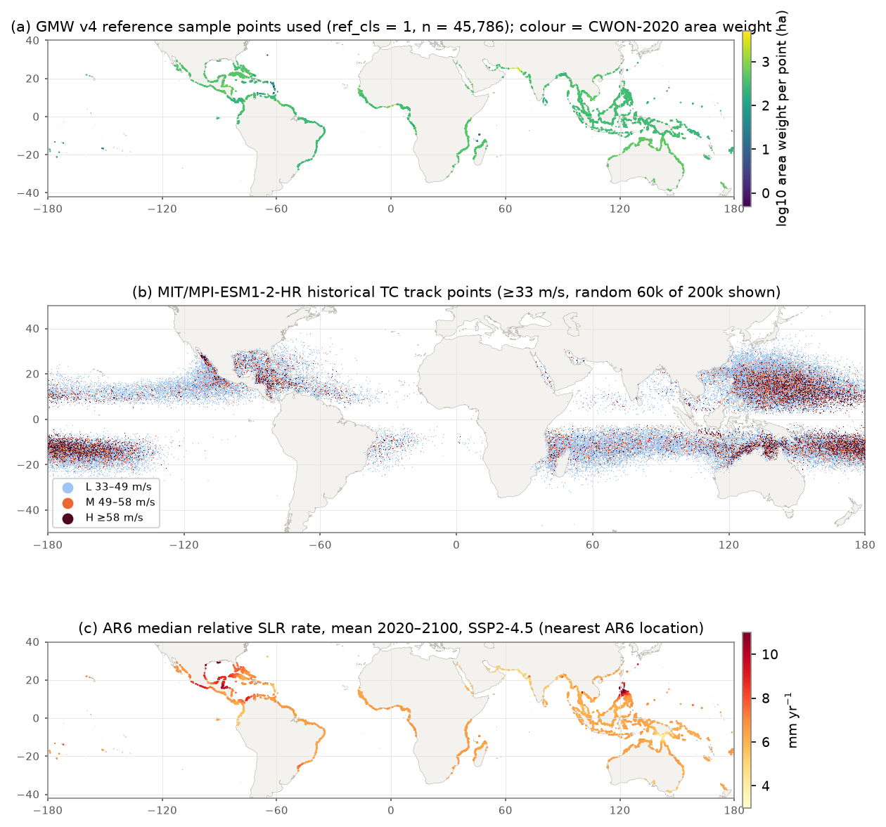

*Figure 1. (a) Mangrove sample points with their CWON area weight; (b) MIT synthetic track points by Kropf intensity class; (c) AR6 median RSLR rate (2020–2100 mean, SSP2-4.5) at each mangrove point.*

---

## 3. Methods

### 3.1 Baseline TC hazard

The track points carry no storm identity, so the annual **storm-passage frequency** within radius R of a site is estimated from point density.

**Calibration.** If a basin produces N_b storms per year at hurricane strength (≥33 m s⁻¹), each with about L = 1,200 km of track at that strength, and is represented by NP_b points, then each point stands for N_b·L/NP_b km of track per year. A storm passing through a disc of radius R traverses on average πR/2 km of it. The passage weight per point is therefore

κ_b = N_b · L / (NP_b · πR/2),

and the site frequency in class c is f_c = κ_b × (number of class-c points within R).

**Basin bias correction.** N_b is set to observed IBTrACS-era climatology: NA 6.4, EP 9.0, WP 16.5, NI 1.5, SI 8.0, SP 4.5, SA 0.05 storms yr⁻¹. This corrects the MIT set's over-population of the South Pacific (26 % of points against about 10 % of observed storms) and its under-population of the North Atlantic and North Indian Ocean.

**Settings.** The primary radius is R = 100 km (50 and 200 km tested). Classes follow Kropf et al.: L 33–49, M 49–58, H ≥58 m s⁻¹.

### 3.2 Baseline adaptation state (Kropf et al., Table 2)

Kropf et al. classify ecoregions. Here each mangrove point is grouped into a **5° × 5° spatial unit** as an ecoregion proxy; 2°, 10° and country × basin units are tested as alternatives. For each unit and class we compute the 20th and 80th percentiles (p20, p80) of site frequencies:

- **dependent** if p20 ≥ 1/20 yr⁻¹;
- **resilient** if p80 ≥ 1/20 yr⁻¹;
- **vulnerable** otherwise;
- **unaffected** if p80 < 1/250 yr⁻¹.

### 3.3 Future TC climates (delta change)

Because no future tracks are supplied, the baseline points are perturbed:

1. **Frequency:** each point weight is multiplied by (1 + Δf_basin·s).
2. **Intensity:** each wind is multiplied by (1 + Δi·s). Storms therefore migrate across the 49 and 58 m s⁻¹ class boundaries.
3. **Scaling:** s = ΔT/2 °C, where ΔT is the AR6 2081–2100 best-estimate GSAT warming (2.7, 3.6 and 4.4 °C) minus 0.3 °C, the mean warming of the 1850–2014 track period.
4. **Sub-threshold storms:** intensification also lifts unobserved storms that were below 33 m s⁻¹. These are represented by pseudo-points, re-using the points with 33 ≤ w < 33(1+Δi) as proxies (assumed equal density just below the threshold).

| Variant | Δf per 2 °C | Δi (LMI) per 2 °C | Rationale |
|---|---|---|---|
| **A – MIT-consistent (primary)** | +10 % in all basins (SA 0) | +5 % | The tracks come from the MIT/Emanuel downscaling, which projects global TC-frequency *increases* under warming (Emanuel 2013, 2021). The method paper (Kropf et al.) also found frequency increases in nearly all cyclone regions. A perturbation that keeps the data source's sign is internally consistent. |
| **B – Knutson 2020 consensus** | NA −10, EP −10, WP −20, NI −10, SI −20, SP −25 % | +5 % | Expert-consensus median: fewer storms, stronger storms. Shown side by side as the main structural alternative. |

### 3.4 Regime-shift test (Kropf et al. §3.3)

For each unit and class, the baseline and future percentiles are compared using return periods: r = (RP₀ − RP₁)/RP₀ = 1 − f₀/f₁.

- Vulnerable and resilient units compare p80; dependent units compare p20.
- A unit is **at risk** if r > 0.10 (vulnerable), r > 0.20 (resilient) or |r| > 0.05 (dependent).
- A unit is also at risk if it is **newly affected**: p80 rises from below to above 1/250 yr⁻¹.

The flag is propagated to **every mangrove point in the unit**. The TC level is the highest class that shifts (L = 1, M = 2, H = 3; 0 = no shift). A per-site version of the test, which uses each site's own r, is retained only as a sensitivity.

### 3.5 SLR level

Each site takes its **nearest valid AR6 location**: median distance 43 km, maximum 78 km (Fig. 10b). The SLR value is the median-quantile rate, averaged over the decades 2020–2100. It is classified as level 0 (<4 mm yr⁻¹), 1 (4–7 mm yr⁻¹) or 2 (≥7 mm yr⁻¹). The 17th and 83rd percentiles, the 2080–2100 mean, and thresholds shifted by ±0.5 mm yr⁻¹ are tested as sensitivities.

### 3.6 Composite score

**Score = TC level (0–3) + SLR level (0–2)**, giving 0 None, 1 Low, 2 Moderate, 3 High, 4 Very high and 5 Severe. A Severe site combines a regime shift in the most intense storm class with RSLR ≥7 mm yr⁻¹.

- **Headline metric:** the share of mangrove area, people and built capital with score ≥3.
- **Secondary typology:**
  - TC-only: TC shift and SLR <7;
  - SLR-only: no TC shift and SLR ≥7;
  - compound: both;
  - none: neither.

The TC component carries more weight (3 levels against 2) because it is resolved by intensity class. SLR is nonetheless decisive in determining whether a site reaches "Severe".

### 3.7 Uncertainty

**Monte Carlo.** A 60-member Monte Carlo uses common random numbers across SSPs and variants. It samples:

- the AR6 SLR quantile, U(0.17, 0.83), applied globally and coherently;
- κ, a log-normal multiplier with σ = 0.35;
- R from {50, 100, 200} km with probabilities 0.25 / 0.5 / 0.25;
- unit size from {2°, 5°, 10°} with probabilities 0.25 / 0.5 / 0.25;
- per-basin Δf: U(0, 0.2) per 2 °C for Variant A, or the Knutson value ± 0.1 for Variant B;
- Δi: U(0.02, 0.08) per 2 °C;
- warming: a triangular distribution over the AR6 likely range.

**One-at-a-time sensitivities** are listed in Table 5.

**Code.** The pipeline is in `code/`: `01_load_data.py` → `02_build_inputs.py` → `03_main.py` → `04_validation.py` → `05_diagnostics.py` → `06_montecarlo.py` → `07_figures.py` → `08_tables.py`, with shared functions in `model.py`. All intermediate products are in `outputs/`.

---

## 4. Results

### 4.1 Baseline cyclone regime and adaptation states

About 54 % of mangrove area experiences at least one hurricane-strength passage within 100 km per 250 years (Fig. 2a). The return period is shortest (<5 yr) in the Philippines, Cuba, the Bahamas and the Yucatán–Belize coast.

Under the Kropf rules (Fig. 2b), for the L class:

- 40 % of the area is unaffected;
- 35 % is vulnerable;
- 6.5 % is resilient;
- 18 % is dependent.

The dependent and resilient units lie in the Philippines, the Bahamas/Cuba/Florida, the Yucatán and Mexican Pacific, the Bay of Bengal, NW Australia and Fiji. Kropf et al. likewise place most resilient and dependent ecoregions in East Asia, the Caribbean and Central America, the Pacific islands and Madagascar. For the M and H classes almost all affected area is "vulnerable" (M: 40 % vulnerable, 2 % resilient or dependent; H: 34 % and 4 %).

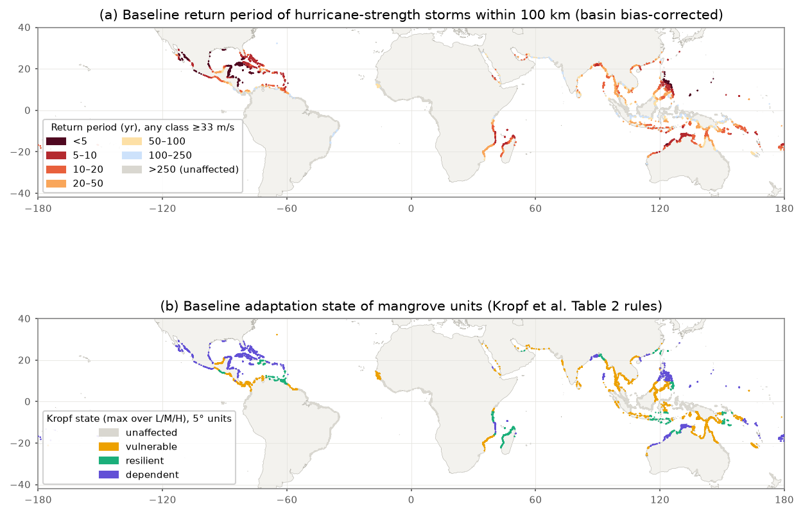

*Figure 2. (a) Baseline return period of hurricane-strength storms within 100 km; (b) Kropf adaptation state (maximum over L/M/H) of 5° mangrove units.*

### 4.2 TC regime shifts

Under Variant A, 62 % of mangrove area experiences a regime shift by 2100 under every SSP (Fig. 3, Table 2). Most of it is in the H class (43–48 % of area). Intensification pushes many M storms above 58 m s⁻¹, so the H-class frequency in previously vulnerable units rises well above the 10 % threshold.

For SSP3-7.0, the shifted area breaks down by mechanism as follows:

- significant increase in vulnerable units: 41.5 %;
- newly affected units: 16.1 %;
- resilient units: 2.7 %;
- dependent units: 1.2 %.

Applying frequency change alone or intensity change alone gives similar headline shares (Table 5), so neither mechanism dominates.

Under Variant B the shifted area falls to 33–38 %. The H-class share drops to 16–22 % and is confined to the North Atlantic/Caribbean, the Bay of Bengal, SE Africa and the northern Philippines. The 20–25 % frequency decreases in the WP, SI and SP basins cancel the intensification there.

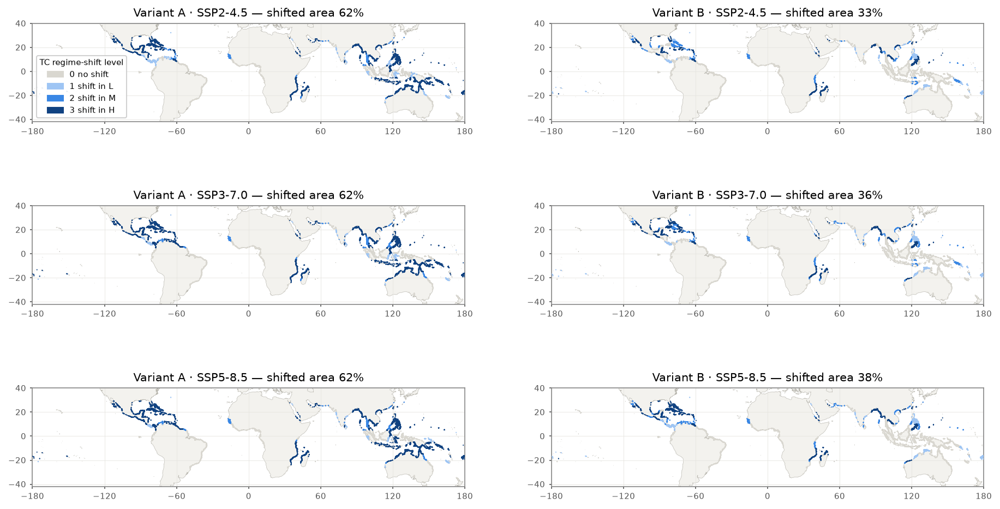

*Figure 3. TC regime-shift level (highest Kropf class with a significant shift) for both variants and all three SSPs.*

### 4.3 Sea-level rise exposure

Using median rates averaged over 2020–2100, nearly 100 % of mangrove area exceeds 4 mm yr⁻¹ under all SSPs. The share exceeding 7 mm yr⁻¹ rises steeply (Fig. 4):

| SSP | Area ≥7 mm yr⁻¹ (median rate) | Area-weighted median rate |
|---|---|---|
| SSP2-4.5 | 13 % | 6.4 mm yr⁻¹ |
| SSP3-7.0 | 85 % | 7.6 mm yr⁻¹ |
| SSP5-8.5 | 99 % | 8.7 mm yr⁻¹ |

Because the area-weighted distribution is narrow and centred close to 7 mm yr⁻¹, the SSP2-4.5 result depends strongly on the quantile and averaging window:

- ≥7 mm yr⁻¹ share: 1 % at the 17th percentile, 100 % at the 83rd percentile;
- 2080–2100 rates (as used by Saintilan et al.): 91 % of area reaches ≥7 mm yr⁻¹ under SSP2-4.5, and 100 % under SSP3-7.0 and SSP5-8.5.

This agrees with Saintilan et al.'s statements that at about 2 °C "nearly all [mangroves are] exposed to ≥4 mm yr⁻¹" and that at about 3 °C "nearly all the world's mangrove forests" face ≥7 mm yr⁻¹. Our SSP2-4.5 (2.7 °C) case lies between their 2 °C (one-third ≥7 mm yr⁻¹) and 3 °C cases.

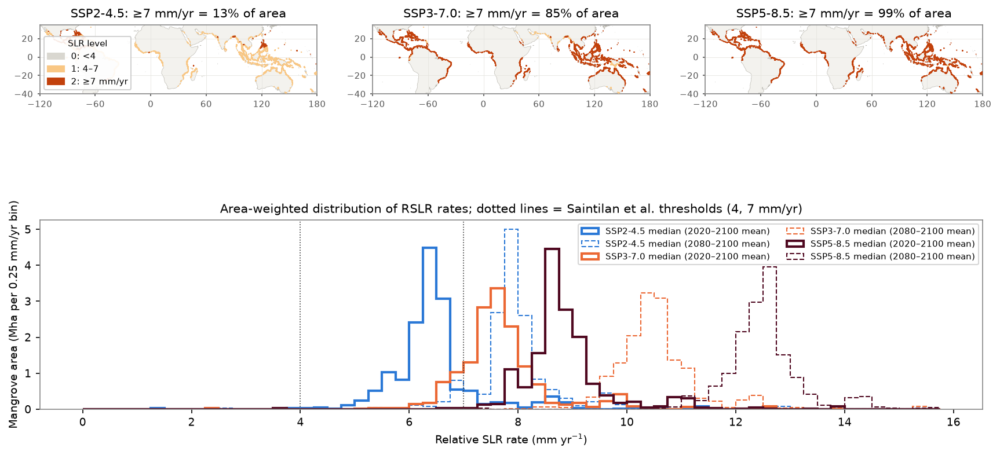

*Figure 4. SLR level per site (top) and area-weighted distribution of median RSLR rates for the 2020–2100 mean (solid) and the 2080–2100 mean (dashed). Dotted lines mark the Saintilan et al. thresholds.*

### 4.4 Global composite risk

**Table 1. Six-class composite score (% of total), central run.**

| Variant | SSP | Weight | 0 None | 1 Low | 2 Moderate | 3 High | 4 Very high | 5 Severe | **≥3** |
|---|---|---|---|---|---|---|---|---|---|
| A | SSP2-4.5 | area | 0.0 | 37.5 | 9.6 | 10.0 | 31.0 | 11.9 | **52.9** |
| A | SSP2-4.5 | people | 0.0 | 13.2 | 4.1 | 6.0 | 69.3 | 7.5 | **82.8** |
| A | SSP2-4.5 | built capital | 0.0 | 13.2 | 4.6 | 12.3 | 55.7 | 14.2 | **82.2** |
| A | SSP3-7.0 | area | 0.0 | 3.4 | 35.5 | 4.3 | 21.3 | 35.5 | **61.1** |
| A | SSP3-7.0 | people | 0.0 | 1.6 | 12.9 | 1.8 | 20.3 | 63.4 | **85.5** |
| A | SSP3-7.0 | built capital | 0.0 | 1.5 | 11.4 | 1.0 | 22.7 | 63.4 | **87.1** |
| A | SSP5-8.5 | area | 0.0 | 0.1 | 38.2 | 3.0 | 11.6 | 47.1 | **61.8** |
| A | SSP5-8.5 | people | 0.0 | 0.0 | 12.8 | 3.2 | 5.2 | 78.8 | **87.2** |
| A | SSP5-8.5 | built capital | 0.0 | 0.0 | 12.1 | 1.5 | 11.5 | 74.8 | **87.8** |
| B | SSP2-4.5 | area | 0.2 | 62.0 | 8.9 | 10.2 | 13.8 | 4.9 | **28.9** |
| B | SSP2-4.5 | people | 0.0 | 29.0 | 7.7 | 34.6 | 24.3 | 4.5 | **63.4** |
| B | SSP2-4.5 | built capital | 0.1 | 30.1 | 15.1 | 26.7 | 18.4 | 9.7 | **54.7** |
| B | SSP3-7.0 | area | 0.0 | 9.3 | 55.0 | 4.2 | 16.3 | 15.3 | **35.8** |
| B | SSP3-7.0 | people | 0.0 | 3.2 | 35.2 | 4.2 | 45.5 | 12.0 | **61.7** |
| B | SSP3-7.0 | built capital | 0.0 | 3.8 | 30.6 | 7.8 | 37.7 | 20.1 | **65.5** |
| B | SSP5-8.5 | area | 0.0 | 0.4 | 61.3 | 6.2 | 10.2 | 21.8 | **38.2** |
| B | SSP5-8.5 | people | 0.0 | 0.0 | 36.0 | 5.1 | 34.2 | 24.7 | **64.0** |
| B | SSP5-8.5 | built capital | 0.0 | 0.3 | 32.9 | 7.7 | 29.0 | 30.1 | **66.8** |

**Table 2. Components and typology (% of area).**

| Variant | SSP | TC level 0 / 1 / 2 / 3 | SLR level 0 / 1 / 2 | TC-only | SLR(≥7)-only | Compound |
|---|---|---|---|---|---|---|
| A | SSP2-4.5 | 38.2 / 9.4 / 9.1 / 43.3 | 0.4 / 86.4 / 13.2 | 49.4 | 0.7 | 12.5 |
| A | SSP3-7.0 | 38.5 / 4.2 / 11.5 / 45.9 | 0.2 / 14.4 / 85.4 | 11.2 | 35.1 | 50.3 |
| A | SSP5-8.5 | 38.2 / 2.8 / 11.3 / 47.7 | 0.2 / 0.4 / 99.3 | 0.6 | 38.2 | 61.2 |
| B | SSP2-4.5 | 67.3 / 4.6 / 11.6 / 16.5 | 0.4 / 86.4 / 13.2 | 24.6 | 5.1 | 8.1 |
| B | SSP3-7.0 | 63.8 / 4.2 / 12.1 / 19.9 | 0.2 / 14.4 / 85.4 | 5.3 | 54.5 | 30.9 |
| B | SSP5-8.5 | 61.8 / 6.0 / 10.2 / 22.0 | 0.2 / 0.4 / 99.3 | 0.2 | 61.3 | 38.0 |

Under Variant A the share at score ≥3 rises from 52.9 % to 61.1 % to 61.8 % (Table 1). The upper tail shifts much more than the headline:

- **Severe:** 11.9 % → 35.5 % → 47.1 %;
- **Low:** 37.5 % → 3.4 % → 0.1 %, as the SLR term moves the TC-free coasts from "Low" to "Moderate".

The headline saturates between SSP3-7.0 and SSP5-8.5 because about 38 % of mangrove area, the TC-free equatorial coasts, can never exceed "Moderate" (2).

The typology (Table 2) shows a transition from a **TC-dominated** risk under SSP2-4.5 (49 % TC-only, 12.5 % compound) to a **compound** risk under SSP3-7.0 and SSP5-8.5 (50–61 % compound). Hardly any mangrove area escapes both hazards by SSP5-8.5 (0.1 % "none").

Services are disproportionately exposed. **83–87 % of the people and 82–88 % of the built capital** protected by mangroves lie in score ≥3 areas, against 53–62 % of the area. The densely populated, cyclone-prone deltas and coasts (Vietnam, Bangladesh, India, the Philippines, the USA, Mexico) dominate the service totals. Under Variant B the area headline is about 29–38 %, but people and capital remain 55–67 % exposed.

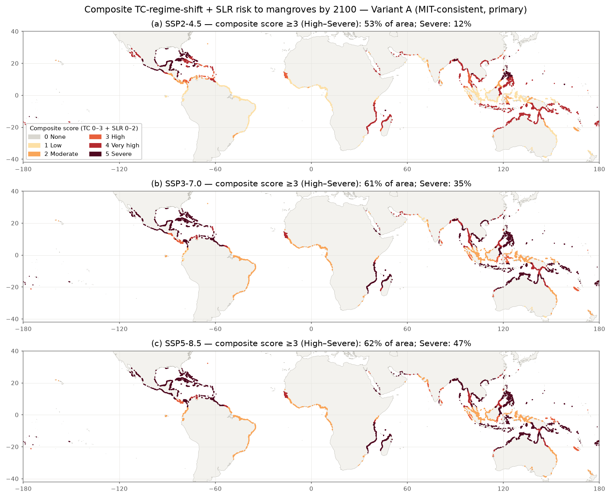

*Figure 5a. Composite score under the primary Variant A for the three SSPs.*

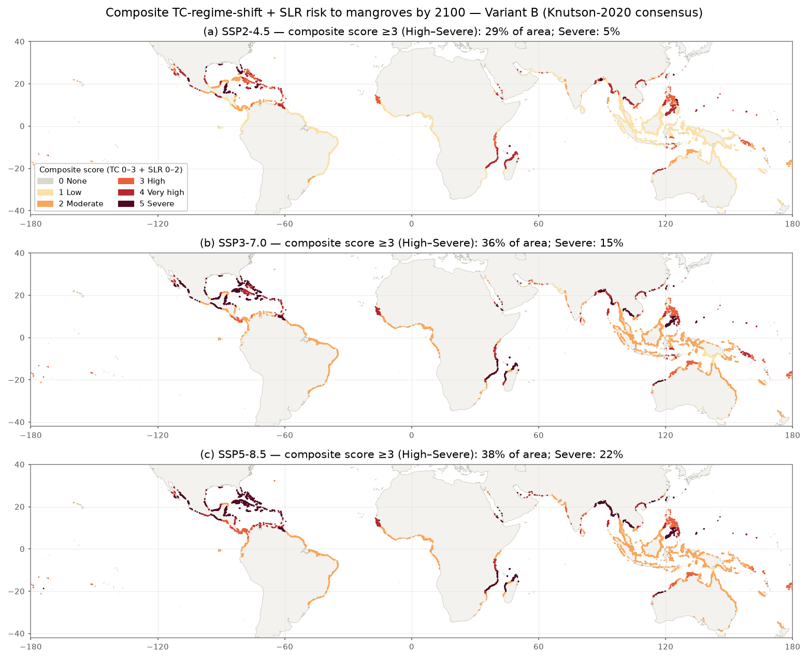

*Figure 5b. Composite score under Variant B (Knutson consensus).*

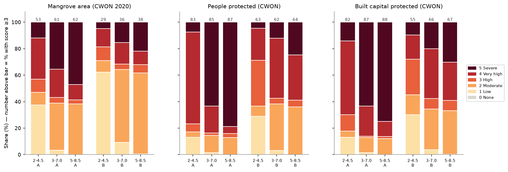

*Figure 6. Six-class shares by SSP and variant, weighted by mangrove area, people protected and built capital protected. The number above each bar is the % with score ≥3.*

### 4.5 Regional hotspots

**Table 3. Regional diagnosis, SSP3-7.0 (% of regional mangrove area).**

| Region | Area (Mha) | Baseline TC-affected | Variant | TC level 0/1/2/3 | SLR ≥7 | Score ≥3 | Severe |
|---|---|---|---|---|---|---|---|
| Philippines | 0.27 | 99% | A | 0/1/11/89 | 100 | **100** | 89 |
| | | | B | 11/36/25/28 | 100 | 89 | 28 |
| Vietnam | 0.19 | 100% | A | 0/0/0/100 | 100 | **100** | 100 |
| | | | B | 41/0/57/2 | 100 | 59 | 2 |
| Malaysia | 0.58 | 43% | A | 43/0/42/15 | 88 | 57 | 13 |
| | | | B | 100/0/0/0 | 88 | 0 | 0 |
| Indonesia | 2.91 | 27% | A | 60/8/0/32 | 82 | 40 | 15 |
| | | | B | 99/0/1/0 | 82 | 1 | 0 |
| SE Asia (PHL+VNM+MYS+IDN) | 3.95 | 38% | A | 51/6/7/36 | 85 | 49 | 24 |
| | | | B | 91/2/5/2 | 85 | 9 | 2 |
| SW Pacific (SH, 135°E–150°W) | 2.13 | 61% | A | 33/2/6/60 | 59 | **67** | 21 |
| | | | B | 95/3/2/0 | 59 | 5 | 0 |
| Central America & Caribbean | 2.51 | 89% | A | 0/12/2/87 | 100 | **100** | 86 |
| | | | B | 22/5/25/49 | 100 | 78 | 49 |
| SE Africa (MOZ, MDG, TZA, KEN, ZAF, COM, MYT) | 0.76 | 92% | A | 8/0/6/86 | 100 | **92** | 86 |
| | | | B | 23/0/23/54 | 100 | 77 | 54 |
| South Asia (IND, BGD, MMR, LKA, PAK) | 1.67 | 95% | A | 5/5/22/68 | 46 | **91** | 26 |
| | | | B | 27/4/10/59 | 46 | 69 | 18 |
| East Asia (CHN, TWN, JPN) | 0.03 | 100% | A | 0/0/38/62 | 90 | 100 | 52 |
| Australia | 0.99 | 75% | A | 22/0/14/63 | 90 | 78 | 55 |
| | | | B | 67/29/2/2 | 90 | 33 | 2 |
| West & Central Africa | 2.50 | 14% | A/B | 76/0/24/0 | 100 | 24 | 0 |
| South America (lat <5°N) | 1.53 | 0% | A/B | 100/0/0/0 | 80 | 0 | 0 |
| **Global** | 15.39 | 54% | A | 38/4/11/46 | 85 | **61** | 35 |
| | | | B | 64/4/12/20 | 85 | 36 | 15 |

The full table for all SSPs is in `outputs/regional_diagnosis.csv`.

The SSP3-7.0 regional maps (Fig. 7) show five patterns:

- **Philippines, Vietnam and the South China Sea:** 100 % High-to-Severe. Under SSP3-7.0, 89 % of the Philippines and all of Vietnam is Severe, because an H-class shift coincides with RSLR ≥7 mm yr⁻¹. This holds along the whole eastern Vietnamese coast, the Mekong delta and the Philippine archipelago.
- **Indonesia and Malaysia:** a sharp north–south contrast. Cyclone-exposed Sabah and eastern Borneo, Sulawesi, Nusa Tenggara/Timor, southern Papua and the Arafura coast are Very high to Severe. Equatorial Sumatra, Java, Kalimantan and Peninsular Malaysia are TC-free and therefore "Moderate" (SLR-only). Because 2.9 Mha of the world's largest national mangrove estate lies in the equatorial belt, Indonesia's area share at ≥3 is only 40 %. Even so, Indonesia contributes the largest *absolute* at-risk area of any country: 1.16 Mha under SSP3-7.0.
- **Mozambique and Madagascar:** 92–98 % High-to-Severe. These coasts are already Very high under SSP2-4.5 and become Severe under SSP3-7.0, when SLR passes 7 mm yr⁻¹.
- **Central America and the Caribbean:** 100 % High-to-Severe from SSP3-7.0 onward. Only the southern Caribbean (Panama–Colombia) and the Pacific coast of Nicaragua/Costa Rica fall to High or Moderate.
- **Southwest Pacific:** Papua New Guinea's south coast, the Gulf of Carpentaria and Cape York, the Solomon Islands, Vanuatu and Fiji are Very high or Severe (67–86 % ≥3). Under Variant A, New Caledonia and the Queensland east coast are only Moderate to High. That reflects a model deficit there, not a real absence of storms (§5.1).

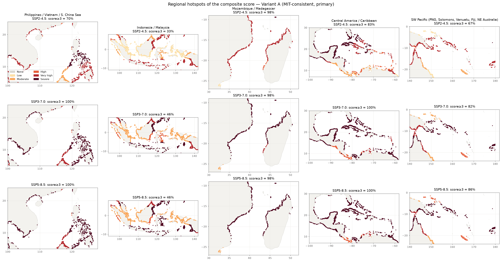

*Figure 7. Regional zooms of the composite score for SSP2-4.5, SSP3-7.0 and SSP5-8.5 (Variant A).*

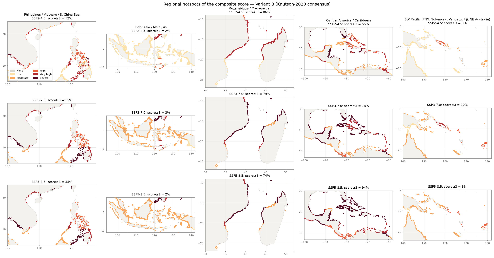

*Figure 8. As Figure 7, for Variant B.*

**Why do SE Asia and the SW Pacific differ between variants?** The regional diagnosis isolates the cause. Under Variant B, SE Asia and the SW Pacific fall to 9 % and 5 % at ≥3, although their SLR level is identical to Variant A's and 38–61 % of their area is TC-affected in the baseline. Two findings point to the frequency sign as the cause:

1. The −20 % (WP) and −25 % (SP) frequency changes per 2 °C outweigh the +5 % intensification. Vulnerable units therefore see the p80 frequency *fall*, and fail the r > 0.1 test.
2. In the Monte Carlo, which jointly varies unit size, radius, κ, SLR quantile and warming, the SSP3-7.0 ranges for SE Asia barely overlap between variants: 30–86 % under A against 3–36 % under B. For the SW Pacific the two do not overlap at all: 46–97 % against 0–37 %. Those parameters therefore cannot reproduce the A–B difference.

Track-point coverage plays a smaller, secondary role. Equatorial Indonesia and Malaysia carry very few points, so even Variant A cannot flag them.

### 4.6 Country rankings

| Country | Mangrove area (kha) | ≥3 share, A: SSP2-4.5 / 3-7.0 / 5-8.5 (%) | ≥3 share, B SSP3-7.0 (%) | People at ≥3 (thousand, A 3-7.0) | Built capital at ≥3 (US$ M, A 3-7.0) |
|---|---|---|---|---|---|
| Indonesia | 2913 | 32 / 40 / 40 | 1 | 195 | 616 |
| Mexico | 1005 | 100 / 100 / 100 | 86 | 161 | 1364 |
| Australia | 988 | 65 / 78 / 78 | 33 | 87 | 4314 |
| Myanmar | 547 | 100 / 100 / 100 | 40 | 63 | 66 |
| Bangladesh | 532 | 100 / 100 / 100 | 100 | 621 | 1286 |
| Papua New Guinea | 461 | 88 / 88 / 96 | 0 | 7 | 35 |
| India | 493 | 79 / 79 / 92 | 79 | 905 | 1255 |
| Cuba | 342 | 100 / 100 / 100 | 100 | 9 | 90 |
| Malaysia | 580 | 16 / 57 / 57 | 0 | 13 | 61 |
| Venezuela | 301 | 92 / 100 / 100 | 89 | 20 | 123 |
| Mozambique | 305 | 96 / 96 / 96 | 90 | 28 | 21 |
| Guinea-Bissau* | 298 | 96 / 96 / 96 | 96 | 3 | 2 |
| Madagascar | 276 | 100 / 100 / 100 | 64 | 20 | 14 |
| Philippines | 275 | 91 / 100 / 100 | 89 | 327 | 546 |
| Thailand | 265 | 100 / 100 / 100 | 12 | 24 | 205 |
| Senegal* | 233 | 99 / 99 / 99 | 99 | 33 | 43 |
| United States | 232 | 100 / 100 / 100 | 100 | 64 | 2342 |
| Viet Nam | 186 | 100 / 100 / 100 | 59 | 3673 | 7392 |
| Panama | 153 | 12 / 100 / 100 | 49 | 5 | 15 |
| Bahamas | 146 | 100 / 100 / 100 | 100 | 2 | 149 |

\* Probable artefact of the point-sampling resolution; see §5.1.

**Services.** Viet Nam alone accounts for 3.7 M of the 7.6 M people and US$ 7.4 bn of the US$ 30.9 bn of built capital protected by mangroves at score ≥3 under SSP3-7.0 (Variant A). India, Bangladesh, the Philippines, Australia, the USA and Mexico follow. Every country's mean score is monotonic in SSP under Variant A.

**Non-monotonic TC levels.** At the TC-component level, some countries are *not* monotonic. In Indonesia, for example, the TC-unshifted area rises from 51 % (SSP2-4.5) to 60 % (SSP3-7.0) under Variant A, and Vietnam shows a similar effect under Variant B. Stronger intensification moves storms out of the L class into M and H, so the L-class frequency can fall even though total activity rises. The class-binned Kropf metric does not guarantee monotonicity.

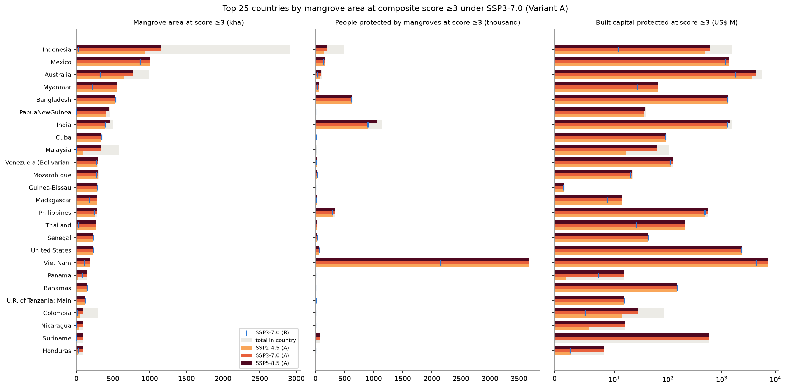

*Figure 9. The 25 countries with the largest mangrove area at score ≥3 (SSP3-7.0, Variant A): area, people and built capital at score ≥3 for each SSP. The blue tick marks Variant B under SSP3-7.0.*

### 4.7 Uncertainty and sensitivity

**Table 4. Monte Carlo (n = 60) shares at score ≥3, % of area unless stated.**

| Variant | SSP | Central ≥3 | MC ≥3: median [5–95 %] | MC Severe: median [5–95 %] | MC ≥3, people | MC ≥3, built capital |
|---|---|---|---|---|---|---|
| A | SSP2-4.5 | 52.9 | 59 [33–75] | 12 [1–57] | 83 [49–91] | 85 [53–93] |
| A | SSP3-7.0 | 61.1 | 63 [38–75] | 19 [4–64] | 86 [65–91] | 87 [74–93] |
| A | SSP5-8.5 | 61.8 | 67 [45–77] | 35 [7–64] | 88 [73–91] | 89 [80–94] |
| B | SSP2-4.5 | 28.9 | 35 [14–54] | 7 [0–32] | 54 [19–82] | 54 [17–79] |
| B | SSP3-7.0 | 35.8 | 36 [17–52] | 10 [1–36] | 53 [19–83] | 56 [24–79] |
| B | SSP5-8.5 | 38.2 | 36 [19–53] | 12 [2–37] | 45 [23–83] | 53 [27–81] |

**Table 5. One-at-a-time sensitivity of the ≥3 area share (%).**

| Sensitivity | A 2-4.5 | A 3-7.0 | A 5-8.5 | B 2-4.5 | B 3-7.0 | B 5-8.5 |
|---|---|---|---|---|---|---|
| **Central (5° unit, R = 100 km, q50, ref_cls = 1)** | **52.9** | **61.1** | **61.8** | **28.9** | **35.8** | **38.2** |
| Unit 2° | 50.3 | 61.9 | 63.6 | 28.8 | 38.0 | 39.5 |
| Unit 10° | 62.2 | 71.8 | 72.3 | 34.4 | 39.5 | 35.6 |
| Unit country × basin | 55.8 | 74.9 | 76.2 | 27.4 | 34.0 | 38.4 |
| Per-site test | 43.3 | 54.6 | 57.7 | 26.1 | 34.0 | 37.5 |
| R = 50 km | 35.4 | 51.9 | 56.6 | 18.8 | 26.1 | 28.1 |
| R = 200 km | 59.7 | 70.7 | 72.0 | 44.5 | 49.5 | 48.5 |
| κ × 0.5 | 41.0 | 57.8 | 57.5 | 19.8 | 23.8 | 27.0 |
| κ × 2 | 66.1 | 70.2 | 70.7 | 33.1 | 45.5 | 43.7 |
| κ site-calibrated per basin | 62.9 | 68.2 | 69.7 | 28.3 | 36.3 | 39.2 |
| SLR 17th percentile | 43.9 | 53.9 | 59.1 | 20.3 | 30.9 | 32.8 |
| SLR 83rd percentile | 61.8 | 61.5 | 61.8 | 32.7 | 36.2 | 38.2 |
| SLR 2080–2100 mean | 61.4 | 61.5 | 61.8 | 32.6 | 36.2 | 38.2 |
| SLR thresholds 3.5 / 6.5 mm yr⁻¹ | 54.7 | 61.5 | 61.8 | 30.2 | 36.2 | 38.2 |
| SLR thresholds 4.5 / 7.5 mm yr⁻¹ | 52.7 | 60.0 | 61.8 | 28.7 | 35.1 | 38.2 |
| All GMW sample points (ref_cls 1–3) | 54.3 | 61.4 | 62.0 | 29.5 | 37.1 | 37.2 |
| Exclude "newly affected" rule | 46.5 | 58.5 | 59.8 | 19.4 | 26.6 | 28.4 |
| A: frequency change only | 49.5 | 62.5 | 63.2 | – | – | – |
| A: intensity change only | 43.8 | 57.3 | 58.5 | – | – | – |

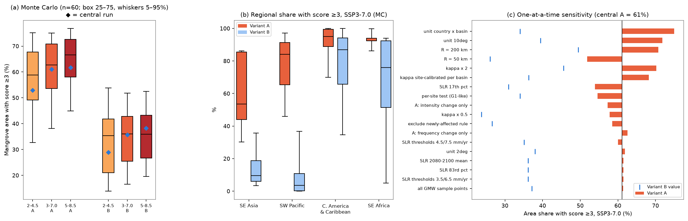

*Figure 10. (a) Monte Carlo distribution of the global ≥3 area share (diamond = central run); (b) regional ≥3 shares under SSP3-7.0; (c) one-at-a-time sensitivities for SSP3-7.0.*

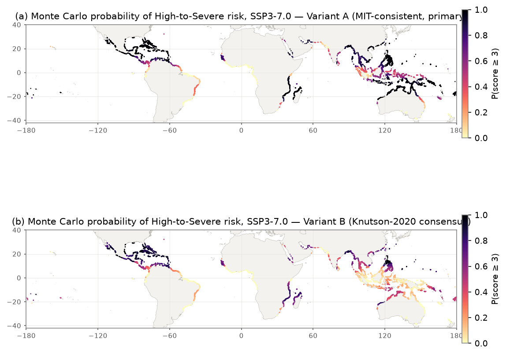

*Figure 11. Monte Carlo probability that a site scores ≥3 under SSP3-7.0, for both variants.*

**What the uncertainty analysis shows:**

1. **The future-TC variant is the dominant uncertainty.** A exceeds B in 100 % of paired Monte Carlo draws, by about 25 percentage points.
2. **Within Variant A, the main uncertainties are R (35–60 % under SSP2-4.5), κ and the SLR quantile.** No single choice produces the headline: every one-at-a-time alternative stays at 35–76 %, and the central value lies inside the Monte Carlo 5–95 % range for every SSP.
3. **Emission ordering is robust under Variant A.** The share rises monotonically with SSP in 97 % of draws. Under Variant B it does so in only 35 % of draws, because stronger warming also deepens the frequency decreases. Those decreases offset the SLR gain and turn units "unshifted" in the WP and SP basins.
4. **The service-weighted exposure is the most stable result.** Variant A gives 83–88 % of people and capital at ≥3, with 5th percentiles of 49–80 %.
5. **The probability map (Fig. 11) identifies robust hotspots,** with P(score ≥3) > 0.9 under both variants:
   - the Caribbean, Gulf of Mexico and Central America;
   - the Bay of Bengal;
   - Mozambique and Madagascar;
   - the northern Philippines.

   The SE Asian archipelagos, northern Australia and the SW Pacific are **variant-dependent**: P > 0.8 under A, below 0.3 under B.

---

## 5. Validation

### 5.1 Baseline TC hazard

Modelled return periods are compared with approximate observed climatologies of hurricane-strength passages within about 100 km (Fig. 12a). The observed values are indicative figures from NHC, JTWC, HKO and BoM climatologies, not formally derived.

| Site | ≈Observed RP (yr) | Model RP, R = 100 km, basin-corrected | Uncorrected | R = 50 km | R = 200 km |
|---|---|---|---|---|---|
| Miami | 7.0 | 5.6 | 10.7 | 10.4 | 3.3 |
| Key West | 5.5 | 5.2 | 9.9 | 9.1 | 2.5 |
| New Orleans | 8.0 | 6.5 | 12.4 | 11.2 | 3.7 |
| Belize City | 9.0 | 2.4 | 4.6 | 3.9 | 1.3 |
| Manila | 2.5 | 11.5 | 11.6 | 68.7 | 4.2 |
| Hong Kong | 3.0 | 10.0 | 10.1 | 21.1 | 5.5 |
| Okinawa | 1.5 | 6.8 | 6.9 | 15.3 | 3.3 |
| Darwin | 15.0 | 7.7 | 6.8 | 10.5 | 4.2 |
| Cairns | 8.0 | 46.5 | 16.9 | 85.2 | 22.4 |
| Sundarbans | 6.0 | 10.2 | 34.8 | 16.3 | 7.0 |
| Mahajanga | 8.0 | 10.9 | 9.6 | 19.7 | 5.5 |
| Beira | 12.0 | 39.5 | 34.8 | 63.1 | 24.8 |
| Nouméa | 6.0 | 511 | 186 | 767 | 128 |
| Suva | 6.0 | 18.7 | 6.8 | 42.6 | 7.7 |
| Ho Chi Minh City | ≈50 | 68.7 | 69.6 | ∞ | 35.5 |

**Where the basin correction works.** It brings the US Atlantic/Gulf sites within 20 % of observations, and it substantially improves the Sundarbans.

**Remaining biases:**

- **Western North Pacific:** underestimated 3–5× (Manila, Hong Kong, Okinawa). Many MIT WP tracks recurve or decay over open ocean, so a basin-wide correction cannot fix the landfall density.
- **South Pacific:** over-populated by the MIT model, so the basin correction down-weights SP points. Combined with the model's genesis distribution, this leaves New Caledonia and the Queensland coast (Cairns) far too quiet.
- **Belize, Darwin:** overestimated by about 2–4×.

**Effect on states and risk.** These biases mostly affect *states*, not *shifts*. Underestimated WP units are classified "vulnerable" where Kropf et al. find "resilient" or "dependent" (Luzon). Vulnerable units need a smaller change (10 %) to be flagged. To test this, κ was re-scaled per basin by the geometric-mean model/observed ratio at the reference sites. This raises the Variant A headline (62.9 / 68.2 / 69.7 %) and leaves Variant B almost unchanged (Table 5). The central estimate is therefore not biased high by the WP deficit.

**Resolution artefact.** After basin correction, one NA track point corresponds to about 1/120 yr⁻¹, which exceeds the 1/250 yr⁻¹ "affected" threshold. In marginal regions a few intensified points can therefore make a unit "newly affected". This is why Guinea-Bissau and Senegal, where hurricanes are extremely rare in observations, appear as M-class "newly affected" (score 4). These two countries contribute about 0.5 Mha (3 % of global area). The "exclude newly affected" sensitivity (46.5 / 58.5 / 59.8 % under A) bounds the effect.

### 5.2 SLR

- AR6 locations lie a median of 43 km from mangrove sites (maximum 78 km; Fig. 12b).
- The SLR exposure statistics agree with Saintilan et al. (§4.3). Their 2080–2100 framing gives 91 % ≥7 mm yr⁻¹ under SSP2-4.5 and 100 % under SSP3-7.0, against their statement of "nearly all mangroves at ≥7 mm yr⁻¹ at 3 °C".
- Their regional remark that SE Asian deltas and the US Gulf exceed 7 mm yr⁻¹ even at low warming is reproduced: the Mekong, Chao Phraya, the Mississippi delta and Java are already level 2 under SSP2-4.5 (Fig. 4).

### 5.3 Basin-scale TC change against Mo et al. (2023)

Mo et al. (2023) project the following risk-change directions at 2 °C: increases in NA, EP, NI and SI, and decreases in WP and SP. We compare these with the change in damage-weighted TC exposure under SSP2-4.5 (Fig. 12c), using weights of 0.05 / 0.10 / 0.20 for L / M / H.

| Basin | Mo et al. (2023) | Variant A | Variant B |
|---|---|---|---|
| NA | ↑ | +37 % | +7 % |
| EP | ↑ | +37 % | +7 % |
| WP | ↓ | +39 % | −6 % |
| NI | ↑ | +41 % | +11 % |
| SI | ↑ | +32 % | −10 % |
| SP | ↓ | +30 % | −19 % |

- **Variant B** matches 5 of the 6 directions; SI is the exception. Its global change is modest, consistent with Mo et al.'s finding of about +3 % in risk alongside about −2 % in frequency.
- **Variant A** is uniformly positive, consistent with Kropf et al.'s finding of increases "all over the world" (+55 / 98 / 84 % in L / M / H frequency for at-risk ecoregions by 2050 under RCP8.5) and with the MIT downscaling.

The literature itself is therefore split along the same line as our two variants. This is why both are reported.

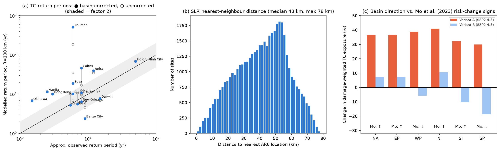

*Figure 12. (a) Modelled against approximate observed return periods at reference sites; (b) distance from mangrove sites to the nearest AR6 location; (c) basin-scale change in damage-weighted TC exposure compared with the directions of Mo et al. (2023).*

---

## 6. Discussion

### 6.1 What is robust

1. **Spatial pattern of hotspots.** Under both variants and all sensitivities, the highest composite risk lies in:
   - the Caribbean, Gulf of Mexico and Central America;
   - the Bay of Bengal (Bangladesh, Myanmar, eastern India);
   - Mozambique and Madagascar;
   - the Philippines;
   - Cuba, the Bahamas and Florida.

   These are places where cyclone-adapted (often dependent or resilient) mangroves meet RSLR ≥7 mm yr⁻¹ by mid-to-late century. Equatorial Indonesia and Malaysia, West–Central Africa and Brazil are consistently limited to Moderate (SLR-only).
2. **The SLR component.** By SSP3-7.0, 85 % (2020–2100 mean) to 100 % (2080–2100) of mangrove area exceeds the "very likely deficit" threshold. Under every SSP and every variant, virtually no mangrove area reaches 2100 with neither hazard. Among the Moderate sites, those exposed to ≥7 mm yr⁻¹ form an SLR-only class covering 35–61 % of global area under SSP3-7.0 and SSP5-8.5.
3. **Emission dependence of the top class.** Severe-class area roughly quadruples between SSP2-4.5 and SSP5-8.5 under Variant A (12 → 47 %; Monte Carlo 12 → 35 % median). Most of this increase comes from the SLR term crossing 7 mm yr⁻¹. Limiting warming to SSP2-4.5 levels is the main lever for keeping cyclone-exposed mangroves out of "Severe".
4. **Services.** Mangrove-protected people and assets are more exposed than mangrove area under every configuration: 83–88 % under Variant A and 54–67 % under Variant B.

### 6.2 What depends on assumptions

- **The sign of future TC frequency change** (Variant A against B). It controls whether SE Asia, northern Australia and the SW Pacific are High-to-Severe (A: 49–67 % of their area) or mostly Moderate (B: 5–9 %). It also controls the global headline (about 61 % against about 36 % under SSP3-7.0).

  We adopt Variant A as primary for three reasons:
  1. It is consistent with the source of the tracks (MIT downscaling).
  2. It is consistent with the regime-shift framework's own application (Kropf et al.).
  3. It is conservative for conservation planning, where false negatives (unflagged shifts) cost more than false positives.

  Variant B reproduces Mo et al.'s basin directions better. Decision-makers in the WP and SP basins should treat these regions as "high risk under frequency-increase projections, uncertain otherwise".
- **Spatial unit and radius.** Coarser units propagate shifts over larger areas (10° or country × basin: +10–15 points). A 50 km radius reduces the headline by up to 17 points. The per-site test, which fragments the ecoregion logic, is 4–8 points lower.
- **SLR quantile and averaging window** matter only under SSP2-4.5, where rates cluster at 6–8 mm yr⁻¹. The SSP2-4.5 headline ranges from 44 % (17th percentile) to 62 % (83rd percentile or 2080–2100 window).

### 6.3 Implications for conservation and management

The composite typology suggests different responses for each risk type:

- **TC-only or compound sites in dependent or resilient units** (Caribbean, Philippines, Bay of Bengal). Management should protect *recovery capacity*: hydrological connectivity, propagule supply and sediment delivery. Additional stress, such as conversion and cutting, should be minimised during post-storm recovery windows, which will shorten by 10–40 % under projected frequency increases.
- **SLR-only Moderate sites** (equatorial SE Asia, West Africa, Brazil). The priority is *accommodation space* and sediment supply: landward migration corridors, setbacks, and restored river-sediment delivery. These coasts are the most likely long-term refugia from cyclone regime shifts.
- **Severe sites** (Vietnam, the Philippines, the Mekong and Bay of Bengal deltas, Mozambique, Madagascar, Cuba, the Yucatán and Gulf coasts). Both buffers are eroded simultaneously, and protection of very large populations and assets depends on these sites (Vietnam alone accounts for about half of the people at risk). They should be priorities for climate-adaptive spatial planning (cf. Dabalà et al. 2023), including nature-based coastal defence that combines mangrove protection with sediment management.

### 6.4 Limitations

1. **No future tracks.** Future TC climates are stylised delta changes, uniform within each basin. They omit poleward migration of the latitude of maximum intensity, changes in genesis location and changes in translation speed. A full MIT future track set (SSP-specific) would replace both variants.
2. **Track-point reduction.** The 200k-point subsample lacks storm identity. Passage frequency is therefore approximated geometrically, with κ uncertain by a factor of about 2 (tested). The point resolution (one point ≈ 1/120 to 1/600 yr⁻¹ depending on basin) is close to the 1/250 yr⁻¹ threshold, which produces artefacts in marginal regions (Guinea-Bissau, Senegal).
3. **Hazard bias.** The MIT/MPI-ESM baseline underestimates WP landfall frequency 3–5× and SP frequency near New Caledonia and Queensland. This affects the Kropf states, but sensitivity tests show the effect on the headline is modest.
4. **Centre-distance hazard.** Storm-centre passage within R with a given central maximum wind stands in for the site wind field (Holland model) used by Kropf et al. This overstates the class of the wind experienced at a site.
5. **Ecoregion proxy.** Regular 5° units replace terrestrial ecoregions.
6. **Undocumented ref_cls.** ref_cls = 1 is assumed to be mangrove. Using all points changes the result by less than 1.5 points.
7. **Uniform service allocation.** CWON country totals are spread uniformly over each country's points, ignoring within-country variation (for example, the Mekong delta against the rest of Vietnam).
8. **Simplified SLR response.** Static SLR thresholds take no account of sediment supply, tidal range or vertical land motion beyond what AR6 includes, nor of landward migration. Saintilan's thresholds describe a *probability* of elevation deficit, not certain loss.
9. **Additive score.** The score assumes the hazards are independent and of comparable consequence. Interaction effects (storm-induced peat collapse accelerating SLR deficit) could make compound sites worse than additive.

---

## 7. Conclusions

A transparent 0–5 composite score combines Kropf-style TC regime shifts with Saintilan SLR thresholds. Under MIT-consistent cyclone projections, it identifies **about 53–62 % of the world's mangrove area, and about 83–88 % of the people and built capital mangroves protect, as being at High-to-Severe risk by 2100**. The Severe class expands from 12 % (SSP2-4.5) to 47 % (SSP5-8.5) of area.

The hotspot geography is robust to methodological choices: Central America and the Caribbean, the Philippines and Vietnam, the Bay of Bengal, and Mozambique and Madagascar. The magnitude in Southeast Asia, northern Australia and the Southwest Pacific hinges on whether TC frequency rises or falls there. Under the Knutson-consensus alternative the global share falls to about 29–38 %, but sea-level rise alone still brings 85–99 % of mangroves above 7 mm yr⁻¹ under SSP3-7.0 and SSP5-8.5.

Limiting emissions to SSP2-4.5 levels is the clearest way to keep most cyclone-exposed mangroves out of the Severe class.

---

## References

- Bunting, P. et al. (2018, 2022). Global Mangrove Watch (GMW) v2/v3/v4 baseline and change.
- Dabalà, A. et al. (2023). Priority areas to protect mangroves and maximise ecosystem services. *Nature Communications* 14, 5863.
- Emanuel, K. (2013). Downscaling CMIP5 climate models shows increased tropical cyclone activity over the 21st century. *PNAS* 110, 12219–12224.
- Emanuel, K. (2021). Response of global tropical cyclone activity to increasing CO₂: results from downscaling CMIP6 models. *J. Climate* 34, 57–70.
- Emanuel, K. et al. (2006). A statistical deterministic approach to hurricane risk assessment. *BAMS* 87, 299–314.
- Garner, G. G. et al. (2021). IPCC AR6 Sea Level Projections, v20210809.
- Knutson, T. et al. (2020). Tropical cyclones and climate change assessment, Part II. *BAMS* 101, E303–E322.
- Krauss, K. W. & Osland, M. J. (2020). Tropical cyclones and the organization of mangrove forests: a review. *Annals of Botany* 125, 213–234.
- Kropf, C. M., Vaterlaus, L., Bresch, D. N. & Pellissier, L. Global vulnerability and resilience of coastal ecosystems to tropical cyclones in a warming climate (preprint).
- Mo, Y., Simard, M. & Hall, J. W. (2023). Tropical cyclone risk to global mangrove ecosystems: potential future regional shifts. *Front. Ecol. Environ.* 21, 269–274.
- Saintilan, N. et al. (2023). Widespread retreat of coastal habitat is likely at warming levels above 1.5 °C. *Nature* 621, 112–119.
- UCSC / The Nature Conservancy. Coastal Wetlands Ocean Wealth (CWON) country accounts, 1996–2020.
