# A FuXi‑style Short/Medium/Long U‑Transformer cascade for 15‑day global forecasts: a reduced‑scale reproduction on real ERA5, verified against the ECMWF ensemble mean, HRES and the published FuXi forecasts

## Abstract

FuXi proposes a cascade of three U‑Transformers to limit autoregressive error accumulation in 15‑day machine‑learning (ML) weather forecasts:
- *Short* covers lead times of 0–5 days;
- *Medium* covers 5–10 days and is fine‑tuned on Short's own forecasts;
- *Long* covers 10–15 days and is fine‑tuned on the cascade's day‑10 forecasts.

The paper reports skill comparable to the ECMWF ensemble mean (EM).

**Data.** The task's sample files turned out to be statistically white noise (verified, Fig. 1). I therefore built the study on real data from the public WeatherBench2 archive:
- ERA5, 2010–2017, used for training, with the 70 FuXi channels at 6‑hourly steps on a 5.625° grid;
- 175 test initialisations in 2020;
- the operational ECMWF ENS mean and HRES as benchmarks;
- the **published FuXi forecasts**, regridded to the same grid.

**Two complementary results.**

1. **The paper's headline claim holds when tested independently.** I compared the published FuXi forecasts with the ECMWF EM on the 8 paper variables × 17 lead times (0.25–15 days), with ERA5 as truth.
   - FuXi has lower RMSE in **96%** of variable × lead cells and higher ACC in **98%** of them. The margins are a few percent after day 5.
   - The skilful lead for Z500 (ACC ≥ 0.6) is 11.4 days for FuXi, 11.0 days for the EM and 9.1 days for HRES.
2. **Our own cascade is orders of magnitude smaller** than FuXi (6 M parameters, about 3.5 CPU‑hours of training) and is far less skilful than either ECMWF system. Its Z500 RMSE at day 5 is 699 m²/s², against 268 for the EM, and it never beats the EM in any cell. It still lets us test the cascade mechanism in a controlled way:
   - At days 6–12 the cascade **reduces RMSE by 14–25%** relative to the same Short model run alone, for every upper‑air and 10‑m variable, and the gain persists to day 15 for all of them except T500. The 95% block‑bootstrap CIs exclude zero.
   - A compute‑matched single model (Short+) gains nothing, so the improvement comes from lead‑time specialisation, not from extra training.
   - Diagnostics show *how* the stages specialise. Medium and Long learn to damp anomaly amplitude toward climatology (activity drops from 1.05 to 0.5). This lowers RMSE but does not raise ACC, and it even lowers ACC at the end of each stage.
   - A cross‑validated post‑hoc damping of the single model is at least as good as the cascade everywhere. The Long stage is also unstable for T2M (+51% RMSE at day 15).

So at small scale the cascade works mainly as a learned, lead‑dependent "blurring" regulariser. The FuXi result shows that, at full scale, the same design keeps ACC at or above the EM level while also blurring. The report states clearly which claims are reproduced by our own models and which only by the published FuXi output.

---

## 1. Introduction and research questions

Single autoregressive ML models suffer from error accumulation. They are trained to minimise error at a few steps but are rolled out for 40–60 steps, and errors grow on the input distribution they produce themselves. FuXi tackles this with a *cascade*: separate copies of the model are fine‑tuned for successive 5‑day windows, each on the forecast states that the preceding stage actually produces.

The research questions are:

- **Q1.** Does a FuXi‑style cascade reduce 15‑day forecast error relative to a single autoregressive model of the same architecture?
- **Q2.** Is any gain due to specialisation, or merely to the extra training compute that the cascade receives?
- **Q3.** By what mechanism does the cascade reduce error (pattern skill vs amplitude/damping)?
- **Q4.** Is FuXi‑type skill comparable to the ECMWF ensemble mean, both for the published FuXi model and for our reduced‑scale reproduction? This is checked on 8 variables (MSL, T2M, U10, V10, Z500, T500, U500, V500) with ACC and RMSE, normalised differences, win fractions, skilful lead times and maps.

## 2. Data

### 2.1 The provided sample files are format placeholders

The two files in `data/` have the documented FuXi layout: `20231012-06_input_netcdf.nc` is (2, 70, 181, 360), and `006.nc` is (1, 1, 70, 181, 360) with step = 6 h. Channels are Z/T/U/V/R at 13 levels plus T2M, U10, V10, MSL and TP. Before using them I checked whether they contain atmospheric structure (`code/diagnose_data.py`, Fig. 1, `outputs/data_diagnosis.json`).

They do not:
- Every channel is spatially white. The largest lag‑1 autocorrelation is 0.009 in longitude and 0.011 in latitude; real ERA5 at 1° exceeds 0.95.
- The fields are uncorrelated in time. The largest correlation between t−6 h and t is 0.010, and between the input and `006.nc` it is 0.010. The 3σ noise level for N = 65 160 points is 0.012.
- Cross‑channel correlations are also at noise level (max 0.015).
- Z500 is indistinguishable from N(0, 10²) (KS p = 0.29), and TP from a half‑normal (KS p = 0.59).
- The best predictor of `006.nc` is the channel mean (RMSE 9.95); persistence scores 14.07 (≈ 10√2).

Nothing can be learned or verified from these files. I therefore use them only for an end‑to‑end I/O test: the trained cascade reads the input file and writes 60 files in the exact `006.nc` layout (Section 4.8).

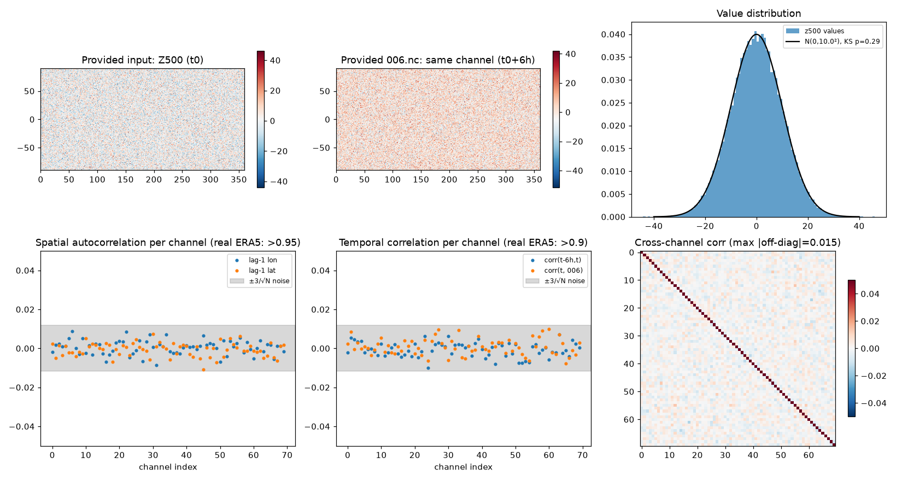
*Figure 1. Diagnosis of the provided files.*
- *Top: Z500 in the input and in `006.nc`, and the value distribution against N(0, 10²).*
- *Bottom: per‑channel spatial lag‑1 and temporal correlations (grey band: ±3/√N noise level) and the cross‑channel correlation matrix.*

### 2.2 ERA5 and operational benchmarks used instead

All training and verification data are real ERA5 and ECMWF products from the public WeatherBench2 (WB2) archive, read directly from its zarr stores over HTTPS (`code/wb2io.py`). All products use the WB2 64 × 32 equiangular grid (5.625°, conservative regridding).

| Product | Use | Content |
|---|---|---|
| ERA5 (WB2 `1959-2023_01_10-6h-64x32`) | training / truth | the 70 FuXi channels, 6‑hourly |
| ECMWF IFS ENS mean (WB2 `ifs_ens/2018-2022-64x32 … _mean`) | main benchmark | 50‑member mean, leads 0–15 d |
| ECMWF HRES (WB2 `hres/2016-2022-0012-64x32`) | deterministic benchmark | leads 0–10 d |
| FuXi, published (WB2 `fuxi/2020-64x32`) | reference ML cascade | the original 0.25° FuXi forecasts, regridded by WB2 |
| ERA5 climatology 1990–2019 (WB2, 6‑hourly × day‑of‑year) | anomalies for ACC | |

This is a deliberate deviation from the task's 0.25° setting, for two reasons:
1. the provided samples contain no signal;
2. a 1440 × 721 model cannot be trained on 2 CPU cores.

The 5.625° grid is the standard low‑resolution WeatherBench configuration. It keeps all 70 FuXi input channels and the 6‑hourly step.

## 3. Methods

### 3.1 U‑Transformer (`code/model.py`)

Each stage uses the same FuXi‑style U‑Transformer, scaled down to 6.0 M parameters. The input is two consecutive normalised states, x(t−6 h) and x(t) (2 × 70 channels), plus 7 forcing channels:
- land–sea mask, orography and sin(latitude);
- TOA insolation proxies cos(SZA)₊ at t and t+6 h;
- sin and cos of day‑of‑year.

The network has five parts:
1. **Cube embedding.** A space‑time patch embedding (kernel 2 × 2 × 2, i.e. both frames × 2 × 2 grid cells) maps the input to 192‑dim tokens on a 16 × 32 grid, followed by LayerNorm.
2. **Down block.** A 3 × 3 convolution (circular in longitude), a stride‑2 convolution and a residual conv block, giving an 8 × 16 token grid.
3. **Swin‑V2 transformer.** 8 blocks, 6 heads. They use res‑post‑norm, scaled‑cosine attention and the log‑spaced continuous relative position bias. Windows are 8 × 8 tokens, with longitude‑periodic shifted windows in alternate blocks.
4. **Up block.** A transposed convolution, concatenation with the skip connection from the embedding, a 1 × 1 fusion convolution and a residual conv block.
5. **Head.** A transposed‑conv upsampling to 32 × 64, concatenated with x(t) and the forcings, then two 3 × 3 circular convolutions. The last layer is initialised to zero. The head predicts the normalised 6‑h increment, which is multiplied by the per‑channel tendency standard deviation: x(t+6 h) = x(t) + σ_Δ ⊙ f(·).

A convolutional head is used instead of a linear pixel‑shuffle head to avoid patch artefacts.

Normalisation is a per‑channel z‑score. TP is first transformed as log1p(TP/10⁻⁴ m).

The loss is latitude‑weighted L1 on normalised fields, as in FuXi, averaged over the autoregressive steps. The optimiser is AdamW (β = 0.9, 0.95; weight decay 0.1) with a cosine learning‑rate schedule, batch size 8 and gradient clipping at 1.

### 3.2 Cascade training (`code/train.py`, `code/gen.py`, `code/pipeline.sh`)

FuXi's cascade is reproduced stage by stage. All stages use the same training years and validate on the held‑out last 45 days of 2017.

| Stage | Initialised from | Input states | Targets | Rollout curriculum (K steps : iterations) |
|---|---|---|---|---|
| Pre‑training | random | ERA5 (t−6 h, t) | ERA5 t+6 h | 1 : 2800 (58 min cap) |
| **Short** (lead 0–5 d, steps 1–20) | pre‑training | ERA5 | ERA5 t+6 h … t+6K h | 2:350, 4:200, 6:100 |
| generate | – | Short run 20 steps from 1000 random training starts | – | – |
| **Medium** (5–10 d, steps 21–40) | Short | Short's own day‑5 states (steps 19, 20) | ERA5 at steps 21…20+K | 2:250, 4:150 |
| generate | – | Medium continues those states for 20 steps | – | – |
| **Long** (10–15 d, steps 41–60) | Medium | cascade's day‑10 states (steps 39, 40) | ERA5 at steps 41…40+K | 2:250, 4:150 |
| **Short+** (control) | Short | ERA5 | ERA5 | 2:500, 4:300 (= Medium + Long iterations) |

Medium and Long are fine‑tuned on the forecast states that the preceding stage actually produces, so each specialises in correcting a lead‑time‑specific error distribution. This is FuXi's central idea.

Short+ is a compute‑matched control. It is the single Short model given exactly the extra training iterations that the cascade spent on Medium and Long. It isolates the benefit of specialisation from the benefit of simply training longer.

The single‑model baseline ("Short only") runs Short autoregressively for all 60 steps. It is the analogue of a single autoregressive model such as GraphCast or FourCastNet without lead‑time specialisation.

### 3.3 Benchmarks, test set and verification (`code/forecast.py`, `code/evaluate.py`, `code/plots.py`, `code/analysis.py`)

**Test set.** The test set has 176 initialisations in 2020, in 44 blocks of 4 consecutive inits (days d and d+1 at 00/12 UTC, d = 0, 8, …, 344). One init (2020‑01‑01 00 UTC) lacks its t−6 h ERA5 input, leaving 175 for our models.
- The ENS mean is available for all inits, at leads of 6 h, 12 h and then every 24 h up to 15 days.
- HRES (to 10 days) and the published FuXi forecasts were downloaded for half the inits (88), because of the ~1–3 MB/s network limit. All pairwise comparisons use only paired inits and leads.

**Systems compared.**

| System | Description |
|---|---|
| **Cascade (ours)** | Short for steps 1–20, Medium for 21–40, Long for 41–60 |
| **Single model (ours)** | Short for all 60 steps |
| **Short+ (ours)** | compute‑matched single model, 60 steps |
| ECMWF ENS mean | 50‑member IFS ensemble mean |
| ECMWF HRES | deterministic IFS |
| FuXi (published) | official FuXi 0.25° forecasts, regridded by WB2 |
| Persistence / climatology | reference baselines |

All ML models start from ERA5 at (t−6 h, t), as FuXi does.

**Metrics.** These follow WeatherBench2:
- latitude‑weighted RMSE: the square root of the mean over inits of the area‑weighted MSE;
- latitude‑weighted ACC of anomalies with respect to the 1990–2019 ERA5 climatology (day‑of‑year × hour), averaged over inits.

Truth is ERA5 for all systems. This slightly penalises IFS at the shortest leads, because IFS is initialised from its own analysis.

**Derived comparison formats** (as in the paper):
- normalised ACC difference (ACC − ACC_EM)/(1 − ACC_EM);
- normalised RMSE difference (RMSE − RMSE_EM)/RMSE_EM;
- win fractions over variable × lead cells;
- skilful lead, i.e. the linearly interpolated lead at which ACC drops below 0.6.

**Statistics.** Uncertainties are 95% block‑bootstrap CIs, resampling the 44 four‑init blocks to respect serial correlation.

**Mechanism diagnostics.**
- activity ratio: std of forecast anomalies / std of ERA5 anomalies;
- zonal power spectra;
- 6‑h precipitation equitable threat score (ETS);
- a cross‑validated post‑hoc damping control (`code/damping.py`). The control computes f_d = c + α(f − c), with α fitted per lead and variable on half of the init blocks and evaluated on the other half. Scaling anomalies leaves ACC unchanged and is the RMSE‑optimal "blurring" of a given forecast.

---

## 4. Results

### 4.1 Data and training

Fig. 2 shows representative ERA5 fields on the model grid. Fig. 3 shows the years used and the per‑channel tendency scales.

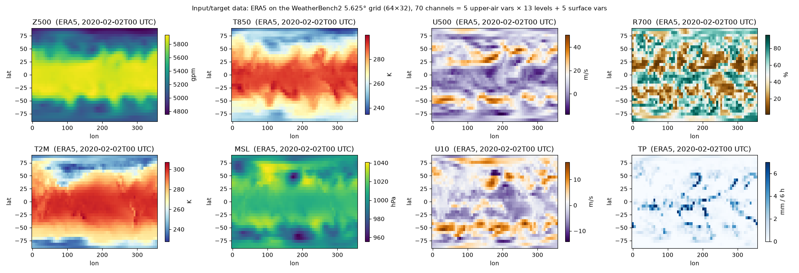
*Figure 2. ERA5 fields on the 5.625° grid at the case‑study init (2020‑02‑02 00 UTC).*

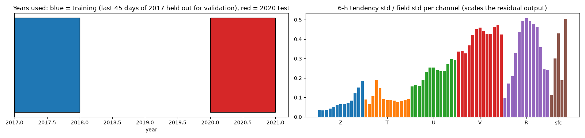
*Figure 3. Left: data split (2010–2017 train, last 45 days of 2017 held out, 2020 test). Right: 6‑h tendency std relative to field std per channel, used to scale the residual output.*

**Data availability during training.** Training years arrived while training ran. Pre‑training began on 2017 alone and absorbed 2014–2017 as they downloaded; Short onwards saw 4 to 8 years. This is a limitation (Sect. 5.3).

Validation RMSE fell steadily in pre‑training, from 0.168 to 0.131 in normalised units, and was still falling when the time cap stopped it (Fig. 4). The models are compute‑limited, not data‑limited.

**Drift of the generated training states.** In normalised units, the states used to fine‑tune Medium have an MAE against ERA5 of 0.41 at day 5, and those used for Long have 0.46 at day 10, against a typical field magnitude of 0.80. These states are far from the truth, which is exactly the regime the cascade is designed for.

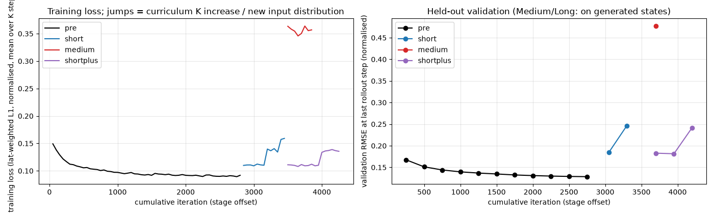
*Figure 4. Training loss and held‑out validation RMSE for each stage.*

**Wall‑clock times on 2 CPU cores.**

| Stage | Iterations | Time |
|---|---|---|
| pre‑training | 2800 it | 58 min |
| Short | 650 it | 40 min |
| generate day‑5 states | 1000 starts | 15 min |
| Medium | 400 it | 22 min |
| generate day‑10 states | – | 15 min |
| Long | 400 it | 21 min |
| Short+ | 800 it | 44 min |
| test forecasts | per system | 8–15 min |

### 4.2 Headline skill curves (8 paper variables)

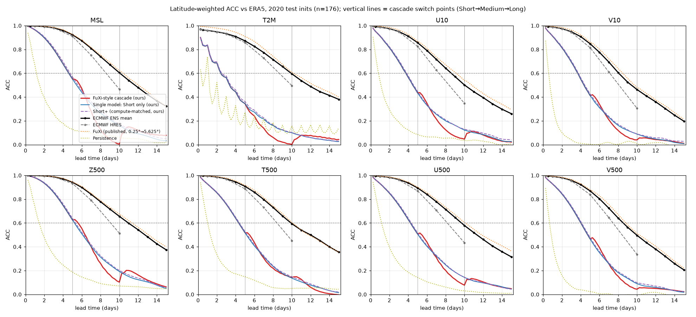
*Figure 5. Latitude‑weighted ACC vs lead time for the 8 verification variables. Dashed horizontal line: ACC = 0.6. Vertical lines: cascade switch points at 5 and 10 days.*

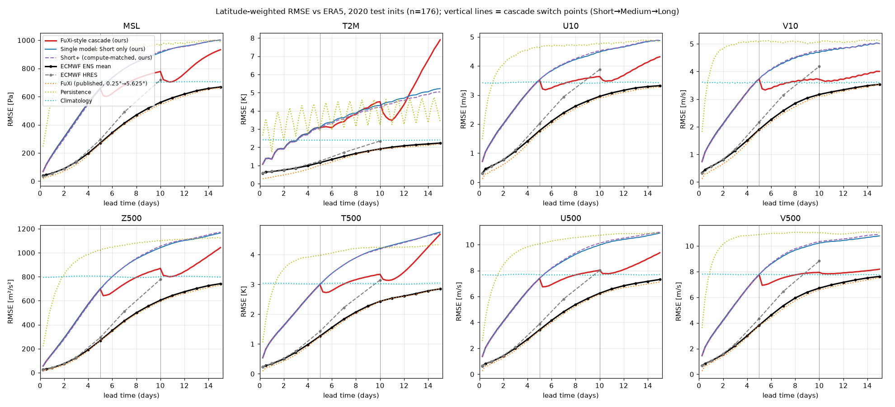
*Figure 6. Latitude‑weighted RMSE (same systems, with climatology and persistence).*

**Table 1.** RMSE at days 5 / 10 / 15. Units: Z500 and MSL in m²/s² and Pa; temperatures in K; U10 in m/s. HRES stops at 10 days.

| Var | Single model | Short+ | **Cascade** | HRES | ENS mean | FuXi (published) |
|---|---|---|---|---|---|---|
| Z500 | 699 / 1042 / 1165 | 693 / 1055 / 1172 | 699 / **870** / **1043** | 293 / 777 / — | 268 / 604 / 742 | 269 / 594 / 730 |
| T850 | 3.18 / 4.38 / 4.93 | 3.15 / 4.37 / 4.90 | 3.18 / **3.82** / 5.74 | 1.54 / 3.33 / — | 1.40 / 2.61 / 3.04 | 1.33 / 2.64 / 3.04 |
| T2M | 3.09 / 4.30 / 5.22 | 3.02 / 4.19 / 5.04 | 3.09 / 4.50 / 7.90 | 1.24 / 2.34 / — | 1.16 / 1.91 / 2.23 | 1.02 / 1.90 / 2.18 |
| MSL | 658 / 913 / 1001 | 652 / 920 / 1003 | 658 / **778** / **933** | 295 / 718 / — | 270 / 559 / 668 | 267 / 547 / 664 |
| U10 | 3.52 / 4.48 / 4.88 | 3.52 / 4.52 / 4.88 | 3.52 / **3.64** / **4.32** | 2.02 / 3.88 / — | 1.77 / 2.95 / 3.32 | 1.74 / 2.91 / 3.28 |
| T500 | 3.00 / 4.21 / 4.76 | 2.99 / 4.19 / 4.72 | 3.00 / **3.34** / 4.68 | 1.42 / 3.15 / — | 1.26 / 2.43 / 2.85 | 1.25 / 2.44 / 2.86 |

**Table 2.** ACC at days 5 / 10 / 15.

| Var | Single model | Short+ | Cascade | HRES | ENS mean | FuXi (published) |
|---|---|---|---|---|---|---|
| Z500 | 0.63 / 0.19 / 0.05 | 0.64 / 0.20 / 0.06 | 0.63 / 0.10 / 0.06 | 0.93 / 0.51 / — | 0.94 / 0.66 / 0.37 | 0.94 / 0.67 / 0.40 |
| T850 | 0.50 / 0.15 / 0.04 | 0.52 / 0.16 / 0.05 | 0.50 / 0.10 / 0.06 | 0.88 / 0.46 / — | 0.90 / 0.59 / 0.34 | 0.91 / 0.59 / 0.33 |
| T2M | 0.34 / 0.10 / 0.03 | 0.36 / 0.10 / 0.03 | 0.34 / 0.00 / 0.04 | 0.86 / 0.50 / — | 0.87 / 0.59 / 0.38 | 0.91 / 0.61 / 0.40 |
| MSL | 0.55 / 0.16 / 0.03 | 0.57 / 0.17 / 0.05 | 0.55 / 0.00 / 0.08 | 0.91 / 0.47 / — | 0.92 / 0.60 / 0.32 | 0.93 / 0.62 / 0.32 |
| U10 | 0.44 / 0.12 / 0.03 | 0.45 / 0.13 / 0.04 | 0.44 / 0.05 / 0.02 | 0.83 / 0.35 / — | 0.86 / 0.50 / 0.26 | 0.87 / 0.54 / 0.29 |
| T500 | 0.52 / 0.14 / 0.01 | 0.53 / 0.15 / 0.02 | 0.52 / 0.14 / −0.00 | 0.89 / 0.45 / — | 0.91 / 0.59 / 0.35 | 0.92 / 0.60 / 0.36 |

**Table 3.** Skilful lead time (days until ACC < 0.6).

| System | MSL | T2M | U10 | V10 | Z500 | T500 | U500 | V500 |
|---|---|---|---|---|---|---|---|---|
| FuXi (published) | **10.4** | **10.2** | **9.1** | **8.5** | **11.35** | **10.1** | **10.1** | **8.8** |
| ECMWF ENS mean | 10.1 | 9.9 | 8.6 | 8.1 | 11.0 | 9.9 | 9.7 | 8.5 |
| ECMWF HRES | 8.6 | 8.6 | 7.3 | 7.1 | 9.1 | 8.4 | 8.2 | 7.4 |
| Cascade (ours) | 4.6 | 2.4 | 3.75 | 3.7 | 5.6 | 4.3 | 4.2 | 4.0 |
| Single model (ours) | 4.6 | 2.4 | 3.75 | 3.7 | 5.2 | 4.3 | 4.2 | 4.0 |
| Short+ (ours) | 4.75 | 2.5 | 3.8 | 3.8 | 5.3 | 4.4 | 4.3 | 4.1 |

**Reading the figures and tables.**

- **Published FuXi vs ECMWF.** On these 2020 cases at 5.625°, published FuXi is marginally but consistently better than the ENS mean, and much better than HRES beyond day 3. Its skilful lead exceeds the EM's by 0.1–0.5 days for every variable.
- **Our models vs ECMWF.** Our reduced models are far less skilful. Errors at 6 h are already 2–4× those of the operational systems, and Z500 RMSE exceeds climatological RMSE after day 6 for the single model and day 8 for the cascade.
- **Cascade vs single model.**
  - From day 6 onward the cascade's RMSE is well below the single model's for all variables except T2M.
  - Its ACC is briefly higher just after the day‑5 switch (Z500 skilful lead 5.6 vs 5.2 days), then *lower* toward the end of the Medium window: Z500 ACC is 0.10 vs 0.19 at day 10, with sharp dips at the end of each window.
  - After the switch to Long, ACC jumps back up.
  - These dips coincide with the stage boundaries (Fig. 5) and are a signature of the damping mechanism analysed in Sect. 4.6.

### 4.3 Normalised differences vs the ECMWF ensemble mean, scorecards and win fractions

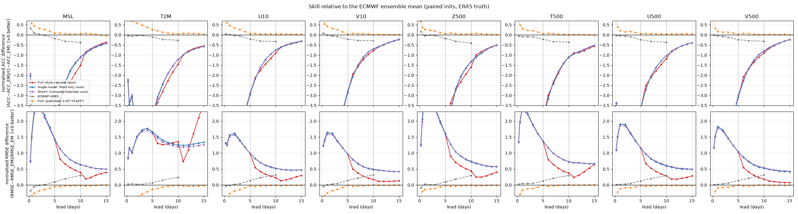
*Figure 7. Normalised ACC difference (top; > 0 means better than the EM) and normalised RMSE difference (bottom; < 0 means better than the EM) vs the ENS mean, on paired inits. Our three ML systems lie mostly below the lower ACC limit and above the upper RMSE limit before day 10.*

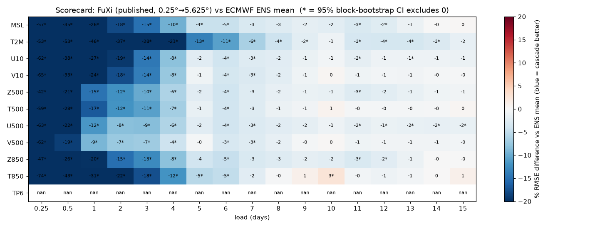
*Figure 8a. Scorecard of the published FuXi vs the ENS mean: % RMSE difference; \* marks a 95% block‑bootstrap CI that excludes 0. FuXi has lower RMSE in 86% of the 187 variable × lead cells (11 variables), significantly so in 51%; it is significantly worse in only 0.5% of cells. Its advantage is large at short leads, partly because ERA5 is the truth, and shrinks to 0–3% beyond day 7.*

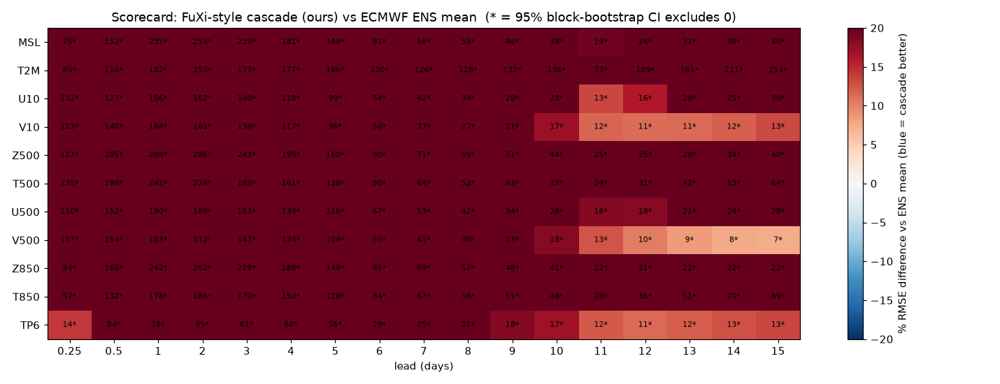
*Figure 8b. The same scorecard for our cascade. It is significantly worse than the EM in every cell. The gap narrows from 150–290% at days 1–4 to 7–40% at days 11–15, but only because both systems approach climatological error levels.*

**Table 4.** Fraction of the 8 variables × available leads where system A beats system B, as ACC win / RMSE win.

| A vs B | all leads | 0–5 d | 5–10 d | 10–15 d |
|---|---|---|---|---|
| **FuXi (published) vs ENS mean** | **0.98 / 0.96** | 1.00 / 1.00 | 1.00 / 0.93 | 0.93 / 0.95 |
| HRES vs ENS mean | 0.13 / 0.13 | 0.18 / 0.18 | 0.00 / 0.00 | — |
| Cascade (ours) vs ENS mean | 0.00 / 0.00 | 0.00 / 0.00 | 0.00 / 0.00 | 0.00 / 0.00 |
| Cascade (ours) vs HRES | 0.00 / 0.05 | 0.00 / 0.00 | 0.00 / 0.19 | — |
| Cascade vs single model (ours) | 0.40 / 0.73 | tie (identical model)ᵃ | 0.28 / 0.96 | 0.56 / 0.93 |
| Cascade vs Short+ (ours) | 0.23 / 0.63 | 0.00 / 0.03 | 0.23 / 0.94 | 0.48 / 0.93 |

ᵃ The cascade and the single model are the same model for steps 1–20. They differ only by float32 round‑off from different thread counts (max |ΔZ500| = 0.012 m²/s²), so wins in this window are ties.

### 4.4 Spatial structure: maps and gridpoint RMSE

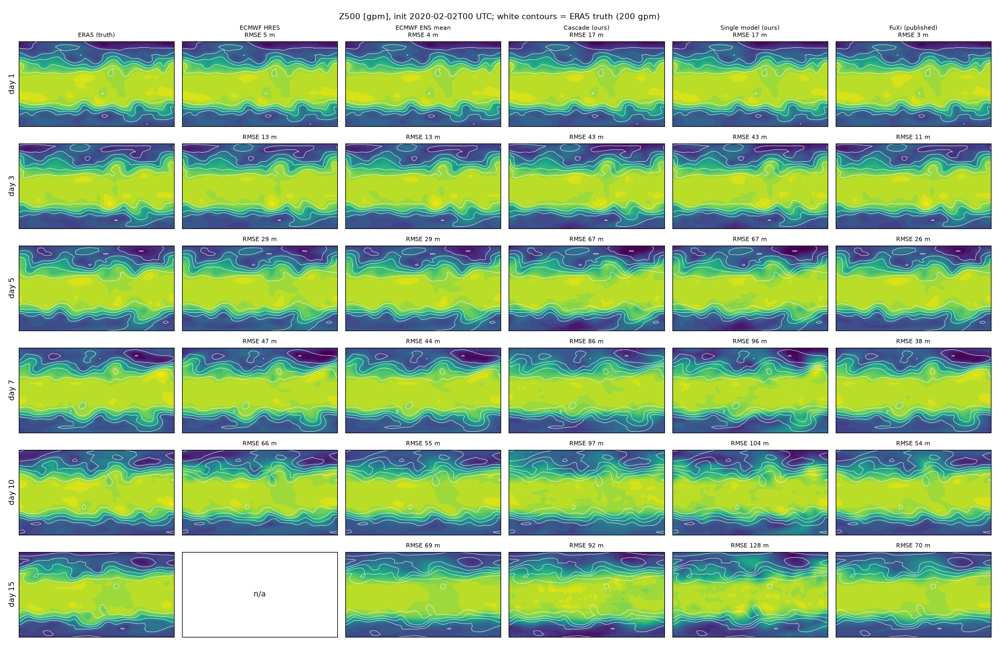
*Figure 9. Z500 at days 1, 3, 5, 7, 10 and 15 from the case‑study init. Columns: ERA5 / HRES / ENS mean / cascade / single model / published FuXi. White contours: ERA5. Panel titles give the case RMSE.*

In this case:
- the cascade and the single model keep the large‑scale planetary‑wave pattern up to about day 5;
- beyond that, the single model develops spurious small‑scale, over‑amplified features (RMSE 128 gpm at day 15);
- the cascade's forecast is smoother (92 gpm), but it also loses the truth's wave positions;
- the ENS mean and published FuXi converge to a smooth, climatology‑like field by day 15 (about 70 gpm).

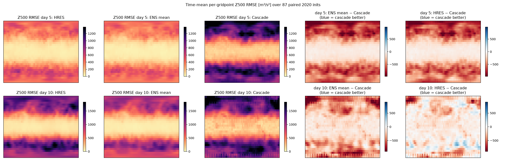
*Figure 10. Time‑mean per‑gridpoint Z500 RMSE at days 5 and 10 for HRES, ENS mean and cascade (87 paired inits), and the differences EM − cascade and HRES − cascade (blue means the cascade is better).*

- The cascade's errors concentrate in the mid‑latitude storm tracks and the polar caps, the same regions where IFS errors are largest, but 2–3× larger.
- At day 10 the cascade beats HRES at 13% of the (area‑weighted) grid, mainly in the Southern Ocean storm track where HRES's sharp deterministic errors are largest. It beats the EM at only 0.2%.
- A weak zonal striping artefact appears in the southernmost grid row of the cascade's day‑10 map.

### 4.5 Cascade vs single model, with uncertainty (Q1, Q2)

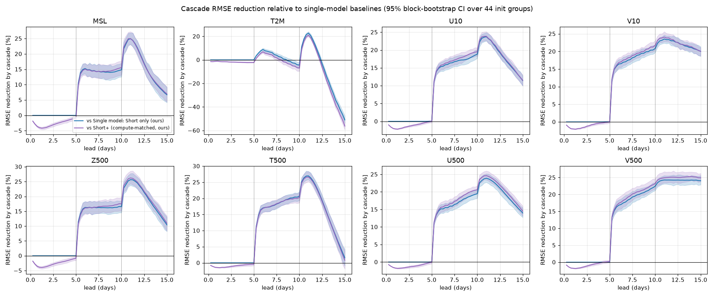
*Figure 11. Relative RMSE reduction of the cascade with respect to the single model (blue) and the compute‑matched Short+ (purple), with 95% block‑bootstrap CIs.*

**Table 5.** RMSE reduction by the cascade relative to the single model, in % [95% CI].

| Var | day 7 | day 10 | day 12 | day 15 |
|---|---|---|---|---|
| Z500 | 16.3 [14.1, 18.4] | 16.6 [14.5, 18.4] | 23.5 [21.5, 25.7] | 10.4 [8.2, 13.0] |
| T500 | 17.7 [16.4, 19.2] | 20.7 [19.3, 22.0] | 22.7 [21.1, 24.3] | 1.6 [−0.9, 4.3] |
| U500 | 16.0 [14.7, 17.2] | 19.5 [18.2, 20.8] | 22.4 [20.8, 23.9] | 14.0 [12.7, 15.4] |
| V500 | 18.4 [16.5, 19.9] | 22.4 [21.2, 23.5] | 24.2 [22.6, 25.8] | 24.1 [22.9, 25.6] |
| MSL | 14.6 [12.5, 16.8] | 14.8 [12.5, 17.0] | 20.3 [18.1, 22.4] | 6.7 [4.2, 9.1] |
| U10 | 16.4 [14.8, 17.9] | 18.8 [17.7, 20.1] | 21.0 [19.7, 22.2] | 11.4 [9.9, 12.8] |
| V10 | 17.5 [16.1, 18.9] | 20.8 [19.7, 21.9] | 23.0 [21.6, 24.4] | 20.0 [18.6, 21.3] |
| T2M | 6.3 [4.6, 7.7] | −4.4 [−7.0, −2.1] | 7.6 [5.7, 9.2] | **−51.0** [−53.8, −47.6] |

**Q1 (RMSE).** Yes for RMSE. The cascade reduces RMSE significantly for 7 of 8 variables (all except T2M) at every lead from day 6 to day 12, and to day 15 for 6 of them (T500's day‑15 CI includes 0). It also improves precipitation ETS modestly at 0.5 mm per 6 h (day 10: 0.208 vs 0.194; day 15: 0.196 vs 0.158).

**Q1 (ACC) and T2M.** The benefit does not extend to ACC beyond day 6, and T2M degrades badly after day 12. The Long model amplifies T2M anomalies (activity ratio > 3 at day 15, Fig. 12), apparently because 400 fine‑tuning iterations on day‑10 states with K ≤ 4 do not constrain its behaviour beyond the training rollout length.

**Q2.** The gain comes from specialisation. Short+ received exactly the iterations that Medium + Long received, yet it is indistinguishable from the single model: within about 1% RMSE and +0.01 ACC, with Z500 skilful lead 5.3 vs 5.2 days. The cascade beats Short+ in 94% / 93% of RMSE cells at 5–10 / 10–15 days.

### 4.6 Mechanism: amplitude damping, spectra and the post‑hoc damping control (Q3)

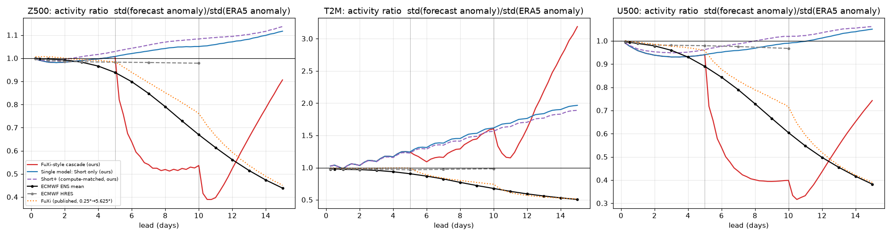
*Figure 12. Activity ratio (forecast anomaly std / ERA5 anomaly std) for Z500, T2M and U500.*

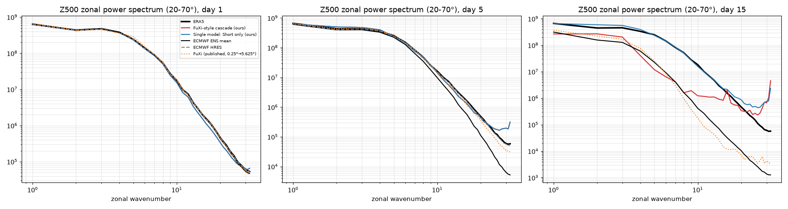
*Figure 13. Zonal power spectra of Z500 (20–70° latitude) at days 1, 5 and 15.*

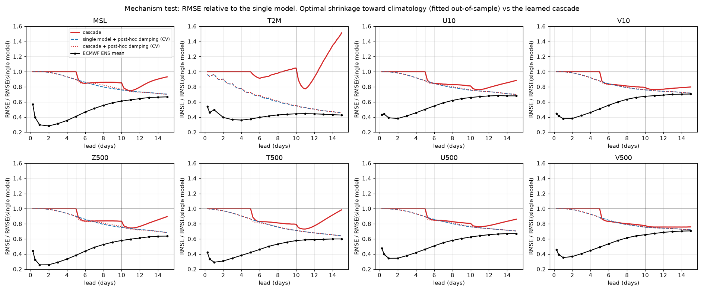
*Figure 14. RMSE relative to the single model for:*
- *the cascade (red);*
- *the single model with cross‑validated, lead‑dependent post‑hoc shrinkage toward climatology (blue dashed);*
- *the cascade with the same shrinkage (red dotted);*
- *the ENS mean (black).*

**Activity.**
- The single model is slightly *over‑active*: Z500 activity reaches 1.05 at day 10 and 1.12 at day 15, and T2M doubles. This is the typical growth of spurious variance in an autoregressive model run on its own outputs.
- The ENS mean's activity decays smoothly to 0.44 at day 15. This is the expected loss of predictable variance through ensemble averaging, and it is what makes the EM RMSE‑optimal.
- Published FuXi also decays, to 0.45 at day 15, almost exactly like the EM. FuXi's long‑lead advantage comes partly from this EM‑like smoothing, as already noted for L1/L2‑trained ML models.
- Our cascade reproduces this behaviour abruptly. At the day‑5 switch, Medium cuts Z500 activity from 1.0 to about 0.52 within 2 days, and at day 10 Long cuts it to 0.39. Long then re‑amplifies, to 0.91 at day 15, which explains the late loss of skill.

**Spectra.**
- At day 5 the single model has excess power at zonal wavenumbers > 20 and a spurious upturn at the grid scale (k = 32).
- At day 15 the cascade removes power at intermediate scales (k ≈ 3–10) but keeps the grid‑scale spike.
- The EM and FuXi spectra fall far below ERA5 at k > 10, an order of magnitude below at k ≈ 20, which is again smoothing.

**Damping control (decisive).**
- For every variable, a single scalar shrinkage per lead time, fitted on held‑out init blocks, reduces the single model's RMSE *more* than the cascade does. For Z500 the RMSE ratio relative to the single model is 0.82 for damping vs 0.84 for the cascade at day 7, 0.75 vs 0.84 at day 10, and 0.69 vs 0.90 at day 15. T2M at day 15 is 0.46 vs 1.51.
- Applying the same shrinkage to the cascade gives almost exactly the damped‑single‑model result. The cascade contains no extra recoverable pattern information.
- Because uniform shrinkage leaves ACC unchanged, and the cascade's ACC is never systematically above the single model's after day 6, the cascade's RMSE gain **is** learned, spatially non‑uniform damping toward climatology. It is not improved predictability.

**Precipitation.** ETS for 6‑hourly precipitation (Fig. 15) shows the same picture:
- the cascade helps modestly at 0.5 mm and slightly at 2 mm (day 10: 0.118 vs 0.094);
- both of our models are far below the EM and HRES (day 1 ETS 0.54 vs 0.74–0.75 at 0.5 mm).

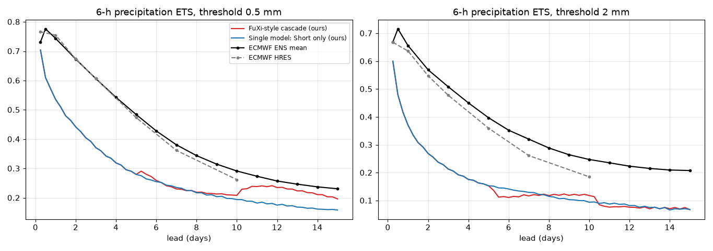
*Figure 15. Equitable threat score for 6‑h precipitation ≥ 0.5 mm and ≥ 2 mm.*

### 4.7 Sanity checks

- **Cascade = Short for steps 1–20.** The maximum absolute difference is float32 thread‑count round‑off: Z500 0.012 m²/s², T2M 3·10⁻⁵ K.
- **Climatology baseline.** Its RMSE is flat in lead time (Z500 ≈ 800 m²/s²), consistent with the published WB2 climatology RMSE at this resolution. The ENS mean (268/604/742 at days 5/10/15) and HRES (day 10: 777) agree closely with the published WB2 64 × 32 values.
- **ENS mean and published FuXi vs climatology.** Their RMSE stays below climatology at all leads.
- **Our ML vs persistence and climatology.** Our models beat persistence in 86% (single model) and 94% (cascade) of cells after day 1. They exceed climatological RMSE after day 6 (single, Z500) and day 8 (cascade, Z500); for T2M this happens after day 3.25 in both. So beyond about 1 week our own forecasts have no RMSE value over climatology.
- **Figure files.** Every figure referenced here exists in `report/images/`.

### 4.8 I/O demonstration on the provided files

`code/io_demo.py` performs the following steps:
1. reads `data/20231012-06_input_netcdf.nc`;
2. area‑averages it to the model grid;
3. runs the trained cascade for 60 steps (Short → Medium → Long);
4. bilinearly interpolates back to 1°;
5. writes `outputs/io_demo/{006…360}.nc` in exactly the `006.nc` layout (dims time/step/level/string5/lat/lon, `data` of shape (1, 1, 70, 181, 360), byte‑string level names, `step` in hours).

60 files were written and verified (all finite, variable shapes identical to `006.nc`). Only 4 were kept to save disk. Because the input is noise, the output values are meaningless; this demonstrates only that the cascade consumes and produces the task's file format.

---

## 5. Discussion

### 5.1 What is and is not reproduced

| Paper claim | Status here |
|---|---|
| Cascade reduces long‑lead error accumulation compared with a single autoregressive model | **Reproduced for RMSE** with our own models (−14 to −25% at days 6–12, CIs exclude 0, 7/8 variables). **Not reproduced for ACC**, and T2M degrades after day 12. |
| The benefit comes from stage specialisation rather than extra training | **Reproduced**: the compute‑matched Short+ gives no gain. |
| 15‑day skill comparable to the ECMWF ensemble mean | **Confirmed for the published FuXi model** (independent 2020 verification: 96–98% of cells better, skilful Z500 lead 11.35 vs 11.0 days). **Not reproduced by our reduced‑scale cascade**, which is worse than the EM in 100% of cells and worse than HRES in 95% of RMSE cells. |
| Extends skilful Z500 lead beyond HRES (about 9 days) | Confirmed for published FuXi (11.35 vs 9.07 days). Our cascade: 5.6 days. |

### 5.2 Interpretation

**What the controlled experiment shows.** It shows clearly what a cascade does when the base model is imperfect:
- each specialised stage receives inputs drawn from the drifted distribution of its predecessor;
- trained with an L1 loss against ERA5, it learns that the safest response to uninformative inputs is to pull forecasts toward climatology.

This is exactly how an ensemble mean behaves, but without the information gain an ensemble provides.

**Why the full‑scale FuXi does better.** In the full‑scale FuXi, the base model is skilful enough that the Medium and Long stages can both damp *and* preserve predictable patterns. Its activity decays like the EM's while its ACC matches or exceeds the EM's. At our scale, the damping component dominates.

**Practical implications.**
- An honest single‑model baseline for cascade studies should include a post‑hoc, lead‑dependent damping, and the cascade should be judged on ACC as well as RMSE.
- RMSE comparisons between a deterministic ML model and an ensemble mean partly reward smoothing. Activity and spectra (Figs. 12, 13) should accompany any "comparable to the EM" claim. FuXi's forecasts at day 15 have power more than 10× below ERA5 at synoptic scales, as smooth as the EM.
- Stage boundaries introduce discontinuities: activity jumps and ACC dips at days 5 and 10. Operationally these could produce temporally inconsistent forecast sequences, for example for T2M.

### 5.3 Limitations

- **Resolution and scale.** We use 5.625° rather than 0.25°, a 6 M‑parameter model rather than FuXi's billions of parameters, and about 3.5 CPU‑hours rather than GPU‑days. Training also used fewer rollout steps (K ≤ 6 for Short and K ≤ 4 for Medium/Long, vs up to 12 in FuXi) and only 1000 generated starts. Absolute skill is therefore far from the paper's, and only relative statements about our own models are meaningful.
- **Training data.** Data were limited by the ~1–3 MB/s network. Pre‑training saw 1–4 years of the 8 eventually downloaded, and each stage saw only 0.3–3 passes over the data. Training curves were still improving.
- **Benchmark coverage.** Benchmarks were downloaded at daily lead resolution, and HRES and published FuXi for 88 of the 176 inits. All comparisons are paired, but the HRES and FuXi CIs are wider.
- **Verification setup.** All verification is against ERA5, which favours ERA5‑trained ML models at short leads. A single test year (2020) is used. Published FuXi is evaluated after WB2's conservative regridding to 5.625°, which removes small‑scale differences.
- **Data deviation.** The task's provided sample data could not be used scientifically because they are noise. This is a documented deviation, not a choice.

### 5.4 Conclusions

1. The FuXi paper's central claim, 15‑day skill comparable to (here marginally better than) the ECMWF ensemble mean, holds in an independent 2020 verification of the published FuXi forecasts on 8 variables.
2. A reduced‑scale FuXi‑style cascade, built and trained from scratch on ERA5, reproduces the qualitative cascade benefit over a single autoregressive model for RMSE. The benefit is not explained by extra training compute.
3. At this scale the benefit is entirely explained by learned, lead‑dependent damping toward climatology. A cross‑validated post‑hoc damping of the single model matches or beats it, and pattern skill (ACC) does not improve.

---

## 6. Reproducibility

Run order:
1. `code/diagnose_data.py` — noise diagnosis of the provided files.
2. `code/download_all.sh` — ERA5, ENS mean, HRES, published FuXi and climatology from WB2 via `wb2io.py`, read sequentially.
3. `code/train.py --stage pretrain …` (command in `pipeline.sh`).
4. `code/pipeline.sh` then `code/pipeline2.sh` — Short, generate, Medium, generate, Long, Short+, forecasts. `pipeline2.sh` re‑runs Medium→Long after a key‑name bug crashed the first attempt; the Short+ run was unaffected.
5. Analysis scripts:
   - `code/evaluate.py` → `outputs/metrics.npz`;
   - `code/plots.py` → Figs 5–8, `outputs/summary_tables.json`;
   - `code/analysis.py` → Figs 9–15, `outputs/analysis_results.json`;
   - `code/damping.py` → Fig. 14, `outputs/damping_results.json`;
   - `code/data_overview.py`, `code/train_curves.py` → Figs 2–4;
   - `code/io_demo.py` → `outputs/io_demo/`.

Checkpoints are in `outputs/ckpt/`, forecasts of the verification variables in `outputs/fc/`, and logs in `outputs/logs/`. Random seeds are fixed (training sampler seed 1, generation seed 7, bootstrap seeds per lead).
