# MMGA: Meta-Model-assisted Genetic-Algorithm Identification of Electrochemical–Aging–Thermal (ECAT) Parameters of Li-ion Cells

*Every number in this report is computed in this run from the files in `data/`. The source JSON/NPZ file in `outputs/` is given next to each result. All code is in `code/`.*

---

## Abstract

High-fidelity physics-based battery models, such as SPMe/DFN coupled with heat and aging, are the basis of Li-ion digital twins. Their internal parameters are not directly measurable, and they are expensive to identify, because every candidate needs a full PDE solve.

We built and evaluated **MMGA** (Meta-Model-assisted Genetic Algorithm) as a three-step framework:

1. **Step 1:** Latin-Hypercube Sampling (LHS) of the parameter box, with PyBaMM simulations of a 1C constant-current (CC) discharge giving both voltage **and** temperature.
2. **Step 2:** a 4-layer fully connected ANN meta-model, trained with Adam, that maps parameters to the full V(t), T(t) and capacity response.
3. **Step 3:** a real-coded GA running on the ANN. The best candidates are verified with the physics model.

**Synthetic-truth benchmark (Steps 1–3).** The core set is the negative and positive particle radii (R_n, R_p), the negative reaction-rate constant (k_n) and the total heat-transfer coefficient (h).
- The ANN reproduces held-out PyBaMM simulations with **0.47 mV** (V) and **0.033 K** (T) RMSE, and 0.010 % discharge-time error.
- Validation MSE falls from 0.257 to 2.4·10⁻⁴ over 1500 Adam epochs.
- One ANN evaluation is ~10³× faster than one physics solve, and ~2·10⁴× faster in batch.
- Over five synthetic truths (2 mV / 0.1 K noise), MMGA identifies all four parameters with a **maximum relative error of 4.7 %**. The mean |error| is 0.6 % (R_n), 1.9 % (R_p), 2.0 % (k_n) and 1.2 % (h).
- The re-simulated curves fit the noise-free truth to **0.26–0.56 mV and ≤0.12 K**.

**Cost.** For the same target, MMGA needs 3.2–3.5 s and 10 online physics simulations. A physics-only GA needs 1040 simulations and 153 s. Within that budget it reached the same objective in one case and stayed 11× worse in the other. The offline cost of MMGA (≈12 min) is amortised after about five identifications.

**Real data.**
- With an 8-parameter ECAT parameterisation (the core set plus aging and stoichiometry states), MMGA fits the fresh NASA B0005 cell at **5.9 mV / 0.19 K / 0.01 % capacity error**.
- It tracks the cell over 168 cycles with 6–22 mV RMSE.
- It fits CALCE CS2_36 at 6.6–7.7 mV.
- On the Oxford dynamic drive cycle it predicts unseen data at 30 mV.

**Negative results reported honestly:**
- the electrode stoichiometry window must be free on real cells (a 6-parameter fit gave 48 mV);
- temperature data are indispensable for h (h error rises to 18 % mean without T);
- the Ai2020-based model does not transfer well to the Oxford pouch cell.

---

## 1. Introduction and research question

A digital twin must update internal states (diffusion lengths, kinetics, heat rejection, degradation) from routinely measured macroscopic signals: terminal voltage, surface temperature and delivered capacity. Physics-based identification (paper_003) puts a GA directly around the electrochemical model. This is robust, but it needs 10³–10⁴ PDE solves per identification.

AI-based identification (paper_001) replaces the forward model by a learned surrogate. The open question is whether a surrogate can be accurate enough that the GA optimum on the surrogate is also an optimum of the physics.

We test three hypotheses:

- **H1:** A compact 4-layer ANN trained on a few thousand LHS physics simulations reproduces the coupled V–T–capacity response to well below measurement noise (≪ 2 mV, ≪ 0.1 K).
- **H2:** A GA on this ANN recovers {R_n, R_p, k_n, h} from noisy 1C discharge V and T curves to within a few percent. With a small physics re-verification it matches a physics-only GA at a tiny fraction of the cost.
- **H3:** The same pipeline identifies a realistic ECAT parameter set on experimental cells (NASA, CALCE, Oxford). We also ask which parameters are identifiable from which signals.

---

## 2. Data

`code/data_prep.py` → `outputs/exp_data.pkl`, `outputs/data_summary.json`; Fig. 1.

| Dataset | Cell / protocol | Used signals | Extracted |
|---|---|---|---|
| NASA PCoE B0005/6/7/18 | 18650, ~2 Ah; 2.0 A CC discharge (≈1C), 24 °C ambient | V, I, surface T | 168 discharges (B0005). Capacity 1.856 → 1.325 Ah; ΔT ≈ 14.5 K in cycle 0 |
| CALCE CS2_36 | 1.1 Ah prismatic, 1.1 A (1C) CC discharge | V, I (no T logged) | 200 discharges (Step_Index 7, 30 s sampling). 0.749 → 0.270 Ah |
| Oxford ExampleDC_C1 | Kokam 740 mAh pouch, 40 °C, Artemis urban drive cycle | V, I, T (1 s) | 3144 s dynamic discharge with peaks of −5.0 A (6.7C) and +1.6 A regeneration |

How the windows were defined:
- **NASA:** the load window is defined by −I > 1 A, and the measured curve is truncated at the 2.7 V cut-off (interpolated crossing).
- **CS2:** the files are ordered by their first time stamp. The first CS2_36 discharge already delivers only 0.75 Ah (68 % of nominal), so the cell is partly aged at the start of the record.

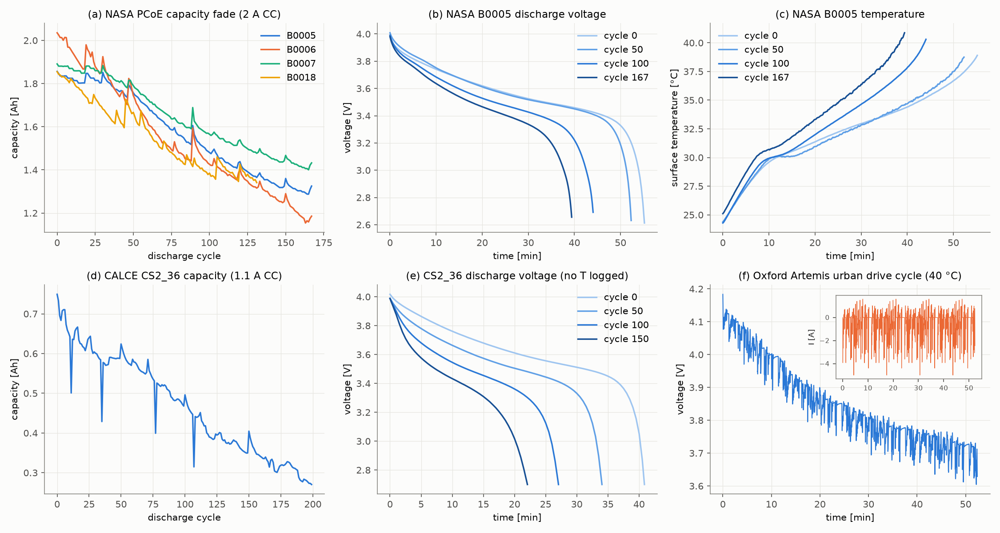

**Figure 1.** (a) NASA capacity fade; (b, c) B0005 voltage and surface temperature over life; (d, e) CS2_36 capacity and voltage; (f) Oxford drive-cycle voltage with the current in the inset.

---

## 3. Methodology

### 3.1 ECAT physics model (PyBaMM)

`code/ecat_model.py`. PyBaMM 26.11 installed without problems, so **PyBaMM is used for every physics simulation**; no custom solver was needed.

**Electrochemistry.** SPMe (single-particle model with electrolyte), solved with the IDAKLU solver. The PyBaMM parameter set is **Ai2020** (LiCoO₂/graphite, 2.28 Ah, with complete thermal data). An LCO/graphite chemistry was chosen because its OCPs are appropriate for the NASA 18650 cells.

**Thermal.** Lumped (x-averaged) energy balance with ohmic, reaction and reversible (entropic) heat sources, and Newton cooling through the *Total heat transfer coefficient* h. The Ai2020 kinetic and diffusion functions are Arrhenius-dependent, which gives two-way electro-thermal coupling.

**Aging/state.** The aging state enters through:
- LAM_p, a scaling of the positive active-material fraction (loss of active material);
- LLI, a scaling of the initial negative stoichiometry (loss of lithium inventory);
- R_f, a film/contact resistance (SEI-like ohmic growth);
- SOCp, a scaling of the initial positive stoichiometry (electrode balancing).

**Parameterisation as inputs.**
- All identified quantities are PyBaMM `InputParameter`s, so the model is discretised once and then re-solved per sample.
- The particle radii change the radial geometry. This was made possible by `SymbolicUniform1DSubMesh` on both particle domains.
- k_n is a multiplier on the Ai2020 negative exchange-current density j₀,n(c_e, c_s, T); k_n = 1 corresponds to the reference rate constant.
- Each solve takes **0.29 s** on average (2 parallel workers on a heavily shared host).

**Numerical verification** (`code/convergence_check.py` → `outputs/convergence_check.json`). The production discretisation (20 points per domain, rtol 10⁻⁶, 2 s output) was compared with a refined reference (40 through-thickness and 60 radial points, rtol 10⁻⁹, 0.5 s output) at four corners of the box.
- V RMSE was 0.03–0.63 mV, with a maximum of 5.9 mV in the last seconds of the knee.
- T RMSE was ≤0.002 K and the discharge-time error ≤0.014 %.
- The production model is therefore converged well below the noise level.

**Implementation notes found during the work:**
1. Requesting dense `t_eval` made PyBaMM ~100× slower. Output is therefore requested through `t_interp`.
2. With a 2.7 V cut-off, the Ai2020 positive electrode can reach surface saturation. The voltage then collapses within one solver step, and the voltage reported at the event (but not the event time) was non-physical in 3107 of 4000 NASA-database samples.
   - The solver output itself is correct up to the second-to-last point. The end-of-discharge voltage is therefore set to the cut-off value (`ecat_model.ECAT.run`; documented in `db_*.json`).
   - The 3.0 V synthetic database was unaffected.

### 3.2 Step 1 — LHS design and simulation database

`code/step1_lhs.py` → `outputs/db_*.npz/json`.

The core search box (log-uniform for all four parameters) was centred on the Ai2020 values R_n = 5 µm, R_p = 3 µm, k_n = 1 and h = 35 W m⁻² K⁻¹:

| Parameter | Lower | Upper | Scaling |
|---|---|---|---|
| R_n (negative particle radius) | 2.5 µm | 10 µm | log |
| R_p (positive particle radius) | 1.5 µm | 6 µm | log |
| k_n (negative reaction-rate multiplier) | 0.2 | 5 | log |
| h (total heat-transfer coefficient) | 5 W m⁻² K⁻¹ | 40 W m⁻² K⁻¹ | log |

Protocol: 1C CC discharge (2.28 A) from 100 % SOC at 25 °C down to 3.0 V.

Each simulation is stored as a fixed-length vector:
- V(τ) and ΔT(τ) = T − T₀ on 83 points of the normalised time τ = t/t_end (denser in the first and last 5 %);
- plus t_end (equivalent to capacity, Q = I·t_end).

Total output dimension: 167.

**Small baseline first.** 20 LHS samples ran with 20/20 successes and 4.9 s wall time (0.32 s per simulation); see Fig. 2a,b.

**Training database.** 3000 LHS samples, **3000/3000 successful**, 439 s wall time (0.29 s per simulation); see Fig. 2c,d and Fig. 3.
- Across the box, t_end varies from 59.5 to 63.8 min.
- The maximum temperature rise varies from 2.8 to 26.5 K, mainly controlled by h.

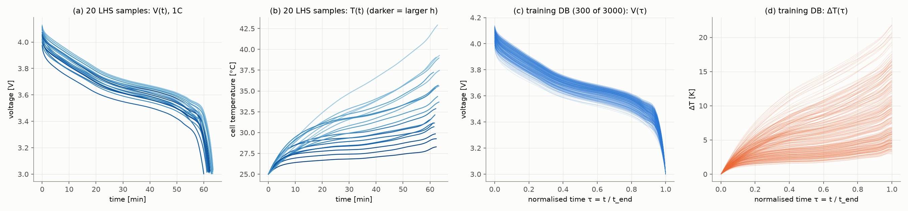

**Figure 2.** Step 1. (a, b) V(t) and T(t) of the 20-sample LHS baseline (colour = h); (c, d) 300 of the 3000 training samples on the normalised time grid.

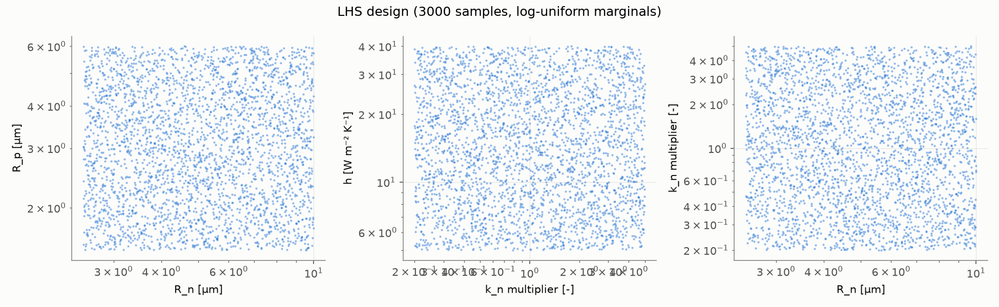

**Figure 3.** Two-dimensional projections of the 3000-point LHS design.

### 3.3 Step 2 — ANN meta-model

`code/step2_ann.py`, `code/metamodel.py` → `outputs/ann_core_*.json`.

**Architecture.** A **4-layer fully connected network**: input (4 parameters scaled to the unit cube) → 128 → 128 → 128 (tanh) → 167 linear outputs. That is 4 weight layers, about 39 k weights.

**Outputs and loss.**
- The outputs are standardised per dimension.
- log t_end is up-weighted ×10 in the loss, because it is 1 of 167 outputs yet carries the capacity information.
- No separate capacity sub-network was needed; the t_end error is 0.01 %.

**Training.**
- Adam with mini-batches of 64, learning rate 2·10⁻³, L2 = 10⁻⁶, 1500 epochs, fixed seed. A cosine decay was coded, but scikit-learn's Adam recomputes the step size from `learning_rate_init` at every update and overrides it, so the effective learning rate was constant. This was found after training; it explains the noisy plateau of the loss after about 200 epochs and leaves some accuracy on the table.
- Split: 2400 training, 300 validation and 300 test samples (held out).
- The per-epoch training and validation MSE are logged in `outputs/ann_core_history.json`.

**Small-data control.** The same architecture was trained on the 20-sample baseline only and evaluated on the same 300 test samples.

### 3.4 Step 3 — Genetic algorithm on the meta-model (MMGA)

`code/ga.py`, `code/step3_identify.py`.

**GA operators.** Real-coded on the unit cube:
- tournament selection (k = 3);
- SBX crossover (η = 15, p_c = 0.9);
- polynomial mutation (η = 20, p_m = 1/d);
- 10 % elitism.

Each run uses a population of 200 for 100 generations, i.e. 20,200 ANN evaluations. Five independent seeds are run per identification.

**Objective** (dimensionless):

$$J=\frac{\overline{(V-\hat V)^2}}{(10\,\mathrm{mV})^2}+\frac{\overline{(\Delta T-\Delta\hat T)^2}}{(0.5\,\mathrm{K})^2}+\frac{\left((t_{end}-\hat t_{end})/\hat t_{end}\right)^2}{(0.5\,\%)^2}$$

**Physics verification.** The 10 best *distinct* candidates pooled from all seeds (Chebyshev distance > 0.03 in the unit cube) are re-simulated with PyBaMM. The one with the lowest physics J is reported. These are the only 10 online physics simulations.

**Synthetic-truth benchmark.**
- Truths: five parameter sets, namely the nominal Ai2020 values plus four random interior points.
- To avoid the "inverse crime", the truths are simulated with the **refined** discretisation of §3.1, not with the model that generated the training database.
- Gaussian noise (σ_V = 2 mV, σ_T = 0.1 K) is added at 1 s resolution.
- **Combined V–T RMSE:** voltage and temperature residuals against the noise-free truth, on a common absolute time axis, are each normalised by the range of the true signal and then pooled: RMSE_VT = √(½[mean(ΔV/range V)² + mean(ΔT/range T)²]), reported in %. V RMSE [mV] and T RMSE [K] are reported separately as well.

**Physics-only GA baseline.** Same operators, population 40, 25 generations (1040 PyBaMM solves), on the same target and the same objective, for two of the cases.

**Identifiability ablation** (`code/step3b_ablation.py`). The five truths were re-identified:
- at noise levels of 2 mV/0.1 K, 5 mV/0.3 K and 10 mV/0.5 K;
- **without** the temperature term (voltage + capacity only), as for a cell without a thermocouple.

### 3.5 Real-data application

`code/step5_nasa.py`, `code/step5_cs2.py`, `code/step6_oxford.py`.

**Per-condition databases.** Same LHS → PyBaMM → 4-layer ANN → GA pipeline, rebuilt for each experimental condition.
- **NASA:** 2.0 A at 24 °C to 2.7 V. 8 parameters: the core set plus LAM_p, R_f, LLI and SOCp. 5000 LHS samples, of which 3506 were feasible. The 1494 infeasible samples all have SOCp < ≈0.92, which puts the initial OCV above the 4.2 V limit.
- **Feasibility handling:** a random-forest classifier (3-fold CV accuracy 1.00) predicts feasibility and adds a penalty, so that the GA cannot exploit ANN extrapolation into the infeasible region.
- **CS2:** the Ai2020 cell is run at its own 1C, i.e. CS2 is represented at equal C-rate, as an area-scaled copy with scale factor 2.28/1.1. Temperature is not recorded, so h is fixed at 35 W m⁻² K⁻¹ and the objective has no temperature term. Seven parameters are identified; 4000 LHS samples, of which 2804 were feasible.
- **Oxford:** the drive current is applied through a 10 s-averaged interpolant, at 5 s per solve. Six parameters, 800 LHS samples, of which **390 were usable**. The other 410 reached 2.5 V before the end of the drive cycle; this happened at low LAM_p or high R_f.
  - Identification uses the first 60 % (31.5 min) of the drive cycle.
  - The remaining 40 % is a blind prediction.

**Real-data box.** It is wider than the synthetic box: R_n up to 20 µm, k_n 0.05–5, LLI 0.6–1.02, SOCp 0.8–1.2, LAM_p 0.4–1.0 and R_f 0–0.15 Ω.

**NASA aging tracking.** For 13 cycles between 0 and 167, the cell was identified in two ways:
- with all 8 parameters free;
- in "tracking" mode: R_n, R_p, h and SOCp frozen at their cycle-0 values, and only the degradation-related parameters k_n, LAM_p, R_f and LLI re-identified.

---

## 4. Results

### 4.1 Step 2 — meta-model accuracy and learning curve

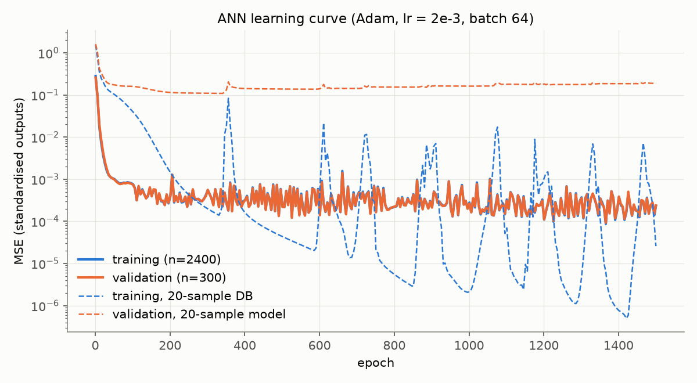

**Figure 4.** ANN learning curves (MSE of the standardised outputs, log scale) for the 2400-sample model (solid) and the 20-sample model (dashed). The spikes of the 20-sample model are Adam instabilities at constant learning rate on a tiny dataset.

| Metric (`outputs/ann_core_metrics.json`) | Full DB (n_train = 2400) | 20-sample DB |
|---|---|---|
| Training MSE, epoch 1 → epoch 1500 (weighted loss) | 0.281 → 2.33·10⁻⁴ | → 2.1·10⁻⁵ (overfit) |
| Validation MSE, epoch 1 → epoch 1500 | 0.257 → 2.37·10⁻⁴ | — |
| **Test MSE (standardised, unweighted)** | **1.73·10⁻⁴** | **0.110** (636× higher) |
| Test MSE, voltage [V²] | 2.25·10⁻⁷ | 2.33·10⁻⁴ |
| Test MSE, temperature [K²] | 1.10·10⁻³ | 0.72 |
| Test RMSE, V [mV] (95th percentile per sample) | **0.47** (0.86) | 15.3 (30.2) |
| Test RMSE, ΔT [K] (95th percentile per sample) | **0.033** (0.055) | 0.85 (1.61) |
| t_end MAPE / maximum APE [%] | 0.010 / 0.088 | 0.33 / 2.49 |
| R² (V / T / t_end) | 0.999996 / 0.99993 / 0.99989 | 0.996 / 0.955 / 0.868 |
| Training time | 294 s | — |
| Evaluation time per sample, single / batch of 200 | 0.29 ms / 13.6 µs | — |
| Speed-up over one PyBaMM solve (0.29 s) | **≈1,000× / ≈21,000×** | — |

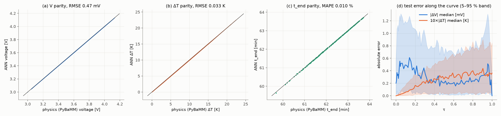

**Figure 5.** Held-out parity for V, ΔT and t_end, and the error along the normalised time axis (median and 5–95 % band).

Key observations:
- The full-database ANN is about 4× more accurate than the measurement noise assumed later (2 mV / 0.1 K), so H1 is confirmed.
- Its errors are largest in the first 5 % of the discharge (initial ohmic and kinetic transient) and at the end-of-discharge knee.
- The 20-sample network interpolates its training points almost perfectly (training RMSE 0.10 mV) but generalises at 15 mV. **The surrogate needs a database of order 10³ samples; 20 is far too few.**

The meta-models used on real data reach similar accuracy:

| Meta-model | Test V RMSE [mV] | Test T RMSE [K] | t_end MAPE [%] | Validation MSE, initial → final | Source |
|---|---|---|---|---|---|
| NASA, 8-D | 2.99 | 0.11 | 0.37 | 0.190 → 9.5·10⁻⁴ | `ann_nasa8_metrics.json` |
| CS2, 7-D | 2.48 | 0.019 | 0.25 | 0.197 → 4.8·10⁻⁴ | `ann_cs2_7_metrics.json` |
| Oxford, 6-D, n_train = 310 | 3.13 | 0.029 | — | test MSE 0.515 → 1.46·10⁻³ | `oxford_mmga.json` |

### 4.2 Step 3 — synthetic-truth identification of {R_n, R_p, k_n, h}

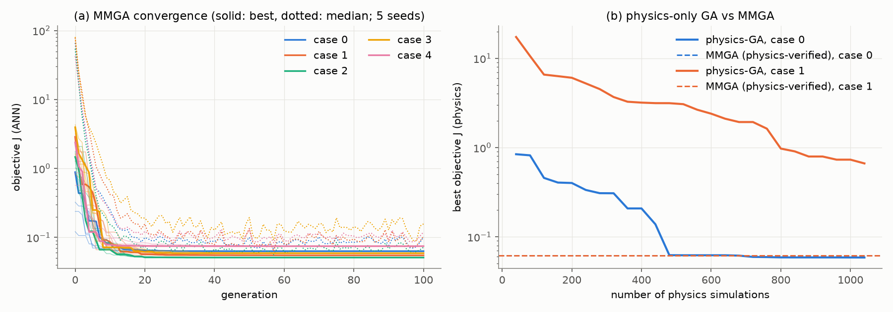

**Figure 6.** (a) MMGA convergence: best (solid) and median (dotted) J per generation, 5 seeds per case. (b) A physics-only GA versus the physics-verified MMGA result on the same targets.

The GA converges within about 20 generations, to J ≈ 0.05–0.08. This is the noise floor: the exact truth scores J = 0.057–0.104 against the noisy data.

Identified parameters (`outputs/step3_synthetic.json`; radii in µm, h in W m⁻² K⁻¹). "Seed CV" is the coefficient of variation of the best solutions of the 5 GA seeds.

| Case | Parameter | True value | Identified | Relative error [%] | Seed CV [%] |
|---|---|---|---|---|---|
| 0 (nominal) | R_n | 5.000 | 5.028 | +0.57 | 0.05 |
| | R_p | 3.000 | 3.016 | +0.55 | 0.08 |
| | k_n | 1.000 | 1.005 | +0.51 | 0.06 |
| | h | 35.00 | 35.02 | +0.06 | 0.01 |
| 1 | R_n | 6.059 | 6.029 | −0.50 | 0.11 |
| | R_p | 1.875 | 1.929 | +2.91 | 0.97 |
| | k_n | 0.5045 | 0.5111 | +1.29 | 0.48 |
| | h | 8.588 | 8.613 | +0.29 | 0.04 |
| 2 | R_n | 3.554 | 3.589 | +1.00 | 0.08 |
| | R_p | 4.168 | 4.147 | −0.51 | 0.06 |
| | k_n | 2.817 | 2.713 | −3.70 | 0.29 |
| | h | 9.935 | 9.851 | −0.85 | 0.02 |
| 3 | R_n | 7.003 | 6.967 | −0.51 | 0.12 |
| | R_p | 4.524 | 4.570 | +1.01 | 0.15 |
| | k_n | 1.032 | 1.048 | +1.52 | 0.23 |
| | h | 9.451 | 9.573 | +1.29 | 0.04 |
| 4 | R_n | 7.036 | 7.003 | −0.47 | 0.03 |
| | R_p | 2.219 | 2.324 | +4.71 | 0.58 |
| | k_n | 1.805 | 1.857 | +2.89 | 0.57 |
| | h | 17.37 | 16.78 | −3.35 | 0.04 |
| **Mean \|error\| over 5 cases** | | | | **R_n 0.61 · R_p 1.94 · k_n 1.98 · h 1.17** | |
| **Maximum \|error\|** | | | | **R_n 1.00 · R_p 4.71 · k_n 3.70 · h 3.35** | |

Curve agreement of the identified parameters, re-simulated with PyBaMM against the noise-free refined-model truth:

| Case | V RMSE [mV] | T RMSE [K] | Combined V–T RMSE [% of range] | Capacity error [%] | J (ANN) | J (physics) | J of the exact truth |
|---|---|---|---|---|---|---|---|
| 0 | 0.52 | 0.001 | 0.04 | −0.16 | 0.063 | 0.070 | 0.067 |
| 1 | 0.26 | 0.031 | 0.15 | −0.17 | 0.055 | 0.056 | 0.063 |
| 2 | 0.40 | 0.055 | 0.38 | −0.00 | 0.051 | 0.053 | 0.057 |
| 3 | 0.55 | 0.092 | 0.50 | −0.12 | 0.059 | 0.060 | 0.087 |
| 4 | 0.56 | 0.119 | 1.23 | −0.13 | 0.075 | 0.083 | 0.104 |

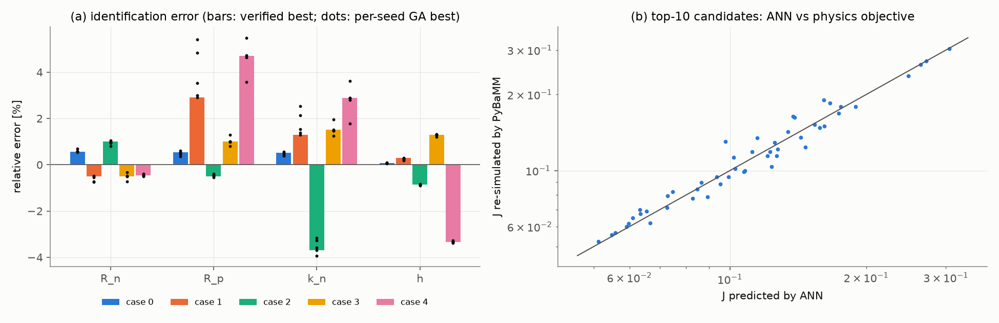

**Figure 7.** (a) Relative identification errors: bars are the physics-verified best, dots are the per-seed GA best. (b) ANN-predicted versus physics-re-simulated J for all 50 verified candidates.

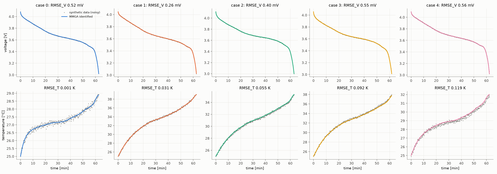

**Figure 8.** Synthetic noisy data (grey) and the PyBaMM response of the MMGA-identified parameters (colour) for all five cases. Voltage is in the top row, temperature in the bottom row.

What the benchmark shows:
- **H2 is confirmed.** All 20 identified values lie within 4.7 % of the truth. The re-simulated curves match the truth to ≤0.56 mV and ≤0.12 K, i.e. below the injected noise.
- **The ANN does not mislead the GA here.** ANN-predicted and physics-recomputed J agree closely over the whole top-10 set (Fig. 7b). The physics J of the chosen solution is within 1–10 % of the ANN J, and below or at the J of the exact truth.
- **The residual errors are not optimiser variance.** The five seeds agree to <1 % CV, yet the errors reach up to 4.7 %. The errors are set by noise, by the small model-form difference between the refined "truth" discretisation and the production model (visible as a systematic −0.13 to −0.17 % capacity offset), and by the flatness of the objective along partly correlated directions.
- **Ranking of the parameters.** In the high-h case 0, h is very well determined; in the low-h, hot cases its error is up to 3.4 %. R_n is the best-constrained electrochemical parameter. R_p and k_n are the weakest, as expected: both act mainly through small overpotentials, k_n mostly in the initial transient.

### 4.3 Identifiability: noise and sensor information

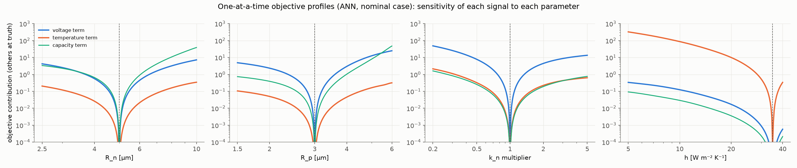

**Figure 9.** One-at-a-time objective profiles on the ANN around the nominal truth, split into the voltage, temperature and capacity terms.

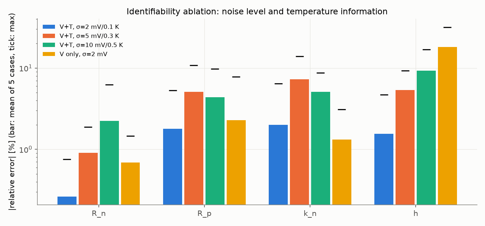

**Figure 10.** Ablation: mean (bars) and maximum (ticks) |relative error| over the 5 cases for different noise levels and with or without temperature data. Source: `outputs/step3b_summary.json`.

| Configuration | R_n | R_p | k_n | h |
|---|---|---|---|---|
| V + T, σ = 2 mV / 0.1 K | 0.26 (0.76) | 1.79 (5.32) | 2.00 (6.46) | 1.56 (4.70) |
| V + T, σ = 5 mV / 0.3 K | 0.90 (1.89) | 5.11 (10.8) | 7.24 (14.0) | 5.34 (9.32) |
| V + T, σ = 10 mV / 0.5 K | 2.25 (6.22) | 4.39 (9.77) | 5.09 (8.77) | 9.24 (16.9) |
| **V only**, σ = 2 mV | 0.69 (1.46) | 2.30 (7.77) | 1.32 (3.10) | **18.1 (31.7)** |

Values are mean (maximum) |relative error| in %. Each configuration uses fresh noise realisations; the first row repeats Table 4.2 with a different noise realisation.

The profiles in Fig. 9 explain the ranking:
- **h is identified almost exclusively through temperature.** Its voltage signature (through Arrhenius coupling) is roughly 10³× weaker than its thermal signature.
- **The radii and k_n are informed mainly by voltage**, with the radii also affecting capacity (diffusion-limited utilisation).

The ablation confirms this:
- Without a temperature sensor, the electrochemical parameters are still found to a few percent. h, however, degrades to an 18 % mean (32 % maximum) error, and is effectively unidentifiable for parameter-level use.
- Accuracy degrades gracefully with noise: about 5 % mean error at realistic cycler-grade noise of 5–10 mV.
- R_n is consistently the most robust parameter. k_n and R_p are the most noise-sensitive.

### 4.4 Efficiency: MMGA versus a physics-only GA

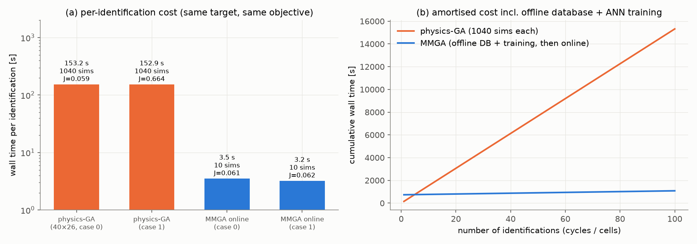

**Figure 11.** (a) Wall time and physics-simulation count per identification. (b) Cumulative cost including the offline database and ANN training.

Source: `outputs/step3_physga_baseline.json`. Each row is one identification of the same synthetic target with the same objective.

| | Physics-only GA (40 × 26) | MMGA (5 seeds × 200 × 100 on the ANN + 10 physics) |
|---|---|---|
| Physics solves, online | 1040 | **10** |
| Wall time, case 0 / case 1 | 153.2 s / 152.9 s | **3.5 s / 3.2 s** |
| Best physics J, case 0 | 0.059 | 0.061 |
| Best physics J, case 1 | **0.664** (not converged) | **0.062** |
| Maximum \|error\|, case 0 | 3.8 % | 4.2 % |
| Maximum \|error\|, case 1 | **74 %** | **0.9 %** |
| Offline cost | none | 439 s (3000 LHS solves) + 294 s (training) |

Main findings:
- With a 1040-solve budget, the physics-only GA matched MMGA on case 0. On case 1 its R_p was still off by 74 %, because its population of 40 was too small to explore the box.
- MMGA effectively evaluates 10⁵ candidates per identification for the cost of 10 solves, i.e. **≈45× faster per identification**.
- Including the offline cost, MMGA is cheaper from about the 5th identification onward (Fig. 11b).
- The NASA aging study below needed 26 identifications, with 20 physics solves each in total.

### 4.5 Real data — NASA PCoE B0005 (V and T measured)

Source: `outputs/nasa8_mmga.json`; the fixed-stoichiometry comparison is in `outputs/nasa_mmga.json` and `outputs/nasa_structure_test.json`.

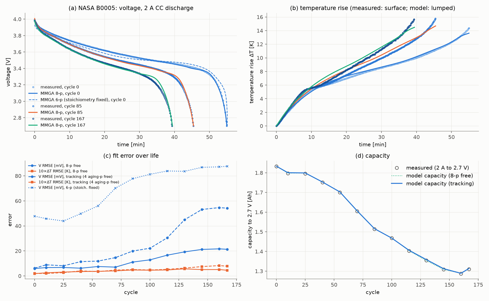

**Figure 12.** NASA B0005: (a) measured and MMGA voltage for cycles 0, 85 and 167, plus the 6-parameter (fixed-stoichiometry) fit; (b) temperature rise; (c) RMSE over life for the three parameterisations; (d) capacity.

**First parameterisation: stoichiometry fixed.** With only the 4 core parameters plus LAM_p and R_f (6-D), the best fit of the fresh cell was **47.7 mV / 1.08 K**. A direct physics Nelder–Mead polish (338 solves) did not do better: 45.8 mV.
- The model's plateau was too flat and its knee too sharp (Fig. 12a, dashed line).
- Several parameters sat on bounds (R_n = 10 µm, k_n near its lower bound).
- The residual is therefore structural (electrode balancing), not an optimiser failure.

**Electrode window freed.** Freeing LLI and SOCp (physics Nelder–Mead, 501 solves) reduced the error to 26.7 mV.

**Full 8-D MMGA**, with a wider R_n and LLI box and the feasibility classifier:

| Cycle 0 (fresh), 8-D MMGA | Value |
|---|---|
| R_n, R_p | 4.02 µm, 2.49 µm |
| k_n | 0.128 × j₀,ref |
| h | 10.4 W m⁻² K⁻¹ |
| LAM_p, LLI, SOCp | 0.777, 0.758, 0.986 |
| R_f | 0.019 Ω |
| **V RMSE / maximum** | **5.9 mV / 16.1 mV** |
| **ΔT RMSE** | **0.19 K** |
| **Capacity error** | **+0.01 %** (1.833 Ah measured to 2.7 V) |
| Combined V–T RMSE | 0.97 % of range |
| J, ANN vs physics | 0.44 vs 0.56 |
| Online physics solves | 10 |

All eight parameters are interior to the box. The identified h ≈ 10 W m⁻² K⁻¹ is physically plausible for an 18650 cell in free convection, and it is stable over all 13 cycles (9.9–11.1 W m⁻² K⁻¹), as a cell-environment property should be.

**Aging tracking over 168 cycles** (Fig. 12c,d; Fig. 13):

| Cycle | Measured capacity [Ah] | 8-p free: V [mV] / ΔT [K] | Tracking: V [mV] / ΔT [K] | LAM_p (tracking) | LLI (tracking) |
|---|---|---|---|---|---|
| 0 | 1.833 | 5.9 / 0.19 | 6.3 / 0.20 | 0.775 | 0.758 |
| 25 | 1.797 | 6.8 / 0.31 | 8.1 / 0.27 | 0.791 | 0.743 |
| 55 | 1.700 | 7.5 / 0.37 | 11.9 / 0.34 | 0.727 | 0.705 |
| 85 | 1.514 | 11.1 / 0.48 | 19.9 / 0.51 | 0.607 | 0.636 |
| 115 | 1.403 | 16.6 / 0.48 | 30.5 / 0.53 | 0.555 | 0.604* |
| 145 | 1.309 | 21.2 / 0.51 | 53.1 / 0.75 | 0.516 | 0.604* |
| 167 | 1.310 | 21.3 / 0.45 | 54.1 / 0.78 | 0.516 | 0.604* |

\* LLI at the lower bound (0.6).

The capacity error stays within ±0.32 % at every cycle in both modes. The full table (13 cycles) is in `outputs/nasa8_mmga.json`.

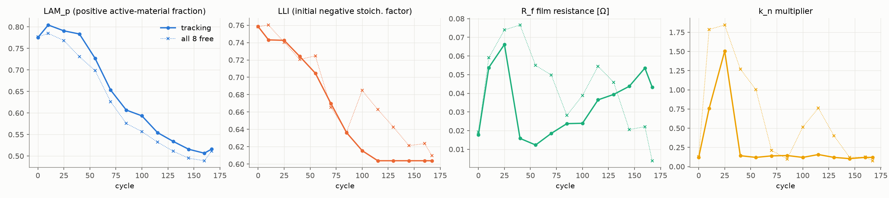

**Figure 13.** Identified degradation parameters over life for B0005: tracking mode (solid) and all 8 free (dotted).

How to read the aging results:
- **Both degradation modes progress.** Loss of positive active material (LAM_p 0.78 → 0.51) and loss of lithium inventory (LLI 0.76 → 0.61) both advance monotonically, and together they reproduce the 29 % capacity fade.
- **The frozen-parameter tracking deteriorates after about cycle 100.** In tracking mode LLI hits its lower bound, and the V RMSE grows to 54 mV. The 8-parameter free fit stays at 6–22 mV, partly by increasing R_n (4 → 13–15 µm) and lowering SOCp (0.99 → 0.92).
- **Interpretation.** Degradation of this cell also changes the *effective* solid-diffusion length and the electrode window, beyond pure LAM/LLI/film growth. A digital twin should not freeze R_n or SOCp over life. In the free 8-D fits these parameters are partly confounded with LLI/LAM, so their individual values carry larger uncertainty.
- **k_n and R_f are poorly identifiable on real data.** They jump between consecutive cycles (Fig. 13), consistent with the weak synthetic identifiability of k_n and with the k_n–R_f trade-off (both add overpotential).
- **Temperature residuals of 0.2–0.5 K are largely model-form error.** The measured temperature is a surface value, while the model state is a lumped average. The measured ΔT also has a "shoulder" at about 10 min that the lumped model only partly reproduces.

### 4.6 Real data — CALCE CS2_36 (voltage only) and Oxford drive cycle

Sources: `outputs/cs2_7_mmga.json`, `outputs/cs2_mmga.json`, `outputs/oxford_mmga.json`.

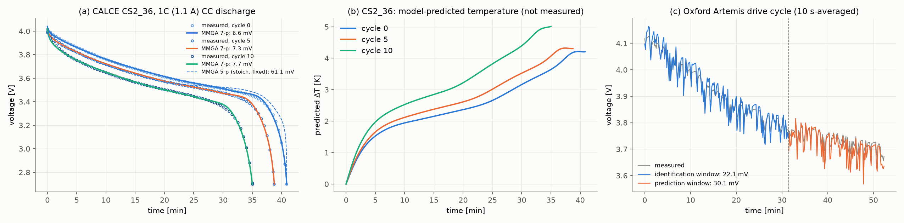

**Figure 14.** (a) CS2_36 1C discharges with the MMGA fits (7-D) and the fixed-stoichiometry 5-D fit; (b) model-predicted temperature rise of CS2_36 (no measurement exists); (c) Oxford drive cycle: identification window (first 60 %) and blind prediction window.

**CS2_36 (voltage only, 1.1 A = 1C).**
- 7-D MMGA fits cycles 0, 5 and 10 at **6.6, 7.3 and 7.7 mV RMSE**, with capacity errors of +0.06 %, +0.05 % and −0.08 %.
- With stoichiometry fixed (5-D) the same cycle-0 fit was 61 mV, with parameters on bounds. This confirms the NASA finding that the electrode window must be free.
- The identified states are LAM_p ≈ 0.65 → 0.57 and LLI ≈ 0.64–0.69. The cell is strongly lithium-limited, consistent with the low initial capacity of 68 % of nominal.
- Because no temperature was logged, **h cannot be identified for CS2.** It was fixed, and the predicted ΔT of 4.2–5.0 K at 1C (Fig. 14b) is a model prediction only.

**Oxford (dynamic load, 40 °C).**
- With 390 feasible simulations, the 6-D ANN reached 3.1 mV test RMSE.
- The MMGA fit gives **22.1 mV** on the identification window and **30.1 mV** on the blind prediction window (maximum 83 mV), compared with 10 s-window-averaged measured voltage. Against the instantaneous 1 s voltage the prediction RMSE is 44.4 mV.
- The model follows the dynamic voltage excursions qualitatively (Fig. 14c), but the identified R_n, R_p, k_n, R_f and LLI all sit at the lowest-resistance and lowest-LLI edges of the box.
- **Conclusion:** the Ai2020 LCO parameter set does not represent this Kokam pouch cell at 40 °C. Better generalisation would need its own base parameterisation, e.g. pseudo-OCV-derived OCPs. This is a model-structure limitation, not a meta-model limitation.

---

## 5. Discussion

**Does the meta-model solve the complexity–efficiency trade-off?**
- For the core four-parameter problem, yes. The ANN is accurate to roughly 1/4 of the measurement noise and ~10³–10⁴× faster than PyBaMM. The GA optimum on the ANN is also a physics optimum: the ANN and physics objectives agree, and the physics J reaches the noise floor.
- The physics-only GA at 1040 solves either matched MMGA or failed to converge, depending on the case. MMGA was robust across all cases, because its effective population (10⁵ evaluations) is unaffordable for the physics model.
- The offline database is embarrassingly parallel and is reused for every subsequent identification. This is what makes per-cycle digital-twin updates practical: 26 NASA identifications took 334 s (≈5.6 min) online.

**Physics verification and safeguards.**
- In our runs the top-10 verification seldom changed the ranking, because the ANN was very accurate. It still caught small optimism of the ANN (J_ann below J_phys by up to 24 % on NASA).
- In the higher-dimensional real-data problems, the infeasible region (initial OCV above the voltage limit) was a real hazard. The ANN extrapolates smoothly into it, which is why the feasibility classifier was added.
- Recommendation: always couple the surrogate with (i) a feasibility model and (ii) physics re-verification of several distinct candidates.

**Identifiability.**
- The ranking R_n ≳ h > R_p ≈ k_n (from synthetic CC data) has a clear physical explanation.
- h is visible almost only in temperature. The particle radii control solid-diffusion overpotentials and the end-of-discharge knee. k_n acts mainly through the small kinetic overpotential and the initial transient, which partly trades off against R_p and R_f.
- On real data k_n therefore remains the least reliable parameter. Its jumps from cycle to cycle should not be over-interpreted.
- Additional excitation would help: relaxation phases, pulses or several C-rates.

**Model-structure error dominates real-data residuals.**
- Freeing the electrode balancing (LLI, SOCp) reduced the NASA residual from 48 to 6 mV and the CS2 residual from 61 to 7 mV.
- In other words, the choice of *which* parameters are free mattered more than optimiser or surrogate quality.
- Remaining residuals: 6–22 mV over life on NASA, 30 mV on the dynamic Oxford data. These reflect the SPMe/LCO parameter-set approximation, the lumped-versus-surface temperature mismatch and, for Oxford, a different cell chemistry and format.

## 6. Limitations

- **Model fidelity.** SPMe with lumped thermal is used throughout; DFN was not used, to keep the database affordable. The synthetic benchmark shares the model structure with the meta-model; only the discretisation differs. Its errors are therefore a lower bound on what is achievable on real cells.
- **Aging representation.** Aging is represented by state parameters (LAM_p, LLI, R_f), not by a time-integrated SEI-growth law. Aging tracking is therefore a sequence of state identifications, not a prognostic aging model.
- **Real-data uncertainty.** Real-data parameter values have no ground truth. Several of them (k_n, R_f, and R_n versus LLI late in life) are weakly identifiable or confounded, and no Bayesian uncertainty quantification was performed.
- **Oxford.** The database had a 49 % feasibility rate and only 310 training samples, and the drive current was averaged over 10 s windows. These results are an exploratory generalisation test.
- **CS2_36.** Represented by an area-scaled Ai2020 cell at equal C-rate. The data contain no temperature, so h is not identified for CS2.
- **Compute.** The host was heavily shared (2 cores, load average ≈ 200), so absolute timings are pessimistic; the ratios are the meaningful quantity.

## 7. Conclusions

1. A PyBaMM-based ECAT model (SPMe + lumped thermal + aging states) was sampled by LHS: 3000 1C discharge simulations with V and T, 3000/3000 successful, 0.29 s each, numerically verified to <1 mV.
2. A 4-layer FC ANN trained with Adam reproduces the coupled response to 0.47 mV / 0.033 K / 0.01 % capacity (test MSE 1.7·10⁻⁴, standardised). This is ~10³× faster than physics; with only 20 training samples it fails (15 mV).
3. The GA on the ANN identifies R_n, R_p, k_n and h from noisy synthetic data with ≤4.7 % error, and the re-simulated curves match the truth to ≤0.6 mV and ≤0.12 K. It is ~45× faster than a physics-GA per identification, and more reliable.
4. Temperature measurements are necessary to identify the heat-transfer coefficient (18 % mean error without them). k_n and R_p are the most noise-sensitive parameters.
5. On experimental cells the framework achieves 5.9 mV / 0.19 K (fresh NASA cell), 6–22 mV over 168 aging cycles, 6.6–7.7 mV (CS2_36) and 30 mV blind prediction on a dynamic drive cycle. This requires the electrode stoichiometry window to be part of the identified set.

## Reproducibility

Run in this order. Python 3.12, PyBaMM 26.11, scikit-learn; seeds are fixed in every script.

1. `data_prep.py`
2. `convergence_check.py`
3. `step1_lhs.py` with `--n 20 --seed 1 --tag baseline20 --raw 1`, then `--n 3000 --seed 2 --tag core3000`
4. `step2_ann.py --db core3000 --tag core --small baseline20`
5. `step3_identify.py`
6. `step3b_ablation.py`
7. Real data, with `ECAT_BOUNDS=real`:
   - `step1_lhs.py` for `nasa8` and `cs2_7` (arguments are recorded in `outputs/db_*.json`);
   - `step2_ann.py`;
   - `step5_nasa.py`, `step5_cs2.py`.
8. The 6-D/5-D fixed-stoichiometry comparison used the earlier `nasa4000`/`cs2_3000` databases with the 6-/5-parameter versions of the step-5 scripts.
9. `step6_oxford.py db`, then `step6_oxford.py fit`
10. Figures: `figs_steps12.py`, `figs_step3.py`, `figs_ablation.py`, `figs_real.py`

Development and benchmarking snippets are in `code/dev_checks/`.
