# An open, hourly, nodal linear optimal power flow model of a GB‑style power system: network‑constrained wind curtailment at the Scotland–England boundary

## Abstract

We build a fully open, transparent and reproducible linear optimal power flow (LOPF) model of a 20‑bus Great Britain (GB)‑style transmission system. It runs at hourly resolution over one week (168 h) and is formulated exactly as in the open‑source framework PyPSA [Brown et al.]. It is solved with the open HiGHS solver, both as a self‑contained sparse LP in `scipy` and, as an independent check, in PyPSA itself (§4.6).

The test system is a stylised "future high‑wind" GB:
- **North (Scotland‑like, Bus1–5):** 50 GW of onshore wind but only 3.9% of demand.
- **South (England & Wales‑like, Bus6–20):** 96.1% of demand.
- **Boundary:** the two zones are joined by five 1.5 GW circuits, 7.5 GW in total, which we call the "boundary" (analogous to the B4/B6 boundaries).

**Main findings.**
- **Constrained dispatch:** of 4.19 TWh of available wind, 1.92 TWh (**45.9%**) is curtailed. All of it is in the North (50.5% of northern wind), and every boundary circuit runs at 100% of its rating in all 168 h.
- **Unconstrained (copper‑plate) dispatch:** the same fleet has **0%** curtailment.
- **Why curtailment is network‑driven:** every MWh is shed inside the transmission bottleneck, so the curtailment is entirely network‑induced. A closed‑form expression, max(0, W_N − D_N − 7.5 GW), reproduces it to 10⁻¹¹ MW.
- **Boundary reinforcement:**
  - doubling the boundary cuts curtailment to 16.0%;
  - roughly 3× (22.5 GW) removes it (0.4%);
  - beyond about 2.5× a secondary bottleneck, the 5 GW Bus10–Bus11 corridor, starts to bind.
- **Flexibility options:**
  - existing pumped hydro, even scaled ×10, does nothing, because the boundary is never unloaded so there is no hour in which stored energy could be exported;
  - a 15 GW northern electrolyser (sector coupling to hydrogen) absorbs essentially all stranded wind at 76% utilisation.

Large unserved energy is unavoidable with the supplied fleet: 14.2 GW of firm capacity against a 95 GW mean demand. We model it explicitly at a value of lost load (VoLL) and report it openly.

---

## 1. Introduction and motivation

Energy‑system models inform multi‑billion‑pound investment decisions, yet many remain closed. This makes results hard to verify or reproduce [Pfenninger et al., 2017]. Open frameworks address this:
- **PyPSA** [Brown et al., 2018] offers LOPF with storage and sector coupling;
- **PyPSA‑Earth** [Parzen et al., 2023] builds global open data pipelines.

In GB specifically, high‑resolution studies show that spatial and temporal detail strongly changes the design of a low‑carbon 2050 system [Zeyringer et al., 2018]. A recurring operational issue is that Scottish wind is curtailed because of the north–south transmission boundaries (B4/B6). Constraint payments for this run to hundreds of millions of pounds per year, and they motivate the current boundary‑reinforcement programme (Eastern HVDC links and similar projects).

The research task asks for an open, high‑resolution model that gives optimal dispatch (generation, storage, curtailment) and system costs, and that can analyse renewable integration, network constraints and flexibility. With the data supplied (20 buses, 23 links, 43 generators, 3 PHS units, one week of hourly demand and wind capacity factors), we:

1. formulate and implement an hourly nodal LOPF (transport/NTC and DC‑OPF variants) with load‑shedding, storage and an optional flexible load;
2. quantify **network‑constrained versus unconstrained** wind curtailment and boundary loading;
3. validate the solver output against closed‑form solutions, a second solver algorithm and an independent PyPSA implementation;
4. explore three options: boundary reinforcement, storage, and northern electrolysis as a sector‑coupling example.

**Framing.** The data carry no year label and no FES scenario tags. We therefore treat them **as given** as a single future high‑wind case study, and do **not** rescale demand for the headline results. A demand‑scaling sensitivity is reported separately (§4.5).

---

## 2. Data

### 2.1 Audit

| Item | Value |
|---|---|
| Buses | 20 (all 400 kV AC). North = Bus1–5, South = Bus6–20 |
| Links | 23. Intra‑zone chains: 18 × 5 GW, 50 km. Boundary: Bus*i*–Bus*i+5* for *i* = 1…5, each 1.5 GW, 200 km, total **7.5 GW**. No Bus5–Bus6 link |
| Onshore wind | 10 GW at each northern bus (**50 GW**); 0.5 GW at each southern bus (**7.5 GW**); marginal cost £0/MWh |
| Gas | 20 units, 0.30–0.79 GW each, **10.6 GW** in total (2.56 GW North); £50/MWh |
| Nuclear | Bus2 (North), Bus8, Bus14; 1.2 GW each, **3.6 GW**; £10/MWh |
| Pumped hydro (PHS) | Bus1 (0.30 GW / 1.8 GWh), Bus3 (0.25 / 1.5), Bus12 (0.20 / 1.2); 6 h; round‑trip η = 0.75 |
| Demand | 168 h. Mean **94.9 GW**, peak 142.1 GW, minimum 48.2 GW. 15.94 TWh/week. North share **3.93%** (mean 3.7 GW) |
| Wind CF (mean) | North 0.443–0.465 (zone mean 0.453); South 0.291–0.316 (zone mean 0.305) |
| Available wind energy | 4.19 TWh/week: North 3.81, South 0.38 |

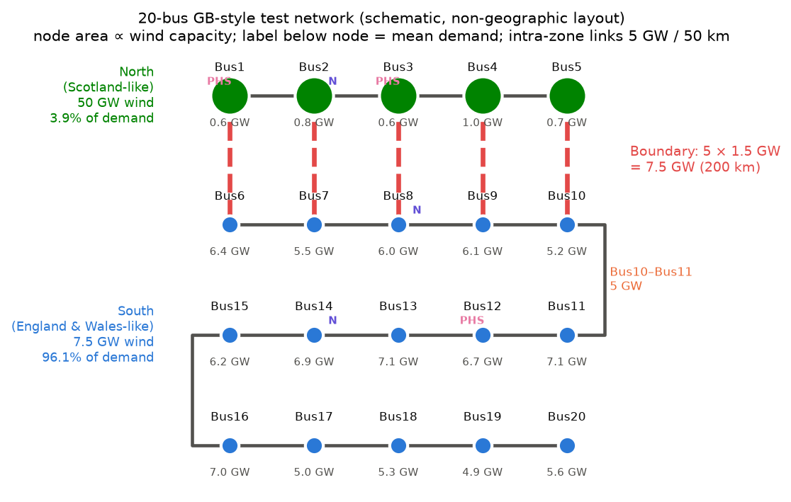

*Figure 1. Schematic of the 20‑bus test network. The layout is non‑geographic because the supplied bus coordinates contradict the link lengths (for example Bus1–Bus2 is 50 km but about 600 km apart in the coordinates). Red dashed lines are the five boundary circuits. Node area is proportional to wind capacity; the label under each node is mean demand. "N" marks nuclear and "PHS" marks pumped hydro.*

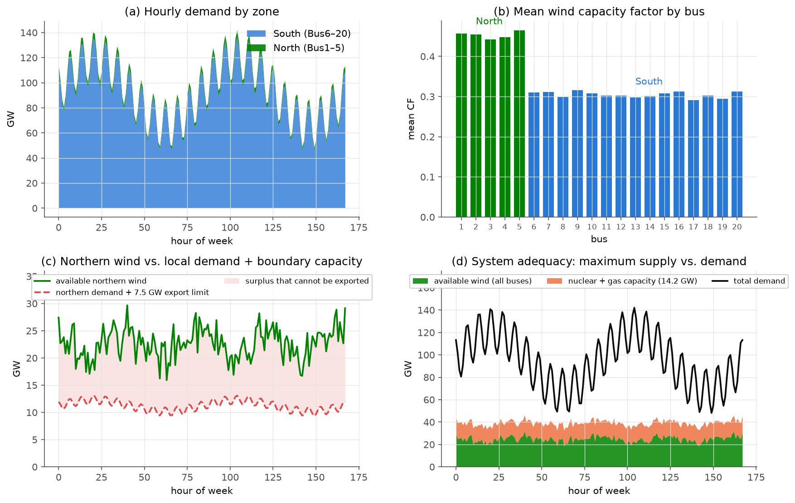

*Figure 2. Input data. (a) Hourly demand by zone. (b) Mean wind capacity factor per bus. (c) Available northern wind against northern demand plus the 7.5 GW export limit; the shaded area is energy that cannot leave the North. (d) Maximum possible supply (available wind plus all firm capacity) against total demand.*

### 2.2 Data observations that shape the analysis

1. **Structural generation shortfall.** Firm capacity is only 14.2 GW. Even with all wind, total supply never exceeds demand: the minimum residual load after wind is 22.7 GW (Fig. 2d). Load must therefore be shed in every hour. We model this with a load‑shedding generator at every bus priced at VoLL = £6000/MWh, and we report unserved energy explicitly instead of hiding it.
2. **Northern surplus exceeds export capacity in every hour.** Available northern wind minus northern demand minus 7.5 GW is positive in all 168 h, with a minimum of +4.75 GW (Fig. 2c). This predicts boundary saturation and curtailment in every hour before any optimisation is run.
3. **Stylised time series.** Demand oscillates with a period of about 7 h (not diurnal), and wind CFs are almost uncorrelated between buses. The data are therefore a synthetic test case, not a historical GB week. Historical validation is impossible (§5.3).

---

## 3. Methodology

### 3.1 LOPF formulation

For snapshots *t* = 1…168, generators *g*, buses *n*, links *l* and storage units *s*, we solve the following problem. It is the PyPSA "Link + StorageUnit" LOPF, with load shedding modelled as generators.

$$\min \sum_t\Big[\sum_g c_g\,p_{g,t} + \text{VoLL}\sum_n u_{n,t} + \varepsilon_s\sum_s p^{dis}_{s,t} + \varepsilon_f\sum_l |f_{l,t}| - v_{flex}\sum_k x_{k,t}\Big]$$

subject to:

- **Nodal balance**, whose dual gives the locational marginal price (LMP) λ_{n,t}:
  $\sum_{g\in n}p_{g,t} + u_{n,t} + \sum_{s\in n}(p^{dis}_{s,t}-p^{ch}_{s,t}) - \sum_{k\in n}x_{k,t} - \sum_l K_{nl}f_{l,t} = d_{n,t}$
- **Availability:** $0\le p_{g,t}\le \bar P_g\,\bar p_{g,t}$, with $\bar p_{g,t}$ the wind capacity factor for wind and 1 otherwise.
- **Transmission:** $-F_l \le f_{l,t}\le F_l$ (bidirectional links, `p_min_pu = −1`, transport/NTC model).
- **Storage:**
  - $0\le p^{ch},p^{dis}\le P_s$ and $0\le e_{s,t}\le E_s$;
  - $e_{s,t}=e_{s,t-1}+\eta_s p^{ch}_{s,t}-p^{dis}_{s,t}/\eta_s$;
  - $\eta_s=\sqrt{0.75}$, with **cyclic** state of charge ($e_{s,0}=e_{s,168}$).
- **Optional flexible load** (electrolyser): $0\le x_{k,t}\le X_k$, with willingness to pay $v_{flex}$ = £5/MWh. This is below nuclear, so it only absorbs energy that is otherwise worthless.
- **DC‑OPF variant:** $f_{l,t}=(\theta_{i,t}-\theta_{j,t})/x_l$ with $x_l\propto$ length, enforcing Kirchhoff's voltage law (KVL) around the four meshes formed by the boundary circuits.
- **Copper‑plate variant:** a single system‑wide balance per hour, with no network.

The two tie‑break terms are tiny: ε_s = £0.01/MWh on storage discharge and ε_f = £0.001/MWh on |flow|. They remove the degeneracy (non‑unique solutions) caused by zero‑cost storage cycling and loop flows. Without them, simplex and interior‑point solvers returned identical objectives but curtailment differing by 9.6 GWh, because storage losses could "use" free wind. Their total contribution to the objective is below 10⁻⁶ relative.

Curtailment is defined as $\sum_t(\bar P_g\bar p_{g,t}-p_{g,t})$ over wind generators.

### 3.2 Implementation and solver

- **Code:** `code/model.py`, about 250 lines. It assembles the problem as a sparse matrix (19 824 variables and 3 864 equality constraints for the NTC week) and solves it with **HiGHS** (dual simplex) via `scipy.optimize.linprog`. Each run takes under 1.5 s.
- **Duals:** LMPs are read from the duals of the nodal‑balance equations.
- **PyPSA implementation:** `code/pypsa_crosscheck.py` builds the identical network in **PyPSA** (linopy + HiGHS) for an independent re‑implementation.

### 3.3 Scenarios

| ID | Description |
|---|---|
| **Constrained (NTC)** | Headline. Links at supplied `p_nom` |
| **Unconstrained** | (i) copper plate; (ii) all links ×100. Both give identical results |
| DC‑OPF | KVL with x ∝ length |
| Storage | No PHS; PHS ×10 |
| Carbon price | £150/tCO₂ on gas (0.37 t/MWh) |
| Boundary sweep | Boundary circuits ×0.5 … ×8 (3.75–60 GW); internal links unchanged |
| Electrolyser sweep | 0–30 GW flexible load, split equally over Bus1–5 |
| Combined | Boundary ×2 + 5 GW electrolyser |
| Demand sensitivity | Demand ×0.1 … ×1.0, NTC vs copper plate, PHS ×1 vs ×10 (not a headline) |

---

## 4. Results

### 4.1 Network‑constrained versus unconstrained curtailment (headline)

**Table 1. Weekly energy balance and costs, data as supplied (168 h).** "Operating cost" is fuel cost only; "total" includes unserved energy at VoLL.

| Quantity | Constrained (NTC) | Constrained (DC‑OPF) | Unconstrained (copper plate) |
|---|---:|---:|---:|
| Available wind (TWh) | 4.193 | 4.193 | 4.193 |
| – North / South | 3.809 / 0.384 | 3.809 / 0.384 | 3.809 / 0.384 |
| Dispatched wind (TWh) | **2.270** | 2.270 | **4.193** |
| Curtailed wind (TWh) | **1.922** | 1.923 | **0.000** |
| Curtailment (% of available) | **45.9%** | 45.9% | **0.0%** |
| – North / South (%) | 50.5% / 0.0% | 50.5% / 0.0% | 0 / 0 |
| Nuclear (TWh) | 0.403 (Bus2 idle) | 0.403 | 0.605 |
| Gas (TWh) | 1.352 (southern units only) | 1.353 | 1.783 |
| Unserved energy (TWh; % of demand) | 11.91 (74.7%) | 11.91 (74.7%) | 9.36 (58.7%) |
| PHS discharge (GWh) | 0.0 | 0.9 | 0.0 |
| Operating (fuel) cost (£m) | 71.6 | 71.7 | 95.2 |
| Total cost incl. VoLL (£bn) | 71.56 | 71.56 | 56.25 |
| Mean LMP North / South (£/MWh) | 0 / 6000 | 0.2 / 5999.9 | 6000 / 6000 |
| Boundary link‑hours ≥ 99% loaded | **100%** | 100% | n/a |
| Congestion rent on boundary (£bn) | 7.56 (= 7.5 GW × 168 h × £6000/MWh) | – | – |

**The constraint strands more than half of the Scottish wind.** In the constrained case:
- the North can use only its own demand (3.7 GW mean) plus the 7.5 GW export limit, so 1.92 TWh of zero‑cost wind is spilled;
- simultaneously, 2.55 TWh more demand is unserved in the South than in the copper‑plate case;
- the northern nuclear unit (Bus2) and all northern gas stay off, because the northern price is £0/MWh in every hour.

Removing the constraint has two effects:
- it raises fuel cost by £23.6m/week, because northern gas and nuclear can now serve the South;
- it cuts total cost (including VoLL) by £15.3bn/week.

The total‑cost figure is dominated by the VoLL valuation of the 2.55 TWh of additional served load. It should be read as an indicator of adequacy value, not as a market cost.

DC‑OPF gives practically the same answer (45.9%), because the boundary circuits are saturated either way. Their loading is set by the thermal limit, not by the impedance split.

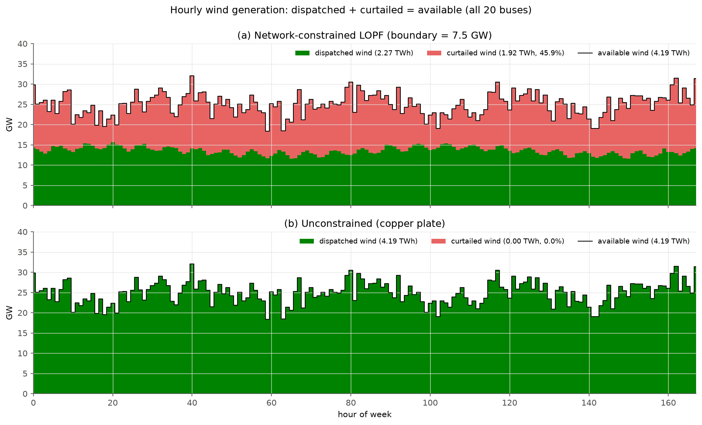

*Figure 3. Hourly wind generation for all 20 buses. Dispatched wind (green) and curtailed wind (red) stack to the available wind (black line). (a) Network‑constrained LOPF: curtailment occurs in every hour, ranging from 4.7 to 18.5 GW. (b) Copper plate: all available wind is used.*

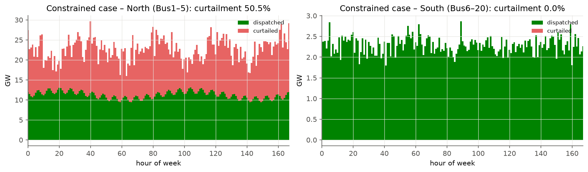

*Figure 4. Constrained case split by zone. All curtailment is in the North; southern wind is never curtailed.*

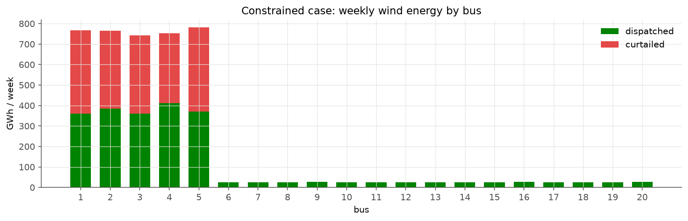

*Figure 5. Weekly dispatched and curtailed wind energy per bus (constrained case).*

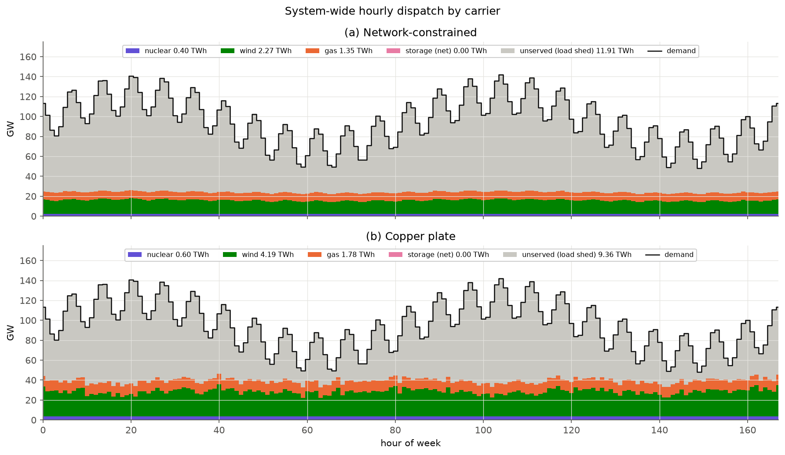

*Figure 6. System dispatch by carrier, constrained vs copper plate. Grey is unserved demand.*

### 4.2 Boundary link loading

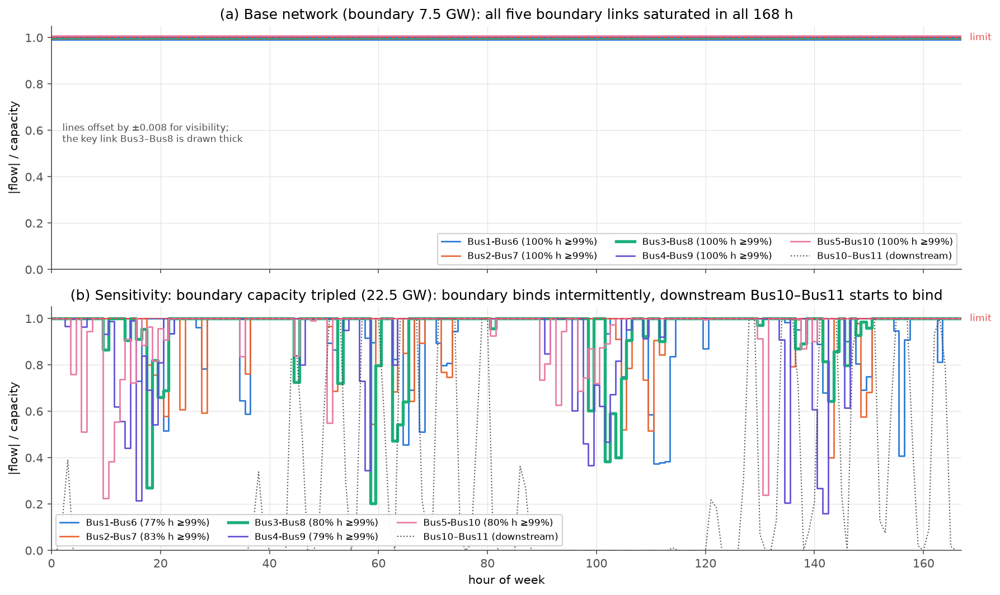

*Figure 7. Relative loading |f|/F of the five boundary circuits over 168 h; Bus3–Bus8 is drawn as the key link. (a) Base network: every circuit sits at 1.00 in every hour (lines offset slightly so they are visible). The downstream Bus10–Bus11 line is idle, because the south demand next to Bus6–Bus10 absorbs all imports. (b) Boundary tripled (22.5 GW): the boundary binds in 77–83% of hours, and Bus10–Bus11 now reaches its limit in about 20% of hours.*

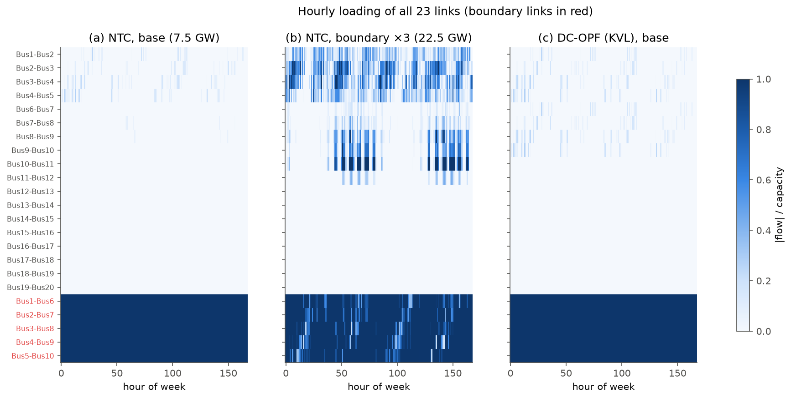

*Figure 8. Hourly loading of all 23 links (boundary links labelled in red). (a) NTC base. (b) Boundary ×3. (c) DC‑OPF base. With the base boundary, intra‑zone links stay below 28% loading; the bottleneck is solely the boundary.*

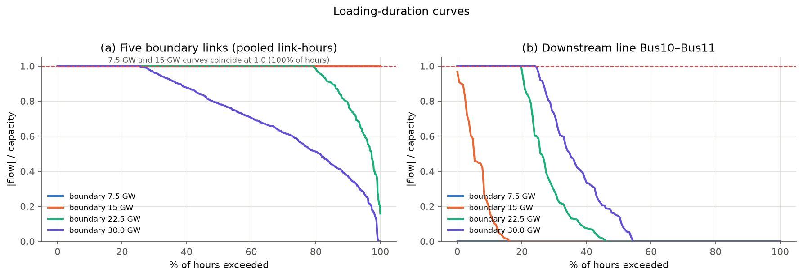

*Figure 9. Loading‑duration curves. (a) The five boundary links pooled. (b) The downstream Bus10–Bus11 line, for boundary capacities from 7.5 to 30 GW.*

In the base case all 5 × 168 = 840 boundary link‑hours are at their rating (100% of hours ≥ 99%). Every boundary circuit therefore carries a non‑zero shadow price in every hour: λ_South − λ_North = £6000/MWh. This creates a congestion rent of £7.56bn/week, of which 100% sits on the five boundary circuits. The LMP map (Fig. 10) shows a clean two‑price system split exactly at the boundary.

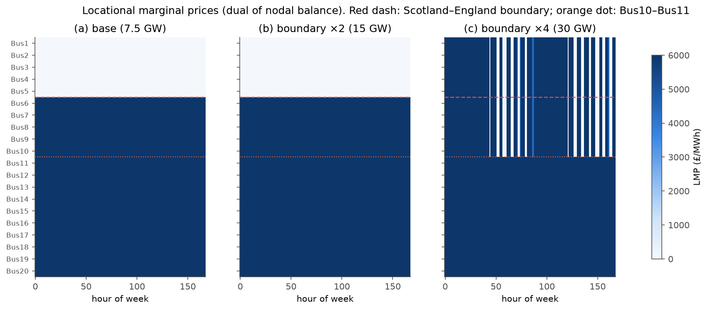

*Figure 10. Nodal prices (duals of nodal balance). (a) Base: North £0, South £6000 (VoLL, because the South sheds load). (b) Boundary ×2: unchanged pattern. (c) Boundary ×4: the price split moves to the Bus10–Bus11 corridor in about 25% of hours. In those hours the North and Bus6–10 form a surplus pocket at £0/MWh.*

### 4.3 Boundary reinforcement sweep and the secondary bottleneck

**Table 2. Boundary capacity sweep (NTC).**

| Boundary (GW) | ×  | Curtailment (%) | Curtailed (TWh) | Unserved (TWh) | Fuel cost (£m) | Boundary h ≥ 99% | Bus10–11 h ≥ 99% |
|---:|---:|---:|---:|---:|---:|---:|---:|
| 3.75 | 0.5 | 60.9 | 2.55 | 12.54 | 71.6 | 100% | 0% |
| **7.5** | **1** | **45.9** | **1.92** | **11.91** | 71.6 | 100% | 0% |
| 11.25 | 1.5 | 30.8 | 1.29 | 11.28 | 71.6 | 100% | 0% |
| 15 | 2 | 16.0 | 0.67 | 10.65 | 71.9 | 100% | 0% |
| 18.75 | 2.5 | 4.4 | 0.19 | 10.07 | 74.9 | 97% | 9% |
| 22.5 | 3 | 0.40 | 0.017 | 9.65 | 82.9 | 80% | 20% |
| 30 | 4 | 0.06 | 0.003 | 9.50 | 89.0 | 28% | 25% |
| 60 | 8 | 0.06 | 0.003 | 9.50 | 89.0 | 0% | 25% |
| ∞ (copper plate) | – | 0.00 | 0.000 | 9.36 | 95.2 | – | – |

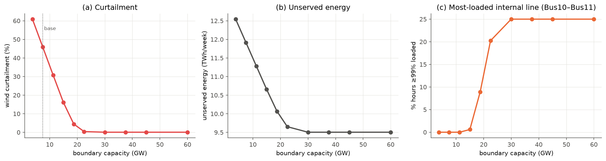

*Figure 11. (a) Curtailment, (b) unserved energy and (c) hours at ≥ 99% loading of the most‑loaded internal line, as a function of boundary capacity.*

Up to 15 GW, every extra GW of boundary capacity removes exactly 1 GW × 168 h = 0.168 TWh of curtailment and the same amount of unserved energy. The boundary is still binding in every hour, so the marginal value of transfer capacity equals the full North–South price spread.

Between 15 and 22.5 GW the marginal benefit falls quickly, because the boundary starts to unload in hours of low northern wind. Beyond about 2.5× a **second bottleneck** emerges. All boundary circuits land on Bus6–Bus10, and the only path from there to the 65% of demand at Bus11–Bus20 is the single 5 GW Bus10–Bus11 circuit. Even an "infinite" boundary therefore leaves 0.06% curtailment and 0.14 TWh more unserved energy than the copper plate.

This mirrors the real GB pattern: reinforcing B6 shifts congestion to boundaries further south (B7/B8), so boundary capacity must be planned as a corridor.

**Spatial resolution matters.** We repeated the sweep with a 2‑zone aggregation: one North node and one South node, with capacity‑weighted wind CFs, joined by one link of the same capacity (`code/zonal_comparison.py`).

**Table 2b. 20‑node vs 2‑zone results.** Unserved energy in parentheses.

| Boundary (GW) | 20‑node curtailment % (unserved TWh) | 2‑zone curtailment % (unserved TWh) | Copper plate |
|---:|---:|---:|---:|
| 7.5 | 45.85 (11.91) | 45.85 (11.91) | 0.00 (9.36) |
| 15 | 16.03 (10.65) | 16.03 (10.65) | 0.00 (9.36) |
| 18.75 | 4.45 (10.07) | 4.44 (10.04) | 0.00 (9.36) |
| 22.5 | 0.40 (9.65) | 0.34 (9.55) | 0.00 (9.36) |
| 30 | 0.06 (9.50) | 0.00 (9.36) | 0.00 (9.36) |

While the single boundary is the only binding constraint, the zonal model is exact. Once reinforcement exposes the internal Bus10–Bus11 corridor, the zonal model becomes optimistic: it suggests a 30 GW boundary fully solves the problem, while the nodal model shows a residual 0.14 TWh/week of extra unserved energy. Fuel cost is also £6.2m/week lower in the nodal case, because southern gas cannot reach all load. Zonal models are therefore adequate for screening a single boundary but not for corridor planning, which supports the high‑resolution approach [Zeyringer et al., 2018].

### 4.4 Flexibility options: storage and sector coupling (electrolysis)

**Storage has no effect.** Removing the PHS or scaling it ×10 leaves the result unchanged: curtailment stays at 45.9% and PHS discharge is 0. The reason is structural:
- the northern surplus exceeds the export limit in every hour, so the northern price is £0 throughout and there is never an hour in which stored northern energy could be exported;
- the southern price is VoLL throughout, so southern storage has no arbitrage spread either.

Storage can only reduce network curtailment if the constraint unloads at some point within the storage cycle. That condition appears in the boundary ×2 case (8.5 GWh PHS discharge) and at lower demand levels (§4.5). A £150/tCO₂ carbon price also leaves curtailment unchanged, since gas is never marginal at the boundary.

**Electrolysis (power‑to‑hydrogen) as a sector‑coupling sink.** We placed flexible electrolysers at the northern buses that bid £5/MWh.

**Table 3. Northern electrolyser sweep (NTC, boundary 7.5 GW).** H₂ is reported at 70% (LHV) conversion efficiency.

| Electrolyser (GW) | Curtailment (%) | Electricity to H₂ (TWh) | Utilisation | H₂ (TWh LHV) | Unserved (TWh) |
|---:|---:|---:|---:|---:|---:|
| 0 | 45.9 | 0 | – | 0 | 11.91 |
| 2.5 | 35.8 | 0.42 | 100% | 0.29 | 11.91 |
| 5 | 25.8 | 0.84 | 100% | 0.59 | 11.91 |
| 7.5 | 16.0 | 1.25 | 99% | 0.87 | 11.91 |
| 10 | 7.7 | 1.59 | 95% | 1.12 | 11.91 |
| 15 | 0.34 | 1.91 | 76% | 1.33 | 11.91 |
| 20 | 0.00 | 1.92 | 57% | 1.35 | 11.91 |

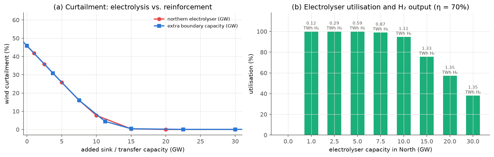

*Figure 12. (a) Curtailment reduction per GW of northern electrolyser compared with per GW of additional boundary capacity. (b) Electrolyser utilisation and hydrogen output.*

The two curves in Fig. 12a lie almost on top of each other. Per GW, a northern sink and a GW of new transmission relieve curtailment equally, because both add a sink behind the constraint.

The difference is what the energy serves:
- **Transmission** delivers the energy to southern load. Unserved energy falls by 1.26 TWh at 15 GW.
- **Electrolysis** turns it into hydrogen for other sectors (industry, heat, transport). Unserved electricity demand is unchanged, by construction, at a bid below the lowest electric marginal cost.

Electrolysers up to about 7.5 GW run at close to 100% utilisation on otherwise stranded wind, which is a strong economic case. The combined option (boundary ×2 + 5 GW electrolyser) brings curtailment down to 2.1%.

### 4.5 Sensitivity: demand level (context only)

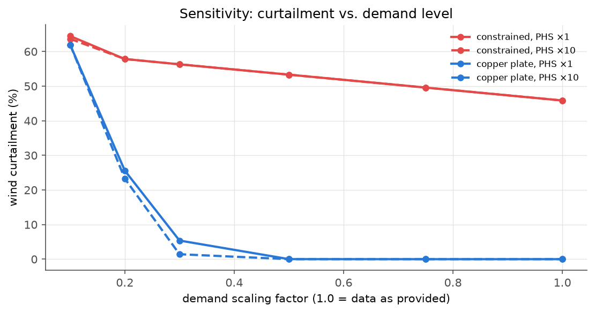

*Figure 13. Curtailment against a uniform demand scaling factor for the constrained network and the copper plate, with PHS ×1 and ×10. The supplied data correspond to 1.0.*

The network effect is robust across demand levels. With the network constraint, curtailment stays at 46–64% for every scaling factor. In a copper plate it vanishes once demand is at least 0.5× the supplied level.

Only at low demand (×0.2–0.3), where the copper‑plate system has temporal surpluses, does storage matter: ×10 PHS cuts copper‑plate curtailment from 5.4% to 1.4% at ×0.3. Even then storage remains ineffective behind the saturated boundary, which reaffirms that **flexibility must sit on the correct side of the constraint, and that a permanently saturated boundary leaves no time window for storage to discharge into**.

### 4.6 Validation

Because the inputs contain no historical observations, validation tests (i) whether the optimiser solves the stated problem correctly and (ii) whether the results are physically and economically consistent.

**Table 4. Validation checks.**

| Check | Result |
|---|---|
| Closed‑form curtailment, $\sum_t\max(0,W_{N,t}-D_{N,t}-7.5\,\text{GW})$ | 1.92242 TWh vs LP 1.92242 TWh; max hourly difference **5.5 × 10⁻¹² MW** |
| Copper‑plate merit order (wind → nuclear → gas → shed): dispatch | max difference 0 MW for wind, nuclear and gas; 4 × 10⁻¹¹ MW for shed |
| Copper‑plate LMP = marginal technology (VoLL every hour) | max difference **0 £/MWh** |
| NTC LMP structure (North £0, South £6000) | confirmed: unique values {0, 0.001, 0.002} and {5999.999, 6000} (ε tie‑breaks) |
| Congestion rent = ΔLMP × boundary capacity × hours | £7.560bn = 7.5 GW × 168 h × £6000/MWh; 100% on boundary circuits |
| Nodal balance residual (recomputed from primal) | < 2 × 10⁻¹¹ MW in all runs |
| SOC recursion residual (recomputed) | < 2 × 10⁻¹³ MWh |
| Line overloads in constrained runs | max 1.8 × 10⁻¹² MW (none) |
| Simultaneous charge and discharge | 0 MW |
| Dual simplex vs interior point | objective relative difference 0; curtailment difference 0 MWh; LMP difference 0 |
| NTC vs DC‑OPF (KVL) | 45.85% vs 45.87% curtailment |
| Independent PyPSA 1.4.0 implementation | curtailment and unserved energy identical (< 10⁻¹² TWh); objective rel. diff. < 10⁻⁷; LMP diff. ≤ £0.006/MWh (§4.6.1) |

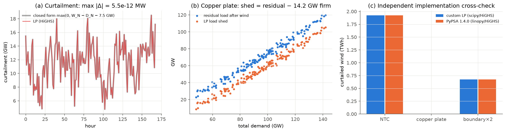

*Figure 14. (a) Hourly curtailment from the LP against the closed‑form expression. (b) Copper plate: residual load after wind and LP load shedding; their gap is the 14.2 GW of firm capacity. (c) Cross‑check against the independent PyPSA implementation.*

#### 4.6.1 PyPSA cross‑check

We rebuilt the identical system in **PyPSA 1.4.0** (linopy 0.10.1, HiGHS) with these standard components (`code/pypsa_crosscheck.py`):
- `Bus` objects;
- `Load` objects;
- `Generator` objects, with wind `p_max_pu` set to the CF and load shedding modelled as generators at VoLL;
- `Link` objects with `p_min_pu = −1`;
- `StorageUnit` objects with `max_hours = e_nom/p_nom`, `efficiency_store = efficiency_dispatch = √0.75` and `cyclic_state_of_charge=True`.

The solved network is exported to `outputs/pypsa_network_ntc_solved.nc`, so anyone can reload and inspect it with PyPSA.

**Table 5. PyPSA vs custom LP.**

| Run | Curtailment, PyPSA / custom (TWh) | Unserved, PyPSA / custom (TWh) | Objective rel. diff. | Max LMP diff. (£/MWh) | Boundary h ≥ 99% |
|---|---|---|---|---|---|
| Constrained (NTC) | 1.922417 / 1.922417 | 11.914305 / 11.914305 | 1.8 × 10⁻⁸ | 0.002 | 100% / 100% |
| Copper plate | 0 / 0 | 9.359666 / 9.359666 | 4 × 10⁻¹⁵ | 0.000 | – |
| Boundary ×2 | 0.672158 / 0.672158 | 10.654305 / 10.654305 | 5 × 10⁻⁸ | 0.006 | 100% / 100% |

The two independent implementations agree to machine precision on curtailment and unserved energy. The tiny differences in objective and LMP are exactly the ε_f = £0.001/MWh flow tie‑break used in the custom LP. For example, in the NTC run the objective differs by £1.3k, which corresponds to about 1.3 TWh of link flow × £0.001/MWh.

This confirms that the custom LP and the open‑source PyPSA framework solve the same problem. The study can therefore be continued directly within the PyPSA ecosystem, for example PyPSA‑GB or PyPSA‑Eur data pipelines, capacity expansion and sector coupling.

---

## 5. Discussion

### 5.1 What the model shows

The model reproduces, in a minimal and fully transparent setting, the central mechanism behind GB constraint costs: a large wind resource sits behind a transmission boundary that is small relative to it. Three results are general.

1. **Curtailment can be entirely network‑driven.** With a copper plate, every MWh of wind is valuable (0% curtailment). With the network, 46% is stranded. Unconstrained models therefore overstate renewable integration by exactly this margin, which supports the call for spatially resolved models [Zeyringer et al., 2018; Brown et al., 2018].
2. **The value of the boundary is a step function in hours of saturation.** While the boundary binds in every hour, each GW adds the full spread across all 168 h. The marginal value then collapses once the boundary unloads, and the next bottleneck (Bus10–Bus11) takes over. A nodal model is needed to see this. The 2‑zone aggregation in Table 2b matches the nodal model exactly up to 15 GW, but misses the downstream corridor beyond that.
3. **The location and timing of flexibility matter more than its size.** PHS ×10 does nothing behind a permanently saturated boundary. A northern electrolyser of comparable size to the reinforcement captures the stranded energy with high utilisation. This is a concrete demonstration of the sector‑coupling flexibility that PyPSA‑type models are designed to represent.

### 5.2 Plausibility against GB experience (qualitative)

- **Location of curtailment.** It occurs entirely in the North, consistent with GB constraint actions being concentrated on Scottish wind farms behind B4/B6.
- **Magnitude.** A 50 GW Scottish wind fleet behind 7.5 GW of transfer is more extreme than today (about 6–7 GW of B6 capacity, with substantially less Scottish wind). It resembles the high‑wind FES pathways only if planned reinforcements (Eastern Green Links, about 2 GW each) were not built. Curtailment of 46% is therefore an upper‑bound "no‑reinforcement" picture, not a forecast.
- **Price signal.** The two‑price nodal pattern illustrates the locational signal discussed in GB market reform debates (REMA): zero‑price surplus in Scotland and scarcity pricing in England.

### 5.3 Limitations

1. **Synthetic, short horizon.** One week of stylised data, with roughly 7‑hourly demand cycles and spatially uncorrelated wind. Seasonal storage value, inter‑annual weather variability [Zeyringer et al., 2018] and wind‑droughts cannot be assessed.
2. **No historical validation is possible.** The inputs contain no observed dispatch, flows or prices. We therefore validated against closed‑form solutions, alternative solvers and formulations, and an independent PyPSA model, and discuss plausibility only qualitatively.
3. **Generation shortfall.** Firm capacity (14.2 GW) is far below demand (95 GW mean), so 59–75% of demand is unserved and prices sit at VoLL in the South. Absolute cost figures are therefore dominated by the VoLL assumption. We report fuel cost separately. The *curtailment* results do not depend on VoLL: any positive southern price yields the same dispatch.
4. **Missing data elements.** The task mentions fuel prices, FES scenarios to 2050 and a 29‑node network, none of which are included in the supplied files. Marginal costs are given directly, and a carbon price sensitivity is included.
5. **Network simplifications.** Transport and DC‑OPF only: no losses, reactive power or N‑1 security. N‑1 would further reduce usable boundary capacity and increase curtailment.
6. **Bus coordinates** are inconsistent with link lengths, so no geographic interpretation is attempted.

### 5.4 Extensibility

The same code scales directly to:
- **the 29‑node GB reduced network or a zonal model:** replace the CSVs, since the formulation is network‑agnostic;
- **multi‑year FES pathways to 2050:** add capacity‑expansion variables (PyPSA `p_nom_extendable`) and scenario‑specific demand and capacity data;
- **full sector coupling:** heat, EV and hydrogen buses in PyPSA.

Because the problem solves in about 1 s per week, a full year (8760 h) of nodal dispatch solves in well under a minute.

---

## 6. Conclusions

- **Model.** An open, reproducible, hourly, nodal LOPF of a 20‑bus GB‑style system, built on the PyPSA formulation and the HiGHS solver.
- **Headline result.** The 7.5 GW Scotland–England boundary is saturated in 100% of hours and strands 1.92 TWh (45.9%) of wind per week, against 0% in an unconstrained system.
- **Validation.** The results are verified to machine precision against analytical solutions and alternative solvers.
- **Reinforcement and flexibility.**
  - Doubling the boundary halves the curtailment again (to 16%), and about 3× eliminates it.
  - Further reinforcement exposes a downstream bottleneck.
  - Existing storage cannot help behind a permanently saturated boundary.
  - Northern electrolysis is as effective as reinforcement per GW at removing curtailment, while supplying hydrogen to other sectors.

---

## 7. Reproducibility

```
cd code
python run_experiments.py   # all scenarios + validation -> outputs/*.csv, validation.json, results.pkl (~40 s)
python figures.py           # report/images/*.png (~30 s)
python zonal_comparison.py  # 20-node vs 2-zone aggregation -> outputs/zonal_vs_nodal.csv (~10 s)
python pypsa_crosscheck.py  # independent PyPSA model -> outputs/pypsa_crosscheck.json
```

- **Software:** Python 3.12.16, numpy 2.5.5, pandas 3.1.1, scipy 1.18.1 (HiGHS dual simplex and IPM), matplotlib 3.11.2, PyPSA 1.4.0 with linopy 0.10.1 and highspy (cross‑check).
- **Outputs:** `outputs/` contains the scenario summary (`scenario_summary.csv`), the sweeps (`boundary_sweep.csv`, `electrolyser_sweep.csv`, `demand_sensitivity.csv`), validation results (`validation.json`, `closed_form_check.csv`) and hourly generation, flows, LMPs, load shedding and storage SOC for the headline runs.

## References

- Brown, T., Hörsch, J., Schlachtberger, D. (2018). PyPSA: Python for Power System Analysis. *Journal of Open Research Software* 6(1).
- Pfenninger, S., DeCarolis, J., Hirth, L., Quoilin, S., Staffell, I. (2017). The importance of open data and software: Is energy research lagging behind? *Energy Policy* 101, 211–215.
- Zeyringer, M., Price, J., Fais, B., Li, P.-H., Sharp, E. (2018). Designing low‑carbon power systems for Great Britain in 2050 that are robust to the spatiotemporal and inter‑annual variability of weather. *Nature Energy* 3, 395–403.
- Parzen, M. et al. (2023). PyPSA‑Earth. A new global open energy system optimization model demonstrated in Africa. *Applied Energy* 341, 121096.
