# African green hydrogen for Europe in 2030: a transparent geospatial levelised-cost model of the ammonia export chain under financing and interest-rate scenarios

*All numbers in this report are generated by `code/analysis.py` and stored in `outputs/key_numbers.json`. Costs are in constant € (≈2023). Unless stated otherwise:*

- *The base case uses a moderate base rate of 2.15 % (Schmidt et al. 2019).*
- *Statistics refer to the **23 onshore hexagons**.*

---

## Abstract

We build an open, fully parameterised model of the cost of green hydrogen (H₂) produced at 30 candidate sites in south-western Africa and delivered to Rotterdam in 2030. The sites are hexagons from the supplied `hex_final_NA_min` dataset, treated as Namibian export sites. The model chain is:

- synthetic hourly solar and wind profiles;
- a full-year (3-hourly) linear programme that sizes PV, wind, electrolyser, battery and H₂ storage at each site;
- explicit costs for every infrastructure distance in the dataset: road, grid, freshwater/seawater supply and the route to the port;
- Haber–Bosch ammonia synthesis, export and import terminals, ammonia shipping and cracking back to H₂.

Financing is modelled bottom-up. The weighted average cost of capital (WACC) is built per asset class from a base rate, debt margins, equity premia, a country default spread and a country risk premium (CRP). This structure follows Schmidt et al. (2019) and Steffen (2020). We evaluate four African finance scenarios (*Commercial*, *Offtake*, *Blended guarantees*, *Full de-risking*) under three base-rate environments (0.49 / 2.15 / 4.29 %). Results are compared with:

- green H₂ produced in Europe (northern Germany with salt-cavern storage; Spain plus a 2,000 km pipeline), financed under the same rate environment;
- grey and blue fossil H₂ as a function of the CO₂ price.

**Findings.**

1. **On-site production costs vary only modestly between sites.** Flexible LCOH under commercial finance is 3.16–3.76 €/kg: a max/min spread of 19 % and a coefficient of variation (CV) of 4.6 %. Costs are set by the solar and wind resource. There is no detectable spatial clustering (Moran's I = −0.05, p = 0.92).
2. **Financing dominates everything else.** Under commercial terms the cost of capital makes up 52 % of the delivered cost, against 34 % in Germany. Moving from commercial finance to full de-risking cuts the delivered cost of the median site from 7.28 to 4.74 €/kg (−35 %). That step is larger than any technology or resource sensitivity.
3. **The ammonia chain costs more than Africa's production advantage.** Converting to ammonia, shipping it and cracking it back adds 2.15–3.24 €/kg, including about 21 % mass losses. Even with full de-risking, delivered African H₂ (best site 4.31 €/kg, median 4.74) stays above German green H₂ (4.02 €/kg commercial; 3.86 €/kg offtake-backed). No site is competitive in any of the 12 scenarios. The exception is when Germany has no access to salt caverns: German H₂ then costs 5.02 €/kg and all 23 de-risked sites undercut it.
4. **Delivered as ammonia rather than H₂, the picture reverses.** Without cracking, de-risked African green NH₃ costs 655 €/t (blended guarantees: 746 €/t), against 838 €/t for green NH₃ made in Germany. With blended or full de-risking, every site beats German green ammonia.
5. **Fossil H₂ sets a high bar.** Against grey SMR hydrogen (2.05 €/kg at gas 35 €/MWh), on-site African H₂ breaks even at a CO₂ price of 32 €/t (de-risked) to 170 €/t (commercial). H₂ delivered to Europe needs ≥ 251 €/t.
6. **Higher base rates hurt Africa more in absolute terms, less in relative terms.** Going from the 0.49 % to the 4.29 % environment raises Africa's delivered cost by +1.28 €/kg under commercial finance, versus +0.87 €/kg in Germany, so the absolute gap widens. In relative terms the increase is +19 % in Africa versus +24 % in Germany.
7. **Infrastructure terms are second-order but systematic.** Road, water and the inland leg together add a median 0.59 €/kg (8 % of delivered cost). Distance to the port is the main spatial driver of delivered cost (standardised β = 0.69). A grid connection lowers cost at every site (median −0.12 €/kg), and the saving shrinks with distance to the grid. Shipping distance matters little: about 0.05–0.08 €/kg per 1,000 nautical miles (nmi).

---

## 1. Introduction and research questions

Several European import strategies (e.g. H2Global, the EU Hydrogen Bank, the German import strategy) expect large volumes of green hydrogen or its derivatives from Africa. Two facts underpin that expectation:

- Southern Africa's solar and wind resources are excellent.
- Namibia has announced multi-GW projects around Lüderitz and Walvis Bay.

Two facts cut against it:

- Capital costs in African countries are far higher than in Europe (Steffen 2020).
- Green hydrogen is very capital-intensive, so its cost is highly sensitive to financing. Rising interest rates worsen this (Schmidt et al. 2019).

Published cost maps are often opaque (Halloran et al. 2024). They usually assume one uniform discount rate and stop at the production site or the export port.

We address five questions:

1. **Production heterogeneity.** How much does on-site LCOH vary across the candidate sites, and which sites or regions have an advantage, and why?
2. **Fossil competitiveness.** At what CO₂ price does African green H₂ (on-site, or delivered to Europe) beat grey or blue fossil H₂?
3. **Competitiveness with European green H₂.** How does delivered African H₂ (via NH₃ and cracking) compare with green H₂ produced in Germany or Spain, and under which financing conditions does Africa win?
4. **De-risking and interest rates.** How much do offtake contracts, guarantees and full public de-risking change delivered cost? How does the base-rate environment shift competitiveness?
5. **Infrastructure and distance.** How much do grid, road, water, inland transport and shipping distance matter?

---

## 2. Data and framing

### 2.1 Input data

`hex_final_NA_min.csv` contains 30 simulated hexagons. Each has latitude, longitude, unitless potential indices `theo_pv` (0.58–0.85) and `theo_wind` (0.29–0.74), and four distances: to the grid (median 122 km), road (67 km), ocean (202 km) and nearest freshwater body (173 km). There are no time series. The Natural Earth 1:10m country polygons are used to assign countries (point-in-polygon, `code/prep.py`) and as the basemap (Fig. 1).

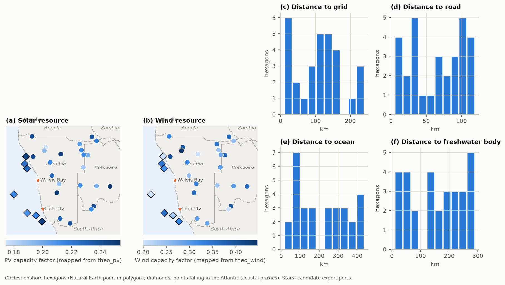

*Figure 1. (a, b) Hexagon locations, coloured by the capacity factors mapped from the resource indices. Circles are onshore hexagons; diamonds are points that fall in the Atlantic. Stars mark candidate export ports. (c–f) Distributions of the four infrastructure-distance attributes.*

### 2.2 Framing decisions

1. **Country assignment and financing.** The point-in-polygon test returns 16 points in Namibia, 5 in Botswana, 1 in Angola, 1 in South Africa, and 7 in the Atlantic (14–345 km offshore). The file name refers to Namibia (ISO "NA"), and the use case is export through Namibian ports. **The primary analysis therefore applies Namibian financing parameters to every hexagon.** Financing each hexagon at its host country's risk is run only as a sensitivity (Section 5.8). Landlocked low-risk Botswana is not allowed to drive the headline results.
2. **Offshore points.** The seven offshore points are modelled as coastal proxies, shown as diamonds on all maps, and **excluded from all headline statistics** (n = 23 onshore).
3. **Inconsistent distance columns.** The distance columns are internally inconsistent with the coordinates. For example, some offshore points have an "ocean distance" of up to 400 km. Because the dataset is simulated, we use the distance attributes as given for road, grid and water. Distances to the ports are computed from the coordinates (great-circle distance × 1.25 routing factor), because ports are physical locations.
4. **Resource indices to capacity factors.** The indices have no units. We map them linearly to annual capacity factors:
   - PV: CF = 0.30 × index, giving 0.17–0.25 (≈1,550–2,230 kWh/kWp, consistent with the Global Solar Atlas range for Namibia);
   - wind: CF = 0.60 × index, giving 0.17–0.45 (interior plateau up to the Lüderitz coastal belt).

   Uncertainty in this mapping is tested through CF sensitivities of ±10 % for PV and ±15 % for wind (Section 5.8).

---

## 3. Methods

The model is in `code/`:

- `params.py`: every parameter, with its source;
- `model.py`: weather synthesis and the plant LP;
- `chain.py`: infrastructure, export chain and benchmarks;
- `run_batch.py`: the LP batch runs;
- `assemble.py`: combines LP results with the chain terms;
- `analysis.py`: figures and key numbers.

### 3.1 Synthetic weather

No weather time series are supplied, so hourly profiles for one year (8,760 h) are generated.

- **PV.** Solar geometry for the hexagon's latitude (fixed tilt equal to |latitude|, facing the equator), plus a diffuse term. This is multiplied by a daily clearness index following an AR(1) process. Its variability is σ = 0.12 for the arid Namibian climate and σ = 0.33 for Europe. A mild dimming in the southern-hemisphere wet season (−8 % in January) is added for Africa. The profile is rescaled to the target annual CF.
- **Wind.** The sum of a synoptic AR(1) process (ρ = 0.985 h⁻¹) and an hourly AR(1) process (ρ = 0.90) is mapped through a Gaussian copula to Weibull wind speeds (k = 2.2). Seasonal and diurnal modulations are applied (Namibia: stronger in austral summer, with an evening maximum). The result passes through a generic power curve (cut-in 3, rated 12, cut-out 25 m/s; 5 % losses). The Weibull scale is calibrated by bisection to the target CF.
- **Calibration check.** The process was calibrated so that the 5th percentile of weekly-mean wind CF is 0.41 × the annual mean. This sits in the 0.4–0.6 range typical of reanalysis data and avoids unrealistically long calms.
- **Common random numbers.** All sites share the same random draws. Cost differences between sites therefore reflect resource level, latitude and seasonal shape, not sampling noise.
  - Limitation: the German profiles share the same synoptic sequence. They do not represent the longer winter wind lulls of central Europe ("Dunkelflaute"), so German storage needs, and hence German costs, are probably underestimated. This biases the comparison *in Africa's favour* (Fig. 11f).

### 3.2 Plant optimisation: two production metrics

For each site and finance case, a linear programme (HiGHS dual simplex) minimises annualised cost over a full year at 3-hourly resolution (2,920 steps, cyclic storage). It sizes PV, wind and electrolyser capacity, compressed-H₂ storage and, optionally, battery energy and power capacity. The demand is 60.6 kt H₂/yr: the median planned capacity of sub-Saharan African projects due by 2030, as used in the GeoH2 Namibia case study.

- **(a) Flexible LCOH (no storage).** The electrolyser follows renewable output, and only the annual quantity is fixed. This is the usual "on-site production LCOH" metric in cost maps (e.g. IEA, Hydrogen Council).
- **(b) Constant-supply LCOH.** The plant must deliver a constant 230.6 MW (LHV) of H₂ to a Haber–Bosch plant, which requires H₂ storage and possibly batteries. This is the GeoH2 approach and is used for the export chain. Compressing H₂ into storage costs 0.051 MWh electricity per MWh H₂ stored.

The two metrics bracket the effect of the constant-supply requirement. An extra variant sizes the Haber–Bosch plant for the flexible profile (fully flexible synthesis) and is used as a check.

**2030 technology costs** (`params.py`; ranges from IEA/DEA/NREL-ATB outlooks):

| Item | Value |
|---|---|
| PV | 450 €/kW, 1.5 %/yr O&M, 25 yr |
| Onshore wind | 1,150 €/kW, 2.5 %/yr O&M, 25 yr |
| Electrolyser | 700 €/kW_el, 3.5 %/yr incl. stack replacement, 20 yr, η = 0.65 (LHV) |
| Battery | 150 €/kWh + 60 €/kW, 15 yr |
| Compressed-H₂ storage | 17 €/kWh_H₂ (GeoH2 today: 21.7) |
| Salt cavern (Europe only) | 1 €/kWh_H₂ |
| Germany cost premium | PV 520 €/kW, wind 1,400 €/kW |
| Spain | PV 430 €/kW, wind 1,200 €/kW |

A uniform-capex sensitivity for Europe is also reported.

### 3.3 Site infrastructure: every distance column enters a cost

- **Road.** A new access road over `road_dist_km`: 481,867 €/km (626,478 €/km below 10 km) plus 7,150 €/km/yr O&M (GeoH2).
- **Water.** 21 L/kg H₂. The model chooses the cheaper of:
  - freshwater: treatment plant (300 € per m³/d), a pipeline over `waterbody_dist_km`, 1.25 €/m³ tariff and 0.4 kWh/m³;
  - seawater: reverse-osmosis desalination (1,500 € per m³/d), a pipeline over `ocean_dist_km`, 3.7 kWh/m³.

  Both include a water pipeline at 350 k€/km and the GeoH2 variable transport cost of 0.1 €/100 km/m³. Electricity is priced at the plant's own LCOE.
- **Grid connection (variant).** Grid distance (`grid_dist_km`) enters through a grid-tied LP variant:
  - line cost 250 k€/km + 600 €/MW/km, plus an 8 M€ substation;
  - import at the Namibian tariff of 104.65 €/MWh, capped at 10 % of electricity use (a renewable fuels of non-biological origin, RFNBO-style limit);
  - surplus export at 20 €/MWh;
  - grid-tie capacity of at most 150 MW.

  For each site we compare this with the off-grid design.
- **Inland transport to port.** Ports are Walvis Bay and Lüderitz (primary), with Saldanha Bay and Namibe added as a cross-border sensitivity. The model takes the cheaper of:
  - an H₂ pipeline to the port (GeoH2 "small" pipeline, 180 k€/km including compression) plus a small power line for the Haber–Bosch plant's electricity;
  - ammonia synthesis at the plant followed by NH₃ trucking (GeoH2 truck parameters).

### 3.4 Export chain

| Step | Assumption |
|---|---|
| Haber–Bosch + air separation | 750 € per t NH₃/yr, 2 %/yr O&M, 25 yr; 2.809 kWh/kg H₂ (GeoH2), priced at plant LCOE; 98 % H₂ conversion |
| Export and import terminals | 90 € per t NH₃/yr each |
| Ship | 53 kt NH₃ carrier, 80 M€, 16 knots, 4 port days, NH₃-fuelled (78 t/day), 0.05 %/day boil-off |
| Sea distances to Rotterdam | Walvis Bay 5,450 nmi, Lüderitz 5,700, Namibe 4,980, Saldanha 6,080 |
| Cracking at Rotterdam | 750 €/kW_H₂, 3 %/yr O&M; H₂ yield 0.85 (process heat from NH₃ combustion, purification losses); 0.6 kWh/kg at 120 €/MWh |

Delivered cost equals total annual cost divided by the H₂ delivered. The median delivered-to-produced ratio is 0.79 (20.8 % losses).

### 3.5 Finance module

Following Schmidt et al. (2019) and Steffen (2020), the after-tax WACC of each asset class *a* is:

> WACC = (D/V)·(IR + DM + S)·(1 − T) + (1 − D/V)·(IR + DM + S + EP + CRP)

where:

- IR is the base rate (German 10-year bond scenarios: 0.49 %, 2.15 %, 4.29 %);
- DM is the debt margin and EP the equity premium (asset-specific);
- S is the country default spread on debt and CRP the country risk premium on equity;
- T is the corporate tax rate (31 % Namibia, 30 % EU).

| Asset class | DM | EP | D/V |
|---|---|---|---|
| PV | 1.3 % | 7.3 % | 75 % |
| Wind | 1.4 % | 8.2 % | 75 % |
| H₂ assets (electrolyser, storage, battery, Haber–Bosch, cracker) | 2.5 % | 10 % | 60 % |
| Infrastructure | 1.2 % | 5 % | 70 % |
| Ships (no country risk) | 1.8 % | 6 % | 65 % |

The PV and wind parameters were calibrated so that German WACC at the 2017 LIBOR rate reproduces Steffen's Table 2 values (PV 2.7 %, wind 3.0 %). Namibia: S = 3.5 %, CRP = 5.0 % (approximately, for a B1/Ba3 rating). The resulting WACCs at the moderate base rate are:

| Scenario | Definition | WACC PV / H₂ / infrastructure |
|---|---|---|
| **Commercial** | market terms | 8.4 % / 12.6 % / 8.4 % |
| **Offtake** | long-term € offtake (H2Global/Hydrogen Bank type): H₂ equity premium 10 % → 8 %, D/V 70 %; power-asset EP −0.5 pt | 8.3 % / 10.3 % / 8.4 % |
| **Blended** | offtake + development-finance (DFI)/Multilateral Investment Guarantee Agency (MIGA) guarantees: debt spread removed, CRP halved, D/V ≥ 75 % | 5.0 % / 6.2 % / 4.4 % |
| **Full de-risking** | offtake + guarantees + concessional/export-credit debt: no country risk, DM halved, D/V 80 % | 3.5 % / 4.2 % / 3.1 % |
| Germany, commercial / offtake | EU, no country risk | 4.5 % / 7.8 % (offtake 6.1 %) / 4.2 % |

European import-side assets (import terminal and cracker) are financed at EU commercial terms in the *Commercial* scenario and at EU offtake terms otherwise. The **financing share** is 1 − cost(WACC = 0)/cost.

### 3.6 Benchmarks

- **European green H₂.** The same LP with constant supply is run for northern Germany (CF PV 0.11, wind 0.30, salt-cavern storage) and Spain (CF PV 0.205, wind 0.26, cavern, plus a 2,000 km share of a large backbone pipeline costing 0.33 €/kg). Both are financed with EU parameters (Commercial and Offtake) under the same base-rate environment. A Germany variant with tank storage only is also run.
- **Grey H₂ (SMR).** 0.050 MWh_HHV gas per kg × gas price (35 €/MWh; sweep 25–50), plus 0.30 €/kg capex and O&M, plus 9 kg CO₂/kg × CO₂ price.
- **Blue H₂ (SMR + CCS, 90 % capture).** 0.055 MWh/kg, 0.60 €/kg capex and O&M, 8.9 kg captured CO₂ at 40 €/t for transport and storage, and 1 kg CO₂/kg residual emissions.
- **Conventional ammonia.** Müller et al. (2023), Table 5: 0.40 €/kg NH₃ plus 1.65 kg CO₂/kg NH₃.
- **Break-even CO₂ price.** (green − grey₀)/(9 kg/kg).

### 3.7 Runs and validation

The scenario runs comprise 1,148 LPs:

- main matrix: 30 sites × 2 metrics × (3 rates × 4 scenarios + zero-WACC), plus the European runs;
- grid-tied variants;
- GeoH2 replication;
- host-country financing;
- 16 plant sensitivities;
- CRP sweep (0–10 %);
- base-rate sweep (0–6 %);
- hourly-resolution checks.

Validation covers:

- WACC markups against Steffen (2020);
- LCOE response to the base rate against Schmidt et al. (2019);
- replication with GeoH2 inputs (6 % flat);
- hourly vs 3-hourly resolution;
- production LCOH against published estimates.

---

## 4. Results

### 4.1 Heterogeneity of production cost (on-site LCOH)

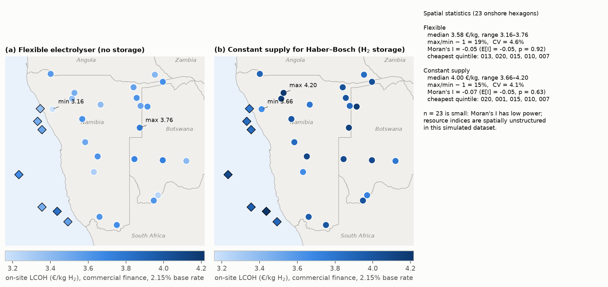

*Figure 2. On-site LCOH (plant plus water plus road) under commercial finance at the 2.15 % base rate. (a) Flexible electrolyser; (b) constant supply. Both panels use the same colour scale.*

**Flexible on-site LCOH** under commercial finance ranges from 3.16 to 3.76 €/kg (median 3.58).

- Spread: max/min − 1 = 19 %; CV = 4.6 %.
- Under full de-risking: 2.10–2.46 €/kg (median 2.34).
- At zero cost of capital: 1.59–1.85 €/kg.
- The optimal flexible design at the median site has 1,510 MW PV, 179 MW wind and 879 MW electrolyser (40 % utilisation).

**Constant-supply LCOH** is 3.66–4.20 €/kg (median 4.00; spread 15 %, CV 4.1 %).

- The constant-supply premium at the median Namibian site (#005) is +0.33 €/kg (3.58 → 3.91).
- It arises from 19.6 h of compressed-H₂ storage, extra PV (1,698 vs 1,485 MW) and higher curtailment (19 % vs 9 %).
- The electrolyser is not enlarged: utilisation stays at about 0.39.
- Batteries are not chosen at 150 €/kWh. H₂ storage (17 €/kWh) plus electrolyser oversizing is cheaper.
- Our constant-supply values are therefore not far above flexible values. The large gap to the most optimistic published numbers (Fig. 11e) comes mainly from the cost of capital: H₂-asset WACC is 12.6 % under commercial finance, and 52 % of the cost is financing.

**What drives the heterogeneity.**

- For flexible production, PV and wind resource matter about equally. Correlation of LCOH with PV CF is r = −0.51 and with wind CF r = −0.55. Standardised coefficients are β = −0.66 for both. Water distance (β = 0.37) and road distance (β = 0.22) are smaller but visible. R² = 0.82 and the maximum variance inflation factor (VIF) is 1.6, so collinearity is low.
- For constant supply, PV dominates (r = −0.88). Wind supplies only 6.5 % of generation at the median site, because at 1,150 €/kW and CF ≤ 0.45 it is more expensive than PV. It enters mainly as night-time balancing.

**Least-cost regions.**

- The cheapest flexible-LCOH quintile is #013, #020, #015, #010 and #007.
- The quintile is geographically mixed:
  - two north-western Namibian hexagons with the best wind (#013 and #020, wind CF 0.45 and 0.41);
  - two central Namibian hexagons with top PV (#010 at CF PV 0.25 / wind 0.37, and #007);
  - #015 on the Botswana/South-Africa border.
- Under commercial finance, the cheapest flexible site (#020, 3.16 €/kg) is 0.42 €/kg below the median.

**Spatial structure.** Moran's I is −0.05 (expected −0.05, permutation p = 0.92) for flexible LCOH and −0.07 (p = 0.63) for constant supply. Production cost therefore shows **no spatial clustering**. This reflects the simulated resource indices, which are spatially unstructured. With n = 23 the test also has low power.

**The southern / South-African border region.** The data do not support a systematic South-African advantage.

- The only South-African hexagon (#025) ranks 13th of 23 on flexible LCOH (3.61 €/kg).
- The southernmost Namibian sites rank 14th (#004) and 20th (#027).
- Only #015 (Botswana, 26.3°S) is among the cheapest (2nd).

Advantages in our data are site-specific, combining good PV and wind, rather than regional.

### 4.2 Delivered cost at Rotterdam and the four finance scenarios

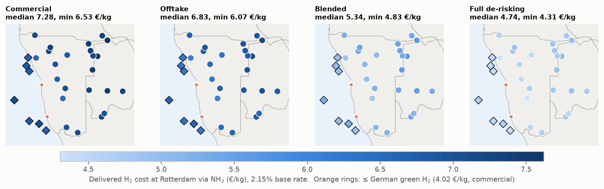

*Figure 3. Delivered H₂ cost at Rotterdam (constant-supply production, NH₃ chain, cracking) at the 2.15 % base rate. No onshore site reaches the German commercial benchmark of 4.02 €/kg, so no orange rings appear.*

At the moderate base rate, the delivered cost (minimum / median / maximum over 23 sites) is:

| Scenario | min | median | max |
|---|---|---|---|
| Commercial | 6.53 | 7.28 | 7.62 |
| Offtake | 6.07 | 6.83 | 7.16 |
| Blended | 4.83 | 5.34 | 5.61 |
| Full de-risking | 4.31 | 4.74 | 4.98 |
| *WACC = 0 (reference)* | *3.20* | *3.49* | *3.68* |

Site #010 (south-central Namibia) is the least-cost location in every scenario. It combines the best PV resource (CF 0.25) with good wind (0.37), and is served by a 400 km H₂ pipeline to Walvis Bay. The site ranking is almost unchanged across finance scenarios (Spearman ρ = 0.99 between Commercial and Full de-risking). Finance therefore moves the *level*, not the *geography*, as long as all sites share one jurisdiction.

- Port choice: 18 sites ship from Walvis Bay and 5 from Lüderitz.
- Inland mode: NH₃ trucking is cheaper for 16 sites and an H₂ pipeline for 7. Pipelines win for short routes, and trucks for long routes to the remote eastern hexagons.
- Water: seawater is chosen at 13 sites and freshwater at 10.

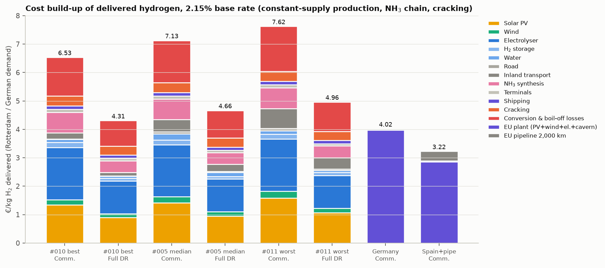

*Figure 4. Cost build-up for the best (#010), median (#005) and worst (#011) sites, under commercial finance and under full de-risking, against the European benchmarks.*

**Cost build-up at the median site (#005).** Under commercial finance it costs 7.13 €/kg:

- 3.62 €/kg is plant-gate production: PV 1.41, electrolyser 1.83, wind 0.22, H₂ storage 0.17;
- 0.28 €/kg is water and road;
- 0.44 €/kg is inland transport;
- 0.72 €/kg is NH₃ synthesis;
- 0.23 €/kg is terminals and shipping (0.10 + 0.13);
- 0.35 €/kg is cracking;
- 1.48 €/kg is conversion and boil-off losses, i.e. the cost of the ≈21 % of H₂ that does not arrive.

The **chain penalty** (everything between plant gate and delivered H₂, excluding site water and road) has a median of 3.24 €/kg under commercial finance and 2.15 €/kg under full de-risking. Shipping itself is cheap (0.12–0.13 €/kg). The large items are conversion capex and the volume lost in conversion.

Two further checks:

- A **fully flexible Haber–Bosch** plant, sized for peak H₂ output (2.1–2.8 × mean), is *more* expensive: 7.65 €/kg median commercial, 4.99 €/kg full de-risking. Buffering H₂ ahead of synthesis is the cheaper design.
- Delivering **ammonia** instead (no cracking, no cracking losses) gives a median of 1,033 €/t NH₃ at Rotterdam under commercial finance and 655 €/t under full de-risking.

### 4.3 Competitiveness with fossil hydrogen

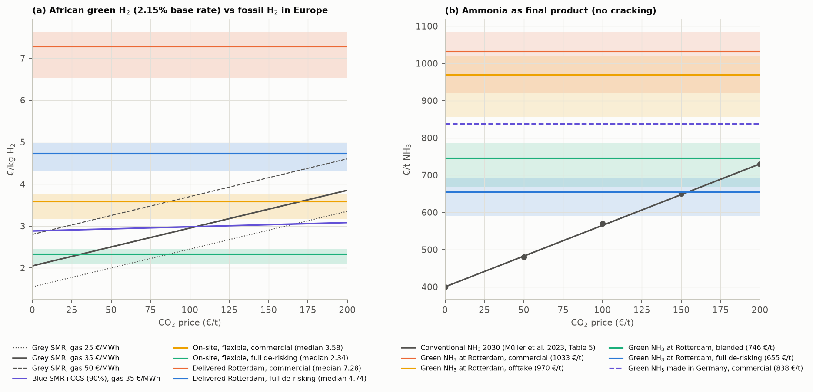

*Figure 5. (a) African green H₂ (bands are site ranges, lines are medians) against grey and blue fossil H₂ in Europe, as a function of the CO₂ price. (b) Green ammonia delivered to Rotterdam against conventional ammonia (Müller et al. 2023) and green ammonia made in Germany.*

**Fossil reference costs.**

- Grey SMR hydrogen costs 2.05 €/kg at a CO₂ price of zero (gas 35 €/MWh) and 2.95 €/kg at 100 €/t CO₂.
- Blue hydrogen costs 2.88–2.98 €/kg. It becomes cheaper than grey above about 104 €/t.

**Break-even CO₂ prices against grey H₂.**

| African product (2.15 % base rate) | Median site | Best site |
|---|---|---|
| On-site flexible, commercial | 170 €/t | 123 €/t |
| On-site flexible, full de-risking | 32 €/t | 6 €/t |
| Delivered to Rotterdam, commercial | 581 €/t | 498 €/t |
| Delivered to Rotterdam, full de-risking | 299 €/t | 251 €/t |
| *Germany green (commercial / offtake)* | *219 / 201 €/t* | |
| *Spain + pipeline (commercial / offtake)* | *131 / 112 €/t* | |

So **de-risked African H₂ used on site is already competitive with grey H₂ at CO₂ prices of about 30 €/t** (and with blue H₂ at any CO₂ price). This favours local use: green ammonia for regional fertiliser, green iron, or synthetic fuels shipped as liquids. **Delivered H₂, however, needs CO₂ prices of 250–600 €/t**, far above current EU ETS expectations for 2030 (≈100–150 €/t). Green H₂ produced in Europe needs 112–219 €/t, which is also high.

**Ammonia as the end product (Fig. 5b).** We fit the conventional-ammonia cost from Müller et al. (2023), Table 5: 0.40 €/kg plus 1.65 kg CO₂/kg NH₃. Delivered African green NH₃ breaks even with conventional NH₃ at 383 €/t CO₂ (commercial), 210 €/t (blended) and 154 €/t (full de-risking; best site 115 €/t). The last figure is within reach of a 2030–2035 ETS price combined with the EU's Carbon Border Adjustment Mechanism (CBAM).

### 4.4 Competitiveness with European green hydrogen, de-risking and the interest-rate environment

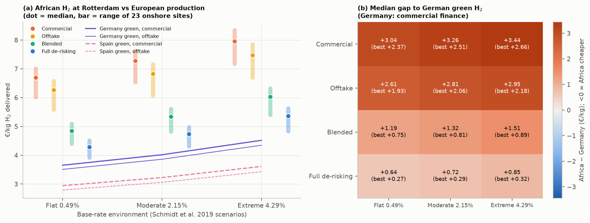

*Figure 6. (a) Delivered African H₂ in each finance × base-rate scenario against German and Spanish green H₂ financed in the same rate environment. (b) Gap between the African median site and German green H₂ under commercial finance (the best site's gap is in brackets).*

**European benchmarks** (constant supply, delivered to industrial demand), at base rates 0.49 / 2.15 / 4.29 %:

| Benchmark | 0.49 % | 2.15 % | 4.29 % |
|---|---|---|---|
| Germany, commercial | 3.65 | 4.02 | 4.52 |
| Germany, offtake | 3.51 | 3.86 | 4.35 |
| Spain + 2,000 km pipeline, commercial | 2.94 | 3.22 | 3.61 |
| Spain + 2,000 km pipeline, offtake | 2.79 | 3.06 | 3.43 |

The German plant uses 1,688 MW PV, 674 MW wind, 716 MW electrolyser and about 483 h of salt-cavern storage.

**Main result: in none of the 12 African scenarios does any of the 23 sites undercut German or Spanish green H₂.** The gap between the African median site and German commercial H₂ is:

- +3.04 to +3.44 €/kg under commercial finance;
- +2.61 to +2.95 €/kg with offtake;
- +1.19 to +1.51 €/kg with blended guarantees;
- +0.64 to +0.85 €/kg with full de-risking.

The best site comes within +0.27 to +0.32 €/kg under full de-risking.

The reason is structural. Even at zero cost of capital everywhere, delivered African H₂ (3.20–3.68 €/kg) is more expensive than German H₂ (2.65 €/kg). The physical chain penalty (conversion capex plus ≈21 % losses) is larger than Africa's resource advantage.

Two conditional results matter for interpreting this:

1. **Without salt caverns**, German constant-supply H₂ (tank storage only) costs 5.02 €/kg. Every de-risked African site (4.31–4.98 €/kg) then beats it. Germany's competitiveness depends on cheap seasonal storage.
2. **For ammonia end-use**, green NH₃ made in Germany costs 838 €/t (commercial; 762–943 €/t across rate environments). Imported African NH₃ beats it at all 23 sites under blended guarantees (median 746 €/t) and full de-risking (median 655 €/t). Under commercial or offtake terms, no site does (median 1,033 and 970 €/t).

**Value of each de-risking step** (median site, 2.15 % base rate):

| Step | Change in delivered cost |
|---|---|
| Offtake contract | −0.46 €/kg |
| Guarantees / blended finance | −1.48 €/kg |
| Concessional debt (full de-risking) | −0.60 €/kg |
| **Total** | **−2.54 €/kg (−35 %)** |

Removing country risk (the guarantees step) is worth three times as much as the offtake contract alone.

The **financing share** of delivered cost is:

- Africa: 52 % under commercial finance (47–56 % across rates), 48 % with offtake, 34 % blended, 26 % under full de-risking (19–35 %);
- Germany: 34 % under commercial finance (28–41 %);
- Spain: 34 %.

**Effect of the interest-rate environment.** Moving from the flat (0.49 %) to the extreme (4.29 %) environment raises delivered cost by:

- Africa: +1.28 €/kg (+19 %) commercial; +1.05 €/kg (+24 %) full de-risking;
- Germany: +0.87 €/kg (+24 %) commercial;
- Spain: +0.67 €/kg (+23 %) commercial.

In the continuous sweep (Fig. 7b) delivered cost rises per percentage point of base rate by 0.33 €/kg for Africa commercial, 0.28 for Africa de-risked, 0.23 for Germany and 0.18 for Spain.

This gives two complementary statements:

- **In absolute terms rising rates widen the gap.** The median commercial gap to Germany grows from 3.04 to 3.44 €/kg, and the full de-risking gap from 0.64 to 0.85 €/kg. The African chain is more capital-intensive per delivered kg.
- **In relative terms**, African costs rise less (+19 %) than European ones (+24 %), because the base rate is a smaller part of an already high WACC.

De-risking makes African projects *more* exposed to the base rate in relative terms, because the remaining WACC consists mostly of the base rate.

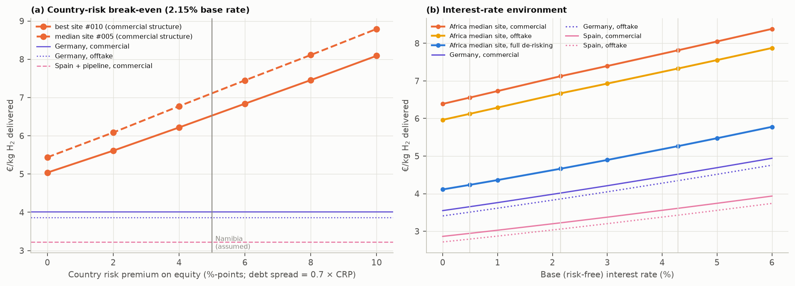

*Figure 7. (a) Delivered cost against the country risk premium (debt spread = 0.7 × CRP; otherwise commercial structure). (b) Delivered cost against the base rate for the median African site and the European benchmarks.*

**Country-risk sweep.** Each percentage point of CRP (with a proportional debt spread) adds 0.31 €/kg (best site) to 0.34 €/kg (median site). Even at CRP = 0, with the commercial H₂-asset equity premium kept, delivered cost is 5.04 €/kg (best) and 5.44 €/kg (median), still above German H₂. **No break-even exists within 0–10 % CRP.** Competitiveness with H₂ produced in Europe would need *both* zero country risk *and* lower H₂-asset premiums (offtake-type risk sharing), and even then only at a level close to the benchmark.

### 4.5 Infrastructure: grid, road, water, port

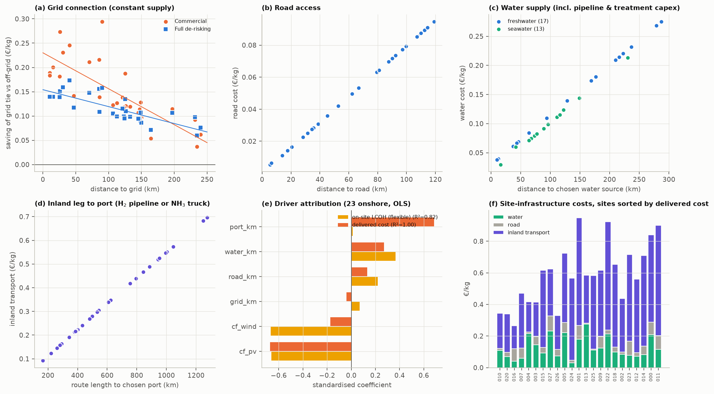

*Figure 8. Infrastructure terms (commercial finance, 2.15 %): (a) saving from a grid tie against grid distance; (b) road; (c) water by source; (d) inland leg; (e) standardised regression of on-site and delivered cost on resource and distance variables; (f) site-infrastructure cost by site.*

- **Grid.** A grid tie lowers constant-supply cost at **all 23 sites**: median −0.12 €/kg (maximum −0.29) under commercial finance, and −0.11 €/kg under full de-risking. The tie brings limited backup imports (≤ 10 %), sale of midday surplus, and smaller H₂ storage (median 19.6 → 12.7 h). The saving falls with distance to the grid (r = −0.77), and the linear extrapolation reaches zero at about 230 km. Grid distance therefore decides whether grid integration is worthwhile, although it is a second-order cost item. Cheaper capital (full de-risking) lowers both the cost of the line and the value of the avoided storage.
- **Road.** Up to 0.09 €/kg (median 0.05), roughly linear in distance.
- **Water.** Median 0.10 €/kg, maximum 0.28 €/kg, 1.4 % of delivered cost. The pipeline from source to plant dominates; treatment energy is negligible. A seawater-only policy, motivated by Namibian freshwater scarcity, costs nothing at the median site and at most +0.34 €/kg.
- **Inland transport to the port.** Median 0.32 €/kg, maximum 0.70 €/kg for the remote eastern sites with 1,000–1,270 km routes. Adding cross-border ports (Namibe, Saldanha) helps only one site (it switches to Namibe and saves 0.34 €/kg).
- **Total site infrastructure.** Median 0.59 €/kg (maximum 0.95), 8 % of delivered cost.
- **Driver attribution.** For delivered cost, route length to the port is the largest spatial driver (β = 0.69), followed by PV CF (β = −0.67), water distance (0.27) and wind CF (−0.17). R² = 1.00 and the maximum VIF is 1.6.

### 4.6 Shipping distance

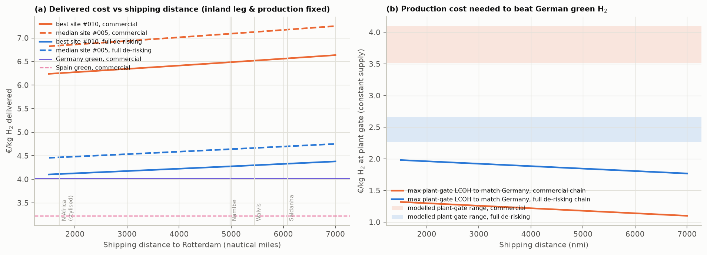

*Figure 9. (a) Delivered cost against shipping distance, holding production and the inland leg fixed. (b) The highest plant-gate LCOH that would still match German green H₂ at each shipping distance.*

Shipping is a weak lever. Delivered cost rises by only about 0.07–0.08 €/kg per 1,000 nmi under commercial finance and about 0.05 €/kg under full de-risking. This covers ship capital and fuel taken from the cargo.

Moving production from Namibia (5,450 nmi) to a stylised North-African distance (1,700 nmi) would save only 0.2–0.3 €/kg. For the NH₃ chain to beat German H₂, plant-gate LCOH (constant supply) would have to fall to:

- 1.16 €/kg (Walvis Bay distance) or 1.31 €/kg (1,700 nmi) with commercial chain financing;
- 1.83 €/kg or 1.97 €/kg with a de-risked chain.

This is well below the 2.36–2.73 €/kg the model gives for Namibian sites under full de-risking. Shorter routes to North Africa therefore matter much less than the conversion route: pipeline H₂ (no NH₃ conversion) or direct NH₃ use. We have no North-African resource data, so this result is a distance effect only, not a claim about Moroccan costs.

### 4.7 Sensitivities and robustness

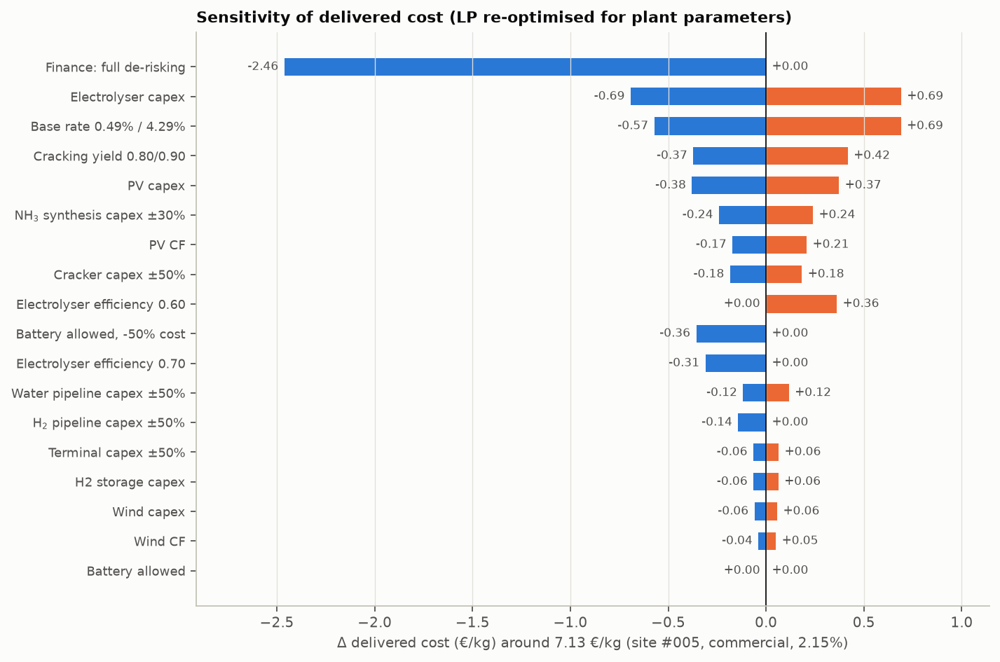

*Figure 10. Sensitivity of delivered cost at the median site (commercial finance, 2.15 %). The plant LP is re-optimised for each plant parameter; chain parameters are re-evaluated with the plant design fixed.*

**Ranking** (change in €/kg around 7.13):

| Parameter | Effect (€/kg) |
|---|---|
| Finance: full de-risking | −2.46 |
| Electrolyser capex ±30 % | ±0.69 |
| Base rate 0.49 / 4.29 % | −0.57 / +0.69 |
| Cracking yield 0.90 / 0.80 | −0.37 / +0.42 |
| PV capex ±20 % | ±0.38 |
| Electrolyser efficiency 0.60 / 0.70 | +0.36 / −0.31 |
| Cheaper batteries (−50 %) | −0.36 (≈3 GWh of batteries enters the design) |
| NH₃ synthesis capex ±30 % | ±0.24 |
| PV CF ±10 % | −0.17 / +0.21 |
| Cracker capex ±50 % | ±0.18 |
| Water pipeline capex ±50 % | ±0.12 |
| Wind capex, wind CF, H₂ tank capex, terminal capex | ≤ 0.07 each |

Finance outweighs all technology and resource uncertainties by a factor of 3–4. The resource-mapping uncertainty (CF ±10–15 %) is small compared with the finance effects.

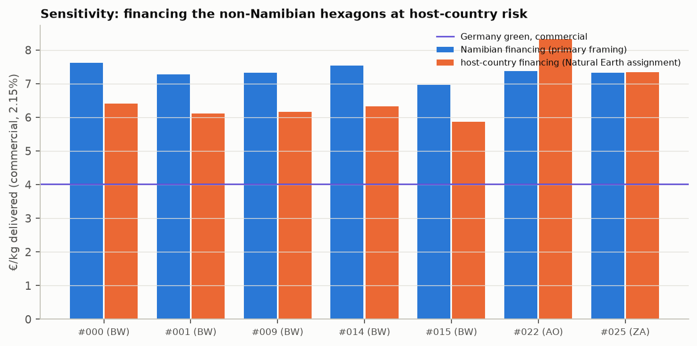

*Figure 11. Sensitivity: financing the seven non-Namibian onshore hexagons at their host country's risk.*

**Host-country financing.** Applied to the seven non-Namibian onshore hexagons, host-country financing changes delivered cost as follows:

- Botswana (A3, low CRP): 5.87–6.40 €/kg, against 6.97–7.61 €/kg with Namibian financing;
- Angola: 7.37 → 8.32 €/kg;
- South Africa: essentially unchanged (7.34 €/kg).

Under this assignment, Botswanan site #015 would become the cheapest location (5.87 €/kg, commercial). This is an artefact of a landlocked, low-risk jurisdiction "exporting" through Namibian ports. It shows how strongly the *geography* of competitiveness follows country risk once sites span several jurisdictions, which is why we keep the single-jurisdiction framing for the headline results.

**European cost assumptions.** With uniform European capex (the same PV and wind costs as Africa), German H₂ falls to 3.59 €/kg (commercial, 2.15 %). That widens Africa's gap further. With tank storage only, German H₂ rises to 5.02 €/kg (see Section 4.4).

### 4.8 Validation

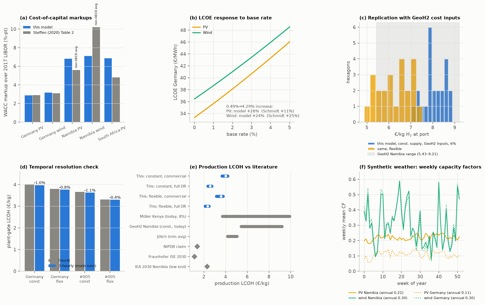

*Figure 12. Validation: (a) WACC markups against Steffen (2020); (b) LCOE response to the base rate against Schmidt et al. (2019); (c) replication with GeoH2 inputs; (d) hourly vs 3-hourly resolution; (e) production LCOH against published estimates; (f) weekly CFs of the synthetic weather.*

**(a) Cost-of-capital markups.**

- German markups reproduce Steffen (2020): PV 2.87 vs 2.9 percentage points; wind 3.18 vs 3.1.
- Namibian PV (6.8 pt) sits above the non-OECD average (5.6) and South Africa (4.8), as expected for a B1-rated country.
- Namibian wind (7.1 pt) is below the non-OECD wind average (10.2), which is dominated by a few high-risk markets.

**(b) LCOE response to the base rate.** Moving from 0.49 % to 4.29 % raises the pure financing component of German LCOE by +28 % (PV) and +24 % (wind). Schmidt et al. report +11 % for PV and +25 % for wind, but these figures are *net of* 2018–2023 cost learning, which is faster for PV. The wind response therefore matches, and the PV difference is consistent with learning that we do not model.

**(c) GeoH2 replication.** Using GeoH2's capex, 0.59 efficiency and 6 % WACC, our constant-supply cost of H₂ delivered to the port is 7.04–8.89 €/kg (median 8.07). GeoH2 reports 5.43–9.21 €/kg for Namibia. Our upper end matches. The lower end is higher because GeoH2's cheapest Namibian locations are wind-only coastal sites with CFs above the maximum in our dataset (0.45).

**(d) Temporal resolution.** 3-hourly results are 0.4–1.1 % below hourly results, for both an African site and Germany and for both metrics. The bias is small and has the same sign everywhere, so it does not affect comparisons.

**(e) Comparison with published estimates.** Our de-risked flexible LCOH (2.1–2.5 €/kg) lies between the optimistic 2030 estimates (IEA ≈2.3 €/kg low end for Namibia; Fraunhofer ISE 1.13; NIPDB claim ≈1.4) and the conservative ones (Jülich 4.2–5.0; GeoH2 5.4–9.2 with today's costs). The commercial figures (3.2–4.2) overlap the conservative ones.

---

## 5. Discussion

### 5.1 Answers to the research questions

1. **Production heterogeneity.** It is real but modest: 15–19 % between the best and worst sites, with a CV of about 4–5 %. Resource quality drives it. PV and wind matter equally for flexible production; PV dominates for constant supply. The least-cost sites are those with the best combined resource: north-western Namibian high-wind hexagons (#013, #020) and the top-PV sites #010 and #007. There is no spatial clustering and no evidence of a South-African-border advantage in this dataset. Financing shifts all sites by up to 1.4 €/kg on-site, an order of magnitude more than the spatial spread.
2. **Fossil competitiveness.** De-risked on-site African H₂ (2.1–2.5 €/kg) matches grey SMR hydrogen at CO₂ prices of about 30 €/t and beats blue hydrogen outright. Under commercial finance it needs 120–170 €/t. Delivered to Europe as H₂ it needs at least 250 €/t, which is not realistic for 2030. As delivered ammonia, the de-risked break-even against conventional NH₃ is 115–155 €/t.
3. **Competitiveness with European green H₂.** For H₂ delivered via NH₃ and cracking: not competitive in any of our scenarios. Full de-risking brings the best site within 0.3 €/kg of German H₂. The exceptions are a Germany without salt caverns and ammonia as the end product, where de-risked African supply wins at every site.
4. **De-risking and interest rates.** Moving from commercial finance to full de-risking is worth 2.5 €/kg (−35 %), dominated by removing country risk through guarantees (−1.5 €/kg). Offtake contracts alone are worth less than 0.5 €/kg. A higher base-rate environment raises African costs more in absolute terms (+1.3 vs +0.9 €/kg) and so widens the gap to Europe. Higher rates therefore increase the case for public de-risking rather than replacing it.
5. **Infrastructure and distance.** The site-specific infrastructure terms (inland leg, water, road) add 0.6 €/kg at the median site. Grid distance decides whether a grid tie (worth about 0.1–0.3 €/kg) pays. Port distance is the main spatial driver of delivered cost. Shipping distance is a weak lever (≤ 0.08 €/kg per 1,000 nmi). The conversion route matters far more than the sea route.

### 5.2 Policy implications

- **Concentrate de-risking on country risk.** Guarantees or blended finance that remove country and currency risk move costs about three times more than offtake price support alone.
- **Prefer derivative end-uses.** Ammonia used directly (fertiliser, chemicals, shipping fuel), and possibly e-fuels or iron, avoids the cracking step and its ≈15 % loss, and makes de-risked African supply competitive with European production.
- **Treat imported H₂ as complementary.** Cracked H₂ imports are a complement to European supply where Europe lacks cheap seasonal storage or land, not a cheaper substitute.
- **Recognise that rising rates hit Africa hardest in absolute terms.** This strengthens the case for concessional, rate-insensitive instruments (e.g. fixed-rate export-credit or DFI debt).
- **Integrate projects with the grid.** Even a small, capped grid connection lowers cost at every site, and grid planning (≤ ~230 km) becomes part of hydrogen-hub siting.

### 5.3 Limitations

- **Simulated inputs.** The hexagons are simulated; their resource indices are unitless and their distance attributes are not geographically consistent. Weather is synthetic and uses common random numbers. The European profiles lack realistic multi-week winter lulls, which biases German costs downward and so works against the main finding. Results show the *mechanisms* and *orders of magnitude*, not site-level investment advice.
- **Approximate risk parameters.** Country risk parameters are approximate rating-based values. Scenario definitions are stylised.
- **Simplified economics.** The model uses one year, real-terms annuities and no inflation or currency modelling. Ammonia synthesis electricity is priced at the plant's LCOE rather than co-optimised, and there are no minimum-load or ramp constraints on Haber–Bosch or the electrolyser.
- **Highly uncertain 2030 chain costs.** Cracking capex and yield are especially uncertain. The tornado shows ±0.2–0.4 €/kg for these items, which does not change the main conclusion.
- **Missing alternatives.** No North-African production data are available, so only the distance effect is assessed. Pipeline imports from North Africa (no NH₃ conversion) are not modelled.

---

## 6. Reproducibility

```
python code/prep.py                         # data checks, country assignment, port distances
NPROC=8 python code/run_batch.py main       # 852 LPs (Africa matrix + uniform-capex EU)
NPROC=4 python code/run_batch.py eu2        # European benchmarks with regional capex
NPROC=6 python code/run_batch.py second hex_005 hex_010   # grid, GeoH2, country, sensitivity, CRP, rate sweeps
NPROC=4 python code/run_batch.py hourly hex_005 hex_010   # temporal-resolution validation
python code/assemble.py                     # chain + infrastructure -> outputs/results_all.csv
python code/analysis.py                     # figures -> report/images, numbers -> outputs/key_numbers.json
```

The representative site (#005, median Namibian site) and the best site (#010) are selected automatically (`python code/analysis.py rep`). Intermediate outputs are in `outputs/`:

- `lp_*.csv`: raw LP results with capacities and WACCs;
- `results_all.csv`: all cost components per run;
- `hex_prepared.csv`;
- `key_numbers.json`.

## References

- Halloran, C., Leonard, A., Salmon, N., Müller, L., Hirmer, S. (2024). GeoH2 model: Geospatial cost optimization of green hydrogen production including storage and transportation. *MethodsX* 12, 102660.
- Müller, L.A., Leonard, A., Trotter, P.A., Hirmer, S. (2023). Green hydrogen production and use in low- and middle-income countries: a least-cost geospatial modelling approach applied to Kenya. *Applied Energy* 343, 121219.
- Steffen, B. (2020). Estimating the cost of capital for renewable energy projects. *Energy Economics* 88, 104783.
- Schmidt, T.S., Steffen, B., Egli, F., Pahle, M., Tietjen, O., Edenhofer, O. (2019). Adverse effects of rising interest rates on sustainable energy transitions. *Nature Sustainability* 2, 879–885.
