# Validating the HEEW Mini-Dataset: Hierarchical Consistency, Energy–Weather Correlation, and a Two-Stage Cleaning Benchmark with Daily-Profile Cluster Recovery

## Abstract

HEEW (Hierarchical Energy, Emission and Weather) is a multi-energy benchmark built from the Arizona State University Campus Metabolism Project and U.S. National Weather Service observations. This report studies its 2014 Mini-Dataset release: 10 buildings (BN001–BN010), one community (CN01), the Total node and one weather file. In total there are 13 files with 8,760 hourly records each, i.e. 105,120 energy records and 8,760 weather records. We ran three core validations.

1. **Hierarchical aggregation consistency.** The community node equals the sum of its ten buildings exactly for all five energy variables: max |residual| = 0.0, MAE = 0.0, mean relative error = 0.0 %. Total is byte-identical to CN01. GHG equals 0.5·E + 0.3·H + 0.2·C − 0.5·PV at every node (OLS R² = 1).
2. **Energy–weather correlation.** The raw hourly Pearson matrix at the Total node gives r(E,T) = −0.574, r(PV,T) = −0.558, r(H,T) = +0.461, r(C,T) = +0.001 and r(PV,RH) = −0.105. All wind, pressure and precipitation couplings with energy are |r| ≤ 0.10. After the hour × weekday calendar profile is removed, every energy–weather |r| falls to ≤ 0.025. The raw correlations therefore come from shared calendar phase, not from weather dependence.
3. **Two-stage cleaning.** We injected 5 % missing values and 2 % outliers into BN001 electricity. A robust seasonal-residual detector found all 175 outliers (P = R = F1 = 1.00). A seasonal-profile, edge-anchored reconstruction then cut the MAE on corrupted hours from 17.81 kW (corrupted series, linear fill) to 3.69 kW, and RMSE from 26.49 to 4.62 kW. The ridge variant, which uses the nine sibling buildings, reaches 2.53 / 3.17 kW. Reconstruction from the hierarchy identity is exact. We clustered daily load curves with K-means (k = 3). The cleaned series recovers the true centroids to within 0.13 kW RMSE (corrupted: 7.37 kW) and the true day labels with ARI = 0.93 (corrupted: 0.42). These results hold across 5 seeds and missing rates of 2–10 %.

The data are exactly additive and internally consistent, which makes them a clean benchmark. Several diagnostics, however, show that the Mini-Dataset's weather and load series are stylised or synthetic rather than raw measurements. We document these so that users do not over-interpret the energy–weather couplings.

---

## 1. Introduction and objectives

Multi-energy datasets often omit thermal loads, PV generation or emissions, or cover only short periods. HEEW addresses this by providing electricity, heat, cooling, PV and GHG series together with seven weather variables, arranged hierarchically: building → community → total. The Mini-Dataset is the released sample used to illustrate the dataset's core properties. We set out to answer three questions:

* **Q1 (hierarchy).** Is the building → community → total aggregation internally consistent, and how is GHG derived?
* **Q2 (correlation).** What is the Pearson correlation structure between the energy variables and weather, and is it robust to calendar confounding?
* **Q3 (cleaning).** Missing values and outliers are the defects a dataset-cleaning pipeline must handle. If we inject them into one building's electricity series, can a transparent two-stage method (detect → reconstruct) recover the truth, measured by MAE/RMSE? And does the cleaned series preserve the daily load-pattern structure, measured by K-means (k = 3) centroids?

*Scope note.* The HEEW paper itself is not in the workspace (`related_work/` contains four papers on other datasets and on clustering). We therefore do **not** claim to reproduce the paper's own cleaning algorithm. Section 3.3 describes our own two-stage method, which is an implementation of the same detect-then-reconstruct idea.

---

## 2. Data

| Item | Value |
|---|---|
| Files | `BN001…BN010_energy.csv`, `CN01_energy.csv`, `Total_energy.csv`, `Total_weather.csv` |
| Period / resolution | 2014-01-01 00:00 – 2014-12-31 23:00, hourly, 8,760 rows per file (strictly 1 h step, asserted) |
| Energy variables | Electricity [kW], Heat [mmBTU], Cooling [ton], PV [kW], GHG [ton] |
| Weather variables | Temperature, Dew point [°F], Relative humidity [%], Wind speed, Wind gust [mph], Pressure [in], Precipitation [in] |
| Quality | 0 NaN, 0 duplicated timestamps, 0 negative values in any file (`outputs/overview_stats.csv`, `outputs/hierarchy_summary.json`) |

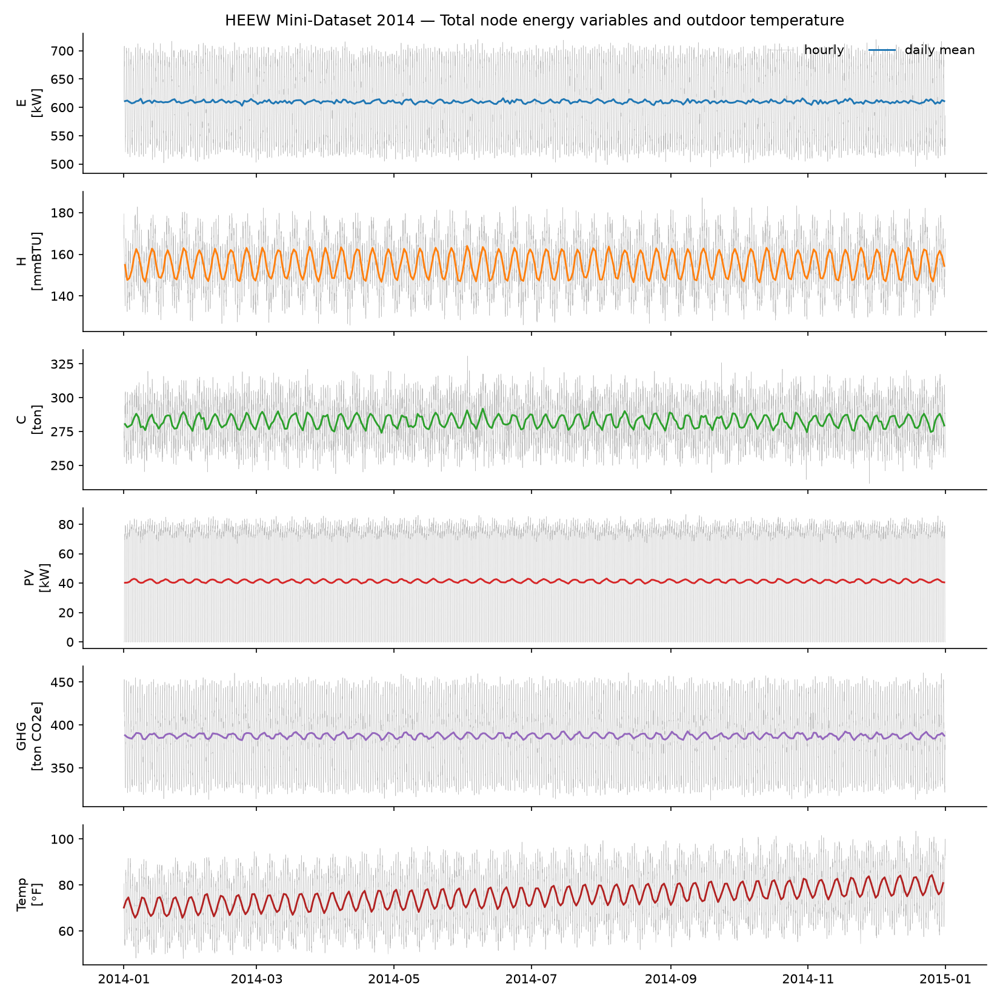

**Figure 1.** Total-node energy variables (hourly in grey, daily mean in colour) and outdoor temperature for 2014.

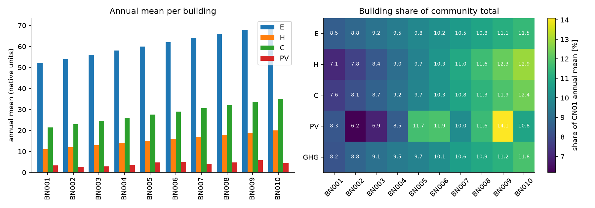

**Figure 2.** Left: annual mean of each variable per building. Right: each building's share of the CN01 annual mean (%). Electricity means rise almost linearly with building ID (52.0, 54.0, …, 70.0 kW), and shares range from 8.5 % (BN001) to 11.5 % (BN010).

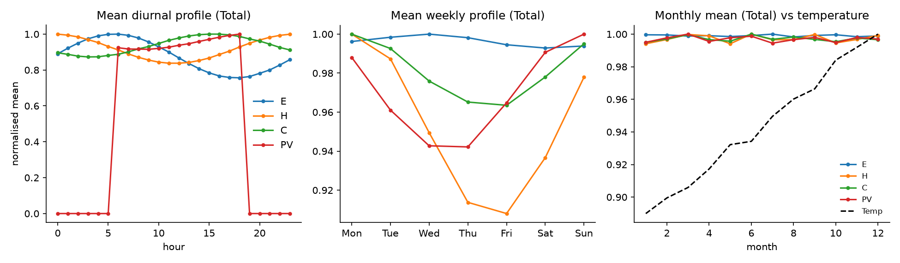

**Figure 3.** Normalised mean diurnal, weekly and monthly profiles at the Total node. Electricity peaks at 06:00 and bottoms out at 18:00. Heat peaks at 00:00, cooling at 15:00 and PV at 18:00. Seasonal variation in the energy variables is weak, while temperature rises monotonically from January to December.

---

## 3. Methodology

All code is in `code/` and runs in order: `01_overview_hierarchy.py`, `02_correlation.py`, `03_cleaning_experiment.py`, `04_sensitivity.py`. `common.py` holds the loaders and `cleaning.py` the methods. All randomness goes through `numpy.random.default_rng(seed)`. The main experiment uses seed 0 and the sensitivity study uses seeds 0–4. K-means uses k-means++ initialisation, Lloyd iterations, `n_init = 20` and seed 0. We implemented it in numpy so the results do not depend on the environment: scikit-learn could not be installed because of network time-outs, but its algorithm is identical.

### 3.1 Hierarchical consistency (Q1)
For each variable v ∈ {E, H, C, PV, GHG} and each hour t we computed two residuals:

* r₁(t) = CN01_v(t) − Σ_{b=1}^{10} BN_b,v(t)
* r₂(t) = Total_v(t) − CN01_v(t)

For each residual we report max |r|, MAE = mean |r|, RMSE, and mean relative error = mean(|r| / |parent|) × 100 %. We also compared file SHA-256 hashes. We regressed GHG on (E, H, C, PV, 1) by OLS at every node to recover the emission-factor identity.

### 3.2 Correlation analysis (Q2)
We concatenated the five Total-node energy variables with the seven weather variables (n = 8,760) and computed the Pearson matrix, with Spearman as a cross-check. To test whether the coefficients reflect physical weather dependence or shared calendar structure, we recomputed them under five variants:

1. after subtracting the mean diurnal profile;
2. after subtracting the hour × weekday profile (168 cells);
3. as in (2), plus monthly means;
4. on daily means;
5. on daily means minus the weekday profile.

We also ran plausibility checks on the weather: monthly temperature against Phoenix climate normals (approximately 56 °F in January and 94 °F in July), RH recomputed from (T, T_d) with the Magnus formula, PV hours against solar geometry, and weekly autocorrelation.

### 3.3 Two-stage cleaning benchmark (Q3)

**Target and ground truth.** The target is BN001 electricity (mean 52.0 kW, σ = 11.45 kW, no zeros, no flat runs). The original series serves as the ground truth.

**Fault injection** (`cleaning.corrupt`, seed 0):
* **Missing, 5 % (438 h):** 60 % of these hours are contiguous blocks of 3–24 h and 40 % are isolated points, giving 193 missing runs with the longest 24 h.
* **Outliers, 2 % (175 h)**, placed so they do not touch missing hours:
  * spikes of ±(3–6)σ, 105 h; negative results are clipped to 0 because meters cannot read below zero;
  * zero drop-outs, 26 h;
  * scaling faults (×0.4, ×0.5, ×1.8 or ×2.2 over 3–6 h blocks), 26 h;
  * stuck-value faults (the previous reading repeated for 3–6 h), 18 h.

  The masks are saved in `outputs/bn001_corruption_seed0.csv`.

**Stage 1: detection** (`cleaning.detect`). This stage combines a robust seasonal-residual (Hampel-type) test with physical rules:
* **Reference.** m(t) is the median of the same clock hour over days d ± 7, excluding day d itself and ignoring NaN.
* **Residual and scale.** e(t) = y(t) − m(t), with a global robust scale s = 1.4826 · MAD(e).
* **Test.** A point is flagged if |e − median(e)| > k · s, with k = 4.
* **Rules.** Flag y < 0, y = 0 and flat runs of ≥ 4 identical readings. The first value of each run is kept as genuine.
* **Iteration.** The test runs twice: after the first pass, flagged values are removed and the reference is recomputed, which stops scaling blocks from masking themselves. All flagged points are then set to NaN.

**Stage 2: reconstruction.** Every remaining gap is filled by one of the following:
* **P (proposed, univariate).** Gaps of ≤ 2 h use linear interpolation. Longer gaps use a reference profile p(t): the mean of y(t − 168 h) and y(t + 168 h), where observed, falling back to ±336 h, then to the ±7-day same-hour median, then to the hour-of-week mean. The profile is anchored to the gap edges by adding an offset that blends linearly from (y − p) at the left edge to (y − p) at the right edge.
* **P′ (cluster-aware, univariate).** K-means (k = 3) is fitted on the complete days. Each incomplete day is assigned to the nearest centroid using its observed hours, and the gap is filled with that centroid, anchored at the edges as in P.
* **X (cross-sectional).** Ridge regression (α = 1, standardised features) of BN001 on the nine sibling buildings' electricity plus hour-of-day and weekday dummies, trained on the observed hours. The siblings are assumed uncorrupted.
* **H (hierarchy upper bound).** BN001 = CN01 − Σ (other nine buildings). This uses the exact identity established in Q1.

Baselines and ablations:
* **B0:** the corrupted series with linear interpolation of the NaNs and no detection.
* **B1:** detection followed by linear interpolation only.
* **O:** the oracle outlier mask followed by P, which isolates the contribution of detection.

**Metrics.**
* MAE, RMSE and MAPE against the truth, computed on (i) all corrupted hours (missing ∪ outlier, 613 h), (ii) missing hours only, (iii) outlier hours only and (iv) all 8,760 hours.
* Precision, recall and F1 of the stage-1 flags against the injected outlier mask.

**Cluster recovery.** Each series (truth, B0, cleaned) is reshaped into a 365 × 24 daily-profile matrix, and K-means (k = 3, n_init = 20, seed 0) is fitted separately to each. Centroids are matched to the true centroids with the Hungarian algorithm on squared distance. We report centroid RMSE and MAE, and the Adjusted Rand Index (ARI) of the day labels against the truth.

**Sensitivity.** We repeated the experiment for 5 seeds × missing rates of {2, 5, 10} %, with outliers fixed at 2 %. To test generalisation, we applied it (seed 0) to E, H and C in all ten buildings.

---

## 4. Results

### 4.1 Hierarchical aggregation is exact (Q1)

**Table 1.** Hierarchy residual metrics, all 8,760 hours (`outputs/hierarchy_consistency.csv`).

| Level | Variable | Parent mean | max \|r\| | MAE | RMSE | Mean rel. error |
|---|---|---|---|---|---|---|
| CN01 − Σ BN001…BN010 | Electricity [kW] | 609.96 | 0.0 | 0.0 | 0.0 | 0.0 % |
| | Heat [mmBTU] | 155.03 | 0.0 | 0.0 | 0.0 | 0.0 % |
| | Cooling [ton] | 282.47 | 0.0 | 0.0 | 0.0 | 0.0 % |
| | PV [kW] | 41.33 | 0.0 | 0.0 | 0.0 | 0.0 % |
| | GHG [ton] | 387.32 | 0.0 | 0.0 | 0.0 | 0.0 % |
| Total − CN01 | all five variables | (same) | 0.0 | 0.0 | 0.0 | 0.0 % |

The residual is exactly zero in IEEE double precision when the buildings are summed in the order BN001 → BN010. In reverse order it is at most 2.3 × 10⁻¹³ kW, a floating-point rounding difference. This indicates that CN01 was generated as the left-to-right sum of the building files. `Total_energy.csv` and `CN01_energy.csv` have the same SHA-256 hash (`c16bba9b…c737`), so the Mini-Dataset contains a single community and Total ≡ CN01.

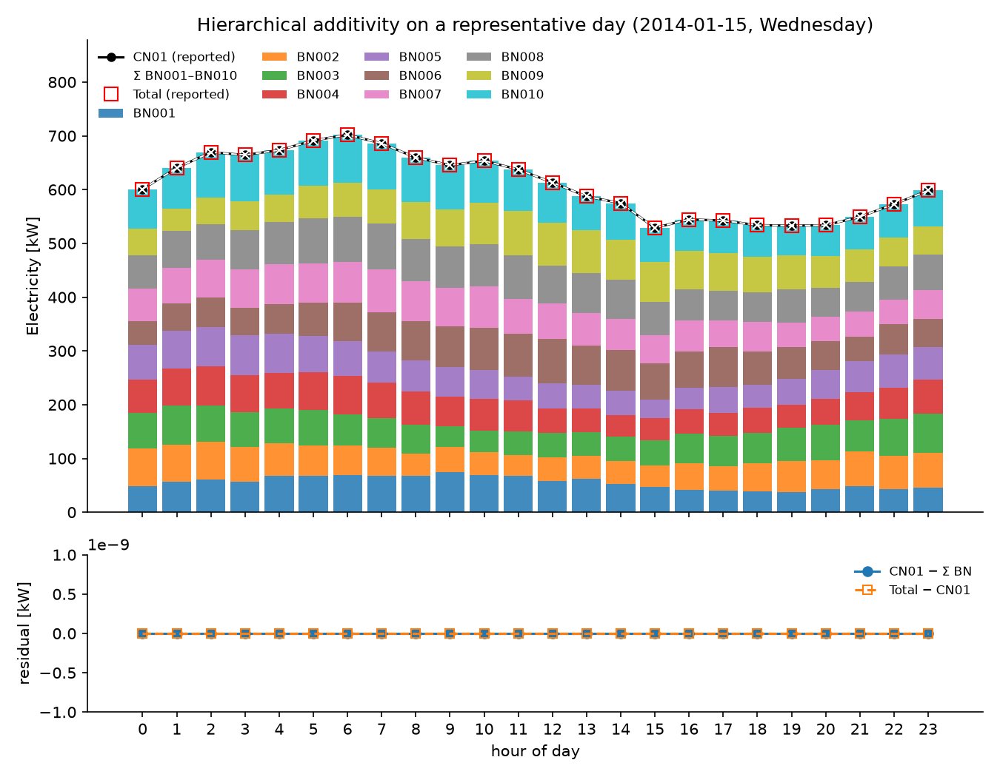

**Figure 4.** A representative day, Wednesday 15 January 2014. The bars stack the ten building electricity loads. CN01 (black circles), Σ BN (white crosses) and Total (red squares) coincide in all 24 hours. The lower panel shows that both residuals are zero on a ±10⁻⁹ kW axis.

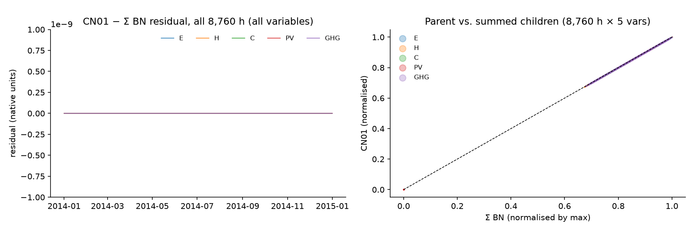

**Figure 5.** Left: CN01 − Σ BN over the full year for all five variables, identically zero. Right: parent against summed children for 8,760 h × 5 variables, all on the identity line.

**GHG identity** (`outputs/ghg_identity.csv`). At all 12 nodes the OLS fit gives β_E = 0.5, β_H = 0.3, β_C = 0.2, β_PV = −0.5 and intercept 0 with R² = 1. The maximum deviation from the fixed formula is 0.0. The formula is linear, so it commutes with aggregation, and GHG is consistent across levels automatically. A practical consequence: GHG is a deterministic function of the other four loads, so it must never be used as a predictor of E, H, C or PV, because it would leak the target.

### 4.2 Energy–weather correlation (Q2)

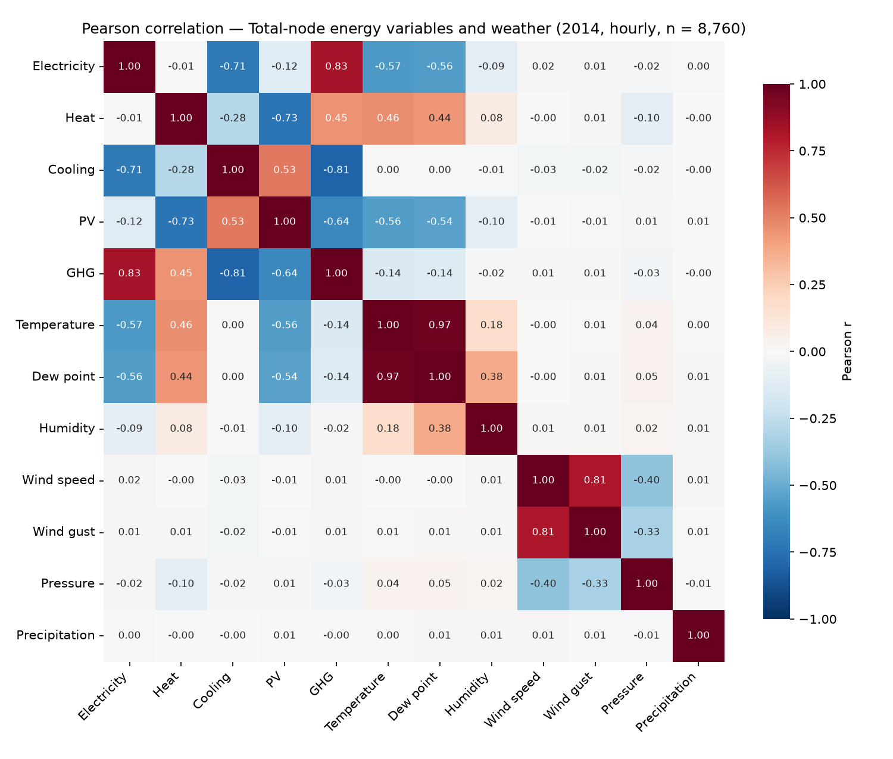

**Figure 6.** Pearson correlation matrix of Total-node energy variables and weather (hourly, n = 8,760; diverging scale fixed to [−1, 1]).

**Key coefficients** (`outputs/corr_key_values.json`):

* **Temperature.** r(E,T) = −0.574, r(H,T) = +0.461, r(C,T) = +0.001, r(PV,T) = −0.558. Dew point gives nearly the same values (E −0.557, H +0.444, PV −0.540) because r(T, T_d) = 0.97.
* **Humidity.** r(PV,RH) = −0.105, r(E,RH) = −0.094, r(H,RH) = +0.084, r(C,RH) = −0.010.
* **Wind, pressure and precipitation.** r(E,Wind) = +0.015, r(PV,Wind) = −0.006, r(E,Pressure) = −0.016, r(PV,Pressure) = +0.014, r(H,Pressure) = −0.102. All energy–precipitation |r| ≤ 0.007.
* **Within energy.** r(E,C) = −0.715, r(H,PV) = −0.73, r(C,PV) = +0.53, r(H,C) = −0.282. GHG correlates with E at +0.83 and with C at −0.81, consistent with its linear definition.
* **Within weather.** r(Wind,Gust) = +0.814, r(Wind,Pressure) = −0.40, r(T,RH) = +0.176.

These signs differ from what building physics leads one to expect for a hot-climate campus. There, cooling load and PV output usually rise with temperature, and heating falls with it. We report the values the data give and explain them with the robustness analysis below.

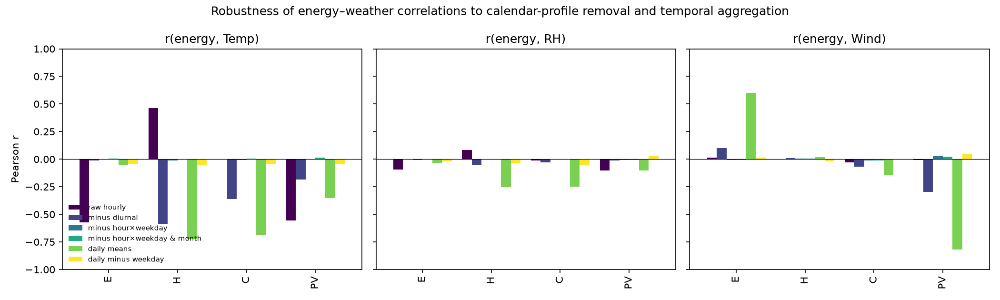

**Figure 7.** Energy–weather correlations under calendar-profile removal and temporal aggregation (`outputs/corr_robustness.csv`).

**Robustness.**
* **Diurnal phase.** Removing the mean diurnal profile removes the E–T coupling (−0.574 → −0.012). The raw coefficient is therefore a phase effect: the mean temperature profile peaks at 21:00 and bottoms out at 09:00, electricity peaks at 06:00, and PV peaks at 18:00.
* **Hour × weekday profile.** After the hour × weekday profile is removed, *every* energy–weather |r| is ≤ 0.025, and ≤ 0.025 again when monthly means are also removed.
* **Variance explained by the calendar profile.** The 168-cell hour × weekday profile explains 97.6 % of the variance of E, 92.8 % of H, 83.8 % of C, 99.9 % of PV and 90.9 % of temperature (`outputs/calendar_variance_share.csv`).
* **Daily means.** At the daily level, large spurious coefficients appear: r(E,Wind) = +0.60 and r(PV,Wind) = −0.82. They vanish (|r| ≤ 0.08) once the weekday profile is removed.

The apparent energy–weather couplings in this file therefore come entirely from shared calendar structure and carry no residual weather information.

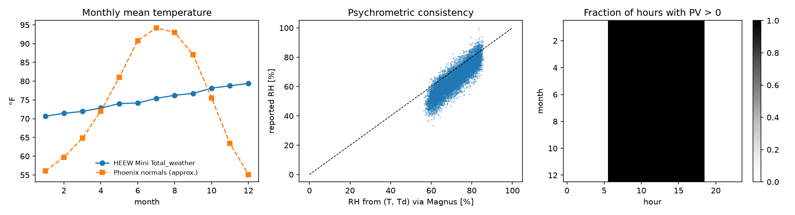

**Figure 8.** Weather plausibility checks (`outputs/weather_plausibility.json`).
* **Left: monthly temperature.** The series rises monotonically from 70.7 °F (January) to 79.4 °F (December). Phoenix normals peak in July at about 94 °F.
* **Centre: psychrometric consistency.** RH reconstructed from (T, T_d) correlates with the reported RH at only r = 0.87, with MAE 7.0 percentage points. The hard constraints do hold: dew point never exceeds temperature, and gust never falls below wind speed.
* **Right: PV hours.** PV is non-zero in exactly hours 06–18 in every month, regardless of season.

Daily temperature also has a lag-7 autocorrelation of 0.99, and mean temperature varies by about 8 °F across weekdays (Monday 70.7 °F, Friday 79.1 °F). A physical weather series cannot have a weekday cycle.

### 4.3 Two-stage cleaning of BN001 electricity (Q3)

**Detection.** Stage 1 flagged exactly the 175 injected outliers: TP = 175, FP = 0, FN = 0, so precision = recall = F1 = 1.00 (`outputs/cleaning_summary_seed0.json`). By type, it caught 105/105 spikes, 26/26 zeros, 26/26 scaling-fault hours and 18/18 stuck hours. Without the physical rules, the residual test alone reached F1 = 0.946, missing 18 points that were mostly stuck values and mild scaling faults. A detector ablation over 5 seeds (`outputs/detector_ablation_summary.csv`) gives mean F1 by detector:

| Detector | Setting | Precision | Recall | F1 |
|---|---|---|---|---|
| Hampel-daily + rules | k = 3 | 0.972 | 0.994 | 0.983 |
| Hampel-daily + rules | k = 4 (main) | 1.000 | 0.983 | 0.991 |
| Hampel-daily + rules | k = 5 | 1.000 | 0.961 | 0.980 |
| Hampel-daily + rules | k = 6 | 1.000 | 0.927 | 0.962 |
| Hampel-daily, no rules | k = 4 | 1.000 | 0.886 | 0.939 |
| Hampel-weekly + rules | k = 4 | 1.000 | 0.997 | 0.998 |
| Global z-score | \|z\| > 2 | 0.979 | 0.858 | 0.915 |
| Global z-score | \|z\| > 3 | 1.000 | 0.662 | 0.796 |
| Global IQR | 1.5 × IQR | 1.000 | 0.657 | 0.793 |

The seasonal reference and the physical rules both matter. Global detectors miss about a third of the faults: mild scaling and stuck faults stay inside the 24–80 kW range of the raw series.

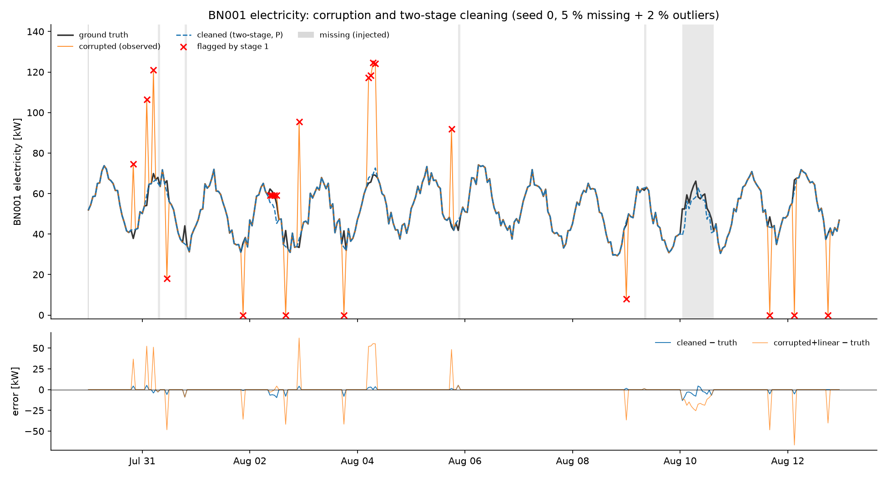

**Figure 9.** A two-week window (31 Jul – 13 Aug 2014). Truth is black, the corrupted observations orange, flagged points red crosses, injected missing periods grey bands, and the cleaned series (P) is dashed blue. The lower panel shows the errors: the cleaned residuals stay within a few kW, while B0 errors reach ±60 kW.

**Table 2.** Reconstruction error against the truth, seed 0, 5 % missing + 2 % outliers (`outputs/cleaning_metrics_seed0.csv`). Units are kW.

| Method | MAE (corrupted, 613 h) | RMSE (corrupted) | MAE (missing) | MAE (outliers) | MAE (all hours) | RMSE (all hours) |
|---|---|---|---|---|---|---|
| B0 corrupted + linear (no detection) | 17.810 | 26.490 | 7.627 | 43.294 | 1.246 | 7.007 |
| B1 detect + linear | 6.373 | 9.232 | 7.627 | 3.232 | 0.446 | 2.442 |
| **P detect + seasonal-profile anchored (proposed)** | **3.691** | **4.623** | 3.835 | 3.328 | 0.258 | 1.223 |
| P′ detect + cluster-centroid anchored | 3.306 | 4.120 | 3.415 | 3.034 | 0.231 | 1.090 |
| X detect + sibling ridge (cross-sectional) | 2.530 | 3.174 | 2.533 | 2.525 | 0.177 | 0.840 |
| H detect + hierarchy identity | 0.000 | 0.000 | 0.000 | 0.000 | 0.000 | 0.000 |
| O oracle mask + P | 3.691 | 4.623 | 3.835 | 3.328 | 0.258 | 1.223 |

The comparison separates the contribution of each stage:
* **Stage 1.** Detection alone (B0 → B1) cuts MAE on the corrupted hours by 64 %, from 17.8 to 6.4 kW.
* **Stage 2.** The seasonal-profile reconstruction (B1 → P) cuts it by a further 42 %, to 3.7 kW, for a total reduction of 79 % in MAE and 83 % in RMSE.
* **Detection is not the bottleneck.** P equals the oracle-mask result O exactly.
* **Remaining error.** The residual error of P (MAPE 7.3 %) comes from unpredictable hour-to-hour variation in BN001 (residual σ ≈ 4.3 kW around the same-hour median). A univariate method cannot remove it.
* **Other information sources.** The ridge on sibling buildings (X) brings the error down further, to 2.5 kW. The hierarchy identity H recovers the series exactly, as the exact additivity of Q1 implies.

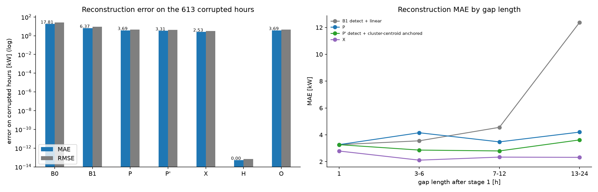

**Figure 10.** Left: MAE and RMSE on the corrupted hours (log scale). Right: MAE by gap length after stage 1 (`outputs/cleaning_by_gaplen_seed0.csv`).

The gap-length breakdown shows where linear interpolation fails. For 13–24 h gaps its MAE is 12.4 kW, while the anchored profile achieves 4.2 kW (P), 3.6 kW (P′) and 2.3 kW (X). On single-hour gaps all univariate methods coincide at 3.27 kW, because they all use linear interpolation there.

**Cluster recovery.**

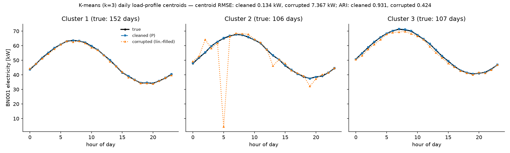

**Figure 11.** K-means (k = 3) centroids of the daily BN001 load curves. True centroids are solid black, those of the cleaned series (P) dashed blue, and those of the corrupted, linear-filled series (B0) dotted orange. Centroids were matched with the Hungarian algorithm.

**Table 3.** Recovery of the daily-profile clusters, seed 0 (`outputs/cluster_recovery_seed0.csv`).

| Series | Centroid RMSE [kW] | Centroid MAE [kW] | ARI vs true labels | Label agreement |
|---|---|---|---|---|
| Corrupted, linear-filled (B0) | 7.367 | 1.842 | 0.424 | 66.3 % |
| Detect + linear (B1) | 7.812 | 4.789 | 0.533 | 35.3 % |
| **Cleaned (P)** | **0.134** | **0.110** | **0.931** | **97.5 %** |
| Cleaned (P′, cluster-aware) | 0.127 | 0.103 | 0.931 | 97.5 % |

The cleaned series reproduces the three true centroids almost exactly: centroid RMSE is 0.13 kW, about 0.25 % of the mean load. It assigns 97.5 % of days to the correct cluster.

The corrupted series fails in two ways. Outlier days distort one centroid: in Figure 11, cluster 2 has a spurious −60 kW dip at 05:00 and a spike at 02:00. Day labels are also reshuffled (ARI 0.42).

Detection followed by plain linear filling (B1) is *worse* at preserving centroid shape than no cleaning at all (RMSE 7.8 kW). Days containing long linearly-bridged gaps become flattened profiles, which K-means groups into their own cluster, changing the partition. Shape-preserving reconstruction is therefore essential for downstream clustering, not only for pointwise error.

**What the clusters represent** (`outputs/cluster_vs_weekday.csv`, `outputs/cluster_vs_month.csv`). The true clusters do not correspond to seasons: each cluster contains 8–15 days in every month. They correspond almost perfectly to days of the week:
* {Fri, Sat, Sun}: 152 days;
* {Mon, Thu}: 106 days, including 4 Sundays;
* {Tue, Wed}: 107 days, including 2 Mondays.

This reflects the strong weekly cycle built into the Mini-Dataset; BN001's lag-168 h autocorrelation is 0.93, above its lag-24 h value of 0.90. Silhouette analysis prefers k = 2 (0.33) over k = 3 (0.20) (`outputs/kmeans_k_selection.csv`). We kept k = 3 as the experimental protocol and note that the clusters are moderately separated.

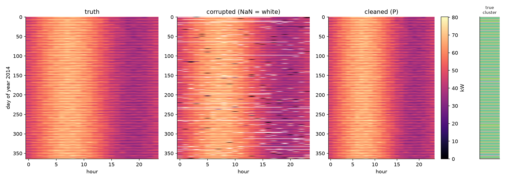

**Figure 12.** 365 × 24 daily-profile matrices of the truth, the corrupted series (missing hours in white, outliers visible as bright or dark specks) and the cleaned series. The strip on the right shows the true cluster labels.

### 4.4 Sensitivity and generalisation

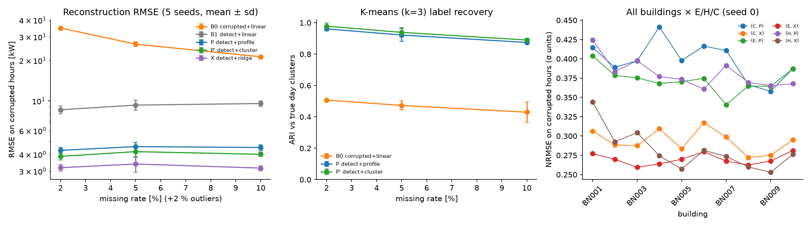

**Figure 13.** Left: RMSE on the corrupted hours against missing rate (5 seeds, mean ± sd). Centre: ARI of the K-means day labels. Right: NRMSE of P and X for E, H and C in all ten buildings (seed 0).

**Table 4.** BN001 electricity, 2 % outliers, mean ± sd over 5 seeds (`outputs/sensitivity_summary.csv`).

| Missing rate | Detection F1 (Hampel-daily) | B0 RMSE [kW] | B1 RMSE | **P RMSE** | P′ RMSE | X RMSE | B0 ARI | **P ARI** | P′ ARI |
|---|---|---|---|---|---|---|---|---|---|
| 2 % | 0.995 ± 0.004 | 34.94 ± 0.66 | 8.60 ± 0.56 | **4.29 ± 0.22** | 3.87 ± 0.23 | 3.18 ± 0.18 | 0.51 ± 0.01 | **0.96 ± 0.01** | 0.98 ± 0.02 |
| 5 % | 0.991 ± 0.012 | 26.50 ± 1.06 | 9.32 ± 0.80 | **4.57 ± 0.36** | 4.19 ± 0.39 | 3.39 ± 0.45 | 0.47 ± 0.03 | **0.92 ± 0.04** | 0.94 ± 0.03 |
| 10 % | 0.994 ± 0.005 | 21.33 ± 0.44 | 9.57 ± 0.42 | **4.50 ± 0.22** | 4.01 ± 0.15 | 3.16 ± 0.14 | 0.43 ± 0.07 | **0.88 ± 0.01** | 0.89 ± 0.01 |

* **Detection.** Precision was 1.00 in every run; recall ranged from 0.98 to 0.99. The weekly-reference detector (same hour-of-week, ±7 weeks) scored slightly higher, F1 = 0.996–0.998.
* **Reconstruction error.** RMSE on the corrupted hours stays essentially flat as the missing rate rises from 2 % to 10 %. B0's RMSE *falls* with missing rate only because the fixed outlier budget becomes a smaller share of the evaluation set.
* **Cluster recovery.** ARI declines gently with more missing data but stays ≥ 0.87 for all cleaned variants.
* **Generalisation.** Across all ten buildings and three loads (E, H, C; seed 0, 5 % + 2 %; `outputs/generalisation_buildings.csv`):

  | Load | Detection F1 | NRMSE, P | NRMSE, X | NRMSE, B0 |
  |---|---|---|---|---|
  | E | 1.000 ± 0.000 | 0.373 ± 0.016 σ | 0.270 ± 0.007 σ | 2.48 σ |
  | H | 0.991 ± 0.014 | 0.381 ± 0.019 σ | 0.282 ± 0.027 σ | 2.21 σ |
  | C | 0.989 ± 0.009 | 0.398 ± 0.025 σ | 0.293 ± 0.015 σ | 2.14 σ |

  The method is not tuned to BN001.

---

## 5. Discussion

**Hierarchy.** Aggregation is exact and GHG is an exact linear identity. This is a useful property for benchmarking hierarchical forecasting, reconciliation and cleaning: (i) any reconciled forecast can be checked against an exact constraint; (ii) a missing child can be reconstructed exactly from its parent and siblings (method H), which gives a hard upper bound for cleaning benchmarks; and (iii) reconstruction errors at the building level propagate unchanged to the community and total levels.

Two caveats for users. Total ≡ CN01 in the Mini-Dataset, so the top level adds no new information. And GHG must be excluded from the feature sets used to predict E, H, C or PV.

**Correlation.** Using the raw hourly Pearson matrix at face value would lead one to conclude that electricity demand and PV output fall as temperature rises. The robustness analysis shows that these coefficients come entirely from the alignment of fixed diurnal and weekly profiles. Once the hour × weekday profile is removed, no measurable weather signal remains (|r| ≤ 0.025).

Several other features of the series are not physically plausible:
* temperature peaks at 21:00 and has its minimum at 09:00;
* temperature has a weekday cycle;
* monthly temperature rises monotonically, unlike Phoenix climate;
* PV runs on a fixed 06:00–18:00 window all year and peaks at 18:00;
* RH is only loosely psychrometrically consistent with T and T_d;
* building means rise linearly with ID.

Together these strongly suggest that the Mini-Dataset is a stylised or synthetic illustration of the HEEW schema rather than a raw extract of the ASU and NWS measurements. *This is an interpretation; the measured facts are the coefficients and diagnostics reported in Section 4.2.* It matters for users: the Mini-Dataset is well suited to testing pipelines, such as I/O, hierarchy checks, cleaning and clustering code, but it should not be used to estimate weather sensitivities of campus loads. For that, the full HEEW release must be used and the analysis repeated.

**Cleaning.** Both stages are necessary, and they do different jobs. Robust detection, with a reference that respects the daily and weekly seasonality and a MAD scale, plus simple physical rules, catches essentially all injected faults, including the stuck-value and scaling faults that a pure residual test partly misses. A global z-score (|z| > 3) or IQR rule on the raw series misses about a third of the faults (F1 ≈ 0.80), because the diurnal and weekly swing inflates the global spread.

Reconstruction must preserve shape: linear bridging minimises error only on short gaps, and it actively corrupts the daily-profile structure that downstream clustering relies on (Table 3, B1). The edge-anchored seasonal profile reconciles the two: it follows the typical weekly shape and remains continuous with the observed data at both gap edges.

The ordering of information sources is clear: univariate seasonal (P, 4.6 kW RMSE) < cluster-aware univariate (P′, 4.1) < cross-sectional siblings (X, 3.2) < hierarchy identity (H, 0). A production cleaning pipeline for HEEW should therefore try the hierarchy identity when parent and sibling readings are trustworthy, fall back to cross-sectional regression, and use univariate profiles only when the building is isolated.

**Limitations.**
1. The faults are synthetic and injected into one variable at a time; real meter faults can be correlated across buildings, which would weaken methods X and H.
2. The detector threshold k = 4 and the reference window were chosen a priori. Sensitivity to k is small: mean F1 is 0.98–0.99 for k = 3–5 (`outputs/detector_ablation_summary.csv`). Our injected faults are, however, well separated from normal variation; subtle drifts would be harder to detect.
3. The Mini-Dataset covers a single year, so seasonal and multi-year drift and year-boundary effects are not tested.
4. K-means with k = 3 is a protocol choice; silhouette analysis prefers k = 2, and the clusters reflect weekday structure, not weather regimes.
5. The original HEEW cleaning algorithm could not be consulted, so our method is an independent implementation of the two-stage idea, not a replication.

---

## 6. Conclusions

1. The HEEW Mini-Dataset is complete (0 NaN, 0 duplicates, 0 negatives) and exactly hierarchically consistent: CN01 = Σ BN with max |r| = MAE = mean relative error = 0 for all five variables, and Total ≡ CN01. GHG = 0.5E + 0.3H + 0.2C − 0.5PV exactly.
2. Raw Total-level energy–weather correlations are moderate (|r| up to 0.57 for E–T and PV–T) but negative for E and PV. They are entirely explained by shared diurnal and weekly calendar profiles (|r| ≤ 0.025 after removing them), and several weather diagnostics point to stylised rather than measured data.
3. A transparent two-stage cleaning pipeline (robust seasonal Hampel plus physical rules, then edge-anchored seasonal-profile reconstruction) recovers BN001 electricity from 5 % missing and 2 % outliers:
   - detection F1 = 1.00;
   - MAE 17.8 → 3.7 kW and RMSE 26.5 → 4.6 kW on the corrupted hours;
   - K-means (k = 3) daily-profile centroids recovered to 0.13 kW RMSE, with ARI 0.93, against 7.37 kW and 0.42 for the corrupted series.

   These results are stable over seeds, missing rates (2–10 %), buildings and load types. Using sibling buildings (RMSE 3.2 kW) or the exact hierarchy identity (RMSE 0) improves reconstruction further.

## Reproducibility

```bash
cd code
python 01_overview_hierarchy.py   # Table 1, Figs 1-5, GHG identity
python 02_correlation.py          # Fig 6-8, correlation tables
python 03_cleaning_experiment.py  # Tables 2-3, Figs 9-12 (seed 0)
python 04_sensitivity.py          # Table 4, Fig 13 (seeds 0-4, ~35 s)
python 05_detector_ablation.py    # detector ablation table (Sec. 4.3)
```

Dependencies: numpy, pandas (3.x), scipy (Hungarian matching), matplotlib and seaborn. K-means and the ARI are implemented in `code/cleaning.py`; set `HEEW_USE_SKLEARN=1` to use scikit-learn's KMeans instead. Every number quoted above is written to a file in `outputs/`.
