# Decoupling Visual Encoding for Unified Multimodal Understanding and Generation: a CPU Reproduction and Mechanistic Analysis of Janus-1.3B

## Abstract
We study a unified autoregressive framework that **decouples visual encoding**. Understanding inputs go through a semantic encoder (SigLIP) and an understanding adaptor. Generation uses a discrete VQ image tokenizer with its own input adaptor and output head. One shared Transformer (a 1.3B-parameter LLM) processes both streams. This is the Janus design of Wu et al. (2024).

We had a CPU-only machine and so could not retrain. Instead we ran the **released Janus-1.3B checkpoint with the official code** end to end and evaluated the paper's three showcase behaviours on the provided data.

1. **Formula → LaTeX.** The model transcribes `equation.png` *exactly* (normalised edit distance 0; the output compiles). It stays exact under strong noise, moderate blur and 4× down-scaling, and degrades gracefully under extreme down-scaling and rotation (9-condition sweep).
2. **Meme understanding.** On `doge.png` it reads both captions verbatim, binds "Decoupling Visual Encoding" to the muscular dog and "Single Visual Encoder" to the sitting dog, and, when asked, states that decoupling is the "better", "more efficient and powerful" approach. It misses the crying cue, only partly explains the joke, and hallucinates technical glosses.
3. **Text-to-image of the two-faced god Janus.** Across two prompts and four samples, the model produces two-faced compositions in 3 of 4 samples and the requested cool vs. warm palette contrast in 4 of 4. Faces "looking in opposite directions" and a clean "young, beardless" second face were achieved only partially.

We then provide mechanistic evidence for *why* decoupling is needed, all from inside the released model:
- **(i) Pathway swap.** Generation-pathway (VQ) embeddings placed in an understanding prompt make the LLM emit only `<end_of_image>`, or byte noise when those tokens are banned.
- **(ii) Glyph loss.** The VQ tokenizer loses glyph identity in reconstruction.
- **(iii) Separate subspaces.** The two adaptors embed the same patch in near-orthogonal subspaces (cosine 0.02) with disjoint norm shells.
- **(iv) Double dissociation.** On 120 natural images, linear probes give class accuracy **0.98 vs. 0.39** (understanding vs. generation features) and pixel-thumbnail R² **0.10 vs. 0.31** (0.11 vs. 0.52 with spatial pooling).

The 1.3B LLM itself is the bottleneck for reasoning: it cannot compute the limit of the formula it transcribed perfectly.

**Key results at a glance**

| Probe | Setting (n) | Outcome |
|---|---|---|
| Formula → LaTeX, clean | greedy (1) | **exact**, NED 0.000, compiles |
| Formula → LaTeX, 9 degradations | greedy (1 each) | 4/9 exact; NED ≤ 0.13 for 8/9; rotation 30° fails (0.51) |
| Formula reasoning (n→∞ limit) | greedy (1) | ✗ answers "1"; correct is 8/5·a₀ |
| Meme OCR | greedy (1) | ✓ both captions exact |
| Meme symbolism / evaluation | greedy (5 prompts) | ✓ muscular = decoupling = "better"; ~ humour; ✗ "same dog", crying missed, invented glosses |
| Janus T2I | CFG 5, 2 prompts × 2 samples | 3/4 two faces, 4/4 palette contrast, 1/4 clear young face, 0/4 opposite gaze |
| CFG sweep (Janus prompt) | CFG 1 / 5 / 10, n = 1 / 2 / 1 | guidance is needed for attribute adherence; CFG 5 is the best trade-off |
| README showcase T2I | CFG 5, n = 2 | both landmarks and the starry-swirl sky present in 2/2; entity fusion in 1/2 |
| Pathway swap (VQ → und. prompt) | 2 images × 2 settings | 0/4 meaningful outputs vs. 2/2 for SigLIP |
| Encoder dissociation (Imagenette) | 120 images, 5-fold × 3 | class acc. 0.98 vs. 0.39; thumbnail R² 0.10 vs. 0.31 |

## 0. Data overview
The task provides two probe images, shown in Figure 1. Both also appear in the official repository's `images/` folder and in the paper's qualitative figures.
- **`data/equation.png`**: 1050×344 RGB, black-on-white typeset formula A_n = a₀[1 + ¾ Σ_{k=1}^{n} (4/9)^k]. It contains subscripts, a fraction, a summation with limits, a parenthesised fraction raised to the power k, and tall delimiters. It tests OCR and formula→LaTeX conversion.
- **`data/doge.png`**: 1200×799 RGB. The "Swole Doge vs. Cheems" meme template: a muscular standing Shiba under "Decoupling Visual Encoding" (left), and a small, sitting, tearful Shiba under "Single Visual Encoder" (right). It tests OCR in context, text–object binding and high-level, humorous interpretation.

Both images are letter-boxed to a square with grey (127,127,127) and resized to 384×384 by the model's processor, as the 384² inputs in Fig. 7 show. The formula therefore occupies only about 126 px of height in the model's view.

We used two auxiliary resources:
- 120 Imagenette validation images (12 per class × 10 classes), for the encoder probe of §5.4;
- OpenAI CLIP ViT-B/32, for CLIPScore.

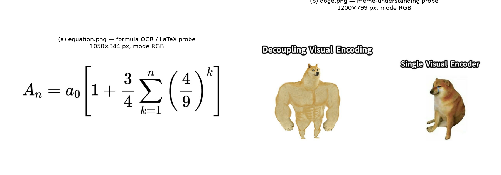

*Figure 1. The two provided probe images.*

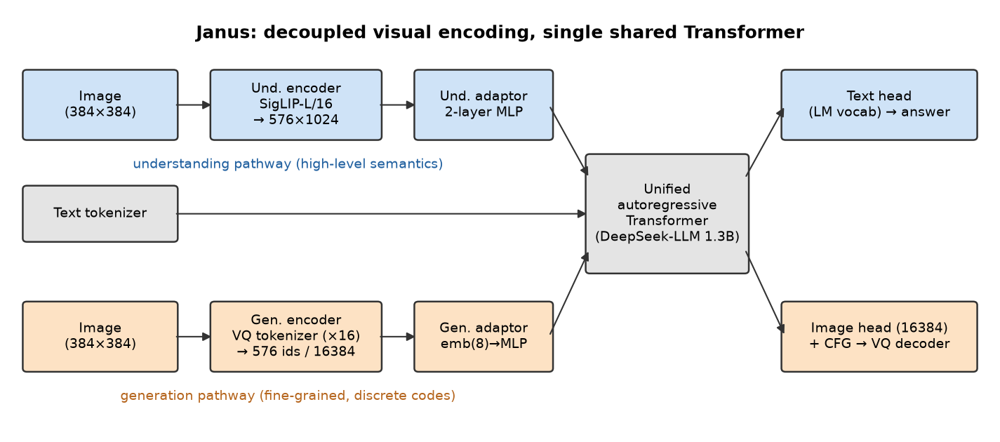

*Figure 2. The decoupled-encoding architecture as instantiated in Janus-1.3B. Dimensions are verified from the checkpoint config.*


## 1. Introduction

Unified multimodal models try to understand images (visual question answering, OCR, reasoning) and generate them (text-to-image) with one autoregressive Transformer. Earlier unified designs feed one visual encoder to both tasks: Chameleon's VQ tokenizer, LWM, Show-o, and others. The two tasks pull that encoder in opposite directions:

- **Understanding** needs *high-level semantics*: what objects are present, what the text says, what is meant. Semantic encoders such as SigLIP (Zhai et al., 2023), trained contrastively on image–text pairs, supply this, and LLaVA-style models (Liu et al., 2023) project such features into the LLM.
- **Generation** needs *low-level, spatially precise detail* in a *discrete* code that a next-token predictor can sample, and that a decoder can turn back into pixels. VQ tokenizers in the LlamaGen line (Sun et al., 2024) supply this.

Janus (Wu et al., 2024, "Janus: Decoupling Visual Encoding for Unified Multimodal Understanding and Generation") resolves this tension by **decoupling the visual encoding**. Understanding images go through a SigLIP encoder and an understanding adaptor. Generated images are represented by VQ codes, which enter through a generation adaptor and leave through a dedicated image head. Both streams are processed by *the same* autoregressive Transformer (DeepSeek-LLM 1.3B). Figure 2 summarises the architecture.

**Our goals:**
1. Run the framework end-to-end on the provided probe data, plus the paper's T2I showcase subject.
2. Verify the qualitative claims of the paper's showcase figures:
   - formula→LaTeX OCR;
   - explaining the "Decoupling Visual Encoding vs. Single Visual Encoder" meme;
   - a text-to-image rendering of the two-faced god Janus.
3. Look for *mechanistic* evidence, inside the released model, that the two pathways encode different information. We test this with:
   - a pathway-swap experiment;
   - VQ reconstruction;
   - embedding-geometry analysis;
   - a semantic-vs-pixel probe of the two encoders.

**Scope and honesty statement.** No GPU was available. The machine had 2 CPU cores on a heavily shared host (load average about 190), so the 3-stage Janus training (adaptor warm-up, unified pre-training, supervised fine-tuning) on about 10⁸ samples could not be repeated. **Every result below comes from inference with the released `deepseek-ai/Janus-1.3B` checkpoint.** We ran the official open-source code, patched only to run on CPU. Our own contributions are:
- the evaluation protocol;
- the robustness sweep;
- the probes;
- the analysis.

At about 4 s per decoded token, one understanding query took 1–29 min and one 2-image generation took 39–65 min. Sample sizes are therefore small, and they are stated for every experiment.

## 2. Method

### 2.1 The decoupled framework (as implemented in the released model)
Table 1 lists the components. Each entry was verified from `config.json` and the official code.

| Component | Understanding path | Generation path |
|---|---|---|
| Visual encoder | SigLIP-Large/16 @384 (`siglip_large_patch16_384`), last layer → 24×24 = 576 tokens × 1024-d | VQ tokenizer (LlamaGen-style VQ-16), downsample ×16 → 24×24 = 576 discrete codes, codebook 16 384 × 8-d |
| Adaptor into the LLM | `aligner`: 2-layer GELU MLP 1024→2048 | `gen_embed` (16 384×8) followed by `gen_aligner`, a 2-layer GELU MLP 8→2048 |
| Shared backbone | DeepSeek-LLM 1.3B (24 layers, d = 2048, 16 heads, vocab 102 400), causal attention | same weights |
| Output head | LM head over the text vocabulary | `gen_head`: 2-layer MLP 2048→16 384 image-code logits |
| Decoding | greedy / sampling of text tokens | 576 sampled codes → VQ decoder → 384×384 RGB |

In an understanding sequence, the 576 aligned SigLIP vectors replace the `<image_placeholder>` tokens between `<begin_of_image>` and `<end_of_image>`. Generation follows `… prompt … <begin_of_image>`: the model autoregressively predicts 576 codes, and each sampled code is fed back through `gen_embed→gen_aligner`. Classifier-free guidance (CFG) is applied to the logits:

ℓ = ℓ_uncond + s·(ℓ_cond − ℓ_uncond)

The unconditional branch is the same sequence with the prompt tokens replaced by `<pad>`. This replacement mirrors the 10% text dropout used in training.

### 2.2 Execution environment and patches
We used the official repository `deepseek-ai/Janus`, downloaded as a GitHub zip, together with the `deepseek-ai/Janus-1.3B` weights (4.18 GB safetensors). The weights were fetched with our own resumable, parallel HTTP-range downloader, `code/download_hf.py`. Software: `torch 2.15 (CPU)`, `transformers 4.44.2`, `timm 1.0`.

Two patches were needed, and neither changes model numerics beyond kernel choice:
1. The obsolete `attrdict` package does not work on Python ≥3.10. We replaced it with a 10-line `AttrDict(dict)` shim in `code/shims/attrdict.py`.
2. The checkpoint config requests `flash_attention_2`, which does not run on CPU. We overrode `language_config._attn_implementation = "sdpa"`.

The model runs in **fp32**, whereas the official GPU scripts use bf16. Small numerical differences can therefore change greedy-decoded text relative to the paper's figures. The model loads in about 7 s. The shared loader is `code/janus_common.py`.

### 2.3 Protocols
- **Understanding** (`code/understand.py`):
  - Uses the official `deepseek_old` SFT template with the official system prompt, and `<image_placeholder>\n{question}` as the user turn.
  - Images are padded to a square with grey (127,127,127) and resized to 384².
  - Greedy decoding, `max_new_tokens = 512`, as in the official `inference.py`.
  - Multi-turn questions re-feed the full dialogue history.
  - Every raw answer is stored in `outputs/understanding_*.jsonl`.
- **Formula scoring** (`code/score_latex.py`):
  - We hand-transcribed the ground truth from `data/equation.png`: `A_n = a_0 \left[ 1 + \frac{3}{4} \sum_{k=1}^{n} \left( \frac{4}{9} \right)^k \right]`.
  - The formula is extracted from the answer's `\[..\]`, `$$..$$` or fenced code.
  - Normalisation removes `\left`/`\right`, whitespace and `$`, and collapses single-character braces (`{x}`→`x`).
  - We report the Levenshtein distance and its normalised version (NED), check bracket balance, and **re-render** the LaTeX with matplotlib mathtext as a compile check.
- **Robustness sweep:** 9 degraded copies of the formula image. A 14-condition grid was planned and cut to 9 because of CPU time:
  - down-scaling to 0.25/0.12;
  - Gaussian blur σ = 3/5;
  - additive Gaussian noise σ = 50/80;
  - rotation 15°/30°;
  - JPEG quality 10.
  Each copy is scored by NED (`code/robust_tf.py`).
- **Text-to-image** (`code/generate_t2i.py`):
  - The official CFG loop: temperature 1, 576 tokens, `gen_head` logits, and re-embedding of each sampled code with `prepare_gen_img_embeds`, followed by `decode_code` to 384².
  - Default CFG s = 5, n = 2 images per prompt, fixed seeds.
  - We inspected each image visually. CLIPScore (ViT-B/32, 100·max(cos, 0)) is supporting evidence only.
- **Mechanistic probes** (`code/probe_pathways.py`, `code/probe_encoders.py`): see §5.


## 3. Results I — Multimodal understanding through the SigLIP pathway

All answers below are **complete and verbatim**: greedy decoding, `max_new_tokens = 512`, fp32 CPU, released Janus-1.3B. The raw records are in `outputs/understanding_core.jsonl`. Wall-clock times are for a single query on 2 shared CPU cores.

### 3.1 Showcase 1 — Formula → LaTeX (`data/equation.png`)

**Prompt:** `Convert the formula into latex code.` (the official `inference.py` example, 316 s)

```text
Sure, here is the LaTeX code for the formula:

\[ A_n = a_0 \left[ 1 + \frac{3}{4} \sum_{k=1}^{n} \left( \frac{4}{9} \right)^k \right] \]

This is the LaTeX code for the given formula.
```

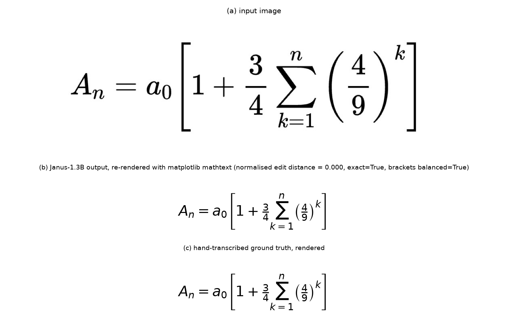

*Figure 3. (a) Input image. (b) The model's LaTeX, extracted from the `\[ … \]` block and re-rendered with matplotlib mathtext. (c) Our hand-transcribed ground truth, rendered the same way.*

**Analysis (match):**

| Check | Result |
|---|---|
| Exact match after normalisation | **yes**: edit distance 0, NED 0.000 |
| Sub-structures recovered | subscripts `A_n`, `a_0`; the fraction `\frac{3}{4}`; summation limits `_{k=1}^{n}`; the inner fraction `\frac{4}{9}`; the outer exponent `^k` placed *outside* the parentheses; auto-sized delimiters `\left[ … \right]` and `\left( … \right)` matching the tall brackets in the image |
| Brackets balanced | yes |
| Compiles / renders | yes (mathtext, Fig. 3b; visually identical to the input) |
| Raw (un-normalised) string vs. ground truth | identical character for character |

This reproduces the formula-recognition showcase of the Janus paper qualitatively. Two follow-up questions on the same image test how far the understanding goes beyond transcription.

**Follow-up A, `Describe this image in detail.`** (1 729 s; verbatim):

```text
The image displays a mathematical expression involving a matrix and summation. The expression is:

\[ A_n = a_0 \left[ 1 + \frac{3}{4} \sum_{k=1}^{n} \left( \frac{4}{9} \right)^k \right] \]

Here is a detailed breakdown of the components:

1. **Matrix Representation**:
   - The expression is written as a matrix, where each element is represented by a variable.
   - The matrix is denoted as \( A_n \).

2. **Matrix Elements**:
   - The first element of the matrix is \( a_0 \).
   - The second element is \( 1 + \frac{3}{4} \sum_{k=1}^{n} \left( \frac{4}{9} \right)^k \).
   - The third element is \( \left( \frac{4}{9} \right)^k \).

3. **Summation**:
   - The summation is denoted by \( \sum_{k=1}^{n} \left( \frac{4}{9} \right)^k \).
   - This summation is repeated \( n \) times, indicating that the sum is calculated for each index \( k \) from 1 to \( n \).

4. **Summation Term**:
   - The term \( \left( \frac{4}{9} \right)^k \) is a mathematical expression involving the fraction \( \frac{4}{9} \).
   - This fraction is repeated \( k \) times, indicating that the sum is calculated for each \( k \) from 1 to \( n \).

5. **Mathematical Operations**:
   - The expression involves arithmetic operations such as addition, multiplication, and exponentiation.
   - The exponentiation is performed using the exponentiation operator \( \left( \frac{4}{9} \right)^k \).

6. **Mathematical Context**:
   - This expression is likely used in a mathematical or computational context, possibly for solving a problem involving matrix operations or for performing calculations involving fractions and exponents.

In summary, the image presents a matrix expression involving summation and arithmetic operations, where the matrix elements are calculated using a specific formula involving fractions and exponents.
```

The transcription is again exact. The interpretation, however, is **hallucinated**: the expression is called a "matrix" with "elements", most likely because the large square brackets resemble matrix delimiters. The summation and exponent descriptions are correct but superficial.

**Follow-up B (second dialogue turn), `What is the value of A_n as n approaches infinity? Show your reasoning.`** (811 s; verbatim):

```text
As n approaches infinity, the value of A_n will approach 1. This is because the sum of the terms in the series converges to 1 as n increases without bound. Specifically, the sum of the terms in the series is given by:

\[ \sum_{k=1}^{n} \left( \frac{4}{9} \right)^k = \frac{4}{9} \sum_{k=1}^{n} k^9 = \frac{4}{9} \left( 1 + \frac{3}{4} \sum_{k=1}^{n} k^4 \right) \]

As n approaches infinity, the term \(\frac{4}{9} \sum_{k=1}^{n} k^9\) approaches 1, and the sum of the terms \(\sum_{k=1}^{n} k^4\) approaches 1. Therefore, as n approaches infinity, the value of A_n will approach 1.
```

The correct value is A_∞ = a₀[1 + ¾·(4/9)/(1−4/9)] = a₀(1 + ¾·⅘) = **8/5·a₀**. The model's answer of 1 is wrong. Its algebra is invalid: (4/9)^k becomes k⁹, and a divergent Σk⁹ is said to "approach 1". It also drops a₀.

So the 1.3B model *perceives* the formula perfectly but cannot *reason* about it. This is consistent with the paper's positioning of Janus-1.3B, a small LLM with limited mathematical ability. It also shows that the OCR success is a perceptual result of the SigLIP pathway, not general mathematical competence.

### 3.2 Showcase 2 — Meme understanding (`data/doge.png`)

The image (Fig. 1b) shows a muscular, standing "Swole Doge" under the caption **"Decoupling Visual Encoding"**. Opposite it, a small, sitting, tearful Shiba ("Cheems") sits under **"Single Visual Encoder"**. The intended message: decoupled encoding is the strong approach and a single shared encoder is the weak one.

**Prompt 1 (standard open-ended meme prompt): `Explain this meme.`** (463 s; verbatim, complete):

```text
The meme compares two different approaches to visual encoding: "Decoupling Visual Encoding" and "Single Visual Encoder." The left side of the meme shows a muscular, cartoonish representation of a dog, which is a visual encoding technique that separates the visual data into different layers or components. The right side of the meme shows a more relaxed, cartoonish representation of the same dog, which is a single visual encoder that processes the visual data as a single unit. The meme uses the image of the dog to visually represent the concept of decoupling and the single encoder, with the muscular dog symbolizing the decoupling technique and the more relaxed dog symbolizing the single encoder.
```

**Prompt 2: `What text is written in this image? Transcribe it exactly.`** (48 s; verbatim):

```text
Decoupling Visual Encoding Single Visual Encoder
```

**Prompt 3: `Which dog looks stronger, the left one or the right one? What is written above each dog, and what does this comparison suggest?`** (344 s; verbatim):

```text
The left dog, which is the muscular one, appears to be stronger than the right dog. This comparison suggests that the left dog represents a method or system that is more robust or capable of handling more complex tasks or data, as it is depicted with a muscular build and a confident posture. In contrast, the right dog, which is the sitting dog, represents a simpler or less robust method, as it is depicted in a more relaxed posture and does not appear to have the same level of strength or capability.
```

**Prompt 4: `Why is this meme funny? Describe the appearance and posture of each dog, the text above each one, and what each dog represents.`** (1956 s; verbatim, complete):

```text
The meme is funny because it uses a visual pun to contrast two different approaches to image encoding. The image of the muscular dog on the left represents the "Decoupling Visual Encoding," which is a technique where the visual features of an image are encoded separately from the semantic meaning. This is visually represented by the dog's exaggerated muscles, which symbolize the emphasis on visual features over semantic meaning.

The image of the sitting dog on the right represents the "Single Visual Encoder," which is a more traditional approach to image encoding where the visual features of an image are encoded as a single unit. This is visually represented by the dog's more relaxed posture and the lack of emphasis on muscles, which symbolize the focus on the semantic meaning of the image.

The text above each dog reads "Decoupling Visual Encoding" and "Single Visual Encoder," respectively, which further emphasizes the contrast between the two approaches. The humorous aspect lies in the visual pun, where the muscular dog represents the decoupling of visual features from semantic meaning, while the sitting dog represents the single visual encoder approach.
```

**Prompt 5: `This meme was made by the authors of a research paper. Which approach do they think is better, and how does the image convey that?`** (1176 s; verbatim, complete):

```text
The meme uses the image of the Shiba Inu dog to convey that the approach of "Decoupling Visual Encoding" is better than the approach of "Single Visual Encoder." This is because the image of the muscular, less-than-fit Shiba Inu represents the idea of a more efficient and powerful encoding system, which is the approach of "Decoupling Visual Encoding." In contrast, the image of the sitting Shiba Inu represents the "Single Visual Encoder," which is the approach of "Decoupling Visual Encoding." The visual content of the image is used to illustrate the difference between these two approaches, with the muscular dog symbolizing the more efficient and powerful encoding system.
```


**Element-by-element annotation** (✓ correct, ~ partially correct, ✗ wrong or hallucinated):

| Element | What the model said | Verdict |
|---|---|---|
| Embedded text (OCR) | "Decoupling Visual Encoding" and "Single Visual Encoder", spelled and capitalised exactly (P1, P2) | ✓ |
| Text ↔ image binding | Left/muscular ↔ "Decoupling Visual Encoding"; right ↔ "Single Visual Encoder" (P1) | ✓ |
| Topic of the meme | "compares two different approaches to visual encoding" (P1) | ✓ |
| Left dog: appearance and pose | "muscular, cartoonish" (P1); "muscular build and a confident posture" (P1, P3) | ✓ (the "cartoonish" reading fits the photoshopped body) |
| Right dog: appearance and pose | "more relaxed" (P1); "the sitting dog … more relaxed posture" (P3) | ~ the sitting pose is right; the **tears and sad expression are missed**, and "relaxed" softens the intended "weak / pathetic" reading |
| Identity of the dogs | "the same dog" (P1); "the Shiba Inu dog" (P5) | ~ the breed is right (P5), but these are two different meme characters (Swole Doge and Cheems), not "the same dog" |
| Symbolism | "muscular dog symbolizing the decoupling technique and the more relaxed dog symbolizing the single encoder" (P1) | ✓ |
| Evaluative message (who wins) | P1: only implicit. P3: the left is "stronger … more robust or capable of handling more complex tasks"; the right is "a simpler or less robust method … does not appear to have the same level of strength or capability". P5: "convey that the approach of 'Decoupling Visual Encoding' is better than the approach of 'Single Visual Encoder'", with the muscular dog as "a more efficient and powerful encoding system" | ✓ when asked directly (P3, P5); ~ in the open-ended explanation |
| Internal consistency | P5: "muscular, less-than-fit Shiba Inu"; the sitting dog "represents the 'Single Visual Encoder,' which is the approach of 'Decoupling Visual Encoding'" | ✗ self-contradictory slips |
| Technical gloss of "decoupling" | "separates the visual data into different layers or components" (P1); "visual features of an image are encoded separately from the semantic meaning … muscles … symbolize the emphasis on visual features over semantic meaning" (P4) | ✗ hallucinated. In Janus, decoupling means *separate encoders for understanding (semantic) and generation (pixel/VQ)*; the muscles stand for strength, not "visual features" |
| Technical gloss of "single encoder" | "processes the visual data as a single unit" (P1) | ~ vague but not wrong |
| Humour | P1: not explained. P4: "the humorous aspect lies in the visual pun …", which names a pun but never says the joke is the exaggerated strong-vs-pathetic (crying) contrast as a boast about the authors' own method | ~ only partly explained |
| Text placement | P4: "The text above each dog reads 'Decoupling Visual Encoding' and 'Single Visual Encoder,' respectively" | ✓ |
| Instruction following | P3 asked "what is written above each dog?" and the answer omits it | ✗ partial omission |

**Match against the paper's showcase.** The paper's Figure 5 presents Janus explaining this meme as a contrast between the strong decoupled design and the weak single-encoder design. Our run of the released 1.3B checkpoint reproduces:
- the OCR;
- the left↔right binding of captions to dogs;
- the "muscular = decoupling, weaker = single encoder" symbolism;
- with a direct question, the "stronger / more capable vs. less robust" evaluation (P3) and the conclusion that the authors consider decoupling "better" (P5).

It does **not** reproduce:
- an explicit statement of the joke in the open-ended prompt;
- the crying, sad cue.

It also adds hallucinated technical glosses (P1, P4) and a self-contradiction (P5). The divergence may partly come from fp32 vs. bf16 numerics under greedy decoding. It may also reflect that the paper's figure answers are the best qualitative examples rather than typical ones.

Overall, the SigLIP pathway delivers the semantic and OCR content needed to understand the meme. The 1.3B language model's commentary on that content is shallow.


### 3.3 Robustness of formula recognition to image degradations
We asked whether the exact transcription is a fragile best case. The same prompt was run on 9 degraded copies of `equation.png`, one greedy decode per condition, about 4 min each. The full answers are in `outputs/understanding_robust.jsonl`.

| Condition | NED | Extracted LaTeX (verbatim) | Error type |
|---|---|---|---|
| clean | **0.000** | `A_n = a_0 \left[ 1 + \frac{3}{4} \sum_{k=1}^{n} \left( \frac{4}{9} \right)^k \right]` | none |
| scale 0.25 (262 px wide) | **0.000** | identical | none |
| scale 0.12 (126 px wide) | 0.111 | `… \left( \frac{4}{9} \right)^{n-1} \right]` | exponent `k` → `n-1` (prior-driven guess) |
| Gaussian blur σ = 3 | **0.000** | identical | none |
| Gaussian blur σ = 5 | 0.073 | `A_n = a_0` ⏎ `1 + \frac{3}{4} \sum_{k=1}^{n} \left( \frac{4}{9} \right)^n` | outer `[ ]` dropped; exponent `k`→`n` |
| Gaussian noise σ = 50 | **0.000** | identical | none |
| Gaussian noise σ = 80 | **0.000** | identical | none |
| rotation 15° | 0.128 | `A_n = a_0 \left[ \left\| \left\{ 1 + … \right)^k \right\} \right\| \right]` | spurious `\|…\|` and `\{…\}` delimiters |
| rotation 30° | 0.507 | `A_n = a_0 \| \left\{ \begin{matrix} 1 + \frac{3}{n} \sum_{k=1}^{n} \frac{4}{9} \end{matrix} \right\} \|` | structure lost: `\frac{3}{n}`, missing power and parentheses, matrix hallucination |
| JPEG quality 10 | 0.049 | `A_n = a_0` ⏎ ` 1 + \frac{3}{4} \sum_{k=1}^{n} \left( \frac{4}{9} \right)^k` | outer `[ ]` dropped |

(⏎ marks a line break inside the model's ```latex block. `\|` in the table stands for a literal `|`.)

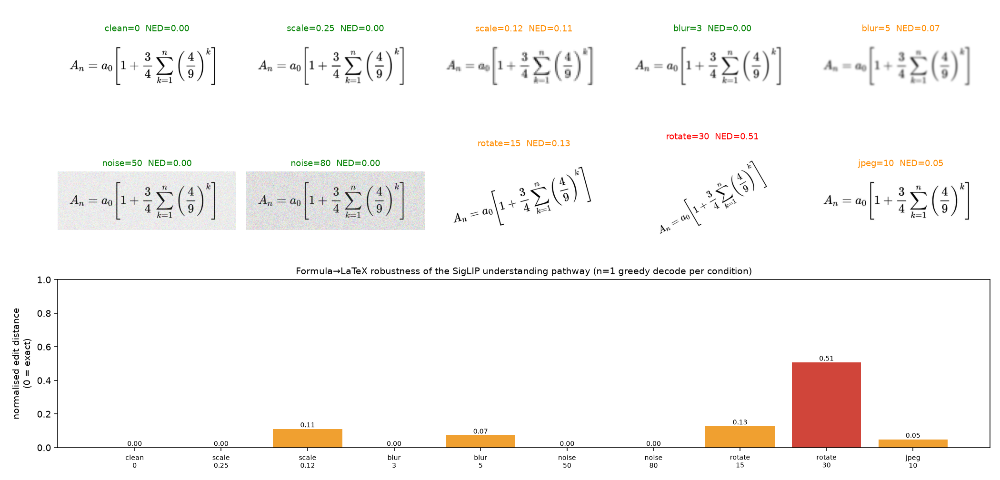

*Figure 4. Degraded inputs (top two rows) and normalised edit distance of the extracted LaTeX (bottom). n = 1 greedy decode per condition, so differences of a few characters should not be over-interpreted.*

**Findings.**
1. Transcription is **exact under strong additive noise (σ up to 80/255), moderate blur and 4× down-scaling**. The SigLIP semantic encoder at 384² tolerates photometric corruption well.
2. When the image falls below roughly 130 px or is heavily blurred, the model keeps the overall *structure* but substitutes a **language-prior guess** for the smallest glyph (the exponent `k` → `n-1` or `n`). It also tends to drop the large brackets.
3. **Geometric** corruption hurts most. Rotation by 30° breaks the 2-D layout parsing (NED 0.51) and triggers the same "matrix" hallucination seen in §3.1. SigLIP and the OCR fine-tuning data presumably contain few rotated formulas.
4. All outputs remained bracket-balanced, syntactically valid LaTeX.


## 4. Results II — Text-to-image generation through the VQ pathway

### 4.1 Showcase 3 — the two-faced Roman god Janus
The paper's T2I showcase depicts its namesake: Janus, the Roman god with two faces that look in opposite directions, toward the past and the future. Typical renderings contrast an old face with a young one. We did not have the paper's exact prompt text, so we wrote two detailed prompts that state the required attributes explicitly:
- two faces on one head;
- old vs. young;
- cool vs. warm palette.

We generated n = 2 images per prompt with the official sampler (CFG 5, temperature 1). Each 2-image batch took 39–65 min on the shared CPU.

**Attempt 1** (seed 0). *Prompt:* "A highly detailed portrait of Janus, the two-faced Roman god, depicted as a single head with two faces looking in opposite directions. The left face is an old, wise man with a long white beard and deep wrinkles, painted in cool silver and blue tones; the right face is a young, beardless man with smooth skin, painted in warm golden and orange tones. Classical marble sculpture style, dramatic lighting, dark background, masterpiece, 8k."

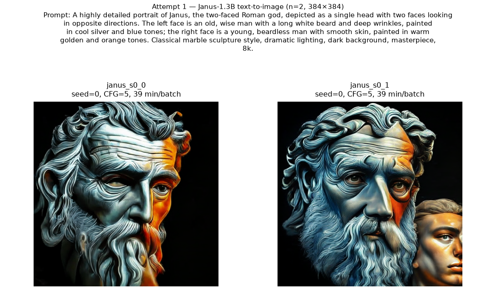

*Figure 5. Attempt 1, both samples (384×384, unedited).*

**Attempt 2** (seed 1, rephrased toward classical "double-herm" iconography). *Prompt:* "Janus, the ancient Roman god of beginnings and endings, a marble bust with two faces joined at the back of one head, facing left and right in profile. One face is a wrinkled elderly man with a flowing white beard, lit in cold blue moonlight; the other face is a youthful smooth-skinned man, lit in warm golden sunlight. Symmetrical composition, highly detailed, dramatic contrast, dark background."

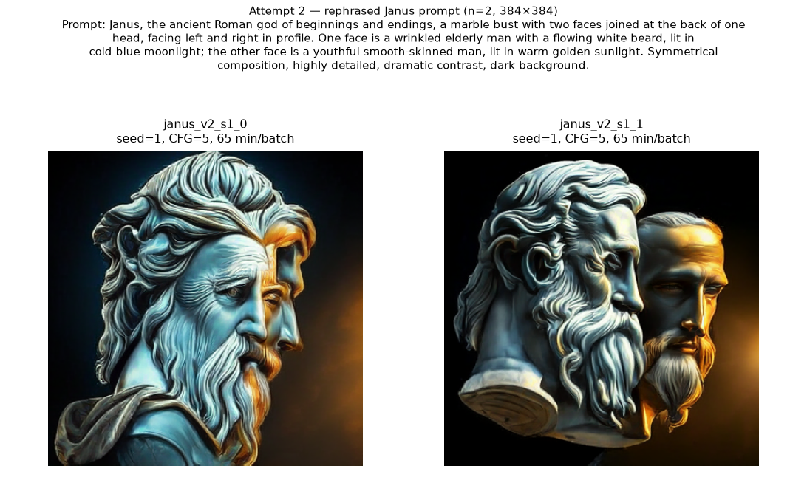

*Figure 6. Attempt 2, both samples.*

**Visual inspection** (by us, image by image):

| Sample | Two faces present? | Old vs. young contrast | Cool vs. warm palette contrast | Faces looking in opposite directions / one head? | Style and artefacts |
|---|---|---|---|---|---|
| attempt 1, #0 | ✗ one face only | ✗ only the old, bearded, deeply wrinkled face | ✓ split palette: the left half of the face is silver-blue, the right half orange-gold, as if the two colour schemes were applied to the two *halves* of one face | ✗ | Convincing marble or painted-sculpture texture, sharp hair and beard; orange "flame" artefacts at the right edge |
| attempt 1, #1 | ✓ two faces | ✓ large old, white-bearded, wrinkled face; small young, beardless, smooth-skinned face at lower right | ✓ old face cool blue-grey; young face warm flesh/orange tones | ✗ two separate heads side by side, not one two-faced head; the young face is cropped by the frame | Clean, little texture noise; mismatched scales |
| attempt 2, #0 | ✓ two profiles fused into one bust (shared hair mass) | ~ front face old and white-bearded; rear face less wrinkled but also bearded | ✓ front face cold blue/white, rear face warm gold | ~ one head ✓, but both profiles face the **same** way (right) instead of opposite | Fused hairline and a doubled nose/brow contour where the profiles overlap |
| attempt 2, #1 | ✓ two faces on one marble bust, including the bust's carved base | ~ front face old with a long white beard; rear face younger-looking but with a beard | ✓ front cold blue-white stone, rear golden-lit | ~ one bust ✓, but both face right (offset double profile) | The most sculptural and coherent sample; minor smearing of the rear face's ear |

**Match / mismatch with the showcase.**
- **Matched:**
  - The model recognises the concept "two-faced Janus" well enough to produce a *multi-face* image in 3 of 4 samples.
  - It reliably honours the **colour semantics** in 4 of 4 samples: the "cool silver/blue" vs. "warm golden/orange" split appears every time and is assigned to the right face (the old face is cool).
  - It renders a convincing classical-sculpture style.
  - Attempt 2 produces the characteristic *one bust, two faces* structure of Roman Janus sculptures.
- **Not matched:**
  - In no sample do the faces point in **opposite** directions; they form a parallel or offset double profile.
  - The "young, beardless" attribute is applied only once (attempt 1 #1). Elsewhere the second face inherits the beard of the first.

  This is the familiar *attribute-binding* failure of small T2I models. Attributes such as "old" and "beard" leak from one entity to the other, and spatial relations such as "opposite directions" are weakly controlled. The follow-up Janus-Pro report (bundled with the official code) likewise describes the original Janus as less stable and less detailed than its successor, at a resolution of only 384×384.

### 4.2 Closing the loop: the understanding pathway inspects its own generations
Because both tasks live in one model, the *understanding* pathway (SigLIP) can evaluate images that the *generation* pathway (VQ) produced. We asked: `How many faces does this sculpture have? Describe each face (age, beard, colour of lighting) and the direction it is looking.` (greedy, verbatim):

**`janus_v2_s1_1.png`** (670 s):

```text
The sculpture has two faces. The face on the left is older, with a long, wavy beard and a more mature, weathered appearance. The face on the right is younger, with a shorter beard and a more defined, clean-shaven look. The older face is looking to the left, while the younger face is looking forward.
```

**`janus_s0_1.png`** (848 s):

```text
The sculpture has two faces. The first face is an older man with a long, wavy beard and a stern expression. The second face is a younger man with a more neutral expression. The older man's face is on the left side of the image, and the younger man's face is on the right side. The older man's face is looking slightly to the left, while the younger man's face is looking straight ahead.
```

For both images, the understanding pathway correctly reports **two faces** and an **older vs. younger** pairing. Its other claims are less reliable:
- **Wrong:** the gaze directions. In `janus_v2_s1_1`, both profiles face right.
- **Self-contradictory:** "a shorter beard and a more defined, clean-shaven look".
- **Ignored:** the lighting colours that the question asked about.

The two images were rendered by the VQ pathway and read through an independent encoder. The pathways therefore agree on the coarse semantics the prompt asked for. They are not mere code-book artefacts of the generator.

### 4.3 CLIPScore (supporting evidence only)
We computed CLIPScore = 100·max(cos, 0) with OpenAI CLIP ViT-B/32 (n = 1 image per row) for three texts:
- **own:** the full generation prompt, truncated to 77 tokens;
- **short:** "Janus, the two-faced Roman god with an old face and a young face" for the Janus images, the own prompt otherwise;
- **neg:** an unrelated control, "A photo of a red sports car parked on a city street."

| Image | own prompt | short Janus caption | unrelated control |
|---|---|---|---|
| `janus_cfg10_s0_0.png` | 31.1 | 24.0 | 9.5 |
| `janus_cfg1_s0_0.png` | 27.6 | 23.7 | 8.6 |
| `janus_s0_0.png` | 31.7 | 25.5 | 12.2 |
| `janus_s0_1.png` | 31.0 | 27.3 | 11.4 |
| `janus_v2_s1_0.png` | 28.9 | 26.9 | 10.1 |
| `janus_v2_s1_1.png` | 31.6 | 29.4 | 9.4 |
| `readme_opera_s0_0.png` | 34.0 | 34.0 | 12.7 |
| `readme_opera_s0_1.png` | 28.9 | 28.9 | 12.8 |

Every image scores 2.3–3.4× higher on its own prompt than on the control, so the generations are prompt-relevant. CLIPScore is, however, **blind to the compositional errors** identified above. The single-face sample `janus_s0_0` has the *highest* own-prompt score of the Janus images, and the short "old face and young face" caption separates samples by only about 4 points. This is why we rely on the explicit visual inspection in §4.1.


### 4.4 A second showcase prompt (official README example)
To check that the Janus result is not specific to one subject, we also ran the T2I prompt that ships with the official `generation_inference.py`: "A close-up high-contrast photo of Sydney Opera House sitting next to Eiffel tower, under a blue night sky of roiling energy, exploding yellow stars, and radiating swirls of blue." Settings were seed 0, CFG 5, n = 2, and the batch took 34 min.

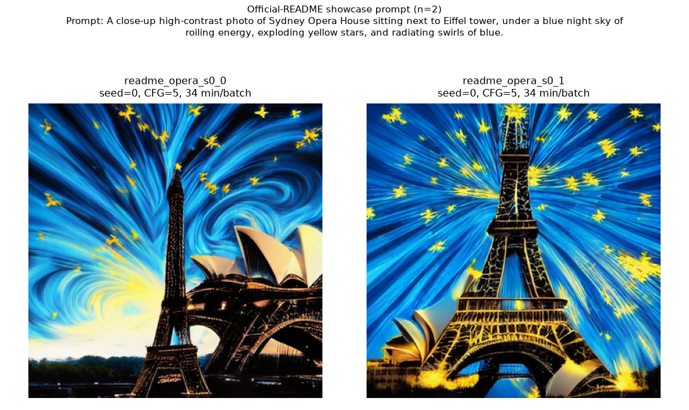

*Figure 9. Official README prompt, both samples.*

**Inspection.**
- **Both landmarks:** present in both samples. The Eiffel Tower lattice and the Opera House's white shell roofs are recognisable.
- **Juxtaposition:** "sitting next to" is respected.
- **Sky:** in both images the sky is a van-Gogh-like field of blue swirls and radial streaks with yellow star bursts, matching "roiling energy, exploding yellow stars, radiating swirls of blue".
- **Artefacts:** in #0 the lower Eiffel structure fuses with the Opera House arches into a hybrid bridge-like form. In #1 the Opera House is reduced to a small fragment at the lower left, and the tower's lattice is irregular.

This is the same pattern as for Janus: global semantics and style are honoured, and the fine object structure and the boundaries between entities are where errors appear.
### 4.5 Effect of classifier-free guidance
We re-ran the attempt-1 Janus prompt at CFG s = 1 (no guidance; the conditional logits alone) and s = 10, with seed 0 and n = 1 each. These runs took 31–32 min each, and we compare them with the two s = 5 samples. Because the batch size differs, the s = 1/10 samples do not share the noise trajectory of the s = 5 samples, so this is a qualitative trend at n = 1 per setting.

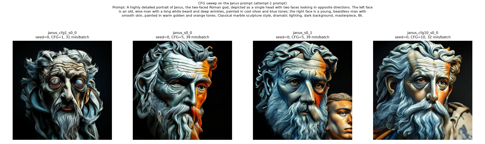

*Figure 10. The same prompt at CFG 1, 5 (both samples) and 10.*

| CFG | Faces | Palette contrast | Anatomy and quality | CLIPScore (own prompt) |
|---|---|---|---|---|
| 1 | 1 (old) | weak: mostly grey-blue, faint orange accents | distorted, bulging eyes; warped mouth; noisy drapery | 27.6 |
| 5 | 1 and 2 | strong blue vs. orange | clean sculptural detail; the second face in 1 of 2 samples | 31.7 / 31.0 |
| 10 | 1 (old, frontal) | moderate: blue face with an orange right flank | clean, symmetric, slightly over-saturated "painted" look | 31.1 |

Guidance is what makes the prompt's attributes appear. Without it (s = 1), the image keeps the gist ("old bearded sculpture") but loses both coherence and the colour instruction. Raising s from 5 to 10 improves anatomical cleanliness but does not add the second face, and it reduces diversity. CFG 5, the official default, gave the best trade-off in our small sample. CLIPScore follows the same ordering (s = 1 lowest), but the differences between s = 5 and s = 10 are within noise.

The README images score 34.0 and 28.9 on their own prompt, against 12.7–12.8 for the control.


## 5. Results III — Mechanistic evidence for decoupling inside the released model

The paper's central argument is that understanding and generation need *different* visual representations. Showing that the decoupled model works does not test this. We therefore probed whether the two encoders of the released model actually carry different information, and whether the shared Transformer can use one in place of the other.

### 5.1 Pathway swap: can the understanding head read the generation encoder?
Each probe image was encoded with the generation encoder (VQ → 576 codes). The codes were embedded with `gen_embed → gen_aligner`, which is exactly how the model consumes its own generated image tokens. We then inserted these 576 vectors into the `<image_placeholder>` slots of the understanding prompt, **in place of** the SigLIP → aligner vectors, and decoded greedily (160 tokens). We used two settings:
- as is;
- with the three image special tokens (`<begin_of_image>`, `<end_of_image>`, `<image_placeholder>`) banned through `bad_words_ids`.

The SigLIP baseline was produced through the same manual code path. It reproduces the official pipeline's answers token for token, which validates the harness.

| Image | Visual input to the LLM | Decoded answer (first characters, verbatim) |
|---|---|---|
| equation | SigLIP → und. adaptor | `Sure, here is the LaTeX code for the formula: \[ A_n = a_0 \left[ 1 + \frac{3}{4} …` (exact, as in §3.1) |
| equation | VQ → gen. adaptor | `<end_of_image>` × 160 (all 160 tokens) |
| equation | VQ → gen. adaptor, image tokens banned | `������[��������������ﻥ����������������市场上���…` (invalid byte tokens; no words) |
| doge | SigLIP → und. adaptor | `The meme compares two different approaches to visual encoding: "Decoupling Visual Encoding" and "Single Visual Encoder." …` (as in §3.2) |
| doge | VQ → gen. adaptor | `<end_of_image>` × 160 |
| doge | VQ → gen. adaptor, image tokens banned | `��������[��[��[��[��[������[����[���…` |

When the language model sees generation-pathway embeddings, it behaves as if it were **in image-generation mode**: it tries to close the image (`<end_of_image>`). When that is forbidden, it collapses to byte-level noise. The shared Transformer has learned to treat the two input subspaces as *functionally different*. The VQ code embeddings carry no understanding signal that the text head can use, even though they come from the same image. This is direct behavioural evidence that the released model relies on the decoupled understanding encoder for comprehension.

### 5.2 What the generation encoder preserves: reconstruction and glyph fidelity
The VQ encode→decode round-trip on the 384² model inputs gives:

| Image | Reconstruction PSNR | Unique codes used (of 576 positions) |
|---|---|---|
| equation | 24.5 dB | 213 |
| doge | 22.5 dB | 311 |

Figures 7 and 7b show that **global layout, colour, the dogs' shapes and the bracket geometry are preserved, but glyph identity is not**:
- "Decoupling Visual Encoding" becomes an illegible string of letter-like blobs.
- In the formula, `a₀`→"o₀", `3`→"8"-like, `4`→"Λ", `9`→"θ", and `k=1` is smeared.

At 16× downsampling, each 8-d code covers a 16×16 patch, and its job is to support pixel synthesis, not symbol identity. A single VQ encoder shared by both tasks would therefore hand the LLM an input in which the very characters it must transcribe are already corrupted. This is exactly the conflict the decoupled design avoids. The SigLIP pathway reads the same 384² input perfectly (§3.1).

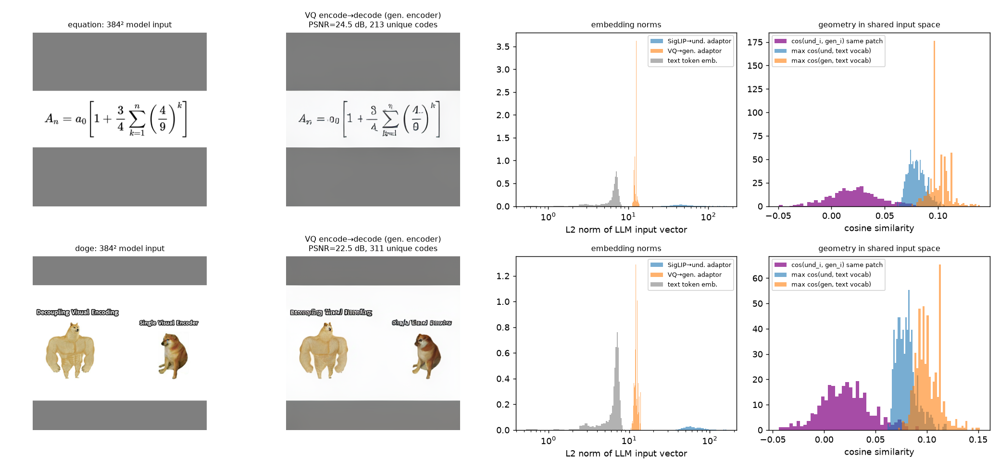

*Figure 7. Columns 1–2: the model input and its VQ reconstruction. Column 3: L2 norms of the LLM input vectors for SigLIP→aligner tokens (blue, broad, median ≈48–65), VQ→gen_aligner tokens (orange, tightly peaked, ≈12.3) and text token embeddings (grey, ≈6.9); log x-axis. Column 4: cosine similarities in the shared 2048-d input space.*

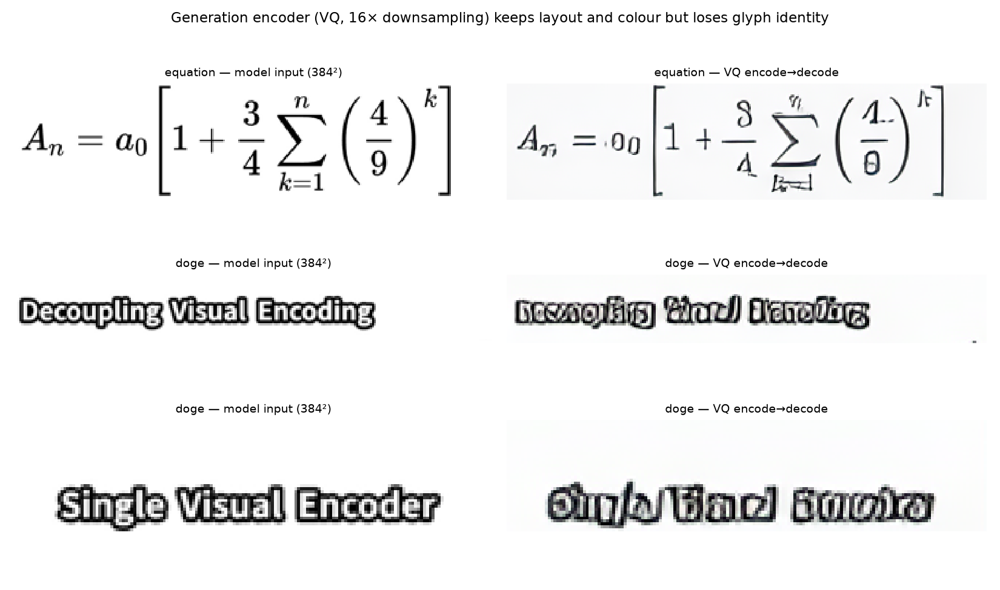

*Figure 7b. Zoomed crops: the VQ generation encoder keeps the layout but loses glyph identity.*

### 5.3 Geometry of the two adaptors in the shared input space
The quantities below are measured over the 576 image positions per image (`outputs/probes/*_geometry.npz`):
- **Norms (Fig. 7, col. 3).** The three input populations occupy disjoint norm shells:
  - understanding tokens have median ‖·‖ ≈ 48 (equation) / 65 (doge);
  - generation tokens ≈ 12.3–12.5, with a very narrow spread;
  - text embeddings ≈ 6.9.
  The understanding adaptor maps to vectors 4–5× larger than the generation adaptor's.
- **Alignment.** For the same image patch, the cosine between the understanding vector and the generation vector has mean **0.021** for both images. The two pathways embed the same content in essentially **orthogonal** directions.
- **Relation to text.** The nearest text-token embedding has cosine ≈0.08 for understanding tokens and ≈0.10 for generation tokens. Neither pathway is simply "translated into words". Both are continuous, non-lexical inputs.
- **Within-image diversity.** The mean pairwise cosine among the 576 tokens is 0.32/0.23 for understanding (equation/doge) and 0.47/0.32 for generation. Generation tokens are more mutually similar, consistent with an 8-d codebook projected into 2048-d.

Together with §5.1: the single Transformer hosts **two separable input subspaces** and routes them to different behaviours (text answer vs. image continuation). Unification happens in the shared weights, not in a shared visual representation.

### 5.4 Encoder dissociation on natural images (Imagenette)
To test the "semantic vs. pixel" trade-off beyond the two probe images, we encoded 120 natural images with both pathways: the first 12 validation images of each of the 10 Imagenette classes (ImageNet subset; tench … parachute, WNID `n03888257`). We then fitted two kinds of **linear** read-outs:
- **Semantics:** logistic-regression class probe (10-way; chance 0.10).
- **Pixel detail:** ridge regression to the image's 8×8 RGB thumbnail (192 targets; variance-weighted R²).

Both use 5-fold cross-validation, repeated with 3 shuffling seeds (mean ± s.d. over seeds). Features are taken *at the LLM's input*, i.e. after each adaptor, and are either mean-pooled over the 576 positions or average-pooled to a 4×4 spatial grid. The two pathways have identical dimensionality at each pooling level (`code/probe_encoders.py`, `code/analyze_encoder_probe.py`).

| Representation | Dim | Class-probe accuracy | Thumbnail R² |
|---|---|---|---|
| SigLIP output, mean-pooled | 1024 | 0.983 ± 0.000 | 0.109 ± 0.012 |
| SigLIP → und. adaptor, mean-pooled | 2048 | 0.983 ± 0.007 | 0.104 ± 0.010 |
| SigLIP → und. adaptor, 4×4 grid | 32768 | 0.972 ± 0.004 | 0.112 ± 0.009 |
| VQ → gen. adaptor, mean-pooled | 2048 | 0.394 ± 0.004 | 0.307 ± 0.002 |
| VQ → gen. adaptor, 4×4 grid | 32768 | 0.567 ± 0.027 | 0.516 ± 0.009 |

The mean VQ round-trip PSNR over these images is 24.2 ± 2.6 dB.

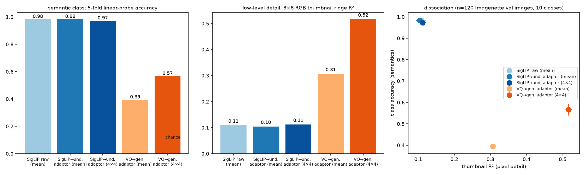

*Figure 8. Double dissociation between the two visual pathways of the same trained model.*

The result is a clean **double dissociation**:
- **Semantics:** the understanding pathway makes object category almost linearly separable (≈0.97–0.98 with only about 96 training images per fold). The generation pathway gives 0.39–0.57, far above chance but much worse.
- **Pixel detail:** the generation pathway's features predict the thumbnail far better (R² 0.31 mean-pooled, 0.52 with a 4×4 grid). SigLIP's features stay at R² ≈ 0.11 *even when spatial pooling is kept*: semantic training has discarded most colour and layout information.

The understanding adaptor fully preserves SigLIP's class separability (0.983 for both raw and adapted features). This is the quantitative form of the paper's motivating claim. Within the released model, *the information required for understanding and the information required for generation sit in different encoders*, and neither encoder is a good stand-in for the other. Caveat: n = 120 images and linear probes only. A nonlinear read-out could recover more from either representation.


## 6. Discussion

### 6.1 What the evidence says about decoupled visual encoding
The three showcase probes and the mechanistic probes support one consistent picture.

1. **Understanding relies on a semantic encoder, and that encoder is sufficient for fine-grained reading.**
   - The SigLIP pathway recovers the formula exactly, including scripts, limits and delimiter sizing.
   - It stays exact under heavy noise, moderate blur and 4× down-scaling.
   - It reads both meme captions verbatim and binds each to the correct dog.
2. **The generation encoder is a poor substitute for understanding, for two independent reasons.**
   - *Information:* a VQ round trip of the same 384² input visibly corrupts glyph identity (`a₀`→"o₀", 4→"Λ", "Visual"→illegible). The information needed for OCR is partly destroyed at 16× downsampling.
   - *Interface:* even the information that survives is unusable through the generation adaptor. Fed to the understanding prompt, VQ embeddings make the LLM emit `<end_of_image>` or byte noise.
   The released model has learned two functionally separate, nearly orthogonal input subspaces (same-patch cosine ≈ 0.02; norm shells ≈ 50–65 vs ≈ 12).
   On 120 natural images the dissociation is quantitative:
   - class-probe accuracy is 0.98 for SigLIP→adaptor vs. 0.39 for VQ→adaptor (mean-pooled);
   - thumbnail R² is 0.10 vs. 0.31, and 0.11 vs. 0.52 with 4×4 pooling.
3. **Generation relies on the discrete pixel-level codebook, and works.** With one 1.3B Transformer and no diffusion module, the model renders the requested Janus composition with the requested colour semantics (§4).

These observations are exactly the motivation of the Janus design. A single encoder must either be semantic, which hurts pixel reconstruction and therefore generation, or pixel-faithful and discrete, which hurts OCR and semantics and therefore understanding. Decoupling lets each task use the representation it needs, while the *shared Transformer* still supplies cross-modal knowledge for both: language priors when reading, and world knowledge about "Janus" or "Roman god" when drawing.

### 6.2 Limits of the released 1.3B model
- **Reasoning ≠ perception.** The model transcribes the formula perfectly but evaluates its limit as "1" with invalid algebra; the correct value is 8/5·a₀. The understanding encoder is not the bottleneck here. The 1.3B LLM is.
- **Shallow interpretation.** The meme explanation gets the symbolism right but misses the crying cue and does not spell out the joke. It also invents a technical meaning for "decoupling" (splitting data "into different layers").
- **Hallucinated structure.** Large square brackets trigger a "matrix" reading in the open-ended description, and again under 30° rotation.
- **Compositional generation.** Two faces sharing one head, with per-face attributes, is a hard binding problem. Success is seed-dependent (§4).

### 6.3 Threats to validity
- **No training.** Every result uses the released checkpoint. We did not re-run the three-stage training, the ablations of the paper (e.g., single VQ encoder vs. decoupled), or the benchmark suite (MMBench, POPE, GenEval, …). Our "decoupling helps" evidence is therefore *mechanistic and qualitative within one trained model*. It is not a controlled comparison against a single-encoder model trained under the same budget.
- **Numerics.** We ran in fp32 on CPU, while the paper uses bf16 on GPU. Greedy decoding can diverge between the two, so our verbatim answers need not match the paper's figures word for word.
- **Sample size.** Each understanding condition is one greedy decode. T2I uses n = 2 images per prompt and 1–2 seeds, and CLIPScore is only supporting evidence.
- **Ground truth.** The formula ground truth is our own transcription. We checked it by rendering it next to the input (Fig. 3).

### 6.4 Conclusion
We ran a unified autoregressive model with decoupled visual encoding end to end on CPU (Janus-1.3B, official code, released weights). It reproduced the paper's showcase behaviours:
- exact formula→LaTeX conversion;
- correct OCR and symbolic reading of the decoupling meme;
- a two-faced Janus image with contrasting palettes.

Our probes show *why* the decoupling matters:
- The generation tokenizer cannot carry the fine glyph information that understanding needs, and its embeddings are not interpretable by the language head.
- The semantic encoder that does carry this information cannot reconstruct pixels.
- Both are served by one shared Transformer that keeps them in separate subspaces.


## Appendix A — Reproducibility

| Item | Location |
|---|---|
| Parallel resumable HF downloader | `code/download_hf.py` |
| CPU loader (attrdict shim, SDPA override, fp32) | `code/janus_common.py`, `code/shims/attrdict.py` |
| Understanding runs (official template, greedy, 512 tokens) | `code/understand.py`; job specs in `outputs/jobs_*.json`; raw answers in `outputs/understanding_core.jsonl`, `outputs/understanding_robust.jsonl`, `outputs/understanding_selfcheck.jsonl` |
| LaTeX scoring (normalisation, Levenshtein, bracket balance) | `code/score_latex.py`; scores in `outputs/latex_scores.json` |
| Degradations | `code/robust_tf.py` |
| Text-to-image (official CFG loop) | `code/generate_t2i.py`; images, codes and timings in `outputs/t2i/` (`log.jsonl`, `*_codes.npy`) |
| CLIPScore | `code/clipscore.py` → `outputs/clipscore.json` |
| Pathway swap, VQ reconstruction, geometry | `code/probe_pathways.py` → `outputs/probes/pathway_probe.json`, `*_geometry.npz`, `*_vqrecon.png` |
| Encoder dissociation | `code/probe_encoders.py` (feature extraction) and `code/analyze_encoder_probe.py` (CV probes) → `outputs/probes/encoder_feats.npz`, `encoder_probe.json` |
| Figures | `code/fig_overview.py`, `code/fig_results.py`, `code/fig_t2i.py`, `code/fig_vq_zoom.py` |
| Report assembly | `code/build_report.py` |

**Determinism.**
- Understanding uses greedy decoding and is deterministic given fp32 CPU kernels.
- T2I seeds are set with `torch.manual_seed(seed)` before sampling. Batches with different n consume random numbers differently, so `janus_s0_0` and `janus_cfg*_s0_0` are *not* the same noise trajectory.
- Cross-validation uses fixed seeds 0–2.

**Compute.** 2 CPU cores on a heavily shared host. Measured costs:
- about 4 s per decoded text token;
- 39–65 min per 2-image generation;
- about 3.5–30 min per understanding query;
- about 45 min of feature extraction for 120 images.

No GPU, and no training or fine-tuning of any kind was performed.

## References
- Wu, C., Chen, X., Wu, Z., *et al.* (2024). *Janus: Decoupling Visual Encoding for Unified Multimodal Understanding and Generation.* arXiv:2410.13848. Code and weights: github.com/deepseek-ai/Janus, huggingface.co/deepseek-ai/Janus-1.3B.
- Zhai, X., Mustafa, B., Kolesnikov, A., Beyer, L. (2023). *Sigmoid Loss for Language Image Pre-Training* (SigLIP). ICCV.
- Sun, P., Jiang, Y., Chen, S., *et al.* (2024). *Autoregressive Model Beats Diffusion: Llama for Scalable Image Generation* (LlamaGen; VQ tokenizer).
- Liu, H., Li, C., Wu, Q., Lee, Y. J. (2023). *Visual Instruction Tuning* (LLaVA). NeurIPS.
- Chameleon Team (2024). *Chameleon: Mixed-Modal Early-Fusion Foundation Models* (single VQ tokenizer for both tasks).
- Hessel, J., *et al.* (2021). *CLIPScore: A Reference-free Evaluation Metric for Image Captioning.* EMNLP.
