# Training-free visual cropping (ViCrop) for fine-grained perception in MLLMs: a CPU replication on LLaVA-1.5-7B and Qwen2.5-VL-3B

## Abstract
Multimodal LLMs built on a fixed-resolution vision encoder (CLIP-ViT-L/336 for LLaVA-1.5) or run under a limited
visual-token budget lose the high-frequency detail needed to read small text or recognise small objects.
ViCrop is a training-free remedy: the MLLM's own attention or gradients locate the region relevant to the question,
that region is cropped from the original-resolution image and zoomed to the encoder resolution, and the crop is given
to the model *together with* the global image. We re-implemented the three ViCrop localisers (**rel-att**,
**grad-att**, **pure-grad**) and the adaptive box selection from scratch. We evaluated them on a seeded random
subset of TextVQA-val (no OCR tokens), using **LLaVA-1.5-7B** (n = 102 pre-planned, extended to 178) and **Qwen2.5-VL-3B-Instruct** at a 448×448
pixel budget (n = 200). We also ran the demo-image experiment (Experiment 1) as fixed-option multiple-choice
questions, plus an open-ended check. All of this ran on a shared CPU node.

* **LLaVA-1.5-7B: 49.6 → 61.9 (rel-att, +12.3 pp, McNemar p = 0.004) and 61.2 (grad-att, +11.6 pp, p = 0.007).**
* **Qwen2.5-VL-3B: 73.9 → 83.9 (rel-att, +10.0 pp, p < 0.001), 81.8 (grad-att, +7.8 pp, p = 0.001), 78.6
  (pure-grad, +4.8 pp, n.s.).**
* A size-matched **random crop** recovers only part of the gain (LLaVA 56.2, Qwen 78.3). rel-att beats it directly
  on Qwen (+5.6 pp, p = 0.004) and on the extended LLaVA set (n = 178: +8.5 pp, p = 0.007).
* The benefit is concentrated on questions whose evidence is small.
* Experiment 1 contains genuine baseline-error → ViCrop-correction cases. LLaVA-1.5 says the squatting person with
  the yellow backpack is "walking"; with rel-att ViCrop it answers "squatting" (p = 0.99). Its wrong backpack colour
  is corrected to "yellow" by the high-resolution rel-att variant (p = 0.95). On the open-ended date question,
  LLaVA misreads the stamp as "02/29/2012"; both rel-att and grad-att crop the stamp and give "02/20/2012".
  Experiment 1 also reveals honest failures: Qwen2.5-VL already answers the demo1 questions correctly, and its maps miss the tiny person in demo2.

---

## 1. Problem and hypothesis
The vision encoder sees a 336×336 (LLaVA-1.5) or ≈448×448 (our Qwen2.5-VL budget) rendering of the image. A
1024-px TextVQA photo is thus down-sampled ≈2–3×. Text whose evidence box covers ~9 % of the image side (the median in
our subset, Fig. 1) ends up a few pixels high. Our hypotheses are:

* **H1 (bottleneck).** Errors on small details are partly caused by resolution loss. Showing a zoomed crop of the
  right region recovers them.
* **H2 (models know where to look).** Even when the model answers wrongly, its attention or gradients already point
  at the right region, so the crop can be chosen by the model itself without training.
* **H3 (localisation matters).** The gain should exceed that of a crop of the same size at a random location.

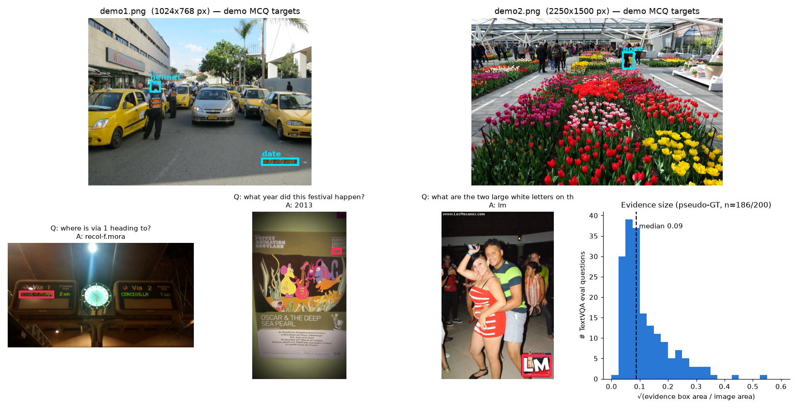

*Figure 1 – Data. Top: the two demo images (`data/demo_imgs`) with the MCQ targets used in Experiment 1. The date
stamp is 165×30 px in a 1024×768 image; the squatting person with the yellow backpack is ≈95×145 px in a
2250×1500 image. Bottom: random TextVQA examples with pseudo-GT evidence boxes (red), and the distribution of
evidence size, √(box area / image area), over the evaluation subset (median 0.09).*

---

## 2. Method

### 2.1 ViCrop pipeline
Given an image *x* and a question *q*, ViCrop works in five steps:
1. Record where the frozen MLLM looks while answering.
2. Turn this into a token-level localisation map.
3. Choose a bounding box on the map.
4. Crop the box from the **original-resolution** image and resize it to the encoder's input size (the "zoom").
5. Answer again with the global image *and* the crop in the context.

Nothing is trained. The overhead is one or two extra forward passes, plus a backward pass for the gradient variants,
and one extra image in the context.

### 2.2 Localisation maps
Let A_l(x,q) be the softmax attention, averaged over heads, from the **last input token** (the position that
predicts the first answer token) to the N image tokens at LLM layer *l*.

| map | definition | cost |
|---|---|---|
| **rel-att** | mean_{l∈B_rel} A_l(x,q) / A_l(x,q′), where q′ = "Write a general description of the image." | 2 forwards |
| **grad-att** | Σ_{l∈B_grad} mean_h [A_{l,h}(x,q) ⊙ ReLU(∂ log p(y₁)/∂A_{l,h})] (Chefer et al.); y₁ = model's own greedy first answer token | 1 fwd + 1 bwd |
| **pure-grad** | Σ_channels \|∂ log p(y₁)/∂ pixels\|, pooled to the token grid (sum over the 14×14 patches of each token) | 1 fwd + 1 bwd through the vision tower |

Dividing by the generic-prompt attention (rel-att) removes question-independent attention, in particular the
"attention-sink" tokens. grad-att re-weights attention by how much it matters for the answer.

**Layer bands.** Each band is 5 consecutive layers. They were chosen on a **calibration split** of 40 TextVQA
questions whose images are disjoint from the evaluation subset. The criterion is the geometric-mean attention
ratio inside the pseudo-GT evidence box (Sec. 2.5). The bands were fixed *before* any evaluation run:

| model | rel-att band | grad-att band |
|---|---|---|
| LLaVA-1.5-7B (32 layers) | 14–18 | 16–20 |
| Qwen2.5-VL-3B (36 layers) | 27–31 | 29–33 |

The LLaVA rel-att band contains layer 14, the layer used by the original ViCrop work for LLaVA-1.5.

### 2.3 Adaptive bounding-box selection
We follow the ViCrop reference procedure:
* Square windows of side s = r·R slide over the token map, using integral images. R is the encoder resolution
  (336 px for LLaVA-1.5; 448 px = √(pixel budget) for Qwen) and r ∈ {1.0, 1.2, …, 2.0}.
* For each r we keep the window with the largest attention sum.
* We pick the r with the highest *sharpness*: (window sum − mean of its 4 neighbouring window sums) / #tokens.

Crops are therefore never smaller than the encoder input, so the crop is never down-sampled, and are
typically ≈0.39 (LLaVA) or 0.54 (Qwen) of the image side. That is a ≈2–2.5× zoom relative to the global view
(Fig. 5).

**High-resolution variant** (fixed rule: any image side > 1024 px, which applies only to demo2 at 2250×1500). The
image is split into ⌈W/1024⌉ × ⌈H/1024⌉ equal tiles, here 3×2. A map is computed for each tile with the tile as the
model input; the maps are stitched together and the box is selected on the stitched map.

### 2.4 Fusion and prompts
* **LLaVA-1.5:** `USER: <image>\n<image>\n{q}\nAnswer the question using a single word or phrase. ASSISTANT:`. The
  first image is the global view and the second is the crop, each 576 CLIP tokens. The baseline prompt is identical
  apart from the second `<image>`.
* **Qwen2.5-VL:** chat template with two image entries (global, crop) followed by the same text. Both images are
  resized to the same 448² budget; the crop is up-sampled to fill the budget.
* **Decoding:** greedy. LLaVA allows ≤16 new tokens. Qwen allows ≤10 new tokens on TextVQA (sufficient for the
  single-word answers) and ≤16 for the demo.

### 2.5 Controls, pseudo ground truth and diagnostics
* **Random crop:** a box of the *same size* as the rel-att box, placed uniformly at random (seeded by the question
  id). It separates the effect of "adding a second, zoomed view" from the effect of *where* the crop is.
* **Oracle crop** (demo only): a box of side R centred on the annotated target.
* **Pseudo-GT evidence boxes.** TextVQA has no answer boxes offline, so Qwen2.5-VL-3B at a higher pixel budget (640²)
  is asked to ground the majority human answer. Questions whose majority answer is "unanswerable", "yes" or "no" are
  skipped; boxes exist for 186/200 eval and 35/40 calibration questions. Spot checks (`outputs/grounding/check_calib.png`)
  show they are mostly accurate. They are used **only** for layer-band calibration and diagnostics (hit rate,
  attention ratio, accuracy by evidence size), never to choose an evaluated crop. Because the boxes come from Qwen
  itself, Qwen's diagnostic hit rates may be optimistic.
* **Metric:** the official VQA accuracy, using the standard EvalAI normalisation (punctuation, articles, number
  words, contractions) and averaged over the 10 leave-one-annotator-out subsets: acc = mean_i min(1, #matches among
  the other 9 / 3).
* **Statistics:** 95 % bootstrap CIs (10 000 resamples); paired bootstrap CIs of the accuracy difference; exact
  McNemar (binomial) test on the binary outcome acc > 0.

### 2.6 Implementation (CPU-only, exactness checks)
Everything runs in fp32 PyTorch 2.15 / transformers 5.24 on a shared 152-core Xeon node with no GPU; the load
average was 120–200 throughout.

* **LLaVA-1.5 preprocessing.** The HF `CLIPImageProcessor` centre-crops by default, which would cut off e.g.
  demo1's date stamp. We instead **pad to square with the CLIP mean colour**, as the original LLaVA-1.5 eval does,
  and map the 24×24 grid back through the padding offset. The padding-area tokens are masked out of the maps.
  [images/llava_padded_input_demo1.png](images/llava_padded_input_demo1.png) shows the de-normalised model input.
* **LLaVA prefix KV cache.** The KV cache for `USER: <image_global>` is computed once per question and reused for
  every suffix: question, generic prompt, crops. Against a full forward, the max |Δlogit| is **3.5·10⁻⁵** and the
  max |Δattention| is **3.6·10⁻⁷** (`outputs/llava_cache_exactness.json`).
* **grad-att on the cache is exact.** The gradient of log p(y₁) with respect to the last-row attention depends only
  on suffix positions, so no backward pass through the image prefix is needed.
* **Batched crop decoding.** The crop variants (rel-att, grad-att and random; identical boxes are de-duplicated)
  are decoded as one batch on a batch-expanded copy of the cache.
* **Qwen2.5-VL.** We use full forwards, because M-RoPE positions depend on the layout, with eager attention only for
  map passes. Token grid = (grid_h/2, grid_w/2), 28 px per token. Pixel patches are ordered in 2×2 merge groups;
  pure-grad sums the 4 consecutive patches of each token.
* **Cost.** Mean per-question cost is ≈5 min of wall time per process for both models (LLaVA: prefix 65 s, attention+grad 18 s, generic prompt 34 s, baseline decode 22 s, batched crops 164 s; Qwen: 59+25+32 s plus ≈45 s per crop variant), with 6
  processes × 8 threads per model.

---

## 3. Results

### 3.1 Where do the models look? (layer-wise localisation)
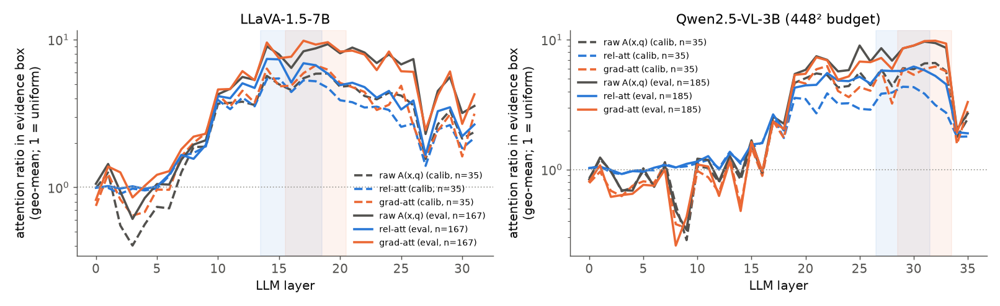

*Figure 2 – Attention ratio inside the pseudo-GT evidence box (geometric mean over questions, log scale; 1 = uniform)
for each LLM layer. Dashed lines: calibration split; solid lines: eval split. Shaded areas: the rel-att (blue) and
grad-att (orange) bands chosen on the calibration split.*

Both models localise the question-relevant evidence strongly but only in the middle and late layers:
* **LLaVA-1.5:** layers 10–26, with a ratio of 4–10× uniform.
* **Qwen2.5-VL:** layers 19–33.

Early layers are near or below uniform. The calibration and evaluation curves agree, so the band choice transfers.
This supports H2: the models "know where to look". Contrary to what is sometimes observed in small models, the
*raw* attention in the chosen bands is already well localised on TextVQA. We test the value of the generic-prompt
normalisation separately in Sec. 3.4.

### 3.2 Main result: TextVQA accuracy
**Table 1 – TextVQA-val subset accuracy (%; VQA metric; no OCR tokens), with 95 % bootstrap CIs. Δ = paired
difference to baseline (paired-bootstrap 95 % CI). W/L = questions fixed / broken (acc>0). p = exact McNemar.**

| Model | Method | Acc. [95 % CI] | Δ vs baseline [95 % CI] | W/L | p |
|---|---|---|---|---|---|
| **LLaVA-1.5-7B** (n = 102) | baseline | 49.6 [40.3, 59.0] | – | – | – |
| | **ViCrop rel-att** | **61.9** [52.8, 70.9] | **+12.3** [+4.3, +20.5] | 18/4 | **0.004** |
| | **ViCrop grad-att** | **61.2** [52.1, 70.3] | **+11.6** [+3.8, +19.6] | 17/4 | **0.007** |
| | random crop (size-matched) | 56.2 [46.8, 65.4] | +6.6 [+2.0, +11.8] | 6/0 | 0.031 |
| **Qwen2.5-VL-3B** @448² (n = 200) | baseline | 73.9 [68.2, 79.4] | – | – | – |
| | **ViCrop rel-att** | **83.9** [79.1, 88.5] | **+10.0** [+5.5, +14.6] | 23/3 | **<0.001** |
| | **ViCrop grad-att** | **81.8** [76.7, 86.6] | **+7.8** [+3.8, +12.1] | 18/3 | **0.001** |
| | ViCrop pure-grad | 78.6 [73.2, 83.9] | +4.8 [+0.4, +9.3] | 15/7 | 0.134 |
| | random crop (size-matched) | 78.3 [73.0, 83.6] | +4.4 [+0.7, +8.4] | 13/5 | 0.096 |

**Extension (secondary).** After the pre-planned LLaVA run (first 102 questions) we continued LLaVA on the remaining
questions of the same list until compute ran out. The run was stopped at **n = 178**; the 22 missing questions belong
to 3 of the 6 interleaved shards. All methods were run on every included question.

| LLaVA-1.5-7B, n = 178 | Acc. [95 % CI] | Δ vs baseline | W/L | p |
|---|---|---|---|---|
| baseline | 50.8 [43.6, 57.8] | – | – | – |
| ViCrop rel-att | **62.5** [55.7, 69.4] | **+11.7** [+6.1, +17.5] | 27/5 | <0.001 |
| ViCrop grad-att | **62.5** [55.4, 69.3] | **+11.7** [+5.8, +17.8] | 27/6 | <0.001 |
| random crop | 53.9 [46.9, 60.9] | +3.1 [−1.3, +7.9] | 11/5 | 0.21 |
| rel-att vs random | | **+8.5** [+2.6, +14.4] | 24/8 | **0.007** |
| grad-att vs random | | **+8.6** [+2.8, +14.3] | 23/8 | **0.011** |

The extension reproduces the primary result. With more power it also makes the advantage of the model-selected
location over a random crop significant for LLaVA.

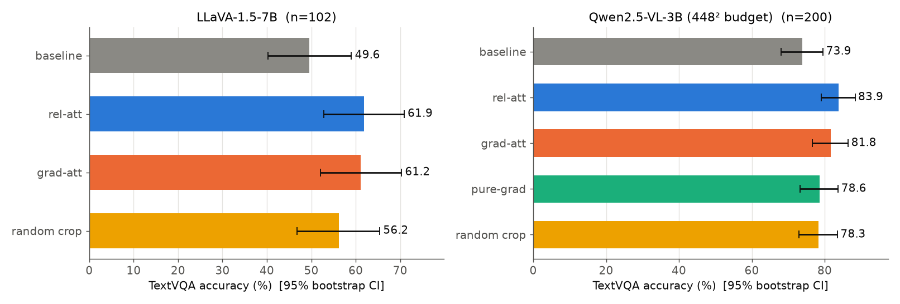

*Figure 3 – TextVQA accuracy per method with 95 % bootstrap CIs.*

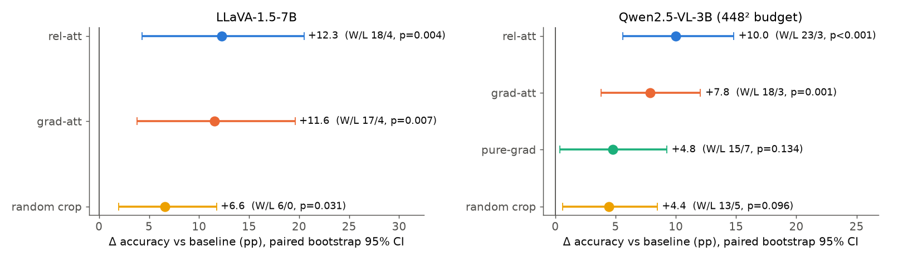

*Figure 4 – Paired accuracy change relative to the no-crop baseline (pp), with paired-bootstrap 95 % CIs, wins/losses
and McNemar p.*

**Readout.**
1. Both attention-based localisers give large, significant gains on both models. The LLaVA-1.5 gain (+12 pp) is of
   the magnitude reported for ViCrop on TextVQA. Qwen2.5-VL, although much stronger at baseline, still gains
   +10 pp when its visual budget is limited.
2. **rel-att ≥ grad-att > pure-grad**, matching the ranking in the original ViCrop paper. The difference between
   rel-att and grad-att is small and not significant (LLaVA +0.7 pp, p = 1.0; Qwen +2.2 pp, p = 0.23). Their crops
   overlap strongly (mean IoU 0.64 for LLaVA, 0.59 for Qwen) and give the same answer on 87–91 % of questions.
3. **Localisation matters (H3).** Directly against the size-matched random crop:
   * Qwen: rel-att is better by +5.6 pp [+2.0, +9.2] (14 wins vs 2 losses, p = 0.004); grad-att by +3.4 pp
     (p = 0.14); pure-grad by only +0.3 pp.
   * LLaVA: rel-att and grad-att are better by +5.7 and +5.0 pp, but the CIs include 0 at n = 102 (p = 0.13 and
     0.19). In the n = 178 extension the gaps are +8.5 / +8.6 pp, p = 0.007 / 0.011.
   * The random crop itself is not useless: +6.6 / +4.4 pp. A second, zoomed view helps whenever it happens to
     contain text, and our random boxes are not small (side ≈0.39–0.54 of the image).
   * Still, a large part of the ViCrop gain requires the model-chosen location: about 45–70 % for LLaVA and 55 % of
     the rel-att gain for Qwen.

### 3.3 Crop statistics and localisation quality
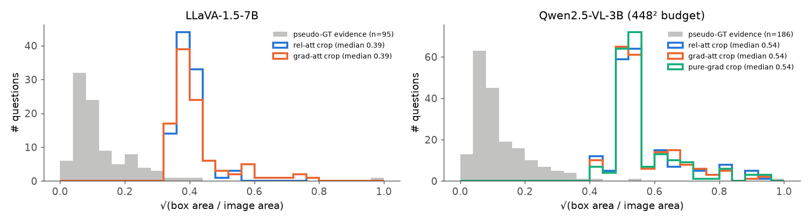

*Figure 5 – Distribution of crop size, √(box area / image area), per method; grey: pseudo-GT evidence size. The
adaptive selection never goes below the encoder resolution, so on ~1024-px images the crop side is ≈0.33–0.66 of the
image.*

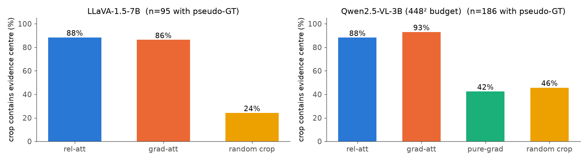

*Figure 6 – Fraction of crops that contain the centre of the pseudo-GT evidence box.*

| | LLaVA rel | LLaVA grad | LLaVA random | Qwen rel | Qwen grad | Qwen pure | Qwen random |
|---|---|---|---|---|---|---|---|
| median crop side / image side | 0.39 | 0.39 | 0.39 | 0.54 | 0.54 | 0.54 | 0.54 |
| hit rate (crop ∋ evidence centre) | **88 %** | **86 %** | 24 % | **88 %** | **93 %** | 42 % | 46 % |

* The attention-based maps put the crop on the evidence in ~90 % of questions.
* **pure-grad localises no better than chance** (42 % vs 46 % for random). This explains why its accuracy equals the
  random-crop control.
* Input-pixel gradient magnitude is dominated by high-contrast edges and noise. It is not a reliable "where is the
  answer" signal without the extra smoothing and filtering heuristics the original work applies to it.

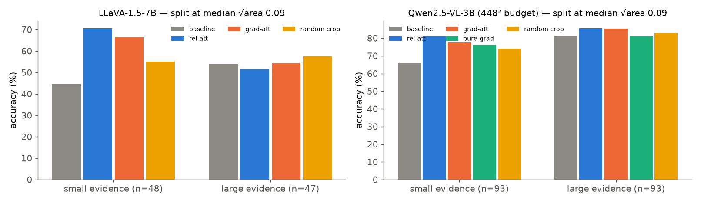

*Figure 7 – Accuracy split at the median pseudo-GT evidence size.*

**The gain is a small-detail effect (H1).**

| subset | model | baseline | rel-att | Δ |
|---|---|---|---|---|
| small evidence (n = 48) | LLaVA | 44.6 | 70.6 | **+26 pp** |
| large evidence (n = 47) | LLaVA | 53.8 | 51.7 | −2 pp (ns) |
| small evidence (n = 93) | Qwen | 66.0 | 81.2 | **+15 pp** |
| large evidence (n = 93) | Qwen | 81.4 | 85.6 | +4 pp |

For questions whose evidence is already large, zooming has nothing to recover.

### 3.4 Ablation: is the generic-prompt normalisation needed?
We re-ran only the box selection, offline, on the saved maps, using the **raw** attention A(x,q) in the same layer
band (`outputs/analysis/offline_box_ablation.json`). This uses all eval questions with saved maps and pseudo-GT:
LLaVA n = 166, including the extension; Qwen n = 186.

| hit rate | raw A(x,q) | rel-att | grad-att | pure-grad |
|---|---|---|---|---|
| LLaVA-1.5 | 83 % | 82 % | 84 % | – |
| Qwen2.5-VL | 93 % | 88 % | 93 % | 42 % |

On TextVQA, with short-answer prompts and in the calibrated bands, raw attention is already nearly as good. No
single sink token captures the peak in more than 3 % of questions. Normalisation becomes crucial when sink tokens
dominate, and this happens with our **MCQ prompts** in Experiment 1:
* The Qwen raw / grad-att maps for the demo1 MCQ peak on a top-left image token, with a max/mean ratio of 37–39.
* rel-att removes this sink (max/mean 8, located near the date stamp).
* The sink is why Qwen's grad-att box lands in the top-left corner on all four demo questions (Sec. 3.5).

Layer choice is the larger factor overall; normalisation is a robustness device.

### 3.5 Experiment 1: demo images (fixed-option MCQs)
The questions, the option order and the target boxes were frozen in `code/demo_questions.json`
(`outputs/demo/demo_questions_frozen.json`) before any model was run. The answer is the arg-max over the next-token
logits of the four option letters.

**Table 2 – Demo MCQ answers (✓ correct / ✗ wrong; probability of the chosen letter).**

| question (GT) | model | baseline | rel-att | grad-att | pure-grad | rel-att HR | grad-att HR | oracle | random |
|---|---|---|---|---|---|---|---|---|---|
| demo1 date "02/20/2012" (C) | LLaVA | ✗ A .70 | ✗ A .76 | ✗ A .87 | ✗ A .82 | – | – | ✗ A .76 | ✗ A .78 |
| | Qwen | ✓ C 1.00 | ✓ C 1.00 | ✓ C 1.00 | ✓ C 1.00 | – | – | ✓ C 1.00 | ✓ C 1.00 |
| demo1 helmet "blue" (C) | LLaVA | ✓ C .71 | ✓ C **.98** | ✓ C .64 | ✓ C .98 | – | – | ✓ C .97 | ✓ C .69 |
| | Qwen | ✓ C .98 | ✓ C .94 | ✓ C .96 | ✓ C .97 | – | – | ✓ C .94 | ✓ C .96 |
| **demo2 pose "squatting" (C)** | **LLaVA** | ✗ A (walking) .65 | **✓ C .99** | ✗ A .83 | ✗ A .73 | **✓ C .98** | ✗ A .66 | ✓ C .99 | ✗ A .71 |
| | Qwen | ✗ A .49 | ✗ A .43 | ✗ A .54 | ✗ A .46 | ✗ B .46 | ✗ A .64 | ✓ C .32 | ✗ A .48 |
| **demo2 backpack "yellow" (D)** | **LLaVA** | ✗ C (green) .58 | ✗ C .50 | ✗ C .50 | ✗ B .31 | **✓ D .95** | ✗ B .46 | ✓ D .98 | ✗ C .40 |
| | Qwen | ✗ B (black) .43 | ✗ B .44 | ✗ B .79 | ✗ B .50 | ✗ B .52 | **✓ D .99** | ✓ D .96 | ✗ B .36 |

HR = high-resolution (tiled) variant, defined only for demo2.

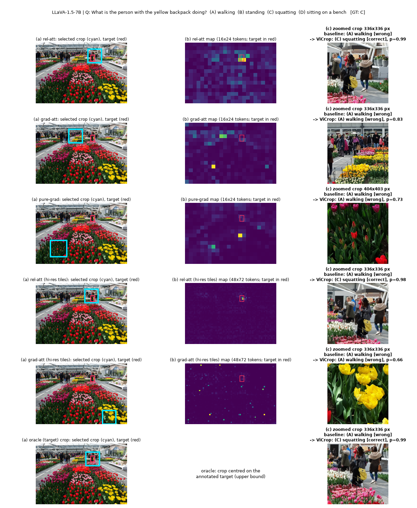

*Figure 8 – LLaVA-1.5-7B, demo2 pose question. Each row is one localiser:
(a) original image with the selected crop (thick cyan) and the target (red);
(b) the localisation map on the image-aligned token grid (viridis, no overlay);
(c) the zoomed crop that is fed to the model, with the baseline → ViCrop answer.
The rel-att map peaks on the crouching person; its crop turns "walking" into "squatting" (p = 0.99). grad-att peaks
elsewhere and stays wrong. The oracle row shows the upper bound.*

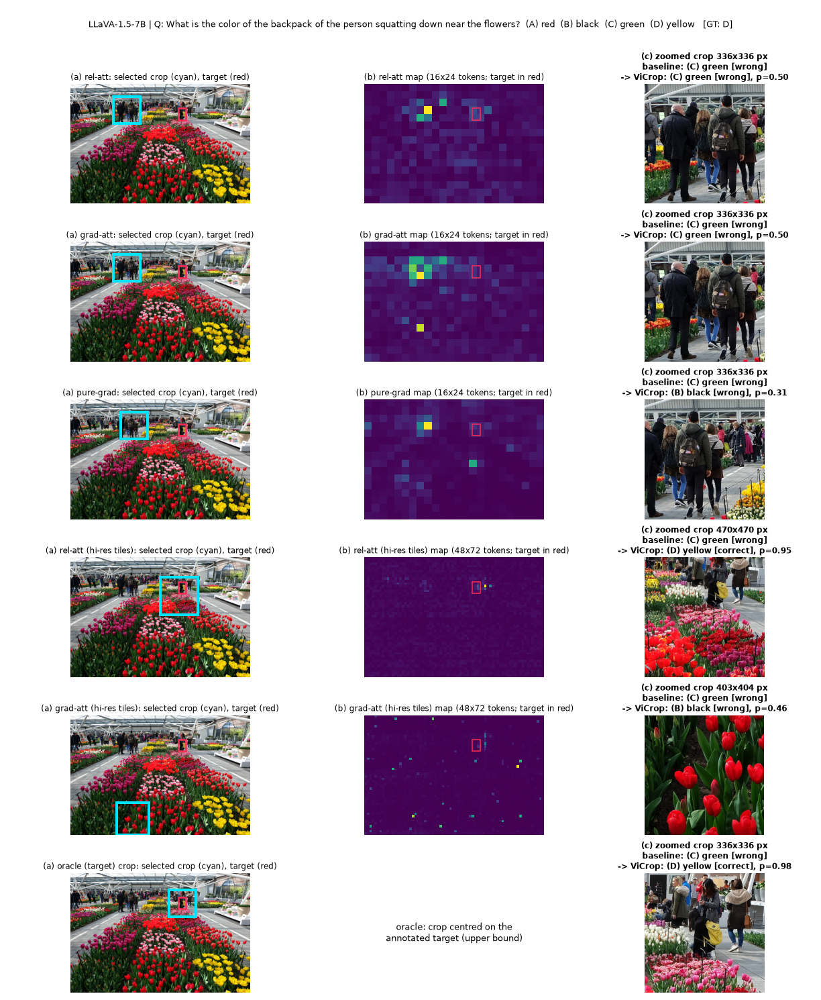

*Figure 9 – LLaVA-1.5-7B, demo2 backpack colour. The global rel-att map (16×24 tokens over a 2250-px image, ≈94 px per
token) is too coarse. The tiled high-resolution rel-att map (48×72 tokens) finds the person, and the crop corrects "green" →
"yellow" (p = 0.95).*

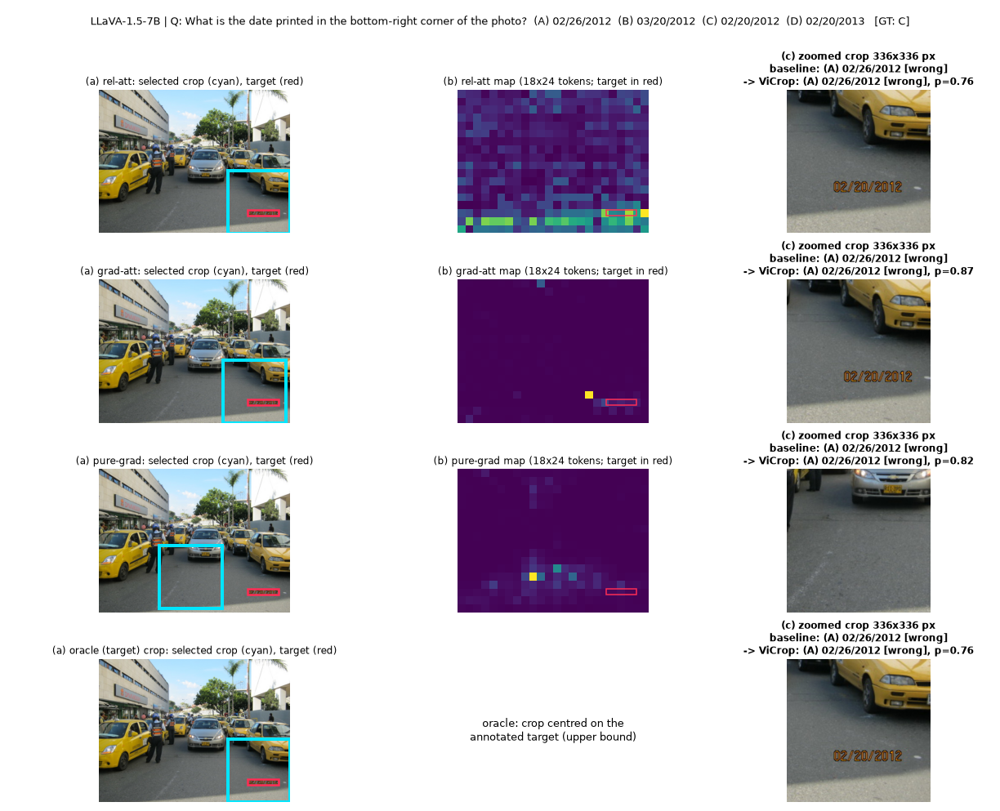

*Figure 10 – LLaVA-1.5-7B, demo1 date. rel-att and grad-att both place the crop on the date stamp, which is the same
box as the oracle crop. Even so, the MCQ answer stays (A) for every crop, oracle included: LLaVA-1.5 does not use the
option letters reliably for near-identical date strings (it prefers "A" with p = 0.70–0.87 for every input). This is
a failure of the answer-selection step, not of localisation; see the free-form check below.*

Further per-model figures for every question:
[demo1_date_qwen](images/demo_demo1_date_qwen.png), [demo1_helmet_qwen](images/demo_demo1_helmet_qwen.png),
[demo2_pose_qwen](images/demo_demo2_pose_qwen.png), [demo2_bag_qwen](images/demo_demo2_bag_qwen.png),
[demo1_helmet_llava](images/demo_demo1_helmet_llava.png), free-form [demo1_date_qwen](images/demo_free_demo1_date_qwen.png), [demo2_pose_qwen](images/demo_free_demo2_pose_qwen.png).

**Secondary check: open-ended (free-form) version.** This was planned beforehand as a secondary output: the same
questions without options, using the TextVQA prompt "Answer the question using a single word or phrase.", greedy
decoding and the same ViCrop pipeline.

**Table 3 – Free-form demo answers.**

| question (GT) | model | baseline | rel-att | grad-att | pure-grad | rel-att HR | oracle | random |
|---|---|---|---|---|---|---|---|---|
| **demo1 date (02/20/2012)** | **LLaVA** | ✗ "02/29/2012" | **✓ "02/20/2012"** | **✓ "02/20/2012"** | ✗ "02/29/2012" | – | ✓ "02/20/2012" | ✗ "02/29/2012" |
| | Qwen | ✓ "02/20/2012" | ✓ | ✓ | ✓ | – | ✓ | ✓ |
| demo2 pose (squatting) | LLaVA | ✗ "Walking" | **✓ "Crouching"** | ✗ "Walking" (HR: ✓ "Crouching") | ✗ "Walking" | ✗ "Sitting" | ✗ "Sitting" | ✗ "Walking" |
| | Qwen | ✗ "walking" | ✗ "walking" | ✗ "walking" | ✗ "walking" | ✗ "walking" | ✗ "standing" | ✗ "walking" |

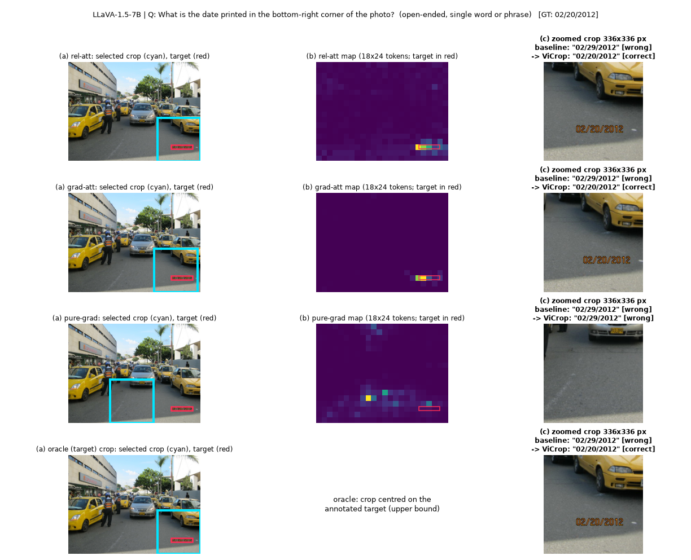

*Figure 10b – LLaVA-1.5-7B, demo1 date, open-ended. This is the paper's demo1 case. Both rel-att and grad-att peak
exactly on the date stamp (red box). The zoomed crop corrects the baseline misreading "02/**29**/2012" → "02/**20**/2012".
pure-grad peaks on the road and leaves the error. With the short-answer prompt the grad-att map shows no
attention sink.*

On the open-ended pose question, LLaVA's rel-att crop again turns "Walking" into "Crouching". This is a synonym of
the target "squatting" and is scored as correct. The tiled grad-att crop also gives "Crouching". The oracle and tiled
rel-att crops are answered "Sitting", which is wrong though close. Open-ended answers are noisier than the MCQ
version, but the direction is the same.

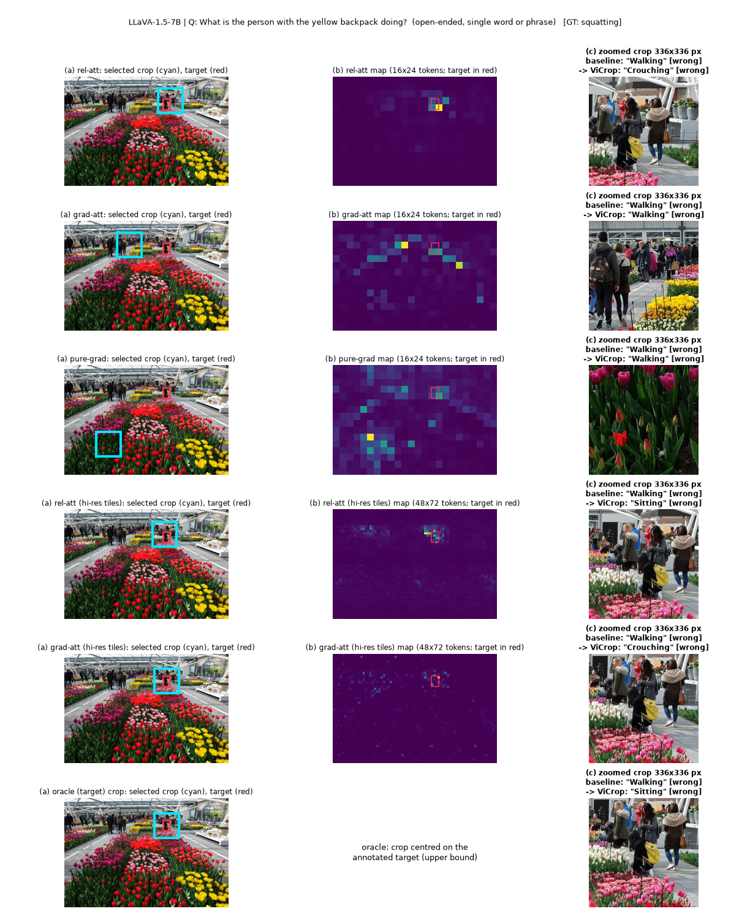

*Figure 10c – LLaVA-1.5-7B, demo2 pose, open-ended.*

**Readout of Experiment 1.**
* **The resolution bottleneck is real.** The oracle crop fixes all four demo2 errors on both models.
* **LLaVA-1.5 with rel-att ViCrop selects the right region autonomously** and corrects the pose error. With the
  high-resolution variant it also corrects the backpack-colour error. In the open-ended version of the date question,
  both rel-att and grad-att correct the misreading "02/29/2012" → "02/20/2012". For the helmet question, which the baseline
  already answered correctly, the crop raises confidence from 0.71 to 0.98.
* **Honest negatives:**
  * Qwen2.5-VL already answers both demo1 questions correctly, so there is nothing to correct.
  * On the 2250×1500 demo2 image, Qwen's rel-att maps (global and tiled) peak on other people or flowers. Only the
    tiled grad-att map fixes the backpack question.
  * grad-att is hurt by attention-sink tokens under the MCQ prompt (top-left boxes).

### 3.6 Qualitative TextVQA cases
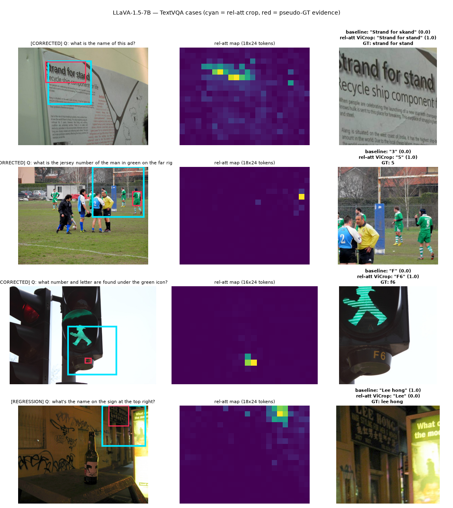

*Figure 11 – LLaVA-1.5-7B. The first three TextVQA questions (by question id) where the baseline scores 0 and rel-att
≥ 0.6, plus the first regression. The rel-att maps are sharply peaked on the evidence: "Strand for skand" →
"Strand for stand"; jersey "3" → "5"; "F" → "F6". The regression illustrates a failure mode: the crop cuts the sign
"LEE HONG" and the model answers "Lee".*

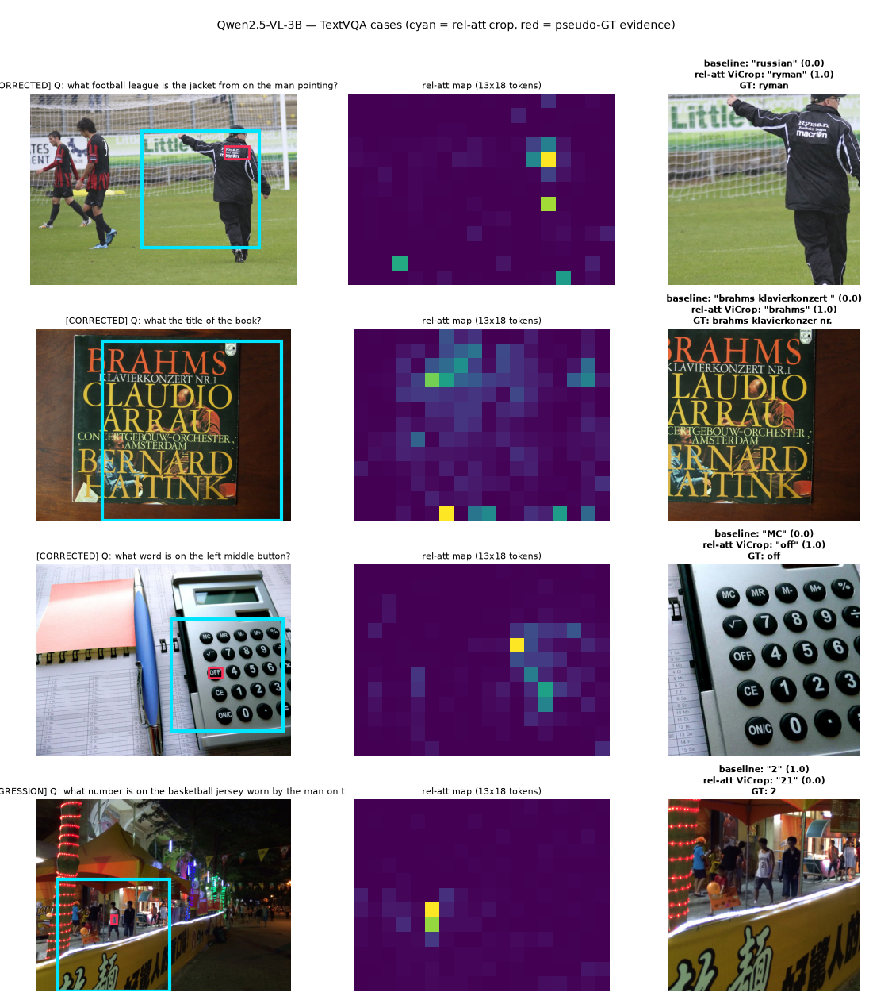

*Figure 12 – Same for Qwen2.5-VL-3B.*

---

## 4. Discussion
* **Does ViCrop mitigate the fixed-resolution information loss?** Yes. Both localisation-driven variants give
  10–12 pp absolute TextVQA gains on two architecturally different MLLMs. The gains are concentrated where the
  evidence is small (+26 pp for LLaVA on the small-evidence half), and the attention maps localise the evidence in
  ~90 % of cases without training.
* **Is it the zoom or the localisation?** Both. A random second view of the same size gives up to half of the gain
  (LLaVA +6.6 pp at n = 102 but only +3.1 pp, n.s., at n = 178; Qwen +4.4 pp). The rest needs the model-selected
  location: rel-att vs random is +5.6 pp, p = 0.004 on Qwen, and +8.5 pp, p = 0.007 on the extended LLaVA set. pure-grad, whose localisation is at chance,
  performs exactly like the random control. This is a clean dose-response between localisation quality and accuracy.
* **rel-att vs grad-att.** They are statistically indistinguishable on TextVQA and overlap strongly. rel-att is
  cheaper (no backward pass) and more robust to attention sinks, as the MCQ demo shows. grad-att is the method of
  choice only when two forward passes per query are not acceptable but one backward pass is.
* **Limitations of the selection step.** The adaptive window never goes below the encoder resolution. On very large
  images (demo2) a 336–448 px crop still contains many distractors, and the global map is too coarse (one token ≈
  94 px). Tiling helps LLaVA but not Qwen. Wrong crops can also hurt, as the TextVQA regression case shows. Using
  the crop *in addition to* the global image limits the damage (4 losses vs 18 wins for LLaVA rel-att).
* **Threats to validity.**
  * Subset sizes (102 / 200) give CIs of ±9 / ±5 pp on absolute accuracy, but the *paired* tests are well powered for
    the main effects.
  * The pseudo-GT boxes come from Qwen2.5-VL (diagnostics only), and Qwen's hit rates may be optimistic.
  * The demo has only 4 questions; it is illustrative, not statistical.

## 5. Deviations from the original protocol (stated explicitly)
1. **Hardware.** CPU only (fp32), on a heavily shared node, so we used a TextVQA-val subset rather than the full 5 000
   questions. The subset is a seeded random sample (`outputs/textvqa_ids.json`, seed 0, from validation shard 0 of
   `lmms-lab/textvqa`). LLaVA used the first 102 questions of the same ordered list (pre-planned primary analysis),
   extended to 178 as a secondary analysis; Qwen used all 200.
2. **No OCR tokens** in the prompt, and the "single word or phrase" instruction (LLaVA-1.5 eval style).
3. **Qwen2.5-VL budget.** Run at a fixed 448×448-pixel budget (`max_pixels = 200 704`) for both the global image and
   the crop. This emulates the limited-resolution regime the method targets; native-resolution Qwen would have a
   higher baseline. A native-resolution baseline run was started but abandoned for lack of compute.
4. **Layer bands** (5 layers) were selected on our own calibration split with pseudo-GT boxes, not taken from the
   paper.
5. **grad-att** aggregates a band of layers instead of a single layer. **pure-grad** is used without additional
   smoothing or filtering, and was run on Qwen only for TextVQA (on both models for the demo), because a full backward
   pass through LLaVA-7B was too costly.
6. **High-resolution tiling** was applied only to images with a side > 1024 px (demo2).
7. **Decoding caps.** Greedy decoding, with ≤10 new tokens for Qwen on TextVQA.

## 6. Reproducibility
Run the scripts in `code/` in this order; all outputs go to `outputs/`.
1. **Downloads:** `pdownload.py` (parallel chunked HF download; the node throttles per-connection bandwidth), then
   `verify_sha.py` (SHA-256 against HF LFS ids; all weights verified).
2. **Data:** `prep_textvqa.py` builds the subset and calibration split (`outputs/textvqa_ids.json`).
3. **Pseudo-GT:** `ground_answers.py --split calib|eval` → `outputs/grounding/`.
4. **Calibration maps:** `run_textvqa.py --model {llava,qwen} --split calib --maps-only`; then
   `calibrate_layers.py {llava,qwen}` → `outputs/analysis/calib_layers_*.json`.
5. **Evaluation:** `run_textvqa.py --model qwen --split eval --rel-band 27,32 --grad-band 29,34` (6 shards), and
   `run_textvqa.py --model llava --split eval --rel-band 14,19 --grad-band 16,21 --no-pure --limit 17` (6 shards).
   Output: per-question JSONL, plus `maps/*.npz` with all-layer attention and gradient maps.
6. **Demo:** `run_demo.py --model {llava,qwen}` (MCQ) and `--freeform --only demo1_date,demo2_pose`
   → `outputs/demo/`.
7. **Analysis:** `analyze_textvqa.py` → `outputs/analysis/textvqa_summary.json`; `offline_boxes.py`;
   `fig_overview.py`, `fig_textvqa.py`, `fig_demo.py`, `fig_cases.py` → `report/images/`.
8. **Engine checks:** `test_llava_cache.py` (KV-cache exactness and padded-preprocessing check).
