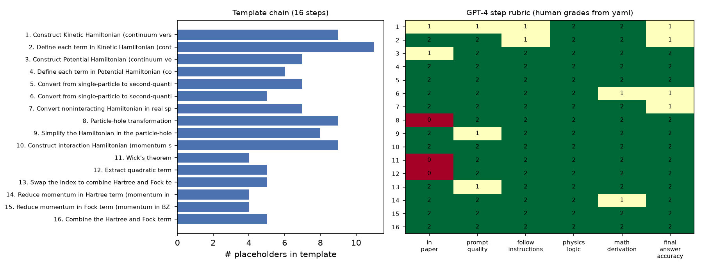
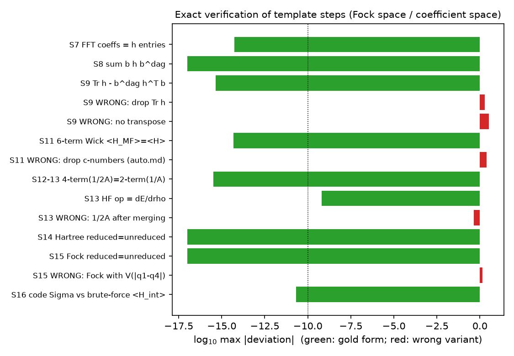
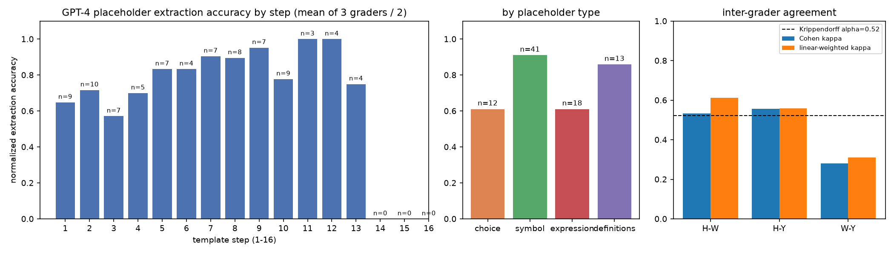
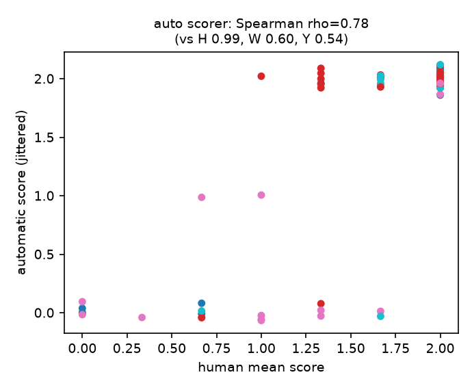
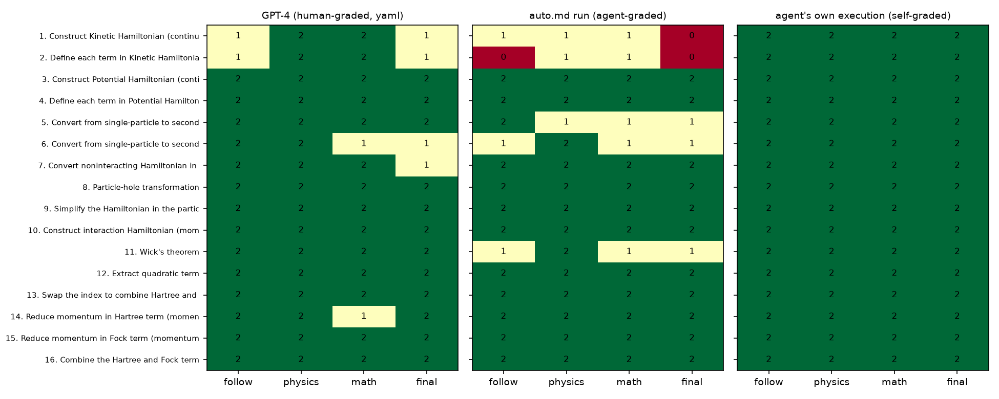
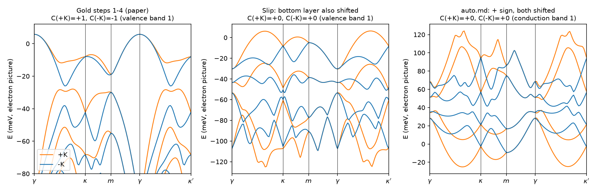
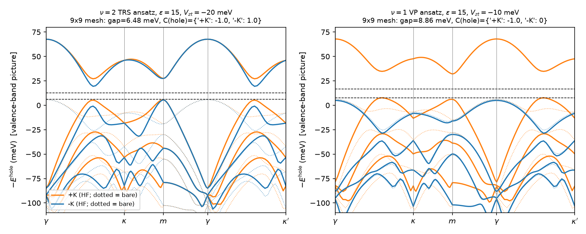
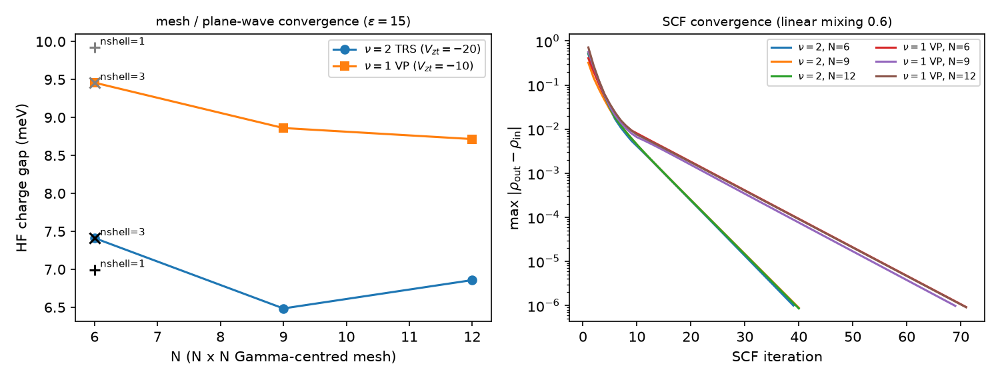
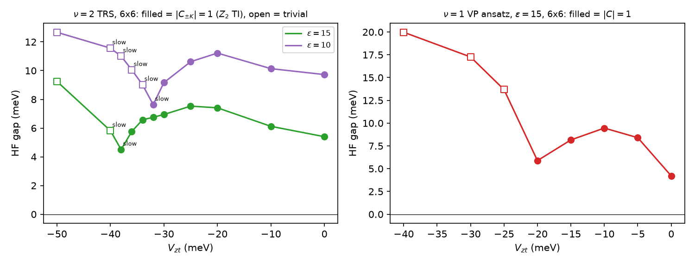

# Can an LLM carry a research-level Hartree–Fock derivation? A verified 16-step template-chain study of AB-stacked MoTe₂/WSe₂ (arXiv:2111.01152)

## Abstract
We study one paper from the LLM Hartree–Fock benchmark: the AB-stacked MoTe₂/WSe₂ moiré heterobilayer
(arXiv:2111.01152). Its HF derivation is broken into 16 templated prompts.

**What we did.**
1. **Executed the template chain ourselves.** The agent (Claude) acted as the LLM executor and derived every step. All 16 resulting equations are given explicitly in §3.
2. **Re-analysed the benchmark annotations.**
   * GPT-4's placeholder extraction: 84 graded placeholders, 3 human graders.
   * GPT-4's step-rubric scores.
   * A second complete LLM run (`_auto.md`), which we graded on the same rubric.
3. **Verified every algebraic step with exact numerics.**
   * Fourier coefficients versus plane-wave matrix elements (Step 7).
   * Jordan–Wigner Fock-space operator identities (Steps 8–13).
   * Coefficient-space momentum reduction (Steps 14–15).
   * A brute-force test of the final HF self-energy (Step 16).
4. **Ran the derived Hamiltonian** in a plane-wave self-consistent HF solver, as a consequence check.

**Results.**

* **GPT-4 extraction.** Normalised accuracy is 0.80. The convention choices are worst: real/momentum, single-particle/second-quantised and electrons/holes score 0.28. Inter-grader agreement is modest (Krippendorff α = 0.52).
* **Algebra (Steps 7–16).** Every gold algebraic step holds to machine precision. Every wrong variant we tried fails at O(1).
* **Where both LLM runs fail.** Neither run makes an operator-algebra error. Both fail on *model conventions* in Steps 1–2: they shift the bottom layer as well as the top layer by τκ. `auto.md` also flips the sign of the parabola, and drops the c-number terms in Wick's theorem.
* **Why the Step-1–2 slip matters.** It is physically fatal: the first valence band's Chern number goes from C_{±K} = ±1 to 0. The rubric nevertheless gives it "physics_logic = 2".
* **HF consequence check.** The derived Hamiltonian reproduces the paper's two headline phases:
  * ν = 2 (ε = 15, V_zt = −20 meV): an interaction-opened Z₂ topological insulator. The gap is 6.9 meV on a 12×12 mesh, the bare bands overlap by 2.5 meV, and C_{±K} = ±1.
  * ν = 1 (V_zt = −10 meV): a valley-polarised Chern insulator with gap 8.7 meV and |C| = 1.
  * The ν = 2 critical V_zt moves to less negative values as ε decreases, as the paper reports.

---

## 1. Data and task overview

*Figure 1. Left: the 16 template steps and their number of placeholders. Right: the human-assigned 6-item step rubric (0–2) for the GPT-4 run, taken from `2111.01152.yaml`.*

**Inputs** (`data/2111.01152/`):

| File | Content |
|---|---|
| `2111.01152.yaml` | 16 tasks. Each has placeholders (GPT-4 fill, human reference, and grades from three graders H/W/Y), a gold `answer`, and a step rubric. |
| `_extractor.md` | GPT-4 filled templates. |
| `_auto.md` | A second, complete LLM execution of all 16 prompts (model unspecified). |
| `Prompt_template.md` | The template library. |
| `.tex` files | Main text lines 55–95 and supplement lines 44–131 contain the model and the HF derivation. |

The related-work PDFs are general LLM background (GPT-3, Minerva, Galactica, Chinchilla) plus an experimental paper; they were not needed for the derivation.

**Step numbering.** We number steps 1–16 and also give the 0-based "Task k" label used in the benchmark's rubric (Task k = step k+1). For example, Wick's theorem is Step 11 / Task 10.

**Model parameters** (paper):

* Geometry: a_M = a_b a_t/|a_b − a_t| = 4.6545 nm, with (a_b, a_t) = (3.575, 3.32) Å.
* Masses: m_b = 0.65 mₑ, m_t = 0.35 mₑ.
* Single-particle terms: w = 12 meV, V_b = 7 meV, ψ_b = −14°.
* Interaction: d = 5 nm, ε = 10–20.
* Units used: ħ²/2mₑ = 38.0998 meV nm² and e² = 1439.96 meV nm.

**Sanity checks against the paper:**

| Quantity | Our value | Paper |
|---|---|---|
| ħ²κ²/2m_b | 47.47 meV | "≈ 47 meV" |
| e²/(εa_M) at ε = 10 | 30.9 meV | "≈ 31 meV" |

## 2. Methodology

1. **Template-chain execution by the agent** (`outputs/agent_execution.md`).
   * For each step we filled the template placeholders from the paper excerpts and then derived the requested expression. The equations are reproduced in §3.
   * **Caveat: this is not a blind test.** The agent read the gold answers before executing the steps. Its correctness is therefore established by the independent numerical checks below, not by self-grading.
2. **Extraction and step-score analysis** (`code/extraction_stats.py`).
   * Placeholders are classified as choice, symbol, expression or definitions. A "(?)" grade is treated as missing.
   * Agreement statistics: Cohen κ (unweighted and linear-weighted) for each grader pair, and Krippendorff α (interval and nominal).
   * Automatic scorer: exact match for choices, and LaTeX-normalised `difflib` similarity for the other types (≥ 0.8 → 2, ≥ 0.4 → 1).
   * The agent graded `_auto.md` and its own execution on the four execution items of the rubric (follow_instructions, physics_logic, math_derivation, final_answer_accuracy). Every cell has a written reason in `outputs/rubric_grades.csv`.
3. **Exact algebra verification** (`code/verify_algebra.py`, `code/single_particle.py`, `code/test_hf_bruteforce.py`).

   | Steps | What is checked | How |
   |---|---|---|
   | 7 | Fourier coefficients of Δ_b and Δ_T equal the plane-wave matrix entries | FFT on a 48×48 real-space grid over one moiré cell |
   | 8–9 | Particle–hole transformation and normal ordering | Operator identities on 5 Jordan–Wigner modes, random Hermitian h |
   | 10–13 | ⟨Φ\|H_int\|Φ⟩ for random Slater determinants Φ | 12-mode momentum-conserving ring (6 momenta × 2 flavours) |
   | 14–15 | Reduced vs unreduced Hartree and Fock coefficients | 1D lattice with k ∈ BZ and q ∈ reciprocal lattice |
   | 16 | Implemented Σ^H + Σ^F against ⟨H_int⟩ from the unreduced four-momentum sum | Brute force |

   Every check is also run on deliberately wrong variants, to show that it can tell right from wrong.
4. **Plane-wave HF solver** (`code/moire.py`, `code/hf_production.py`).
   * **Basis:** nshell = 2, i.e. 19 plane waves per layer per valley; nshell = 1 and 3 were used as cutoff checks.
   * **k-mesh:** Γ-centred N×N mesh with N = 6, 9, 12, folded into the Wigner–Seitz BZ. The folding keeps the plane-wave cutoff centred.
   * **SCF:** aufbau occupation with fixed valley fillings. The TRS ansatz has (ν/2, ν/2) and an explicit T-symmetrisation of ρ; the VP ansatz has (1, 0). Linear mixing 0.6, tolerance 10⁻⁶. The Q = 0 Hartree term is dropped (neutralising background).
   * **Chern numbers:** Fukui–Hatsugai–Suzuki (FHS), with boundary links u_{k+B}(G) = u_k(G+B).

---

## 3. Step-by-step derivation (agent execution), with LLM slips and verification

**Constants and symbols.**

* Valley index τ = ±1 (±K); layer index l ∈ {b (MoTe₂), t (WSe₂)}.
* Moiré BZ corner κ = 4π/(3a_M)(1, 0).
* First-shell reciprocal vectors g_j = (4π/(√3 a_M))(−sin(π(j−1)/3), cos(π(j−1)/3)), j = 1…6. Explicitly:
  * g₁ = G₀(0, 1), g₂ = G₀(−√3/2, 1/2), g₃ = G₀(−√3/2, −1/2) = g₂ − g₁;
  * g₄ = −g₁, g₅ = −g₂, g₆ = −g₃;
  * G₀ = 4π/(√3 a_M).
* ω = e^{2πi/3} and ψ_b = −14°.
* Spinors Ψ₊ = (ψ_{b↑+}, ψ_{t↓+})ᵀ and Ψ₋ = (ψ_{b↓−}, ψ_{t↑−})ᵀ. Spin is locked to (layer, valley).
* Basis order (+K,b), (+K,t), (−K,b), (−K,t).
* Interaction V(q) = 2πe² tanh(qd)/(εq).

### Phase A — single-particle Hamiltonian (Steps 1–6, Tasks 0–5)

**Step 1 (Task 0) — Kinetic Hamiltonian (real space, single-particle).**
Placeholders filled: real space; single-particle; degrees of freedom = valley and layer; order (+K,b), (+K,t), (−K,b), (−K,t).

$$H_{\rm Kinetic}(\mathbf r)=\begin{pmatrix}E_{+K,b}&0&0&0\\0&E_{+K,t}&0&0\\0&0&E_{-K,b}&0\\0&0&0&E_{-K,t}\end{pmatrix}.$$

* *GPT-4 slip (yaml):* it chose "momentum" and "second-quantized", and its basis order was only "bottom layer and top layer". Its answer shifts the **bottom** layer by κ as well (yaml comment: "bottom layer does not have a shift of Kappa"). Rubric: final 1.
* *auto.md slip:* it writes the full H_τ including the potentials instead of a diagonal kinetic matrix. Its kinetic term is **+**ħ²(k−τκ)²/2m in **both** layers.
* *Verification:* §5.1 (Chern consequence check).

**Step 2 (Task 1) — Define each kinetic term.**
Placeholders filled: parabolic dispersion for **holes** (valence bands, negative curvature); the shift ±κ is applied **only** to E_{t,±K}; k = −i∂_r.

$$E_{\tau,b}=-\frac{\hbar^2\mathbf k^2}{2m_b},\qquad E_{\tau,t}=-\frac{\hbar^2(\mathbf k-\tau\boldsymbol\kappa)^2}{2m_t}\;\Rightarrow\;
H_{\rm Kinetic}=\mathrm{diag}\Big(-\tfrac{\hbar^2k^2}{2m_b},-\tfrac{\hbar^2(\mathbf k-\boldsymbol\kappa)^2}{2m_t},-\tfrac{\hbar^2k^2}{2m_b},-\tfrac{\hbar^2(\mathbf k+\boldsymbol\kappa)^2}{2m_t}\Big).$$

* *GPT-4 slip:* it chose "electrons" (graded 0 by all three graders) and shifted the bottom layer too. Rubric: follow 1, final 1.
* *auto.md slip:* the prompt correctly says "holes" and "shift for E_{t,±K}". The answer still uses +ħ²(k−τκ)²/2m in **both** layers, i.e. two independent errors. Agent grade: final 0.
* *Verification:* only the top-layer shift gives C_{±K} = ±1 (§5.1). Also ħ²κ²/2m_b = 47.5 meV, matching the paper's "≈ 47 meV".

**Step 3 (Task 2) — Potential Hamiltonian.**

$$H_{\rm Potential}(\mathbf r)=\begin{pmatrix}\Delta_b(\mathbf r)&\Delta_{T,+K}(\mathbf r)&0&0\\ \Delta^*_{T,+K}(\mathbf r)&\Delta_t(\mathbf r)&0&0\\0&0&\Delta_b(\mathbf r)&\Delta_{T,-K}(\mathbf r)\\0&0&\Delta^*_{T,-K}(\mathbf r)&\Delta_t(\mathbf r)\end{pmatrix}.$$

* *GPT-4:* the final answer is correct (2). The "diagonal_potential" placeholder wrongly included the kinetic terms (graded 0/1/0).
* *auto.md:* correct. It writes Δ_t + V_zt and keeps the matrix Hermitian.
* *Verification:* the potential block is Hermitian to 0.0 (exact).

**Step 4 (Task 3) — Define each potential term.**

$$\Delta_b(\mathbf r)=2V_b\sum_{j=1,3,5}\cos(\mathbf g_j\cdot\mathbf r+\psi_b),\qquad\Delta_t(\mathbf r)\equiv V_{zt},$$

$$\Delta_{T,\tau}(\mathbf r)=\tau w\left(1+\omega^{\tau}e^{i\tau\mathbf g_2\cdot\mathbf r}+\omega^{2\tau}e^{i\tau\mathbf g_3\cdot\mathbf r}\right),$$

which gives the two valley components

$$\Delta_{T,+K}=w\left(1+\omega e^{i\mathbf g_2\cdot\mathbf r}+\omega^{2}e^{i\mathbf g_3\cdot\mathbf r}\right),\qquad
\Delta_{T,-K}=-w\left(1+\omega^{-1}e^{-i\mathbf g_2\cdot\mathbf r}+\omega^{-2}e^{-i\mathbf g_3\cdot\mathbf r}\right)=-\Delta^*_{T,+K}.$$

Substituting into Step 3:

$$H_{\rm Pot}=\begin{pmatrix}2V_b\sum_{j=1,3,5}\cos(\mathbf g_j\!\cdot\!\mathbf r+\psi_b)& w(1+\omega e^{i\mathbf g_2\cdot\mathbf r}+\omega^2e^{i\mathbf g_3\cdot\mathbf r})&0&0\\ w(1+\omega^{-1}e^{-i\mathbf g_2\cdot\mathbf r}+\omega^{-2}e^{-i\mathbf g_3\cdot\mathbf r})&V_{zt}&0&0\\0&0&2V_b\sum_{j}\cos(\mathbf g_j\!\cdot\!\mathbf r+\psi_b)&-w(1+\omega^{-1}e^{-i\mathbf g_2\cdot\mathbf r}+\omega^{-2}e^{-i\mathbf g_3\cdot\mathbf r})\\0&0&-w(1+\omega e^{i\mathbf g_2\cdot\mathbf r}+\omega^2e^{i\mathbf g_3\cdot\mathbf r})&V_{zt}\end{pmatrix}.$$

* **Δ_t convention.** The paper sets Δ_t = 0 and adds V_zt separately on the (t,t) entry. The gold answer absorbs the offset into Δ_t = V_zt. These are the same Hamiltonian provided V_zt is counted once; our code uses the paper's form.
* *GPT-4 / auto.md:* both correct (final 2). Neither double-counts V_zt.
* *Verification:* T symmetry. The relation Δ_{T,−K} = −Δ*_{T,+K} implies E_{−K}(k) = E_{+K}(−k), which holds to 1.8×10⁻¹² meV.

**Step 5 (Task 4) — Second-quantised form, matrix.**

$$\hat H^0=\int d^2r\;\vec\psi^\dagger(\mathbf r)\,H^0(\mathbf r)\,\vec\psi(\mathbf r),\qquad \vec\psi=(\psi_{+K,b},\psi_{+K,t},\psi_{-K,b},\psi_{-K,t})^T=(\psi_{b\uparrow+},\psi_{t\downarrow+},\psi_{b\downarrow-},\psi_{t\uparrow-})^T,$$

$$H^0=H_{\rm Kinetic}+H_{\rm Pot}=\begin{pmatrix}-\frac{\hbar^2k^2}{2m_b}+\Delta_b&\Delta_{T,+K}&0&0\\ \Delta^*_{T,+K}&-\frac{\hbar^2(\mathbf k-\boldsymbol\kappa)^2}{2m_t}+V_{zt}&0&0\\0&0&-\frac{\hbar^2k^2}{2m_b}+\Delta_b&\Delta_{T,-K}\\0&0&\Delta^*_{T,-K}&-\frac{\hbar^2(\mathbf k+\boldsymbol\kappa)^2}{2m_t}+V_{zt}\end{pmatrix}.$$

* *GPT-4:* correct (2). It left the `second_nonint_symbol` placeholder empty.
* *auto.md:* the structure is correct, but the kinetic term is −ħ²(∇+iτκ)²/2m = **+**ħ²(k+τκ)²/2m in both layers. The Step-1/2 error propagates here. Agent grade: final 1.

**Step 6 (Task 5) — Second-quantised form, expanded sum.**

$$\hat H^0=\sum_{\tau=\pm}\sum_{l_1,l_2}\int d^2r\,\psi^\dagger_{\tau l_1}(\mathbf r)H^0_{\tau l_1,\tau l_2}(\mathbf r)\psi_{\tau l_2}(\mathbf r)$$

$$=\sum_\tau\!\int\! d^2r\Big[\psi^\dagger_{\tau b}\big(-\tfrac{\hbar^2k^2}{2m_b}+\Delta_b\big)\psi_{\tau b}+\psi^\dagger_{\tau t}\big(-\tfrac{\hbar^2(\mathbf k-\tau\boldsymbol\kappa)^2}{2m_t}+V_{zt}\big)\psi_{\tau t}+\psi^\dagger_{\tau b}\Delta_{T,\tau}\psi_{\tau t}+\psi^\dagger_{\tau t}\Delta^*_{T,\tau}\psi_{\tau b}\Big].$$

The vanishing intervalley blocks (τ ≠ τ′) have been removed.

* *GPT-4 slip:* the sum over τ is missing (math 1, final 1).
* *auto.md slip:* it keeps Σ_τ, but leaves a 2-spinor matrix product rather than the explicit Σ_{l₁,l₂}. The kinetic term is again +ħ²(−i∇−τκ)²/2m in both layers.

### Phase B — momentum space, particle–hole transformation, interaction, Wick (Steps 7–11, Tasks 6–10)

**Step 7 (Task 6) — Fourier transform to momentum space.**
The transform and its inverse are

$$c^\dagger_{\tau l}(\mathbf k)=\frac1{\sqrt A}\int d^2r\,\psi^\dagger_{\tau l}(\mathbf r)e^{i\mathbf k\cdot\mathbf r},\qquad \psi^\dagger_{\tau l}(\mathbf r)=\frac{1}{\sqrt A}\sum_{\mathbf k}c^\dagger_{\tau l}(\mathbf k)e^{-i\mathbf k\cdot\mathbf r}.$$

Substituting into Step 6:

$$\hat H^0=\sum_{\tau,l_1,l_2,\mathbf k_1,\mathbf k_2}c^\dagger_{\tau l_1}(\mathbf k_1)\,h^{(\tau)}_{l_1l_2}(\mathbf k_1,\mathbf k_2)\,c_{\tau l_2}(\mathbf k_2),\qquad h^{(\tau)}_{l_1l_2}(\mathbf k_1,\mathbf k_2)=\frac1A\!\int\! d^2r\,e^{-i\mathbf k_1\cdot\mathbf r}H^0_{\tau l_1,\tau l_2}\,e^{i\mathbf k_2\cdot\mathbf r}.$$

The explicit plane-wave matrix elements follow from k acting on e^{ik₂·r} and the Fourier components of Δ_b and Δ_T:

$$h^{(\tau)}_{bb}(\mathbf k_1,\mathbf k_2)=-\frac{\hbar^2|\mathbf k_2|^2}{2m_b}\delta_{\mathbf k_1\mathbf k_2}+V_b\!\!\sum_{j=1,3,5}\!\big[e^{i\psi_b}\delta_{\mathbf k_1-\mathbf k_2,\mathbf g_j}+e^{-i\psi_b}\delta_{\mathbf k_1-\mathbf k_2,-\mathbf g_j}\big],$$

$$h^{(\tau)}_{tt}(\mathbf k_1,\mathbf k_2)=\Big[-\frac{\hbar^2|\mathbf k_2-\tau\boldsymbol\kappa|^2}{2m_t}+V_{zt}\Big]\delta_{\mathbf k_1\mathbf k_2},$$

$$h^{(\tau)}_{bt}(\mathbf k_1,\mathbf k_2)=\tau w\big[\delta_{\mathbf k_1\mathbf k_2}+\omega^{\tau}\delta_{\mathbf k_1-\mathbf k_2,\tau\mathbf g_2}+\omega^{2\tau}\delta_{\mathbf k_1-\mathbf k_2,\tau\mathbf g_3}\big],\qquad h^{(\tau)}_{tb}(\mathbf k_1,\mathbf k_2)=h^{(\tau)}_{bt}(\mathbf k_2,\mathbf k_1)^*.$$

In the Bloch basis k₁ = k+G and k₂ = k+G′, with k in the moiré BZ. Then h is block-diagonal in k with entries h^{(τ)}_{(l,G),(l′,G′)}(k).

| Entry | Value |
|---|---|
| (b,G),(b,G) | −ħ²\|k+G\|²/2m_b |
| (t,G),(t,G) | −ħ²\|k+G−τκ\|²/2m_t + V_zt |
| (b,G),(b,G′), with G−G′ = ±g_{1,3,5} | V_b e^{±iψ_b} |
| (b,G),(t,G′), with G−G′ = 0, τg₂, τg₃ | τw, τwω^τ, τwω^{2τ} |

* *GPT-4 slip:* the sum over τ is missing (final 1). The `definition_of_Fourier_Transformation` placeholder got the H-form instead of the FT definition (graded 0/2/0).
* *auto.md:* correct, with Σ_τ and the Bloch selection rule. It does not write out the matrix elements explicitly.
* *Verification (new):* Δ_b(r) and Δ_{T,±K}(r) were sampled on a 48×48 grid over one moiré cell and transformed by FFT.
  * The nonzero Fourier coefficients appear **only** at G ∈ {±g₁, ±g₃, ±g₅} for Δ_b, and at {0, τg₂, τg₃} for Δ_T.
  * They equal the plane-wave matrix entries to **5.6×10⁻¹⁵ meV**.
  * Direct quadrature of ⟨k+G|H|k+G′⟩ agrees to 4×10⁻¹⁵.
  * The coefficient values are V_b e^{iψ_b} = 6.792 − 1.693i meV and, for +K, w(1, ω, ω²) = 12, −6+10.39i, −6−10.39i meV.
  * h(k) is Hermitian to 0.

**Step 8 (Task 7) — Particle–hole transformation**, with b_{τl}(k) = c†_{τl}(k):

$$\hat H^0=\sum_{\tau,l_1,l_2,\mathbf k_1,\mathbf k_2}b_{\tau l_1}(\mathbf k_1)\,h^{(\tau)}_{l_1l_2}(\mathbf k_1,\mathbf k_2)\,b^\dagger_{\tau l_2}(\mathbf k_2).$$

* *GPT-4 / auto.md:* both correct. (Grader Y questioned GPT-4's dagger placement in placeholder fills that were in fact correct.)
* *Verification:* operator identity in 5-mode Fock space, error 0.0.

**Step 9 (Task 8) — Normal ordering in the hole basis.** Using b_i b_j† = δ_ij − b_j† b_i and relabelling:

$$\hat H^0=\sum_{\tau}\mathrm{Tr}\,h^{(\tau)}-\sum_{\tau,l_1,l_2,\mathbf k_1,\mathbf k_2}b^\dagger_{\tau l_1}(\mathbf k_1)\,[h^{(\tau)}]^{T}_{l_1l_2}(\mathbf k_1,\mathbf k_2)\,b_{\tau l_2}(\mathbf k_2),\qquad \tilde h^{(\tau)}\equiv-[h^{(\tau)}]^T=-[h^{(\tau)}]^*.$$

* *GPT-4 / auto.md:* both correct. auto.md writes the gold form (H⁰)*.
* *Verification:* Σc†hc = Tr h − Σb†hᵀb holds to **4×10⁻¹⁶**. Wrong variants: dropping Tr h gives an error of 1.90, omitting the transpose gives 3.22, and the wrong sign gives 5.68.

**Step 10 (Task 9) — Interaction Hamiltonian (hole basis).**

$$\hat H_{\rm int}=\frac1{2A}\sum_{\tau_1,\tau_2,l_1,l_2}\sum_{\mathbf k_1,\mathbf k_2,\mathbf k_3,\mathbf k_4}b^\dagger_{l_1\tau_1}(\mathbf k_1)b^\dagger_{l_2\tau_2}(\mathbf k_2)b_{l_2\tau_2}(\mathbf k_3)b_{l_1\tau_1}(\mathbf k_4)\,V(|\mathbf k_1-\mathbf k_4|)\,\delta_{\mathbf k_1+\mathbf k_2,\mathbf k_3+\mathbf k_4},\qquad V(q)=\frac{2\pi e^2\tanh(qd)}{\epsilon q},\ d=5\ {\rm nm}.$$

* *GPT-4:* correct (final 2). Two placeholders (index_of_operator, momentum) were left empty.
* *auto.md:* correct.

**Step 11 (Task 10) — Wick's theorem (full six-term expansion).**
Shorthand: b₁ ≡ b_{l₁τ₁}(k₁), b₂ ≡ b_{l₂τ₂}(k₂), b₃ ≡ b_{l₂τ₂}(k₃), b₄ ≡ b_{l₁τ₁}(k₄).

$$\hat H^{\rm int,HF}=\frac1{2A}\sum V(|\mathbf k_1-\mathbf k_4|)\delta_{\mathbf k_1+\mathbf k_2,\mathbf k_3+\mathbf k_4}\Big[\langle b_1^\dagger b_4\rangle b_2^\dagger b_3+\langle b_2^\dagger b_3\rangle b_1^\dagger b_4-\langle b_1^\dagger b_4\rangle\langle b_2^\dagger b_3\rangle-\langle b_1^\dagger b_3\rangle b_2^\dagger b_4-\langle b_2^\dagger b_4\rangle b_1^\dagger b_3+\langle b_1^\dagger b_3\rangle\langle b_2^\dagger b_4\rangle\Big].$$

* *GPT-4:* correct (2).
* *auto.md slip:* it dropped both c-number terms ⟨⟩⟨⟩, even though EXAMPLE 1 of the template keeps them. Agent grade: final 1.
* *Verification:* on 12 modes with random Slater determinants, ⟨Φ|H_int|Φ⟩ equals the Hartree−Fock Wick energy to **3×10⁻¹⁵**, and the six-term operator's expectation equals ⟨H_int⟩ to **5×10⁻¹⁵**. Dropping the c-numbers (auto.md) gives an error of **2.42**: the energy is double-counted.

### Phase C — mean-field reduction and the final HF Hamiltonian (Steps 12–16, Tasks 11–15)

**Step 12 (Task 11) — Quadratic terms.**

$$\hat H^{\rm int,HF,2}=\frac1{2A}\sum V(|\mathbf k_1-\mathbf k_4|)\delta_{\mathbf k_1+\mathbf k_2,\mathbf k_3+\mathbf k_4}\Big[\langle b_1^\dagger b_4\rangle b_2^\dagger b_3+\langle b_2^\dagger b_3\rangle b_1^\dagger b_4-\langle b_1^\dagger b_3\rangle b_2^\dagger b_4-\langle b_2^\dagger b_4\rangle b_1^\dagger b_3\Big].$$

* *GPT-4 / auto.md:* both correct.

**Step 13 (Task 12) — Swap indices to combine the Hartree terms and the Fock terms.**
In the 2nd and 4th terms, relabel (l₁,τ₁,k₁,k₄) ↔ (l₂,τ₂,k₂,k₃). The Kronecker δ is invariant under this relabelling, and V(|k₂−k₃|) = V(|k₁−k₄|) by momentum conservation. Hence

$$\hat H^{\rm int,HF,2}=\frac1A\sum_{\tau_1\tau_2l_1l_2\mathbf k_1..\mathbf k_4}\Big[\langle b^\dagger_{l_1\tau_1}(\mathbf k_1)b_{l_1\tau_1}(\mathbf k_4)\rangle b^\dagger_{l_2\tau_2}(\mathbf k_2)b_{l_2\tau_2}(\mathbf k_3)-\langle b^\dagger_{l_1\tau_1}(\mathbf k_1)b_{l_2\tau_2}(\mathbf k_3)\rangle b^\dagger_{l_2\tau_2}(\mathbf k_2)b_{l_1\tau_1}(\mathbf k_4)\Big]V(|\mathbf k_1-\mathbf k_4|)\delta_{\mathbf k_1+\mathbf k_2,\mathbf k_3+\mathbf k_4}.$$

* *GPT-4:* correct (2). Its `expression_Hartree` placeholders gave bare bilinears (graded 1).
* *auto.md:* correct, with an explicit justification for each relabelling.
* *Verification:*
  * The four-term (1/2A) and two-term (1/A) coefficient matrices are identical to 3×10⁻¹⁶.
  * The HF operator equals ∂E_Wick/∂ρ to 6×10⁻¹⁰; this limit is set by the finite-difference step.
  * Wrong variants: keeping 1/2A after merging gives an error of 0.45, and keeping only the Hartree term gives 0.47.

**Step 14 (Task 13) — Reduce momentum in the Hartree term.**
Write each momentum as k_i → k_i + q_i, with k_i in the first BZ and q_i reciprocal-lattice vectors. Translation invariance gives ⟨b†_{q₁}(k₁)b_{q₄}(k₄)⟩ ∝ δ_{k₁k₄}. Then δ_{k₂+q₁+q₂, k₃+q₃+q₄} = δ_{k₂k₃} δ_{q₁+q₂, q₃+q₄}, because k₂ − k₃ lies inside the BZ while the q's form a lattice vector:

$$H_{\rm Hartree}=\frac1A\sum_{\tau_1,\tau_2,l_1,l_2,\mathbf k_1,\mathbf k_2,\mathbf q_1..\mathbf q_4}\langle b^\dagger_{l_1\tau_1\mathbf q_1}(\mathbf k_1)b_{l_1\tau_1\mathbf q_4}(\mathbf k_1)\rangle\,b^\dagger_{l_2\tau_2\mathbf q_2}(\mathbf k_2)b_{l_2\tau_2\mathbf q_3}(\mathbf k_2)\,V(|\mathbf q_1-\mathbf q_4|)\,\delta_{\mathbf q_1+\mathbf q_2,\mathbf q_3+\mathbf q_4}.$$

* *GPT-4:* the rubric gives math 1, with the comment "simplification of delta function is not correct". The GPT-4 placeholders for this step were empty in the yaml.
* *auto.md:* correct, including the BZ argument for splitting the δ.
* *Verification:* on a 1D lattice (4 k-points × 5 q-vectors, random translation-invariant ρ), the reduced and unreduced Hartree coefficient arrays agree **exactly** (0.0). The gold δ-splitting is therefore exact for k_i in the first BZ.

**Step 15 (Task 14) — Reduce momentum in the Fock term.**

$$H_{\rm Fock}=-\frac1A\sum_{\tau_1,\tau_2,l_1,l_2,\mathbf k_1,\mathbf k_2,\mathbf q_1..\mathbf q_4}\langle b^\dagger_{l_1\tau_1\mathbf q_1}(\mathbf k_1)b_{l_2\tau_2\mathbf q_3}(\mathbf k_1)\rangle\,b^\dagger_{l_2\tau_2\mathbf q_2}(\mathbf k_2)b_{l_1\tau_1\mathbf q_4}(\mathbf k_2)\,V(|\mathbf k_1+\mathbf q_1-\mathbf k_2-\mathbf q_4|)\,\delta_{\mathbf q_1+\mathbf q_2,\mathbf q_3+\mathbf q_4}.$$

* *GPT-4:* 2. *auto.md:* correct.
* *Verification:* reduced and unreduced Fock coefficients agree exactly (0.0). The wrong variant with V(|q₁−q₄|) deviates by 1.39, on a coefficient scale of 4.3.

**Step 16 (Task 15) — Combine the Hartree and Fock terms: final mean-field Hamiltonian.**
Define the density matrix ρ_{(α,q),(β,q′)}(k) = ⟨b†_{α,q}(k) b_{β,q′}(k)⟩, with α = (l,τ). Then

$$\boxed{\hat H^{\rm HF}=\sum_{\mathbf k\in{\rm mBZ}}\sum_{\alpha\mathbf q,\beta\mathbf q'}b^\dagger_{\alpha\mathbf q}(\mathbf k)\Big[\tilde h^{(\tau_\alpha)}_{l_\alpha\mathbf q,l_\beta\mathbf q'}(\mathbf k)\,\delta_{\tau_\alpha\tau_\beta}+\Sigma^H_{\alpha\mathbf q,\beta\mathbf q'}+\Sigma^F_{\alpha\mathbf q,\beta\mathbf q'}(\mathbf k)\Big]b_{\beta\mathbf q'}(\mathbf k)}$$

Here h̃^{(τ)}(k) = −[h^{(τ)}(k)]* is the plane-wave matrix of Step 7, transformed as in Step 9. The self-energies are

$$\Sigma^H_{(\alpha,\mathbf q),(\beta,\mathbf q')}=\frac{\delta_{\alpha\beta}}{A}\,V(|\mathbf q-\mathbf q'|)\;n(\mathbf q-\mathbf q'),\qquad n(\mathbf Q)=\sum_{\mathbf k',\gamma,\mathbf p}\rho_{(\gamma,\mathbf p),(\gamma,\mathbf p+\mathbf Q)}(\mathbf k'),$$

$$\Sigma^F_{(\beta,\mathbf q_2),(\alpha,\mathbf q_4)}(\mathbf k)=-\frac1A\sum_{\mathbf k'\in{\rm mBZ}}\sum_{\mathbf Q}V(|\mathbf k'-\mathbf k+\mathbf Q|)\;\rho_{(\alpha,\mathbf q_4+\mathbf Q),(\beta,\mathbf q_2+\mathbf Q)}(\mathbf k').$$

These are exactly H_Hartree + H_Fock from Steps 14–15:

* in the Hartree term, set (q₂, q₃) → (q, q′), so Q = q₄ − q₁ = q − q′;
* in the Fock term, set Q = q₁ − q₄.

Equivalently, in unreduced form,

$$\hat H^{\rm HF}=\hat H_1+\frac1A\sum\Big[V(|\mathbf q_1-\mathbf q_4|)\langle b^\dagger_{l_1\tau_1\mathbf q_1}(\mathbf k_1)b_{l_1\tau_1\mathbf q_4}(\mathbf k_1)\rangle b^\dagger_{l_2\tau_2\mathbf q_2}(\mathbf k_2)b_{l_2\tau_2\mathbf q_3}(\mathbf k_2)-V(|\mathbf k_1+\mathbf q_1-\mathbf k_2-\mathbf q_4|)\langle b^\dagger_{l_1\tau_1\mathbf q_1}(\mathbf k_1)b_{l_2\tau_2\mathbf q_3}(\mathbf k_1)\rangle b^\dagger_{l_2\tau_2\mathbf q_2}(\mathbf k_2)b_{l_1\tau_1\mathbf q_4}(\mathbf k_2)\Big]\delta_{\mathbf q_1+\mathbf q_2,\mathbf q_3+\mathbf q_4}.$$

The total energy per moiré cell, with N_k the number of k-points, is

$$E=\frac{1}{N_k}\sum_{\mathbf k}\Big\{\mathrm{Tr}\big[\tilde h(\mathbf k)\rho^T(\mathbf k)\big]+\tfrac12\mathrm{Tr}\big[(\Sigma^H+\Sigma^F(\mathbf k))\rho^T(\mathbf k)\big]\Big\}.$$

Self-consistency requires that ρ is built from the occupied eigenvectors of the bracket. The Q = 0 Hartree term cancels against the neutralising gate/background charge and is dropped.

* *GPT-4 / auto.md:* both correct. auto.md performs a superfluous round-trip relabelling that returns to the gold form.
* *Verification:* the implemented Σ^H + Σ^F (`code/moire.py`) reproduces ⟨H_int⟩, evaluated by brute force from the unreduced four-momentum sum of Step 10, to **2×10⁻¹¹ meV** (out of about 690 meV). This was tested with random density matrices on 3×3 k × 7 G × 2 layers × 2 valleys. Σ is Hermitian to 2×10⁻¹⁵ in all production runs.

*Figure 2. Exact verification of Steps 7–16. Green bars are the gold forms; they all sit at machine precision. The S13 gradient check, at 6×10⁻¹⁰, is limited by the finite-difference step. Red bars are wrong variants, all of which fail at O(1). Two of the wrong variants are slips actually made by an LLM: dropping the c-numbers (auto.md, Step 11) and keeping 1/2A after merging.*

---

## 4. Extraction and step-score results

*Figure 3. GPT-4 placeholder-extraction accuracy (mean over three graders, divided by 2) by step and by placeholder type, together with inter-grader agreement. Steps 14–16 have no graded placeholders.*

**Overview.** There are 105 placeholders, of which 84 were graded; 8 grade cells are missing or "(?)".

**Normalised accuracy.** Overall it is **0.795**. By grader it is H 0.81, W 0.78 and Y 0.79.

| Placeholder type | Number | Normalised accuracy |
|---|---|---|
| symbol | 41 | **0.91** |
| definitions | 13 | 0.86 |
| choice | 12 | 0.61 |
| expression | 18 | 0.61 |
| the six convention choices (real/momentum, single-particle/second-quantised, electrons/holes) | 6 | **0.28** |

**By step.** Steps 1–4 (model construction) score 0.57–0.72. Steps 7–12 (operator algebra) score 0.78–1.0.

**Inter-grader agreement.**

| Pair | Cohen κ | Linear-weighted κ |
|---|---|---|
| H–W | 0.53 | 0.61 |
| H–Y | 0.56 | 0.56 |
| W–Y | 0.28 | 0.31 |

Krippendorff α is **0.52** (interval) and 0.47 (nominal). The grader comments show where the disagreements come from:

* conventions, e.g. "Seems acceptable since basis wavefunctions not specified";
* whether a partially correct answer should get partial credit;
* dagger conventions in the particle–hole fills.

**Automatic scorer.**

* Spearman ρ against the grader mean is **0.78**. It agrees exactly with the rounded human mean on 76% of placeholders.
* The ρ is circular. Against grader H it is ρ = **0.99**, against W 0.60 and against Y 0.54. The references were authored by grader H, and for 63 of the 84 placeholders there is no explicit reference: the GPT-4 answer itself is the reference.
* Restricted to the 21 placeholders with an explicit human reference, ρ falls to **0.05**. A string-similarity scorer therefore does **not** measure extraction quality in any independent sense.

*Figure 4. Automatic scorer versus human mean score; colour indicates placeholder type.*

**Step rubric.**

*Figure 5. Execution-rubric items for the three runs. Left: GPT-4, human grades from the yaml. Middle: the `auto.md` run, graded by the agent with a reason per cell in `outputs/rubric_grades.csv`. Right: the agent's own execution, self-graded; this panel is not independent evidence.*

Mean final-answer accuracy by phase:

| Run | Steps 1–6 | Steps 7–11 | Steps 12–16 |
|---|---|---|---|
| GPT-4 | 1.50 | 1.80 | 2.00 |
| auto.md | 1.00 | 1.80 | 2.00 |
| agent | 2.00 | 2.00 | 2.00 |

* Both LLM runs are essentially perfect on the second-quantised operator algebra (Steps 8–16).
* They lose points on model construction (Steps 1–2, 5–6) and on bookkeeping: GPT-4 drops Σ_τ, and auto.md drops the c-numbers.
* GPT-4 has `physics_logic = 2` on every step, including Steps 1–2, even though its Step 1–2 Hamiltonian has the wrong topology (§5.1).
* The rubric's lowest item mean is `in_paper` = 1.5. Steps 8, 11 and 12 (particle–hole transformation, Wick, quadratic terms) score 0 because the paper does not show those intermediate steps. These are exactly the steps where templates add value.

---

## 5. Consequence checks with the derived Hamiltonian

### 5.1 Single-particle topology: the Step-1/2 slip is physically fatal

*Figure 6. Topmost moiré bands (electron picture) at (w, V_b, V_zt) = (12, 7, −20) meV. Orange is +K and blue is −K. Left: gold kinetic term (only the top layer shifted by τκ). Middle: the GPT-4/auto.md slip with both layers shifted. Right: the auto.md form with +ħ²(k−τκ)²/2m in both layers.*

FHS Chern numbers of the first band (18×18 mesh):

| Single-particle Hamiltonian | C₊K (electron) | C₋K (electron) | C₊K, C₋K (hole basis) |
|---|---|---|---|
| Gold (paper): only E_{t,±K} shifted | **+1** | **−1** | −1, +1 |
| Slip: bottom layer also shifted (GPT-4 and auto.md, Steps 1–2) | **0** | **0** | 0, 0 |
| auto.md: + sign, both layers shifted (first conduction-like band) | 0 | 0 | 0, 0 |
| Δ_T without the τ prefactor (gauge) | +1 | −1 | −1, +1 |

* The gold Hamiltonian gives the paper's valley-contrasting C_{±K} = ±1. The hole-basis signs are reversed because h̃ = −h*.
* The Step-1/2 slip that both LLMs made gives a trivial band. The whole Z₂/Chern physics of the paper would be lost, even though every later algebraic step is executed correctly.
* Dropping the τ prefactor of Δ_T is only a gauge change: the Chern numbers are unchanged.
* Gold first-band C₊K against V_zt: 0 at −60 meV, and +1 from −50 to 0 meV (12×12 mesh). This agrees with the trivial-to-topological band inversion in the paper's Fig. 1(d).
* At V_zt = −20 meV the bare bands overlap at ν = 2: the indirect gap is **−2.47 meV** on a 24×24 mesh, and the first band is 36 meV wide. This matches the paper's statement that there is no single-particle gap.

### 5.2 Self-consistent HF with the Step-16 Hamiltonian

*Figure 7. HF bands (solid) and bare bands (dotted) on a 9×9 mesh, plotted as −E^{hole} (valence-band picture). Dashed lines bound the charge gap. Left: ν = 2 TRS state; an interaction-induced gap opens. Right: ν = 1 VP state; only the +K valley is hole-filled and the −K bands are barely renormalised.*

Headline results (ε = 15, w = 12 meV, V_b = 7 meV, nshell = 2):

| State | Mesh | Gap (meV) | Chern (hole basis) | Iterations | Notes |
|---|---|---|---|---|---|
| ν = 2 TRS, V_zt = −20 | 6×6 | 7.41 | C₊K = −1, C₋K = +1 | 39 | T-asymmetry of bands 1×10⁻³ meV |
| ν = 2 TRS, V_zt = −20 | 9×9 | 6.48 | −1, +1 | 40 | |
| ν = 2 TRS, V_zt = −20 | 12×12 | **6.86** | −1, +1 | 40 | bare overlap −2.47 meV → **Z₂ TI** |
| ν = 1 VP, V_zt = −10 | 6×6 | 9.46 | C₊K = −1 | 71 | valley filling exactly (1, 0) |
| ν = 1 VP, V_zt = −10 | 9×9 | 8.86 | −1 | 69 | |
| ν = 1 VP, V_zt = −10 | 12×12 | **8.72** | −1 | 71 | **VP Chern insulator, \|C\| = 1** |
| ν = 1, VP start, free (unconstrained) valley aufbau | 6×6 | 9.46 | −1 | 71 | stays fully polarised (1, 0) |

**Cutoff and mesh convergence.**

| nshell (plane waves per layer per valley) | ν = 2 gap (meV) | ν = 1 gap (meV) |
|---|---|---|
| 1 (7) | 6.99 | 9.92 |
| 2 (19) | 7.41 | 9.46 |
| 3 (37) | 7.41 | 9.46 |

* Going from nshell 2 to 3 changes the gaps by less than 0.01 meV, and the Chern numbers are unchanged.
* Between the 9×9 and 12×12 meshes the gaps change by 0.4 meV (ν = 2) and 0.14 meV (ν = 1).

**SCF diagnostics.**

* Σ is Hermitian to ≤ 2×10⁻¹⁵ in every run.
* The SCF energy is monotone after iteration 5.
* The residual decreases geometrically (Figure 8, right). The ν = 1 runs need about 70 iterations; by our rule this is flagged "slow", but the convergence is clean and geometric.

*Figure 8. Left: charge gap against mesh size N and plane-wave cutoff (crosses: nshell = 1, 3). Right: SCF residual histories.*

**A numerical pitfall we found and fixed.**

* In a first implementation the Γ-centred mesh was *not* folded into the Wigner–Seitz BZ. The plane-wave cutoff was then centred at Γ but evaluated at k far from Γ.
* With that setup, the valley-balanced ν = 2 SCF drifted for about 200 iterations into a state that **breaks T**: the ±K band minima differed by about 5 meV, with an apparent gap of 10.2 meV.
* After folding, the same calculation converges in 39 iterations to the TRS state, whether or not T-symmetrisation is imposed.
* An off-centre cutoff therefore produces spurious symmetry breaking. Any "anomalous" ν = 2 state obtained without folding should be treated as suspect.

### 5.3 Small parameter scans (6×6 mesh)

*Figure 9. Left: ν = 2 gap against V_zt for the TRS ansatz at ε = 15 and 10. Filled circles mark |C_{±K}| = 1 (Z₂ TI); open squares mark trivial (C = 0) states. "slow" marks runs needing more than 60 iterations. Right: ν = 1 VP ansatz at ε = 15.*

**ν = 2.**

* The Chern number changes between V_zt = −40 and −38 meV at ε = 15, and between −34 and −32 meV at ε = 10. **The critical V_zt therefore increases as ε decreases**, which is the trend stated in the paper for its Fig. 2(b).
* The gap minimum is near the transition: about 4.5 meV at ε = 15 and about 7.6 meV at ε = 10. The SCF runs closest to the transition converge slowly or not at all within 200 iterations: V_zt = −38 (ε = 15) and −34 (ε = 10) are flagged NOT_CONVERGED.
* With a 2-meV spacing and a 6×6 mesh we do not resolve the gap closing itself. The transition points should be read as ±2 meV estimates.

**ν = 1 (VP ansatz, ε = 15).**

* C = 0 for V_zt ≤ −25 meV, and |C| = 1 for V_zt ≥ −20 meV. The −20 meV point did not converge within 200 iterations and is flagged.
* This reproduces the paper's remark that "the VP state may become topologically trivial for large negative V_zt".
* We did not compute the competing √3×√3 SDW or FM_x states, so we make no claim about the ν = 1 phase diagram.

---

## 6. Discussion

1. **Where LLMs fail.** Both LLM runs execute the second-quantised algebra correctly: the particle–hole transformation, normal ordering, Wick contraction, index swaps and momentum reduction (Steps 8–16). They fail on *model conventions*:
   * which layer carries the τκ shift;
   * the sign of a hole-like dispersion;
   * whether to keep the sum over valleys;
   * whether to keep c-number terms.

   These are the same pieces of information GPT-4 extracted worst: convention choices score 0.28, against 0.91 for symbols. The bottleneck is therefore *grounding in the paper's conventions*, not symbolic manipulation.
2. **Rubric scores under-weight physically fatal slips.**
   * GPT-4's Steps 1–2 cost 1 point of final-answer accuracy and 0 points of physics logic. Yet the slip changes C_{±K} from ±1 to 0, which would invalidate the paper's central claims (Z₂ TI at ν = 2, Chern insulator at ν = 1).
   * Conversely, GPT-4 lost a point for dropping Σ_τ in Steps 6–7, which is harmless once the block-diagonal structure is recognised.
   * Consequence-aware checks such as the Chern number, symmetry tests or a quick band structure discriminate far better than surface rubrics, and they are cheap enough to automate.
3. **Templates help, but transmit errors.**
   * In the auto.md run the *prompt* for Step 2 already contained the correct information ("holes"; shift only E_{t,±K}), and the model still produced the wrong form.
   * Its Step-1 error propagated into Steps 5–6, because each template feeds the previous answer forward.
   * Exact per-step verifiers (§3) catch such errors locally, with the right granularity for an automated pipeline. Every gold step passed; every tested wrong variant was rejected.
4. **Automatic extraction scoring is not yet trustworthy.** The 0.78 correlation of a string-similarity scorer collapses to 0.05 once the circular references are removed. The human graders themselves agree only moderately (α = 0.52).
5. **The derived HF Hamiltonian is usable.** Implemented literally from Step 16, it reproduces:
   * the interaction-opened ν = 2 Z₂ TI (6.9 meV gap, against a −2.5 meV bare overlap);
   * the ν = 1 VP Chern insulator (8.7 meV, |C| = 1);
   * the ε-dependence of the ν = 2 transition.

   The template chain therefore produces a research-grade end product, provided Steps 1–2 are right.

## 7. Limitations

* **One paper.** Of the 15 papers in the benchmark, only one was available.
* **Grading of the non-GPT-4 runs.** The agent graded auto.md, and the agent's own execution is self-graded and not blind: the agent had read the gold answers. Its correctness rests on the numerical checks, not on the grades.
* **Coarse numerics.** HF meshes are at most 12×12, scans use 6×6, and transition points carry about ±2 meV uncertainty. Several near-critical runs did not converge within 200 iterations.
* **States not computed.** Only translation-invariant, valley-diagonal ansätze were run (TRS and VP). We did not compute intervalley-coherent (FM_x) or √3×√3 SDW states, nor ν = 2/3 CDWs. No phase-diagram claims beyond those listed are made.
* **Comparison with the paper is qualitative.** The paper's exact gap values are not given in the text. We compare trends and topology, not numbers.

## 8. Reproducibility

| Script | Purpose | Outputs |
|---|---|---|
| `code/moire.py` | continuum model (Steps 1–7), hole-basis h̃ (Step 9), HF self-energies Σ^H and Σ^F (Step 16), FHS Chern, T map | library |
| `code/single_particle.py` | Step-7 FFT check, Hermiticity, T symmetry, Chern numbers of the slip variants, Fig. 6 | `outputs/single_particle_checks.json`, `images/single_particle_bands.png` |
| `code/verify_algebra.py` | exact checks of Steps 8–15 and wrong variants | `outputs/algebra_checks.json` |
| `code/test_hf_bruteforce.py` | Step-16 Σ against brute-force ⟨H_int⟩ | `outputs/bruteforce_hf.txt` |
| `code/hf_production.py <job>` | HF runs: `nu2_mesh`, `nu1_mesh`, `nu2_scan`, `nu2_fine`, `nu1_scan`, `shell` | `outputs/hf_*.json`, `outputs/log_*.txt` |
| `code/extraction_stats.py` | placeholder statistics, κ/α, auto-scorer, rubric grading (with reasons) | `outputs/extraction_stats.json`, `placeholder_table.csv`, `rubric_grades.csv`, Figs. 3–5 |
| `code/make_figures.py` | Figs. 1, 2, 7–9 and the bare ν = 2 overlap | `outputs/figure_summary.json` |
| — | the agent's template-chain execution | `outputs/agent_execution.md` |

**Run conditions.**

* Run with `OMP_NUM_THREADS=1 python3 code/<script>.py`, using numpy, scipy, matplotlib and pyyaml.
* The total HF compute was about 15 min on 2 cores.
* All random tests use fixed seeds.
