# DIDS-MFL: Disentangled Dynamic Intrusion Detection with Multi-scale Few-shot Learning on NF-UNSW-NB15-v2

*A full reproduction-style study on CPU: statistical and representational disentanglement, dynamic graph diffusion, multi-scale few-shot fusion, and evaluation under known-, unknown- and few-shot-attack protocols.*

---

## Abstract

Network intrusion detection systems (NIDS) often detect some attack types well and others poorly. Unknown and few-shot (rare) attacks are the hardest cases. Following 3D-IDS (Qiu et al., KDD'23), we test whether **entangled feature distributions** cause this inconsistency. We then build **DIDS-MFL**, a dynamic, TGN-style intrusion detector with five components:

- **Statistical disentanglement (SD):** the linear programme of 3D-IDS Eqs. 3–7, solved exactly with HiGHS.
- **Representational disentanglement (RD):** a decorrelation loss on the memory representation.
- **Perona–Malik diffusion:** non-linear graph diffusion with RK4 over each node's temporal neighbourhood.
- **Multi-scale fusion (MFL):** scale attention over edge-, memory- and diffusion-level views, plus a residual multi-scale transform and a decorrelation regulariser.
- **Bi-similarity heads:** cosine and learned-relation prototype heads, trained on class-balanced episodes.

We evaluate on NF-UNSW-NB15-v2 (148,774 flows, 10 classes) under four separately labelled protocols: known attacks, leave-one-attack-out unknown attacks, **episodic N-way K-shot learning on four never-labelled attack classes**, and an LLM/latency comparison. The baselines are RF, MLP, E-GraphSAGE, TGN, 3D-IDS and dedicated few-shot learners (ProtoNet, RelationNet, Baseline++, BSNet-style, fine-tuned linear heads).

Main findings:

1. **Few-shot.** With the same logistic-regression head on every embedding, DIDS-MFL embeddings give the best novel-class episode F1 and NMI:
   - 4-way 5-shot: 80.3 ± 1.1 F1 / 64.6 NMI, against 77.0 for 3D-IDS, 76.2 for TGN, 74.8 for E-GraphSAGE, 74.2 for a supervised MLP and 76.8 for raw features.
   - 4-way 10-shot: 85.0 ± 0.5.
   - The gap holds on a stricter de-duplicated episode pool.

   With prototype heads, DIDS-MFL is the best learned model at K = 1. A raw-feature random forest fitted on the support set, however, is a strong and often stronger non-parametric competitor for K ≥ 5.
2. **Known attacks.** Binary detection is saturated: F1 ≈ 99% for every method. On 10-class typing, DIDS-MFL reaches 72.2 ± 0.5 macro-F1 with a 20-epoch budget. That is above 3D-IDS (71.6), TGN (69.5) and MLP (69.3) and level with E-GraphSAGE (71.7). A random forest is far better (82.6).
3. **Mechanisms.**
   - RD and the fused-embedding regulariser verifiably decorrelate the representations: off-diagonal |r| of the memory view drops from 0.57 to 0.29, and to 0.07 with β = 1.
   - Diffusion is the most useful dynamic component for few-shot transfer: removing it costs 3.2 F1 points under the common head and 4.9 under the MFL head.
   - SD and the bi-similarity head give no measurable gain over their ablations.
4. **Root cause.** Feature overlap predicts *which attack pairs are confused* (Spearman ρ = 0.34–0.58). It only weakly predicts per-class F1 (ρ ≈ −0.2). The paper's claim that *highly correlated representations cause low F1* is **not** reproduced: the correlation is positive (ρ = +0.83 to +0.90).
5. **LLM comparison.** A locally run open LLM (Qwen2.5-1.5B-Instruct, 20 in-context examples) reaches 0.20 macro-F1 and 0.82 binary F1 on 100 flows. That is about 10,000× slower per flow than DIDS-MFL (3.2 s vs 0.30 ms).

---

## 1. Introduction and objectives

Anomaly-based NIDS learn to tell benign from malicious flows. They are known to be **inconsistent across attack types**: they detect high-volume, well-represented attacks well and rare or novel ones poorly. 3D-IDS attributes this to two kinds of entanglement:

- *statistical entanglement*: flow-feature distributions of different classes overlap;
- *representational entanglement*: dimensions of the learned embeddings are highly correlated.

It addresses both with a non-parametric SD step, an RD loss, and dynamic multi-layer graph diffusion. The present task extends this to **DIDS-MFL**, adding multi-scale representation fusion for few-shot attacks. The objectives are:

1. quantify inconsistency and test entanglement as its cause on NF-UNSW-NB15-v2;
2. implement SD, RD and dynamic diffusion inside a TGN-style dynamic graph model;
3. add a multi-scale few-shot learning (MFL) module;
4. evaluate binary and multi-class detection for known, unknown and few-shot attacks against strong baselines, with ablations, representation visualisations, an LLM comparison and latency.

We report every result against a labelled protocol, show negative results, and diagnose them where possible.

## 2. Data

**Source.** `data/NF-UNSW-NB15-v2_3d.pt` is a PyG `TemporalData` pickle. We loaded it without torch_geometric by stubbing the modules (`code/00_extract.py`). It contains `src`, `dst`, `t`, `msg` (148,774 × 40 min-max-normalised NetFlow features, unnamed), `dt`, `label` and `attack`.

Verified facts:

- **Labels.** `attack` is alphabetical, with Benign = 2. Classes and counts: Analysis 380, Backdoor 341, **Benign 114,716**, DoS 3,666, Exploits 1,473, Fuzzers 1,009, Generic 14,688, Reconnaissance 10,910, Shellcode 1,427, Worms 164.
- **Time.** `t` is sorted over 0–86,399 s.
- **Graph.** There are 160,277 IP:port nodes and the graph is extremely sparse: **73.2%** of flows come from a source seen only once.
- **Layer marks.** These are all zero in the file. We therefore derived them **causally**: a node becomes layer-1 ("intermediate") once its past degree exceeds 50. This makes 7.4% of src and 64.7% of dst endpoints layer-1.
- **Duplicates.** Only 44,486 feature rows are unique, and **75.9% of test flows repeat a training feature vector exactly**.

**Split.** We use a chronological split of 70/15/15. Train / val / test hold 104,141 / 22,316 / 22,317 flows. Class mixes are stationary over time (Fig. 1).

**Preprocessing.** Raw min-max features are extremely skewed. All neural models use a quantile transform fitted on training rows only. In the unknown protocol, we refit it without the held-out class. Trees use raw features.

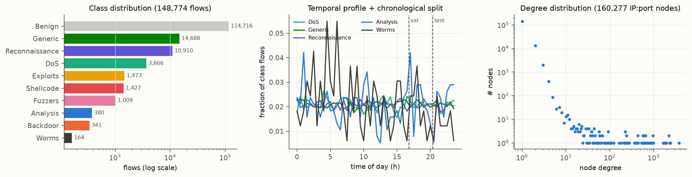

*Figure 1. Left: class distribution (log scale). Middle: temporal profile of selected classes and the chronological split boundaries. Right: degree distribution of the IP:port graph (heavy-tailed, mostly degree-1 nodes).*

## 3. Method: DIDS-MFL

The code is in `code/dyn.py`. Each flow is a timestamped edge (v_i, l_i, v_j, l_j, t, Δt, F_ij). The model processes the stream chronologically in batches of 200.

### 3.1 Statistical disentanglement (SD)

The paper's SMT formulation (Eqs. 5–7) becomes a linear programme once we substitute h = w ⊙ F:

```
max  h_N − h_1 + Σ_{i=2}^{N−1} (2h_i − h_{i−1} − h_{i+1})
s.t. W_min·F_i ≤ h_i ≤ W_max·F_i,   Σ h_i ≤ B,   h_i ≤ h_{i+1},   2h_i ≤ h_{i−1} + h_{i+1}
```

Details:

- Features are sorted ascending within each flow, so the order-preserving constraint (Eq. 4) is meaningful. The solution is then mapped back to the original feature positions.
- We solve the LP exactly with HiGHS, once per unique feature row: 44,486 LPs in 32 s on 8 processes (`code/01_sd.py`).
- With W ∈ [0.1, 10] and B = 40, **100% of LPs are feasible**, so the relaxed fallback was never used.
- The model input is **[F ‖ h]**. The literal "h replaces F" variant is evaluated as an ablation.

### 3.2 Dynamic memory and representational disentanglement (RD)

This part follows Eqs. 8–11 of 3D-IDS.

- **Memory update.** Every node has a 64-d memory m. Messages c_i = MLP(m_i, m_j, φ(Δt), l_i, l_j, e_ij) are computed from batch b−1 and aggregated per node. A GRU then updates the memory, with gradient, *before* batch b is embedded. This is TGN-style causal training: a flow never sees its own label or later flows.
- **Edge embedding.** e_ij is an MLP embedding of [F ‖ h ‖ Δt ‖ l_i ‖ l_j].
- **Speed.** Only a *local memory view* of the nodes needed by the batch is materialised for autograd.
- **RD loss.** The memory-scale representation z_m = MLP([m_src ‖ m_dst]) gets L_RD = ‖C(z_m) − I‖²_F / d², where C is the batch correlation matrix across dimensions.
- **Smoothness.** A memory-smoothness term (Eq. 19) is added with α = 10⁻³.

### 3.3 Dynamic Perona–Malik graph diffusion

For each endpoint we build a star graph: the endpoint plus its **K = 10 most recent temporal neighbours**, taken from strictly earlier batches.

- Leaf states combine the neighbour's memory and the edge embedding of that interaction.
- We integrate dX/dt = −Mᵀ σ(MXKᵀ) S (MXKᵀ) K with σ(x) = exp(−|x|) (Eq. 16), using RK4 (2 steps, h = 0.5).
- S holds the layer-temporal coefficients s_ij = sigmoid(MLP(l_i ‖ l_j ‖ φ(t − t_ij))) (Eqs. 14–15).
- The diffused centre states of src and dst form the diffusion-scale view z_d.
- The TGN baseline replaces diffusion with temporal graph attention over the same neighbours.

### 3.4 Multi-scale few-shot learning (MFL) module

- **Three views.** z_e (edge / statistical), z_m (memory) and z_d (diffusion).
- **Scale attention.** a_s = softmax_s(vᵀ tanh(W z_s)) gives z = Σ a_s z_s.
- **Multi-scale transform (MST).** A residual MLP over [z_e ‖ z_m ‖ z_d]: z ← z + MST(·).
- **Disentanglement regulariser.** L_Dis = ‖C(z) − I‖²_F / d² on the fused embedding z.
- **Bi-similarity heads (BSNet-inspired).** A cosine head τ·cos(z, p_c) plus a learned relation module r(z, p_c) = σ(MLP([z ‖ p_c])).
- **Class-balanced episodes.** A per-class FIFO buffer stores 64 detached embeddings per class. At every step, prototypes are formed from 5 buffer samples per class, and up to 16 queries per class from the current batch are classified. The episode loss is L_ep = CE(cos-logits) + BCE(relation scores).
- **Two-step classifier (Eq. 18).** A binary head gives p_att, and an attack-type head gives q. Final class probabilities are p(Benign) = 1 − p_att and p(k) = p_att · q_k. For MFL, q averages the softmax head and the bi-similarity probabilities against training-period class prototypes.

**Total loss:** L = L_int + α·L_smooth + β·L_RD + γ·L_Dis + λ·L_ep, with α = 10⁻³ and β = γ = 0.1, λ = 1 by default. The attack-type cross-entropy uses inverse-sqrt-frequency weights, and every neural baseline uses the same weighting. Optimiser: Adam with lr 10⁻³, weight decay 10⁻⁵, gradient clipping at 1. The default budget is 8 epochs with early stopping on validation macro-F1 (patience 3). A 20-epoch budget (patience 6) is reported separately.

**Named configurations** (all in the same code base):

- *TGN*: memory + temporal attention, no SD/RD/MFL.
- *3D-IDS*: SD + RD + PM diffusion + MLP fusion + two-step head; no MFL.
- *DIDS-MFL*: everything.

## 4. Experimental protocols and baselines

| Protocol | Training labels | Evaluation |
|---|---|---|
| **P1 Known** | all 10 classes, train period | test period: binary F1/AUC, 10-class macro-F1, attack balanced accuracy, per-class F1 |
| **P2 Unknown** | one attack type (Backdoor, DoS, Fuzzers or Reconnaissance) removed from train and val | test: detection recall of the unseen type, F1 and AUC on benign ∪ unseen |
| **P3 Few-shot (episodic, primary)** | only **base** classes (Benign, DoS, Exploits, Fuzzers, Generic, Reconnaissance), train period; novel-class flows stay in the stream as *unlabelled* traffic | **novel** classes Analysis, Backdoor, Shellcode, Worms. 4-way (novel only) and 5-way (+Benign from test) N-way K-shot, K ∈ {1, 5, 10}, 15 queries/class, **500 fixed episodes shared by all methods**. Metrics: episode macro-F1 and **NMI** (predictions vs labels), 95% CI over episodes, and k-means NMI on query embeddings. Pools: *all* flows, and a stricter *dedup* pool with one flow per unique feature vector. |
| **P4 Deployability** | – | per-flow inference latency; LLM in-context classification of 100 test flows |

**Baselines.**

- *Supervised:* RF (200 trees, balanced), MLP, E-GraphSAGE and TGN. E-GraphSAGE uses a two-layer mean aggregation of incident-edge features over the static IP:port graph, with edge embedding [z_u ‖ z_v].
- *Dedicated few-shot learners* (`code/static.py`), all meta-trained on base classes with 4-way 5-shot episodes for 3,000 iterations, or supervised for Baseline++: ProtoNet, RelationNet, Baseline++ (cosine classifier), BSNet-style (cosine + relation) and "MLP pretrain + fine-tuned logistic regression".
- *Non-parametric:* raw features with prototype, 1-NN and random-forest-on-support heads.
- *Graph or dynamic models with a prototype head:* E-GraphSAGE, TGN and 3D-IDS embeddings.

**Seeds.**

- P1: 3 seeds.
- P3: 5 seeds for the main methods; 2–3 for ablations.
- P2: 2 seeds.

Tables report mean ± std over seeds.

**Compute.** Everything ran on a shared 152-core CPU host (load 90–200), 2 threads per job, with no GPU. A DIDS-MFL epoch takes about 100 s. In total we ran 185 training and evaluation jobs.

## 5. Results

### 5.1 Is entanglement the root cause of inconsistent detection?

**Overlap measure.** For every class pair and every feature we computed the overlap 1 − 2|AUC − 0.5|. A value of 0 means a single feature separates the two classes perfectly; 1 means the distributions are identical (Fig. 2).

- DoS–Exploits is by far the most entangled pair: mean overlap 0.92 over all features, and still 0.80 on the five most separating features.
- Fuzzers–Backdoor (0.69) and Reconnaissance–Shellcode (0.71) follow.
- Benign is well separated from everything (≤ 0.15). This is why **binary detection is saturated**.

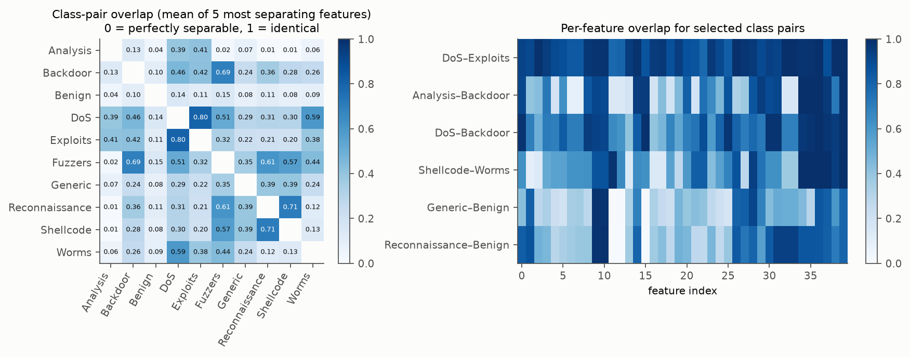

*Figure 2. Left: class-pair overlap computed on the five most separating features. Right: per-feature overlap for selected pairs. DoS–Exploits is entangled in almost every feature.*

**Inconsistency.** Per-class F1 under P1 varies widely for every model (Table 2, Fig. 3).

- The standard deviation of per-class F1 is 12.7 points for RF and 20–25 for the neural models.
- Benign, Generic and Reconnaissance reach ≥ 91, while Exploits, DoS, Backdoor, Analysis and Worms fall to 28–62.
- The dominant confusion for every model is DoS ↔ Exploits (Fig. 4). This is exactly the most entangled pair.

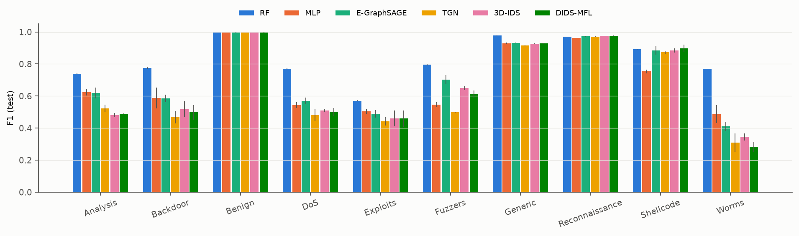

*Figure 3. Per-class test F1 (known protocol, 8-epoch budget, mean ± std over 3 seeds).*

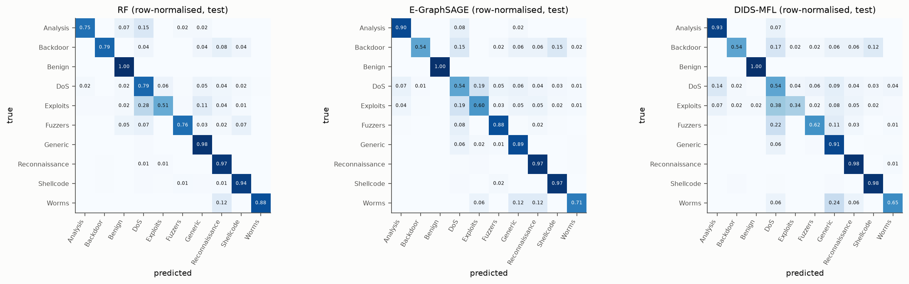

*Figure 4. Row-normalised confusion matrices (test). Every model's largest off-diagonal mass is DoS/Exploits. DIDS-MFL trades precision for recall on rare classes: Analysis recall is 0.93, but DoS flows leak into Analysis.*

**Quantitative test** (Fig. 5, `outputs/rootcause.json`):

| Test | Spearman ρ | Reading |
|---|---|---|
| (a) Pairwise feature overlap vs pairwise confusion rate (36 attack pairs) | **0.34 to 0.58** across six models | statistical entanglement explains *which* classes get confused |
| (b) Class-level entanglement score vs per-class F1 (9 attacks) | only −0.06 to −0.25 | weak: Worms and Analysis are poorly classified mainly because of scarcity, not overlap |
| (c) Mean representation correlation of a class vs its F1 | **+0.90** E-GraphSAGE, **+0.83** TGN, +0.29 DIDS-MFL | **positive, i.e. opposite to the 3D-IDS hypothesis** |

On (c): the best-detected classes, Generic and Reconnaissance, have the most correlated embeddings, because their flows collapse into tight, nearly one-dimensional clusters. Representational correlation is therefore *not* a cause of poor detection on this dataset.

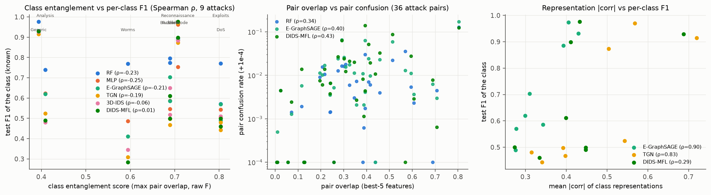

*Figure 5. Root-cause tests. Left: class entanglement vs class F1. Middle: pair overlap vs pair confusion (log scale). Right: representation |corr| vs class F1.*

**Duplicate-aware check.** On the 24% of test flows whose feature vector never occurs in training, RF still reaches 80.1 macro-F1 (77.7 on seen vectors). The 20-epoch dynamic models drop from 70.5–71.1 to 64.7–67.1. RF's advantage is therefore not mere memorisation of repeated vectors.

### 5.2 Statistical disentanglement: what does SD do?

- The LP solution is essentially a within-flow monotone, convex ramp. Learned weights average 0.12–10 per feature (median 0.50), and the per-feature Pearson correlation between h and F is 0.73.
- SD reduces the mean |Spearman| correlation between features from **0.441 to 0.399** (Fig. 6).
- Averaged over *all* features, it does **not** reduce class-pair overlap (0.664 → 0.667). Some features become more separable and others less: Fig. 7 shows the five features with the largest post-hoc reduction (e.g. feature 30: overlap 0.90 → 0.70).
- h is nevertheless *complementary* to F. A 5-NN attack-type classifier scores macro-F1 70.4 on F, 72.3 on h and **73.0 on [F ‖ h]**.

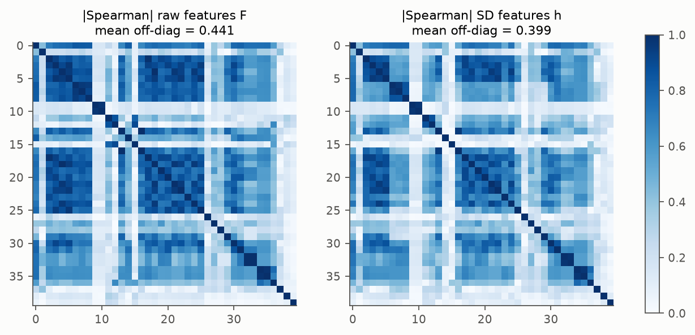

*Figure 6. |Spearman| correlation between features before (F) and after (h) SD.*

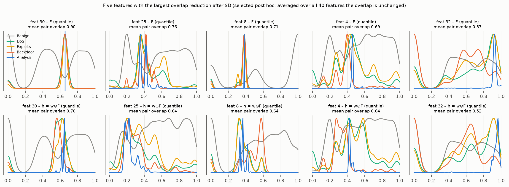

*Figure 7. Class-conditional densities before and after SD for the five features whose class overlap SD reduces most (selected post hoc; averaged over all features the overlap is unchanged).*

### 5.3 Known attacks (P1)

**Table 1. Known-attack detection, test period.** 8-epoch budget, 3 seeds, values in %.

| Method | Binary F1 | Binary AUC | Macro-F1 (10 cls) | Attack bal. acc | Min class F1 | Std of class F1 |
|---|---|---|---|---|---|---|
| RF | 99.3 ± 0.0 | 100.0 | **82.6 ± 0.1** | **82.1 ± 0.1** | **57.1** | **12.7** |
| MLP | 99.2 ± 0.0 | 99.9 | 69.3 ± 0.8 | 73.5 ± 0.7 | 46.5 | 19.3 |
| E-GraphSAGE | 99.2 ± 0.0 | 99.9 | 71.7 ± 1.0 | 75.9 ± 1.3 | 41.1 | 20.4 |
| TGN | 98.7 ± 0.1 | 99.9 | 64.8 ± 1.2 | 71.7 ± 0.5 | 30.9 | 24.6 |
| 3D-IDS | 98.8 ± 0.1 | 100.0 | 67.5 ± 0.8 | 75.7 ± 1.2 | 34.5 | 23.5 |
| DIDS-MFL | 99.0 ± 0.2 | 100.0 | 66.4 ± 1.7 | 72.9 ± 1.2 | 28.3 | 24.7 |

**Under-training diagnosis.** The dynamic models were still improving at epoch 8 (Fig. 13, left), so we repeated them with 20 epochs (Table 1b). DIDS-MFL then becomes the best dynamic model (72.2 macro-F1), above 3D-IDS (71.6) and TGN (69.5), and matches E-GraphSAGE (71.7). It still trails RF by about 10 points on attack typing.

**Table 1b. Known attacks with a 20-epoch budget** (patience 6, best epochs 15–20). Values in %.

| Method (20 epochs) | Seeds | Binary F1 | Macro-F1 | Attack bal. acc | Min class F1 |
|---|---|---|---|---|---|
| TGN | 3 | 99.0 ± 0.0 | 69.5 ± 0.8 | 75.8 ± 0.6 | 43.9 |
| 3D-IDS | 3 | 99.2 ± 0.1 | 71.6 ± 0.9 | 77.0 ± 0.3 | 44.9 |
| **DIDS-MFL** | 3 | 99.1 ± 0.1 | **72.2 ± 0.5** | **77.6 ± 0.7** | 43.8 |
| DIDS-MFL w/o diffusion | 2 | 99.2 ± 0.0 | 72.0 ± 0.8 | 77.4 ± 0.6 | 39.8 |

The binary task is saturated for all methods (F1 ≈ 99, AUC ≈ 100). This differs from the 95.5% binary F1 that 3D-IDS reports on the full 2.4M-flow NF-UNSW-NB15-v2. Our file is a 149k-flow subset in which Benign is trivially separable.

### 5.4 Unknown attacks (P2)

**Table 2. Leave-one-attack-out detection** (test; recall = fraction of unseen-type flows flagged as attacks; F1 and AUC on benign ∪ unseen). 2 seeds, values in %.

| Method | Backdoor rec. / F1 | DoS rec. / F1 | Fuzzers rec. / F1 | Recon. rec. / F1 | Mean recall | Min recall | Mean F1 | AUC range |
|---|---|---|---|---|---|---|---|---|
| RF | 97.9 / 66.7 | 96.2 / 94.3 | 75.0 / 75.9 | 99.1 / 98.1 | 92.1 | 75.0 | **83.7** | 99.9–100 |
| MLP | 100 / 53.9 | 98.8 / 93.3 | 99.7 / 79.0 | 99.8 / 97.6 | **99.6** | **98.8** | 81.0 | 99.8 |
| E-GraphSAGE | 100 / 53.2 | 98.6 / 93.1 | 100 / 81.2 | 100 / 97.6 | **99.6** | 98.6 | 81.3 | 99.7–99.8 |
| TGN | 87.5 / 40.5 | 96.0 / 89.1 | 96.5 / 75.4 | 81.1 ± 18.6 / 85.3 | 90.3 | 81.1 | 72.6 | 99.5–99.8 |
| 3D-IDS | 90.6 / 49.8 | 96.7 / 91.3 | 99.7 / 77.4 | 82.7 ± 17.3 / 86.7 | 92.4 | 82.7 | 76.3 | 99.6–99.9 |
| DIDS-MFL | 97.9 / 55.8 | 98.0 / 91.2 | 97.9 / 80.6 | **46.0 ± 17.3** / 58.9 | 85.0 | 46.0 | 71.6 | 99.5–99.9 |

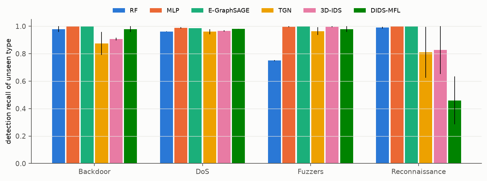

*Figure 8. Detection recall of the unseen attack type.*

- Every model *ranks* unseen attacks almost perfectly (AUC ≥ 99.5).
- Differences come from the 0.5 decision threshold. The two-step dynamic models are poorly calibrated on unseen **Reconnaissance**: DIDS-MFL flags only 46% at p_att > 0.5, despite AUC 99.5, with high seed variance.
- DIDS-MFL is the most consistent dynamic model on the other three types (≥ 97.9% recall).
- Trees miss unseen Fuzzers (75%), while neural models do not.
- Overall, DIDS-MFL does **not** improve unknown-attack detection over simple neural baselines. This is a negative result for P2.

### 5.5 Few-shot attacks: episodic evaluation (P3, primary)

**Table 3a. 4-way novel-class episodes** (Analysis, Backdoor, Shellcode, Worms). Pool = all, 500 episodes × 60 queries, mean ± std over seeds (5 seeds unless noted), values in %.

| Method | F1 K=1 | NMI K=1 | F1 K=5 | NMI K=5 | F1 K=10 | NMI K=10 |
|---|---|---|---|---|---|---|
| Raw features + ProtoNet head (1 seed) | 54.0 | 41.0 | 69.6 | 52.3 | 72.4 | 55.4 |
| Raw features + 1-NN (1 seed) | 54.0 | 41.0 | 72.5 | 54.5 | 78.6 | 60.8 |
| Raw features + RF on support (1 seed, 200 episodes) | 59.1 | 48.2 | 77.3 | 59.9 | 82.5 | 65.9 |
| ProtoNet | 52.2 ± 1.3 | 39.4 | 62.8 ± 1.2 | 46.2 | 65.3 ± 1.4 | 48.0 |
| RelationNet | 46.4 ± 4.2 | 40.1 | 50.2 ± 5.8 | 40.8 | 51.3 ± 7.0 | 41.1 |
| Baseline++ (cosine) | 52.5 ± 2.7 | 40.1 | 68.2 ± 3.2 | 51.8 | 73.3 ± 3.2 | 56.5 |
| BSNet-style (bi-similarity) | 48.2 ± 0.9 | 34.8 | 59.5 ± 2.0 | 42.4 | 63.0 ± 2.6 | 45.1 |
| MLP pretrain + proto | 56.9 ± 0.9 | 47.5 | 68.4 ± 1.9 | 54.3 | 72.8 ± 2.2 | 57.7 |
| MLP pretrain + fine-tune LR | 57.7 ± 0.9 | 48.3 | 74.7 ± 0.9 | 58.7 | 81.7 ± 0.5 | 65.4 |
| E-GraphSAGE + proto | 54.1 ± 2.2 | 42.4 | 68.2 ± 2.1 | 52.0 | 71.8 ± 1.9 | 54.4 |
| TGN + proto | 56.6 ± 2.0 | 47.6 | 67.9 ± 1.8 | 53.5 | 71.4 ± 1.9 | 55.6 |
| 3D-IDS + proto | 58.8 ± 2.3 | 49.2 | 67.2 ± 2.3 | 53.2 | 70.0 ± 2.8 | 55.2 |
| DIDS-MFL embedding + proto | **60.4 ± 2.2** | **50.9** | 71.7 ± 2.5 | 57.5 | 75.8 ± 2.2 | 60.7 |
| DIDS-MFL (bi-similarity MFL head) | 60.0 ± 3.3 | 48.6 | 71.3 ± 4.2 | 56.2 | 75.1 ± 4.1 | 59.4 |

**Table 3b. 5-way episodes (Benign + 4 novel).** Pool = all, F1 / NMI in %.

| Method | K=1 | K=5 | K=10 |
|---|---|---|---|
| ProtoNet | 61.1 / 58.2 | 70.6 / 63.1 | 72.2 / 63.9 |
| Baseline++ | 61.3 / 58.8 | 75.1 / 67.5 | 78.5 / 69.7 |
| BSNet-style | 58.2 / 55.5 | 68.2 / 60.8 | 70.3 / 62.0 |
| MLP + fine-tune LR | 65.4 / 63.7 | **80.8 / 72.0** | **85.0 / 75.6** |
| Raw + RF on support | 50.3 / 45.0 | 80.3 / 69.0 | 85.3 / 75.3 |
| E-GraphSAGE + proto | 62.1 / 59.7 | 74.8 / 66.9 | 77.1 / 68.2 |
| TGN + proto | 63.6 / 62.3 | 74.0 / 66.9 | 76.5 / 67.6 |
| 3D-IDS + proto | 65.0 / 62.5 | 73.3 / 66.6 | 75.4 / 67.3 |
| **DIDS-MFL (MFL head)** | **67.3 / 64.5** | 77.2 / 70.2 | 80.2 / 71.9 |

Full tables, including the de-duplicated pool, are in `outputs/tables/fewshot_*.csv`. On the dedup pool every method loses 3–6 points, but the ordering is unchanged.

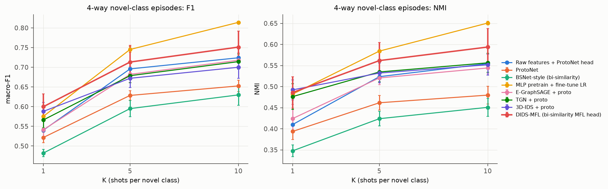

*Figure 9. 4-way novel-class F1 and NMI vs K (mean ± std over 5 seeds).*

**Heads confound the comparison above.** Some rows use a prototype head and others a learned LR head. We therefore applied **the same two heads to every model's saved novel-class embeddings** (`code/posthoc_fewshot.py`, Table 4, Fig. 10).

**Table 4. Common-head comparison of embeddings** (4-way, 500 episodes, 5 seeds). Values in %; "proto" = Euclidean prototype, "LR" = logistic regression on the standardised support set.

| Embedding | Proto F1 K=5 | LR F1 K=5 | LR NMI K=5 | LR F1 K=10 | LR NMI K=10 | Dedup LR F1 K=5 |
|---|---|---|---|---|---|---|
| Raw [F ‖ h] | 69.6 | 76.8 | 59.1 | 82.7 | 66.3 | 72.3 |
| MLP (supervised) | 68.5 ± 1.9 | 74.2 ± 0.4 | 57.9 | 81.6 ± 0.7 | 65.0 | 72.8 |
| BSNet-style | 62.7 ± 2.3 | 70.7 ± 2.0 | 52.5 | 79.3 ± 2.1 | 61.4 | 68.9 |
| E-GraphSAGE | 68.2 ± 2.1 | 74.8 ± 1.5 | 56.9 | 81.2 ± 1.2 | 63.8 | 72.7 |
| TGN | 67.9 ± 1.8 | 76.2 ± 1.6 | 59.2 | 81.6 ± 1.5 | 65.2 | 72.8 |
| 3D-IDS | 67.2 ± 2.3 | 77.0 ± 1.4 | 60.1 | 82.8 ± 0.7 | 66.5 | 74.3 |
| **DIDS-MFL** | **71.7 ± 2.5** | **80.3 ± 1.1** | **64.6** | **85.0 ± 0.5** | **70.1** | **77.9** |

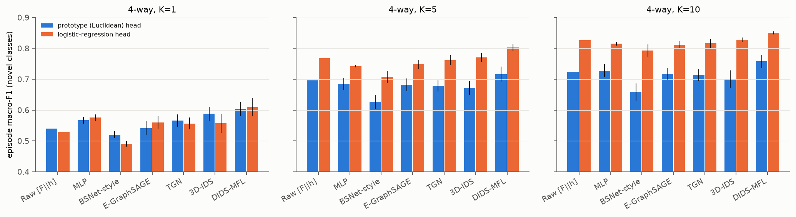

*Figure 10. The same heads applied to every embedding. Under either head, the DIDS-MFL embedding gives the highest novel-class F1 at every K.*

**Interpretation.**

- *Embedding quality.* With the head held fixed, DIDS-MFL gives the highest few-shot F1 and NMI at every K, under both heads and both pools:
  - +3.3 F1 over the best other learned embedding (3D-IDS) at 4-way 5-shot with LR;
  - +6.1 over the supervised MLP;
  - +3.5 over raw features.

  Seed-to-seed std is about 1 point, while the gaps are 3–6 points.
- *Head choice.* The MFL bi-similarity head is *not* better than a plain prototype head on the same embedding (71.3 vs 71.7). For K ≥ 5, a simple logistic-regression head is much better than any metric head (+8–9 points). This matches the "a closer look at few-shot classification" observation, and suggests the bi-similarity head is the weakest MFL component.
- *Dedicated few-shot learners.* ProtoNet, RelationNet and BSNet-style, meta-trained on only six base classes, underperform even raw features. With so few base classes, meta-training over-specialises.
- *Strong non-parametric baseline.* A random forest fitted on the K-shot support set of *raw* features (77.3 at K=5) beats every learned model *with a prototype head*. It loses only to learned embeddings with an LR head.

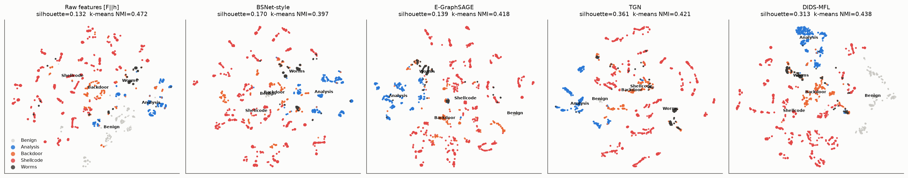

*Figure 11. t-SNE of novel-class (and Benign) embeddings under the few-shot protocol; novel classes were never labelled in training. Silhouette on the four novel classes:*

| Embedding | Silhouette (novel classes) |
|---|---|
| Raw features | 0.21 |
| BSNet-style | 0.17 |
| E-GraphSAGE | 0.15 |
| TGN | 0.36 |
| DIDS-MFL | 0.33 |

*The dynamic models form compact Analysis and Worms clusters; Backdoor stays mixed with Shellcode.*

A known-protocol t-SNE (Fig. 12) shows the same pattern. k-means NMI on 10 classes: DIDS-MFL 0.655, TGN 0.638, E-GraphSAGE 0.557.

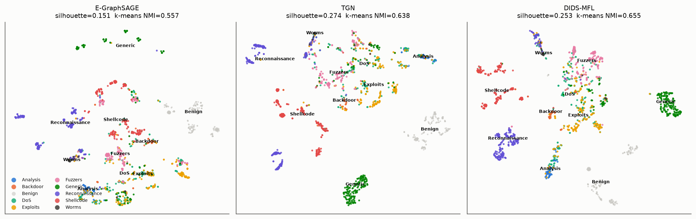

*Figure 12. t-SNE of test embeddings under the known protocol (200 flows per class).*

**Longer training hurts transfer.** With 20 epochs (seed 0), base-class test macro-F1 rises from 77.5 to 79.5, but novel 4-way 5-shot F1 falls from 73.5 to 67.5. Training longer over-fits the base classes, so the default 8-epoch budget is retained for P3. Model selection uses base-class validation only; no novel labels are ever used.

### 5.6 Ablations and mechanism checks

**Table 5. Ablations.** Known: macro-F1 with the 8-epoch budget (2–3 seeds). Few-shot: 4-way pool=all with the model's own head (3–5 seeds). |corr| = mean off-diagonal absolute correlation of the test embeddings. Values in %.

| Variant | Known macro-F1 | \|corr\| z | \|corr\| z_m | FS F1 K=1 | FS F1 K=5 | FS NMI K=5 |
|---|---|---|---|---|---|---|
| **DIDS-MFL (full)** | 66.4 ± 1.7 | 0.314 | 0.294 | 60.0 ± 3.3 | 71.3 ± 4.2 | 56.2 |
| w/o SD (F only) | 64.2 ± 0.8 | 0.330 | 0.316 | 63.2 ± 1.5 | 75.6 ± 0.8 | 61.9 |
| h replaces F | 66.0 ± 0.2 | 0.301 | 0.295 | 56.6 ± 0.8 | 69.3 ± 1.7 | 54.1 |
| w/o RD | 65.7 ± 0.6 | 0.326 | **0.569** | 59.7 ± 2.9 | 69.9 ± 5.3 | 55.6 |
| w/o RD and w/o Dis-reg | 64.2 ± 2.2 | **0.514** | **0.733** | 57.9 ± 1.0 | 68.9 ± 1.9 | 53.6 |
| RD/Dis β = γ = 1 | **68.0 ± 0.1** | 0.182 | 0.074 | 59.8 ± 3.9 | 73.3 ± 2.6 | 58.0 |
| w/o diffusion | 64.0 ± 3.0 | 0.324 | 0.348 | 56.9 ± 0.9 | **66.4 ± 1.3** | 50.3 |
| diffusion → temporal attention | 64.6 ± 0.8 | 0.336 | 0.298 | 59.4 ± 1.3 | 71.9 ± 1.3 | 55.8 |
| w/o multi-scale transform | 55.6 ± 7.3 | 0.404 | 0.350 | 64.7 ± 0.6 | 75.5 ± 0.7 | 60.8 |
| w/o Dis-reg | 67.7 ± 0.2 | **0.590** | 0.235 | 60.2 ± 1.9 | 68.7 ± 0.8 | 54.4 |
| single (cosine) similarity | 64.4 ± 0.4 | 0.329 | 0.254 | 58.5 ± 0.2 | 68.6 ± 1.1 | 54.3 |
| w/o episodes (proto head) | 66.9 ± 2.8 | 0.260 | 0.177 | 58.9 ± 1.8 | 72.5 ± 1.6 | 56.1 |
| 3D-IDS (no MFL) | 67.5 ± 0.8 | 0.569 | 0.146 | 58.8 ± 2.3 | 67.2 ± 2.3 | 53.2 |
| TGN | 64.8 ± 1.2 | 0.594 | 0.645 | 56.6 ± 2.0 | 67.9 ± 1.8 | 53.5 |

The same ablations under the common LR head (`outputs/tables/fewshot_posthoc.csv`, 4-way 5-shot F1):

| Variant | LR-head F1 |
|---|---|
| Full | 80.3 ± 1.1 |
| w/o diffusion | 77.1 ± 0.3 |
| w/o episodes | 78.0 ± 1.3 |
| w/o SD | 81.0 ± 0.6 |

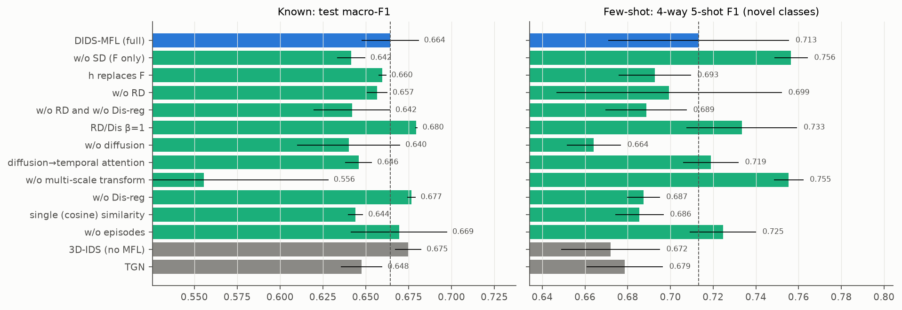

*Figure 13a. Ablations (8-epoch budget). The dashed line marks the full model.*

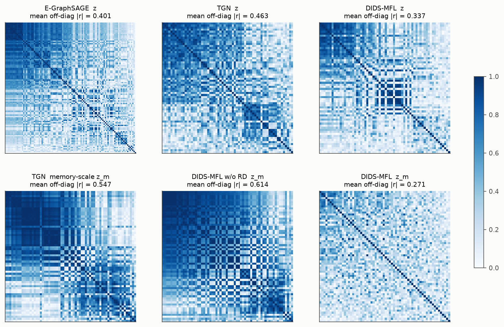

*Figure 14. |corr| heatmaps of learned test embeddings (known protocol).*

| Embedding | Mean off-diagonal \|r\| |
|---|---|
| E-GraphSAGE z | 0.40 |
| TGN z | 0.46 |
| DIDS-MFL z | **0.34** |
| TGN memory view z_m | 0.55 |
| DIDS-MFL w/o RD, z_m | 0.61 |
| DIDS-MFL z_m | **0.27** |

*RD and the Dis-regulariser do what they are designed to do.*

What the ablations show, after diagnosis:

- **RD works as designed, but the decorrelation buys little accuracy.**
  - Removing RD raises memory-view correlation from 0.29 to 0.57. Removing both regularisers raises fused-embedding correlation from 0.31 to 0.51.
  - Removing both costs 2.2 known macro-F1 and about 2.4 few-shot F1. Removing either one alone has effects within seed noise.
  - Stronger decorrelation (β = γ = 1) gives the best known macro-F1 of all variants (68.0) and decent few-shot results. This suggests the default β = 0.1 is too weak. We did not re-tune it on test.
- **Diffusion is the most valuable dynamic component for few-shot transfer.**
  - Removing it costs 4.9 F1 with the MFL head and 3.2 with the common LR head.
  - Replacing it with TGN-style temporal attention recovers most of the loss (71.9).
  - For *known* attacks, diffusion does not matter once training converges (72.2 vs 72.0 at 20 epochs).
  - Scale attention gives the diffusion view large weight for Generic (76%), Reconnaissance (89%), Shellcode (38%) and Fuzzers (23%) (Fig. 15). These classes involve multi-flow scans and bursts.
- **SD does not help.** Removing SD is neutral-to-better for few-shot (75.6 vs 71.3) and slightly worse for known typing (64.2 vs 66.4). Replacing F by h ("h replaces F") is worse for few-shot. SD therefore adds a mildly useful feature view rather than a disentangled replacement.
- **The MFL internals are mixed.**
  - Removing the multi-scale transform *destabilises* known-attack training: one of two seeds collapsed, giving binary F1 89.8 ± 8.4.
  - Removing MST does not hurt few-shot (75.5).
  - The single-similarity head and the no-episode variant are within noise of the full model.
  - Episodic training helps the embedding under the common LR head (80.3 vs 78.0).
- **Seed variance.** DIDS-MFL's own-head few-shot F1 has the largest seed variance (± 4.2). Several ablation differences of 2–4 points are therefore not significant with 3 seeds. We mark them as such and do not claim them as effects.

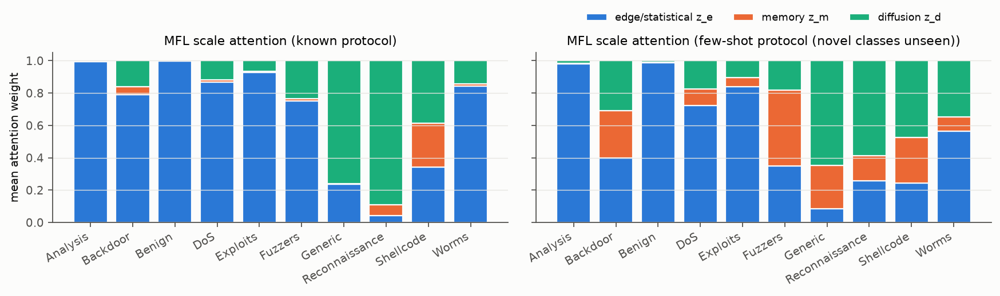

*Figure 15. Mean MFL scale-attention weights per class (test). The memory view receives almost no weight in the known protocol, consistent with 73% of sources being seen only once.*

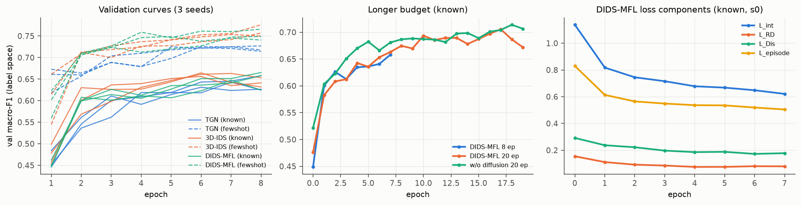

*Figure 13b. Left: validation curves (3 seeds). Middle: 20-epoch runs (known). Right: DIDS-MFL loss components.*

### 5.7 Comparison with an LLM, and inference latency (P4)

**Reachability.** No hosted LLM API key was available. We downloaded an open instruction-tuned model, **Qwen2.5-1.5B-Instruct**, and ran it locally on CPU (fp32, 4 threads, `code/llm_eval.py`).

**Setup.**

- Inputs: 100 test flows (10 per class) serialised as text, using the 20 most informative features (mutual information) as percentile ranks.
- Prompt: 20 labelled in-context training examples (2 per class), with a KV-cached prefix of 1,372 tokens.
- Prediction: the argmax of next-token logits restricted to the 10 class letters.

**Table 6. Accuracy on the same 100 flows, and per-flow latency (CPU).**

| Method | Macro-F1 (10 cls) | Binary F1 | Latency per flow |
|---|---|---|---|
| Qwen2.5-1.5B, in-context (20 shots) | 0.20 | 0.82 | **3,246 ms** (+ 39 s prefix) |
| RF trained on the same 20 prompt flows (40 features) | 0.43 | 0.98 | ≈ 0.07 ms |
| DIDS-MFL (known protocol, seed 0) | 0.68 | 1.00 | 0.30 ms |
| RF (full training set) | 0.85 | 0.99 | 0.07 ms |

**Table 6b. Inference latency of all models** (per flow; dynamic models include the memory update).

| Method | ms / flow |
|---|---|
| MLP | 0.005 |
| E-GraphSAGE | 0.010 |
| RF | 0.070 |
| TGN | 0.136 |
| DIDS-MFL | 0.302 |
| 3D-IDS | 0.316 |
| LLM | 3,246 |

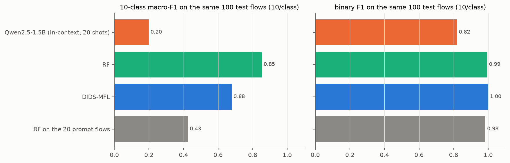

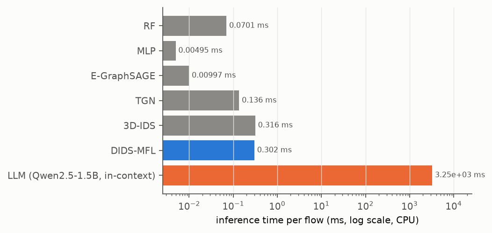

*Figure 16. Top: accuracy on the shared 100-flow sample. Bottom: per-flow inference latency (log scale).*

**Findings.**

- The LLM predicted only 5 of the 10 classes. It mainly emitted Analysis, Benign, Fuzzers, Generic and Worms.
- With the same 20 labelled examples, a random forest is twice as accurate, so the LLM's poor result is not just a lack of data.
- DIDS-MFL processes the whole 148,774-flow stream in 45 s on 2 CPU threads, about 3,300 flows/s. That makes it compatible with online deployment. The LLM's 0.3 flows/s is not.
- Larger hosted LLMs could be more accurate, but we could not test them, and they would be still slower and costlier per flow.

## 6. Discussion

**What the evidence supports.**

1. *Statistical entanglement is a real driver of confusion.* The pairs that overlap in feature space are the pairs that get confused, especially DoS/Exploits. It is not, however, the sole explanation of per-class inconsistency: class scarcity (Worms, Analysis, Backdoor) matters at least as much.
2. *A dynamic, diffusion-based, multi-scale representation transfers better to unseen attack classes.* Novel attacks can be recognised from a few labelled flows. On four attack types never labelled during training, the DIDS-MFL embedding gives the best F1 and NMI at K = 1, 5 and 10 under identical heads. This is the main positive result and is consistent across 5 seeds and both episode pools.
3. *RD/Dis-reg reduce representation correlation as intended,* with modest accuracy benefits that are stronger at β = 1.

**What it does not support.**

1. SD as implemented (the exact LP of Eqs. 3–7) does not reduce distribution overlap on average, and does not improve few-shot transfer.
2. Highly correlated representations do *not* go with poor detection on this dataset; the correlation is the opposite.
3. DIDS-MFL does not beat a random forest on known-attack typing, nor simple neural models on leave-one-out unknown detection. Its two-step classifier is mis-calibrated for unseen Reconnaissance.
4. The bi-similarity head brings no gain over prototype heads, and both are clearly beaten by a logistic-regression head at K ≥ 5.

**Practical recommendation.** Combine the DIDS-MFL embedding with a lightweight classifier fitted on the support set (LR), and recalibrate the binary threshold on validation data that includes rare attacks. In our results the most reliable gains come from the dynamic embedding, not from the metric heads.

## 7. Limitations

- **One dataset.** NF-UNSW-NB15-v2 is a 149k-flow subset with unnamed features. Binary detection is saturated, and 76% of test flows duplicate training vectors. We report a dedup episode pool and duplicate-aware scores to control for this.
- **CPU-only, shared host.** Budgets are 8 or 20 epochs rather than the paper's 500. Seed counts are modest (2–5), so several ablation differences are within noise.
- **Derived layer marks.** Layer marks were all zero in the file and were derived causally from node degree. This differs from the paper's router-address rule.
- **SD hyperparameters.** W_min, W_max and B are unspecified in the paper. We chose the smallest box giving 100% feasibility.
- **Transductive unlabelled traffic.** In P3, novel-class flows pass through the stream *unlabelled* during training. This mirrors deployment, since traffic is observed but not labelled, but it is mildly transductive.
- **LLM comparison.** Only a small local model (1.5B) was available. No hosted frontier model was tested, so the LLM results should not be generalised to larger models.
- **Hyperparameters.** These (β, γ, λ, K, epochs) were not tuned beyond the reported sensitivity runs. Selecting β = 1 post hoc would be test-set tuning, so the default is reported as the main model.

## 8. Reproducibility

**Pipeline.** Run the scripts below from `/workspace`.

| Step | Command | Produces |
|---|---|---|
| Extract data | `python code/00_extract.py` | `outputs/data.npz` |
| Solve SD | `python code/01_sd.py` | `outputs/sd_h.npy`, `sd_stats.json` |
| Entanglement analysis | `python code/02_entangle.py` | `entangle.json`, Figs. 1, 2, 6, 7 |
| Build episodes | `python code/03_make_episodes.py` | fixed episodes, `outputs/episodes.npz` |
| Dynamic models | `python code/dyn.py --protocol {known,fewshot,unknown} [--holdout c] --variant <name> --seed s [--epochs 20 --patience 6 --tag _long]` | variants listed in `VARIANTS` |
| Static baselines | `python code/static.py --method {rf,mlp,egs,protonet,relationnet,baselinepp,bsnet,raw} --protocol ... --seed s` | baseline runs |
| Job queues | `code/jobq.py` with `outputs/jobs_*.txt` | all 185 runs, which write `outputs/runs/*.json` |
| Common-head analysis | `python code/posthoc_fewshot.py <model>` | common-head few-shot results |
| Figures and tables | `code/viz.py`, `code/rootcause.py`, `code/aggregate.py` | figures, `outputs/tables/*.csv`, `outputs/tables.md` |
| LLM comparison | `python code/dl_parallel.py Qwen/Qwen2.5-1.5B-Instruct outputs/llm/qwen15 16`, then `python code/llm_eval.py` | `outputs/llm/llm_results.json` |

Every number in this report is read from `outputs/runs/*.json`, `outputs/tables/*.csv`, `outputs/posthoc/*.json`, `outputs/rootcause.json`, `outputs/viz_stats.json`, `outputs/entangle.json` or `outputs/llm/llm_results.json`.
