# Data-driven de novo design of underwater-adhesive hydrogels from adhesive-protein sequence statistics: a re-analysis of the screening and machine-learning optimisation data

## Abstract

We re-analysed every public data file from a three-step design campaign. In that campaign, the residue-class statistics of natural adhesive proteins were converted into the feed compositions of six-monomer random copolymer hydrogels:

- nucleophilic → HEA
- hydrophobic → BA
- acidic → CBEA
- cationic → ATAC
- aromatic → PEA
- amide → AAm

The resulting gels were then optimised with Gaussian-process (GP) and random-forest (RFR) Bayesian optimisation.

**Data integrity.** The three historical snapshots of the 180-gel data-mined (DM) library agree exactly with the verified 184-row file (maximum |Δx| = |Δy| = 0). After de-duplication, the optimisation workbook adds 113, 29 and 26 new formulations in rounds 1–3, giving 352 distinct tested formulations.

**Key formulations.**
- **G-max** is the strongest protein-derived gel, **G-042**:
  - composition HEA/BA/CBEA/ATAC/PEA/AAm = 0.141/0.591/0.076/0.096/0.096/0;
  - F_a = 146.6 kPa on glass after 10 s contact, against a library median of 41.7 kPa.
- **R1-max** is the strongest ML-designed formulation, the first entry of the round-1 `old-SM-GP` predicted-mean list:
  - composition BA/ATAC/PEA = 0.588/0.094/0.318, with no HEA, CBEA or AAm;
  - F_a = 353.3 kPa;
  - an independent pilot measurement of the same composition (P-008) gave 194.6 kPa at 10 s and 264.9 kPa at 60 s.

**Campaign performance.** The ML campaign raised the median adhesion of tested gels from 41.7 kPa to 138.2 kPa (p = 4 × 10⁻⁴⁴). In addition:
- 46 % of the ML formulations beat G-max;
- GP-based lists ranked by predicted mean outperformed EI-ranked lists (median 196 vs 123 kPa, p = 4 × 10⁻⁸);
- by round 3 the top gels had converged to BA ≈ 0.61, PEA ≈ 0.31, ATAC ≈ 0.07.

**Structure–property analysis.**
- Adhesion requires a cationic component: ATAC switches on phase separation (98 % vs 27 % of gels), and adhesion is highest at 6–15 mol % ATAC.
- Too much ATAC over-swells the gel. Gels with swelling ratio Q > 2 never exceeded 60 kPa.
- Within the cationic window, hydrophobic and aromatic content (BA + PEA) drives adhesion.
- ATAC also explains substrate specificity: across the 28 gels tested on both substrates, it correlates with preferring glass over steel (ρ = 0.81). This is consistent with quaternary-ammonium/silanolate electrostatic attraction.
- Exact Shapley attribution and prospective round-by-round validation confirm these rules. Prospective Spearman ρ was 0.65 in round 1 and 0.82–0.86 in rounds 2–3.

**Copolymerization simulation.** A terminal-model Monte Carlo simulation (Mayo–Lewis, after paper_001) shows that near-ideal random copolymerization reproduces the target composition in essentially every chain and 20-mer segment. Hypothetical non-ideal reactivity ratios instead cause:
- composition drift;
- longer hydrophobic blocks;
- up to 2.7× more segments that lack any cationic anchor.

This supports the design premise that the statistics of the protein must be replicated faithfully by a random copolymer.

**Relation to the task goal.** No value in the provided screening files reaches the >1 MPa goal; the best measured value (0.35 MPa) matches the 0.3 MPa measured for natural mussel plaques. We therefore cannot verify >1 MPa from these data. Characterisation of the optimised specimens under the final test protocol is not part of the release.

---

## 1. Introduction and objectives

Proteins such as the mussel foot proteins (mfps) achieve wet adhesion through a balanced mixture of chemical functions rather than any single residue. These include:
- catecholic and aromatic residues;
- cationic Lys/Arg;
- hydrophobic residues;
- hydroxyl and amide residues.

paper_002 (Lee, Messersmith, Israelachvili & Waite 2011) summarises their sequences and SFA adhesion data. paper_000 (Ruan et al. 2023) argues that the *statistical, segment-level* chemistry of protein sequences is what synthetic random heteropolymers must replicate to reproduce protein behaviour. paper_001 (Smith et al. 2019) provides the Mayo–Lewis Monte Carlo framework needed to check that a random copolymerization actually produces such statistics without composition drift.

The task: the inputs are protein-sequence features converted to six monomer compositions, and the output is underwater adhesive strength. The stated goal is a de novo hydrogel with robust underwater adhesion above 1 MPa. Our objectives were:

1. Reconstruct and verify the data pipeline (DM library → screening → three rounds of ML optimisation), and identify the key formulations explicitly.
2. Extract the composition–structure–property rules that govern adhesion, and relate them to adhesive-protein chemistry.
3. Test, by simulation, the premise that random copolymerization faithfully transfers sequence statistics, and quantify what composition drift would do.
4. Evaluate the ML campaign: surrogate accuracy, strategy comparison, exploration, attribution and prospective validity.
5. Benchmark the outcome honestly against the 1 MPa goal and against literature values.

## 2. Data and methods

All code is in `code/` and is numbered in execution order. All intermediate tables are in `outputs/`.

### 2.1 Data sources and verification (`02_load_clean.py`)

| File | Content | Use |
|---|---|---|
| `184_verified_Original Data_ML_20230926.xlsx` | 180 DM gels `G-001…G-180` + 4 pilot GP-RFR designs `GPRFR-1…4` | Primary initial set |
| `Original Data_ML_20220829 / 20221031 / 20221129.xlsx` | Historical snapshots; the latter two also contain 11 pilot gels `P-001…P-011` with 10 s **and** 60 s glass data | Verification; replicates; contact-time effect |
| `ML_ei&pred (1&2&3rounds)_20240408.xlsx` (sheets `EI`, `PRED`) | Round 1–3 proposal lists and measured `Glass (kPa)_max` | Optimisation analysis |
| `ML_ei&pred_20240213.xlsx` | Round-1-only subset | Verification |

**Target and supporting variables.**
- The target is `Glass (kPa)_10s`.
- The 60 s glass and steel columns of the verified file are empty.
- `Steel (kPa)_10s` exists for only 28 gels.
- Supporting variables are the swelling ratio Q, phase separation (0/1), modulus (kPa), tanδ, G'' and XlogP3.

**Verification results.**
- All three snapshots reproduce the 180 G-rows exactly (max |Δx| = 0, max |Δy| = 0; `outputs/verification_snapshots.csv`).
- The two P-series snapshots are identical.
- The 20240213 workbook is an exact prefix of the 20240408 workbook (round 1 only; max difference 0).
- Compositions sum to 1 within 2 × 10⁻⁷.

**Parsing the optimisation workbook.**
- `ML` labels were forward-filled.
- Round and criterion were parsed from the suffixes `-2rd-ei`, `-3rd-pred`, etc. Unsuffixed labels are round 1, and their criterion is taken from the sheet name.
- Three kinds of special row were found and handled:
  - "与k号重复" ("duplicate of #k"): four entries; the composition was copied from entry k of the same list and the row flagged.
  - "NO GELATION": three entries, kept as feasibility failures and excluded from regression. Two share the same composition (BA/ATAC/PEA = 0.51/0.05/0.44). For one (`RFR-GP-2rd-pred#2`) no composition was recorded.
  - Compositions were renormalised.
- Formulations were de-duplicated on compositions rounded to 10⁻³. The same composition proposed by several lists always carries the same measured value (0 conflicts), which shows that each value is one measurement shared across lists.

**Method labels, reported exactly as in the file.**
- EI sheet, round 1: `RFR-RFR, RFR-GP, GP-GP, GP-RFR, ENU-RFR, ENU-GP, CLMax, CLMin, LP_df, old-SM-GP`.
- PRED sheet, round 1: `RFR-GP, GP-GP, old-SM-GP, SM-ETR, SM-GBM`.
- Rounds 2–3: `RFR-GP` and `GP-GP`, each with `-ei` and `-pred` lists.

**Correspondence with the README.**
- The README describes GP_CLmax/CLmin/LP/KB (= `GP-GP`), GP-RFR, RFR-RFR, RFR-GP and RFR-GP\* (warm start).
- Following the README's "provider–EI-maximiser" convention, the second token is the surrogate used to rank by EI.
- `ENU-*`, `old-SM-GP`, `SM-ETR` and `SM-GBM` are **not described** in the README.
- `RFR-GP*` does not appear in the file. Whether `old-SM-GP` is the warm-started variant, or some other "surrogate-model" list, cannot be determined from the data, so we keep the file label.

**Dataset sizes.** The cumulative number of distinct formulations is 184 → 297 → 326 → 352. Of these, 351 gelled. The README's notebooks are named 289/316/341, which suggests slightly different de-duplication choices by the original authors.

### 2.2 Analyses

**Initial screen (`04_initial_screen.py`)**
- Spearman correlations of F_a with composition and properties.
- Tercile composition boxplots.
- Phase-separation gate analysis: Fisher exact test and Mann–Whitney U (MWU).
- ATAC-window and swelling analyses.
- Modulus and tanδ vs F_a.
- Glass vs steel for the 28 gels with steel data.

**Substrate specificity (`09_steel_substrate.py`)**
- Spearman correlation of composition with log(F_glass/F_steel).

**Protein-to-monomer check (`05_mfp_mapping.py`)**
- The raw sequence corpus used for data mining is **not** in the provided files.
- As a minimal substitute, we transcribed the mfp-1…6 and tmp-1 sequences (and repeat numbers) from paper_002 Table 1.
- Residues were mapped with an *assumed* class scheme:
  - nucleophilic S/T/C → HEA;
  - hydrophobic A/V/L/I/M → BA;
  - acidic D/E → CBEA;
  - cationic K/R/H → ATAC;
  - aromatic Y (including Dopa)/F/W → PEA;
  - amide N/Q → AAm;
  - G, P and hydroxyproline unassigned.
- Fractions were renormalised over the six classes.
- The proteins were projected into the PCA space of the 180 DM compositions.

**Copolymer sequence simulation (`06_copolymer_mc.py`)**
- Terminal-model Monte Carlo as in paper_001, with monomer depletion. The probability of adding monomer x to a chain ending in y is
  P(x | y) = k_yx[M_x] / Σ_z k_yz[M_z], with k_yx = k_yy / r_yx.
- Parameters: DP = 200, 600 chains, 95 % conversion.
- Two growth modes:
  - **FRP**: chains are initiated and completed sequentially as conversion advances, as in conventional free-radical gelation. Drift then appears as chain-to-chain heterogeneity.
  - **CRP**: all chains grow simultaneously, as in paper_001. Drift then appears as gradients along the chain.
- Five reactivity-ratio scenarios:
  1. *Ideal*, all r = 1. This is a reasonable first approximation, because five of the six monomers are acrylates (HEA, BA, CBEA, ATAC = acryloyloxyethyl-trimethylammonium, PEA) and AAm is an acrylamide.
  2. *Mild dispersion*: log₁₀ r ~ N(0, 0.15).
  3. *AAm mismatch*: r = 3 / 0.5.
  4. *ATAC slow*: r_y,ATAC = 4 and r_ATAC,y = 0.25.
  5. *BA/PEA self-preferring*: r = 5.
- **Scenarios 2–5 are hypothetical sensitivity cases.** No six-monomer reactivity ratios are given in the provided material.
- The simulation was applied to G-042 and R1-max. Both contain no AAm, so scenario 3 is identical to ideal; it is kept in the CSV only.
- Outputs:
  - instantaneous and cumulative composition vs conversion;
  - per-chain total-variation distance from the feed;
  - run-length (block) distributions;
  - dyad frequencies relative to random;
  - ATAC counts per 20-mer segment, a segment-level statistic in the spirit of paper_000.

**Surrogate models (`07_ml_models.py`)**
- Seven regressors, all fitted on log F_a:
  - GP with constant × Matérn-5/2 ARD + white-noise kernel;
  - random forest (RF);
  - extra trees;
  - gradient boosting (GBM);
  - distance-weighted kNN;
  - linear and quadratic Scheffé-type ridge mixture models.
- Evaluation:
  - 5-fold CV repeated 3 times, on the 180 DM gels and on all 351 gelled formulations;
  - **prospective validation**: train on rounds < r and predict round r.
- Attribution:
  - **exact interventional Shapley values** for an RF trained on all data. With 6 features there are 2⁶ = 64 coalitions, evaluated against 80 background samples. The efficiency identity holds to 7 × 10⁻¹⁶.
  - permutation importance as a cross-check. (The `shap` and `umap-learn` packages could not be installed in the sandbox, so Shapley values were computed directly.)
  - a three-group Shapley analysis (hydrophilic / hydrophobic + aromatic / cationic), which removes most of the sum-to-one redundancy of the compositions.
- The t-SNE embedding (perplexity 30) of all compositions stands in for UMAP.

**Campaign analysis (`08_campaign.py`)**
- Per-list statistics and MWU tests: EI vs PRED, and GP vs RFR EI surrogate.
- Top-10 composition convergence across rounds.
- BA–PEA–ATAC sub-simplex map.
- Replicate matching of the P-series to the other files, by total-variation distance in composition.
- Literature baselines: only values stated in the provided related work are used.

## 3. Results

### 3.1 Workflow and data overview

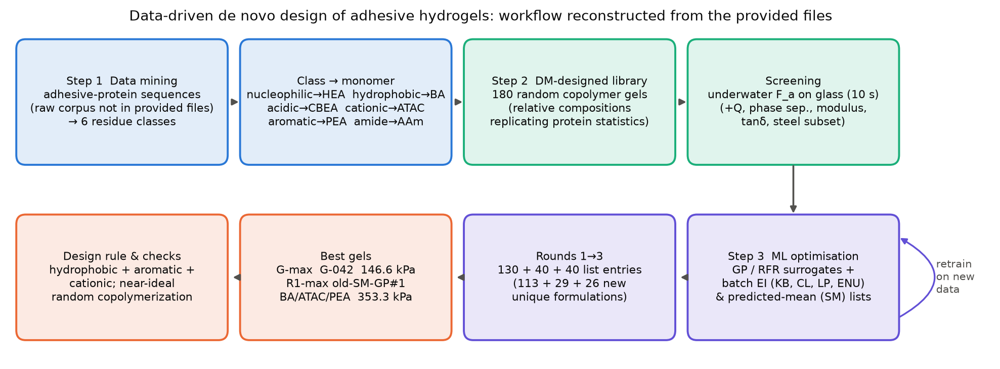

**Figure 1.** The three-step workflow, reconstructed from the files: data mining → DM-designed library → ML optimisation, with the key formulations identified in this work.

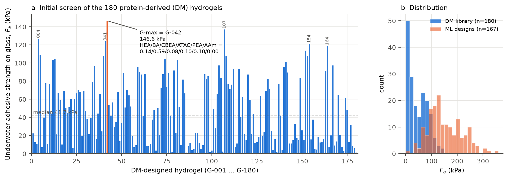

**Figure 2.** (a) Adhesive strength of all 180 DM gels, indexed by sample ID. G-max (G-042) is highlighted in orange. (b) Distribution of the DM library compared with the 167 unique ML-designed gels.

**Library statistics.** The 180 DM gels span 1.2–146.6 kPa, with a median of 41.7 kPa. The strongest protein-derived gel is **G-042**: HEA 0.141, BA 0.591, CBEA 0.076, ATAC 0.096, PEA 0.096, AAm 0, with F_a = 146.6 kPa. It is also the gel with the highest tanδ in the library (0.310). It is phase-separated, with Q = 0.37 and modulus 5.9 MPa. The next-best gels are G-107 (137.0 kPa), G-004 (126.8 kPa) and G-041 (124.0 kPa). G-107 and G-041 have a similar BA-rich composition; G-004 is PEA- and ATAC-rich.

**Pilot gels.** The 304.6 kPa maximum of the 184-row file is the pilot design **GPRFR-2** (BA/ATAC/PEA/AAm = 0.530/0.050/0.370/0.050). It is an early ML design, not a protein-derived gel.

**Table 1. Key formulations.** Every value traces to `outputs/key_formulations.csv`.

| Name | Source / ID | HEA | BA | CBEA | ATAC | PEA | AAm | F_a glass (kPa) |
|---|---|---|---|---|---|---|---|---|
| **G-max** (best DM gel) | G-042 | 0.141 | 0.591 | 0.076 | 0.096 | 0.096 | 0 | **146.6** |
| Best pilot in training set | GPRFR-2 | 0 | 0.530 | 0 | 0.050 | 0.370 | 0.050 | 304.6 |
| **R1-max** (best ML design) | PRED: `old-SM-GP` #1 | 0 | 0.588 | 0 | 0.094 | 0.318 | 0 | **353.3** |
| R1-max composition, independent pilot | P-008 (2022 snapshots) | 0 | 0.588 | 0 | 0.094 | 0.318 | 0 | 194.6 (10 s); 264.9 (60 s) |
| R2-max | EI: `GP-GP-2rd-ei` #5 (= PRED `GP-GP-2rd-pred` #10) | 0 | 0.630 | 0 | 0.061 | 0.310 | 0 | 281.6 |
| R3-max | EI: `GP-GP-3rd-ei` #7 (= PRED `GP-GP-3rd-pred` #9) | 0 | 0.680 | 0 | 0.070 | 0.250 | 0 | 251.0 |

The README's "expected results" list index 41, [0.14, 0.59, 0.08, 0.10, 0.10, 0.0], with a fitted value of 146.6 kPa. This is G-042 (0-based index), which confirms the identification of G-max. The second-best round-1 design (`RFR-GP` #10 in the EI list = PRED #3: BA/ATAC/PEA = 0.680/0.100/0.220) reached 321.2 kPa.

### 3.2 Composition rules in the DM library

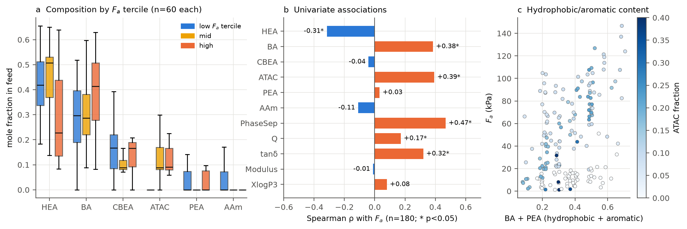

**Figure 3.** (a) Monomer fractions by F_a tercile. (b) Univariate Spearman correlations with F_a (n = 180). (c) F_a vs BA + PEA, coloured by ATAC.

Spearman correlations with F_a (`outputs/spearman_initial180.csv`):

| Variable | Spearman ρ with F_a | p |
|---|---|---|
| Phase separation | +0.47 | < 10⁻⁶ |
| ATAC | +0.39 | < 10⁻⁶ |
| BA | +0.38 | < 10⁻⁶ |
| tanδ | +0.32 | 1 × 10⁻⁵ |
| HEA | −0.31 | < 10⁻⁴ |
| Q | +0.17 | 0.02 |
| PEA | 0.03 (n.s.) | |
| CBEA | −0.04 (n.s.) | |
| AAm | −0.11 (n.s.) | |
| Modulus | −0.01 (n.s.) | 0.89 |

High-adhesion gels are BA-rich and HEA-poor and contain about 0.1 ATAC (Fig. 3a). PEA has no univariate effect in this library because 73 % of the DM gels contain no PEA. Its role only becomes visible in the ML rounds (Section 3.5).

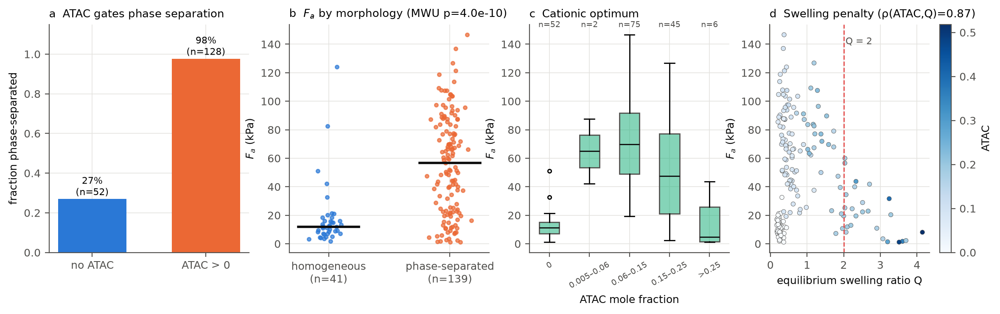

**Figure 4.** (a) ATAC gates phase separation. (b) F_a by morphology. (c) F_a by ATAC window. (d) The swelling penalty.

**ATAC gates phase separation.**
- 97.7 % of the 128 ATAC-containing gels are phase-separated, against 26.9 % of the 52 ATAC-free gels (Fisher p = 1 × 10⁻²³).
- Phase-separated gels adhere much more strongly: median 56.6 vs 11.9 kPa (MWU p = 4 × 10⁻¹⁰).
- Within the phase-separated gels, BA + PEA correlates with F_a at ρ = 0.64. In homogeneous gels the correlation is ρ = 0.52, but F_a is much lower.

**There is a cationic optimum** (`outputs/atac_bins.csv`):

| ATAC fraction | n | Median F_a (kPa) | Max F_a (kPa) |
|---|---|---|---|
| 0 | 52 | 11.2 | 51.1 |
| 0.06–0.15 | 75 | 69.6 | 146.6 |
| 0.15–0.25 | 45 | 47.4 | — |
| > 0.25 | 6 | 4.9 | — |

**Excess ATAC over-swells the gel.**
- ATAC is strongly coupled to swelling (ρ(ATAC, Q) = 0.87).
- The 25 gels with Q > 2 have a median of only 20.4 kPa and a maximum of 60.0 kPa, against a median of 49.4 kPa for Q ≤ 2.
- Swelling therefore sets the upper limit of the cationic window: charge density raises the osmotic swelling, which dilutes and weakens the network and lets water reach the interface.

### 3.3 Mechanics, substrate specificity and replicates

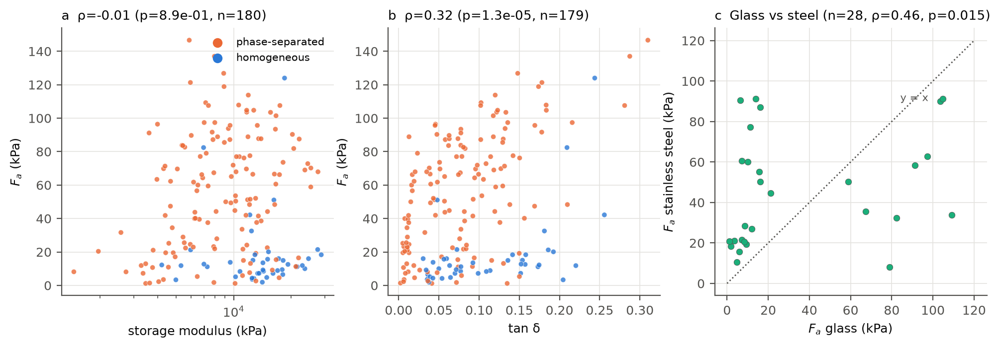

**Figure 5.** (a) Modulus vs F_a. (b) tanδ vs F_a. (c) Glass vs stainless-steel adhesion for the 28 gels with steel data.

**Mechanics.** Stiffness does not predict adhesion (ρ = −0.01). Viscoelastic dissipation does (tanδ ρ = 0.32), and G-042 has the highest tanδ of all gels. Phase separation and tanδ therefore act as cohesion and energy-dissipation markers.

**Substrate specificity.**
- On the 28 gels tested on both substrates, glass and steel adhesion correlate only weakly (Spearman 0.46, p = 0.015; Pearson 0.25, p = 0.20).
- The pattern is substrate-specific, not general (`outputs/steel_substrate_specificity.csv`). ATAC content is the strongest correlate of preferring glass over steel (ρ = 0.81 with log F_glass/F_steel, p < 10⁻⁶).
- The 9 ATAC-containing gels adhere 1.56× more strongly to glass than to steel (median). The 19 ATAC-free gels adhere about 3.5× more strongly to steel (glass/steel ratio 0.28; MWU p = 3 × 10⁻⁵).
- Glass carries negatively charged silanolate groups (Si–O⁻) underwater. This is direct evidence that ATAC's quaternary ammonium contributes **electrostatic attraction to the anionic glass surface**.
- Steel adhesion, by contrast, is weakly linked to low HEA (ρ = −0.42) and is otherwise not composition-specific.
- The steel subset contains no gels above 110 kPa on glass, and steel data for G-042 and R1-max are absent.

**Replicates and contact time** (Fig. 14b, `outputs/replicate_matches.csv`). The 11 pilot P-gels include exact compositional replicates of gels reported elsewhere. Their 10 s values are 0.55–0.79× the values reported in the other files:

| P-series gel | Matched gel | P-series value, 10 s (kPa) | Value reported elsewhere (kPa) | Ratio |
|---|---|---|---|---|
| P-006 | G-042 | 115.2 | 146.6 | 0.79 |
| P-007 | G-107 | 78.5 | 137.0 | 0.57 |
| P-009 | ≈ G-004 (TV distance 0.004) | 72.4 | 126.8 | 0.57 |
| P-008 | R1-max | 194.6 | 353.3 | 0.55 |

Three caveats follow:
1. The measurement-to-measurement variability (or batch effect) is large.
2. The ML file's column is named `Glass (kPa)_max`, which plausibly denotes the maximum over replicate measurements.
3. Contact time roughly doubles F_a: the median 60 s/10 s ratio is 2.02 (range 1.11–2.73).

Headline values must therefore always carry their protocol. The ranking is robust, however. The R1-max composition was the strongest P-gel at both 10 s and 60 s.

### 3.4 From protein sequences to monomer compositions

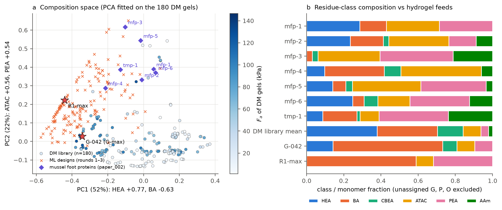

**Figure 6.** (a) PCA of the 180 DM compositions (PC1 52 %: HEA vs BA), with ML designs, the mussel-adhesive proteins of paper_002 mapped onto the six classes, G-042 and R1-max. (b) Class compositions compared.

The mapped mfps (`outputs/mfp_class_composition.csv`) are dominated by cationic and aromatic classes:

| Protein | Cationic | Aromatic | Note |
|---|---|---|---|
| mfp-3 | 0.33 | 0.39 | interfacial adhesive protein |
| mfp-5 | 0.37 | 0.35 | interfacial adhesive protein |
| mfp-1 | 0.29 | 0.29 | |
| mfp-4 | 0.43 | — | hydrophobic fraction 0.32 |

The DM library mean, by contrast, is HEA/BA-rich (HEA 0.38, BA 0.32, ATAC 0.10, PEA 0.04). It lies at the HEA–BA side of composition space, whereas the mfps lie at high PC2 (ATAC/PEA).

The ML campaign moved designs *from* the DM cloud *towards* the cationic/aromatic direction of the mfps:
- PEA rose from 0.10 (G-042) to 0.32 (R1-max);
- ATAC stayed at about 0.1;
- unlike the proteins, the designs retained a large hydrophobic BA fraction and dropped the nucleophilic and amide classes.

This matches the logic of mussel adhesion in paper_002:
- aromatic Dopa/Tyr provide surface hydrogen bonding, cation–π interactions and cohesion;
- Lys/Arg displace hydrated cations and bind anionic mineral surfaces.

In an all-synthetic system without catechols, the hydrophobic BA fraction takes over the job of expelling interfacial water.

These mfps are only a handful of well-characterised proteins, not the full mining corpus, and the residue-class assignment (Section 2.2) is our assumption. The figure is therefore a plausibility check of the mapping, not a reconstruction of the original data mining.

### 3.5 Machine-learning optimisation campaign

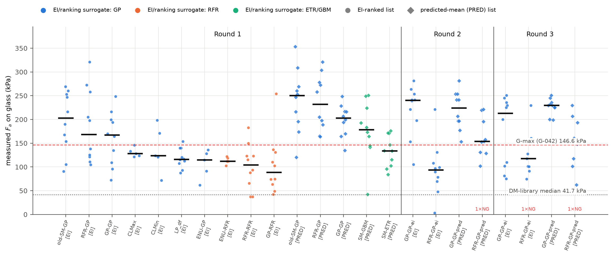

**Figure 7.** Measured F_a of every proposal list. Bars mark list medians; colour shows the surrogate used for EI or ranking; marker shape shows EI-ranked vs predicted-mean (PRED) lists; NG marks no-gelation entries.

**Overall gain.** The ML formulations (n = 167 unique gelled) have a median of 138.2 kPa, against 41.7 kPa for the DM library (MWU p = 4 × 10⁻⁴⁴), and 46 % of them exceed G-max (`outputs/campaign_tests.csv`).

**Strategy comparison** (`outputs/strategy_stats.csv`):

- **Round 1, predicted-mean vs EI.** PRED lists beat EI lists: median 193.3 vs 123.1 kPa (p = 7 × 10⁻⁷).
  - Best lists: `old-SM-GP` PRED (median 250.0 kPa, 9/10 above G-max, max 353.3 kPa) and `RFR-GP` PRED (median 231.6 kPa, 10/10 above G-max, max 321.2 kPa).
- **Round 1 EI lists, surrogate family.** Lists that maximise EI with a GP surrogate beat RFR-based EI lists (median 134.8 vs 110.3 kPa, p = 4 × 10⁻⁴). The constant-liar (CLMax, CLMin) and local-penalisation (LP_df) GP variants gave moderate, conservative lists (medians 116–128 kPa).
- **Rounds 2–3.** Lists labelled `GP-GP` beat `RFR-GP` (round 2: 240.2 vs 128.4 kPa, p = 3 × 10⁻⁵; round 3: 227.5 vs 137.8 kPa, p = 0.002). The `RFR-GP` EI lists deliberately explored ATAC-rich, AAm-rich and CBEA-rich corners. They produced the lowest values (down to 3.1 kPa) and all three no-gelation events.
- **Rounds 2–3, PRED vs EI.** PRED lists were again higher (round 2: 196.5 vs 141.9 kPa; round 3: 206.7 vs 127.7 kPa), but not significantly with n = 20 per group (p = 0.20 and 0.10).

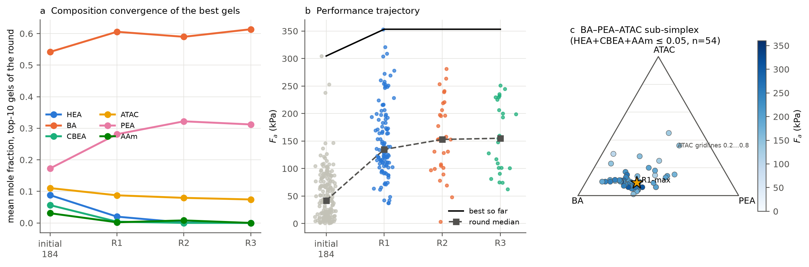

**Figure 8.** (a) Mean composition of the 10 best gels of each round. (b) Performance trajectory. (c) The BA–PEA–ATAC sub-simplex (gels with HEA + CBEA + AAm ≤ 0.05).

**Convergence** (`outputs/convergence_top10.csv`).
- The top-10 composition of each round converged from the initial set (BA 0.54, PEA 0.17, ATAC 0.11, HEA 0.09) to round 3 (BA 0.61, PEA 0.31, ATAC 0.07, HEA = CBEA = AAm = 0).
- The best-so-far value rose 304.6 → 353.3 kPa in round 1 and did not improve in rounds 2–3. Round medians rose 42.1 → 134.8 → 153.0 → 155.1 kPa.
- The campaign therefore found the optimum region in round 1 and spent rounds 2–3 refining and confirming it. The R2-max and R3-max designs are close neighbours of R1-max.
- In the BA–PEA–ATAC sub-simplex, the high-adhesion ridge lies at about 55–70 % BA, 20–37 % PEA and 5–11 % ATAC.
- Gelation failed at 44 % PEA with 5 % ATAC. This marks a hydrophobic/aromatic feasibility limit.

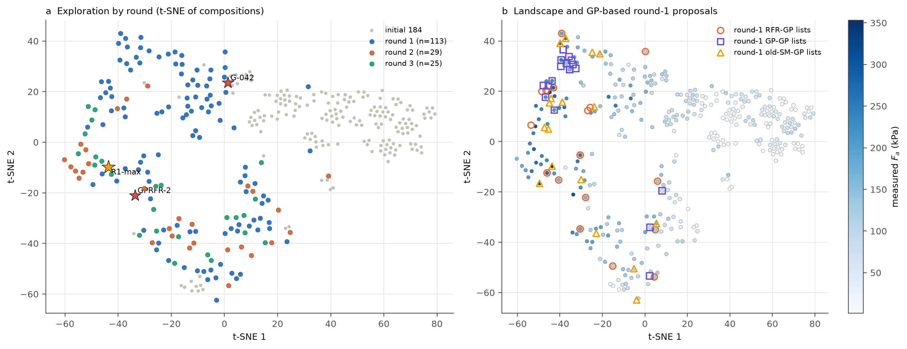

**Figure 9.** t-SNE embedding of all compositions. (a) Coloured by round. (b) The landscape coloured by F_a, with the round-1 GP-based lists overlaid.

**Exploration.** The initial library occupies a broad HEA-rich region. Round-1 designs spread into new territory and cluster around the GPRFR pilot gels and G-042. Rounds 2 and 3 concentrate in the BA/PEA/ATAC cluster that contains R1-max, while the RFR-GP EI lists scatter into sparsely sampled regions.

### 3.6 Surrogate accuracy, prospective validation and attribution

**Table 2.** Cross-validated surrogate performance on log F_a (5-fold × 3; mean ± s.d.; `outputs/ml_cv_benchmark.csv`).

| Model | Spearman (180 DM) | R² log (180 DM) | Spearman (all 351) | R² log (all 351) | MAE kPa (all) |
|---|---|---|---|---|---|
| GP (Matérn-ARD) | 0.84 ± 0.05 | 0.64 | 0.90 ± 0.03 | 0.77 | 23.6 |
| Random forest | 0.83 ± 0.06 | 0.64 | 0.90 ± 0.03 | 0.76 | 23.6 |
| Extra trees | 0.83 ± 0.05 | 0.65 | 0.91 ± 0.02 | 0.77 | 23.7 |
| Gradient boosting | 0.80 ± 0.06 | 0.55 | 0.90 ± 0.02 | 0.76 | 24.5 |
| kNN | 0.78 ± 0.06 | 0.53 | 0.88 ± 0.03 | 0.72 | 25.2 |
| Quadratic mixture | 0.75 ± 0.09 | 0.46 | 0.87 ± 0.03 | 0.65 | 32.9 |
| Linear mixture | 0.49 ± 0.14 | 0.14 | 0.83 ± 0.04 | 0.51 | 31.8 |

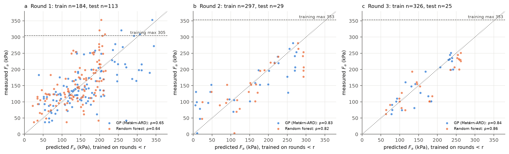

**Figure 10.** Prospective validation: models trained on all rounds < r and used to predict the gels of round r.

**Prospective accuracy** (`outputs/ml_prospective_validation.csv`).
- Round 1 is the hardest case: the 184 training gels sit in a different region from the 113 round-1 designs. Spearman was 0.65 for GP, 0.64 for RF and 0.56 for GBM. The quadratic mixture model extrapolated wildly, with a maximum prediction of 773 kPa.
- Rounds 2 and 3 were predicted well (Spearman 0.82–0.86).
- Only 3 of the 113 round-1 gels exceeded the training maximum.
- Tree ensembles cannot predict above the training range (RF maximum prediction 216 kPa for round 1), whereas the GP can. Its maximum round-1 prediction was 344 kPa, close to the observed 353 kPa. This helps explain why GP-based acquisition found the best gels.

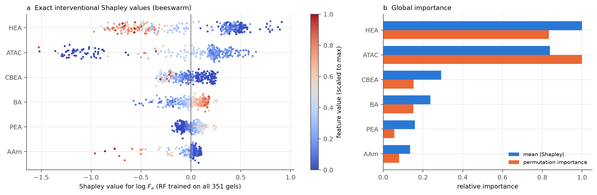

**Figure 11.** (a) Exact interventional Shapley values for log F_a (RF, all 351 gels). (b) Mean |Shapley| compared with permutation importance.

**Per-feature attribution** (`outputs/feature_importance.csv`).

| Monomer | Mean \|φ\| (log units) | Direction |
|---|---|---|
| HEA | 0.47 | monotonically negative (ρ(value, φ) = −0.88) |
| ATAC | 0.39 | non-monotonic: strongly negative at 0 (φ down to −1.5), positive at about 0.05–0.15, negative again at high fractions |
| CBEA | 0.14 | negative |
| BA | 0.11 | positive (ρ = +0.92) |
| PEA | 0.07 | positive (ρ = +0.92) |
| AAm | 0.06 | negative |

Permutation importance gives the same top two features (ATAC, then HEA).

**Grouped attribution.** Because the six fractions sum to 1, "less HEA" and "more BA/PEA" are partly the same statement. The three-group Shapley analysis (`outputs/grouped_shapley.csv`) gives mean |φ| of:
- 0.52 for hydrophilic (HEA + CBEA + AAm), negative;
- 0.39 for cationic (ATAC), optimum-shaped;
- 0.13 for hydrophobic + aromatic (BA + PEA), positive.

For R1-max, the group contributions are +0.86 (no hydrophilic monomers), +0.30 (BA + PEA) and +0.26 (ATAC at 0.094). Together these make up a log-gain of 1.42, i.e. about 4× above the dataset mean prediction.

The model-based attribution thus confirms the design rule: maximise hydrophobic + aromatic content, keep one cationic component in its window, and remove the hydrating monomers.

### 3.7 Does random copolymerization transfer the protein statistics?

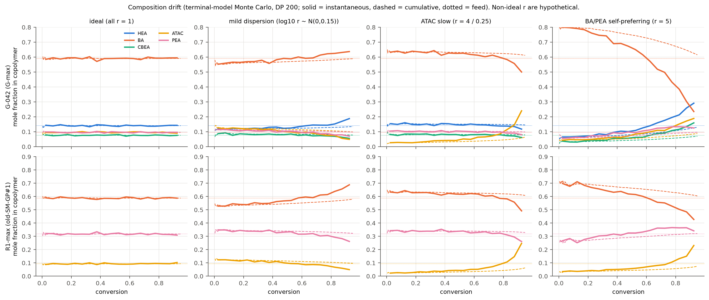

**Figure 12.** Terminal-model Monte Carlo of the G-042 and R1-max feeds. Solid lines show instantaneous composition, dashed lines cumulative composition and dotted lines the feed. The non-ideal reactivity ratios are hypothetical.

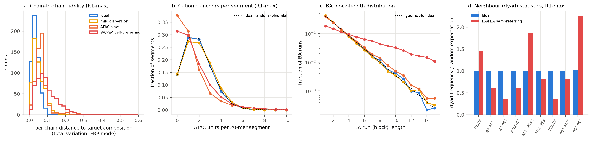

**Figure 13.** R1-max sequence statistics in FRP mode. (a) Per-chain distance to the target composition. (b) ATAC units per 20-mer segment. (c) BA run-length distribution. (d) Dyad frequencies relative to random.

Summary statistics are in `outputs/copolymer_mc_summary.csv`.

**Ideal case (all r = 1).**
- Instantaneous composition equals the feed at all conversions; there is no drift.
- With DP 200, chains differ from the target only by finite-length sampling noise: mean total-variation distance 0.036 for R1-max and 0.048 for G-042, and 100 % and 99 % of chains respectively lie within 0.1.
- Run lengths are geometric (mean BA run 2.42 vs the ideal 1/(1 − f_BA) = 2.43).
- Dyads match random expectation (ratio 1.00).
- The number of cationic units per 20-mer is binomial: 14.1 % of segments contain no ATAC, against 13.9 % expected.
- Every chain and every segment is therefore a statistically faithful sample of the protein-derived composition. This is the random-heteropolymer premise of paper_000.

**Mild dispersion (log₁₀ r s.d. 0.15).** This produces modest drift. The instantaneous ATAC fraction falls from 0.12 to 0.05 over the course of the reaction, but 92.5 % of FRP chains remain within 0.1 of the target.

**ATAC slow (hypothetical r = 4 / 0.25).**
- Chains formed early are starved of the cation: instantaneous ATAC is 0.023 at low conversion and 0.247 near the end.
- 37.7 % of the R1-max 20-mer segments carry **no** cationic anchor, against 13.9 % for an ideal copolymer (2.7×).
- The segment variance is 1.36× binomial.
- Such a gel would contain cation-poor hydrophobic chains, unable to bind glass electrostatically, alongside cation-rich, highly swelling chains. In the DM data both regimes are poor (ATAC = 0: median 11 kPa; Q > 2: median 20 kPa).

**BA/PEA self-preferring (hypothetical r = 5).**
- The mean BA block length rises from 2.4 to 5.8.
- Only 62.6 % of R1-max chains and 27.9 % of G-042 chains remain within 0.1 of the target composition.
- 31.5 % of segments lack ATAC.

**Implication.** The design premise holds only if the copolymerization is near-ideal. The six monomers are nearly all acrylates, which makes an ideal or mildly dispersed regime plausible, and the simulation shows that this regime keeps the protein-like statistics in every chain. Drift would break the link between the feed composition (the ML input) and the chain-level chemistry that actually meets the interface. It would also add noise to the composition–property map that the ML relies on.

We therefore recommend:
- measuring the reactivity ratios, or at least the residual monomer by NMR at several conversions;
- running the polymerization to high, uniform conversion or with monomer feeding, if any monomer is found to be fast or slow.

We do *not* recommend deliberately making the gels blocky. The faithful statistical replication of protein sequence features is the design rationale.

### 3.8 Benchmarking against the 1 MPa goal and the literature

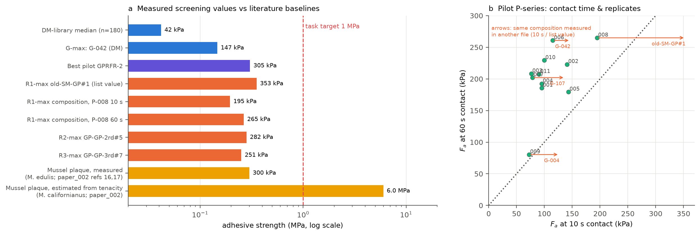

**Figure 14.** (a) Measured screening values compared with literature values for mussel adhesion stated in paper_002. (b) The P-series pilot gels: 60 s vs 10 s contact, with arrows to the same compositions as measured in other files.

**Literature baselines.** paper_002 reports two values for natural mussel plaques:
- **0.3 MPa** measured directly on individual *Mytilus edulis* plaques (Allen et al.; Wilker and colleagues);
- about **6 MPa** estimated for *M. californianus*, from a tenacity of about 300 N spread over about 50 threads and 2 mm plaques. The authors themselves warn that the two numbers are hard to reconcile because of thread–plaque angle and peeling effects.

paper_002's surface-force data (for example, mfp-5 W_A ≈ 6 mJ m⁻²) are adhesion *energies* and cannot be compared with stresses. We found no synthetic-hydrogel lap-shear benchmarks in the provided related work, so none are plotted.

**How our values compare.**
- G-042 (146.6 kPa) is about half the measured mussel-plaque strength.
- The best ML designs (251–353 kPa list values) are at the level of the directly measured natural plaques.

**The 1 MPa goal.** No value in the provided screening data exceeds 1 MPa. The highest recorded value is 0.353 MPa, with a 10 s replicate of 0.195 MPa and a 60 s value of 0.265 MPa. The provided files therefore **do not demonstrate** the >1 MPa target. They contain only the ML screening protocol: glass, short contact time, the `_max` column. Characterisation of the optimised formulation is absent, including longer contact or curing, tensile and lap-shear tests on multiple substrates, and durability measurements.

The data do show that the measured strength is highly protocol-dependent. Extending contact from 10 s to 60 s raised F_a 1.1–2.7× in the P-series. As a purely hypothetical extrapolation, not a measurement, applying that range to the R1-max list value would give roughly 0.4–0.95 MPa. Whether an optimised specimen exceeds 1 MPa must be settled experimentally. We do not attempt to settle it by extrapolating the GP model, because GP models cannot represent curing, contact or test-geometry variables.

## 4. Discussion

### 4.1 Mechanism: what makes the optimal gels adhere underwater

The data and attribution analyses support a three-part design rule. It mirrors, in all-synthetic chemistry, the adhesive-protein logic in paper_002.

1. **Remove interfacial water with hydrophobic content (BA).** BA is the single largest component of every top gel (0.55–0.70). Hydrating monomers (HEA and, to a lesser extent, CBEA and AAm) are consistently detrimental: HEA has ρ = −0.31 with F_a and the largest negative Shapley contribution, and the hydrophilic group contributes −0.52 log units on average. A hydrophobic, low-swelling gel (Q < 1 for G-042) displaces the hydration layer and keeps the interface dry, the role that hydrophobic residues and Dopa play in mfps.

2. **Aromatic PEA supplies cohesion and π interactions.** PEA has no effect in the PEA-poor DM library, but it is selected strongly by the ML (top-10 PEA 0.17 → 0.31) and has a positive Shapley contribution. Its phenyl rings contribute π–π stacking (cohesion and dissipation, cf. the tanδ correlation) and cation–π interactions with the quaternary ammonium of ATAC. This is the same Lys/Arg–aromatic pairing that is enriched in mfp-3/5 (cationic 0.33–0.37 and aromatic 0.35–0.39 in our class mapping).

3. **Cationic ATAC provides electrostatic anchoring to the anionic glass surface, within a window.**
   - Glass and silica carry negatively charged Si–O⁻ groups underwater, and the quaternary ammonium of ATAC is permanently cationic.
   - The strongest piece of evidence for this electrostatic mechanism in the provided data is that ATAC content predicts preference for glass over steel (ρ = 0.81).
   - ATAC also induces the phase-separated morphology (98 % vs 27 %) that correlates with high adhesion and dissipation.
   - Too much ATAC, however, swells the network (ρ(ATAC, Q) = 0.87). Gels with Q > 2 lose cohesion and adhesion. Hence the optimum at roughly 6–15 mol %, and ≈ 7–10 % in the ML-optimised gels.
   - Like mussel Lys, the cation probably also displaces hydrated counter-ions from the surface. Mussels pair it with catechols, which these gels lack.

Moderate stiffness is not required (modulus ρ ≈ 0). Phase separation and viscoelastic dissipation (tanδ) are the relevant bulk properties. This is consistent with adhesive failure being governed by interfacial dewetting combined with dissipative cohesion.

### 4.2 Value of data mining and of ML

The protein-derived DM library already produced functional adhesives (median 42 kPa; G-042 147 kPa). Its main value, however, was to provide a chemically meaningful, diverse training set: models trained on it reached CV Spearman 0.84.

The GP-based ML campaign then concentrated the search into the BA/PEA/ATAC region and gave a 2.4× higher best value with very few experiments. About 113 new formulations in round 1 found the optimum, and 55 more confirmed it.

Two practical lessons emerge:
- Lists ranked by predicted mean were markedly better than EI-ranked lists. EI's exploration bonus led to unproductive corners: low-adhesion gels and the no-gelation failures.
- GP surrogates were preferable to tree surrogates for acquisition, because only the GP can extrapolate above the training maximum. Tree models stay capped at the training range.

One expected limitation: the very best measurement probably benefits from selection plus measurement noise (winner's curse). Its 10 s replicate (P-008) was 55 % of the list value, and the round-2 and round-3 designs in the same neighbourhood measured 230–282 kPa. A realistic performance level for the optimum composition is therefore about 200–300 kPa under the 10 s screening protocol.

### 4.3 Limitations

- **Raw sequences are absent.** The protein-sequence corpus and the residue-to-composition extraction are not in the provided files. Our mfp mapping covers only 7 proteins and uses an assumed residue classification.
- **No characterisation of the optimised gel.** There are no tensile, lap-shear, multi-substrate or long-term underwater durability data for R1-max. G-042 and R1-max have no steel data. The steel data cover only 28 low-to-moderate gels. The 60 s columns of the verified file are empty; 60 s data exist only for the 11 P-series gels.
- **Replicate and protocol ambiguity.** The ML file reports `Glass (kPa)_max`. The P-series replicates measured 0.55–0.79× those values, so values from different files should not be compared without caveats.
- **Labels.** `old-SM-GP`, `SM-ETR`, `SM-GBM` and `ENU-*` are not documented in the README, and `RFR-GP*` does not appear in the file, so strategy conclusions are stated in terms of the file labels.
- **Simulation parameters.** The Monte Carlo reactivity ratios for the non-ideal scenarios are hypothetical. The simulation addresses chain statistics, not network formation, crosslinking or phase separation.
- **Attribution.** Shapley values describe the RF surrogate, not causal effects. The sum-to-one constraint makes per-monomer attributions partly redundant, which the grouped analysis mitigates.

### 4.4 Recommended experiments

1. Re-measure R1-max (BA/ATAC/PEA = 0.588/0.094/0.318), R2-max and G-042 with n ≥ 5 replicates. For each, vary contact time (10 s, 60 s and longer) and curing time.
2. Characterise these gels by lap shear and tensile testing on glass, steel, PTFE and tissue, and by ageing underwater over days to weeks, to test whether >1 MPa is reached and maintained under an optimised protocol.
3. Measure reactivity ratios or the conversion-resolved feed composition (¹H NMR) for the BA/PEA/ATAC system to confirm near-ideal copolymerization.
4. Use a mixed design around the ridge at BA 0.55–0.70, PEA 0.20–0.37, ATAC 0.05–0.11, staying below the gelation limit (PEA < 0.44 at low ATAC) and below Q ≈ 2.
5. Test the electrostatic mechanism directly: vary the ionic strength and pH of the medium (to screen or neutralise silanolates) and the substrate charge.

## 5. Conclusions

- **Data integrity.** The public data are internally consistent. The verified 184-gel set is identical to its historical snapshots, and the optimisation workbook yields 352 distinct tested formulations after de-duplication.
- **Best protein-derived gel.** G-max is **G-042** (HEA/BA/CBEA/ATAC/PEA/AAm = 0.141/0.591/0.076/0.096/0.096/0; 146.6 kPa on glass at 10 s), against a library median of 41.7 kPa.
- **Best ML-designed gel.** R1-max is the round-1 `old-SM-GP` predicted-mean design #1 (BA/ATAC/PEA = 0.588/0.094/0.318; 353.3 kPa; 194.6 kPa at 10 s and 264.9 kPa at 60 s in an independent pilot measurement, P-008). Later rounds confirmed the same region: R2-max 281.6 kPa, R3-max 251.0 kPa.
- **Design rule.** Hydrophobic BA expels interfacial water. Aromatic PEA provides cohesion and cation–π interactions. Cationic ATAC at 6–15 mol % provides electrostatic anchoring to anionic glass and induces a dissipative phase-separated structure; at higher levels it over-swells the gel. Hydrating HEA, CBEA and AAm are detrimental.
- **Copolymerization.** Near-ideal random copolymerization is what makes each chain a faithful statistical copy of the protein-derived composition. Composition drift, simulated with hypothetical non-ideal reactivity ratios, would produce cation-free segments and hydrophobic blocks, and would break the feed–property link.
- **ML campaign.** The campaign tripled the median adhesion and more than doubled the best value. GP-based, mean-ranked lists were the most efficient.
- **The >1 MPa goal.** The provided screening data reach about 0.35 MPa, comparable to measured mussel plaques (0.3 MPa), but contain no measurement above 1 MPa. Verifying the >1 MPa target requires characterisation data for the optimised specimens that are outside the released files.

## Reproducibility

Run the scripts in order (Python 3.12; numpy, pandas, scipy, scikit-learn, matplotlib, openpyxl, pypdf):

```
python code/00_extract_pdfs.py
python code/02_load_clean.py
python code/03_workflow_schematic.py
python code/04_initial_screen.py
python code/05_mfp_mapping.py
python code/06_copolymer_mc.py      # ~2 min
python code/07_ml_models.py         # ~5 min
python code/08_campaign.py
python code/09_steel_substrate.py
```

`code/01_inspect_data.py` only prints the raw sheets. All random seeds are fixed.
