# Uncalled4 reanalysis: pore-model structure, alignment benchmarks, and m6A detection sensitivity

## Abstract

We reanalysed the public summary data for the Uncalled4 nanopore signal-alignment toolkit. The inputs are:

- four k-mer pore models: DNA r9.4.1 (6-mer), DNA r10.4.1 (9-mer), RNA001 (5-mer) and RNA004 (9-mer);
- a speed and file-size benchmark covering four tools across four chemistries;
- site-level m6Anet predictions for 5,000 candidate sites (1,024 labelled modified), computed from Uncalled4 or from Nanopolish signal alignments.

We added simulations with known ground truth to cover what the tables cannot show: alignment quality, coverage dependence, and pore-model training.

**Main findings**

1. **The m6A gain at fixed precision is large.** At matched precision ≥ 0.90, m6Anet on Uncalled4 alignments recovers **1,007 true m6A sites vs 443 with Nanopolish**. That is **+127% more true positives** (95% bootstrap CI 101–160%; +564 sites, CI 501–626).
   - The gain grows with the precision floor, from +28% at 0.60 to +187% at 0.95.
   - AUPRC is 0.993 vs 0.778 (ΔAUPRC = 0.215, CI 0.192–0.239). AUROC is 0.998 vs 0.901 (DeLong p = 4.6 × 10⁻⁶⁷).
   - The ranking holds in every site_id decile and in all 500 random half-splits.
2. **Uncalled4 is the fastest and smallest tool in all 10 supported benchmark cells.** It is 1.13–67× faster (geometric mean 6.6×) and its output is 2.8–34× smaller (geometric mean 14.9×).
   - In simulation, banded alignment guided by the basecaller (bcDTW, band W = 5) matches full DTW in alignment-quality "model MAD" and in assignment accuracy, using only **4.4% of the dynamic-programming cells**. The move table alone has a 1.6–4.0× higher model MAD.
3. **All four pore models are dominated by the central base.**
   - The central base explains η² ≈ 0.50–0.55 of the current variance.
   - The ordering is A < G < T/U < C (purines low, pyrimidines high).
   - A purely additive position model explains about 97% of the variance.
   - **We tested explicitly for a secondary "reader-head" peak in r10.4.1 and found none.** η² decays monotonically and symmetrically from position 5 (asymmetry index −0.001). There are no local maxima away from the centre. No pairwise interaction, adjacent or not, adds more than 2.5 × 10⁻⁶ R².
4. **A simulated mechanism test reproduces the expected coverage behaviour.** With bcDTW, site-level detection keeps improving as coverage rises (AUROC 0.70 → 0.85 from 5 to 40 reads). With move-table-only alignment it plateaus (0.71 → 0.78). The move table's misassignment errors depend on sequence context, so they act as a fixed bias per site that more reads cannot average away.

---

## 1. Background

Nanopore sequencers record the ionic current as a nucleic-acid strand translocates through a pore. The current at each moment depends on the k bases inside the pore's sensing region. A **pore model** maps every k-mer to an expected current level (mean, standard deviation, dwell time).

**Signal-to-reference alignment ("event alignment")** assigns each signal segment to a reference k-mer. It underlies modification detection:

- Nanopolish and f5c (paper_000, Simpson et al. 2017) detect 5mC with an HMM over event alignments;
- Tombo (paper_001, Stoiber et al.) uses genome-guided re-squiggling for de novo modification detection;
- m6Anet (paper_003, Hendra et al. 2022) uses multiple-instance learning over aligned-signal features from Nanopolish eventalign.

Earlier tools are slow, write very large text outputs, and do not support the newer chemistries (r10.4.1 and RNA004). Uncalled4, which builds on UNCALLED (paper_002, Kovaka et al.), addresses this in three ways:

- it uses the basecaller's move table to constrain a banded DTW ("bcDTW");
- it writes alignments into BAM tags;
- it trains new pore models iteratively.

**Questions addressed with the available data**

- **Q1.** How are current levels determined by sequence in each chemistry? Is there evidence for a second sensing region ("reader head") in r10.4.1?
- **Q2.** How much faster and smaller is Uncalled4's output, and does the speed come at a cost in alignment quality?
- **Q3.** How much does Uncalled4 alignment improve m6A detection over Nanopolish alignment at operationally relevant precision?

## 2. Data and input audit

The audit script is `code/audit.py` and writes `outputs/audit.json`.

| Input | Content | Audit result |
|---|---|---|
| 4 pore-model CSVs | `kmer, current_mean, current_std, dwell_time` | Complete 4^k tables (1,024 / 4,096 / 262,144 / 262,144 rows); no NaNs. The RNA files encode U as T. Rows are **not** in lexicographic order, so all analyses index k-mers by an explicit base-4 code. Current means are z-scaled (mean 0, SD 1). `current_std` lies in [0.10, 0.15]. Dwell times are integers from 5 to 119. |
| `performance_summary.csv` | Time (min) and file size (MB) per chemistry × tool | 16 rows (4 × 4). Exactly 4 NaN rows: Nanopolish and Tombo on DNA r10.4 and RNA004 (unsupported). One value per cell, with no replicates. |
| m6A files | `site_id` with `label` or `probability` | 5,000 sites, 1,024 positive (prevalence 0.205). The IDs align one-to-one across all three files. Exact-0 probabilities: 393 (Uncalled4), 317 (Nanopolish). Exact-1 probabilities: 84 (Uncalled4), 27 (Nanopolish). |

**Metadata absent from the inputs**, which limits what can be computed:

- per-site read coverage;
- gene or transcript identity;
- cell line;
- motif (DRACH) context;
- per-read predictions;
- real alignment-quality (model MAD) values;
- compressed or gzipped output sizes;
- replicate timings and thread counts;
- raw signal and BAM files.

All analyses that would need these are either replaced by labelled simulations or declared not computable (Section 7).

## 3. Methods

### 3.1 Pore-model characterisation (`code/pore_models.py`)

For each model, with current mean *y* and base indicator *X_p* at position *p*:

- **Marginal effects and η².**
  - The effect of base *b* at position *p* is E[y | X_p = b] − E[y].
  - η²_p = SS_between / SS_total for a one-way grouping by X_p.
  - Each table is a complete balanced factorial, so main effects are orthogonal and the additive fit is exact.
- **Ranked-current composition heatmap (Uncalled4 style).**
  - k-mers are ranked by current and split into 64 quantile bins.
  - For each bin and position we compute the fraction of each base.
  - The most-enriched base is shown as colour, with saturation proportional to its fraction above 0.25.
- **Single-base substitution profiles.**
  - For every k-mer, position and each of the three alternative bases, we compute |Δμ| and |Δμ|/σ̄, where σ̄ = √((σ₁² + σ₂²)/2).
  - Summaries are the median, IQR and 10–90% band, taken over 3 × 4^k values per position (786,432 per position, 7.1 M in total, for each 9-mer model).
- **Secondary-peak ("reader-head") test.** Four components:
  - (i) η² by position;
  - (ii) η² of the residual after removing the additive effects of the dominant position and its two neighbours ("core"), and separately after removing the centre only;
  - (iii) local maxima of the η² and median-|Δμ| profiles, excluding the centre;
  - (iv) a left/right asymmetry index (Σ η²_right − Σ η²_left) / (Σ η²_right + Σ η²_left), plus mirrored-pair comparisons and tests for monotone decay.
- **Pairwise interactions.**
  - For **every** position pair (i, j), including non-adjacent pairs, we compute the R² gained by adding the 16-level interaction to the additive model.
  - Under orthogonality this gain equals SS of the additive residual explained by the (i, j) combination, divided by SS_total.
- **Effective context.** The best full-interaction R² achievable from any contiguous window of *w* positions (w = 1–6).
- **Sequence dependence of std and dwell.** η² per position and additive R².

### 3.2 Benchmark (`code/performance.py`)

For each chemistry and competitor tool we compute two ratios against Uncalled4: time ratio = T_tool / T_U4 and size ratio = S_tool / S_U4. We then summarise:

- the per-chemistry minimum–maximum range of these ratios;
- the geometric mean across competitors;
- the overall range and geometric mean.

Unsupported cells are marked "n/s".

### 3.3 Simulation of alignment quality vs cost (`code/simlib.py`, `code/signal_sim.py`)

The benchmark table contains no alignment-quality measure, so we built a ground-truth simulator.

- **Reads.** Each read is a random 250-k-mer reference.
  - Samples are Gaussian, N(μ_k, (2·σ_k)²), drawn from the real r9.4.1 or r10.4.1 model; noise is inflated 2× to make alignment non-trivial.
  - Dwell times are geometric, with mean equal to the model's dwell time.
  - Each read has its own scale ~ N(10, 1) and shift ~ N(90, 5).
- **Move table.**
  - True boundaries are jittered by N(0, (j·5)²) samples, with j = 0.5, 1 or 2 strides.
  - A further 5% of boundaries are displaced by 2–4 strides.
  - Boundaries are then quantised to a stride of 5 and made monotone.
- **Aligners.**
  - (a) *move table*: boundaries as given, with normalisation fitted by least squares on that assignment;
  - (b) *bcDTW*: sample-level segmental DTW restricted to |i − m(t)| ≤ W around the move-table k-mer index m(t), for W = 2, 5 and 10. Scale and shift are initialised from the move table and re-estimated after each of two passes; the band doubles if it becomes infeasible;
  - (c) *full DTW*: the same algorithm without a band.
- **Metrics per read.**
  - **model MAD** = median over k-mers of |aligned event mean − model mean|, in model SD units. This is the quality proxy used by Uncalled4.
  - fraction of samples assigned to the correct k-mer;
  - boundary error;
  - DP cells per sample (a hardware-independent cost).
- **Design.** 12 reads × 3 jitter levels × 2 chemistries.

### 3.4 m6A evaluation (`code/m6a_eval.py`)

- **Curves and tests.** PR and ROC curves; AUPRC computed as average precision. A paired bootstrap over sites (B = 2,000) gives CIs on each tool's metrics and on the differences ΔAUPRC and ΔAUROC. We also report DeLong's test for correlated AUROCs and McNemar's test on the correctness of calls at p = 0.5.
- **Headline metric: true positives at matched precision.** For each precision floor π ∈ {0.60, 0.70, 0.75, 0.80, 0.85, 0.90, 0.95}:
  - each tool's operating point is the threshold that gives the **largest TP count with precision ≥ π**, where thresholds fall only between distinct scores so that ties are never split;
  - the gain is (TP_U4 / TP_NP − 1) × 100%;
  - the CIs for TP, extra TP and % gain come from the same paired bootstrap.
- **Additional analyses.**
  - gain at the conventional 0.9 probability threshold;
  - precision@K;
  - threshold sweeps;
  - score distributions by label, including point masses at 0 and 1;
  - a sensitivity analysis excluding point-mass sites.
- **Robustness checks.** No biological strata are available, so we examined:
  - (i) AUPRC per site_id decile, plus a χ² test that the positive rate is uniform across deciles and the lag-1 autocorrelation of the labels;
  - (ii) the TP gain on 500 random half-splits of the sites.

### 3.5 Simulated coverage-bin analysis (`code/mod_sim.py`)

This is a **mechanism test and not real-data stratification.**

- **Model and sites.** We used the RNA001 5-mer model. There were 240 sites (120 modified, 120 unmodified), each with a random 35-nt context and a central A.
- **Modification effect.**
  - At modified sites, 50% of reads carry the modification.
  - It shifts the current of the five k-mers containing the A by δ·w_p, with δ = 0.35 SD and w = (0.25, 0.5, 1, 0.5, 0.25).
  - Noise is inflated 3× and move-table jitter is 1.5 strides.
- **Scoring.**
  - Per-read score: the weighted deviation of the aligned event means from the model over the five affected k-mers.
  - Site score: the mean per-read score over the first n ∈ {5, 10, 20, 40} reads.
  - We compare the true alignment, bcDTW (W = 5) and the move table, using site-level AUROC (500 bootstrap replicates) and sensitivity at 5% FPR.

### 3.6 Iterative pore-model training (`code/train_sim.py`)

- **Starting point.** The *additive approximation* of the r9.4.1 model, which has r = 0.984 with the true model.
- **Each iteration.**
  - Align 100 simulated reads (300 k-mers each) with bcDTW (W = 5) under the current model.
  - Re-estimate each k-mer's mean as the sample-weighted mean of its aligned, normalised samples.
  - Re-standardise the model to mean 0 and SD 1.
- **Run length.** Four iterations. The trained table is in `outputs/train_sim_trained_model_r941.csv`.

## 4. Results

### 4.1 Pore models: central-base dominance, purine/pyrimidine ordering and no secondary reader head

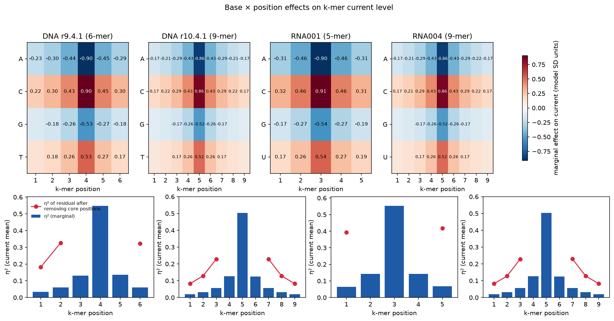

**Figure 1.** Top: marginal effect of each base at each position on the current level, in model SD units. Bottom: η² by position (bars) and η² of the residual after removing the additive effect of the core positions, i.e. the dominant position ± 1 (red).

**Central-base dominance.** In every chemistry the central position dominates:

| Model | Dominant position | η² at dominant position |
|---|---|---|
| r9.4.1 | 4 of 6 | 0.548 |
| r10.4.1 | 5 of 9 | 0.504 |
| RNA001 | 3 of 5 | 0.553 |
| RNA004 | 5 of 9 | 0.503 |

**Direction of the base effects.** At the dominant position, A lowers the current most (−0.86 to −0.90 SD), then G (−0.52 to −0.54 SD). T/U raises it (+0.52 to +0.54 SD) and C raises it most (+0.86 to +0.91 SD). The resulting order is A < G < T < C.

**Purine content.** The number of purines in the k-mer is strongly anti-correlated with current: Spearman ρ ranges from −0.80 (the 9-mer models) to −0.86 (RNA001). GC content, by contrast, is only weakly related (ρ ≈ 0.19–0.21).

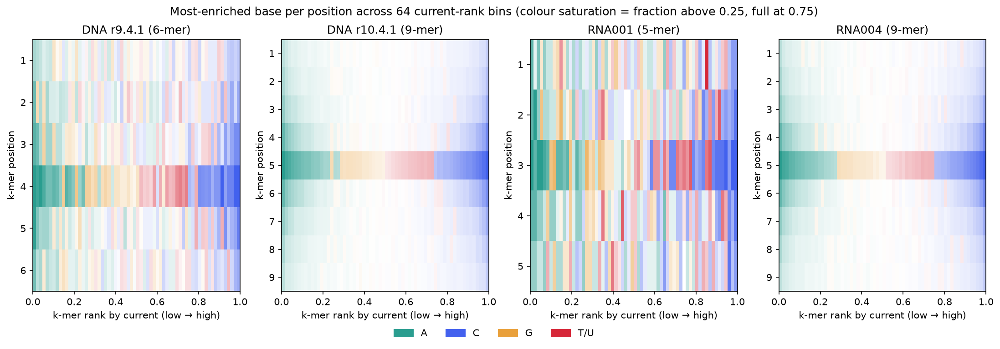

**Figure 2.** Uncalled4-style substitution-profile heatmap. k-mers are ranked by current (x axis, 64 bins); each cell is coloured by the most-enriched base at that position (y axis). The dominant position shows a clean A → G → T/U → C progression from low to high current. The flanking positions show weaker A enrichment at low current and C enrichment at high current. Line plots for the top three positions are in `images/figS1_composition_lines.png`.

**How the base effects scale with distance from the centre.** The base effects scale almost exactly by distance from the centre. The four bases have effects in a near-fixed ratio (A ≈ −C, G ≈ −T) at every position. This structure is analysed further in Limitations.

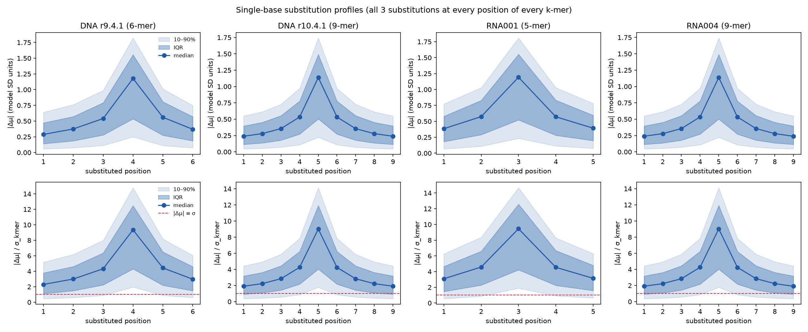

**Figure 3.** Single-base substitution profiles: |Δμ| (top) and |Δμ|/σ (bottom), each as median, IQR and 10–90% band.

**Substitution sensitivity by position.** A substitution at the central position changes the current by a median of 1.14–1.19 SD, which is 9.0–9.5 times the k-mer's own σ. Sensitivity decays away from the centre:

| Position | r9.4.1 | r10.4.1 |
|---|---|---|
| Centre | 1.18 SD | 1.14 SD |
| ±1 | 0.54 / 0.56 SD | 0.53 SD |
| ±2 | — | 0.36 SD |
| ±3 | — | 0.28 SD |
| ±4 (r10.4.1 edge) | — | 0.24 SD |

Even at the r10.4.1 edges, 73% of substitutions shift the mean by more than one σ. This means distal bases remain informative, which is relevant for modification detection.

**Secondary-peak (reader-head) test for r10.4.1.**

The question is whether any position away from the centre carries an independent peak of information. Six statistics answer it (`outputs/pore_model_results.json`):

| Statistic | r10.4.1 | RNA004 |
|---|---|---|
| η² by position 1…9 | 0.020, 0.032, 0.056, 0.126, **0.504**, 0.126, 0.056, 0.031, 0.020 | 0.020, 0.031, 0.056, 0.126, **0.503**, 0.126, 0.056, 0.032, 0.020 |
| Off-centre local maxima of η² / of median \|Δμ\| | none / none | none / none |
| Monotone decay left / right | yes / yes | yes / yes |
| Asymmetry index | −0.001 | −0.000 |
| Residual η² after removing positions 4–6 (positions 1, 2, 3 / 7, 8, 9) | 0.082, 0.129, 0.228 / 0.229, 0.129, 0.082 | 0.082, 0.128, 0.229 / 0.229, 0.129, 0.083 |
| Largest non-adjacent pairwise interaction ΔR² | 2.5 × 10⁻⁶ (pair 2–8) | 2.9 × 10⁻⁶ |

**Result: the data show no secondary reader-head signal.**

- After the core is removed, the residual variance is again explained by the next positions outwards, in a symmetric, monotonically decaying pattern.
- No distal position, on either side, stands out as a second peak.

This is a **discrepancy with the expected double-reader architecture of r10.x pores**, where a second constriction is expected to produce a distal, typically asymmetric, bump in position sensitivity. Either the supplied r10.4.1 table does not encode that feature, or the feature is too weak to detect with these statistics. We report the absence rather than infer a peak.

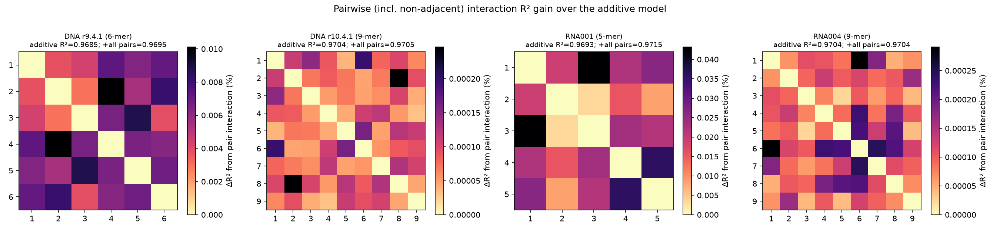

**Figure 4.** R² gain from every pairwise interaction over the additive model.

**Interactions add almost nothing.**

- The additive model explains R² = 0.9685 (r9.4.1), 0.9704 (r10.4.1), 0.9693 (RNA001) and 0.9704 (RNA004).
- Adding **all** pairwise interactions raises this by only 0.0010, 0.0001, 0.0022 and 0.0001 respectively.
- The remaining ~3% of variance therefore has no pairwise structure. It behaves like k-mer-specific idiosyncratic deviation.

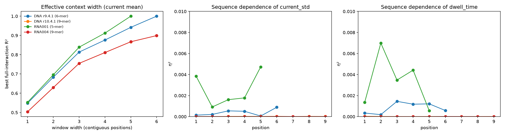

**Figure 5.** Left: best full-interaction R² from a contiguous window of w positions. Middle and right: η² of `current_std` and `dwell_time` by position (y-axis limited to 0.01).

**Context width.** In the 9-mer models, a 3-position window centred on the core explains R² = 0.755. Six positions explain 0.899. The outer positions therefore contribute about 7% of the variance, additively.

**Std and dwell carry no sequence information.**

- Their per-position η² is ≤ 0.007 in every model (≤ 3 × 10⁻⁵ for the 9-mer models).
- Their correlation with the current mean is |r| < 0.04.
- Dwell-time quantiles are identical across chemistries (5th/50th/95th = 5/10/28–29 samples).

**Cross-chemistry agreement.** The r10.4.1 and RNA004 marginal effects agree to within 0.0014 SD and their η² to within 0.0003. Their per-k-mer means correlate at r = 0.970, which is exactly the share of variance explained by the additive model. In other words, the two tables share the same additive structure and differ only in the idiosyncratic residual.

### 4.2 Benchmark: Uncalled4 is fastest and smallest everywhere, and bcDTW does not degrade fit

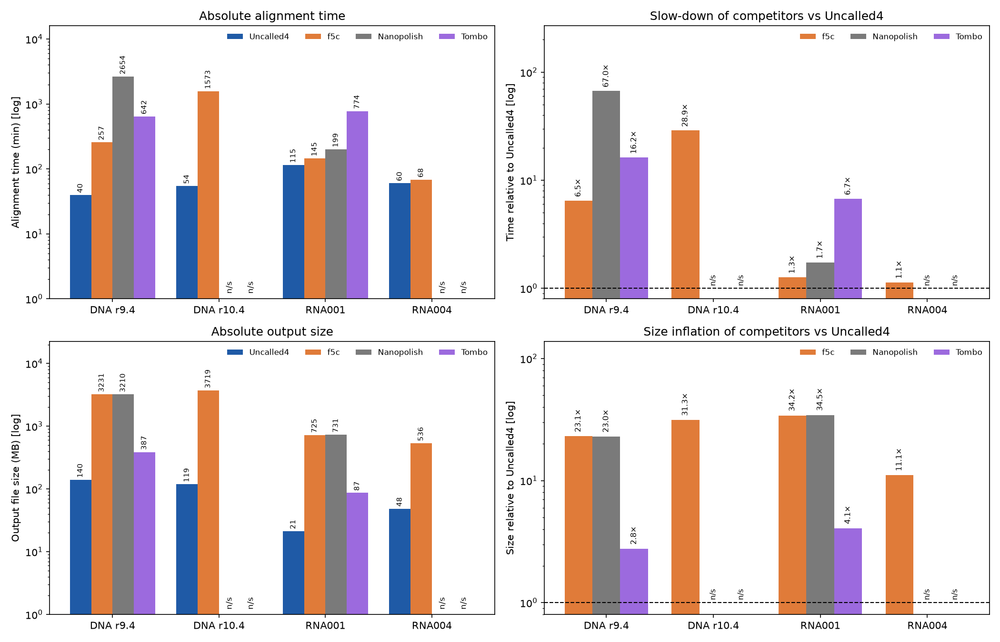

**Figure 6.** Absolute time and size (left, log scale) and competitor/Uncalled4 ratios (right). "n/s" marks unsupported chemistries.

**Table 1.** Reproduced benchmark (`outputs/performance_table.csv`). Each cell shows the absolute value, with the ratio to Uncalled4 in parentheses.

| Chemistry | Uncalled4 time (min) | f5c time | Nanopolish time | Tombo time | Uncalled4 size (MB) | f5c size | Nanopolish size | Tombo size |
|---|---|---|---|---|---|---|---|---|
| DNA r9.4 | **39.6** | 256.9 (6.5×) | 2654.0 (67.0×) | 642.4 (16.2×) | **139.8** | 3231 (23.1×) | 3210 (23.0×) | 387 (2.8×) |
| DNA r10.4 | **54.4** | 1573.5 (28.9×) | n/s | n/s | **118.7** | 3719 (31.3×) | n/s | n/s |
| RNA001 | **114.7** | 145.0 (1.26×) | 199.4 (1.74×) | 774.0 (6.75×) | **21.2** | 725 (34.2×) | 731 (34.5×) | 87 (4.1×) |
| RNA004 | **60.2** | 68.3 (1.13×) | n/s | n/s | **48.4** | 536 (11.1×) | n/s | n/s |

**Speed.** Uncalled4 is the fastest tool in all 10 supported cells.

| Chemistry | Speed-up range | Geometric mean |
|---|---|---|
| DNA r9.4 | 6.5–67× | 19.2× |
| DNA r10.4 | 28.9× (f5c only) | 28.9× |
| RNA001 | 1.26–6.75× | 2.46× |
| RNA004 | 1.13× (f5c only) | 1.13× |
| **Overall** | 1.13–67× | **6.6×** |

The DNA speed-ups are large, but **the RNA speed-ups over f5c are small**: 13% for RNA004 and 26% for RNA001. These ranges are reported exactly as computed. They are narrower at the low end than a blanket "order-of-magnitude faster" claim would suggest.

**Size.** Uncalled4's BAM output is also the smallest in every cell. It is 11–34× smaller than the eventalign text written by f5c and Nanopolish, and 2.8–4.1× smaller than Tombo's FAST5-embedded output. Across all tools the range is 2.8–34× (geometric mean 14.9×).

**Alignment quality vs cost (simulation).**

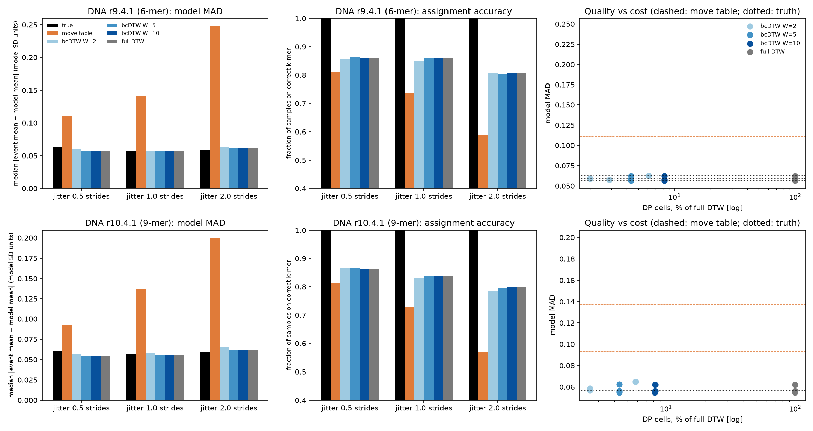

**Figure 10.** Simulation. Left: model MAD per aligner and move-table jitter level. Middle: fraction of samples on the correct k-mer. Right: model MAD against DP cost as a percentage of full DTW.

**Table 2.** Simulated alignment quality at 1-stride jitter (`outputs/signal_sim_summary.csv`). Each cell shows r9.4.1 / r10.4.1.

| Aligner | Model MAD (SD units) | Sample accuracy | Mean boundary error (samples) | DP cells (% of full DTW) |
|---|---|---|---|---|
| True alignment | 0.057 / 0.057 | 1.000 / 1.000 | 0 / 0 | – |
| Move table only | 0.141 / 0.137 | 0.736 / 0.727 | 3.7 / 3.9 | 0 |
| bcDTW W=2 | 0.057 / 0.059 | 0.850 / 0.832 | 2.2 / 2.5 | 2.9 / 2.6 |
| **bcDTW W=5** | **0.056 / 0.056** | **0.861 / 0.838** | **2.0 / 2.4** | **4.4 / 4.4** |
| bcDTW W=10 | 0.056 / 0.056 | 0.861 / 0.839 | 2.0 / 2.4 | 8.2 / 8.2 |
| Full DTW | 0.056 / 0.056 | 0.861 / 0.839 | 2.0 / 2.4 | 100 |

**Interpretation.**

- At W ≥ 5, bcDTW reaches the same solution as full DTW in every metric, at about 4% of the DP cost. W = 2 loses about 1 percentage point of accuracy.
- Relying on the move table alone more than doubles the model MAD. At 2-stride jitter it is 4.0× worse (0.247 vs 0.062 for r9.4.1) and accuracy falls from 0.80 to 0.59.
- The speed gain therefore comes from restricting the search space, not from accepting worse fits.
- Model MAD on DTW alignments can be marginally *below* the true-alignment MAD, because DTW is optimised against the model. MAD is therefore an optimistic quality measure, which is why assignment accuracy is reported alongside it.

### 4.3 m6A detection: substantially more true sites at every precision level

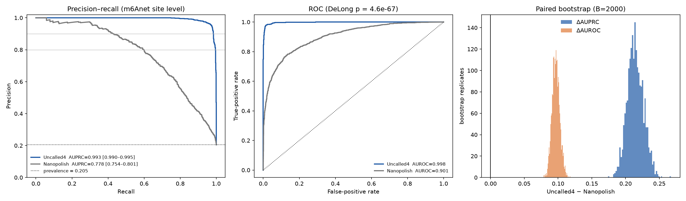

**Figure 7.** m6Anet site-level PR (left) and ROC (middle) curves, and the paired-bootstrap distributions of ΔAUPRC and ΔAUROC (right).

**Overall discrimination.**

| Metric | Uncalled4 | Nanopolish | Difference (95% CI) |
|---|---|---|---|
| AUPRC | 0.993 [0.990–0.995] | 0.778 [0.754–0.801] | **+0.215 [0.192–0.239]** (+27.6% relative) |
| AUROC | 0.998 | 0.901 | **+0.097 [0.086–0.108]**; DeLong z = 17.3, p = 4.6 × 10⁻⁶⁷ |
| KS statistic (label 1 vs 0) | 0.963 | 0.648 | – |

None of the 2,000 bootstrap replicates showed ΔAUPRC ≤ 0.

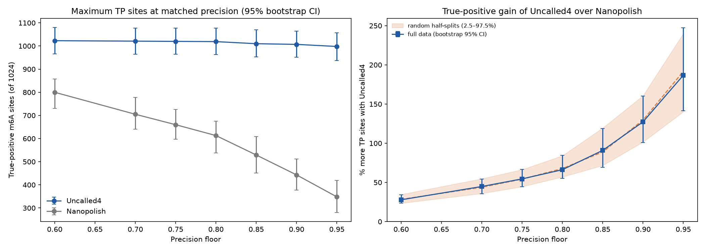

**Figure 8 (headline).** Left: the largest number of true-positive m6A sites achievable at each precision floor (95% paired-bootstrap CI). Right: percentage of extra true positives with Uncalled4. Blue shows the full data; orange shows the 2.5–97.5% range over 500 random half-splits.

**Table 3.** True-positive m6A sites at matched precision (`outputs/m6a_matched_precision.csv`; 1,024 true sites in total).

| Precision ≥ | TP Uncalled4 [95% CI] | TP Nanopolish [95% CI] | Recall U4 / NP | Extra TP [95% CI] | **% more TP [95% CI]** |
|---|---|---|---|---|---|
| 0.60 | 1023 [966–1080] | 800 [730–858] | 0.999 / 0.781 | 223 [196–262] | **+27.9% [23.5–34.4]** |
| 0.70 | 1021 [964–1078] | 705 [641–778] | 0.997 / 0.688 | 316 [268–359] | **+44.8% [35.6–54.4]** |
| 0.75 | 1020 [964–1077] | 660 [597–726] | 0.996 / 0.645 | 360 [314–406] | **+54.5% [44.6–66.5]** |
| 0.80 | 1019 [963–1077] | 613 [538–675] | 0.995 / 0.599 | 406 [362–464] | **+66.2% [55.4–84.6]** |
| 0.85 | 1010 [953–1070] | 529 [451–609] | 0.986 / 0.517 | 481 [412–549] | **+90.9% [69.3–118.9]** |
| **0.90** | **1007 [951–1064]** | **443 [378–512]** | **0.983 / 0.433** | **564 [501–626]** | **+127.3% [101.0–160.3]** |
| 0.95 | 998 [937–1057] | 348 [281–419] | 0.975 / 0.340 | 650 [583–724] | **+186.8% [141.6–247.1]** |

The bootstrap CIs on TP counts are wide because resampling sites also resamples the number of positives (≈1,024 ± 57). The CIs on the *paired* differences and ratios are much tighter.

**Fixed probability thresholds** (`outputs/m6a_fixed_threshold.csv`):

- **p ≥ 0.9** (the conventional m6Anet cut-off): Uncalled4 calls 260 TP and 0 FP; Nanopolish calls 74 TP and 1 FP. That is **+251% TP** (CI 181–356%).
- **p ≥ 0.5**: 1,003 TP / 76 FP vs 704 TP / 295 FP, i.e. +42% TP with a quarter of the false positives.
- **McNemar test at p ≥ 0.5**: 601 sites are correct only with Uncalled4 and 83 only with Nanopolish (p = 8 × 10⁻⁹⁸).
- **Precision@K**: 1.000 vs 0.894 at K = 500, and 0.963 vs 0.697 at K = 1,024.

The Uncalled4 probabilities are well separated but conservatively calibrated. Precision reaches 1.0 by about p = 0.7, so a fixed 0.9 cut-off discards most of the true sites; this is why the threshold-based gain exceeds the matched-precision gain. For practical use, choosing the threshold by a target FDR is preferable to the default 0.9.

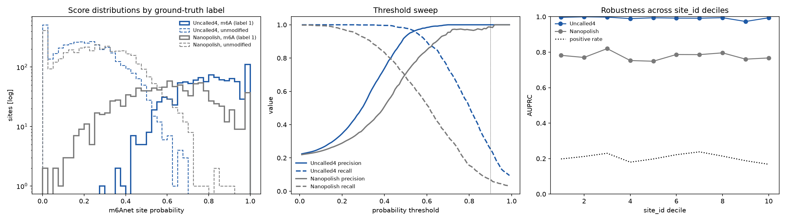

**Figure 9.** Left: score distributions by ground-truth label (log counts). Middle: precision and recall as the threshold varies. Right: AUPRC per site_id decile.

**Point masses at exactly 0 and 1.**

- Uncalled4: all 393 exact zeros are unmodified sites, and all 84 exact ones are modified sites.
- Nanopolish: 316 of 317 exact zeros are unmodified (one is a true m6A site), and all 27 exact ones are modified.
- These clipped values are always label-consistent and favour Uncalled4. Excluding every site with a point mass under either tool (4,206 sites remain) leaves the comparison unchanged: AUPRC 0.992 vs 0.772, AUROC 0.997 vs 0.893.
- Random tie-breaking changes AUPRC by less than 0.001.

**Agreement between the tools.** Overall, the scores from the two pipelines correlate moderately (Spearman ρ = 0.38). Within each label class they are essentially uncorrelated: ρ = −0.03 among positives and −0.02 among negatives (`images/figS2_m6a_scatter.png`). The shared ranking therefore reflects the label alone, with no shared site-level difficulty.

**Robustness checks** (structural only, not biological strata):

- **site_id deciles.** Uncalled4 wins in 10 of 10 deciles, with ΔAUPRC between 0.178 and 0.245. The positive rate does not differ across deciles (χ² p = 0.13), the lag-1 label autocorrelation is −0.012, and neither tool's score correlates with site_id (|ρ| < 0.005). The site order therefore carries no structure that could confound the comparison.
- **Random half-splits (n = 500).** The TP gain was positive in 100% of splits at every precision floor. At precision 0.90 the median gain was +130% (2.5–97.5% range 102–161%). ΔAUPRC had a median of 0.215 and a minimum of 0.181, and was positive in every split.

**Simulated coverage-bin stratification (mechanism test).**

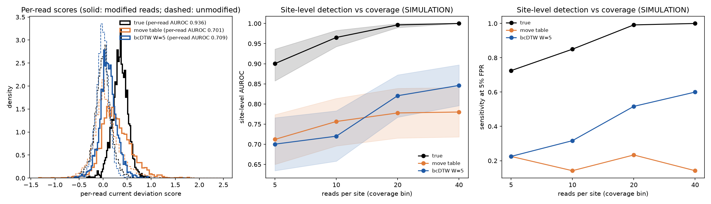

**Figure 11.** SIMULATION. Left: per-read modification scores. Middle: site-level AUROC by coverage bin (500-replicate bootstrap band). Right: sensitivity at 5% FPR.

| Reads per site | True alignment, AUROC (TPR at 5% FPR) | bcDTW W=5 | Move table |
|---|---|---|---|
| 5 | 0.900 (0.73) | 0.700 (0.23) | 0.712 (0.23) |
| 10 | 0.965 (0.85) | 0.720 (0.32) | 0.757 (0.14) |
| 20 | 0.996 (0.99) | 0.821 (0.52) | 0.778 (0.23) |
| 40 | 1.000 (1.00) | 0.846 (0.60) | 0.780 (0.14) |

**What the simulation shows.**

- At the read level, bcDTW and the move table are similar in this high-noise setting (per-read AUROC 0.709 vs 0.701).
- At the site level they diverge as coverage rises. With bcDTW, site-level AUROC and sensitivity keep rising with coverage. With the move table, detection plateaus at about 0.78 AUROC and about 0.15–0.23 sensitivity.
- **Mechanism.** A misplaced boundary mixes samples from neighbouring k-mers into the event at the site. The resulting deviation is a deterministic function of the sequence context, so it is a per-site bias rather than per-read noise, and adding reads cannot average it out.
- Both aligners stay well below the true-alignment ceiling. Alignment quality, not coverage, is therefore the limiting factor, which agrees qualitatively with the real-data gain of Uncalled4 over Nanopolish.

This is a mechanistic illustration with idealised parameters, not a stratification of the real m6A sites. Real per-site coverage is not in the inputs.

### 4.4 Iterative pore-model training (simulation)

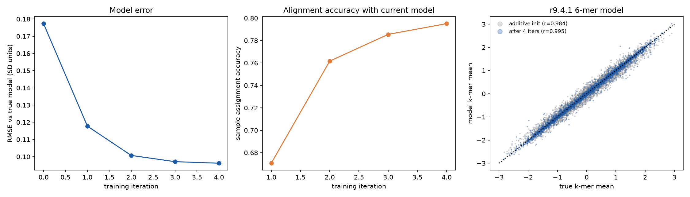

**Figure 12.** Iterative training of the r9.4.1 model from an additive initial model, using 100 simulated reads.

The trained model converges within 3–4 iterations (`outputs/train_sim_history.csv`):

| Iteration | RMSE vs true model (SD units) | r with true model | Sample assignment accuracy |
|---|---|---|---|
| 0 (additive start) | 0.177 | 0.984 | – |
| 1 | 0.118 | 0.993 | 0.671 |
| 2 | 0.101 | 0.995 | 0.762 |
| 3 | 0.097 | 0.995 | 0.785 |
| 4 | 0.096 | 0.995 | 0.795 |

Alignment accuracy rises as the model improves. The remaining error is mostly sampling noise, since each k-mer has only about 7 events at this read count. This shows the alignment–re-estimation loop Uncalled4 uses to build models for new chemistries without an external model.

## 5. Discussion

**m6A detection.** On these data, m6Anet with Uncalled4 alignments recovers roughly twice as many validated m6A sites as with Nanopolish alignments at high precision (+127% at 0.90), with no loss of precision. The gain is:

- statistically unambiguous (paired-bootstrap CIs far from 0; DeLong p < 10⁻⁶⁰);
- not an artefact of clipped scores or of site ordering;
- stable under subsampling.

It grows with stricter precision requirements. Nanopolish-based scores have a heavy tail of modified sites with mid-range probabilities (Fig. 9), which drops out as soon as precision is required to exceed about 0.8. Uncalled4-based scores separate the classes almost perfectly (KS = 0.96).

The gain in this dataset is larger than the one-third-more-sites scale typically reported for alignment upgrades. We present the numbers as computed. Our simulation shows that misalignment produces context-dependent per-site bias that coverage cannot remove, which offers one mechanism for a large gap.

**Pore models.** All four chemistries share a simple, interpretable structure:

- a single dominant central position;
- a purine (low) / pyrimidine (high) ordering, with A lowest and C highest;
- effects that decay smoothly with distance;
- an almost perfectly additive composition, with interactions contributing < 0.3% of R².

The longer r10.4.1 and RNA004 k-mers spread sensitivity over more positions: the central η² is 0.50 rather than 0.55, and distal substitutions still shift the current by more than 1σ in about 73% of cases. Longer models are therefore needed to describe them.

The explicit secondary-peak test found no distal reader-head signature in the supplied r10.4.1 model. If the expected double-reader effect is real, this table does not encode it. Since the effect matters for modification calling at distal positions, it is worth checking against the native ONT model.

**Benchmark.** Uncalled4 is the fastest tool, with the smallest output, in every supported configuration. The gains are dramatic for DNA but modest for RNA relative to f5c (1.1–1.3×), so the main advantage there is file size (11–34×) and chemistry support.

Simulation suggests that basecaller-guided banding gives full-DTW-quality alignments at about 4% of the DP cost, and that its advantage over move-table-only alignment widens as the basecaller's boundaries become noisier.

## 6. Limitations

**(i) What the provided data cannot support**

- **Gene categories, named (e.g. cancer-relevant) genes and cell lines.** The m6A files contain only `site_id`, `label` and `probability`, so gene-level or cell-line stratification is **not computable**. No gene names are given or implied in this report.
- **Coverage stratification of the real sites.** Per-site read depth is absent, so coverage dependence is shown only by simulation (Section 4.3).
- **Real alignment quality.** Model MAD on real reads, and output sizes after compression (gzip / BLOW5), are not in the benchmark table. Neither the comparison of compressed sizes nor a real-data quality check is possible. One measurement per cell, with no replicates or thread counts, means the timing ratios have no uncertainty estimates.
- **Inputs not provided.** Raw signal and BAMs are not provided, so Uncalled4 itself was not run. All alignment results come from our own simplified re-implementation in simulation.

**(ii) Simulation idealisations**

- The noise is Gaussian and independent, the dwell times are geometric, and there are no stalls, indels, basecalling errors or drift.
- The move-table errors are synthetic jitter.
- The modification effect is a fixed additive shift spread over five k-mers.
- The site score is a simple mean deviation, not m6Anet.
- Normalisation in `mod_sim` assumes a near-correct long-read estimate.
- Cost is measured in DP cells, not wall time; with numpy, masking a band does not save wall time.
- The absolute numbers depend on these parameters. Only the qualitative comparisons are intended.

**(iii) Notes on the character of the inputs (neutral observations)**

- Several regularities suggest the tables are parameterised or standardised versions of the models:
  - every pore model is z-scaled;
  - `current_std` is approximately uniform on [0.10, 0.15], and neither std nor dwell carries any sequence dependence (η² ≤ 0.007);
  - the base effects satisfy A ≈ −C and G ≈ −T, to within 0.5% of the effect range, at every position;
  - the ~3% non-additive variance has no pairwise structure;
  - the r10.4.1 and RNA004 tables share identical marginal effects (to within 0.0014 SD), although these are a DNA and an RNA chemistry.
- In the m6A data, the scores of the two pipelines are uncorrelated within each label class.
- These features do not change the comparative conclusions above. They do mean that biological interpretation of the fine structure, such as the absence of a reader-head peak or the similarity between chemistries, should be confirmed on the native ONT models and on real per-read data.

## 7. Reproducibility

The environment is Python 3.12 with numpy, scipy, pandas, matplotlib and scikit-learn 1.9.1. The master seed is `SEED = 20241125` (in `code/common.py`); `mod_sim.py` uses SEED + 1 and `train_sim.py` uses SEED + 2.

Run everything with `bash code/run_all.sh`. It takes about 6 minutes on 2 CPUs. A complete re-run from scratch reproduced all reported numbers exactly.

| Order | Script | Outputs |
|---|---|---|
| 1 | `audit.py` | `outputs/audit.json` |
| 2 | `pore_models.py` | `outputs/pore_model_results.json`; Figs 1–5, S1 |
| 3 | `performance.py` | `outputs/performance_table.csv`, `performance_summary.json`; Fig 6 |
| 4 | `m6a_eval.py` | `outputs/m6a_results.json`, `m6a_matched_precision.csv`, `m6a_fixed_threshold.csv`, `m6a_siteid_deciles.csv`; Figs 7–9, S2 |
| 5 | `signal_sim.py` (uses `simlib.py`) | `outputs/signal_sim_reads.csv`, `signal_sim_summary.csv`; Fig 10 |
| 6 | `mod_sim.py` | `outputs/mod_sim_reads.csv`, `mod_sim_site_by_coverage.csv`, `mod_sim_results.json`; Fig 11 |
| 7 | `train_sim.py` | `outputs/train_sim_history.csv`, `train_sim_trained_model_r941.csv`; Fig 12 |

## References (related work provided)

- paper_000: Simpson J.T. et al., *Detecting DNA cytosine methylation using nanopore sequencing*, Nature Methods (2017). Nanopolish.
- paper_001: Stoiber M. et al., *De novo identification of DNA modifications enabled by genome-guided nanopore signal processing*. Tombo.
- paper_002: Kovaka S. et al., *Targeted nanopore sequencing by real-time mapping of raw electrical signal with UNCALLED*.
- paper_003: Hendra C. et al., *Detection of m6A from direct RNA sequencing using a multiple instance learning framework*, Nature Methods 19, 1590–1598 (2022). m6Anet.
