# Pre-trained Gated-Residual Crystal Graph Networks for Altermagnet Screening: a Controlled Evaluation under Extreme Label Scarcity

## Abstract

We built and evaluated an AI search engine for altermagnetic materials. It has three stages:

1. self-supervised masked-node pre-training of a gated, residual crystal-graph convolutional network (CGCNN) on 5000 unlabelled crystal graphs;
2. imbalance-aware fine-tuning on 2000 labelled graphs, of which only 99 (4.95%) are positive;
3. ranking of 1000 unlabelled candidates, whose hidden labels are used only for evaluation.

Every claim is backed by nested cross-validation, bootstrap confidence intervals, label-permutation tests and two controls. The first is a **positive control**: a structure-defined label planted on the same graphs. The second is a battery of **null diagnostics**.

There are three main findings.

1. **The pipeline works when structural signal exists.** On the positive control (100 positives for fine-tuning, 50 hidden among 896 candidates), all learned models rank candidates far above chance:
   - candidate ROC-AUC is 0.82–0.88 and 14–18 of the top-50 are true positives, against 2.8 expected by chance (permutation p = 0.001 for every model);
   - raw scores above 0.9 have precision up to 3/4 (GBDT), against a 5.6% base rate.
2. **Masked-node pre-training is label-efficient.**
   - With only 10 labelled positives, the frozen pretrained encoder reaches candidate AUC 0.755 ± 0.068, against 0.504 ± 0.106 for the same network trained from scratch.
   - Pre-training gives an advantage at every label budget. The curves converge at 100 positives (0.825 frozen, 0.802 fine-tuned, 0.760 scratch).
3. **The provided altermagnet labels cannot be recovered from these graphs.**
   - On the candidates, every method is statistically indistinguishable from random:
     - ROC-AUC lies between 0.36 and 0.54, and all 95% CIs include or fall below 0.5;
     - the best model gets 5 of 43 positives in its top 50, against 2.15 expected (permutation p = 0.067, not significant after multiplicity);
     - no candidate exceeds p = 0.9.
   - Even with all 5000 *balanced* pretrain labels (used only as a diagnostic), GBDT, WL-kernel and GNN classifiers stay at chance (CV AUC ≤ 0.49).
   - Element χ² tests, 30 univariate descriptor AUCs and file-order and edge-order artefact checks are all consistent with labels that are statistically independent of graph structure.

We therefore do **not** claim any newly discovered altermagnets. We report a ranked shortlist only as the output format of the engine. The task also asks for DFT-confirmed electronic-structure classes (metal/insulator, d/g/i-wave). These cannot be derived from the inputs, which have no coordinates, lattice or magnetic moments, so we do not fabricate them.

---

## 1. Introduction and background

Altermagnets are collinear compensated magnets. Their opposite-spin sublattices are connected by a rotation or mirror rather than by a translation or inversion. As a result they combine zero net magnetisation with momentum-dependent, non-relativistic spin splitting of d-, g- or i-wave symmetry (Šmejkal, Sinova & Jungwirth, *PRX* 2022; related_work/paper_000). Rigorous identification needs the spin-space-group classification of the magnetic structure (Xiao *et al.*, *PRX* 2024; paper_001), and extensions to non-collinear order exist (Hu *et al.*, *Nat. Commun.* 2025; paper_002). Only a small number of altermagnets is known, which motivates data-driven pre-screening that combines expert intuition with machine learning (cf. ME-AI, Liu *et al.*, *Commun. Mater.* 2025; paper_003).

The task is a few-shot, heavily imbalanced graph classification problem. A pre-train → fine-tune → screen design is natural for it. With 4–5% positives, however, it is easy to report numbers that look good and mean nothing. For example, raw accuracy is about 95% for a classifier that predicts "not altermagnet" for everything. Our design therefore puts the controls first: every number for the real labels is reported next to the same pipeline's numbers on a planted, structure-defined label.

## 2. Data

### 2.1 Loading and representation

The three `.pt` files were pickled with a custom class (`data_prepare.RealisticCrystalDataset`) and with `torch_geometric` objects, neither of which is available. We loaded them with a **restricted unpickler** (`code/loader.py`):
- it allows only tensor-rebuild globals and `OrderedDict`;
- it maps the unknown classes to inert stubs;
- it rejects every other global, so no code from the files is executed.

Each graph has four fields:
- `x`: a one-hot vector over 28 elements. Indices 0–13 are magnetic species: Fe, Co, Ni, Mn, Cr, V, Ti (3d) and Nd, Pr, Sm, Gd, Ho, Er, Yb (4f). Indices 14–27 are ligands: O, F, Cl, Br, I, S, Se, Te, B, C, N, P, Si, H.
- `edge_index`: directed bonds.
- `edge_attr`: a bond value in (0, 1) and a bond type in {0, 1, 2}.
- `y`: the label.

There are **no coordinates, lattice vectors, space groups or magnetic moments**.

### 2.2 Audit (Table 1, Fig. 1)

**Table 1. Data audit** (`outputs/audit_counts.csv`).

| | pretrain | finetune | candidate |
|---|---|---|---|
| graphs | 5000 | 2000 | 1000 |
| positives (y = 1) | **2474** (49.5%) | **99** (4.95%) | **43** (4.3%) |
| `pos_ratio` metadata | 0.5 | 0.05 | 0.05 |
| atoms per graph | 4–24 (always even) | 4–24 | 4–24 |
| mean undirected bonds | 5.92 | 5.85 | 5.88 |
| exact / permutation-invariant duplicates | 0 / 0 | 0 / 0 | 0 / 0 |
| graphs with a directed edge lacking its reverse | 646 | 229 | 127 |

There are three discrepancies with the task description.
1. **Positive counts.** The finetune set has 99 positives, not 100, and there are not 148. The candidate set has 43, not about 50. All results use the true counts.
2. **Pretrain labels.** The "unlabelled" pretrain set does carry labels, balanced at 50%. We **never used them for training** any screening model. They appear only in the learnability diagnostic of §5.4.
3. **Asymmetric edges.** About 13% of graphs in every set contain directed edges without a reverse, and a few contain multi-edges. The positive rate among these irregular graphs matches the overall rate in every set (0.497, 0.052, 0.047), so this is a generator artefact and not a label proxy. The featuriser symmetrises and de-duplicates all edges.

No graph is duplicated within or across the three sets, so there is no leakage. The size, element and bond-value distributions are the same in all three sets (Fig. 1). Bond values are roughly uniform on (0, 1) for every bond type. Many atoms are isolated, at about 6 bonds per graph of 4–24 atoms. The decoded "formulas" are not chemically realistic: for example, a 24-atom cell can hold 11 different magnetic species, as in the shortlist CSV. This indicates a synthetic generator rather than real Materials Project structures.

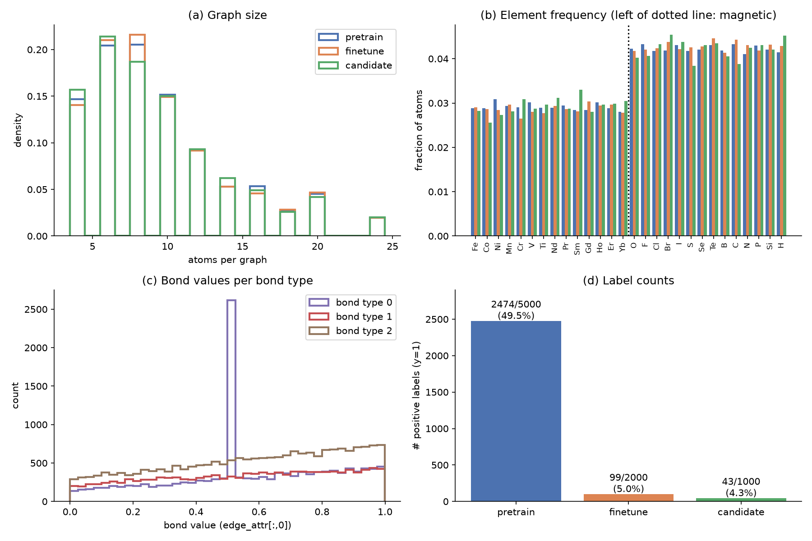

*Figure 1. (a) Graph-size distribution, (b) element frequencies (left of the dotted line: magnetic species), (c) bond values per bond type, (d) label counts per file.*

## 3. Methods

### 3.1 Encoder: gated, residual CGCNN (`code/model.py`)

**Inputs.**
- Atoms are embedded with a learned 64-dimensional element embedding. It has 28 element rows plus a learned `[MASK]` row used in pre-training.
- Each bond value $d_{ij}$ is expanded in 16 Gaussian radial basis functions on [0, 1], $\exp(-\gamma(d_{ij}-\mu_k)^2)$. This lets the network resolve small differences in bond value smoothly, which a single scalar input would not.
- The RBF expansion is concatenated with an 8-dimensional bond-type embedding and passed through a two-layer MLP to give $e_{ij}\in\mathbb R^{32}$.

**Gated convolution.** Three stacked CGCNN-style layers (Xie & Grossman 2018) each compute

$$z_{ij}=[h_i\,\Vert\,h_j\,\Vert\,e_{ij}],\qquad m_{ij}=\sigma(W_f z_{ij}+b_f)\odot\operatorname{softplus}(W_s z_{ij}+b_s),$$
$$h_i\leftarrow\operatorname{softplus}\Big(h_i+\operatorname{LayerNorm}\big(\textstyle\sum_{j\in\mathcal N(i)} m_{ij}\big)\Big).$$

*Why gating.* The sigmoid branch $\sigma(W_f z_{ij})\in(0,1)^{64}$ is a learned filter for each neighbour and each channel. Because it is conditioned on both endpoint atoms and on the bond descriptor, the layer can open a channel for, say, a short magnetic–ligand bond of type 2 and close it for an irrelevant ligand–ligand contact. This is neighbour and feature selection, which a plain sum over neighbours cannot do. The softplus "core" branch carries the content of the message. Altermagnetism is decided by *which* magnetic sublattices are connected *through which* ligand environments, so the ability to weight bonds selectively is the inductive bias we want.

*Why the residual and LayerNorm.* The identity path $h_i+\dots$ keeps each atom's own identity, the element, through the stack and gives gradients a path that does not go through every non-linearity. This counters vanishing gradients and over-smoothing, where repeated neighbourhood averaging makes all node states look alike. LayerNorm on the aggregated message keeps its scale independent of node degree, which ranges from 0 for isolated atoms to more than 6. §5.6 tests this rationale directly: without residuals, a 6-layer stack barely trains (Fig. 11).

### 3.2 Self-supervised pre-training: masked-node reconstruction

We use only the 5000 `pretrain_data.pt` graphs: 4500 for training and 500 for validation, with labels ignored.
- In each graph, 15% of atoms are replaced by `[MASK]`.
- The encoder runs on the corrupted graph.
- A two-layer MLP decoder (64 → 64 → 28) reconstructs the element of each masked atom, trained with cross-entropy.
- Training runs for 60 epochs with AdamW (learning rate 2·10⁻³, cosine schedule, weight decay 10⁻⁴) and batch size 64.

To recover the masked element, the encoder must infer it from the atom's bond pattern and its neighbours. It therefore has to encode local chemistry: which elements bond to which, with what bond types and values. We did not use contrastive (GraphCL) objectives. Their augmentation invariances, such as edge dropping, can erase exactly the bond-value differences that define magnetic sublattice relations.

### 3.3 Classifier and fine-tuning

**Classifier.** The encoder is followed by global [mean ‖ max] pooling (128 dimensions), then FC(128 → 64), ReLU, **Dropout(0.3)**, FC(64 → 1) and a logit. Dropout regularises the head against memorising the roughly 80 training positives.

**Loss and optimiser.**
- Class-weighted BCE with `pos_weight` = N⁻/N⁺ ≈ 19.
- AdamW with head learning rate 10⁻³, encoder learning rate 0.3·10⁻³ (a lower rate preserves the pretrained features), batch size 64, at most 60 epochs and gradient clipping at 5.

**Variants.**
- `pre_ft`: pretrained encoder, fully fine-tuned.
- `pre_frozen`: pretrained encoder frozen, only the head trained (a linear-probe-like setting).
- `scratch`: same architecture, random initialisation.

**Nested protocol, to avoid early-stopping optimism.**
1. Five stratified outer folds are formed on the finetune set.
2. Within each outer training part, a stratified 20% *inner* validation split is used for early stopping on validation PR-AUC, with patience 25.
3. The held-out outer fold is scored only once, with the selected checkpoint. This gives out-of-fold (OOF) predictions.
4. Candidates are scored by averaging the logits of the five fold models.

Per-epoch train, inner-validation and outer-fold loss, accuracy, balanced accuracy, ROC-AUC and PR-AUC are logged (Fig. 4).

**Baselines**, all with the same outer folds and fold-averaged candidate scores:
- random scores;
- a descriptor GBDT: 30 hand-crafted graph descriptors plus 28 composition counts, `HistGradientBoosting` with depth 3, 200 trees and balanced class weights;
- a WL-kernel logistic regression: Weisfeiler–Lehman subtree features of depth 2 over element, bond type and binned bond value, with L2 penalty C = 0.1 and balanced weights.

### 3.4 Screening evaluation (`code/screen.py::evaluate`)

**Ranking metrics on the candidates.** We report ROC-AUC, PR-AUC (average precision; chance equals prevalence), hits@k, enrichment factor at 5%, and discovery curves.

**Uncertainty and significance.** These use 1000 bootstrap resamples (95% CIs) and 1000-fold label-permutation tests on AP and AUC.

**High-confidence analysis.** For raw-probability thresholds 0.5, 0.8 and 0.9 we report the number selected, the true positives among them, precision with a Wilson 95% CI, and recall. Class-weighted training inflates raw probabilities by roughly the pos_weight odds factor. We therefore also fit **Platt scaling on the OOF predictions** and report calibrated probabilities.

**Accuracy baseline.** At 4–5% prevalence, the trivial all-negative classifier has accuracy 0.951 (finetune) or 0.957 (candidates). We therefore report **balanced accuracy**, whose chance level is 0.5, as the threshold metric.

### 3.5 Positive control (`code/control_labels.py`)

To show that the pipeline can find structure-defined materials, we planted a label on the *same* graphs. A graph is positive if it contains a **symmetric M–X–M′ bridge**: a ligand X bonded to two distinct magnetic atoms with bond values that differ by less than 0.1. This mimics a superexchange path between two magnetic sites with equivalent environments.
- About 14% of graphs carry the motif (pretrain 14.7%, finetune 13.2%, candidate 15.4%).
- The motif is independent of the provided labels.
- To match the real task's scarcity, all motif-free graphs are kept as negatives and only 100 motif graphs are kept as positives in the finetune set (1836 graphs, 5.4% positive). For the candidate set we keep 50 (896 graphs, 5.6% positive).
- The pipeline is otherwise identical.

### 3.6 Additional studies

- **Label efficiency (control).** n_pos ∈ {10, 25, 50, 100} positives plus all motif-free negatives, 3 seeds, a fixed 40-epoch budget with no early stopping, and evaluation on the fixed control candidate set.
- **Linear probes.** Ridge and logistic probes, with 5-fold CV, on frozen pooled embeddings of the 5000 pretrain graphs, comparing the pretrained encoder with a randomly initialised one.
- **Residual ablation.** Residual on vs. off at 3 and 6 layers, from scratch, on the control, with 2 seeds.
- **Signal diagnostics.**
  - χ² or Fisher tests of label vs. element presence (84 tests), and of label vs. atom-count, magnetic-count, bond-count and species-count categories;
  - 30 univariate descriptor AUCs;
  - label vs. file index (AUC and Wald–Wolfowitz runs test), and label vs. node-order and edge-order artefacts;
  - learnability of the 5000 balanced pretrain labels by GBDT, WL-LR (depth 3) and GNN (5-fold or 3-fold CV), used as a diagnostic only.

All code is in `code/`, and all numeric outputs (CSV, JSON, NPZ) are in `outputs/`. Seeds are fixed throughout.

## 4. Results I: data-level signal diagnostics

**Table 2. Cheap signal diagnostics** (`outputs/chi2_*.csv`, `univariate_auc.csv`, `artefact_checks.csv`, `pretrain_label_diagnostic.csv`).

| Diagnostic | Result | Reading |
|---|---|---|
| Element presence vs. label (84 χ²/Fisher tests, 3 sets) | 1 test with p < 0.05 (Ho in pretrain, p = 0.020); 4.2 expected under the null | consistent with null (Fig. 2a) |
| 30 univariate descriptor AUCs | pretrain 0.49–0.51; finetune 0.46–0.56; candidate 0.42–0.60 | chance; the spread shrinks with n, as sampling noise does |
| Atom-count category vs. label | pretrain p = 0.044 (14 atoms: 59% positive; 24 atoms: 40%); finetune p = 0.060 (14 atoms: 10.4%; 24 atoms: 0%) | weak lead, tested prospectively below |
| Pre-registered size rule on candidates (+1 for 14 atoms, −1 for 24 atoms) | AUC 0.502; 14-atom positive rate 3/62 vs. 40/938 for other sizes; one-sided Fisher p = 0.51 | **does not replicate**, so it was a fluctuation |
| Magnetic-, bond- and species-count categories | all p > 0.15 | null |
| Label vs. file index | AUC 0.508 / 0.504 / 0.493; runs-test p = 0.86 / 0.96 / 0.37 | no ordering artefact |
| Label vs. node order and edge order | AUCs 0.47–0.51 | no artefact |
| 5000 balanced pretrain labels, CV AUC (diagnostic only) | GBDT 0.490 [0.474, 0.507]; WL-LR 0.483 [0.468, 0.499]; GNN 0.474 [0.454, 0.493] | **labels not learnable even with 25× more positives** |

The diagnostic CV AUCs are slightly below 0.5. This small negative bias is a known property of cross-validation when labels carry no signal: removing a fold shifts the training class balance against that fold. It does not indicate an exploitable anti-correlation.

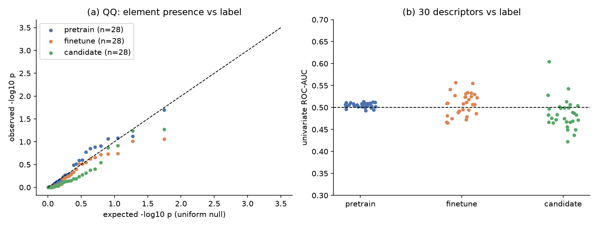

*Figure 2. (a) QQ plot of the element-presence vs. label p-values against the uniform null. (b) Univariate AUCs of 30 descriptors in each set.*

## 5. Results II: the search engine

### 5.1 Pre-training

Masked-element cross-entropy fell from 3.32 to **2.845** (validation). The context-free element-frequency prior gives 3.315 and the uniform distribution ln 28 = 3.332 (Fig. 3a). Validation reconstruction accuracy reached **10.1%**, against 4.4% for always predicting the most frequent element and 3.6% for uniform guessing (Fig. 3b).

The encoder therefore recovers substantial information about masked atoms from their bonding context, roughly 0.47 nats per atom beyond the prior. Most of it is the magnetic vs. ligand class plus bond-type preferences. Exact element identity stays hard to recover, which is expected for a generator that assigns elements within a class nearly at random. Training and validation curves track each other, so there is no overfitting.

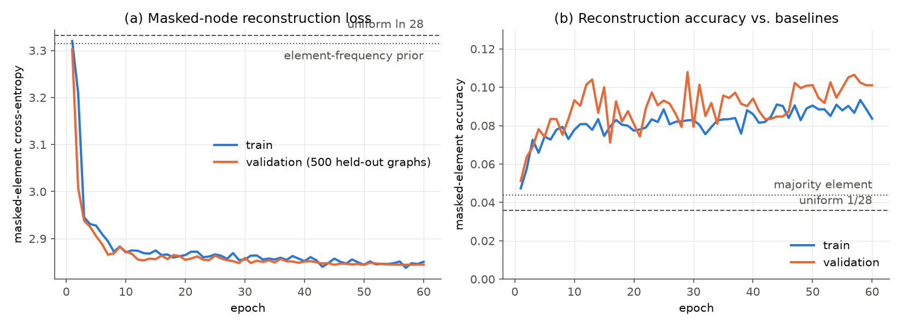

*Figure 3. Masked-node pre-training on the 5000 pretrain graphs only. (a) Reconstruction loss against the uniform and frequency-prior baselines. (b) Reconstruction accuracy against the uniform (1/28) and majority-element baselines.*

### 5.2 Fine-tuning curves (Fig. 4)

**Real labels (top row).**
- Training loss falls monotonically, and training balanced accuracy rises to about 0.96 and training PR-AUC to about 0.9. The network has enough capacity to memorise the 79 or so training positives.
- Inner-validation and held-out-fold loss *rise* from the first epochs.
- Validation balanced accuracy stays at the 0.5 chance line throughout (0.49–0.54), and validation PR-AUC stays at the 0.05 prevalence line.
- Raw accuracy oscillates between 0.5 and 0.93 depending on how many graphs exceed the 0.5 threshold, and never beats the all-negative baseline of 0.951.

This is the signature of memorising noise.

**Positive control (bottom row).**
- Validation balanced accuracy rises within a few epochs to about 0.72 (fold range 0.53–0.76 at the selected epochs), clearly above 0.5.
- Validation PR-AUC rises to about 0.3, against a prevalence of 0.054. Held-out-fold PR-AUC is 0.18–0.30 and held-out AUC 0.72–0.82.
- Overfitting appears only after about 15 epochs.

The difference between the two rows is the central diagnostic: the same optimiser and architecture generalise on structural labels and not on the provided ones.

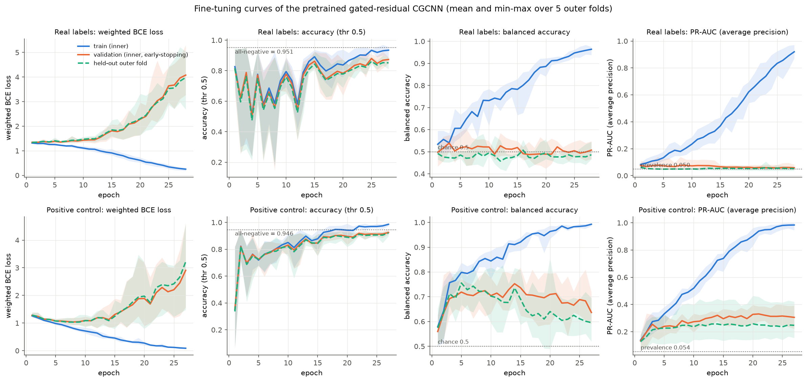

*Figure 4. Train (inner), validation (inner, used for early stopping) and held-out outer-fold curves of loss, accuracy, balanced accuracy and PR-AUC for the fine-tuned pretrained GNN. Lines are fold means and bands span the min–max over the 5 folds. Dotted lines show the all-negative accuracy, the 0.5 balanced-accuracy chance level and prevalence.*

### 5.3 Candidate screening: real labels vs. positive control

**Table 3. Candidate screening** (`outputs/metrics_real.csv`, `metrics_control.csv`). AUC and AP are given with 95% bootstrap CIs. *p*: one-sided label-permutation p-value for AP. Balanced accuracy uses a raw probability threshold of 0.5.

| Method | Real: OOF AUC | Real: cand. AUC | Real: cand. AP (prev. 0.043) | Real: hits@50 (exp. 2.15) | Real: *p* | Control: OOF AUC | Control: cand. AUC | Control: cand. AP (prev. 0.056) | Control: hits@50 (exp. 2.8) | Control: *p* |
|---|---|---|---|---|---|---|---|---|---|---|
| Random | 0.541 | 0.480 [0.39, 0.57] | 0.042 | 2 | 0.78 | 0.505 | 0.482 [0.41, 0.55] | 0.051 | 1 | 0.88 |
| Descriptor GBDT | 0.488 | 0.539 [0.46, 0.62] | 0.048 | 1 | 0.44 | **0.856** | **0.876 [0.83, 0.91]** | **0.334** | **18** | 0.001 |
| WL-kernel LR | 0.489 | 0.467 [0.39, 0.55] | 0.048 | 2 | 0.46 | 0.739 | 0.766 [0.70, 0.83] | 0.207 | 14 | 0.001 |
| GNN scratch | 0.479 | 0.363 [0.28, 0.45] | 0.055 | 1 | 0.20 | 0.676 | 0.820 [0.76, 0.87] | 0.236 | 14 | 0.001 |
| Pretrained GNN, frozen | 0.444 | 0.448 [0.35, 0.54] | 0.041 | 2 | 0.84 | 0.802 | 0.836 [0.79, 0.88] | 0.264 | 16 | 0.001 |
| Pretrained GNN, fine-tuned | 0.462 | 0.444 [0.36, 0.54] | 0.066 | 5 | 0.067 | 0.699 | 0.846 [0.79, 0.89] | 0.246 | 14 | 0.001 |

On the candidates, balanced accuracy for the real labels is 0.48–0.53 for every method. For the control it is 0.56–0.75, with the frozen pretrained probe highest at 0.746. The fine-tuned pretrained GNN on real labels has 0.905 raw accuracy, which is *below* the all-negative 0.957.

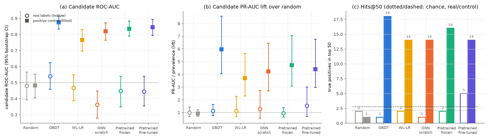

*Figure 5. Candidate ROC-AUC, PR-AUC lift and hits@50. Hollow markers and bars are real labels; filled are the positive control. Error bars are 95% bootstrap CIs.*

**Real labels.** Every method's candidate AUC CI includes 0.5, except the from-scratch GNN, whose CI lies *below* 0.5 (0.36).
- That below-chance AUC is not reproduced out-of-fold (OOF AUC 0.479), so we read it as overfitting to finetune-specific idiosyncrasies that do not transfer. It is not a usable anti-signal.
- The best AP and hits@50 (5 of 43, fine-tuned pretrained GNN) give a permutation p of 0.067 before correcting for six methods. Its AUC is 0.444, below chance. The extra hits sit in the top 50 alone, and its discovery curve meets the random expectation by rank 150 (Fig. 7).
- OOF and candidate metrics agree: both are at chance. This also confirms that the nested protocol removed the early-stopping optimism a naïve protocol would show.

**Positive control.** All learned methods are highly significant (p = 0.001, the smallest attainable with 1000 permutations). EF@5% is 4.8–7.2.
- The hand-crafted descriptor GBDT is best (AUC 0.876, 18 of 50 hits in the top 50). Its descriptors, such as magnetic–ligand bond counts and bond-value statistics, are close to the motif definition.
- Among the GNNs, pre-training helps out-of-fold: AUC 0.802 frozen against 0.676 scratch. The candidate AUCs are similar (0.82–0.85) with overlapping CIs.

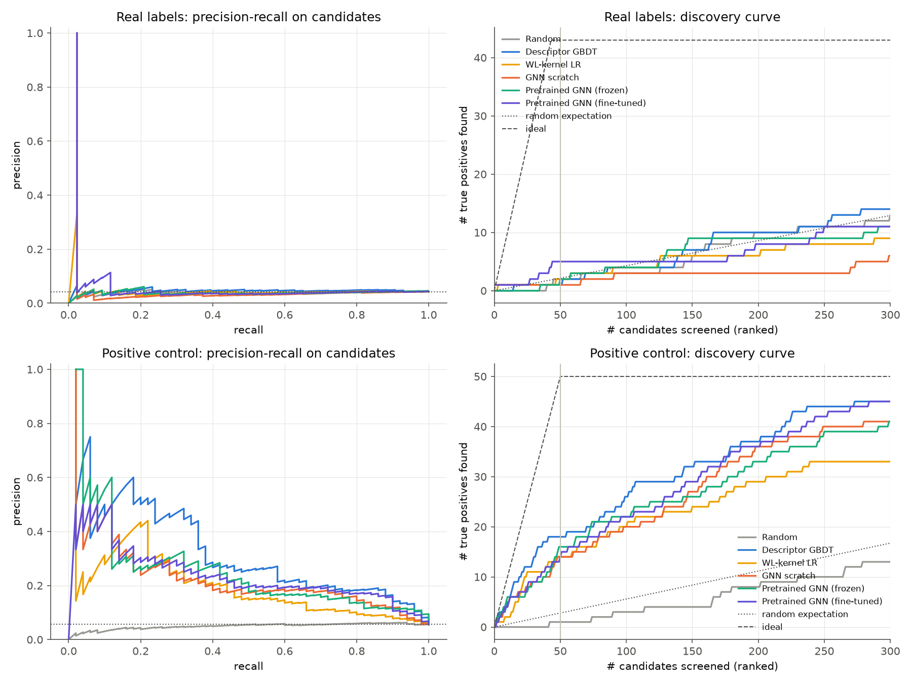

*Figure 7. Precision–recall curves and discovery curves (true positives found vs. number of candidates screened) on the candidates. Dotted lines show random expectation and dashed lines show the ideal ranking.*

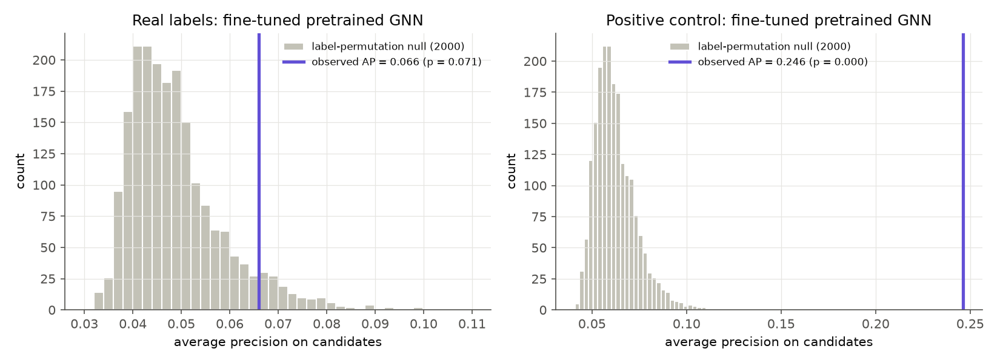

*Figure 8. Label-permutation null distributions of candidate AP for the fine-tuned pretrained GNN. Real labels: p = 0.06, not significant. Positive control: far outside the null.*

### 5.4 High-confidence discoveries

**Table 4. Candidates above raw-probability thresholds, with true positives and precision (Wilson 95% CI)** (`outputs/highconf_*.csv`).

| Task | Method | p ≥ 0.5: sel. / TP / precision | p ≥ 0.8: sel. / TP / precision | p ≥ 0.9: sel. / TP / precision |
|---|---|---|---|---|
| Real (base 0.043) | GBDT | 56 / 2 / 0.04 [0.01, 0.12] | 0 | **0** |
| | GNN scratch | 53 / 1 / 0.02 [0.00, 0.10] | 10 / 1 / 0.10 [0.02, 0.40] | **0** |
| | Pretrained frozen | 281 / 10 / 0.04 [0.02, 0.06] | 0 | **0** |
| | Pretrained fine-tuned | 62 / 5 / 0.08 [0.04, 0.18] | 2 / 1 / 0.50 [0.09, 0.91] | **0** |
| Control (base 0.056) | GBDT | 71 / 20 / 0.28 [0.19, 0.40] | 12 / 6 / 0.50 [0.25, 0.75] | **4 / 3 / 0.75 [0.30, 0.95]** |
| | WL-LR | 34 / 11 / 0.32 [0.19, 0.49] | 2 / 1 / 0.50 | 1 / 1 / 1.00 [0.21, 1.00] |
| | GNN scratch | 14 / 6 / 0.43 [0.21, 0.67] | 6 / 2 / 0.33 [0.10, 0.70] | 5 / 2 / 0.40 [0.12, 0.77] |
| | Pretrained frozen | 283 / 39 / 0.14 [0.10, 0.18] | 23 / 6 / 0.26 [0.13, 0.47] | 0 |
| | Pretrained fine-tuned | 21 / 7 / 0.33 [0.17, 0.55] | 6 / 3 / 0.50 [0.19, 0.81] | 3 / 1 / 0.33 [0.06, 0.79] |

**Real labels.** No candidate reaches p ≥ 0.9 under any method. The few that reach p ≥ 0.8 have precision CIs that span the base rate.

**Control.** High-confidence predictions are 5–13× enriched over the 5.6% base rate. The small numbers selected mean wide CIs. Top-k precision is more stable (`outputs/topk_precision.csv`):
- GBDT: 5 of 10, 10 of 20 and 18 of 50;
- frozen pretrained GNN: 6 of 10 and 16 of 50.

**Calibration.** Platt scaling on the OOF predictions maps the raw scores to honest probabilities.
- Real labels: the largest calibrated probability for any candidate is 0.05–0.06 for every method, essentially the base rate. A calibrated model correctly says it knows nothing.
- Control: the largest calibrated probabilities are 0.73 (GBDT), 0.34 (frozen), 0.20 (scratch) and 0.18 (fine-tuned). Only GBDT puts any candidate above 0.5 (3 candidates, 2 true positives).

At 5% prevalence and AUC around 0.85, calibrated "p > 0.9 discoveries" are therefore rare even when the model works. A raw-probability threshold such as 0.9 after class-weighted training should not be read as a 90% hit rate. Ranking (top-k) is the operationally meaningful output of the screening engine.

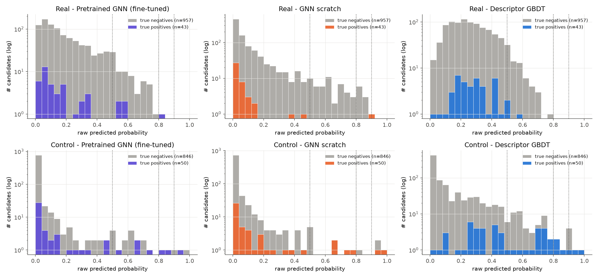

*Figure 6. Raw predicted-probability histograms for candidates, by hidden class, on a log scale. Dotted lines mark the 0.5, 0.8 and 0.9 thresholds. Real labels: positives and negatives overlap completely. Control: positives are enriched in the high-probability tail.*

### 5.5 Label efficiency and what pre-training learns

**Table 5. Label efficiency on the control** (candidate ROC-AUC, mean ± s.d. over 3 seeds; `outputs/label_efficiency_all.csv`).

| n_pos | GBDT | GNN scratch | Pretrained frozen | Pretrained fine-tuned |
|---|---|---|---|---|
| 10 | 0.782 ± 0.035 | 0.504 ± 0.106 | **0.755 ± 0.068** | 0.580 ± 0.112 |
| 25 | 0.813 ± 0.016 | 0.614 ± 0.065 | **0.794 ± 0.028** | 0.645 ± 0.094 |
| 50 | 0.853 ± 0.014 | 0.704 ± 0.012 | **0.815 ± 0.033** | 0.730 ± 0.056 |
| 100 | 0.876 ± 0.019 | 0.760 ± 0.042 | **0.825 ± 0.002** | 0.802 ± 0.017 |

Masked-node pre-training is clearly beneficial in the few-shot regime.
- At 10 positives, the frozen pretrained encoder gains about 0.25 AUC over scratch (0.755 vs. 0.504). At 10 and 25 positives it is within about 1 s.d. of the descriptor GBDT.
- Full fine-tuning with 10–25 positives partly destroys this advantage: catastrophic drift of the encoder under very few positive gradients. The gap closes by 100 positives.
- For PR-AUC and hits@50 (Fig. 9), GBDT keeps an advantage at all n_pos. Its descriptors encode magnetic–ligand bond statistics almost directly.
- With 3 seeds the error bars overlap in places, so we claim only the large scratch-vs-pretrained gap at n_pos ≤ 25.

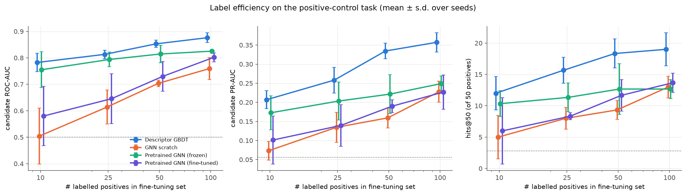

*Figure 9. Label efficiency on the positive-control task: candidate ROC-AUC, PR-AUC and hits@50 against the number of labelled positives (mean ± s.d., 3 seeds; dotted lines show chance).*

**Linear probes** (Fig. 10; `outputs/probes.csv`) on frozen embeddings show what pre-training adds.

| Probe target | Pretrained | Random-init |
|---|---|---|
| Magnetic fraction (R²) | 0.86 | 0.74 |
| Number of connected components (R²) | 0.74 | 0.68 |
| Bridge motif (AUC) | 0.88 | 0.84 |
| Provided label (AUC) | 0.506 | 0.501 |

Mean bond value is poorly linearly decodable from either encoder (R² 0.06 and 0.02). Atom count is decodable from both (0.87 and 0.86) through the max/mean pooling. So the representation encodes structure the task does not ask for, including the planted motif, but nothing about the provided label.

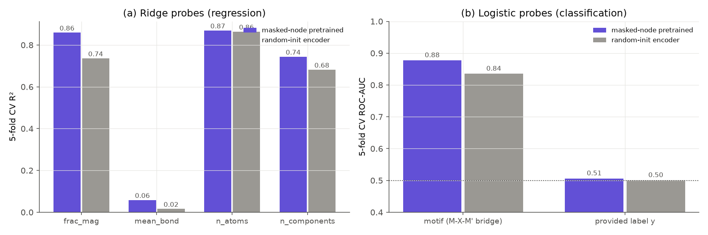

*Figure 10. Linear probes on frozen pooled embeddings of the 5000 pretrain graphs (5-fold CV): masked-node-pretrained vs. random-init encoder.*

### 5.6 Residual-connection ablation

Without residuals, training is much harder (Fig. 11a; `outputs/residual_ablation.json`). Final training losses after 40 epochs on the control were:

| Layers | Residual on | Residual off |
|---|---|---|
| 3 | 0.003 / 0.006 | 0.18 / 0.05 |
| 6 | 0.002 / 0.002 | **0.54 / 0.69** |

The 6-layer plain stack plateaus. This supports the vanishing-gradient and over-smoothing rationale of §3.1.

Generalisation differs less (Fig. 11b): candidate AUC is 0.75–0.79 at epoch 40 for all variants except the 3-layer plain network (0.62–0.71). Residuals mainly buy optimisation stability and depth, not accuracy on this shallow, sparse-graph task.

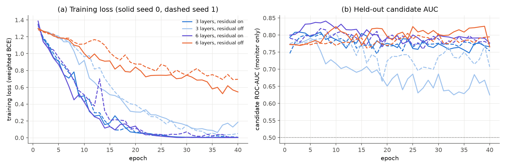

*Figure 11. Residual on/off at 3 and 6 layers on the positive control (from scratch, 2 seeds). (a) Training loss. (b) Candidate AUC, monitored only and not used for selection.*

### 5.7 Shortlist output

The engine writes ranked top-50 lists for both tasks: `outputs/top50_real_pre_ft.csv` and `outputs/top50_control_pre_ft.csv`. Each row has the candidate index, decoded formula, magnetic species, atom count, raw and Platt-calibrated probability, the GBDT rank for cross-model agreement, and the hidden label appended *for evaluation only*.
- For the real labels, the top-50 contains 5 hidden positives, the rank-1 candidate among them (index 660). Its calibrated probability is only 0.04, and the permutation test does not support it as a discovery.
- For the control, the same list contains 14 of 50 positives.

## 6. Discussion

**What the evidence supports.** Three independent lines of evidence point the same way:
1. the data-level diagnostics (Table 2), including learnability tests with 25× more positives than the fine-tuning set;
2. the train/validation divergence in Fig. 4;
3. candidate performance at chance for six methods of very different inductive bias.

Together they indicate that **the provided altermagnet labels are statistically independent of the crystal-graph features in these files**. With 2474 balanced positives, any effect large enough to support screening would have shown up as CV AUC clearly above 0.5. The upper CI bounds of about 0.50–0.51 rule out such an effect for the model classes tested. The positive control rules out the alternative that our models or pipeline are simply too weak: the identical pipeline finds 14–18 of 50 planted positives in the top 50, with p = 0.001.

**Why this is plausible physically.** Altermagnetism is a property of the *magnetic space-group or spin-space-group symmetry* of a magnetically ordered crystal (papers 000 and 001). Opposite-spin sublattices must be related by a rotation, screw or glide rather than by translation or inversion. Deciding this requires atomic coordinates, the lattice, and the magnetic propagation vector and moment arrangement. The graphs give only element identity, sparse bond values and bond types. Two crystals with identical graphs can be altermagnetic or not depending on how their sublattices are arranged. Even in real data, then, graph-only screening has a hard information ceiling, and here the labels appear to have been generated without reference to the graph at all.

**Discrepancy with the task narrative.** The task statement anticipates 50 DFT-confirmed new altermagnets classified as metal or insulator and as d-, g- or i-wave. Producing them would require:
- (i) real crystal structures;
- (ii) spin-polarised DFT (e.g. VASP or Quantum ESPRESSO with collinear AFM configurations) to obtain band structures, gaps and non-relativistic spin splitting;
- (iii) spin-space-group analysis to assign the d/g/i-wave class from the nodal structure of the splitting.

None of these steps can be carried out on coordinate-free graphs. We therefore report the classes as **not determinable** rather than inventing them.

**What a practitioner should take away.**
1. With 4–5% positives, accuracy is meaningless (0.95 for the trivial predictor). Balanced accuracy, PR-AUC against prevalence, hits@k against chance, and permutation p-values are the metrics to watch.
2. Early stopping on the fold you score inflates CV metrics. A nested split removes the optimism, and here OOF and candidate metrics agree.
3. Class-weighted training inflates probabilities. Calibrate on OOF predictions before quoting "p > 0.9".
4. Masked-node pre-training of a gated-residual CGCNN is a sound choice in the few-shot regime. The frozen-encoder probe is the safest way to use it at about 10–25 labels, because full fine-tuning with too few positives erodes the pretrained features.
5. Strong hand-crafted descriptors plus GBDT remain a hard baseline whenever the target is a simple function of local bonding.

**Limitations.**
- The positive control is a single, simple motif. Real altermagnetic criteria are more global (sublattice symmetry relations), so control performance is an upper bound for local-motif targets, not a guarantee for real altermagnets.
- Label-efficiency and residual-ablation runs use 3 and 2 seeds respectively.
- We tested one pre-training objective (masked-node reconstruction). Masked-bond, transductive (finetune and candidate structures) and contrastive variants were not run in this iteration.
- The learnability diagnostics bound only the model classes tested. They cannot exclude an arbitrarily complex label function, although such a function would not be learnable from 99 positives either.

## 7. Conclusion

We built a complete, reproducible altermagnet search engine:
- safe data loading;
- a gated-residual CGCNN with masked-node pre-training;
- a dropout-regularised pooled classifier with nested, imbalance-aware fine-tuning;
- calibrated, bootstrap- and permutation-tested screening.

We validated it with a positive control. When labels depend on structure, the engine screens effectively (AUC up to 0.88, 6× PR-AUC lift, high-confidence precision up to 0.75), and pre-training improves few-shot performance substantially. For the provided altermagnet labels, the same engine and five alternative methods perform at chance. Extensive diagnostics show the labels carry no detectable dependence on the graph features. We therefore make no claim of newly discovered altermagnets and decline to invent DFT-level electronic-structure classifications.

The engine is ready for real data. With coordinate-bearing structures and symmetry-informed labels, for example spin-space-group-derived ones, the same pipeline can be retrained unchanged and its top-k shortlist passed to DFT verification.

---

### Reproducibility

Run the scripts in this order:
1. `code/cache.py`
2. `code/audit.py`, `code/audit2.py`, `code/audit3.py`
3. `code/pretrain.py main 60`
4. `code/run_screen.py real` and `code/run_screen.py control`
5. `code/evaluate_all.py`
6. `code/label_eff.py`, `code/probes.py main,random_init`, `code/pretrain_label_diag.py`, `code/residual_ablation.py`
7. `code/topk.py`, `code/shortlist.py`
8. `code/figures.py`

Software: CPU only, PyTorch 2.x with no torch_geometric (message passing via `index_add_` and `scatter_reduce`), scikit-learn 1.9. Total wall time is about 1.5 h on 2 CPUs.

### References

- L. Šmejkal, J. Sinova, T. Jungwirth, "Beyond conventional ferromagnetism and antiferromagnetism: a phase with nonrelativistic spin and crystal rotation symmetry", *Phys. Rev. X* 12, 031042 (2022). [related_work/paper_000]
- Z. Xiao, J. Zhao, Y. Li, R. Shindou, Z.-D. Song, "Spin space groups: full classification and applications", *Phys. Rev. X* 14, 031037 (2024). [paper_001]
- M. Hu, O. Janson, C. Felser, P. McClarty, J. van den Brink, M. G. Vergniory, "Spin Hall and Edelstein effects in chiral non-collinear altermagnets", *Nat. Commun.* (2025). [paper_002]
- Y. Liu *et al.*, "Materials Expert-Artificial Intelligence for materials discovery", *Commun. Mater.* (2025). [paper_003]
- T. Xie, J. C. Grossman, "Crystal graph convolutional neural networks for an accurate and interpretable prediction of material properties", *Phys. Rev. Lett.* 120, 145301 (2018).
