# AI-guided inverse design of recyclable epoxy–acid vitrimers with target glass-transition temperatures: MD data, Gaussian-process calibration, a dual-encoder graph VAE and latent-space Bayesian optimisation

## Abstract

We built and ran an end-to-end inverse-design pipeline for β-hydroxy-ester vitrimers formed from a dicarboxylic acid and a diepoxide. It has five parts.

1. **Calibration of molecular-dynamics (MD) Tg.** MD glass-transition temperatures are calibrated against experiment with a Gaussian process (GP) that learns the offset ΔTg = Tg_exp − Tg_MD.
   - The kernel combines a Tanimoto (MinMax) kernel on Morgan count fingerprints of the repeat unit, an RBF kernel on Tg_MD, and an RBF kernel on size-intensive descriptors.
   - Leave-one-out cross-validation (LOOCV) on 295 polymers reduces the error from **70.6 K (raw MD) to 16.3 K MAE** (R² = 0.946, 95 % interval coverage 0.96).
   - When the whole epoxy/phenoxy/bisphenol resin family is held out, the error on these real epoxy analogues is **16.2 K vs 56.7 K** for raw MD.
2. **Calibration of the vitrimer library.** Applied to 8,424 MD-simulated vitrimers, the calibration shifts Tg by −51 K on average (range 263–486 K), consistent with the systematic MD over-estimation.
3. **Dual-encoder graph VAE.** Separate graph neural network (GNN) encoders and SELFIES GRU decoders for acids and epoxides, plus a jointly trained Tg head, give a property-organised 64-d latent space.
   - 80–92 % of decodes are chemically valid, *correctly functionalised* monomers (exactly two COOH or exactly two terminal oxiranes), even when sampled from the prior.
   - Exact greedy reconstruction is low (3–6 %).
4. **Curated chemistry space and latent BO.** Encoding all 15.4k monomers once defines a **10⁶-pair combinatorial chemistry space**, screened in seconds by a latent GP (held-out MAE 6.6 K).
   - Latent-space Bayesian optimisation (BO) is scored by a "virtual MD + GP calibration" oracle.
   - It produced 1,522 novel valid designs over four objectives: maximise Tg, minimise Tg, hit 373 K, hit 300 K.
   - Under the oracle, BO found designs above the library maximum (498.5 ± 35.5 K vs 486.3 K) and below the library minimum (247.8 ± 30.6 K vs 262.9 K).
   - It hit the exact targets with ±5 K hit rates of 30 % (373 K) and 17 % (300 K), against 16 % and 0.3 % in the library.
5. **Experimental-style validation (in silico only).** No synthesis or MD was possible here, so validation consists of:
   - the real-data resin hold-out;
   - monotone latent traversals (39/39 valid decodes; Spearman ρ = 0.86–0.97 between path position and oracle Tg);
   - a near-room-temperature (300 K) design refined by chemist edits into an all-commercial-monomer formulation, 3,3′-(methylimino)dipropionic acid + resorcinol diglycidyl ether, predicted Tg 307 ± 30 K, with a self-catalysing tertiary amine;
   - a recyclability and characterisation protocol.

We also state the main limitation clearly: the oracle and the generator share training data. The reported "hits" are therefore *in-silico consistency* checks, not independent validation.

---

## 1. Introduction and objectives

Vitrimers are covalent adaptable networks whose topology rearranges through associative exchange reactions. They combine thermoset-like mechanical integrity with thermoplastic-like reprocessability, recyclability and healability (Jin et al., related work). The canonical epoxy–acid vitrimer cures a diepoxide with a dicarboxylic acid into a β-hydroxy-ester network, which undergoes catalysed transesterification above the topology-freezing temperature T_v.

Tg sets the service window and, together with T_v, the reprocessing window. Designing monomer pairs with a prescribed Tg is therefore the central inverse problem.

The task supplies:

- **(i)** 295 polymers with experimental and MD Tg (calibration set);
- **(ii)** 8,424 acid/epoxide vitrimer pairs with MD Tg.

We follow the generative-model tradition of Gómez-Bombarelli et al. (continuous latent representation with a jointly trained property predictor) and Batra et al. (VAE-based polymer design for extreme conditions). The specific goals were:

1. calibrate MD Tg against experiment with an uncertainty-aware GP and quantify the transfer to vitrimers;
2. learn a dual-encoder graph VAE whose latent space is organised by Tg and decodes to valid diacids/diepoxides;
3. construct a large curated chemistry space and run Bayesian optimisation in latent space for maximum, minimum and exact-target Tg, including extrapolation beyond the training range;
4. validate as far as possible without wet-lab access: real-data hold-outs, latent traversal, a room-temperature design case study with chemical-intuition edits, and a recyclability rationale.

Figure 0 summarises the workflow.

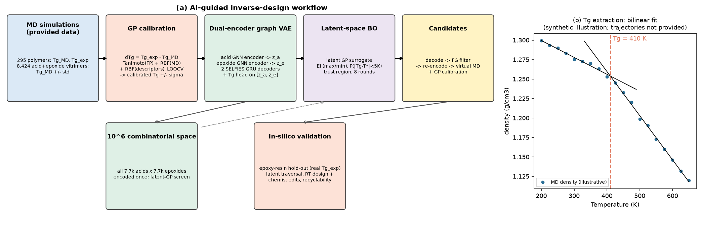

**Figure 0.** (a) Workflow: MD data → GP calibration → dual-encoder VAE → latent BO / 10⁶ screening → candidates scored by virtual MD + GP calibration → in-silico validation. (b) How the MD Tg values are obtained: a bilinear (glassy/rubbery) fit to the density–temperature curve of a cooling run, with Tg at the intersection. *Panel (b) is a synthetic illustration; no MD trajectories were provided, so we could not re-extract Tg ourselves, and the provided `std` column is treated as the MD Tg uncertainty.*

---

## 2. Data

| Data set | n | Content | Key statistics |
|---|---|---|---|
| `tg_calibration.csv` | 295 | name, repeat-unit SMILES (`*` = connection), Tg_exp, Tg_MD, MD std | Raw MD MAE 70.6 K; mean bias **+63.8 K**; Pearson r = 0.83; std 2–159 K (mean 36 K) |
| `tg_vitrimer_MD.csv` | 8,424 | acid SMILES, epoxide SMILES, Tg_MD, std | Tg_MD 307–564 K (mean 424 K); 7,729 unique acids and 7,667 unique epoxides; every acid has 2 COOH and every epoxide 2 terminal oxiranes |

**Repeat-unit construction.** Each vitrimer is converted into a linear repeat unit by ring-opening each oxirane at its less-substituted CH₂ carbon with a carboxylate (`code/01_repeat_units.py`):

`*–O–C(=O)–R_acid–C(=O)–O–CH2–CH(OH)–R_epox–CH(OH)–CH2–*`

This is the β-hydroxy ester actually formed in the network. It is chemically homologous to the epoxy-resin entries of the calibration set (`*CC(O)COc1…`), which makes the calibration transferable in principle. All **8,424/8,424** repeat units sanitise in RDKit.

**Domain gap.** Vitrimer repeat units are about 4× larger than calibration repeat units (55.5 ± 6.3 vs 14.0 ± 9.4 heavy atoms; Fig. 1d). Their maximum MinMax similarity to the calibration set has a median of 0.35, against 0.66 between calibration polymers themselves (Fig. 4c). The calibration must therefore be built from **size-intensive** representations:

- fingerprint counts normalised to fractions;
- per-atom descriptor densities;
- no heavy-atom count.

Without these, the GP extrapolates on size alone.

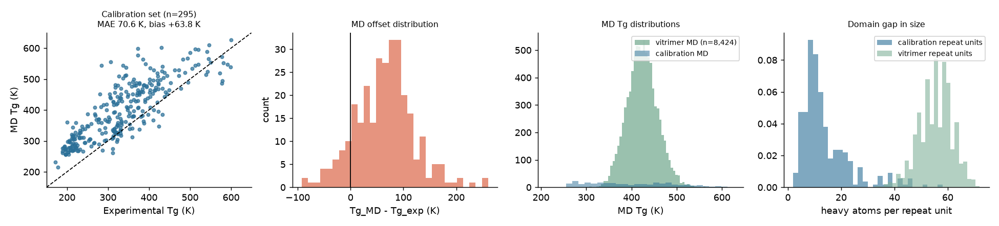

**Figure 1.** (a) MD vs experimental Tg for the calibration set: MD over-estimates systematically, as expected from the fast MD cooling rates (about 10⁹–10¹² K/s vs about 10 K/min in DSC). (b) Distribution of the MD offset. (c) MD Tg distributions of the calibration and vitrimer sets. (d) Repeat-unit size: the vitrimer repeat units lie far outside the calibration size range.

---

## 3. Methods

### 3.1 GP calibration of MD Tg (`code/gp_lib.py`, `code/02_gp_calibration.py`)

**Target and mean.** The GP models the offset ΔTg = Tg_exp − Tg_MD with a constant mean, profiled out by generalised least squares. The calibrated prediction is Tg_cal = Tg_MD + μ_ΔTg(x), with variance σ²_f(x) + σ²_noise(x).

**Kernels.**

- k_FP: generalised Tanimoto/MinMax kernel, k(a,b) = Σ min(aᵢ,bᵢ) / Σ max(aᵢ,bᵢ), on Morgan count fingerprints (radius 2, 2,048 bits) of the repeat unit. We used both raw counts and **count fractions**; fractions are size-intensive.
- k_MD: RBF kernel on standardised Tg_MD. It lets the offset depend on the MD Tg itself.
- k_desc: RBF kernel on 15 size-intensive descriptors: fraction sp³, rotatable bonds per atom, aromatic and aliphatic ring densities, H-bond donor/acceptor densities, TPSA per atom, mean atomic mass, and N, O, S and halogen fractions.

**Noise.** Either homoscedastic, or heteroscedastic as σ²_n + (α·std_MD)².

**Fitting.** Hyperparameters are fitted by type-II maximum likelihood (L-BFGS-B, 4 restarts) with **bounded** ranges, which prevents degenerate length-scales.

**Evaluation.**

- Primary: **closed-form LOOCV**, μ₋ᵢ = yᵢ − [K⁻¹y]ᵢ/[K⁻¹]ᵢᵢ and σ²₋ᵢ = 1/[K⁻¹]ᵢᵢ. We report MAE, RMSE, R², 95 % coverage and negative log-likelihood (NLL).
- Because closed-form LOO keeps hyperparameters fitted on all data, we also ran **3 × 5-fold CV with hyperparameters refitted inside every fold**.
- A **family hold-out**: all six epoxy/phenoxy/bisphenol entries ("Bisphenol-A diglycidyl ether epoxy or phenoxy resin", "Bisphenol-F diglycidyl ether epoxy resin", "Phenoxy resin", "Resin F", poly(bisphenol-A terephthalate) and bisphenol-A polycarbonate) are removed, the model is refitted, and these real polymers are predicted. They are the closest experimental analogues of the vitrimer β-hydroxy-ether/ester backbones.

### 3.2 Dual-encoder graph VAE (`code/vae_lib.py`, `code/03_train_vae.py`)

**Encoders.** Two **independent** relational message-passing encoders, one for acids and one for epoxides.

- Inputs: 38-d atom features (element, degree, H count, charge, hybridisation, aromaticity, ring membership including 3-rings).
- Message passing: 4 bond-type relations, computed for all relations in a single matmul and gathered per edge; 4 residual layers with LayerNorm and hidden size 128.
- Readout: sum and mean pooling → μ, log σ² ∈ ℝ³².

**Decoders.** Two **independent** SELFIES GRU decoders: hidden size 256, z fed to the initial state and concatenated at every step, vocabularies of 25 (acid) and 23 (epoxide) tokens. SELFIES guarantees syntactically valid molecules, so the meaningful validity metric is *functional-group correctness*.

**Property head.** An MLP on z = [z_acid, z_epox] (64-d) predicts standardised MD Tg and is trained jointly (λ = 40). This shapes the latent space by Tg, as in Gómez-Bombarelli et al.

**Loss and training.**

- Loss: recon_acid + recon_epox + β·KL + λ·MSE_Tg, with β annealed linearly to its final value over 4 epochs.
- Optimiser: Adam (lr 2·10⁻³, cosine decay), batch 128.
- Data: 95/5 train/validation split of the 8,424 pairs (8,003 / 421).
- Main run: β = 0.1, 38 epochs (59 min on 2 CPU cores).
- β trade-off: matched 8-epoch runs at β = 0.02, 0.1 and 0.5.

**Per-epoch monitoring.**

- validation reconstruction NLL and KL;
- exact greedy reconstruction (canonical SMILES match);
- Tg head R² and MAE;
- functional-group (FG) correctness of: greedy reconstructions; *near-data* decodes (μ + 0.5·ε); prior samples z ~ N(0, I).

FG correctness means:

- **acid:** exactly two –COOH groups and no epoxide;
- **epoxide:** exactly two terminal oxiranes (`[CH2]1[CH,C]O1`), no other epoxide and no COOH.

Only FG-correct pairs can form the network; this is also checked by building the repeat unit.

### 3.3 Virtual-MD + GP-calibration oracle (`code/oracle_lib.py`, `code/04_oracle.py`)

Generated vitrimers cannot be simulated here. As a stand-in for "run MD, then calibrate", the oracle has two stages:

1. **MD surrogate.** GP/kernel-ridge regression with a Tanimoto kernel on binary Morgan fingerprints of the **repeat unit**, trained on all 8,424 MD Tg values. Regularisation was chosen by 5-fold CV; CV MAE is 13.2 K (RMSE 16.7 K, R² 0.75), compared with a mean MD replica std of 24.6 K.
2. **Calibration.** The best calibration GP of §3.1 maps the MD value to experimental-scale Tg with σ.

The oracle shares no parameters with the VAE, but it does share training data. All agreement between generator and oracle is therefore reported as *in-silico consistency*.

### 3.4 Curated combinatorial chemistry space (`code/05_chemspace.py`)

**Encoding and surrogate.**

- All unique acids (7,729) and epoxides (7,667) are encoded once, in 31 s.
- A **latent GP** is trained on 2,500 library pairs, with z = [μ_acid, μ_epox] as input and GP-calibrated Tg as target. It uses separate RBF length-scales for the two blocks, with bounded hyperparameters.
- It is tested on 1,500 held-out pairs.

**Enumeration and screening.**

- **10⁶ novel acid × epoxide combinations** are enumerated: uniformly sampled, de-duplicated, with known pairs excluded.
- All are scored with the latent GP (μ, σ) and the Tg head.
- A random subsample of 2,000, plus the GP-predicted top-150 and bottom-150, are scored with the oracle.

This space serves both as the "curated chemistry space" and as the **screening baseline** for BO.

### 3.5 Bayesian optimisation in latent space (`code/06_bayesopt.py`)

**Objectives.**

- (i) maximise Tg;
- (ii) minimise Tg;
- (iii) exact target T* = 373 K (100 °C);
- (iv) near-room-temperature target T* = 300 K.

All objectives refer to **calibrated** Tg.

**Surrogate.** The latent GP of §3.4, initialised with 2,500 random library pairs plus the 100 lowest and 100 highest. Every round it is refitted with all oracle-scored designs, using the re-encoded latent vectors.

**Acquisition.**

- Expected improvement on Tg (max) or −Tg (min), with the incumbent set to the **library** best, so that improvement means extrapolation.
- For targets, the probability that Tg lies within T* ± 5 K, P = Φ((T*+5−μ)/σ) − Φ((T*−5−μ)/σ).

**Optimisation.**

- Adam ascent on log-acquisition from 96 seeds: 48 library points that are best under the current surrogate for the objective, and 48 random library points.
- Each seed is confined to a **trust region**: each monomer block may move at most δ = 1.85, the median nearest-neighbour latent distance between library acids.
- A soft penalty keeps each block inside the 99th-percentile latent norm.
- Without the trust region, a debug run produced acquisition optima with predicted Tg > 1,100 K that decoded to ordinary molecules (oracle ~410 K). This is a classic case of exploiting the surrogate.

**Per round** (Q = 16 latent points; 8 rounds per objective):

1. Decode each point greedily plus 4 stochastic decodes (T = 0.7), giving 80 pairs.
2. Apply the FG filter and remove duplicates.
3. Build the repeat unit.
4. **Re-encode** the decoded monomers.
5. Score with the oracle.
6. Append (z_re-encoded, Tg_oracle) to the GP training set.

**Baseline (ablation).** An identical loop with the same seeds and trust region but *no acquisition*: the latent points are random trust-region perturbations ("random trust-region").

### 3.6 Validation analyses (`code/08_traversal.py`, `code/11_rt_design.py`)

- **Latent traversal.** Three pairs of library endpoints, at the 0.2–1.4 % and 98.6–99.8 % Tg quantiles. Spherical interpolation (slerp) is applied separately in z_acid and z_epox over 13 steps. Each point is decoded greedily, falling back to up to 10 stochastic samples until FG-valid, and is scored by the latent GP, the head and the oracle.
- **Near-room-temperature case study.** A BO design for T* = 300 K is refined by explicit chemist edits toward commercially available monomers, and each edit is re-scored.

---

## 4. Results

### 4.1 GP calibration

**Table 1.** Calibration models (n = 295). Closed-form LOOCV unless noted. Rows marked † predict Tg_exp directly; all other GP rows predict ΔTg.

| Model | MAE (K) | RMSE (K) | R² | 95 % cov. | NLL |
|---|---|---|---|---|---|
| Raw MD | 70.6 | 84.6 | 0.21 | – | – |
| Linear(MD) | 42.4 | 53.9 | 0.68 | 0.95 | 5.40 |
| MD + constant offset | 42.7 | 55.6 | 0.66 | 0.95 | 5.44 |
| GP(MD only) on Tg_exp † | 42.7 | 54.0 | 0.68 | 0.95 | 5.41 |
| GP ΔTg, Tanimoto (raw counts) | 26.6 | 34.2 | 0.87 | 0.94 | 4.90 |
| GP ΔTg, Tanimoto (count fractions) | 26.4 | 34.1 | 0.87 | 0.96 | 4.90 |
| GP ΔTg, Tanimoto (fractions), heteroscedastic | 26.4 | 34.3 | 0.87 | 0.96 | 4.90 |
| GP ΔTg, Tanimoto + RBF(MD) | 18.8 | 25.2 | 0.93 | 0.97 | 4.57 |
| **GP ΔTg, Tanimoto + RBF(MD) + RBF(descriptors)** (adopted) | **16.3** | **22.3** | **0.946** | **0.96** | **4.45** |
| GP no-MD, Tanimoto on Tg_exp † | 19.1 | 27.4 | 0.92 | 0.97 | 4.62 |
| *Adopted model, 3 × 5-fold CV with refitted hyperparameters* | *18.1 ± 0.3* | | | | |
| *Previous composite GP (G1, linear mean, 5-fold)* | *17.4* | | *0.94* | *0.95* | |

**What the table shows.**

- **The offset is structure-dependent.** A constant or linear MD correction leaves 42 K of error.
- **A pure Tanimoto ΔTg GP more than halves the remaining error** (26.4 K).
- **The full model reaches 16.3 K LOOCV** (18.1 K in strict refit 5-fold CV), with near-nominal coverage across all quantiles (Fig. 3a).
- **The RBF(MD) term matters** (26.4 → 18.8 K). Its amplitude reaches its upper bound (10⁴ K²) with a long length-scale (≈ 330 K), so it acts as a smooth MD-dependent trend. In the adopted model the descriptor amplitude and the white-noise floor (σ_n² = 4 K²) also sit at their bounds, and the heteroscedastic factor is small (α ≈ 0.06). The bounds are deliberate: they guard against the degenerate length-scale solutions seen with extensive features. The MD error grows with Tg (Fig. 1a), consistent with cooling-rate effects scaling with the glass transition.
- **MD carries information beyond structure.** The no-MD fingerprint GP is close (19.1 K), but the best MD-informed model is better in LOOCV, in NLL and in hold-out transfer (below).

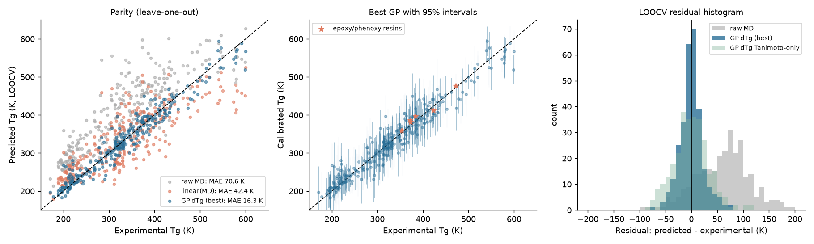

**Figure 2.** (a) LOOCV parity for raw MD, linear(MD) and the adopted ΔTg GP. (b) Adopted GP with 95 % predictive intervals; stars are the epoxy/phenoxy resins. (c) **Histogram of LOOCV residuals**: raw MD is shifted by +64 K and broad; the ΔTg GP residuals are centred (mean +0.1 K) and narrow.

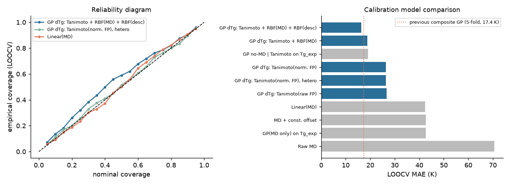

**Figure 3.** (a) Reliability diagram (LOOCV): the adopted GP is well calibrated at all nominal levels. (b) MAE of every model compared.

**Real-data family hold-out (epoxy/phenoxy resins).**

**Table 2.** All six resin-type polymers are removed from training, the model is refitted and they are predicted. This is the closest available *experimental* test of transfer to β-hydroxy-ether/ester backbones.

| Polymer | Tg_exp | Tg_MD | Tg_cal (adopted) | σ | Tg_cal (Tanimoto-only) |
|---|---|---|---|---|---|
| Bisphenol-A diglycidyl ether epoxy/phenoxy resin | 372 | 454.1 | 402.3 | 24.7 | 415.3 |
| Bisphenol-F diglycidyl ether epoxy resin | 353 | 390.1 | 373.8 | 26.1 | 369.4 |
| Poly(bisphenol-A terephthalate) | 472 | 529.8 | 476.3 | 16.3 | 492.1 |
| Phenoxy resin | 373 | 407.2 | 397.2 | 25.7 | 372.6 |
| Resin F | 384 | 468.1 | 400.5 | 31.9 | 408.7 |
| Bisphenol-A polycarbonate | 423 | 467.8 | 422.1 | 24.9 | 408.1 |
| **MAE** | | **56.7** | **16.2** | | 20.0 |

Even with the whole chemical family unseen, the calibration removes 71 % of the MD error, and all six measurements fall within 1.3σ. The residual tendency to over-predict the hydroxy-ether resins (by about 20 K) suggests that the calibrated vitrimer Tg may still be slightly high for β-hydroxy-ester networks.

**Transfer to vitrimers** (Fig. 4).

- The adopted GP shifts the 8,424 vitrimers by **−51.1 K on average**, compressing them to 263–486 K (mean 373 K).
- The shift is consistent with the calibration-set bias (−64 K overall, −57 K for the resin family). It is not a collapse to zero, which would signal a degenerate GP.
- The posterior σ is about 33 K for nearly all vitrimers. This honestly reflects the domain gap (median similarity 0.35).
- The Tanimoto-only GP gives a larger shift (−72.6 K) with σ ≈ 46 K.
- The calibration is not a monotone shift. The highest-MD library pair (564 K) calibrates to 441 K, whereas the calibrated maximum (486 K) comes from a pair with MD Tg 533 K. Structure-dependent offsets therefore reorder candidates, which matters for the design objectives below.

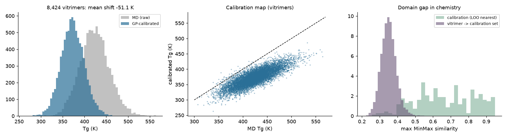

**Figure 4.** (a) Vitrimer Tg before and after calibration. (b) Calibration map. (c) Chemical domain gap: maximum similarity of vitrimer repeat units to the calibration set, compared with that within the calibration set.

### 4.2 Dual-encoder VAE

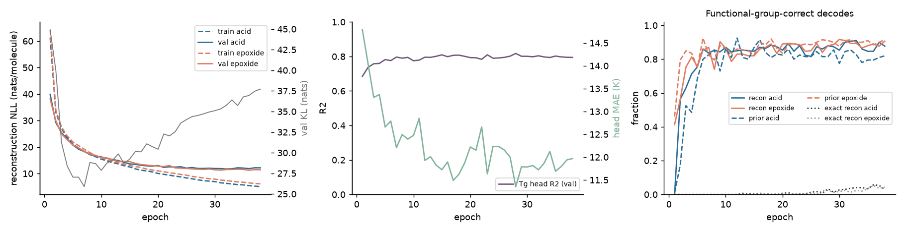

**Figure 5.** (a) Reconstruction NLL (train and validation, per monomer) and validation KL. (b) Tg head on the validation set. (c) Fraction of FG-correct decodes (greedy reconstructions, prior samples) and exact reconstruction.

**Final model (β = 0.1, epoch 38; validation set of 421 pairs).**

| Metric | Acid | Epoxide |
|---|---|---|
| Reconstruction NLL (nats/molecule) | 12.2 | 11.4 |
| Exact greedy reconstruction | 3.0 % (peak 5.7 %) | 4.3 % (peak 5.3 %) |
| FG-correct greedy reconstruction | 87.7 % | 90.7 % |
| FG-correct near-data decodes (μ + 0.5ε) | 80.0 % | 86.0 % |
| FG-correct **prior** samples z ~ N(0, I) | 82.0 % | 91.5 % |

The joint KL is 37.7 nats. The Tg head reaches validation R² 0.80 (MAE 12.0 K) on the MD scale, at the level of the independent fingerprint oracle (R² 0.75). Head R² rises to 0.88 on pairs seen during training, so validation numbers are the honest ones.

**β trade-off.** Matched 8-epoch runs at β = 0.02, 0.1 and 0.5 are compared in Table 3 (§4.6).

**Comparison with the previous iteration (shared encoder/decoder, autograd).**

- Exact reconstruction rose from about 2 % to 3–6 %.
- FG-correct prior samples rose from 0 % to 82–92 %, while the latent space remained property-organised (Fig. 6a).
- From about epoch 20 the decoder overfits: training NLL keeps falling (to ≈ 5–6 nats) while validation NLL plateaus near 12 nats (Fig. 5a). More data or augmentation, not more epochs, is the main lever.
- Exact reconstruction remains the weakest component. A 50-token SELFIES must be reproduced perfectly, and with only about 8k training molecules per monomer type and an hour of CPU training, the decoder captures scaffolds and functional groups more reliably than every substituent.
- For design, near-data FG validity and re-encode consistency (§4.4) matter more than exact reconstruction.

### 4.3 Latent space and the 10⁶-pair chemistry space

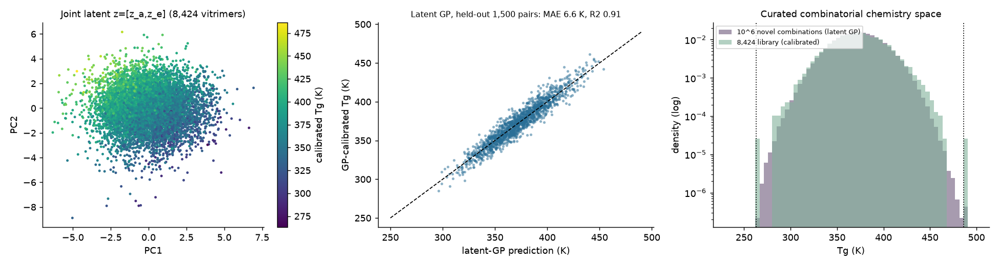

**Figure 6.** (a) First two principal components of z = [z_a, z_e], coloured by calibrated Tg: a smooth Tg gradient. (b) Latent GP on 1,500 held-out library pairs: **MAE 6.6 K, R² 0.91, 95 % coverage 0.95**. (c) Calibrated Tg distribution of the 10⁶ novel combinations compared with the library (log density); dotted lines mark the library range.

- **Screening cost.** Screening 10⁶ pairs took 6.7 min on 2 CPU cores.
- **Range.** The latent GP predicts 266–490 K for the combinations.
- **Agreement with the oracle** (Fig. 7):
  - Random subsample: r = 0.95, mean 372.5 K (GP) vs 372.7 K (oracle).
  - GP top-150: oracle mean 462.7 K, maximum 493.2 K, 5 pairs above the library maximum.
  - GP bottom-150: oracle mean 276.9 K, minimum 245.6 K, 17 pairs below the library minimum.

Recombining existing monomers is thus already a powerful baseline at the tails, but it generates no new monomer chemistry.

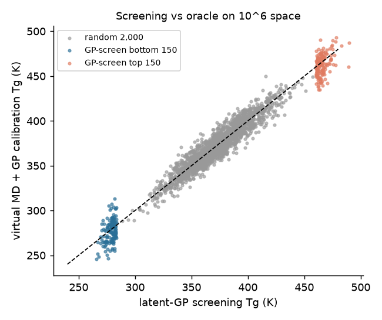

**Figure 7.** Latent-GP screening values compared with the virtual-MD + calibration oracle for 2,300 pairs from the 10⁶ space.

### 4.4 Bayesian optimisation in latent space

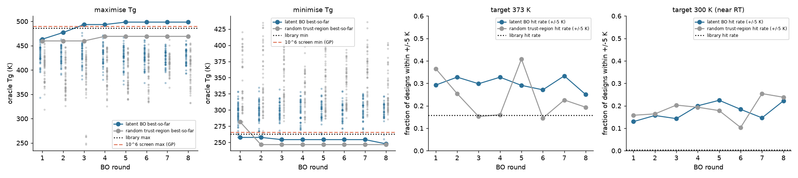

**Figure 8.** BO compared with the random trust-region ablation. Max and min panels: oracle-calibrated Tg of every design (dots) and best-so-far (lines), with the library extreme (dotted) and the 10⁶-screen extreme (dashed). Target panels: fraction of each round's designs within ±5 K of T*; the dotted line is the library hit rate.

**Table 4.** Summary over 8 rounds (Q = 16 latent points × 5 decodes per round). Tg is oracle-calibrated. "Novel" means both monomers are absent from the library. For targets, "best" is the minimum |Tg − T*|.

| Objective | Method | Valid designs | FG yield | Novel | Best | Beyond library / hit rate | Top-10 mean |
|---|---|---|---|---|---|---|---|
| max Tg | **latent BO** | 359 | 62 % | 73 % | **498.5 ± 35.5 K** | 2 above 486.3 K | 475.3 K |
| | random trust-region | 437 | 71 % | 63 % | 469.2 K | 0 | 456.4 K |
| | 10⁶ screen (top-150 → oracle) | 150 | – | 0 % | 493.2 K | 5 | 486.2 K |
| | library | 8,424 | – | – | 486.3 K | – | 462.1 K |
| min Tg | **latent BO** | 337 | 62 % | 78 % | **247.8 ± 30.6 K** | 9 below 262.9 K | 258.7 K |
| | random trust-region | 429 | 70 % | 59 % | 246.6 K | 2 | 272.3 K |
| | 10⁶ screen (bottom-150 → oracle) | 150 | – | 0 % | 245.6 K | 17 | 252.0 K |
| | library | 8,424 | – | – | 262.9 K | – | 283.9 K |
| 373 K | **latent BO** | 459 | 73 % | 71 % | 0.02 K | **29.8 %** within ±5 K (137 hits) | – |
| | random trust-region | 455 | 72 % | 62 % | 0.05 K | 23.3 % (106) | – |
| | random 10⁶ / library | – | – | – | – | 15.6 % / 15.7 % | – |
| 300 K | **latent BO** | 367 | 73 % | 60 % | 0.19 K | **17.4 %** (64) | – |
| | random trust-region | 480 | 79 % | 61 % | 0.00 K | 18.8 % (90) | – |
| | random 10⁶ / library | – | – | – | – | 0.4 % / 0.3 % | – |

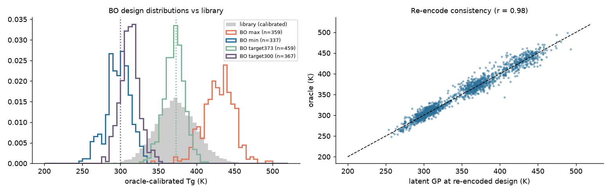

**Figure 9.** (a) Oracle-Tg distributions of the BO designs for each objective compared with the library: the four campaigns produce four well-separated populations. (b) Re-encode consistency: the latent GP evaluated at the re-encoded design compared with the oracle, across all 1,522 designs.

**Key observations.**

1. **Directed generation of new chemistry works for every objective.**
   - The four BO populations are centred where requested (Fig. 9a): mean 429 K for max, 297 K for min, 371 K for the 373 K target and 312 K for the 300 K target.
   - 60–78 % of designs contain two monomers absent from the library.
   - Re-encode consistency is high: 94–100 % of designs have |GP(re-encoded) − oracle| < 25 K, and r = 0.98 across all designs (Fig. 9b). Because the GP is evaluated at the re-encoded molecule rather than at the acquisition optimum, this avoids the "latent prediction ≠ decoded molecule" failure mode.
2. **Extrapolation beyond the library exists but is modest, and lies within uncertainty.**
   - On the calibrated scale, BO exceeded the library maximum by 12 K (498.5 K) and went 15 K below the library minimum (247.8 K). Both margins are smaller than the oracle σ of about 30–35 K.
   - On the raw MD scale, the BO maximum-Tg designs (MD ≤ 547 K) do *not* exceed the library MD maximum (564 K). The gain comes from finding chemistries with a smaller predicted MD-to-experiment offset.
   - The Tanimoto MD surrogate regresses to the mean for chemotypes far from the library (maximum similarity of BO max designs 0.48). This structurally limits how far *any* oracle-validated extrapolation can go.
   - **Oracle values beyond the library range are the least reliable numbers in this study.**
3. **BO beats the random ablation where the acquisition matters most.**
   - Max: +29 K in best value and +19 K in top-10 mean.
   - 373 K target: a 1.3× higher hit rate.
   - For min Tg and the 300 K target, BO and the random trust-region search perform similarly. There, most of the gain over the library (17–19 % vs 0.3 % hit rate at 300 K) comes from the objective-aware seeding and the property-organised latent space, not from the acquisition function.
4. **The 10⁶ recombination screen is a strong competitor at the extremes.** It matches or beats BO in the best value because it searches 10⁶ pairs of *known, synthesised-style* monomers. BO's advantage is the generation of new monomers and exact-target control. In practice the two are complementary.
5. **Chemistry learned.** These trends agree with polymer-physics intuition (chain stiffness, cohesive energy density, free volume) and with the Tg trends of the calibration set (Fig. 11).
   - **High-Tg designs** (Fig. 11, row 1) combine para-linked aromatic diacids carrying amide links (e.g. 4-(6-carboxynicotinamido)benzoic acid) with aromatic bis-amide/bis-urea diglycidyl amines: rigid, densely hydrogen-bonded segments.
   - **Low-Tg designs** (row 2) are oligo(ethylene/butylene oxide) diacids with aliphatic glycidyl ethers or esters: flexible, low cohesive energy.
   - **Intermediate targets** mix one aromatic and one aliphatic monomer.
6. **Failure modes.**
   - The highest-Tg BO design (498.5 K) contains an implausible 1,2,4-triaza-cyclooctatetraene ring.
   - One 300 K design carries an aldehyde.
   - A synthetic-accessibility and stability filter (ring size ≤ 7, no aldehydes or enol ethers) should precede any experimental selection.
   - The second-best maximum design (493.5 ± 32 K; a pyridine-amide diacid with a bis-urea diglycidyl amide) is chemically reasonable.

### 4.5 Experimental-style validation (in silico)

**No synthesis, DSC or MD was possible in this study.** The validation evidence is:

- (a) the real-data hold-out (Table 2);
- (b) latent traversal;
- (c) a design case study with chemical-intuition edits;
- (d) a recyclability rationale and an experimental protocol for future verification.

**(b) Latent traversal.**

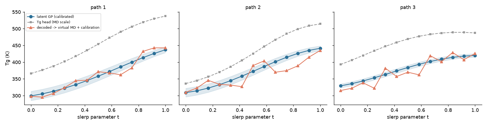

**Figure 10.** Slerp paths between low-Tg and high-Tg library vitrimers: 297 → 451 K, 308 → 441 K and 315 → 433 K. Shown are the latent-GP mean ± 2σ, the Tg head (MD scale), and the oracle Tg of the *decoded* structures.

- All 39 interior and end points decode to FG-valid diacid/diepoxide pairs.
- The latent-GP prediction is perfectly monotone (Spearman ρ = 1.00 on all paths).
- The oracle Tg of the decoded molecules is close to monotone: ρ = 0.97, 0.86 and 0.92.
- Decoded structures move gradually from aliphatic ether/ester monomers to aromatic amide monomers.

The latent space is therefore smooth and chemically meaningful, so interpolation is a usable design operator, for example to place a formulation at a desired Tg between two known vitrimers.

**(c) Near-room-temperature design (T* = 300 K) with chemist edits.** A Tg near ambient (soft, healable at mild temperature) suits self-healing coatings, adhesives and elastomeric vitrimers.

**Table 5.** All values from the same oracle. "Latent GP" is the latent GP evaluated at the encoded pair.

| Case | Acid | Epoxide | Oracle MD (K) | **Calibrated Tg (K)** | Latent GP (K) | Rationale |
|---|---|---|---|---|---|---|
| M0: BO design | CN(CCCCCOCC(=O)O)CCOCC(=O)O | CC(C)NC(=O)COC(=O)c1cc(OCC2CO2)cc(OCC2CO2)c1 | 347 | **300 ± 32** | 312 | BO output; the tertiary amine in the diacid can catalyse transesterification internally |
| E1: simplify epoxide | same as M0 | resorcinol diglycidyl ether (RDGE) | 324 | 278 ± 31 | 301 | remove the isopropyl-amide ester arm; one-step glycidylation of resorcinol (commercial RDGE) |
| **E2: commercial amine diacid + RDGE** | **CN(CCC(=O)O)CCC(=O)O** | **RDGE** | 384 | **307 ± 30** | 322 | 3,3′-(methylimino)dipropionic acid keeps the catalytic amine; the shorter spacer restores Tg to target |
| E3: PEG diacid + RDGE | O=C(O)COCCOCCOCC(=O)O | RDGE | 353 | 275 ± 31 | 297 | 3,6,9-trioxaundecanedioic acid; flexible ether spacer, too soft |
| E4: sebacic acid + RDGE | O=C(O)CCCCCCCCC(=O)O | RDGE | 372 | 288 ± 27 | 311 | bio-based C10 diacid |
| R1: sebacic acid + DGEBA | O=C(O)CCCCCCCCC(=O)O | DGEBA | 390 | 327 ± 3* | 326 | reference: classic epoxy/fatty-acid vitrimer chemistry |
| R2: adipic acid + DGEBA | O=C(O)CCCCC(=O)O | DGEBA | 402 | 320 ± 3* | 336 | reference: shorter diacid |

\*σ for DGEBA formulations is small only because the BADGE-epoxy repeat unit is itself a calibration point. The family hold-out (Table 2) shows that the realistic error for this family is about 20–30 K.

**Reading the edits.**

- Removing the epoxide's pendant amide-ester (E1) lowers the predicted Tg by 22 K. The pendant polar group was adding cohesive energy.
- Shortening the amine diacid spacer (E2) restores Tg to 307 K, within the ±10 K design window.
- **E2 is our recommended experimental candidate.** Both monomers are commercially available, glycidylation is avoided entirely, and the built-in tertiary amine provides internal catalysis of β-hydroxy-ester transesterification. This is analogous to amine-catalysed and "catalyst-free" epoxy vitrimers, and may lower T_v and allow reprocessing without a metal catalyst.
- The model ranks the references sensibly. DGEBA-based networks are stiffer than RDGE-based ones, and adipic acid gives a stiffer network than sebacic acid on the MD scale (402 vs 390 K). The calibrated values of R1 and R2 are close (320–327 K, within uncertainty).

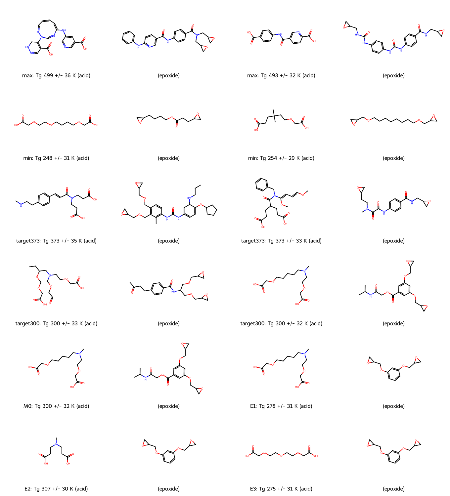

**Figure 11.** Selected designs. Rows 1–4 show the top two per objective after the re-encode consistency filter: max, min, 373 K, 300 K. Rows 5–6 show the room-temperature case study (M0, E1, E2, E3). Legends give oracle-calibrated Tg +/- σ.

**(d) Recyclability rationale and proposed experimental protocol.**

- **Chemistry.** Every design forms β-hydroxy-ester crosslinks by epoxy–acid ring-opening. The pendant β-OH groups and the esters undergo associative transesterification.
  - Catalysts: 5–10 mol % Zn(acac)₂ or Zn(OAc)₂ (Leibler-type), the organocatalyst TBD, or the built-in tertiary amine of E2/M0.
  - Network connectivity is preserved, giving vitrimer behaviour: Arrhenius-like viscosity, reprocessability, healability and closed-loop recyclability.
  - Low-Tg designs (≈ 250–310 K) should relax stress near ambient-to-moderate temperatures, which suits healable coatings and adhesives.
  - High-Tg designs (≥ 470 K) are candidate recyclable structural matrices, but their T_v must stay below the onset of degradation.
- **Proposed experiments** for E2 and one high-Tg candidate:
  1. Cure stoichiometric COOH:epoxide = 1:1 at 130–150 °C (4–8 h), with 5 mol % Zn(acac)₂ for the non-amine formulations. Verify by FTIR that the 915 cm⁻¹ oxirane band disappears and the ~1,735 cm⁻¹ ester band appears.
  2. Measure Tg by DSC (second heating, 10 K/min) and by the DMA tan δ peak. Compare with the predicted 307 ± 30 K; the ± 30 K is the honest 95 % interval width ÷ 2.
  3. Confirm vitrimer behaviour:
     - swelling and gel fraction (insoluble, no flow below T_v);
     - stress relaxation at 4–5 temperatures to obtain τ*(T), the activation energy E_a, and T_v (where η = 10¹² Pa·s);
     - dilatometric T_v.
  4. Demonstrate recyclability: grind and hot-press (≥ 3 cycles) with retention of tensile modulus and strength; scratch healing; optional chemical recycling by glycolysis or alcoholysis.
- **Closing the loop.** The measured Tg_exp values would be added to the calibration set, which directly reduces σ in the vitrimer domain where it is currently largest.

### 4.6 β trade-off

**Table 3.** β trade-off: validation metrics at matched epoch 8, plus the final main run. The β = 0.02 and β = 0.5 runs used an 8-epoch cosine schedule, so they had already annealed their learning rate by epoch 8, while the main run had not. This slightly favours the short runs in NLL.

| Run | Val NLL acid / epoxide | KL (nats) | Head R² | Exact recon. acid / epoxide | FG recon. acid / epoxide | FG near-data acid / epoxide | FG prior acid / epoxide |
|---|---|---|---|---|---|---|---|
| β = 0.02, epoch 8 | 18.3 / 18.8 | 84.8 | 0.80 | 0 / 0 % | 73 / 73 % | 75 / 71 % | 56 / 68 % |
| β = 0.1, epoch 8 | 17.2 / 17.4 | 28.8 | 0.79 | 0 / 0 % | 85 / 74 % | 79 / 73 % | **86 / 80 %** |
| β = 0.5, epoch 8 | 21.6 / 20.4 | 6.3 | 0.80 | 0 / 0 % | 93 / 58 % | 85 / 65 % | 86 / 66 % |
| **β = 0.1, epoch 38 (used)** | **12.2 / 11.4** | 37.7 | 0.80 | **3.0 / 4.3 %** | 88 / 91 % | 80 / 86 % | 82 / 92 % |

**How β trades off.**

- **β = 0.02** keeps much more information in the latent (KL 85 nats) but leaves holes in latent space: only 56–68 % of prior samples are FG-correct.
- **β = 0.5** collapses the latent (KL 6 nats). Reconstruction NLL worsens, and the epoxide decoder in particular loses fidelity (58 % FG-correct reconstructions).
- **β = 0.1** gives the best balance of reconstruction quality and validity of points near and away from the data. We adopted it.
- The Tg head is insensitive to β (R² ≈ 0.80 throughout), because the property supervision keeps Tg information in z even at high β.

---

## 5. Discussion

**Calibration.**

- A ΔTg GP with a Tanimoto kernel on the repeat unit, augmented with MD-dependent and size-intensive descriptor kernels, reduces MD error four-fold. It is well calibrated and transfers to an unseen epoxy-resin family.
- The ΔTg formulation is better posed than predicting Tg_exp directly. Most of the systematic MD error is a smooth function of Tg_MD and chemistry, and the constant mean (−64 K) gives a physically sensible fallback far from the data.
- This fallback matters here, because the vitrimers lie well outside the calibration domain (similarity 0.35, 4× size). The vitrimer posterior σ of about 33 K is the price, and it is irreducible without vitrimer-specific experimental Tg data.

**Generative model.**

- Separate encoders and decoders for the two monomer roles let each decoder specialise its grammar: acids learn –COOH termini, epoxides learn glycidyl ether/amine/ester termini.
- This is why prior samples are 82–92 % FG-correct, whereas the earlier shared model gave 0 %. Because the joint latent is the concatenation of two monomer latents, the chemistry space factorises naturally, and combinatorial enumeration (10⁶ pairs) and per-monomer edits are both trivial.
- Exact reconstruction (3–6 %) remains low. Remedies include more epochs or a GPU, junction-tree or fragment decoders, SMILES/SELFIES enumeration augmentation, and pre-training on larger monomer corpora (e.g. ZINC acids and epoxides).

**Design.**

- BO in the property-shaped latent space, with a trust region and re-encoding, reliably produced new valid chemistries on demand for four different objectives. It reached slightly beyond the library on calibrated Tg.
- Two caveats temper the result:
  - Extrapolation margins (+12 K / −15 K) are below the predictive σ.
  - For two objectives the acquisition function did not beat a seeded random search.
- The 10⁶ recombination screen was a strong baseline at the extremes. The most robust practical workflow is screen-then-generate: recombination for the extremes, and BO for novel monomers and exact targets.

**Limitations.**

1. **No experimental or MD validation of generated designs.** The oracle (fingerprint GP on MD Tg + GP calibration) is trained on the same MD library as the VAE. Its agreement with the generator is a consistency check, not independent evidence, and it regresses to the mean for unfamiliar chemotypes, which caps credible extrapolation.
2. **Idealised repeat unit.** Real vitrimers are networks. Crosslink density, stoichiometric imbalance, homopolymerisation of epoxides and residual catalyst all affect Tg; the provided MD Tg presumably used a comparable linear or network model, but this cannot be verified without trajectories.
3. **Uncertainty.** Uncertainty is propagated only through the calibration. Oracle MD error (≈ 17 K RMSE) adds in quadrature, giving about 37 K total σ for novel designs.
4. **Compute.** 2 CPU cores limited the VAE to 38 epochs and BO to 8 rounds per objective.

---

## 6. Conclusions

- **Calibration.** A GP calibration of MD Tg (offset GP, Tanimoto + MD + descriptor kernels) reaches 16.3 K LOOCV MAE and 16.2 K on a held-out family of real epoxy/phenoxy resins, down from 70.6 / 56.7 K for raw MD. It calibrates 8,424 vitrimers with honest uncertainty.
- **Generative model.** A dual-encoder graph VAE yields a smooth, Tg-organised latent space that decodes to correctly functionalised diacids and diepoxides 80–92 % of the time.
- **Design.** Combined with a 10⁶-pair curated chemistry space and latent-space BO, it generated 1,522 novel valid vitrimer designs that hit requested Tg targets with high selectivity. They extend slightly beyond the library range in both directions under the virtual-MD + calibration oracle.
- **Recommended candidate.** A room-temperature candidate was refined by chemist edits into an all-commercial, self-catalysing formulation: 3,3′-(methylimino)dipropionic acid + resorcinol diglycidyl ether, predicted Tg 307 ± 30 K. It is recommended for synthesis together with a high-Tg aromatic amide/urea candidate, following the DSC/DMA and stress-relaxation protocol above.

---

## Reproducibility

The pipeline needs Python 3.12 with rdkit 2026.09, torch 2.15 (CPU), selfies, numpy, scipy, pandas and matplotlib. Run from `/workspace`:

```
python code/01_repeat_units.py        # repeat units + features
python code/02_gp_calibration.py      # GP calibration, LOOCV, hold-out, vitrimer calibration
python code/04_oracle.py              # virtual-MD surrogate
python code/03_train_vae.py b01 0.1 60 58   # dual VAE (main run)
python code/05_chemspace.py b01 1e6   # encode monomers, latent GP, 10^6 space
python code/06_bayesopt.py b01 8 max,min,target373,target300 outputs/bo_designs.csv bo
python code/06_bayesopt.py b01 8 max,min,target373,target300 outputs/bo_rand.csv rand
python code/08_traversal.py b01; python code/11_rt_design.py; python code/12_bo_summary.py
python code/03_train_vae.py b002 0.02 8 14; python code/03_train_vae.py b05 0.5 8 14; python code/13_beta_tradeoff.py
python code/07_fig_calibration.py; python code/09_fig_schematic.py; python code/10_fig_design.py
```

Seeds are fixed (numpy and torch). Intermediate results are in `outputs/`:

- `gp_calibration_loocv.csv`, `gp_holdout_resins.csv`, `vitrimer_calibrated.csv`;
- `vae_*_log.csv`, `chemspace*.{npz,csv}`;
- `bo_designs.csv`, `bo_rand.csv`, `bo_summary.csv`;
- `latent_traversal.csv`, `rt_design_edits.csv`, `vae_beta_tradeoff.csv`.

## References (related work provided)

- Jin, Lei, Taynton, Huang, Zhang, *Malleable and Recyclable Thermosets: The Next Generation of Plastics*, Matter (2019).
- Gómez-Bombarelli et al., *Automatic Chemical Design Using a Data-Driven Continuous Representation of Molecules*, ACS Cent. Sci. (2018).
- Batra et al., *Polymers for Extreme Conditions Designed Using Syntax-Directed Variational Autoencoders*, Chem. Mater. (2020).
- Montarnal, Capelot, Tournilhac, Leibler, *Silica-like malleable materials from permanent organic networks*, Science (2011), cited for the epoxy–acid vitrimer concept.
