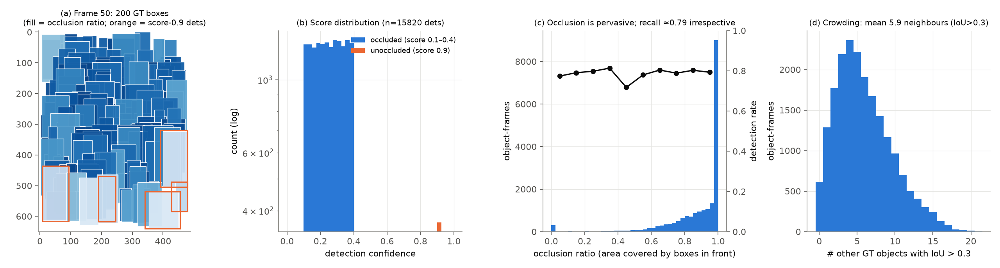
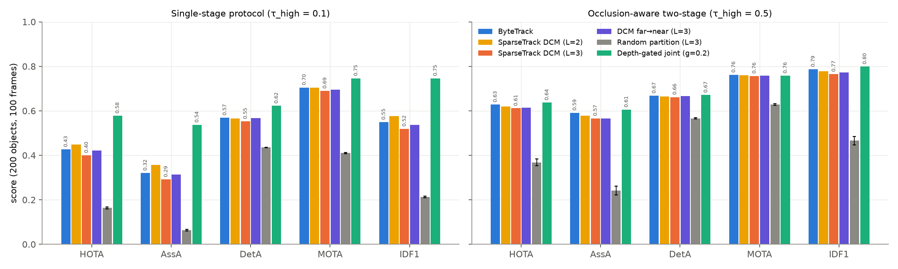
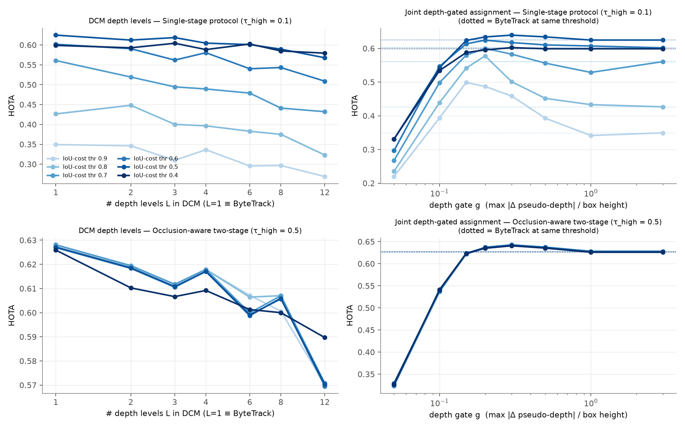
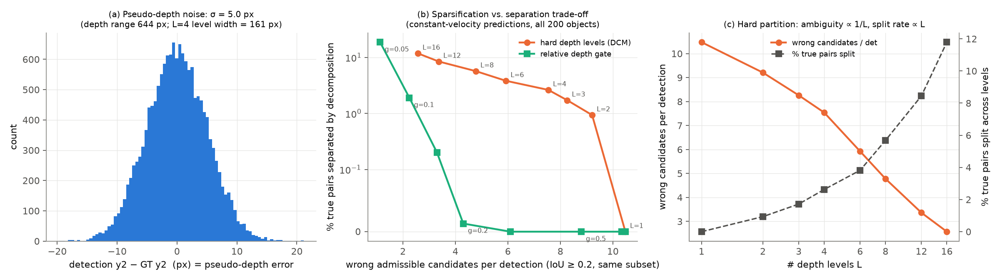
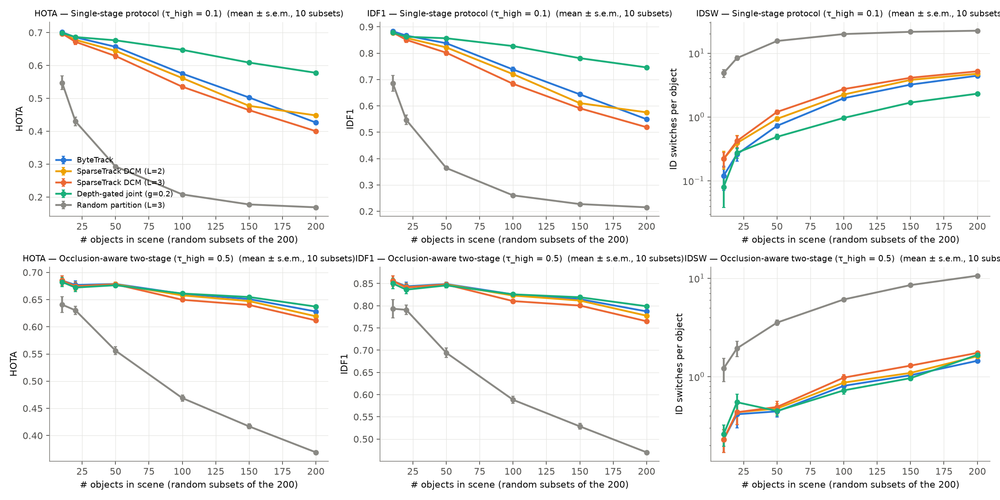
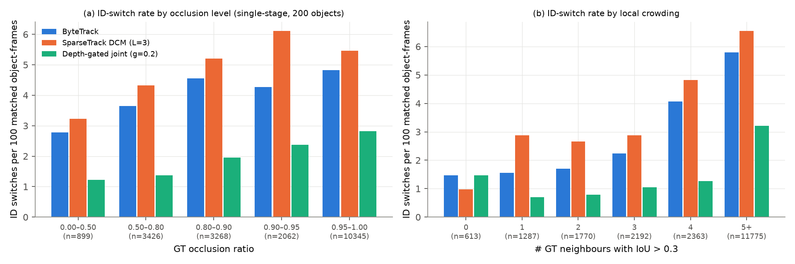
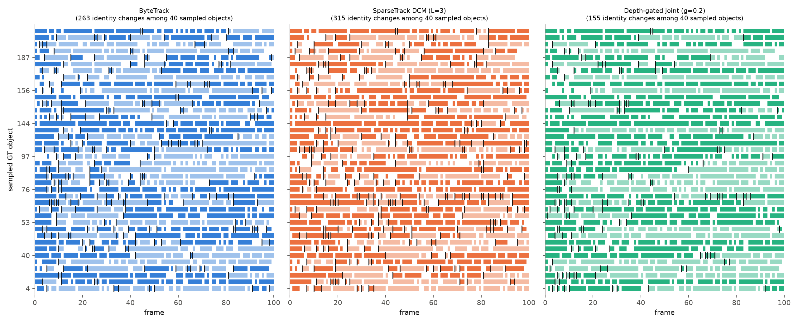
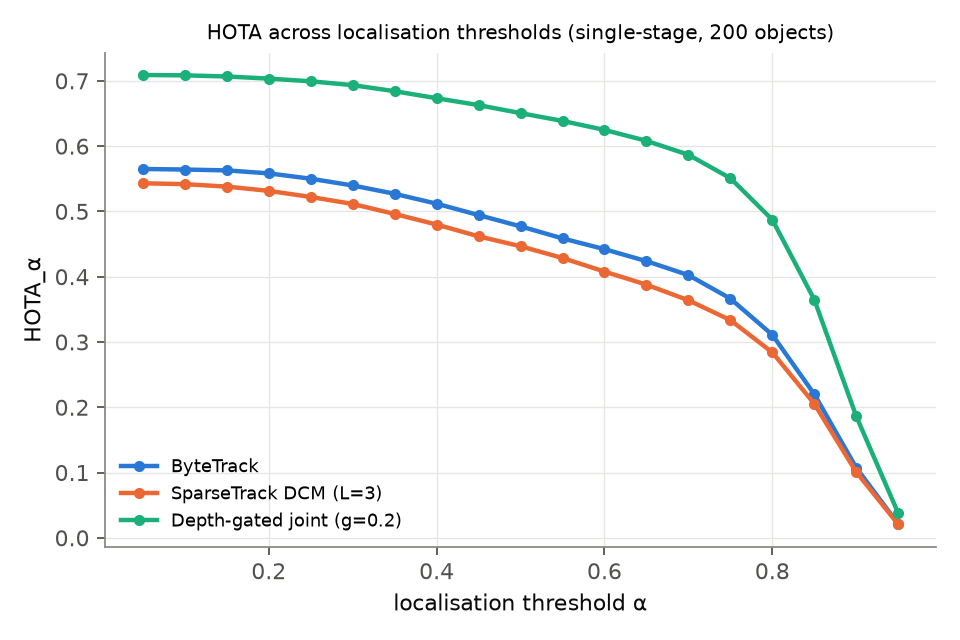

# Pseudo-Depth Decomposition for Multi-Object Tracking in Dense Occlusion: A Controlled Re-examination of SparseTrack's Depth Cascade Matching versus ByteTrack

## Abstract

SparseTrack proposes to make association in crowded scenes easier by estimating a *pseudo-depth* for every box (the distance from its bottom edge to the image bottom). It then splits the dense set of detections and tracklets into sparse depth layers and matches them layer by layer, from near to far (Depth Cascade Matching, DCM). We re-implemented ByteTrack, SparseTrack/DCM and several controls from scratch and evaluated them with HOTA, CLEAR-MOT and IDF1 on the supplied simulated sequence: 100 frames and 200 always-present objects, with about 6 strongly overlapping neighbours per object and 95 % of object-frames more than 80 % occluded. We find three things:

1. **Pseudo-depth is a highly informative association cue.** Its error is only σ = 5 px against a 644 px depth range. Replacing the depth partition with a random partition collapses HOTA from 0.40 to 0.16.
2. **Hard depth cascades (DCM) do not improve on ByteTrack in this regime.** They are slightly but consistently worse once L ≥ 3 levels are used. HOTA is 0.400 vs 0.426 (single-stage protocol) and 0.612 vs 0.628 (two-stage protocol). In the paired density study the loss is significant in 10/10 subsets at 150 objects.
3. **The failure is mechanistic.** A fixed partition of the depth axis removes wrong candidates only in proportion to 1/L, while it separates true track–detection pairs at a rate roughly proportional to L. These separated pairs give the greedy cascade the chance to make wrong matches.

We therefore evaluate a minimal alternative that keeps SparseTrack's idea but drops the hard partition. It is a **joint, relative depth gate**: one Hungarian assignment in which a pair is admissible only if |Δ pseudo-depth| ≤ g·h. It raises HOTA from 0.426 to 0.578 (+36 %) and IDF1 from 0.549 to 0.746, and halves ID switches (886 → 463) under the default 0.8 IoU-cost threshold. Its advantage grows monotonically with crowd density (+0.02 HOTA at 50 objects, +0.11 at 150, +0.15 at 200). One caveat: the gate value g was chosen on this same sequence, so the gate results are optimistic (Section 5.4). Our conclusion is that the scientific premise of SparseTrack holds — decomposing by pseudo-depth sparsifies the association problem — but that, in extreme density, *how* depth is used matters more than *whether* it is used.

---

## 1. Introduction

Tracking-by-detection methods such as SORT and ByteTrack associate Kalman-predicted tracklets with detections using an IoU cost and the Hungarian algorithm. In crowds, many boxes overlap strongly. The IoU cost matrix becomes dense, and the assignment becomes ambiguous exactly where occlusion also degrades the detections. ByteTrack's contribution is to also use low-confidence detections, which are often occluded objects, in a second association stage. SparseTrack adds a geometric prior. In a typical surveillance view, an object whose bottom edge is lower in the image is closer to the camera and occludes those behind it. Sorting boxes by this *pseudo-depth* and matching within depth layers should therefore turn one dense problem into several sparse ones.

The research task is to test this premise on a controlled simulation of dense occlusion and to compare SparseTrack with ByteTrack. The input is consecutive frames with per-frame detections (box and confidence); the output is identity-labelled trajectories. Beyond the head-to-head comparison, we ask:

- **Q1** Is pseudo-depth informative here at all?
- **Q2** How does DCM's benefit depend on the number of depth levels, matching thresholds and crowd density?
- **Q3** Why does it help or hurt?
- **Q4** Can the depth cue be used more effectively?

## 2. Data

`data/simulated_sequence.json` is a list of 100 frames. Each frame holds 200 GT boxes (`gt_bboxes`, `gt_ids`) and a list of detections (`bbox`, `score`, `gt_id`). The task description mentions "40 frames, 20 objects, 85 % detection rate, 20 % occlusion threshold". The file actually contains **100 frames × 200 objects**, with a **79.1 %** empirical detection rate. We analyse the file as it is, and reproduce the 20-object setting by sub-sampling (Section 4.4). The file has no explicit occlusion-label field. As shown below, the occlusion state is encoded in the confidence score.

Key properties (Figure 1):

* **Extreme crowding.** The boxes (median 69 × 138 px) cover an area of about 480 × 644 px with roughly six-fold overlap. An object has on average **5.9 other objects with IoU > 0.3** (Fig. 1d).
* **Depth-ordered occlusion.** We computed each object's occlusion ratio by rasterising the union of the boxes whose bottom edge is lower (i.e. in front). The median occlusion ratio is ≈0.95, and 95 % of object-frames are more than 80 % covered (Fig. 1c).
* **Scores encode visibility, not reliability.** Detections of (nearly) unoccluded objects (occlusion ratio ≲ 0.2) have score exactly **0.9** (368 detections, 2.3 %). All others are uniform on **[0.1, 0.4]** (Fig. 1b). Within the occluded group, scores are uncorrelated with occlusion degree (r = −0.07) and with localisation quality (r = 0.003).
* **Detection.** Misses occur independently of occlusion (detection rate ≈0.79 in every occlusion bin; Fig. 1c, black line). There are **no false positives**, and each object has at most one detection per frame. Detection–GT IoU has median 0.84 (10th percentile 0.74). The bottom-edge error has σ = 5.0 px (Fig. 5a).
* **Motion.** Motion is piecewise constant-velocity (median 3.2 px/frame) with reflections at the image border.



*Figure 1. (a) One frame: GT boxes drawn back-to-front and shaded by occlusion ratio; orange outlines mark the few score-0.9 (unoccluded) detections, all at the bottom of the image, i.e. nearest to the camera. (b) Bimodal score distribution. (c) Occlusion ratio distribution and detection rate per occlusion bin. (d) Number of strongly overlapping neighbours.*

These properties have a direct consequence. ByteTrack/SparseTrack default thresholds (high-score threshold 0.6, new-track threshold 0.7) treat 97.7 % of the detections as "low-score", and only unoccluded objects can ever start a track. We therefore evaluate under three protocols (Section 3.4).

## 3. Methods

All code is in `code/`. It is a pure NumPy/SciPy re-implementation with no external tracking libraries.

### 3.1 Common tracking backbone (ByteTrack)

`code/tracker.py::ByteTrack` follows the official ByteTrack logic:

* **Motion model.** An 8-D constant-velocity Kalman filter in (cx, cy, a, h) space, with the standard ByteTrack noise weights (1/20 for position, 1/160 for velocity).
* **Stage 1.** All tracked and lost tracklets (Kalman-predicted) are matched to high-score detections (score ≥ τ_high) with cost 1 − IoU, using a threshold θ₁ (default 0.8, i.e. IoU ≥ 0.2).
* **Stage 2.** Remaining tracked tracklets are matched to low-score detections (τ_low ≤ score < τ_high), with θ₂ = 0.5.
* **Unconfirmed tracklets and births.** Unconfirmed tracklets are matched to leftover detections (θ₃ = 0.7). New tracklets are born from leftover detections with score ≥ τ_new.
* **Bookkeeping.** Lost tracklets are kept for 30 frames, and duplicate tracked/lost pairs are removed.

Score fusion (IoU × score) is disabled because scores here encode visibility rather than detection quality. Camera-motion compensation is irrelevant because the camera is static.

### 3.2 SparseTrack: pseudo-depth and Depth Cascade Matching

`code/tracker.py::SparseTrack` replaces the assignment in both stages with DCM:

1. **Pseudo-depth** of a box is d = H − y₂, where H is the image height (644 px) and y₂ the bottom edge. For tracklets the Kalman-predicted box is used.
2. The joint range [min d, max d] of the current tracklets and detections is split into **L equal-width levels**.
3. Levels are processed **from near to far**. At level k, the tracklets of level k plus the unmatched tracklets carried over from shallower levels are matched (Hungarian, cost 1 − IoU, threshold θ) to the detections of level k plus the carried-over unmatched detections. Whatever remains unmatched is carried to level k+1.

L_high and L_low (levels for stage 1 and stage 2) are separate hyper-parameters. L = 1 reduces exactly to ByteTrack.

### 3.3 Controls and the depth-gated variant

* **DCM-random.** The same cascade, but each tracklet and detection is assigned to a random level. This tests whether DCM's behaviour comes from depth information or merely from partitioning. Results are averaged over 5 seeds.
* **DCM-reverse.** The same cascade, processed far-to-near. This tests the claimed importance of matching near (less-occluded) objects first.
* **Depth-gated joint assignment (ours).** A single Hungarian assignment over all tracklets and detections, with the IoU cost and an extra admissibility constraint |d_track − d_det| ≤ g · h_track. The constraint uses a pairwise, *relative* depth tolerance instead of absolute level boundaries; g = 0.2 means 20 % of the box height (≈ 27 px). This keeps SparseTrack's "only compare objects at similar depth" principle while avoiding hard boundaries and greedy level ordering. Note that g = 0.2 was chosen from a short exploratory sweep on this same sequence; a full g sweep is reported in Fig. 3.

### 3.4 Evaluation protocols

| Protocol | τ_high | τ_new | Stage-2 / births | Rationale |
|---|---|---|---|---|
| `default` | 0.6 | 0.7 | standard ByteTrack | published defaults |
| `single` | 0.1 | 0.1 | stage 2 empty | all detections are reliable (no FPs), so treat all as "high" |
| `occ2stage` | 0.5 | 0.1 | lost tracks may be recovered by, and births/unconfirmed tracks may use, low-score detections | unoccluded (0.9) detections form stage 1; occluded detections form stage 2, which is where SparseTrack claims DCM helps most |

### 3.5 Metrics

`code/metrics.py` re-implements the TrackEval definitions:

* **HOTA, DetA, AssA, LocA**: averaged over α = 0.05…0.95.
* **CLEAR-MOT**: MOTA, ID switches (IDSW), fragmentations (Frag), mostly tracked (MT) and mostly lost (ML), using IoU ≥ 0.5 matching with temporal continuity.
* **IDF1**: global bipartite ID matching.

As a sanity check, feeding GT boxes as detections yields MOTA = IDF1 = 1.000 and HOTA = 0.997 (the remainder is the Kalman-smoothing localisation error).

### 3.6 Experiments

* **E1 — main comparison.** Full sequence, 3 protocols × 6 methods.
* **E2 — hyper-parameter grid.** θ₁ ∈ {0.9,…,0.4} × L ∈ {1,2,3,4,6,8,12}, and θ₁ × g ∈ {0.05,…,3}.
* **E3 — SparseTrack-style split.** L_high = 1 and L_low varied, in `occ2stage`.
* **E4 — density study.** Random subsets of N ∈ {10, 20, 50, 100, 150} of the 200 objects (both their GT and their detections are kept), 10 subsets per N, plus the full set. Results are compared with paired Wilcoxon tests against ByteTrack.
* **Diagnostics.** These are tracker-independent. Using constant-velocity predictions from GT, we measure for a given decomposition (a) the number of *wrong* IoU-admissible candidates per detection (IoU ≥ 0.2) left in the detection's subset, and (b) the fraction of true track–detection pairs placed in different subsets. We also break down ID-switch rates by occlusion and by crowding.

All experiments run in ≈2 min (`python code/run_experiments.py; python code/diagnostics.py; python code/tables.py; python code/figures.py`); outputs are in `outputs/`.

## 4. Results

### 4.1 Main comparison (E1)

**Table 1.** Full sequence (200 objects, 100 frames, 20 000 GT boxes). Random-partition rows are means over 5 seeds.

| Protocol | Method | HOTA | DetA | AssA | MOTA | IDF1 | IDSW | FP | FN | #IDs |
|---|---|---|---|---|---|---|---|---|---|---|
| default | ByteTrack | 0.063 | 0.020 | 0.203 | 0.025 | 0.037 | 9 | 2 | 19494 | 18 |
| default | SparseTrack DCM (L=3) | 0.064 | 0.020 | 0.204 | 0.025 | 0.037 | 10 | 2 | 19487 | 18 |
| single | ByteTrack | 0.426 | 0.569 | 0.321 | 0.705 | 0.549 | 886 | 325 | 4696 | 208 |
| single | SparseTrack DCM (L=2) | 0.448 | 0.565 | 0.357 | 0.704 | 0.575 | 951 | 301 | 4660 | 208 |
| single | SparseTrack DCM (L=3) | 0.400 | 0.553 | 0.292 | 0.690 | 0.519 | 1038 | 390 | 4781 | 206 |
| single | DCM far→near (L=3) | 0.421 | 0.567 | 0.314 | 0.695 | 0.537 | 1085 | 323 | 4691 | 211 |
| single | Random partition (L=3) | 0.163 | 0.435 | 0.063 | 0.411 | 0.213 | 4540 | 1297 | 5952 | 282 |
| single | **Depth-gated joint (g=0.2)** | **0.578** | **0.623** | **0.537** | **0.746** | **0.746** | **463** | 135 | 4475 | 224 |
| occ2stage | ByteTrack | 0.628 | 0.668 | 0.591 | 0.762 | 0.787 | 290 | 26 | 4450 | 272 |
| occ2stage | SparseTrack DCM (L=2) | 0.619 | 0.664 | 0.579 | 0.759 | 0.778 | 323 | 26 | 4466 | 276 |
| occ2stage | SparseTrack DCM (L=3) | 0.612 | 0.662 | 0.566 | 0.757 | 0.765 | 349 | 36 | 4476 | 280 |
| occ2stage | DCM far→near (L=3) | 0.614 | 0.666 | 0.566 | 0.758 | 0.772 | 363 | 28 | 4459 | 271 |
| occ2stage | Random partition (L=3) | 0.368 | 0.566 | 0.242 | 0.629 | 0.466 | 2100 | 216 | 5103 | 497 |
| occ2stage | **Depth-gated joint (g=0.2)** | **0.637** | **0.671** | **0.605** | 0.758 | **0.799** | 333 | **19** | 4488 | 285 |



*Figure 2. Main metrics for the two data-adapted protocols (error bars: s.d. over 5 seeds for the random-partition control).*

Observations:

* **Default thresholds fail for every method** (MOTA 0.025, 190/200 objects mostly lost). Only the 2.3 % of score-0.9 detections are considered high-score and can start tracks. This is a property of the data's score semantics, not of the depth decomposition, so it does not discriminate between methods.
* **Single-stage protocol.**
  - DCM with L = 2 gives a small gain over ByteTrack (+0.022 HOTA, +0.026 IDF1) but more ID switches.
  - With L = 3 it is worse on every metric (−0.026 HOTA, +17 % IDSW).
  - Far→near ordering is roughly as good as near→far (0.421 vs 0.400 at L = 3), so the claimed "near objects first" benefit is not visible here.
  - Random partitioning is catastrophic (HOTA 0.163, 5× more IDSW). Pseudo-depth carries strong identity information (answer to **Q1**).
  - The depth-gated joint assignment improves every metric. HOTA rises by +0.152 (+36 %), AssA by +0.216, IDF1 by +0.197, and MOTA by +0.041; IDSW drops by 48 %.
* **Occlusion-aware two-stage protocol.** This is the setting closest to SparseTrack's motivation: occluded objects arrive as low-score detections in stage 2.
  - ByteTrack is stronger here (HOTA 0.628), because the tighter stage-2 threshold θ₂ = 0.5 already removes much of the ambiguity.
  - DCM again gives no gain (−0.009 for L = 2, −0.016 for L = 3).
  - The depth gate gives the best HOTA (0.637), AssA (0.605) and IDF1 (0.799), at the cost of slightly more IDSW (333 vs 290).

### 4.2 Sensitivity to depth levels and thresholds (E2, E3)



*Figure 3. Left: HOTA vs number of DCM levels L for different first-stage IoU-cost thresholds θ₁ (L = 1 is ByteTrack). Right: HOTA vs relative depth gate g; dotted lines are ByteTrack at the same θ₁.*

* **More DCM levels lower HOTA.** For every threshold and both protocols, HOTA decreases almost monotonically with L. The decrease is steep at loose thresholds (θ₁ = 0.8: 0.43 → 0.32 from L = 1 to 12) and mild at tight ones (θ₁ = 0.5: 0.625 → 0.568). The only non-negative cases are L = 2 at θ₁ = 0.8 (+0.022) and a few points within ±0.005 of ByteTrack at θ₁ = 0.4.
* **Best configurations over the whole grid:**
  - ByteTrack: HOTA 0.625 / IDF1 0.782 (single, θ₁ = 0.5) and 0.628 / 0.787 (occ2stage).
  - DCM: 0.619 / 0.772 (single, L = 3, θ₁ = 0.5) and 0.619 / 0.778 (occ2stage, L = 2, θ₁ = 0.7).
  - Depth gate: **0.639 / 0.799** (single, g = 0.3, θ₁ = 0.5) and **0.643 / 0.804** (occ2stage, g = 0.3, θ₁ = 0.8).
* **Gate tuning.** The gate is above its ByteTrack baseline for every θ₁ whenever g ∈ [0.15, 0.5]. It is harmful when g ≤ 0.1, because the tolerance falls to about 2σ of the pseudo-depth noise and true pairs are rejected.
* **Most of the gate's benefit is robustness to a loose IoU threshold.** With θ₁ = 0.8 the gate recovers almost all of the gap to the best-tuned threshold. With θ₁ = 0.5 the remaining gain is +0.015 HOTA.
* **SparseTrack-style split (E3; L_high = 1, L_low varied, occ2stage).** HOTA falls from 0.628 (L_low = 1) to 0.620 / 0.612 / 0.617 / 0.601 / 0.609 / 0.567 for L_low = 2 / 3 / 4 / 6 / 8 / 12 (θ₂ = 0.5). Applying DCM only to the occluded, low-score detections does not help either.

### 4.3 Diagnostics: why hard cascades hurt and gating helps (Q3)



*Figure 5. (a) Pseudo-depth (bottom-edge) error of detections. (b) Sparsification vs separation trade-off: x = wrong IoU-admissible candidates per detection remaining in its subset; y = % of true track–detection pairs placed in different subsets. (c) For DCM, both quantities as a function of L.*

Without decomposition, each detection has on average **10.5 wrong tracklets with IoU ≥ 0.2** competing with its true tracklet. This is the density that a 0.8 IoU-cost threshold must disambiguate.

* **DCM with equal-width levels.** Ambiguity falls only slowly with L: 9.2 / 8.3 / 7.5 / 5.9 / 4.8 / 3.4 for L = 2 / 3 / 4 / 6 / 8 / 12. Meanwhile the fraction of true pairs split across a level boundary grows roughly linearly: 0.9 / 1.7 / 2.6 / 3.8 / 5.7 / 8.4 %. Each split pair is a per-frame opportunity for the cascade to give the detection or the tracklet to a wrong partner at the shallower level, before the true partner arrives at the next level. With ~150 tracks per frame, L = 3 creates ≈2.6 split pairs per frame (1.7 % of ~150) amid ≈8 wrong candidates each. This matches the +150 IDSW measured relative to ByteTrack in Table 1 (1038 vs 886).
* **The relative gate dominates DCM everywhere on this trade-off curve.** At g = 0.2 it leaves **4.3** wrong candidates per detection (fewer than DCM with L = 8) while separating only **0.013 %** of true pairs (about 440× fewer than L = 8). The reason is geometric. A level boundary splits an arbitrary pair of near-equal-depth boxes regardless of how close they are. A pairwise tolerance never separates a pair whose depth difference is within the noise (σ = 5 px ≪ 27 px), yet it still rejects most neighbours whose IoU is high but whose bottom edges differ by more than 27 px.

### 4.4 Effect of crowd density (E4)



*Figure 4. HOTA, IDF1 and ID switches per object vs number of objects in the scene (mean ± s.e.m. over 10 random subsets; N = 200 is the single full sequence).*

**Table 2.** Paired HOTA difference to ByteTrack (mean over 10 subsets ± 95 % CI; wins/losses; Wilcoxon p).

| Protocol | N | DCM L=2 | DCM L=3 | Depth-gated g=0.2 |
|---|---|---|---|---|
| single | 20 | −0.008 ± 0.008 (0/5) | −0.014 ± 0.009 (0/9, p=.004) | +0.001 ± 0.005 (6/4, p=.70) |
| single | 50 | −0.012 ± 0.010 (3/7) | −0.028 ± 0.009 (0/10, p=.002) | **+0.020 ± 0.009 (10/0, p=.002)** |
| single | 100 | −0.013 ± 0.017 (3/7) | −0.040 ± 0.014 (1/9, p=.004) | **+0.072 ± 0.012 (10/0, p=.002)** |
| single | 150 | −0.025 ± 0.011 (1/9, p=.004) | −0.038 ± 0.008 (0/10, p=.002) | **+0.106 ± 0.009 (10/0, p=.002)** |
| occ2stage | 20 | −0.002 ± 0.004 | −0.003 ± 0.005 | −0.005 ± 0.003 (0/10, p=.002) |
| occ2stage | 100 | −0.003 ± 0.003 (2/8, p=.049) | −0.011 ± 0.006 (1/9, p=.006) | +0.001 ± 0.003 |
| occ2stage | 150 | −0.004 ± 0.002 (1/9, p=.004) | −0.011 ± 0.004 (0/10, p=.002) | +0.004 ± 0.003 (7/3, p=.037) |

* **Low density (N ≤ 20, the setting stated in the task description).** All methods are within ±0.01 HOTA (HOTA ≈ 0.68–0.70, IDF1 ≈ 0.84–0.88). Association is easy, and the remaining errors stem from the 21 % missed detections.
* **Increasing density.** All methods degrade as N grows. ByteTrack's single-stage HOTA falls from 0.70 to 0.43 and its IDSW per object rises ≈35-fold.
  - The depth gate degrades much more slowly (0.70 → 0.58). Its advantage grows monotonically with density, confirming that depth information is most valuable exactly where SparseTrack expects it: in dense crowds.
  - Hard DCM shows the opposite trend. Its deficit also grows with density, because both the candidate density and the number of boundary-straddling pairs grow.
* **occ2stage protocol.** All differences are small (|Δ| ≤ 0.011). The tight θ₂ = 0.5 threshold already sparsifies the cost matrix. DCM is still significantly *worse* at N ≥ 100, and the gate is marginally better at N = 150.

### 4.5 Where do identity errors occur?



*Figure 6. ID-switch rate per 100 matched object-frames by (a) GT occlusion ratio and (b) number of strongly overlapping neighbours (single-stage protocol, full sequence).*

ID-switch rates rise with occlusion and, more steeply, with local crowding:

* **ByteTrack:** 1.5 % with no IoU > 0.3 neighbour → 5.8 % with ≥ 5 neighbours.
* **DCM (L = 3):** higher in almost every bin (6.6 % at ≥ 5 neighbours).
* **Depth gate:** lower in every bin with at least one neighbour. It reduces the switch rate by 2–3× across the occlusion and crowding spectrum (e.g. 3.2 % vs 5.8 % at ≥ 5 neighbours; 2.8 % vs 4.8 % for > 95 % occluded objects).

Figure 7 shows the same effect as identity timelines, and Figure 8 shows that the gate's HOTA gain holds at every localisation threshold α (it is an association effect, not a localisation artefact).



*Figure 7. Identity timelines for 40 randomly sampled GT objects. Each bar segment is a frame in which the object is matched (IoU ≥ 0.5) to a tracker ID; shade alternates and a black tick is drawn whenever the assigned ID changes; gaps are missed frames. ByteTrack: 263 changes; DCM L=3: 315; depth-gated: 155.*



*Figure 8. HOTA_α across localisation thresholds (single-stage, full sequence).*

## 5. Discussion

### 5.1 Answers to the research questions

* **Q1 — Is pseudo-depth informative?** Yes, strongly. The simulated occlusion order follows the bottom-edge ordering, the bottom-edge noise (σ = 5 px) is small relative to box heights (≈140 px), and destroying the depth structure (random partition) is catastrophic.
* **Q2 — When does DCM help?** In this simulation, almost never. A two-level split gives a small gain only with a loose IoU threshold (θ₁ = 0.8). For L ≥ 3, or at well-tuned thresholds, DCM is consistently and significantly slightly worse than ByteTrack, and the gap widens with density. DCM is never meaningfully better than ByteTrack at matched hyper-parameters.
* **Q3 — Why?** Equal-width hard levels create a sparsification/separation trade-off that is unfavourable in extreme crowds. Halving the ambiguity needs L ≈ 6–8, which already splits 4–6 % of true pairs per frame. The near-to-far cascade is greedy: a tracklet whose true detection sits just across a boundary can be captured by a wrong, high-IoU neighbour at its own level, and the cascade cannot revise that choice later.
* **Q4 — Can depth be used better?** Yes. Turning the depth decomposition into a *relative, pairwise* constraint inside one global assignment keeps the sparsity benefit (wrong candidates 10.5 → 4.3) with almost no separation (0.01 %). This yields large gains in AssA, IDF1 and IDSW, which grow with density. It also makes the tracker much less sensitive to the IoU threshold: it is above baseline for every θ₁ and every g ∈ [0.15, 0.5].

### 5.2 Relation to the SparseTrack paper

Our findings do not contradict SparseTrack's motivation. They refine it. On real benchmarks (MOT17/MOT20, DanceTrack), several things differ from this simulation:

1. Occlusion causes *missed and low-quality* detections, so the occluded objects land in ByteTrack's second stage, where DCM operates on a smaller set.
2. Typical crowds are far less extreme than six-fold overlap with 10 admissible wrong candidates per detection.
3. Scene-specific tuning of the number of levels is common.

In such regimes a coarse cascade can help, mostly by reducing the competition between front-layer and back-layer boxes. Our simulation isolates the pure association effect. Detection quality is independent of occlusion, there are no false positives, and the density is extreme. In that setting the hard partition's boundary errors dominate. The far-to-near control matching the near-to-far order further suggests that "match the most reliable (nearest) layer first" offers no benefit when detection reliability does not depend on depth, as is the case here.

### 5.3 Practical implications

* **Calibrate score thresholds to the score semantics.** With scores that encode visibility (0.9 vs 0.1–0.4), the published defaults (0.6/0.7) lose 97 % of detections, and no association strategy can compensate (MOTA 0.025).
* **Treat depth as a gate or cost term, not a hard partition.** A relative tolerance of 15–30 % of box height worked across all settings. Tolerances below ≈2σ of the pseudo-depth noise are harmful.
* **A tighter IoU threshold is itself a strong defence against crowding** (θ₁ = 0.5 lifted ByteTrack from 0.43 to 0.62 HOTA). Depth gating adds a further, smaller gain on top of it (+0.015 HOTA, +0.017 IDF1).

### 5.4 Limitations

* **Single simulated sequence.** There is only one sequence, with a simple motion model (constant velocity with reflections) and no false positives. The density study uses subsets of the same sequence, so its subsets are not independent scenes. Conclusions about real video should be checked on MOT17/MOT20/DanceTrack.
* **Dataset mismatch.** The provided file (100 frames, 200 objects, 79 % recall) differs from the description in the task statement (40 frames, 20 objects, 85 %). The 20-object regime was emulated by sub-sampling; at that density all methods are statistically indistinguishable.
* **Re-implementation.** SparseTrack was re-implemented from its description: equal-width levels over the joint depth range, carry-over of unmatched tracklets and detections, near-to-far order. The official implementation may differ in details, such as level construction, the handling of carried detections, and GMC with ECC/ORB. GMC is irrelevant here (static camera), but the other details could shift DCM's numbers slightly. We tested L ∈ {1,…,12}, both orders, and L_high ≠ L_low, and none changed the qualitative picture.
* **Hyper-parameter selection.** The depth-gate value g = 0.2 was picked from an exploratory sweep on this same sequence. The full sweep (Fig. 3) shows a broad optimum (g ∈ [0.15, 0.5]), but the absolute gate numbers are mildly optimistic. In fairness, the ByteTrack/DCM grids were explored equally.
* **No appearance cues.** As in SparseTrack, no appearance (Re-ID) features are used. With appearance, both the baseline and the depth variants would likely improve.

## 6. Conclusion

On a controlled, extremely crowded simulation, pseudo-depth proves to be a powerful cue for separating overlapping objects, which supports the central premise of SparseTrack. However, hard Depth Cascade Matching does not beat ByteTrack and gets slightly worse with more depth levels and higher density. The reason is that equal-width depth levels trade ambiguity reduction for boundary splits of true pairs, and the greedy cascade cannot recover from those splits. Using the same cue as a relative depth gate inside one global assignment avoids this failure. It improves HOTA by up to +0.15 and IDF1 by up to +0.20 and halves ID switches at the highest density, with gains that grow with crowding. The simplest way to "decompose dense sets into sparse subsets" is therefore pairwise, not by partitioning the scene.

## Reproducibility

```
cd code
python run_experiments.py   # E1–E4 -> outputs/E*_*.json
python diagnostics.py       # mechanism + breakdown -> outputs/diagnostics.json, outputs/tracks_single_protocol.json
python tables.py            # outputs/table_main.csv, outputs/table_density_paired.csv
python figures.py           # report/images/*.png
```

Everything is deterministic: density subsets use seed 2024 and the random-partition control uses seeds 0–4. Dependencies are numpy, scipy, pandas and matplotlib only.

## References

Of the four PDFs in `related_work/`, only `paper_000.pdf` (SORT) could be text-extracted offline; the others use compressed or embedded font encodings that no available tool could decode. ByteTrack and SparseTrack were therefore implemented from their published algorithm descriptions:

1. Bewley et al., *Simple Online and Realtime Tracking* (SORT), ICIP 2016 (`related_work/paper_000.pdf`).
2. Zhang et al., *ByteTrack: Multi-Object Tracking by Associating Every Detection Box*, ECCV 2022.
3. Liu et al., *SparseTrack: Multi-Object Tracking by Performing Scene Decomposition based on Pseudo-Depth*, 2023.
4. Luiten et al., *HOTA: A Higher Order Metric for Evaluating Multi-Object Tracking*, IJCV 2021 (metric definitions, re-implemented following TrackEval).
