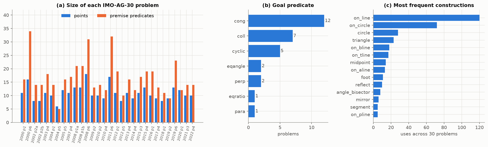
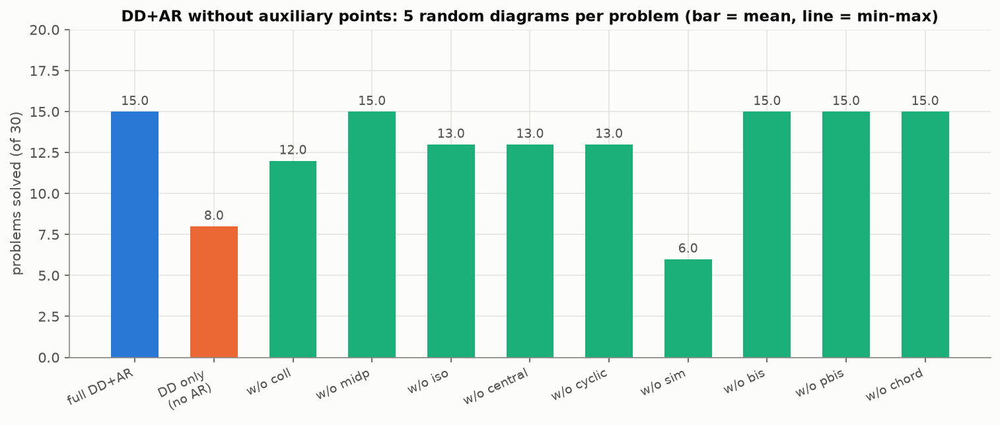
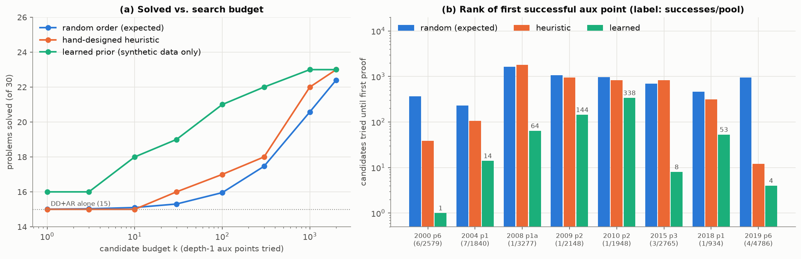
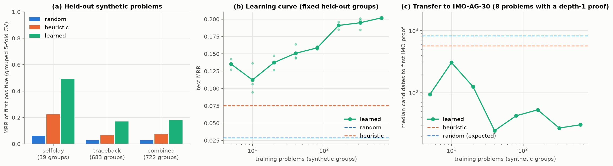
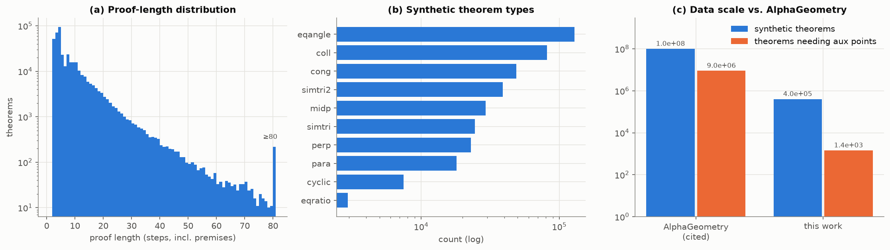
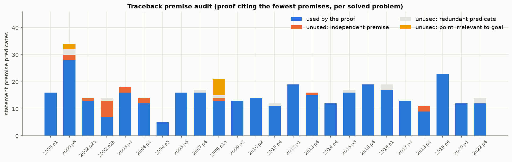
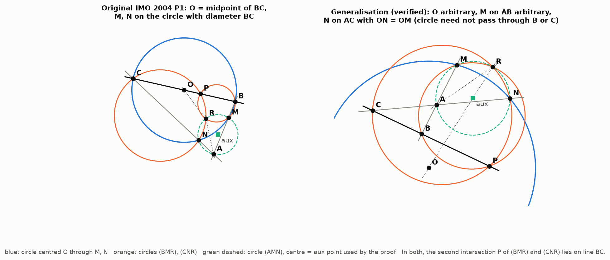
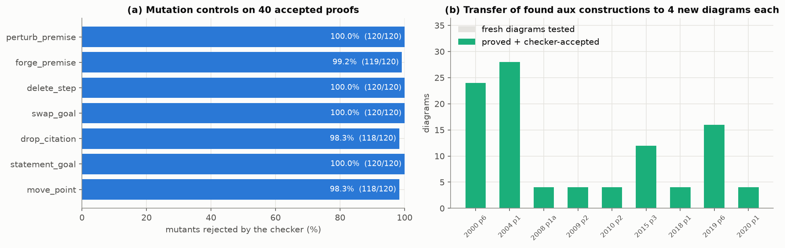

# A neuro-symbolic olympiad-geometry prover built from scratch: DD+AR, a learned auxiliary-point prior trained only on synthetic data, verified proofs, and traceback-driven theorem generalisation on IMO-AG-30

## Abstract

We build, from scratch and fully offline on two CPU cores, a geometry theorem prover for the IMO-AG-30 benchmark. It produces machine-checkable, human-readable proofs.

**Engine.** The symbolic core couples a deductive database (DD) of geometric rules with algebraic reasoning (AR) over directed angles and log-lengths. AR is maintained as a row space over GF(p) and queried in O(1) through random solutions of the homogeneous system. Every rule application is proposed numerically by a random diagram and justified symbolically. Traceback extracts minimal proofs, which an **independent** exact-rational checker re-verifies.

**Search.** Auxiliary constructions are searched over 14 hand-defined candidate families. They are ordered by random order, by a hand-designed heuristic, or by a **learned prior**. The prior is a logistic model trained only on synthetic problems we generate ourselves: about 4.0·10^5 traced synthetic theorems, 683 traceback-derived auxiliary-point examples, and 14,100 self-play labels. No IMO labels or human demonstrations are used.

**Results.**
- DD+AR alone solves **15/30**, identically on 5 independent random diagrams per problem.
- With one auxiliary point it solves **23/30** for any ordering, given a budget of 2,000 candidates.
- The learned prior reaches 21/30 after only 100 candidates, against 17 for the heuristic and 16.0 for random order. Its median number of candidates to the first IMO proof is 33.5, against 567 and 824.
- A depth-2 beam adds IMO 2020 P1, for a total of **24/30**.
- Every one of the 24 proofs is accepted by the independent checker.

**Validation.** Mutation controls reject 835 of 840 corrupted proofs; all 5 survivors are semantically equivalent mutants. All 25 auxiliary constructions (24 depth-1, 1 depth-2) transfer to 4/4 fresh diagrams each (100/100).

**Generalisation.** A traceback premise audit shows that a checker-verified proof of IMO 2004 P1 never uses the fact that O is the midpoint of BC. We formulate and verify a strictly more general theorem: O can be **any** point, M **any** point of AB, and N the point of AC with ON = OM. It holds on 200/200 random diagrams, is proved with one auxiliary point, is accepted by the checker, and transfers to 10/10 fresh diagrams.

---

## 1. Data

**IMO-AG-30** (`data/imo_ag_30.txt`) contains 30 problems from IMO 2000–2022. Each is written in a construction language whose 68 primitives are defined in `data/defs.txt`.

Each primitive block specifies:
- the new point(s);
- non-degeneracy conditions;
- the predicates that hold;
- a numeric sketch.

Problems contain 6–18 points (mean 10.9) and 5–34 premise predicates (mean 16.7). The goal is one of `cong` (12), `coll` (7), `cyclic` (5), `eqangle` (2), `perp` (2), `eqratio` (1) and `para` (1) (Fig. 1). Some clauses omit the output name (e.g. `a1 = on_line b c`) or give fixed coordinates (`x@4.96_-0.13`, IMO 2008 P6). The parser handles both.

`data/rules.txt` lists the AlphaGeometry deduction rules. Our rule set (§2.2) is a re-implementation of the important subset, and some of those rules are subsumed by AR.



*Figure 1. (a) Points and premise predicates per problem. (b) Goal predicates. (c) Most frequent constructions.*

**Related-work note.** The provided PDFs are the Transformer paper, AlphaGo, a hadron-physics paper and one unreadable file. None concerns geometry. Literature numbers for AlphaGeometry (Trinh et al., *Nature* 2024) and human contestants are therefore **quoted from that paper as cited values, not re-run** (Table 2).

---

## 2. Method

All code is in `code/`. The engine package is `code/geo/`; the checker, `code/checker.py`, does not import it.

### 2.1 Numeric diagrams (`geo/numeric.py`, `geo/problem.py`)

Points are complex numbers. Each construction is realised either as explicit points (foot, circumcentre, incentre, external tangents, …) or as one or two 1-D loci (lines or circles) to intersect. When a locus intersection has several solutions, we choose randomly among those that do not coincide with existing points.

A diagram is rejected and resampled if any of the following fails:
- a non-degeneracy condition;
- any premise predicate (checked numerically at tolerance 10⁻⁶);
- point separation;
- the goal, which is checked numerically because some random configurations, e.g. of 2005 P5 and 2018 P1, fall on the "wrong side".

All 30 problems build on 5 seeds with **0 premise violations**.

### 2.2 Deduction engine (`geo/dd.py`)

**AR.**
- Variables:
  - θ_XY is the direction of line XY, in units of π, modulo 1.
  - ℓ_XY is the log-length of XY.
- Each fact contributes linear rows "form = constant":
  - `para`: θ_AB − θ_CD = 0.
  - `perp`: θ_AB − θ_CD = ½.
  - `eqangle`: θ_CD − θ_AB − θ_RS + θ_PQ = k.
  - `cong`, `eqratio`: rows in ℓ.
  - midpoint: ℓ_AB − ℓ_MA = 1, in units of log 2.
  - cyclic: three inscribed-angle rows per 4 points.
  - similar triangles: two angle rows and two ratio rows.
- Rows are kept in RREF over GF(p) with p = 33,554,393, so products fit in int64.
- Instead of eliminating for every query, we keep K = 2 random solutions of the homogeneous system. A form lies in the row space iff it vanishes on both solutions, with a false-positive rate of about p⁻². Any membership query is therefore a 4-term dot product, and candidate rows already in the span are filtered in O(1).
- The constant of a derived fact is read from the diagram during search and recomputed exactly by traceback and the checker.

**DD rules.** Every instance is proposed numerically by the diagram and fires only if its premises are AR-known:
- `para_coll`: AB ∥ AC ⇒ A, B, C collinear. This is needed because θ_AB = θ_AC does not *linearly* imply θ_BC = θ_AB; adding the rule fixed an early traceback failure.
- `midp`.
- Isosceles triangle and its converse.
- Inscribed angle = half central angle, and its converse. This also covers tangent–chord and Thales.
- Concyclicity from equal angles or from a common centre, plus circle merging.
- **Similar triangles by AA, SAS or SSS**, direct or mirrored. Candidate pairs come from hashing triangle shapes.
- Angle-bisector theorem and its converse.
- Perpendicular bisector.
- Equal chords ⇔ equal inscribed angles.

Saturation runs in rounds. Facts derived in round *t* use only rows committed before *t*, which makes the proof DAG acyclic by construction.

### 2.3 Traceback and the independent checker (`geo/trace.py`, `code/checker.py`)

**Traceback.** Each fact records its rule and premises. An AR fact derived at time T is explained by rows with index < T, in three steps:
1. collect rows by BFS over shared variables until the target lies in their GF(p) span;
2. greedily prune them to a minimal support;
3. solve for exact rational coefficients.

The proof is the post-order DAG from the goal and is printed in human-readable form (example in §4.6).

**Checker.** The checker re-derives everything from scratch:
- It re-parses the statement with its own reader of `defs.txt`.
- It recomputes premise predicates.
- It re-derives the rows of every cited fact.
- It verifies every AR step by exact span membership over **Q** with `Fraction`s, including the constant.
- It verifies every DD step against its rule schema, including point-coverage checks.
- It matches the final fact to the statement's goal for every goal type, including coll and cyclic.
- It checks numerically that every non-coll/cyclic step is true on the stored coordinates.
- Side conditions (non-collinearity, orientation for SSS, the sign branch of `chord_conv`) are checked numerically on the stored coordinates, as AlphaGeometry also does.

Directed angles live modulo π. An angle step whose rational combination has a denominator d is therefore established modulo π/d, and the remaining branch is fixed by the diagram. The checker accepts such steps and counts them; we report the counts in §4.7.

### 2.4 Auxiliary-point search (`geo/aux.py`, `label_aux.py`, `depth2.py`)

**Candidate families (14):**
- midpoint, mirror, foot, reflection;
- circumcentre, orthocentre, incentre;
- parallelogram;
- line∩line, line∩circle, circle∩circle;
- parallel∩line, perpendicular∩line, tangent∩line.

Every candidate is written as an ordinary `defs.txt` clause (e.g. `aux = foot aux b a r`), so the checker treats it like any premise.

Candidates are deduplicated by hashing rounded coordinates. The names `aux` and `aux2` are reserved and checked for collisions. Each family is capped at 200 candidates (seeded subsampling). For the 12 problems with ≤ 13 points we extend the cap to 1,500. The three 16–18-point problems keep the 200 cap for compute reasons.

**Exhaustive labelling.** Instead of running each ordering until its first success, we try **every** candidate of the pool once. That is 899–4,786 candidates per problem, about 35.6k engine runs in total. The resulting success labels let any ordering be scored offline on identical data, and give the *expected* rank under random order exactly:
- expected rank = (n + 1)/(s + 1), for a pool of n candidates with s successes;
- P(solved within k) = 1 − C(n−s, k)/C(n, k).

**Orderings compared:**
- *random*;
- *heuristic*: hand-designed family priority plus a bonus for using goal points;
- *learned* (§2.6).

**Depth-2 beam.** For the problems left unsolved, the top 8 first-level candidates (by the learned prior) are each combined with the top 250 second-level candidates, re-generated on the augmented diagram. That is 2,000 runs per problem.

### 2.5 Synthetic data (`synth.py`, `build_aux_examples.py`)

**Generator.** A random base (triangle 70%, quadrangle, right or isosceles triangle) is grown one clause at a time from 21 construction templates. Argument choice is biased towards recently added points, to create deep dependencies. A clause is resampled up to 30 times if it is degenerate or numerically inconsistent. Diagrams have 10–14 points.

**Corpus A: synthetic theorems with proofs.**
- Each diagram is saturated by DD+AR. Every derived non-premise fact is a synthetic theorem: coll, para, perp, cong, cyclic, midp, similar triangles, and DD-derived eqangle/eqratio.
- Each theorem is traced back to a minimal proof.
- Points used by the proof's premises but outside the dependency closure of the conclusion are **auxiliary points**.
- For up to 3 such theorems per diagram, we re-run DD+AR on the statement restricted to the closure. If it fails there, the auxiliary point is confirmed **needed**.
- Single-aux-point examples whose auxiliary point lies in our candidate space become supervised examples: the positive is the true aux point, matched by coordinates; the negatives are the rest of the pool. This is AlphaGeometry's traceback supervision.

**Corpus B: self-play.** "Hard conjectures" are facts true at tolerance 10⁻¹⁰ that saturated DD+AR does not know (cong, coll, cyclic, para, perp). For one random conjecture per diagram, 150 random candidates are tried and each is labelled success or failure.

### 2.6 Learned prior (`prior.py`, `train_prior.py`)

The prior is an L2 logistic regression with class weighting on 28 problem-agnostic features:
- family one-hot;
- fraction of arguments that are goal points, or recent points;
- numeric coincidences the candidate creates (log counts of collinear pairs, equidistant pairs, right angles, equal existing lengths, concyclic triples);
- distances to goal points, to the nearest point and to the centroid;
- problem size.

Evaluation uses grouped 5-fold CV on synthetic problems (MRR of the first positive), a learning curve on fixed held-out groups, and transfer to IMO. **IMO labels are never used for training.**

---

## 3. Experimental protocol summary

| Item | Setting |
|---|---|
| Hardware | 2 shared CPU cores, no GPU, offline |
| DD+AR | max 40 rounds; seeds 0–4 for the robustness study |
| Depth-1 pool | 14 families, quota 200 (1,500 for ≤ 13-point problems), exhaustive labelling |
| Budgets | k = 1, 3, 10, 30, 100, 300, 1000, 2000 candidates |
| Depth-2 | beam 8 × 250, learned ordering at both levels |
| Synthetic | Corpus A 16,010 diagrams; Corpus B 2,310 diagrams scanned |
| Verification | independent checker; 7 mutation classes × 3 per proof; 4 fresh diagrams per construction |

---

## 4. Results

### 4.1 DD+AR and ablations

DD+AR without auxiliary points solves **15/30 on each of 5 random diagrams** (seed spread 0). The 15 are 2000 P1, 2002 P2a, 2002 P2b, 2003 P4, 2004 P5, 2005 P5, 2007 P4, 2010 P4, 2012 P1, 2013 P4, 2014 P4, 2015 P4, 2016 P1, 2017 P4 and 2022 P4. Each takes 0.01–0.45 s including traceback.

Our **in-house DD-without-AR baseline** keeps only transitivity of explicitly stated equalities, implemented with union-find over variables and angle/ratio "difference keys", and drops linear angle/ratio chasing. It solves **8/30**. AR therefore accounts for 7 of the 15 DD+AR solves.

Ablating one rule at a time (Fig. 2):
- **Similar triangles** are by far the most important: without them, 6/30.
- Then `para_coll`, the line rule: 12/30.
- Then isosceles, central angle and concyclicity: 13/30 each.
- Midpoint, bisector, perpendicular-bisector and chord rules are individually redundant on this benchmark (15/30). Their effect is subsumed by similar triangles combined with AR.

Every proof in every configuration was re-checked by the independent checker; none was rejected.



*Figure 2. Problems solved without auxiliary points over 5 random diagrams (bar = mean, line = min–max; the spread is zero everywhere).*

### 4.2 Main result

**Table 1.** Final status per method. Every claimed solve has a checker-accepted JSON proof in `outputs/final_proofs/` (list in `outputs/main_results.json`).

| Configuration | Solved / 30 | Problems added |
|---|---|---|
| DD only (no AR), in-house baseline | 8 | – |
| DD+AR (ours) | **15** | – |
| + 1 aux point, budget 2,000, **any** ordering | **23** | 2000 P6, 2004 P1, 2008 P1a, 2009 P2, 2010 P2, 2015 P3, 2018 P1, 2019 P6 |
| + depth-2 beam (8 × 250, learned) | **24** | 2020 P1 (`aux = reflect P over CO`; `aux2 = CO ∩ AY`, found after 769 tries) |
| Unsolved | 6 | 2008 P1b, 2008 P6, 2011 P6, 2012 P5, 2019 P2, 2021 P3 |

**Table 2.** Literature reference points, **cited from Trinh et al. (2024), not re-run here**.

| System | IMO-AG-30 |
|---|---|
| GPT-4 | 0 |
| Full-angle method | 2 |
| Gröbner basis | 4 |
| Wu's method | 10 |
| AlphaGeometry's DD+AR | 14 |
| DD+AR + human-designed heuristics | 18 |
| AlphaGeometry (LM trained on 10⁸ synthetic theorems) | 25 |
| Avg. IMO bronze / silver / gold medallist (geometry problems, scaled to 30) | 19.3 / 22.9 / 25.9 |

Against these cited numbers:
- Our DD+AR (15) is one above AlphaGeometry's DD+AR (14).
- Our full system (24) exceeds the heuristic-augmented DD+AR (18) and the average *silver* medallist (22.9).
- It is below AlphaGeometry (25) and the average gold medallist (25.9).

The comparison is indicative only: the rule sets, diagram procedures and compute differ.

### 4.3 Search budget: what the learned prior buys

Because the pools are labelled exhaustively, random, heuristic and learned orderings are compared on identical candidates (Fig. 3).

**Table 3.** Problems solved (of 30) as a function of the depth-1 budget k.

| k | 1 | 3 | 10 | 30 | 100 | 300 | 1000 | 2000 |
|---|---|---|---|---|---|---|---|---|
| random (expected) | 15.0 | 15.0 | 15.1 | 15.3 | 16.0 | 17.5 | 20.6 | 22.4 |
| heuristic | 15 | 15 | 15 | 16 | 17 | 18 | 22 | 23 |
| **learned (synthetic only)** | **16** | **16** | **18** | **19** | **21** | **22** | **23** | **23** |

Successful auxiliary points are very rare: 1–7 per pool of 934–4,786 candidates.

The learned prior's rank of the first successful construction is:

| Problem | 2000 P6 | 2004 P1 | 2008 P1a | 2009 P2 | 2010 P2 | 2015 P3 | 2018 P1 | 2019 P6 |
|---|---|---|---|---|---|---|---|---|
| Rank | 1 | 14 | 64 | 144 | 338 | 8 | 53 | 4 |

That is a median of **33.5**, against 567 for the heuristic and 824 for random order (expected).

The ordering does not change the final depth-1 count. At a budget of 2,000 all orderings reach 22.4–23, because the remaining failures are capability limits of the engine, not search failures. What the prior changes is the cost. It reaches the final count (23) with 1,000 candidates and 21/30 with only 100. Its median search cost is 17 times lower than the heuristic's and 25 times lower than random order.



*Figure 3. (a) Solved vs. depth-1 budget. (b) Candidates tried until the first proof; the label under each problem gives successes/pool size.*

### 4.4 The learned prior: cross-validation and learning curve

Table 4 and Fig. 5 report grouped 5-fold CV on synthetic data, with each group a synthetic problem.

**Table 4.**

| Training data | groups (with a positive) | records | MRR learned | MRR heuristic | MRR random |
|---|---|---|---|---|---|
| self-play (Corpus B) | 39 | 14,100 | **0.49** | 0.22 | 0.06 |
| traceback aux examples (Corpus A) | 683 | 185,871 | **0.17** | 0.065 | 0.027 |
| combined (final model) | 722 | 199,971 | **0.18** | 0.074 | 0.029 |

On IMO, the median candidates to the first proof is 84 for the self-play-only model, 30 for the traceback-only model and 33.5 for the combined model. Traceback-derived labels are thus the more useful supervision, as in AlphaGeometry, simply because there are 17 times more positive problems.

**Learning curve.** On fixed held-out groups, test MRR rises from 0.13 with 5 training problems, through 0.15 with 40 and 0.19 with 160, to 0.20 with 633 (Fig. 5b). The heuristic's MRR on the same groups is 0.075.

On IMO the median rank falls from about 100–500 with fewer than 20 training problems to about 25–55 beyond 40 (Fig. 5c). The IMO curve is noisy because it is a median over only 8 problems.

The largest coefficients reward candidates that create **many numeric coincidences**: equal lengths, equidistant pairs, right angles and collinearities. They also reward the use of goal points and the orthocentre family, and penalise line∩circle and circle∩circle. These are sensible, human-interpretable preferences discovered purely from synthetic data.



*Figure 5. (a) Grouped-CV MRR on held-out synthetic problems. (b) Learning curve. (c) IMO median candidates to first proof vs. synthetic training size.*

### 4.5 Synthetic data statistics and scale

**Corpus A (Fig. 6):**
- **16,010** random diagrams (12.0 points on average, 0.085 s per diagram including traceback).
- **402,788** synthetic theorems with traced proofs.
- **102,653** unique after canonical renaming of points.
- By type: eqangle 128k, coll 81k, cong 49k, simtri (mirror) 39k, midp 29k, simtri 24k, perp 23k, para 18k, cyclic 7.4k, eqratio 3.0k.
- Proof length: mean 7.3 steps, median 4, maximum 159. 23% of proofs have ≥ 10 steps and 5.9% have ≥ 20.

**Auxiliary points.**
- 5,780 theorems (1.4%) have a proof that uses a point outside the dependency closure of the conclusion.
- Re-running DD+AR on the reduced statement for 3,818 of them confirmed that the auxiliary point is truly needed in **950 cases (24.9%)**. That extrapolates to about 1.4·10³ aux-needing theorems in the corpus.
- 812 were single-aux examples and 683 were representable in our candidate space. These became the traceback training set.

**Corpus B.** We scanned 2,310 diagrams. Hard conjectures were rare (about 4% of diagrams). We labelled 94 conjectures × 150 candidates = 14,100 records, of which 86 were successes, spread over 39 conjectures.

**Gap to AlphaGeometry.** AlphaGeometry used 10⁸ synthetic theorems, 9·10⁶ of them with auxiliary points. Our corpus is **2.4 orders of magnitude** smaller in theorems and **3.8 orders of magnitude** smaller in auxiliary-point examples (Fig. 6c). The generator is fast enough (about 12 diagrams/s per core) that 10⁷ theorems would take roughly 10 core-hours. The binding constraint on a 2-core, few-hour budget is wall-clock time, not method.

The learning curve (Fig. 5b) is still rising at our largest training size, so more data would likely improve the prior further.



*Figure 6. (a) Proof lengths of the 402,788 Corpus-A theorems (log scale; ≥ 80 clipped). (b) Theorem types. (c) Scale vs. AlphaGeometry (cited).*

### 4.6 Traceback premise audit and a more general IMO 2004 P1

**Audit (`code/trace_back.py` → `outputs/premise_usage.json`, Fig. 9).** For each of the 24 solved problems, and for every checker-accepted proof (40 in total), we list which predicates of the *original* statement the proof cites. Constructions are split into their predicates; for example, `midpoint` gives `coll` and `cong`.

Unused predicates fall into three classes:
1. **Redundant:** implied by the other predicates of the same construction. Examples are the isosceles-angle form of `on_bline`, the third altitude of `orthocenter`, the congruences of `parallelogram`, and the second perpendicular of `reflect`.
2. **About a point irrelevant to the goal:** for example the orthocentre H in 2000 P6, or D, A1 and A2 in 2008 P1a.
3. **Independent:** the candidates for generalisation. This class also contains cases where the proof cites an equivalent sibling predicate instead, e.g. the angle form of a perpendicular bisector in place of its `cong` (2002 P2a, 2003 P4, 2018 P1).



*Figure 9. Premise usage of the proof citing the fewest premises, per solved problem.*

**Automatic relaxation.** Wherever unused predicates allow it, the construction is replaced by a weaker one: midpoint → perpendicular bisector or free point, 2-locus point → 1-locus point, and so on. A relaxation counts as a **generalisation** only if all four tests pass:
- (i) the goal holds on 30/30 fresh random diagrams of the relaxed statement;
- (ii) DD+AR plus auxiliary-point search proves it;
- (iii) the independent checker accepts the proof;
- (iv) the proof transfers to fresh diagrams.

| Problem | Relaxation | Numeric | Proof / checker | Transfer | Interpretation |
|---|---|---|---|---|---|
| **2004 P1** | `o = midpoint o b c` → `o = free o` | 30/30 | ✓ / ✓ | 5/5 | **substantive generalisation** |
| **2002 P2b** | `o = midpoint o b c` → `o = on_bline o b c` | 30/30 | ✓ / ✓ | 5/5 | **substantive:** O any point on the perpendicular bisector of BC |
| 2002 P2b | D drops one of its two loci (×2); J drops `on_pline` | 30/30 | ✓ / ✓ | 5/5 | goal-invariant: the goal ∠ECJ = ∠JCF only involves line CJ = CA |
| 2008 P1a | D free; A1, A2 drop a locus (×4) | 30/30 | ✓ / ✓ | 5/5 | trivial: D, A1, A2 lie outside the goal's dependency closure |

**Negative controls.** Dropping a premise that the proofs *do* use makes the goal fail on 0/30 diagrams in each case: the bisector of ∠A, ON = OM, or N ∈ AC (`outputs/gen2004/negative_controls.json`). The numeric test therefore separates true relaxations from false ones.

**IMO 2004 P1 in detail (`code/gen2004.py`, Fig. 7).** The checker-accepted proof that uses the auxiliary point "circumcentre of AMN" cites neither `coll(O,B,C)` nor `cong(OB,OC)`. It uses only OM = OB = ON, and in fact only OM = ON.

We therefore tested a chain of relaxations, all with the goal "P ∈ BC". Each variant was checked numerically on 200 random diagrams and then proved with the auxiliary-point search, which uses the heuristic ordering here:

| Variant | Hypothesis on O, M, N | Numeric (200 diagrams) | O far from BC (dist > 0.2·BC) | Proof (aux, rank) | Steps | Checker | Transfer |
|---|---|---|---|---|---|---|---|
| V0 original | O midpoint of BC, M, N on circle(O, OB) | 200/200 | – | foot of B on AR (101st) | 43 | ✓ | 10/10 |
| V1 | O on perpendicular bisector of BC | 200/200 | 164/164 | circumcentre AMN (583rd) | 48 | ✓ | 10/10 |
| V2 | O arbitrary, M, N on circle(O, OB) | 200/200 | 156/156 | circumcentre AMN (591st) | 42 | ✓ | 10/10 |
| **V3** | **O arbitrary, M arbitrary on AB, N on AC with ON = OM** | **200/200** | **151/151** | circumcentre AMN (594th) | 46 | ✓ | **10/10** |

> **Generalised theorem (verified).** Let ABC be a triangle, M any point of line AB, and O any point. Let N be a point of line AC with ON = OM. Let R be the intersection of the bisector of ∠BAC with the bisector of ∠MON, i.e. the perpendicular bisector of MN. Then the circles BMR and CNR meet again on line BC.

The machine proof explains why. R lies on the bisector of ∠A and on the perpendicular bisector of MN, so it is the midpoint of arc MN of circle (AMN); the proof establishes this via the auxiliary centre with |aux R| = |aux A| (steps 18–22). Angle chasing in the cyclic quadrilaterals BMRP and CNRP then gives PB ∥ PC (step 45). The circle through B and C, and the midpoint, are never needed. An excerpt of the 46-step proof (`outputs/gen2004/V3_only_OM_eq_ON_proof.txt`):

```
(1) ON = OM   [given]
(3) AUXM = AUXN   [given]                         aux = circumcentre of AMN
(5) △OMAUX ∼ △ONAUX (opposite orientation)   [similar triangles (SSS) from (4), (2)]
(8) O, R, AUX are collinear   [AB ∥ AC ⇒ A, B, C collinear from (7)]
(18) ∠(AAUX,AR) = ∠(RA,RAUX)   [angle/ratio chasing from (17),(16),(15),(6),(14),(13),(12),(9),(8)]
(19) AUXA = AUXR   [equal base angles ⇒ isosceles from (18)]          R lies on circle AMN
(20) ∠(AN,AR) = ∠(AUXN,NR) + 90°   [inscribed angle = half central angle from (11), (19)]
 ...
(45) PB ∥ PC   [angle/ratio chasing from (17),(16),(44),(43),(42),(41),(36),(35),(34),(30),(28),(23),(21),(20)]
(46) P, B, C are collinear   [AB ∥ AC ⇒ A, B, C collinear from (45)]
```



*Figure 7. Left: original configuration. Right: the verified generalisation, where O is not on BC and the circle centred at O does not pass through B or C. In both, (BMR) and (CNR) meet on BC.*

### 4.7 Validation

**Proof verification.** All 24 claimed solves have checker-accepted proofs (`outputs/final_proofs/`). The 16 alternative depth-1 proofs (different auxiliary points) are also accepted, as are all 14 generalisation proofs (10 automatic relaxations and 4 IMO 2004 P1 variants). The final proofs have 18–144 steps (median about 52), of which 5–32 are premises.

Angle steps that need a halving, i.e. that are resolved modulo π/2 by the diagram, are reported per proof in `outputs/main_results.json`. In total, 125 of the 528 AR steps in the 24 final proofs (24%, occurring in 22 of the 24 proofs) need the diagram to fix such a branch. They mostly come from bisector and isosceles configurations (e.g. 2002 P2b: "CJ bisects ∠ECF" is derived from equilateral-triangle relations).

**Mutation controls** (`code/mutation_test.py`, Fig. 8a). There were 840 mutants of the 40 accepted proofs, 3 per class per proof. The perturbed-premise, deleted-step, swapped-goal and changed-statement-goal classes were rejected 100%. The 5 survivors were inspected one by one and are all **semantically equivalent** mutants:
- 2 dropped citations were genuinely redundant: the remaining citations still span the step.
- 1 "forged" premise was a derived trivial ratio identical to a statement premise. In 2009 P2, MQ:MO = MP:MO is exactly `cong MQ MP`.
- 2 "moved" points (H in 2000 P6, and A2 or D in 2008 P1a) never occur in the proof.

An earlier version of the swap-goal mutation (permuting points of a cyclic goal) produced equivalent statements. We replaced it with a genuine change: substituting a new point into the goal.

**Cross-diagram transfer** (`code/transfer.py`, Fig. 8b). Each of the 24 successful depth-1 constructions and the depth-2 construction for 2020 P1 was rebuilt on 4 fresh random diagrams, with new coordinates and intersections chosen at random. All **100/100** were re-proved and checker-accepted. The constructions are not artefacts of one diagram.

**Robustness to the diagram.** DD+AR gives identical results on 5 random diagrams per problem (§4.1).



*Figure 8. (a) Mutation controls. (b) Transfer of all successful auxiliary constructions to 4 new diagrams each.*

---

## 5. Discussion

**What worked.**
- **Random-solution AR.** A form lies in the row space iff it vanishes on random solutions of the homogeneous system. This makes AR queries O(1), so DD+AR saturation of an IMO problem takes well under a second. That speed is what made exhaustive labelling of about 35.6k auxiliary candidates affordable on 2 cores.
- **Similar triangles.** Proposed by shape hashing and justified by AA/SAS/SSS over AR, they carry most of the deductive power (15 → 6 when removed).
- **Exhaustive labelling.** It turns the search-ordering comparison into an exact, ordering-independent measurement, including the expectation for random order. It shows the learned prior's real value: a 17-fold reduction in median search cost relative to the heuristic (25-fold relative to random) at equal final solve rate, even though at a budget of 2,000 all orderings saturate at 23. The prior was trained only on self-generated data, with no human demonstrations.
- **Traceback audit.** Systematically inspecting premise usage, rather than looking at a single proof, surfaced a genuinely more general IMO 2004 P1. Numeric testing on adversarial diagrams (O far from BC) and an independently checked proof confirm it. The same pipeline also tells genuine generalisations apart from trivial ones (goal-irrelevant points) and redundant predicates.

**Where the remaining 6 fail.** 2008 P1b, 2008 P6, 2011 P6, 2012 P5, 2019 P2 and 2021 P3 are unsolved. For 2012 P5, 2019 P2 and 2021 P3, *every* depth-1 candidate and 2,000 depth-2 pairs fail, so the limitation is deductive. The standard solutions need power-of-a-point or Pythagoras-type additive length reasoning: our AR is multiplicative in lengths only, with no ℓ-additive or squared-length chasing. The same applies to 2008 P1b. 2008 P6 and 2011 P6 additionally have 17–18 points and much larger search spaces, so they may also be limited by search.

**Provisional vs. checked findings.**
- *Checked:* all solve counts; all proofs (checker); the 2004 P1 and 2002 P2b generalisations (numeric + checker + transfer, plus negative controls); transfer; mutation results.
- *Provisional:* the learned prior's advantage is measured on only 8 IMO problems with a depth-1 proof, so the IMO median ranks carry large uncertainty (Fig. 5c). The extrapolated count of aux-needing synthetic theorems (about 1.4·10³) assumes the checked sample is representative.

---

## 6. Limitations

1. **Hand-defined candidate space.** Auxiliary points come from 14 fixed families with per-family quotas: 200, or 1,500 for small problems. A language model could propose constructions outside this space, and positives outside it are invisible to us; 129 of 812 synthetic aux examples were not representable. The quota also subsamples the families for the three largest problems.
2. **Numeric oracle.** Rule instances are proposed by a diagram. Side conditions (non-collinearity, SSS orientation, chord-angle sign) and the π/d branch of halved angle steps are fixed by the stored coordinates, as in AlphaGeometry. The proofs are therefore "diagram-assisted": exact and complete for the configuration drawn, but not a fully synthetic proof covering every configuration.
3. **Data scale.** 4.0·10⁵ synthetic theorems and about 1.4·10³ aux-needing ones, against 10⁸ and 9·10⁶ for AlphaGeometry (2.4 and 3.8 orders of magnitude smaller). The prior is a 28-feature logistic regression, not a sequence model. The learning curve has not plateaued.
4. **Baselines.** DD-without-AR, DD+AR, random and heuristic orderings were run in-house. Wu's method, Gröbner bases, the full-angle method, GPT-4, AlphaGeometry and the human medallist figures are **cited, not re-run**.
5. **Benchmark size.** With 30 problems (8 informative for ordering), differences of one problem are within noise.

---

## Appendix A. Per-problem results (from `outputs/main_results.json`)

| Problem | Method | Auxiliary construction(s) | Candidates tried (learned order) | Proof steps (premises / AR / DD) | Checker |
|---|---|---|---|---|---|
| 2000 P1 | DD+AR | – | – | 75 (16 / 29 / 30) | accepted |
| 2000 P6 | DD+AR + 1 aux | `aux = foot aux b a i` | 1 | 135 (32 / 59 / 44) | accepted |
| 2002 P2A | DD+AR | – | – | 41 (13 / 15 / 13) | accepted |
| 2002 P2B | DD+AR | – | – | 18 (7 / 6 / 5) | accepted |
| 2003 P4 | DD+AR | – | – | 62 (16 / 22 / 24) | accepted |
| 2004 P1 | DD+AR + 1 aux | `aux = foot aux b a r` | 14 | 43 (16 / 10 / 17) | accepted |
| 2004 P5 | DD+AR | – | – | 18 (5 / 6 / 7) | accepted |
| 2005 P5 | DD+AR | – | – | 64 (16 / 23 / 25) | accepted |
| 2007 P4 | DD+AR | – | – | 51 (16 / 20 / 15) | accepted |
| 2008 P1A | DD+AR + 1 aux | `aux = reflect aux h e f` | 64 | 53 (16 / 18 / 19) | accepted |
| 2008 P1B | unsolved | – | – | – | – |
| 2008 P6 | unsolved | – | – | – | – |
| 2009 P2 | DD+AR + 1 aux | `aux = reflect aux a m w` | 144 | 56 (15 / 22 / 19) | accepted |
| 2010 P2 | DD+AR + 1 aux | `aux = mirror aux i d` | 338 | 55 (16 / 18 / 21) | accepted |
| 2010 P4 | DD+AR | – | – | 35 (11 / 13 / 11) | accepted |
| 2011 P6 | unsolved | – | – | – | – |
| 2012 P1 | DD+AR | – | – | 83 (19 / 37 / 27) | accepted |
| 2012 P5 | unsolved | – | – | – | – |
| 2013 P4 | DD+AR | – | – | 52 (15 / 21 / 16) | accepted |
| 2014 P4 | DD+AR | – | – | 30 (12 / 9 / 9) | accepted |
| 2015 P3 | DD+AR + 1 aux | `aux = foot aux a b h` | 8 | 144 (19 / 65 / 60) | accepted |
| 2015 P4 | DD+AR | – | – | 62 (19 / 17 / 26) | accepted |
| 2016 P1 | DD+AR | – | – | 49 (17 / 17 / 15) | accepted |
| 2017 P4 | DD+AR | – | – | 46 (13 / 16 / 17) | accepted |
| 2018 P1 | DD+AR + 1 aux | `aux = orthocenter aux a f g` | 53 | 32 (12 / 8 / 12) | accepted |
| 2019 P2 | unsolved | – | – | – | – |
| 2019 P6 | DD+AR + 1 aux | `aux = foot aux a b i` | 4 | 127 (25 / 53 / 49) | accepted |
| 2020 P1 | DD+AR + 2 aux (beam) | `aux = reflect aux p c o; aux2 = on_line aux2 c o, on_line aux2 a y` | 769 | 43 (17 / 14 / 12) | accepted |
| 2021 P3 | unsolved | – | – | – | – |
| 2022 P4 | DD+AR | – | – | 29 (12 / 10 / 7) | accepted |

## 7. Reproducibility

Run all commands from `code/` with `PYTHONHASHSEED=0`.

| Step | Command |
|---|---|
| DD+AR proofs | `python solve.py ../outputs/proofs_ddar` |
| Check proofs | `python checker.py <proof.json>…` |
| Ablations | `python run_ablation.py` |
| Depth-1 labelling | `python label_aux.py <problems>` (plus `EXT=1 QUOTA=1500` for the extension) |
| Depth-2 search | `python depth2.py learned <problems>` |
| Corpus A | `./run_synthA.sh 0 16000 2000` |
| Corpus B | `python synth.py B 100000 104000 ../outputs/synth_B` |
| Aux examples from Corpus A | `python build_aux_examples.py` |
| Prior | `python train_prior.py` |
| Premise audit | `python trace_back.py` |
| 2004 P1 generalisation | `python gen2004.py` |
| Mutations | `python mutation_test.py` |
| Transfer | `python transfer.py` |
| Main results | `python results_table.py` |
| Figures | `python make_figures.py …`, `fig_data.py`, `fig_2004.py`, `synth_stats.py` |

Outputs are in `outputs/`:
- `final_proofs/*.json|txt`: one verified, human-readable proof per solved problem;
- `main_results.json`;
- `search_results.json`;
- `prior_results.json`;
- `synth_A_stats.json`;
- `premise_usage.json`;
- `gen2004/`;
- `mutation_all.json`;
- `transfer.json`;
- `ddar_ablation.json`.
