# Auditing a SimBA-style supervised behaviour-classification workflow on the official sample project: Attack and Sniffing classifiers, precision–recall evidence, and TreeSHAP feature-category attribution

*All numbers in this report are read from files in `outputs/`, produced by the scripts in `code/` (run order `01`→`11`). Assumptions and provisional items are labelled as such.*

---

## Abstract

SimBA (Simple Behavioral Analysis) turns pose-estimation tracks into hundreds of hand-engineered geometric and kinematic features. It then trains one random-forest classifier per behaviour and reports precision, recall, F1 and feature-importance diagnostics. We re-executed this workflow end to end, using open code, on the files distributed with the official SimBA sample project:
- **Together_1:** 1,738 annotated frames with Attack and Sniffing labels.
- **A 300-frame reference recording:** it carries 517 SimBA features.

**Feature re-implementation.** We re-implemented the SimBA 2-animal/16-body-part feature family from the raw pose, producing 498 features. We checked it against SimBA's own columns, and the distance, movement, angle and tracking features agree exactly (median Pearson r = 1.000, scale 4.2425 px/mm).

**Classifier performance.** We trained classifiers under the SimBA default protocol: random forest with 2,000 trees, entropy criterion, `max_features = sqrt`, and a random stratified 80/20 frame split repeated over 5 seeds. On held-out frames:

| Behaviour | AP | ROC-AUC | F1 (OOB-chosen threshold) | Prevalence |
|---|---|---|---|---|
| Attack | 0.709 ± 0.014 | 0.918 | 0.905 | 0.338 |
| Sniffing | 0.761 ± 0.049 | 0.979 | 0.899 | 0.133 |

**What caps AP.** The ceiling of about 0.71–0.76 is set by the annotations, not the classifier. The labels form a 5-frames-on / 1-frame-off "comb", and 100% of Attack false positives fall on these 1-frame gaps (24/24 for seed 0). If those gaps are closed (a labelled annotation-artifact sensitivity analysis), AP becomes ≥ 0.996.

**Interpretability.** We produced three kinds of evidence:
- **Permutation importance** (F1 and AP drop, top-15).
- **Grouped permutation by feature category.**
- **TreeSHAP**, with attributions aggregated into categories (distance / movement / shape / angle / tracking) and animal roles (M1 = assumed resident, M2 = assumed intruder, inter-animal). Confidence intervals come from a block bootstrap.

**What the attributions show.**
- Inter-animal distance features carry 3.5–5× more attribution per feature than their share of the feature set would predict. This holds for both behaviours and both recordings.
- In Together_1 the Attack classifier assigns *higher* Attack probability to *larger* inter-animal distances. The labelled Attack frames really do have a larger median centroid separation (179 mm) than other frames (128 mm), whereas in the reference recording Attack occurs at short range (98 mm).
- On the reference recording, SHAP gives ~70% of the matched M1/M2 attribution to M1. M1's tail-base keypoint is missing (zero) in 100% of positive frames there, so this M1 weight is a tracking confound.

**Validity checks.** These limit what the performance numbers mean:
- **Index-only control.** Two columns that encode only the frame index reach F1 = 0.87 under the random split.
- **Circular-shift null.** Real labels are not distinguishable from time-rotated labels (random-split AP 0.713 vs null 0.739 ± 0.043, p = 0.69).
- **Blocked temporal CV.** Under blocked 5-fold CV with a 15-frame purge, AP falls to or below prevalence.
- **Cross-recording transfer.** A model trained on one recording and applied to the other predicts essentially no positives.

**Conclusion.** The workflow is *reproducible* (same-seed predictions are bit-identical) and *transparent*: SHAP and grouped permutation importance surfaced label and tracking problems that the headline metrics hide. However, on this public material the performance numbers are evidence of within-video temporal interpolation, not of generalisable behaviour recognition.

---

## 1. Introduction

Supervised behaviour classifiers built on pose estimation are now standard in behavioural neuroscience. Pose trackers include DeepPoseKit (Graving et al., 2019) and SLEAP (Pereira et al., 2022). On top of these sit supervised classifiers such as MARS (Segalin et al., 2021), SimBA, and the pixel-based DeepEthogram (Bohnslav et al., 2021), as well as unsupervised alternatives such as B-SOiD (Hsu & Yttri, 2021).

SimBA's pitch is *transparency*. Its features are human-interpretable (distances, movements, hull geometry), its classifiers are random forests, and its reports include classification reports, precision–recall (PR) curves and feature-importance logs, including SHAP. The scientific objective here is to check on open data with executable code whether this pipeline reproducibly turns tracked features into **transparent and auditable** behaviour-classification evidence. We address four questions:

1. **Re-implementation.** Can the SimBA feature family be re-implemented from pose alone and matched to SimBA's own output?
2. **Performance.** What held-out performance does the default protocol reach for Attack and Sniffing? Are the PR curves, confusion matrices and classification reports reproducible?
3. **Interpretability.** Which features and feature *categories* drive each classifier, and does the attribution differ between behaviours and recordings?
4. **Validity.** Which parts of the evidence survive leakage and validity controls?

**Note on conditions.** The public material contains **one annotated video** plus **one short reference table from a second recording**. It contains no laboratory, sex or housing conditions. Wherever a "cross-condition" comparison is made below, it is an honest *analogue*, either Attack vs Sniffing or Together_1 vs the reference recording. It is not a reproduction of a multi-condition experiment.

---

## 2. Data

### 2.1 Inputs and audit

All audit results are in `outputs/audit.json` (script `code/01_audit.py`).

**`Together_1_features_extracted.csv`** — 1,738 × 50.
- 48 pose columns: 8 body parts × 2 animals × (x, y, likelihood p).
- `Feature_1` and `Feature_2`. Audit result: `Feature_1` ≡ frame index and `Feature_2` ≡ 3000 − index exactly. These are the only monotone, per-frame-unique columns.
- No NaNs.
- Pose likelihoods > 1 occur 3,664 times (a tracking-export oddity); 1,662 likelihoods are below 0.5.

**`Together_1_targets_inserted.csv`** — the same 50 columns (max |Δ| = 1.1 × 10⁻⁴, i.e. rounding) plus `Attack` and `Sniffing`. It is index-aligned with the features.

**`Together_1_machine_results_reference.csv`** — 300 × 569, from a *different* recording.
- 48 pose columns.
- 517 SimBA engineered features, including 20 ROI features that cannot be recomputed without ROI definitions.
- `Probability_Attack` and `Probability_Sniffing`, which are exactly 0.9 × label. They are therefore a software fixture, not a benchmark prediction.
- About 6% of pose coordinates are exactly 0 (missing). `Tail_base_1` is zero in 141 of 300 frames.

| Recording | Behaviour | Positive frames | Prevalence | Annotated bouts | 1-frame gaps | Episodes after closing gaps |
|---|---|---|---|---|---|---|
| Together_1 | Attack | 587 | 0.338 | 120 | 116 | 4 (412–694, 810–1022, 1118–1137, 1256–1442) |
| Together_1 | Sniffing | 232 | 0.133 | 48 | 45 | 3 (326–411, 696–808, 1443–1520) |
| Reference | Attack | 49 | 0.163 | 3 | 0 | 3 |
| Reference | Sniffing | 11 | 0.037 | 1 | 0 | 1 |

Attack and Sniffing never co-occur.

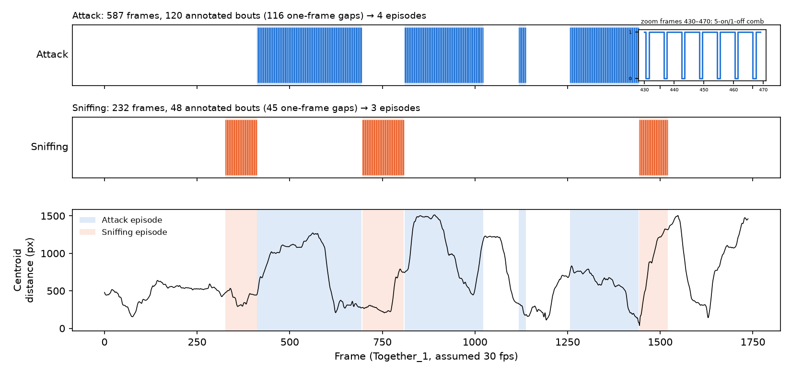

**Figure 1.** Together_1 ethogram. The inset shows the 5-on/1-off annotation comb, and the bottom panel shows centroid distance with episodes shaded. The labels are a regular comb (median bout length 5 frames) nested inside only 4 Attack and 3 Sniffing episodes, so the effective number of independent labelled events is very small. The two long Attack episodes coincide with the largest inter-animal separations of the video (up to ~1,500 px).

### 2.2 Assumptions

- **Animal roles (assumption).** Animal 1 (suffix `_1`, "M1") is taken to be the *resident* and Animal 2 ("M2") the *intruder*. This is not documented in the files.
- **Frame rate (assumption).** 30 fps. It affects only the rolling-window lengths: fps/{2, 5, 6, 7.5, 15} = {15, 6, 5, 4, 2} frames.
- **Pixel scale.** 4.2425 px/mm, estimated from the reference table (see §3.1) and assumed to be shared by both videos.

---

## 3. Methods

### 3.1 Feature engineering and validation (`code/features.py`, `code/02_features.py`)

We re-implemented the SimBA "2 animals, 16 body-parts" feature extractor from pose only. Column names are identical to the reference table. There are 498 features:
- convex-hull "area";
- intra-animal distances (nose–tail, width, ear distance, nose/centroid-to-lateral);
- inter-animal distances (centroid, nose–nose, nose-to-lateral, nose-to-tail-base);
- per-body-part frame-to-frame movement and total movement;
- pairwise body-point distance statistics ("hull" largest/smallest/mean/sum);
- rolling median, mean and sum over 5 windows;
- tail-end relative movement;
- three-point body angle and its rolling sums;
- deviation-from-video-mean and percentile-rank transforms;
- probability sums and low-probability detection counts.

Validating against the 497 computable reference columns exposed several undocumented SimBA conventions. We reproduced them for fidelity:

| SimBA convention | What it means |
|---|---|
| `Mouse_N_poly_area` is the convex-hull *perimeter* | SimBA calls `scipy.ConvexHull.area`, which in 2-D is the perimeter |
| Movement uses a previous frame zero-filled at frame 0 | Frame 0 gets a spurious large "movement" |
| `*_deviation` = mean − value | Opposite sign to the usual convention |
| Rolling-window `*_percentile_rank` columns are copies of the `*_deviation` columns | Not actually percentile ranks |
| `Sum_probabilities_percentile_rank` ranks the deviation | Not the raw sum |
| The reference lacks `Tail_end_movement_M2_mean_7.5` | One column of the feature family is missing |

**Feature tags.** Every feature was tagged with a **category** and an **animal role**; the tags are in `outputs/feature_categories.csv`.
- Categories: `distance` (inter-animal), `movement`, `shape` (hull, width, nose–tail and other intra-animal geometry), `angle`, `tracking` (likelihood-derived), plus `position` (raw coordinates), `roi`, and `index_control` (`Feature_1/2`).
- Roles: M1, M2, or inter (relational or both animals).

### 3.2 Classifiers (`code/03_classifiers.py`)

**Headline model (SimBA defaults).**
- `RandomForestClassifier(n_estimators=2000, criterion='entropy', max_features='sqrt', bootstrap=True)`.
- One binary model per behaviour, trained on the 498 engineered features. The index columns are excluded.
- Random *stratified* 80/20 frame split (SimBA's default), repeated over seeds 0–4.

**Thresholds.** We report the 0.5 threshold and an F1-maximising threshold chosen **on out-of-bag predictions of the training frames only**. The test set is never used to choose thresholds. The OOB thresholds were 0.316 ± 0.020 for Attack and 0.236 ± 0.024 for Sniffing.

**Metrics.** On held-out frames we computed:
- AP, using `average_precision_score` (step-function AP, no interpolation);
- ROC-AUC, F1, precision and recall;
- sklearn classification reports (`outputs/classification_reports.json`);
- confusion matrices (`outputs/confusion_matrices.json`).

**Control feature sets** (500 trees, 3 seeds):
- `pose48` — raw pose only;
- `provided50` — the distributed feature table as is, including `Feature_1/2`;
- `index_only` — `Feature_1/2` alone.

**Annotation-artifact sensitivity.** We re-scored the same predictions against labels whose isolated 1-frame gaps were filled (`gap_closed_eval`). We also retrained on gap-closed labels (`gap_closed_train_and_eval`). This is reported as a correction for an annotation artifact, *not* as the headline.

**Second recording (analogue condition).** We used the same forest settings with 500 trees, run on two feature sets:
- the reference table's own 517 SimBA features;
- our 498 recomputed features.

Two CV schemes were applied:
- SimBA-style stratified random 5-fold, 3 seeds;
- blocked contiguous 5-fold with a 15-frame purge.

With 3 Attack bouts and 1 Sniffing bout, the reference estimates are **fragile by construction**.

**Cross-recording transfer.** Train on all of one recording and predict the other, using identical recomputed feature definitions.

### 3.3 Interpretability (`code/04_importance.py`, `code/05_shap.py`)

**Permutation importance.**
- Computed on the held-out frames of the seed-0 split.
- One forest of 300 trees, same hyper-parameters (reduced from 2,000 for runtime).
- 5 repeats per feature. F1 drop and AP drop are computed from the same permutations.
- Run for the engineered set, the provided 50-column table, and the reference recording's 517 SimBA features.

**Grouped permutation.** All columns of a category, role, or category × role group are row-permuted *jointly* (20 repeats). This avoids the masking caused by the many near-duplicate rolling-window variants.

**MDI (Gini/entropy) importance.** Mean ± SD over 5 seeds (500 trees).

**TreeSHAP.**
- `shap.TreeExplainer` (shap 0.54.1, exact tree path-dependent algorithm) on a 200-tree forest with the same settings, trained on the seed-0 80% split.
- SHAP values are on the probability scale for the positive class.
- Summaries for Together_1 use the 348 held-out frames. For the reference recording, all 300 frames were explained by a model trained on its 80% split.
- SHAP values are saved in `outputs/shap_values*.csv`.

**Attribution shares.** Mean |SHAP| per feature was summed within category, role, and category × role, then normalised to shares. Two adjustments were added:

1. **Per-feature enrichment** = share ÷ fraction of features in the group. This matters because the groups are very unequal in size: 37 distance vs 227 movement vs 208 shape features.
2. **Twin-feature role balance.** This is the M1 fraction of |SHAP| over the 148 features that exist in matched M1/M2 versions. It is needed because SimBA computes several rolling and deviation families *only for Mouse 1*, so raw role shares are confounded by feature count.

**Confidence intervals.** 95% intervals come from a **block bootstrap** that resamples 30-frame blocks (~1 s), 200 resamples. The block structure respects temporal autocorrelation; independent-row bootstraps gave CIs roughly 2× narrower.

**Comparisons.**
1. Attack vs Sniffing within Together_1.
2. Together_1 vs the reference recording, per behaviour, on identical feature definitions.
3. Per-episode profiles within Together_1 (descriptive; ~80% of episode frames are training frames).

### 3.4 Validity checks (`code/06_validity.py`)

1. **Index-only control** under the random split (see §3.2).
2. **Blocked 5-fold temporal CV** with a 15-frame purge (200 trees). Results are per fold and pooled.
3. **Leakage curve.** Contiguous blocks of length L ∈ {1, 6, 30, 120, 348} are randomly assigned to a 20% test set. Engineered features, 100 trees, 3 seeds.
4. **Circular-shift null.** Labels are rotated by 15 random offsets (≥ 150 frames). This preserves label autocorrelation but destroys the feature–label correspondence. Each shift is evaluated under both the random split and blocked CV (100 trees). Empirical p = (1 + #null ≥ real) / (1 + 15).
5. **Determinism.** SHA-256 of the test-set probabilities from two same-seed fits.

**Compute.** 2 CPUs (`n_jobs=2`), all seeds fixed. Runtime: ~9 min for the headline models, ~2 min for SHAP, ~7 min for validity, ~11 min for importance.

---

## 4. Results

### 4.1 The re-implemented features reproduce SimBA's own columns

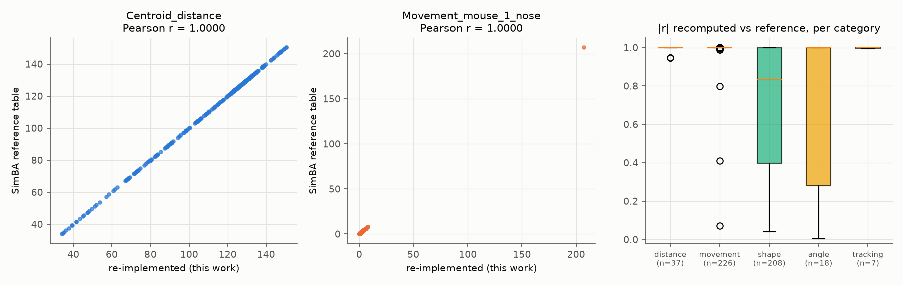

**Figure 2.** Re-implemented vs SimBA reference features on the reference recording's pose.

- **Overall agreement.** 337 of 497 recomputable features match at |r| > 0.99 and 375 at |r| > 0.9 (`outputs/feature_validation_vs_reference.csv`).
- **By category** (fraction with |r| > 0.99):

  | Category | Fraction at \|r\| > 0.99 |
  |---|---|
  | tracking | 100% |
  | movement | 98% |
  | distance | 92% |
  | angle | 68% |
  | shape | 30% |

- **Distances** match after a constant ratio of 4.2425 px/mm.
- **Remaining disagreements:**
  - the pairwise-point "smallest/mean hull distance" families, where SimBA's handling of missing (0, 0) keypoints differs;
  - tortuosity, whose SimBA definition we could not infer;
  - a few percentile-rank columns.

The feature layer of the workflow is therefore transparent and reproducible for the feature types that later dominate the classifiers (distance, movement).

### 4.2 Headline performance and PR curves

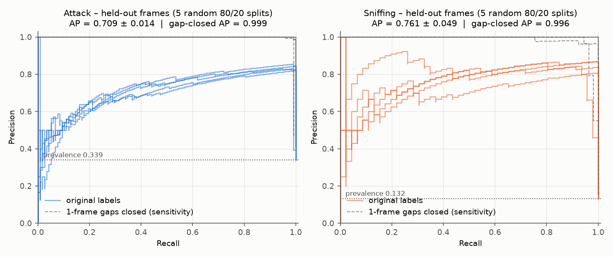

**Figure 3.** Held-out PR curves on Together_1 for 5 random splits. Solid lines use the original labels; dashed grey lines score the same predictions against gap-closed labels. The dotted line marks prevalence.

**Table 1.** Together_1, random 80/20 split, engineered features, 2,000 trees, 5 seeds (mean ± SD). Source: `outputs/together1_random_split_metrics.csv`.

| Behaviour | Threshold | Labels scored | AP | ROC-AUC | F1 | Precision | Recall |
|---|---|---|---|---|---|---|---|
| Attack | 0.5 | original | 0.709 ± 0.014 | 0.918 ± 0.008 | 0.846 ± 0.009 | 0.818 ± 0.013 | 0.876 ± 0.011 |
| Attack | OOB-max-F1 (0.32) | original | 0.709 ± 0.014 | 0.918 ± 0.008 | **0.905 ± 0.007** | 0.833 ± 0.010 | 0.990 ± 0.008 |
| Attack | OOB-max-F1 | gap-closed (sensitivity) | 0.999 ± 0.001 | 0.999 ± 0.002 | 0.994 ± 0.005 | 0.997 ± 0.004 | 0.991 ± 0.007 |
| Sniffing | 0.5 | original | 0.761 ± 0.049 | 0.979 ± 0.005 | 0.787 ± 0.026 | 0.822 ± 0.034 | 0.757 ± 0.037 |
| Sniffing | OOB-max-F1 (0.24) | original | 0.761 ± 0.049 | 0.979 ± 0.005 | **0.899 ± 0.024** | 0.826 ± 0.031 | 0.987 ± 0.026 |
| Sniffing | OOB-max-F1 | gap-closed (sensitivity) | 0.996 ± 0.005 | 0.999 ± 0.001 | 0.982 ± 0.013 | 0.975 ± 0.018 | 0.989 ± 0.022 |

**Unusual PR shape.** The PR curves on the original labels have an atypical form: precision is *lowest* at the highest scores and rises with recall (Fig. 3). The frames the model is most confident about include the 1-frame "off" gaps inside long episodes. These gaps are labelled negative, but in pose space they are indistinguishable from their neighbours, so they absorb the top of the ranking.

**The gaps account for the false positives.** Every Attack false positive at threshold 0.5 lies on a gap frame, in all 5 seeds (24/24, 23/23, 20/20, 22/22, 26/26). For Sniffing the figure is 37 of 38 false positives across seeds (`classification_reports.json`, keys `*_FP_on_gap_frames`).

**Gap-closed labels.** Scoring against gap-closed labels raises AP to ≥ 0.996, and retraining on gap-closed labels gives AP 0.999–1.000. The AP ceiling (~0.71–0.76) is therefore a property of the annotation comb, not of the classifier.

Classification reports for seed 0 at threshold 0.5:

| Behaviour | Positive class (precision / recall / F1) | Negative class (precision / recall / F1) | Accuracy |
|---|---|---|---|
| Attack | 0.808 / 0.856 / 0.831 (support 118) | 0.924 / 0.896 / 0.909 | 0.882 |
| Sniffing | 0.810 / 0.739 / 0.773 (support 46) | 0.961 / 0.974 / 0.967 | 0.943 |

### 4.3 Confusion matrices

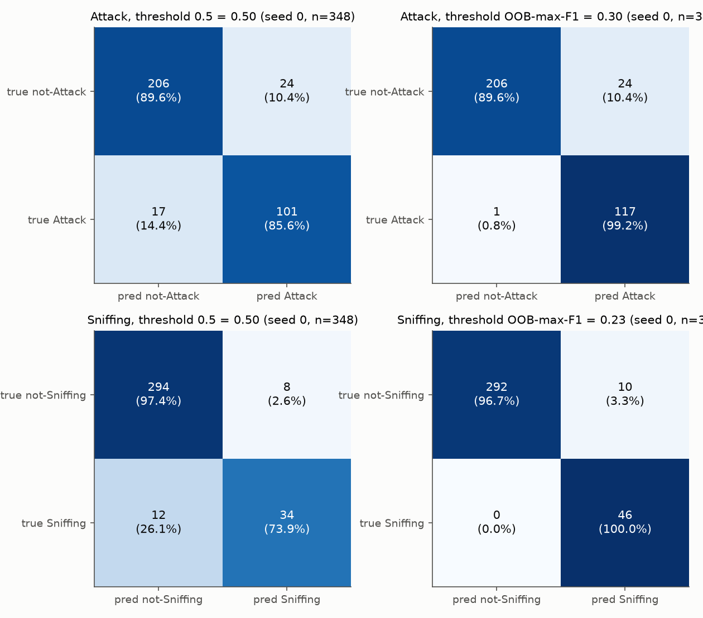

**Figure 4.** Seed-0 confusion matrices (counts and row %) at threshold 0.5 and at the OOB-selected threshold.

- **Attack.** At 0.5: TN 206, FP 24, FN 17, TP 101. At the OOB threshold the false negatives drop to 1 (TP 117) while FP stays at 24, which is precisely the gap frames.
- **Sniffing.** At 0.5: TN 294, FP 8, FN 12, TP 34. At the OOB threshold: FN 0, FP 10.

### 4.4 Feature-set comparison: the index columns perform almost as well

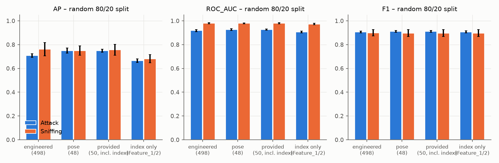

**Figure 5.** AP, ROC-AUC and F1 (OOB threshold) for each feature set under the random split.

Under the random split, models on the 48 raw coordinates (AP 0.750 / 0.750) or on the distributed 50-column table (0.749 / 0.757) match or slightly exceed the 498 engineered features (AP 0.709 for Attack, 0.761 for Sniffing). Strikingly, **the two index columns alone** reach:

| Behaviour | F1 @ 0.5 | F1 @ OOB threshold | AP | ROC-AUC |
|---|---|---|---|---|
| Attack | 0.866 | 0.907 | 0.665 | 0.906 |
| Sniffing | 0.866 | 0.897 | 0.681 | 0.973 |

A feature with no behavioural content can achieve this only if test frames are interpolated from temporally adjacent training frames. The random-split numbers in Table 1 therefore cannot, on their own, be read as evidence of behaviour recognition (§4.8).

### 4.5 Second recording (reference table): PR curves and fragility

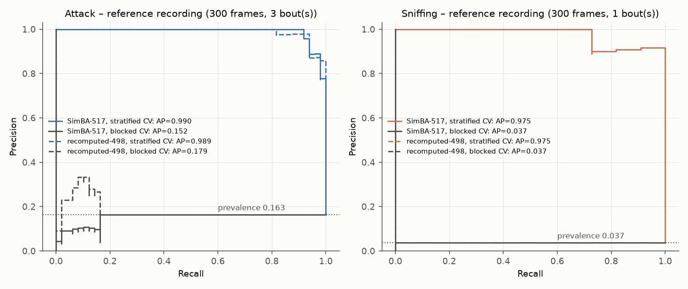

**Figure 6.** PR curves on the 300-frame reference recording.

**Table 2.** Reference recording (500 trees). Source: `outputs/reference_cv_metrics.csv`.

| Feature set | Behaviour | CV scheme | AP | ROC-AUC | F1 @ 0.5 | Prevalence |
|---|---|---|---|---|---|---|
| SimBA-517 | Attack | stratified random 5-fold (3 seeds) | 0.990 ± 0.000 | 0.998 | 0.917 | 0.163 |
| SimBA-517 | Attack | blocked 5-fold, purge 15 | 0.152 | 0.235 | 0.113 | 0.163 |
| SimBA-517 | Sniffing | stratified random 5-fold | 0.979 ± 0.004 | 0.999 | 0.874 | 0.037 |
| SimBA-517 | Sniffing | blocked 5-fold | 0.037 | 0.235 | 0.000 | 0.037 |
| recomputed-498 | Attack | stratified random 5-fold | 0.989 ± 0.001 | 0.998 | 0.937 | 0.163 |
| recomputed-498 | Attack | blocked 5-fold | 0.179 | 0.197 | 0.167 | 0.163 |
| recomputed-498 | Sniffing | stratified random 5-fold | 0.975 ± 0.000 | 0.999 | 0.874 | 0.037 |
| recomputed-498 | Sniffing | blocked 5-fold | 0.037 | 0.194 | 0.000 | 0.037 |

- **Random CV is near-perfect.** The reference recording has no annotation comb, so random CV gives near-perfect AP (≈ 0.98–0.99) on both SimBA's features and ours. The two feature sets agree, which supports the fidelity of the re-implementation.
- **Blocked CV is degenerate.** Sniffing has a single 11-frame bout, so its training folds contain no positives and AP equals prevalence. For Attack, all three bouts lie in frames 5–67, so blocked folds train on at most two short bouts.

These reference estimates should be treated as illustrative only.

**Cross-recording transfer** (`outputs/cross_recording_transfer.csv`). Models trained on Together_1 predict **0** positive frames on the reference recording for both behaviours (max p = 0.41 for Attack, 0.36 for Sniffing). Attack AP is 0.128, below the prevalence of 0.163. Sniffing shows weak rank information (ROC-AUC 0.81, AP 0.099 vs prevalence 0.037). In the reverse direction, Attack AP is 0.250 (prevalence 0.338) and Sniffing AP is 0.178 (prevalence 0.133).

### 4.6 Permutation importance (top-15) and MDI

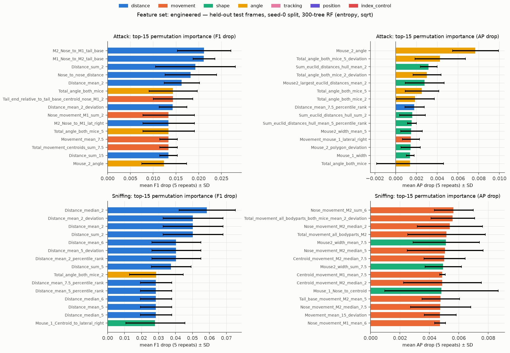

**Figure 7.** Top-15 permutation importance on held-out Together_1 frames, engineered features. Left: F1 drop. Right: AP drop. Colours indicate category.

**F1-based ranking** (`outputs/perm_top15_F1_engineered_*.csv`).
- **Attack:** dominated by inter-animal distances: `M2_Nose_to_M1_tail_base` and `M1_Nose_to_M2_tail_base` (each ΔF1 = 0.021), then `Distance_sum_2`, `Nose_to_nose_distance`, `Distance_mean_2`. Angle and movement features follow (`Total_angle_both_mice`, `Nose_movement_M1_sum_2`).
- **Sniffing:** almost entirely short-window centroid-distance statistics: `Distance_median_2` ΔF1 = 0.059, then `Distance_mean_2`, `Distance_mean_2_deviation`, `Distance_sum_2` (0.050 each).

**AP-based ranking.** Single-feature AP drops are tiny (≤ 0.008) and often negative. Redundant rolling-window variants mask one another, and AP is capped by the label comb in any case. The AP top-15 is therefore an unstable ranking. It favours angle features for Attack (`Mouse_2_angle`, ΔAP = 0.008) and M2 movement features for Sniffing.

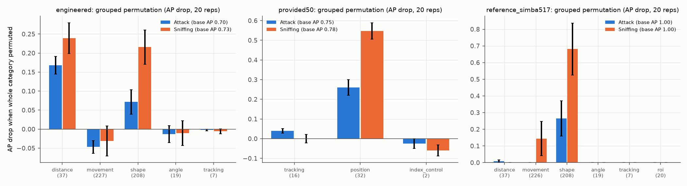

**Figure 8.** Grouped permutation importance: AP drop when a whole category is permuted jointly (20 repeats).

**Grouped permutation** (`outputs/grouped_permutation_importance.csv`) removes the redundancy problem:

| Group permuted | Attack ΔAP (base 0.702) | Sniffing ΔAP (base 0.730) |
|---|---|---|
| distance (37 features) | 0.168 ± 0.023 | 0.239 ± 0.040 |
| shape (208) | 0.071 ± 0.032 | 0.216 ± 0.045 |
| movement (227) | −0.047 ± 0.017 | −0.031 ± 0.040 |
| angle (19) | −0.013 ± 0.022 | −0.011 ± 0.033 |
| tracking (7) | −0.002 ± 0.002 | −0.006 ± 0.006 |
| role: inter-animal | 0.225 ± 0.038 | 0.430 ± 0.066 |
| role: M1 | −0.054 ± 0.021 | 0.012 ± 0.037 |
| role: M2 | −0.051 ± 0.015 | 0.052 ± 0.038 |

The 37 inter-animal distance features are the single most necessary category. In F1 terms, permuting the distance group removes 0.37 (Attack) and 0.44 (Sniffing) of F1. Negative ΔAP for movement means that scrambling movement slightly *improves* AP, consistent with movement features fitting the gap frames.

**Provided 50-column table** (Fig. 9a). Top F1 features are raw coordinates (`Tail_end_1_y`, `Lat_right_1_y`, `Tail_end_2_x`) together with the index columns `Feature_2` and `Feature_1`. These are ranked #2–3 for Attack (ΔF1 0.040 and 0.035) and #5–6 for Sniffing. In MDI terms, `Feature_1/2` rank **#1–2 for Attack** (MDI 0.096 and 0.095, `outputs/mdi_top15_provided50_Attack.csv`) and #2–3 for Sniffing (0.061 each).

**Reference SimBA-517 table** (Fig. 9b). With only 60 test frames (10 Attack, 2 Sniffing positives), single-feature permutation is degenerate: all top Attack F1 drops are 0, and Sniffing F1 drops take only the values 0.27 and 0.33. MDI is more informative here. Its top features are:
- **Attack:** an ROI feature (`Circ_Simon_distance`) followed by `M2_Nose_to_M1_tail_base`, `Nose_to_nose_distance` and `M1_Nose_to_M2_tail_base`;
- **Sniffing:** tail-end movement features.

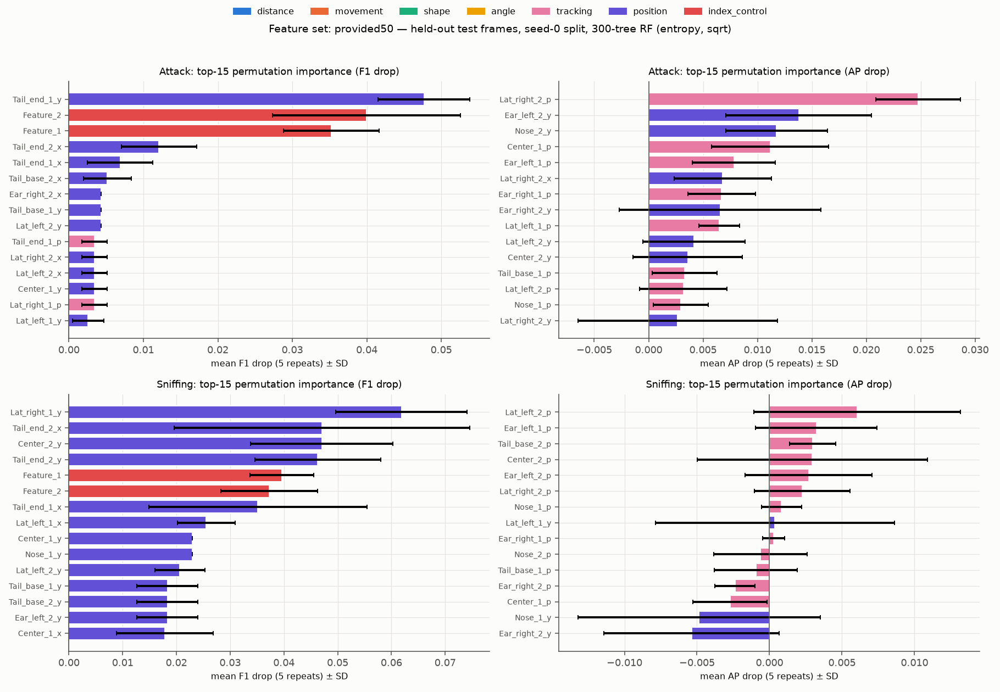

**Figure 9a.** Permutation top-15 for the distributed 50-column table. Red bars are the index-control columns.

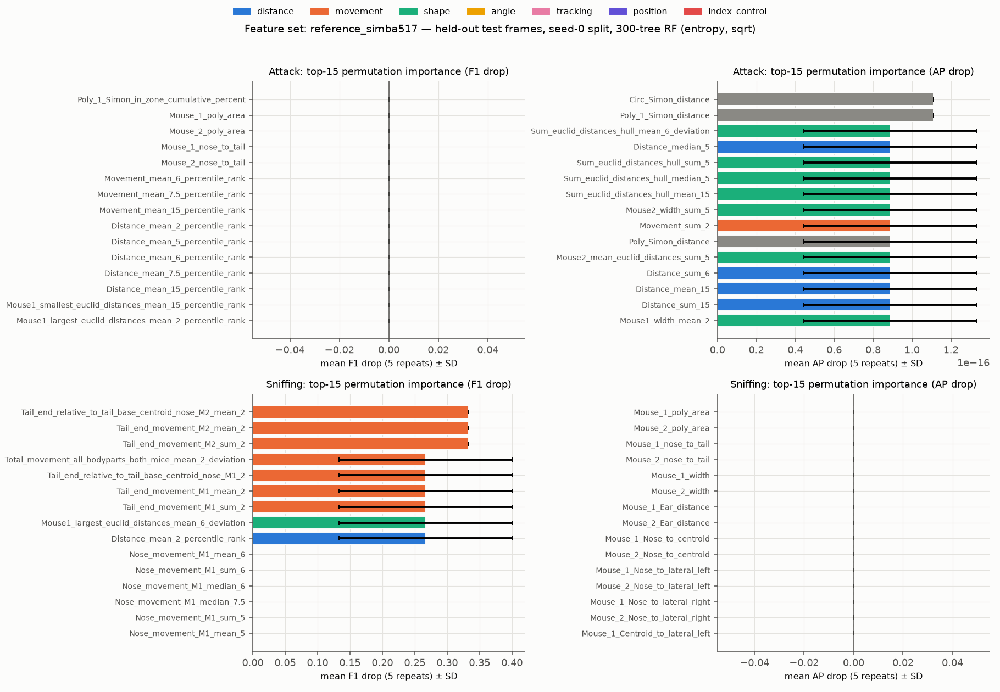

**Figure 9b.** Permutation top-15 for the reference recording's 517 SimBA features. The ranking is degenerate because of the small test set.

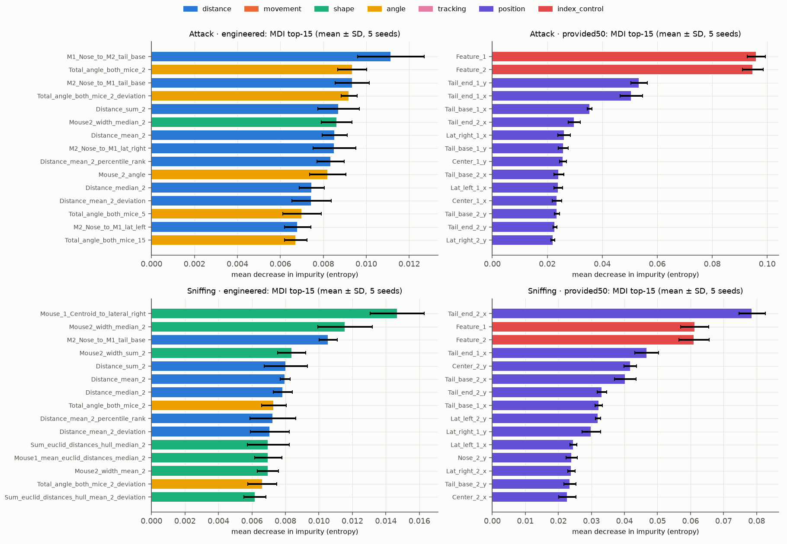

**Figure 10.** MDI top-15 (mean ± SD over 5 seeds) for the engineered and provided feature sets.

The engineered MDI ranking is stable across seeds (SD ≈ 10% of the mean):
- **Attack:** `M1_Nose_to_M2_tail_base` (0.0112 ± 0.0016), `Total_angle_both_mice_2`, `M2_Nose_to_M1_tail_base`, `Total_angle_both_mice_2_deviation`, `Distance_sum_2`.
- **Sniffing:** `Mouse_1_Centroid_to_lateral_right` (0.0147 ± 0.0016), `Mouse2_width_median_2`, `M2_Nose_to_M1_tail_base`.

### 4.7 TreeSHAP: features, categories, roles and cross-condition comparisons

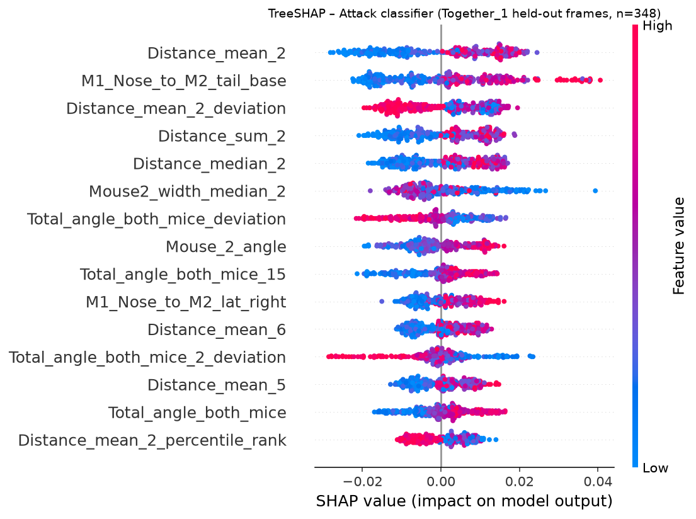
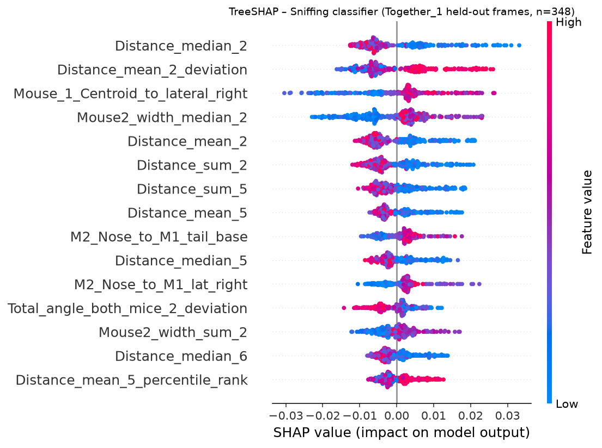

**Figure 11.** TreeSHAP beeswarm plots (top 15, Together_1 held-out frames, n = 348). Bar-plot versions: `images/fig_shap_bar_Attack.png` and `images/fig_shap_bar_Sniffing.png`.

**Top features.** The SHAP top-15 (`outputs/shap_top15.csv`) agrees with permutation and MDI that inter-animal distance features lead both classifiers. It also adds the *direction* of each effect: the column `corr_value_vs_shap` is the correlation between a feature's value and its SHAP value.

- **Sniffing (Together_1).** `Distance_median_2`, `Distance_mean_2` and `Distance_sum_2` all have negative value–SHAP correlations (−0.64 to −0.67). Sniffing probability rises when the animals are close, which is what the behavioural definition requires.
- **Attack (Together_1).** `Distance_mean_2` (r = +0.73) and `M1_Nose_to_M2_tail_base` (r = +0.81) have *positive* correlations: Attack probability rises when the animals are **far apart**. This is not a SHAP artifact. The raw data agree (`outputs/feature_medians_by_state.csv`):

  | Frames | Median centroid distance |
  |---|---|
  | Labelled Attack | 179 mm |
  | Sniffing | 99 mm |
  | Other | 128 mm |
  | Attack episodes 1 and 2 | 237 and 242 mm (vs 86–102 mm in the 60 frames before each) |

- **Attack (reference recording).** The relationship has the expected sign. `M1_Nose_to_M2_tail_base` (r = −0.80) and `Nose_to_nose_distance` (r = −0.82) show Attack being predicted at short range (median centroid distance 98 mm vs 126 mm for other frames).

The same feature therefore pushes the Attack prediction in **opposite directions** in the two recordings. Either the Together_1 Attack labels or pose tracks are not physically consistent with an attack (for example, an identity or keypoint failure, or demonstration labels), or the "Attack" label means different things in the two files. Without the video we cannot decide which. SHAP made the inconsistency visible.

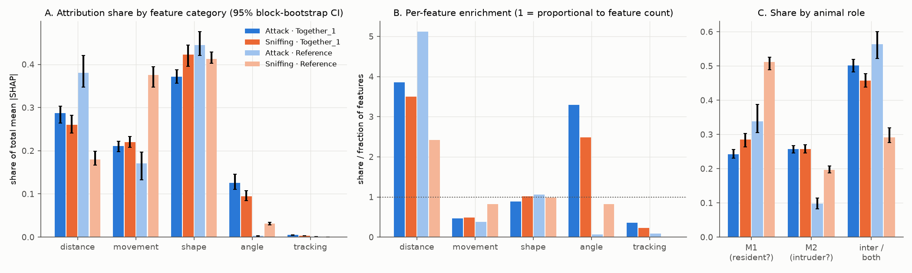

**Figure 12.** TreeSHAP attribution. (A) Share of total mean |SHAP| by category, with 95% block-bootstrap CIs. (B) Per-feature enrichment. (C) Share by animal role.

**Table 3.** Category shares of mean |SHAP|, with 95% block-bootstrap CI and enrichment (share ÷ feature fraction). Source: `outputs/shap_category_role_shares.csv`.

| Category (n features) | T1 Attack | T1 Sniffing | Ref Attack | Ref Sniffing |
|---|---|---|---|---|
| distance (37) | 0.287 [0.264, 0.304], ×3.86 | 0.260 [0.241, 0.282], ×3.50 | 0.380 [0.347, 0.421], ×5.12 | 0.180 [0.167, 0.198], ×2.42 |
| movement (227) | 0.211 [0.198, 0.222], ×0.46 | 0.220 [0.208, 0.233], ×0.48 | 0.171 [0.133, 0.197], ×0.38 | 0.376 [0.347, 0.394], ×0.83 |
| shape (208) | 0.372 [0.356, 0.387], ×0.89 | 0.422 [0.396, 0.445], ×1.01 | 0.444 [0.421, 0.476], ×1.06 | 0.413 [0.403, 0.428], ×0.99 |
| angle (19) | 0.126 [0.110, 0.146], ×3.30 | 0.095 [0.085, 0.107], ×2.48 | 0.003, ×0.07 | 0.031, ×0.82 |
| tracking (7) | 0.005, ×0.36 | 0.003, ×0.22 | 0.001, ×0.09 | 0.000 |

**Do distance or movement features dominate?** Ranked by raw share, the large *shape* family (208 features) takes the largest slice everywhere (37–44%). Normalised per feature, however, the **inter-animal distance** features are the most informative in every condition: they carry 2.4–5.1× their numeric share. Movement features are under-weighted in every condition (×0.38–0.83). The exception is Sniffing on the reference recording, where movement is the largest single share (0.376), led by tail-end movement features.

Angle features matter in Together_1 (×2.5–3.3) but hardly at all in the reference recording.

Tracking-confidence features contribute < 0.5% everywhere. The model is not *directly* exploiting likelihoods, although see the zero-coordinate confound below.

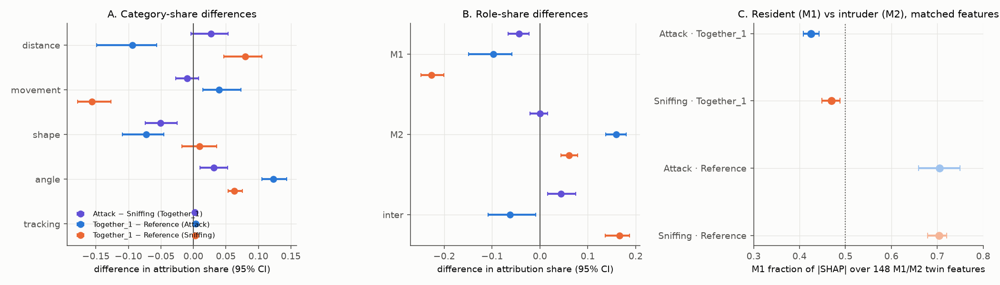

**Figure 13.** Differences in attribution share between conditions, with 95% block-bootstrap CIs. (A) By category. (B) By role. (C) M1 fraction of |SHAP| over 148 matched M1/M2 twin features.

**Comparison 1 — Attack vs Sniffing (Together_1).** The two classifiers rely on similar evidence. Category differences are small, though some CIs exclude zero (`outputs/shap_share_differences.csv`):

| Category | Attack − Sniffing share | 95% CI |
|---|---|---|
| shape | −0.051 | [−0.074, −0.025] |
| angle | +0.031 | [+0.010, +0.054] |
| distance | +0.027 | [−0.003, +0.054], includes 0 |
| movement | −0.009 | CI includes 0 |

Attack therefore leans slightly more on posture angle, and Sniffing more on intra-animal shape, mainly `Mouse_1_Centroid_to_lateral_right` and `Mouse2_width_median_2`.

In role shares, Attack places more weight than Sniffing on inter-animal features (+0.044) and less on M1 (−0.043).

On matched twin features, M1's fraction of |SHAP| is 0.425 [0.409, 0.442] for Attack and 0.470 [0.448, 0.488] for Sniffing. Both classifiers therefore weight the **assumed intruder (M2)** slightly more than the assumed resident, with Attack more intruder-leaning. If M1 is indeed the resident, this means intruder posture and angle (`Mouse_2_angle`, `Mouse2_width_median_2`) is slightly more diagnostic than resident posture in this video. The role assignment, however, is an assumption.

**Comparison 2 — Together_1 vs the reference recording.**

- **Attack.** Category profiles differ significantly:

  | Category | Together_1 − Reference share | 95% CI |
  |---|---|---|
  | distance | −0.094 | [−0.148, −0.056] |
  | angle | +0.123 | [+0.106, +0.143] |
  | movement | +0.040 | [+0.015, +0.073] |
  | shape | −0.073 | — |

  The top features also differ (Fig. 14B). On the reference recording, nose-to-tail-base and nose-to-nose distances dominate. On Together_1, short-window centroid-distance statistics and angle features dominate, and they enter with the opposite sign.

- **Sniffing.** The difference is driven by movement, which is much more important on the reference recording (−0.156 [−0.178, −0.127]), and by M1 (role difference −0.227).

- **Resident vs intruder.** On the twin features, the reference models give M1 **70%** of attribution for both behaviours (Attack 0.705 [0.659, 0.749], Sniffing 0.704 [0.679, 0.720]). Together_1 gives 43–47%. We traced this to tracking. In the reference recording, M1's tail-base keypoint is missing (x = 0) in **100% of Attack and 100% of Sniffing frames**, against 37% and 45% of other frames. Every M1 feature that uses the tail base or tail end therefore carries a "tracking failed" signal that co-occurs with the behaviour. The reference recording's apparent resident-dominance is a **tracking confound**, not a biological finding.

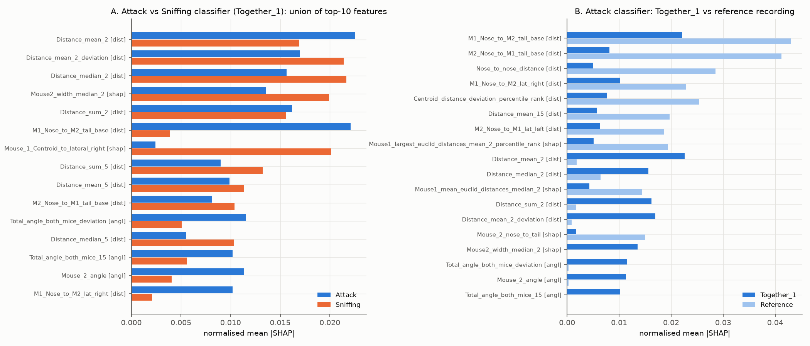

**Figure 14.** Normalised mean |SHAP| for the union of top features. (A) Attack vs Sniffing (Together_1). (B) Attack on Together_1 vs the reference recording. Bracketed tags indicate category.

**Comparison 3 — per-episode profiles (Together_1, descriptive).**

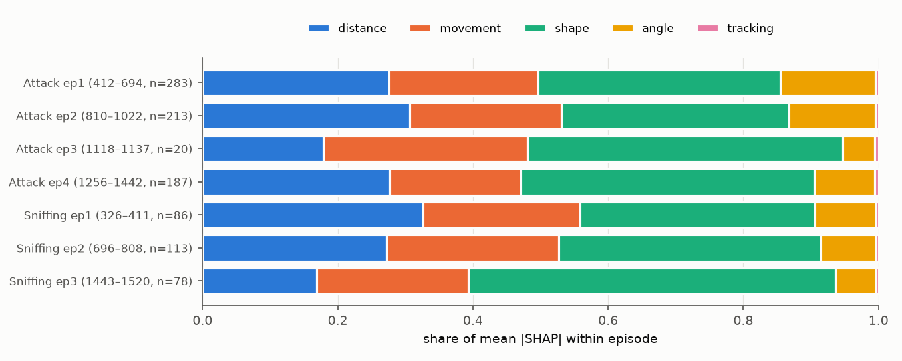

**Figure 15.** Per-episode SHAP category profiles in Together_1.

The three long Attack episodes have similar profiles:

| Attack episode | distance | shape | movement | angle |
|---|---|---|---|---|
| Episode 1 | 0.28 | 0.36 | 0.22 | 0.14 |
| Episode 2 | 0.31 | 0.34 | 0.22 | 0.13 |
| Episode 4 | 0.28 | 0.43 | 0.20 | 0.09 |

The short 20-frame episode 3, which is the only one at close range (median centroid distance 69 mm), is instead driven by shape (0.47) and movement (0.30), with a larger M2 role share (0.40).

Sniffing episode 3 (frames 1443–1520) is more shape- and M1-dominated (shape 0.54, M1 0.37) than episodes 1–2. The per-episode heterogeneity matters because the *unit of replication* for any behavioural claim here is the episode: n = 4 for Attack and n = 3 for Sniffing.

### 4.8 Validity: what the evidence does and does not support

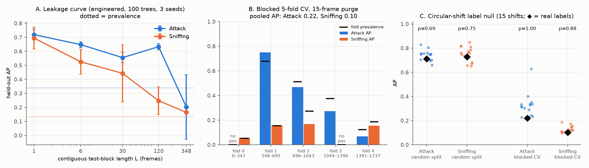

**Figure 16.** (A) Leakage curve: held-out AP vs contiguous test-block length. (B) Blocked 5-fold CV per fold, with fold prevalence marked. (C) Circular-shift null: 15 rotated label sequences (dots) vs the real labels (◆), under the random split and under blocked CV.

1. **The leakage curve falls with block length** (`outputs/leakage_curve.csv`).

   | Behaviour | L = 1 | L = 6 | L = 30 | L = 120 | L = 348 |
   |---|---|---|---|---|---|
   | Attack AP | 0.720 | 0.648 | 0.555 | 0.633* | 0.203 |
   | Sniffing AP | 0.695 | 0.526 | 0.443 | 0.248 | 0.164 |

   \*At L = 120, test-fold Attack prevalence was 0.54, which inflates AP; ROC-AUC fell to 0.55. Performance decays toward chance as test frames become temporally distant from training frames.

2. **Blocked 5-fold CV with a 15-frame purge** (`outputs/blocked_cv_metrics.csv`). Pooled out-of-fold scores:

   | Feature set | Behaviour | AP | ROC-AUC | Prevalence |
   |---|---|---|---|---|
   | engineered | Attack | 0.220 | 0.209 | 0.338 |
   | engineered | Sniffing | 0.100 | 0.378 | 0.133 |
   | provided50 | Attack | 0.256 | — | 0.338 |
   | provided50 | Sniffing | 0.138 | — | 0.133 |
   | index_only | Attack | 0.408 | — | 0.338 |
   | index_only | Sniffing | 0.175 | — | 0.133 |

   With only 4 and 3 episodes, each fold must extrapolate to an unseen episode. Fold-level AP mostly tracks fold prevalence (Fig. 16B). ROC-AUC below 0.5 indicates that the within-video feature–label relationship is *inverted* between episodes. This is consistent with the Attack-at-large-distance anomaly in §4.7.

3. **Circular-shift null** (`outputs/circular_shift_null_summary.json`).

   | Behaviour | Random split: real AP | Random split: null AP | p | Blocked CV: real AP | Blocked CV: null AP | p |
   |---|---|---|---|---|---|---|
   | Attack | 0.713 | 0.739 ± 0.043 | 0.69 | 0.221 | 0.325 ± 0.098 | 1.00 |
   | Sniffing | 0.727 | 0.752 ± 0.062 | 0.75 | 0.102 | 0.129 ± 0.027 | 0.88 |

   Random-split AP is reproduced just as well by label sequences that have the same autocorrelation but no correspondence to the animals' behaviour.

4. **Determinism** (`outputs/determinism.json`). Two same-seed fits produce identical SHA-256 hashes of the test probabilities (`499ba3e7…`); a different seed gives a different hash.

**Summary of validity.** The workflow's *computations* are reproducible and auditable. However, on this material the headline random-split metrics measure the ability to interpolate a temporally smooth label sequence. They do not measure the ability to recognise Attack or Sniffing in new data.

---

## 5. Discussion

**Reproducibility.** Every stage was re-executed with open code, and the feature layer was matched to SimBA's own output column by column, including several undocumented conventions:
- "poly area" is the hull perimeter;
- deviations are computed as mean − value;
- rolling percentile-rank columns are copies of deviations;
- frame 0 movement is zero-filled.

Classifiers, thresholds chosen on out-of-bag predictions, PR curves with AP, classification reports and confusion matrices are all deterministic given a seed. In this narrow, computational sense the SimBA workflow is reproducible.

**Transparency and auditability.** The interpretability layer did more than rank features: it produced *audit findings*.
- Grouped permutation and per-feature SHAP enrichment consistently identify **inter-animal distance** as the most informative feature family. This is biologically sensible for social behaviours and matches the design rationale of SimBA and MARS.
- The SHAP sign shows that the Together_1 Attack classifier predicts Attack at *large* separation, opposite to the reference recording and to the behavioural definition. The raw distances confirm it.
- The twin-feature role analysis showed that the reference recording's "resident-dominant" attribution is caused by a missing M1 tail-base keypoint in every positive frame.
- Permutation importance on the distributed 50-column table ranks the frame-index columns among the top features, a red flag visible from the default importance outputs alone.

Each of these would be missed by a reader who saw only F1 ≈ 0.90.

**Which evidence is trustworthy?**

| Claim | Supported by these data? |
|---|---|
| The pipeline is reproducible and deterministic | **Yes** |
| Distance features are the most informative family per feature, for both behaviours | **Yes**, within the limits of a single video (consistent across SHAP, grouped permutation and MDI, and across both recordings) |
| Attack and Sniffing classifiers use similar categories, with small, statistically resolvable differences (Attack more angle, Sniffing more shape) | **Descriptively yes**. CIs are from a 30-frame block bootstrap, but there are only 3–4 episodes per behaviour |
| Held-out F1 ≈ 0.90 / AP ≈ 0.71–0.76 measures behaviour recognition | **No.** It is matched by an index-only control and by circular-shift nulls, and it collapses under blocked CV and cross-recording transfer |
| Resident vs intruder weighting | **Not resolvable.** Roles are assumed, and in the reference recording the weighting is confounded by tracking failure |
| Differences between labs, sexes or housing | **Not testable.** No such conditions exist in the public data; our "conditions" are analogues |

**Relation to prior work.** MARS (Segalin et al., 2021) evaluates on held-out *videos* and reports inter-annotator variability. DeepEthogram (Bohnslav et al., 2021) also evaluates on held-out videos. B-SOiD (Hsu & Yttri, 2021) emphasises cross-animal generalisation. Our results show quantitatively why those designs matter: with a random frame split, even a frame counter scores F1 ≈ 0.87 on this file.

The 1-frame annotation comb is a further, separate hazard. It caps AP at ~0.71–0.76 and produces all of the false positives. Annotation tools and label exports should be checked for such artifacts before metrics are reported.

**Limitations.**
1. **One annotated video** (1,738 frames, 4 Attack and 3 Sniffing episodes) and one 300-frame reference recording with 3 and 1 bouts. All "cross-condition" comparisons are analogues.
2. **Assumptions.** Animal roles (M1 = resident), frame rate (30 fps) and a shared pixel scale (4.2425 px/mm) are assumed. The scale affects only the absolute mm values, not the models.
3. **Reduced forest sizes for interpretation.** SHAP used 200 trees and permutation importance used 300, rather than the 2,000-tree headline model. MDI rankings were stable across seeds, but the explanation models are not bit-identical to the headline model.
4. **SHAP summaries are partly in-sample.** For Together_1 they use the 348 held-out frames. Per-episode profiles and all reference-recording SHAP values include training frames and are descriptive only.
5. **Bootstrap CIs understate uncertainty.** The block bootstrap respects within-video autocorrelation but not between-episode variability. With n = 3–4 episodes, the CIs are too narrow for population-level inference.
6. **Imperfect feature fidelity.** Shape (hull) features and tortuosity are matched imperfectly, and the 20 ROI features of the reference table could not be recomputed.

---

## 6. Conclusion

On the official SimBA sample files, the SimBA-style workflow can be re-executed end to end with open code:
- the engineered features match SimBA's own columns exactly for the distance, movement, angle and tracking families;
- the 2,000-tree entropy random forests are deterministic;
- the workflow produces the full set of evidence: classification reports, PR curves and AP, confusion matrices, top-15 permutation importance by F1 and AP, MDI, and TreeSHAP, with feature-category and animal-role aggregation.

Under the default random-split protocol the classifiers reach the following on held-out frames:

| Behaviour | F1 | AP |
|---|---|---|
| Attack | 0.905 | 0.709 |
| Sniffing | 0.899 | 0.761 |

AP is capped by a 1-frame annotation comb.

Interpretation consistently favours inter-animal distance features. It also exposed three problems in the sample data:
- an Attack label that coincides with large rather than small inter-animal distance in Together_1;
- a tracking-failure confound behind the reference recording's resident-weighted attributions;
- frame-index columns that rank among the top features.

Validity controls show that the headline performance does not exceed what temporal autocorrelation alone produces. The index-only control gives F1 0.87, the circular-shift null gives p ≈ 0.7, and blocked CV and cross-video transfer fall to chance.

The workflow is therefore **reproducible and auditable**, and its transparency tools are what revealed these issues. The sample project does **not**, however, provide evidence of generalisable Attack or Sniffing recognition. That would require several annotated videos with evaluation on held-out videos or animals.

---

## Reproducibility: code and outputs

| Script | Purpose | Key outputs |
|---|---|---|
| `code/common.py`, `code/features.py`, `code/style.py` | Loaders, bout utilities, SimBA feature re-implementation and category tagging, plotting style | — |
| `code/01_audit.py` | Data audit, ethogram | `outputs/audit.json`, `fig01` |
| `code/02_features.py` | Feature computation and validation vs the reference | `features_engineered_*.csv`, `feature_validation_vs_reference.csv`, `feature_categories.csv` |
| `code/03_classifiers.py` | Headline RFs, controls, gap sensitivity, reference CV, transfer | `together1_random_split_*.csv`, `classification_reports.json`, `confusion_matrices.json`, `reference_cv_*.csv`, `cross_recording_transfer.csv` |
| `code/04_importance.py` | Permutation (F1/AP), grouped permutation, MDI | `permutation_importance_all.csv`, `perm_top15_*`, `grouped_permutation_importance.csv`, `mdi_*` |
| `code/05_shap.py` | TreeSHAP, shares, block-bootstrap CIs, comparisons, twin roles, episodes | `shap_values*.csv`, `shap_top15.csv`, `shap_category_role_shares.csv`, `shap_share_differences.csv`, `shap_role_balance_twin_features.csv`, `shap_episode_profiles.csv` |
| `code/06_validity.py` | Blocked CV, leakage curve, circular-shift null, determinism | `blocked_cv_metrics.csv`, `leakage_curve.csv`, `circular_shift_null*.{csv,json}`, `determinism.json` |
| `code/07`–`10_figures_*.py`, `code/11_report_tables.py` | Figures and tables | `report/images/*.png`, `outputs/report_tables.md` |

Environment: Python 3.12, scikit-learn 1.9.1, shap 0.54.1, numpy 2.5, pandas 3.1; 2 CPUs. All random seeds are fixed in the code.

## References

- Bohnslav, J. P., et al. (2021). DeepEthogram, a machine learning pipeline for supervised behavior classification from raw pixels. *eLife* 10:e63377.
- Graving, J. M., et al. (2019). DeepPoseKit, a software toolkit for fast and robust animal pose estimation using deep learning. *eLife* 8:e47994.
- Hsu, A. I., & Yttri, E. A. (2021). B-SOiD, an open-source unsupervised algorithm for identification and fast prediction of behaviors. *Nature Communications* 12:5188.
- Pereira, T. D., et al. (2022). SLEAP: A deep learning system for multi-animal pose tracking. *Nature Methods* 19:486–495.
- Segalin, C., et al. (2021). The Mouse Action Recognition System (MARS) software pipeline for automated analysis of social behaviors in mice. *eLife* 10:e63720.
- Lundberg, S. M., et al. (2020). From local explanations to global understanding with explainable AI for trees. *Nature Machine Intelligence* 2:56–67.
- Nilsson, S. R. O., et al. Simple Behavioral Analysis (SimBA) – an open source toolkit for computer classification of complex social behaviors in experimental animals. *bioRxiv* (2020).
