# From connectome to function: predicting neural activity and motion-detection mechanisms of the *Drosophila* optic lobe with a connectome-constrained, task-optimized deep mechanistic network ensemble

## Abstract
We analysed the complete ensemble of 50 deep mechanistic networks (DMNs) of the *Drosophila* motion pathway: 45,669 neurons of 65 cell types, wired by the measured connectome (1,513,231 synapses, 604 type pairs with column-resolved synapse counts and signs). In each model only 734 parameters (resting potentials, time constants and unit synaptic strengths) were learned, by optimising optic-flow estimation on natural movies. With a re-implemented sparse simulator that matches flyvis to ≈10⁻⁶ and the native flyvis metrics, we found:

1. **Contrast preference is predicted almost exactly.** The best (lowest-loss) model gets the ON/OFF polarity of 30/32 experimentally characterised cell types right, and the ensemble-median prediction gets all 32.
2. **The connectome's sign structure suffices for polarity.** Untrained parameters already give 31/32.
3. **Direction selectivity needs both structure and training.** It is predicted for the known DS cells (median correlation with known DS 0.55; best model 0.88; non-DS inputs median DSI 0.05) and absent in untrained networks.
4. **The connectome's spatial offsets causally set the DS axis.** Collapsing them abolishes DS, and mirroring them rotates the preferred direction of 95 % of DS T4/T5 cells (median 176°) and reverses decoded flow.
5. **T4 DS is predicted robustly; T5 DS is not.** T4 ON-motion DS is robust (35/50 models), whereas T5 OFF-motion DS appears in only a subset of models, including the best one (T5 PD error 12°, tuning correlation 0.93). We show this is not an artefact of the metric.
6. **The mechanism is the experimentally described three-arm detector.** Silencing and current analysis show that Mi1 (T4) and Tm9 (T5) provide excitation, while offset inhibition from Mi4/CT1(M10) onto T4 arrives ≈ 85–90 ms earlier for null-direction motion (p = 0.002; the analogous 80 ms lead of CT1(Lo1) onto T5 is a trend, p = 0.078).
7. **Signed solution clusters link circuit polarity to tuning sign.** One T4c cluster is tuned upward as in the fly. Another is inverted, and every inverted model has an ON-responding Mi9 (Fisher OR = 28, p = 3·10⁻⁶); silencing Mi9 abolishes inverted tuning, whereas silencing Mi4 abolishes correct tuning (a double dissociation).
8. **TmY3/5a/13/18 compute direction selectivity in parallel to T4/T5.** These DS TmY neurons receive no or negligible T4/T5 input and keep their DS when all T4/T5 outputs are silenced.

Together, the analyses show that connectome measurements plus a functional objective predict single-cell-type activity and expose the circuit logic of motion detection. They also identify which predictions are under-determined (T5 tuning, Mi9/L3 polarity, tuning sign) and that call for the ensemble approach and for experimental tests.

---

## 1. Introduction

The *Drosophila* optic lobe is one of the few circuits whose synaptic wiring is known at the level of identified cell types and columnar offsets (Takemura et al. 2013/2015; Shinomiya et al. 2019; Matsliah et al. 2024 — `related_work/`). A wiring diagram alone, however, leaves the single-neuron dynamics (resting potentials, membrane time constants) and the efficacy of a single synapse undetermined. The deep-mechanistic-network (DMN) approach closes this gap with *task knowledge*. Every neuron and every synapse of the motion pathway is modelled, and the wiring is fixed by the connectome. Only per-cell-type and per-type-pair scalars are left free, and these are optimised end-to-end so that a small decoder can read optic flow from the network's output neurons.

This report analyses the provided ensemble of 50 such pre-trained DMNs (`data/flow/0000/000–049`). We do not retrain them; the 2-core CPU budget makes retraining 50 networks for 250k iterations impossible. Instead we:

1. re-implement and **validate** the network dynamics;
2. simulate the voltage of all 45,669 neurons in response to flashes, moving edges and moving textures;
3. compare the predictions with experimentally known properties: ON/OFF contrast preference, direction selectivity (DS), preferred directions (PD) and T4/T5 tuning curves;
4. run **inference-time ablations and coarse-grainings**, which ask how much of the predictive power comes from the connectome as opposed to the learned parameters;
5. dissect the **mechanism** of motion detection by targeted silencing, input-current decomposition and a parallel-pathway test;
6. relate the ensemble's **solution clusters** to circuit mechanism with a signed analysis.

Throughout we separate **checked facts** (connectome counts, simulator equivalence), **model predictions** (intact trained networks) and **perturbation results** (inference-time manipulations of trained networks, which are not retrained models).

---

## 2. Data and model

### 2.1 Data overview
The dataset (`data/flow/0000`) contains the complete flyvis ensemble `flow/0000`.

- **Per-model files (50 models, `000`–`049`):**
  - `best_chkpt`: network and decoder state dicts;
  - `chkpts/chkpt_00000`;
  - a validation loss;
  - `_meta.yaml`, the full network/task configuration.
- **Ensemble-level file:** `umap_and_clustering/<cell type>.pickle` (65 files). Each holds a UMAP embedding of every model's responses to naturalistic stimuli, plus Gaussian-mixture cluster labels.

The connectome (`fib25-fib19_v2.2.json`) ships with flyvis 1.2.0.

**Checked facts:**
- **Network size** (Fig. 2): 65 cell types (the 64-type count of the original work plus CT1 split into its two compartments, CT1(M10) and CT1(Lo1)), 45,669 neurons and 1,513,231 synapses (edges).
  - All types tile a hexagonal lattice of 721 columns (extent 15), except Lawf1 and Lawf2 (123 cells each).
  - There are 604 connected type pairs with 2,355 distinct (pair, Δu, Δv) offsets.
- **Output signs:** 37 types have only excitatory outputs, 22 only inhibitory, and 4 mixed. Mi11 and Tm30 have no outputs, so their parameters receive no task gradient and their "predictions" are unconstrained.
- **Validation losses** range from 5.137 (model 000, the "best model") to 5.678. The model folders are already sorted by loss.
- **`chkpt_00000` is bit-identical to `best_chkpt`** for all parameter tensors. It is therefore *not* an untrained baseline, and untrained networks were instead sampled from the configured initial distributions (§2.6).
- **All 50 `_meta.yaml` files are byte-identical** (status "manually written", seed 0). What distinguishes the 50 models (e.g. random seeds) is not recorded in the data.

**Offset convention** (verified on all edges): Δu = u_target − u_source and Δv = v_target − v_source.

### 2.2 Network dynamics (deep mechanistic network)
Each neuron *i* of cell type *t_i* is a passive point neuron with graded (non-spiking) synaptic transmission:

$$\tau_{t_i}\,\frac{dV_i}{dt} = -V_i + V^{\text{rest}}_{t_i} + \sum_j w_{ij}\,\mathrm{ReLU}(V_j) + e_i(t), \qquad w_{ij} = \sigma_{t_it_j}\, N_{t_it_j}(\Delta u,\Delta v)\,\alpha_{t_it_j}.$$

- **Fixed by the connectome:**
  - the sign σ of each type pair (604 values);
  - the average synapse count N for each type pair and each hexagonal column offset (Δu, Δv) (2,355 values).
- **Learned by the task:**
  - resting potentials V^rest (65);
  - time constants τ (65);
  - non-negative unit synaptic strengths α (604).

This gives 734 free and 2,959 fixed parameters. The photoreceptors R1–R8 receive the luminance of their hexagonal column as input current e_i.

Integration uses forward Euler with effective time constant max(τ, Δt). The initial state is V = V^rest, followed by 1 s of grey (luminance 0.5) to reach a steady state. These are the PPNeuronIGRSynapses dynamics of flyvis 1.2.0, and the derivation was checked against its source.

### 2.3 Task optimization (as configured in the shipped `_meta.yaml` and flyvis configs; not re-run)
We did not repeat training (2 CPU cores; 250,000 iterations × 50 models is infeasible). The shipped configuration specifies:
- **Task:** optic-flow estimation on augmented Sintel movie clips (`MultiTaskSintel`), using 19 frames at dt = 20 ms. The movies are rendered through a hexagonal `BoxEye` (extent 15, kernel 13), with random temporal crops, flips and rotations, contrast/brightness jitter and Gaussian noise (σ = 0.08).
- **Decoder:** `DecoderGAVP`. It takes rectified voltages of the 34 output cell types (T1–T5, Tm, TmY) and applies a hexagonal convolution (34→8 channels, kernel 5, batch norm, softplus, dropout 0.5), then 8→2+1 channels with a normalising channel.
- **Loss:** L2 norm of the per-column flow error.
- **Optimisation:**
  - backpropagation through time through the Euler-integrated network dynamics (PyTorch);
  - Adam, with learning rates stepped from 5·10⁻⁵ to 5·10⁻⁶ for the network and decoder;
  - batch size 4 for 250k iterations;
  - plus an activity penalty (SGD; baseline activity 5, weight 0.1, active until iteration 150k) that keeps rectified resting activity from collapsing.
- **Initialisation:**
  - V^rest ~ N(0.5, 0.05) per type;
  - τ = 50 ms;
  - α = 0.01/⟨N⟩, i.e. inversely proportional to the mean synapse count of the type pair;
  - α is clamped non-negative.

No explicit clamp on τ exists. However, the training step (20 ms) makes τ_eff = max(τ, 20 ms), so the gradient vanishes below 20 ms, and 74 % of the learned τ lie at ≈19–20 ms (Fig. 3).

### 2.4 Fast, validated simulator
flyvis integrates the dynamics with gather/scatter operations over edges. Because the connectome is identical across models, we re-implemented the dynamics as a sparse CSR matrix (targets × sources) built from the loaded semantic parameters (`code/fastsim.py`). It is integrated in torch on 2 threads, with the state stored as (neurons × batch).

**Edge-stimulus trimming.** For moving edges we additionally:
- integrate the grey pre-stimulus period once at batch size 1;
- stop at the end of the time window that the flyvis peak-response metric uses.

The remaining frames are never read by the metric.

**Validation** (`code/01_validate_sim.py`, `01b_…`, `01c_…`; Fig. 1). We compared against native `flyvis.analysis.stimulus_responses` for the best model and for models 001 and 002:

| quantity | max discrepancy |
|---|---|
| flash responses (4 stimuli) | 9.5·10⁻⁷ |
| moving-edge responses (24 stimuli, 19°/s) | ≤ 2.9·10⁻⁶ (max response ≈ 6.6) |
| native DSI on fast vs native responses | ≤ 2.3·10⁻⁷ |
| native FRI | ≤ 3.1·10⁻⁷ |
| native PD, cells with DSI > 0.01 | ≤ 5·10⁻⁶ rad |

Larger PD differences occur only for silent cells with DSI ≈ 10⁻¹⁷, whose angle is undefined. Speed-up for one speed × 24 edges: ≈ 4 s versus ≈ 240 s of native simulation, and versus ≈ 37 min including flyvis' one-off stimulus rendering.

### 2.5 Stimuli and metrics
All stimulus datasets are the flyvis classes themselves, so stimulus rendering is native. All metrics are the **native flyvis functions**, applied to xarray datasets formatted exactly as flyvis does (`code/stimuli.py`).

- **Flashes** (`Flashes`): full-field (radius 6 hexals) ON (1) and OFF (0) steps on a grey 0.5 background, 1 s each, at dt = 5 ms.
  - **Flash response index:** FRI = (r_ON − r_OFF)/(r_ON + r_OFF), where r is the peak response after shifting all responses to be non-negative.
  - **Polarity accuracy:** sign(FRI) against the 32 cell types with known contrast preference (`groundtruth_utils.polarity`; 24 excluding R1–R8).
- **Moving edges** (`MovingEdge`): ON and OFF edges (height 80 LEDs) in 12 directions at 6 speeds (2.4–25 columns·s⁻¹), at dt = 5 ms.
  - **Peak response:** maximum of the rectified voltage of the central cell while the edge crosses ±22.5° around it.
  - **DSI** = |Σ_θ r_θ e^{iθ}| / max_contrast Σ_θ r_θ, averaged over speeds.
  - **PD** = arg Σ r_θ e^{iθ}.
  - **Further metrics:**
    - angular PD error to the known T4/T5 preferred directions (T4/T5a 180°, b 0°, c 90°, d 270°);
    - correlation of the predicted T4/T5 tuning curves with the measured ones (Maisak et al. 2013);
    - the correlation between DSI (maximum over ON/OFF) and a binary known-DS label over the 18 types with known DS (8 DS T4/T5 types and 10 non-DS T4/T5 input types; flyvis `dsi_correlation_to_known`).
- **Ensemble analyses:** all 6 speeds.
- **Ablations and silencing:** 3 speeds (4.8, 13, 25 columns·s⁻¹), with the intact baseline re-computed identically.

### 2.6 Inference-time ablations and coarse-graining (no retraining)
All ablations perturb *trained* networks at inference time, without retraining (`code/ablations.py`, `code/04_ablations.py`). They answer how much of each prediction is carried by connectome structure versus learned parameters in the trained solution. The original study's stronger counterfactual, re-training under a degraded connectome, was not computationally possible here. The ten best models (000–009), or ten random draws, were used for each condition:

1. **intact** trained network;
2. **connectome + untrained parameters:** V^rest ~ N(0.5, 0.05), τ = 50 ms, α = 0.01/⟨N⟩. These are the configured initial distributions; 10 seeds;
3. **trained parameters permuted:** the trained V^rest, τ and α of each model are randomly re-assigned across cell types and type pairs, which keeps their marginal distributions but destroys type identity;
4. **shuffled connectome:** every type pair (s → t) keeps its spatial filter, counts and trained strength, but its source s is replaced by a random different type of the same output-sign class (E or I);
5. **polarity only:** sign and connectivity support are kept, but every synapse count is replaced by a constant per target type, preserving the total synapses per target cell;
6. **no spatial structure:** every filter is collapsed into the home column, with its total weight preserved;
7. as 6, but only for filters onto T4a–d and T5a–d;
8. **mirrored filters** onto T4/T5, (Δu, Δv) → (−Δu, −Δv). This is a causal test of whether the spatial offset determines PD;
9. **subtype-tied:** the parameters of T4a–d and of T5a–d are averaged, leaving 59 instead of 65 parameter groups (the "58-type" coarse-graining on our 65-type count). Strengths are averaged across type pairs that coincide after merging;
10. **E/I/mixed-tied:** all node parameters are averaged within output-sign classes (E, I, mixed, none), and all strengths within (class_src, class_tgt, sign) groups.

Conditions 4, 6, 7 and 8 rebuild the edge list from the modified filter table. Rebuilding the unmodified table reproduces the original 1,513,231 edges and their weights exactly (max |ΔW| = 0). Paired Wilcoxon tests compare each condition with intact, using the same models.

### 2.7 Mechanism analyses
Mechanism analyses (`code/05_mechanism.py`):

- **(a) Targeted silencing.** All synapses from one presynaptic type onto all T4 (or all T5) subtypes are removed. This covers every input type with ≥ 1 synapse per T4c (T5c) cell, in the 10 best models. We report ΔDSI, the shift in PD and the gain (silenced/intact maximal peak response). These are reported only for (model, subtype) pairs that are DS when intact (DSI ≥ 0.2).
- **(b) Input-current decomposition.** The synaptic currents w_ij·ReLU(V_j) onto the central T4c (T5c) cell are summed per presynaptic type. They are computed for ON (OFF) edges moving at 19°/s in the anatomical PD (90°) and null direction (270°), in the 10 best models.
- **(c) TmY parallel pathway.**
  - From the connectome edge list we list every presynaptic type of TmY3, 4, 5a, 13, 14, 15 and 18, and whether it is a T4/T5 type.
  - We then silence all output synapses of T4a–d and T5a–d and re-measure the DSI of all types.
- **(d) Structure → function.** We test whether the flyvis list of cell types with spatially asymmetric connectome input predicts larger DSI (one-sided Mann-Whitney U).

### 2.8 Solution clusters
The provided clusterings partition the 50 models by the shape of each cell type's responses to naturalistic stimuli. Cluster indices were re-sorted by mean validation loss (C0 = lowest).

- **Per cluster:** circular-mean PD (weighted by DSI), mean DSI, polar tuning curves of every model, and the fraction of models whose Mi4 (known ON) and Mi9 (known OFF) have the correct FRI sign.
- **T4c classification** in every model:
  - *correct*: DSI ≥ 0.2 and PD within 45° of upward;
  - *inverted*: PD within 45° of downward;
  - *oblique*;
  - *non-DS*.
- **Statistics:** association with the Mi4/Mi9 polarity configuration was tested with χ² (4 × 4) and Fisher's exact test (2 × 2).
- **Causal follow-up** (`code/06b_cluster_causal.py`): Mi9 and/or Mi4 synapses onto T4 were silenced in the inverted and the correct models.

### 2.9 Optic-flow decoding
We could not download Sintel (offline environment, multi-GB), so flow decoding was tested on synthetic stimuli (`code/textures.py`, `code/07_flow.py`).

- **Stimuli:**
  - a 1/f (β = 1.6) noise texture rendered with the training eye (`BoxEye(15, 13)`) at the training dt of 20 ms;
  - rigid translation in 8 directions at 4 px/frame (≈ 0.3 columns/frame);
  - rotation and expansion about the centre.
- **Protocol:** after a 1 s grey steady state and 0.5 s of the static first frame, the network ran for 40 motion frames. Each model's own trained decoder read out the flow over the last 20 frames.
- **Scores:**
  - cosine and angular error between the spatio-temporally averaged decoded vector and the true direction;
  - for rotation and expansion, the mean per-column cosine with the analytic flow field.

The conventions (x right, y up) were verified with the translation stimuli. All 50 models were tested intact and with the outputs of T4, T5, T4+T5, Mi1+Tm3 (main T4 drivers) or Tm9+CT1(Lo1) (main T5 drivers) silenced.

---

## 3. Results

### 3.1 Simulator equivalence and data overview (checked facts)

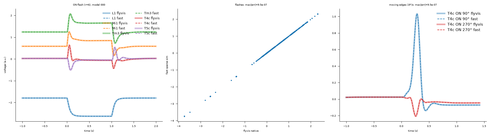

**Figure 1. Validation of the fast sparse simulator against native flyvis (best model, 000).**
- *Left:* central-cell voltages for an ON flash. Thick lines: flyvis; dashed: fast simulator.
- *Middle:* all flash responses (65 types × 4 stimuli × 600 frames). Max |error| = 9.5·10⁻⁷.
- *Right:* T4c responses to ON edges moving in its anatomical PD (90°) and null direction (270°) at 19°/s. Max |error| over all 24 edge stimuli = 9.5·10⁻⁷.

The native metric functions give identical FRI, DSI and PD on both sets of responses (§2.4), so every number below is a native flyvis quantity.

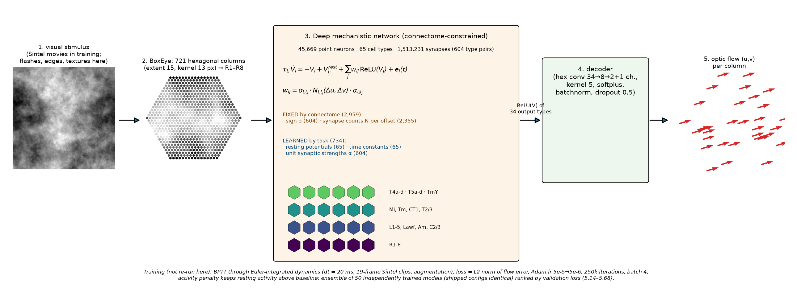

**Figure 2a. Pipeline.**
- A stimulus is sampled by the hexagonal eye (721 columns) and drives R1–R8.
- The DMN (45,669 neurons, wiring fixed by the connectome) produces voltages.
- A small convolutional decoder reads the rectified voltages of the 34 output types and estimates optic flow at every column.
- Only 734 scalars (V^rest, τ per type; α per type pair) and the decoder were learned.

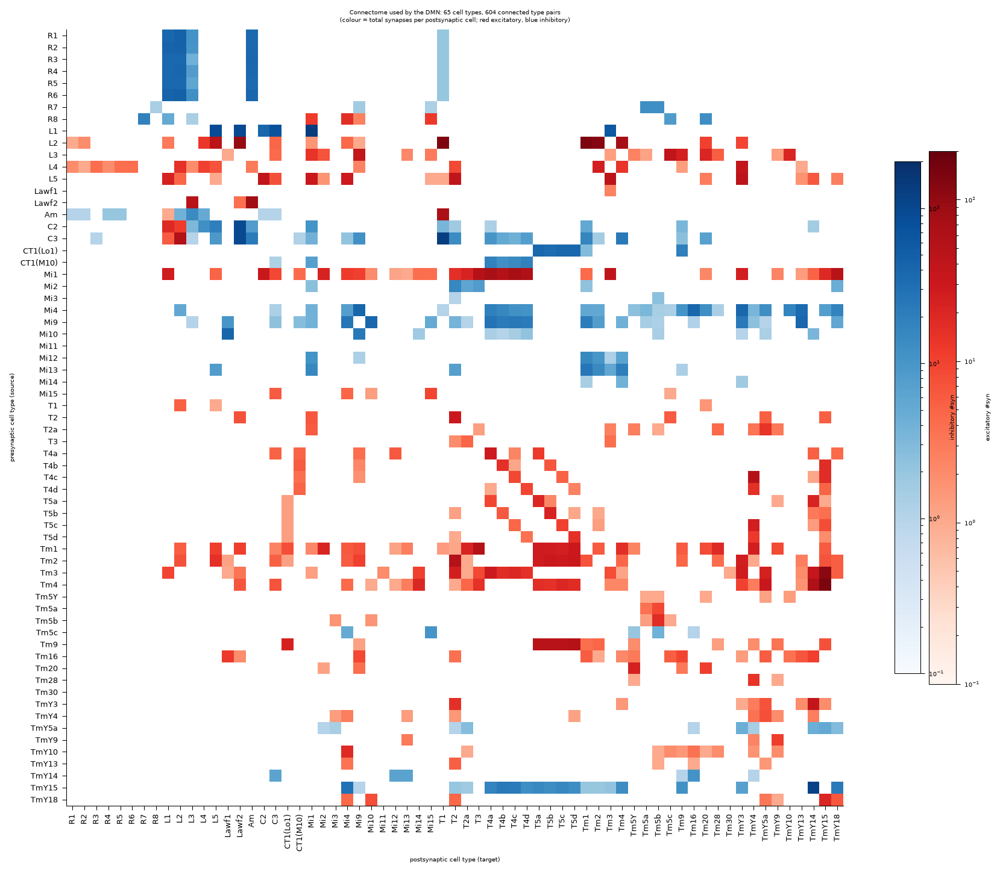

**Figure 2b. Connectome used by the DMN.** Rows = presynaptic (source), columns = postsynaptic (target) cell type. Colour = total synapses per postsynaptic cell summed over column offsets (log scale; red excitatory, blue inhibitory). Visible features:
- the photoreceptor → lamina block, where R1–R6 inhibit L1–L3 and Am;
- the ON pathway: L1 → Mi1/Tm3 → T4;
- the OFF pathway: L2/L3 → Tm1/Tm2/Tm4/Tm9 → T5;
- the T4/T5 inhibitory inputs: Mi4, Mi9, CT1(M10) and C3 onto T4; CT1(Lo1) onto T5;
- the dense TmY15 inhibitory projection onto T4/T5.

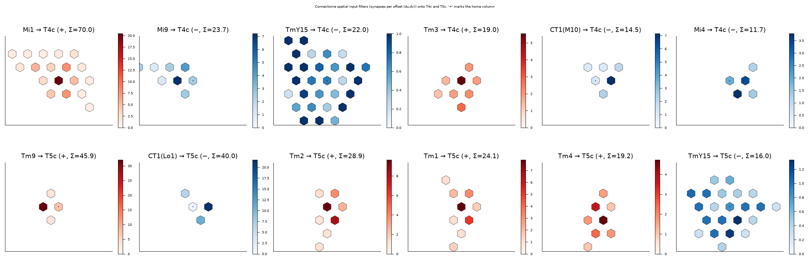

**Figure 2c. Spatial input filters (synapses per column offset) of the six largest inputs onto T4c (top) and T5c (bottom).**
- **T4c:** Mi1 and Tm3 excitation is roughly centred on the home column (+). The inhibitory Mi9 input is offset to one side and Mi4/CT1(M10) to the opposite side.
- **T5c:** Tm9 is offset relative to the CT1(Lo1) inhibition.

This anatomical asymmetry is the only source of direction-specific structure in the model.

### 3.2 What the task learned: parameters
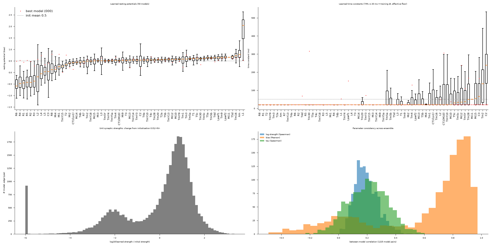

**Figure 3. Learned parameters across the 50 models (red dots: best model).**
- **Resting potentials** stay close to the 0.5 initialisation for most types. They are strongly negative for photoreceptors and strongly positive for L1, Am and Tm16.
- **Time constants:** 74 % of learned τ sit at the 20 ms effective floor, which equals the training dt. Slow τ (≥ 100 ms) are learned only for a subset of types (e.g. C2, C3, Tm2, Mi15, Lawf2, CT1(M10)), and only in some models.
- **Unit synaptic strengths** change by a median factor of 3.6 from initialisation, with a trimodal distribution:
  - 3.1 % are driven exactly to 0, i.e. functionally pruned;
  - a mode sits about 100× below initialisation;
  - the main mode lies about 3–10× above.
- **Consistency across models** (*bottom right*, 1,225 model pairs):
  - resting potentials are reproducible (median Pearson r = 0.77);
  - time constants (Spearman 0.21) and log-strengths (Spearman 0.18) are not.

The parameters are therefore strongly under-determined by the task, even though the predicted response properties below are largely shared. This is the motivation for an ensemble analysis.

### 3.3 Predicted contrast preference (ON/OFF) and direction selectivity of every cell type

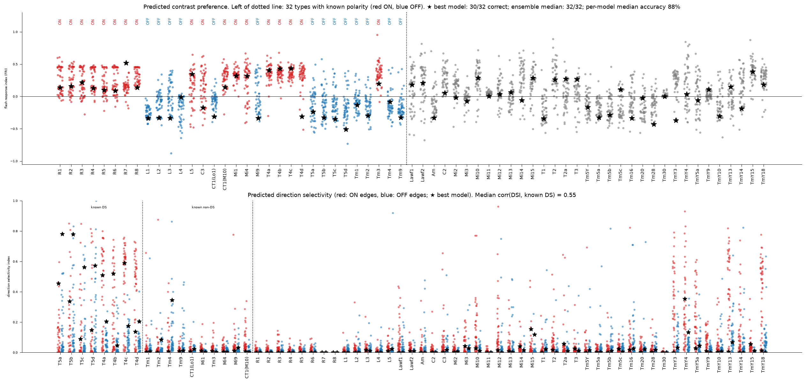

**Figure 4. Model predictions for all 65 cell types.**
- *Top:* FRI to full-field flashes, one dot per model; ★ marks the best model. The 32 types with experimentally known polarity are on the left, labelled with their known preference.
- *Bottom:* DSI to ON (red) and OFF (blue) moving edges, for the known-DS types (T4a–d, T5a–d), known non-DS types and the remaining types.

**Contrast preference (n = 50 models, 32 known types).**
- **Best model:** 30/32 known types correct, i.e. 93.8 %. Its errors are T4d (predicted OFF) and C3. Excluding photoreceptors it gets 22/24 (91.7 %).
- **Ensemble-median FRI:** correct for **32/32** types (24/24 without R1–R8).
- **Per-model accuracy:** median 87.5 % (IQR 81–91 %).
- **Least reliable types** (fraction of models correct): L3 (0.54), Mi9 (0.58), T5a (0.68), C3 (0.70), T5b (0.70) and L2 (0.72). These are the "bistable" cell types whose polarity differs between solutions (Fig. 8).
- **Relation to task loss:** polarity accuracy is not correlated with validation loss (Spearman ρ = −0.16, p = 0.28).

**Direction selectivity.**
- **Agreement with known DS labels:** correlation between DSI and the binary known-DS label has median **0.55** across models, and **0.88** for the best model.
- **Known non-DS T4/T5 input neurons** (Mi1, Tm3, Mi4, Mi9, CT1, Tm1/2/4/9) have median DSI 0.05.
- **T4:** median T4 ON-DSI (mean over a–d) is 0.33, and 35/50 models have T4 ON-DSI > 0.3.
- **T5:** OFF-edge DS is much weaker in most models. Median T5 OFF-DSI is 0.17, and only 6/50 models exceed 0.3 (paired Wilcoxon T4 vs T5 p = 9·10⁻⁸). The best model, however, has strongly and correctly tuned T5 (T5 DSI 0.67, PD error 12°, tuning-curve correlation 0.93).
- **DS outside T4/T5:**
  - TmY18 and TmY13 have ensemble-median ON-DSI of 0.47 and 0.38, comparable to T4;
  - TmY3, TmY4 and TmY5a reach 0.16–0.26.
- **Structure → function:** cell types listed as receiving spatially asymmetric connectome input have higher DSI than types with symmetric input (median 0.085 vs 0.017; one-sided Mann-Whitney U p = 1.1·10⁻⁶, n = 19 vs 33; Fig. S1).

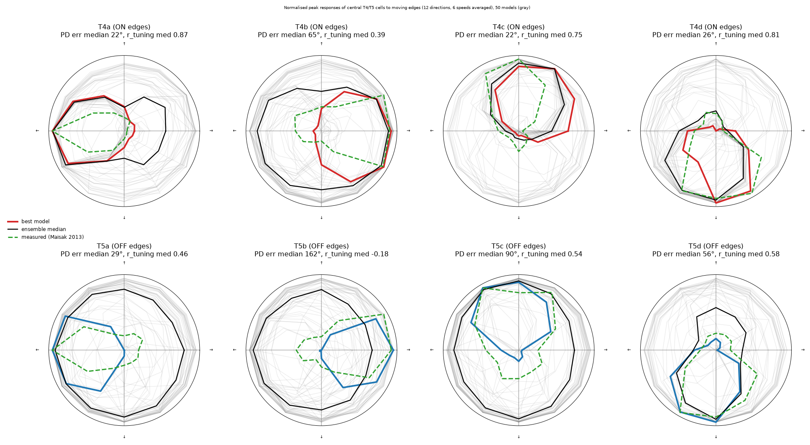

**Figure 5. Direction tuning of central T4 (ON edges) and T5 (OFF edges) cells versus measured tuning** (green dashed; Maisak et al. 2013, from flyvis ground truth).
- Gray: 50 individual models; black: ensemble median; colour: best model.
- **T4a, T4c and T4d** are correctly tuned in most models: median PD error 22°, 22° and 26°; median tuning-curve r = 0.87, 0.75 and 0.81.
- **T4b** is weaker (PD error 65°, r = 0.39).
- **T5 subtypes** are broadly tuned in most models, but the best model reproduces all four T5 PDs (PD error 12°).

**Relation to task loss.** Lower validation loss goes with better motion predictions:
- T4 DSI: ρ = −0.58, p = 9·10⁻⁶;
- T4 PD error: ρ = +0.43, p = 0.002;
- T4 tuning correlation: ρ = −0.39, p = 0.005;
- DSI–known-DS correlation: ρ = −0.37, p = 0.009.

T5 metrics are not correlated with loss (|ρ| < 0.09). See Fig. S2.

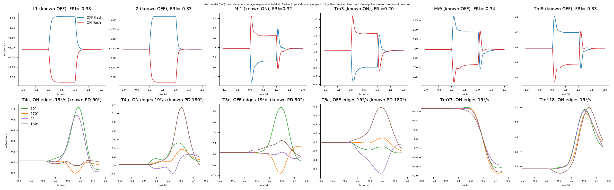

**Figure 6. Example voltage predictions of the best model.**
- *Top:* responses to full-field ON (red) and OFF (blue) flashes. L1 and L2 depolarise to OFF; Mi1 and Tm3 depolarise to ON; Mi9 and Tm9 are OFF cells.
- *Bottom:* responses to edges moving in four directions at 19°/s.
  - T4c and T5c respond selectively to upward motion (90°), and T4a and T5a to backward motion (180°); null-direction edges hyperpolarise.
  - TmY3 shows a non-selective OFF-like hyperpolarisation.
  - TmY18 depolarises for all directions in this model.

**Is weak T5 DS an artefact of the metric?** No. Using the native flyvis metric on native flyvis simulations gives the same low T5 DSI for models 001 and 002 (0.21/0.10/0.04/0.01 and 0.02/0.20/0.04/0.04 for T5a–d at 19°/s), while model 000 gives 0.78/0.75/0.58/0.53 (Table in §2.4, `outputs/01b_validation_edges.json`). The definition does not explain it either. Computed over all 50 models:

| DSI definition | T4 (ON) | T5 (OFF) |
|---|---|---|
| native | 0.44 | 0.063 |
| per-intensity normalisation | 0.45 | 0.065 |
| resting-potential-subtracted | 0.49 | 0.106 |

(Fig. S3, `outputs/t4t5_dsi_definition_summary.csv`.) Weak T5 direction selectivity is therefore a genuine property of most models in this ensemble. Only some solutions (including the best one) implement OFF-motion DS.

### 3.4 How much is carried by the connectome and how much by the learned parameters? Inference-time ablations

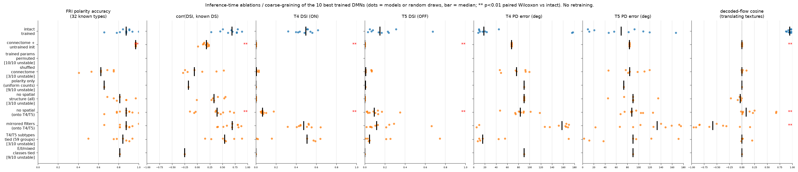

**Figure 7. Ablation and coarse-graining baselines.**
- One dot per model (10 best) or per random draw; black bar = median; ** = p < 0.01, paired Wilcoxon vs intact.
- Runs whose voltages diverged (|V| > 10⁴; "unstable", counted in the labels) are treated as failures and excluded from the medians.
- No network was retrained, so these are counterfactual perturbations of trained solutions, not alternative training conditions.

| condition (10 runs each) | unstable | FRI acc. (32) | corr(DSI, known) | T4 DSI | T5 DSI | flow cosine |
|---|---|---|---|---|---|---|
| intact, trained | 0 | **0.88** | **0.69** | **0.50** | 0.15 | **0.95** |
| connectome + untrained init | 0 | 0.97 | 0.18 | 0.0001 | 0.0000 | 0.00 |
| trained params permuted across types | **10** | — | — | — | — | — |
| shuffled connectome (sign-class preserving) | 3 | 0.62 | −0.06 | 0.006 | 0.011 | 0.00 |
| polarity only (uniform counts) | **9** | (0.66) | (−0.18) | (0.00) | (0.01) | (0.00) |
| no spatial structure (all filters) | 3 | 0.81 | 0.33 | 0.0002 | 0.0001 | −0.03 |
| no spatial structure (onto T4/T5 only) | 0 | 0.88 | 0.39 | 0.07 | 0.09 | 0.08 |
| mirrored filters onto T4/T5 | 0 | 0.88 | 0.69 | 0.48 | 0.12 | **−0.58** |
| T4a–d and T5a–d parameters tied (59 groups) | 3 | 0.84 | 0.55 | 0.51 | 0.05 | 0.00 |
| E/I/mixed classes tied | **9** | (0.81) | (−0.25) | (0.00) | (0.00) | (0.00) |

Values in parentheses come from the 1 stable run (`outputs/ablation_summary_table.csv`; p-values in `outputs/ablation_wilcoxon_vs_intact.csv`).

**1. Contrast polarity is largely a property of the connectome's sign structure.**
- With the untrained initial parameters, every seed predicts 31/32 known polarities correctly; only L5 is wrong.
- That is *better* than the trained models (0.97 vs 0.88, p = 0.006), whose errors are scattered across the "bistable" types.
- In this nearly linear regime, all resting potentials ≈ 0.5, so the ON/OFF identity of every type follows from the product of synaptic signs along its dominant path from the (histaminergic, sign-inverting) photoreceptors.
- Removing spatial structure barely affects polarity (0.81–0.88), whereas shuffling which type connects to which destroys it (0.62).

**2. Direction selectivity and flow estimation require both the connectome's spatial structure and the trained parameters.**
- **Untrained connectome:** exactly non-DS (T4 DSI 10⁻⁴), with chance flow decoding.
- **No spatial offsets, all filters:** DSI = 0 by symmetry. Collapsing only the filters onto T4/T5 reduces T4 DSI from 0.50 to 0.07 (p = 0.002), and the trained decoder fails (cosine 0.08).
- **Mirrored filters:** point-mirroring the T4/T5 input filters leaves DSI unchanged (0.48 vs 0.50, p = 0.92) but rotates the PD of every DS T4/T5 cell by a median **176°** (41/43 DS (model, subtype) pairs rotate by > 135°). Decoded flow then points *against* the true motion (cosine −0.58, p = 0.002).
- The spatial asymmetry of the connectome therefore determines the DS axis causally.

**3. The trained parameters are type-specific and cannot be exchanged.**
- Re-assigning the trained values to random types makes all 10 networks unstable.
- Shuffling the source identities (keeping filters, counts and strengths) abolishes DS (T4 DSI 0.006) and lowers polarity accuracy.
- Replacing the synapse counts by a constant per target type ("polarity only") is unstable in 9/10 models. Within a trained solution, the strengths are thus tuned to the measured counts.

**4. Coarse-graining.**
- **Subtype tying** (T4a–d and T5a–d share V^rest, τ and α; the subtypes still differ through their connectome filters) keeps T4 DS and PD (T4 DSI 0.51, PD error 16°). It costs some polarity accuracy and further weakens the already weak T5 (DSI 0.05), and 3/10 networks become unstable.
- **E/I/mixed tying** (4 node classes, 12 strength groups) is unstable in 9/10 and non-DS in the remaining one.
- So cell-type-level resolution of the *parameters* is needed. Coarse-graining T4/T5 subtypes is tolerated for T4 because the subtypes' identities are carried by their distinct connectome filters.
- Caveat: flow decoding fails in every perturbed condition, including subtype tying (cosine 0.00) where T4 DS survives. The trained decoder is not retrained, so flow scores under perturbation measure compatibility with the original readout, not the information present.

*A "task-only" model without connectome (e.g. a fully connected or randomly wired network of the same size trained on the same task) would be the natural complement. It could not be trained within the compute budget.*

### 3.5 Mechanism of motion detection: silencing and input currents

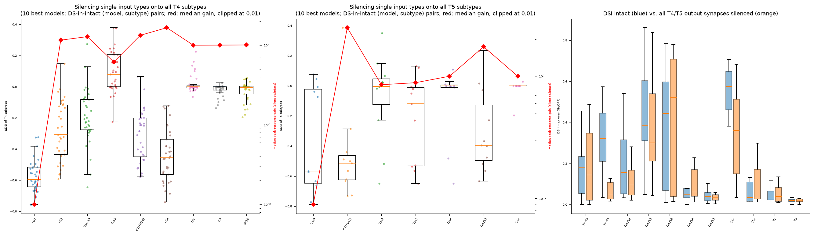

**Figure 9. Targeted silencing (10 best models) and the TmY parallel pathway.**
- *Left and middle:* change in DSI of DS-in-intact T4 subtypes (33 (model, subtype) pairs from 10 models) and T5 subtypes (11 pairs from 7 models) when all synapses from one input type onto all T4 (T5) subtypes are removed. Red: median gain (peak response silenced/intact).
- *Right:* DSI of TmY and other types, intact vs with all T4/T5 output synapses silenced.

Summary of single-input silencing (`outputs/silencing_summary.csv`):

| target | silenced input (sign) | median ΔDSI | fraction with ΔDSI < −0.1 | median gain |
|---|---|---|---|---|
| T4 | **Mi1** (+) | −0.60 | 100 % | 0.00 (response abolished) |
| T4 | **Mi4** (−) | −0.46 | 100 % | 1.66 |
| T4 | Mi9 (−) | −0.31 | 82 % | 1.16 |
| T4 | CT1(M10) (−) | −0.28 | 94 % | 1.33 |
| T4 | TmY15 (−) | −0.22 | 70 % | 1.28 |
| T4 | Tm3 (+) | +0.08 | 3 % | 0.62 |
| T4 | C3, Mi10, T5c | ≈ 0 | ≤ 18 % | ≈ 1.0 |
| T5 | **Tm9** (+) | −0.57 | 55 % | 0.09 |
| T5 | **CT1(Lo1)** (−) | −0.51 | 91 % | 2.49 |
| T5 | TmY15 (−) | −0.40 | 73 % | 1.74 |
| T5 | Tm1 (+) | −0.12 | 55 % | 0.89 |
| T5 | Tm2, Tm4, T4c | ≈ 0 | ≤ 27 % | ≈ 0.85–1.0 |

**T4.**
- Mi1 is the main excitatory drive. Tm3 adds gain but is not needed for DS; silencing it slightly *raises* DSI.
- DS is generated by the offset inhibitory inputs Mi4 and CT1(M10), which suppress the null direction, and by Mi9.
- Removing the inhibitory inputs increases response gain (1.2–1.7×) while abolishing selectivity. That is the signature of null-direction suppression.

**T5.**
- Tm9 is the dominant excitatory drive; Tm1 and Tm2 contribute less.
- CT1(Lo1), the OFF-compartment counterpart of CT1(M10), is the key inhibitory input for DS.
- TmY15 inhibition contributes to DS in both T4 and T5.

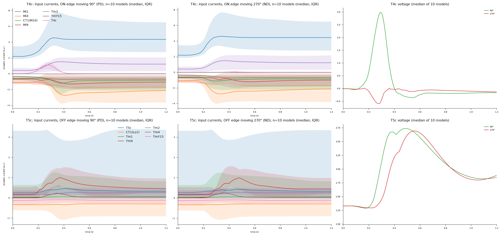

**Figure 10. Synaptic input currents onto the central T4c (top; ON edges) and T5c (bottom; OFF edges) at 19°/s, for upward (PD) vs downward (ND) motion** (median and IQR over the 10 best models; right: voltage).

The integrated input currents are nearly identical for PD and ND (e.g. ∫|I_Mi1| = 1632 vs 1661, ∫|I_Mi4| = 799 vs 821 a.u.). Direction selectivity is therefore not produced by input amplitudes but by their **relative timing**, followed by the ReLU nonlinearity of the postsynaptic cell and its targets.

Half-rise latencies (median over 10 models; Wilcoxon over models; `outputs/mechanism/current_latencies.csv`):

| T4c input | latency PD | latency ND | ND − PD | p |
|---|---|---|---|---|
| Mi1 (+) | 248 ms | 233 ms | −15 ms | 0.002 |
| Mi4 (−) | 320 ms | 228 ms | **−85 ms** | 0.002 |
| CT1(M10) (−) | 320 ms | 233 ms | **−90 ms** | 0.002 |
| Mi9 (−) | 218 ms | 315 ms | **+98 ms** | 0.047 |

| T5c input | latency PD | latency ND | ND − PD | p |
|---|---|---|---|---|
| Tm9 (+) | 253 ms | 345 ms | **+90 ms** | 0.002 |
| CT1(Lo1) (−) | 350 ms | 340 ms | −80 ms (n = 7) | 0.078 |
| Tm2 (+) | 300 ms | 275 ms | −30 ms | 0.004 |

**T4c.**
- In the null direction, the Mi4/CT1(M10) inhibition arrives together with (or before) the Mi1 excitation and vetoes it.
- In the preferred direction it arrives about 70 ms *after* Mi1, so the excitation is unopposed.
- The change in Mi9 input (an OFF cell, whose inhibition is *withdrawn* by an ON edge, i.e. disinhibition) arrives early in PD.

This reproduces the three-arm "preferred-direction enhancement plus null-direction suppression" motif reported for T4 (Haag et al. 2016, 2017; Borst 2018). It emerges here from the connectome's spatial offsets (Fig. 2c) and the learned time constants, and was never specified explicitly.

**T5c.** The Tm9 drive is early in PD and late in ND, with CT1(Lo1) inhibition timed oppositely, the OFF-pathway counterpart of the T4 motif.

### 3.6 Direction-selective TmY neurons: a parallel pathway, not inherited from T4/T5

From the connectome edge list (`outputs/mechanism/tmy_input_summary.csv`):
- **TmY3, TmY5a and TmY13 receive no synapses from any T4/T5 subtype.**
- TmY18 receives 3 % of its synapses from T4a.
- TmY4 receives 60 % from T4c, T5c, T4d and T5d.
- TmY14 and TmY15 receive 10–14 % from T4/T5.

Silencing **all** output synapses of T4a–d and T5a–d (10 best models; Fig. 9 right; `outputs/tmy_dsi_noT4T5.csv`):

| cell type | % input from T4/T5 | median DSI intact | median DSI, T4/T5 silenced | Wilcoxon p |
|---|---|---|---|---|
| TmY3 | 0 | 0.18 | 0.14 | 0.91 |
| TmY5a | 0 | 0.16 | 0.10 | 0.23 |
| TmY13 | 0 | 0.39 | 0.30 | 0.13 |
| TmY18 | 3 | 0.44 | 0.52 | 0.13 |
| TmY4 | 60 | 0.32 | **0.05** | 0.037 |

The models therefore predict that the direction selectivity of TmY3, TmY5a, TmY13 and TmY18 arises **in parallel to T4/T5**. Their own spatially asymmetric inputs (e.g. from Mi1, Tm3, Tm4 and Mi4; TmY3/4/5a/18 are in the asymmetric-input list) feed a T4-independent motion computation. TmY4 instead inherits its DS from T4/T5.

T4c's own DSI also falls when T4/T5 outputs are silenced (0.58 → 0.36, p = 0.049). Recurrent T4→T4 and T5→T4 connections (Fig. 2b) thus contribute to T4 selectivity. This is a prediction that is testable by silencing T4/T5 and recording TmY13/TmY18 *in vivo*.

### 3.7 Solution clusters: a signed link between input polarity and T4 direction preference

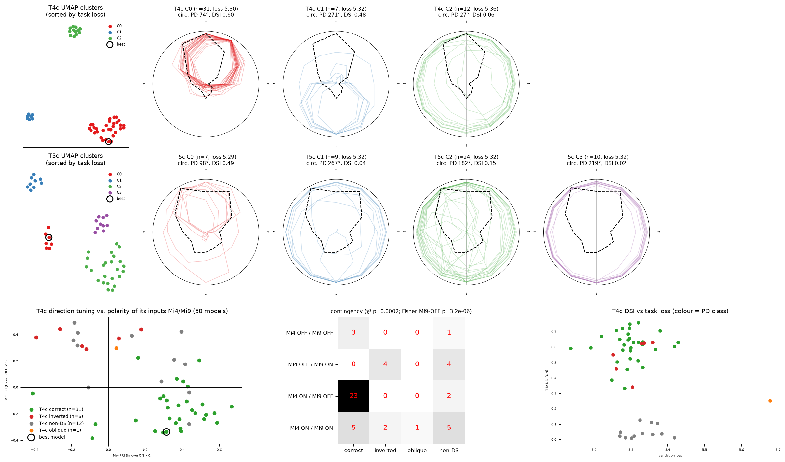

**Figure 8. Signed cluster analysis.**
- *Top and middle rows:* the provided UMAP/GMM clusters of T4c and T5c responses to naturalistic stimuli. Clusters are sorted by mean validation loss, the best model is circled, and each polar panel shows every model of a cluster (normalised peak responses; dashed: measured tuning).
- *Bottom left:* Mi4 FRI versus Mi9 FRI for all 50 models, coloured by T4c PD class.
- *Bottom middle:* contingency table of Mi4/Mi9 polarity × T4c class.
- *Bottom right:* T4c DSI versus validation loss.

**The T4c clusters are directionally distinct, which an unsigned DSI analysis cannot show.**

| T4c cluster | n | mean loss | circular-mean PD | mean DSI | PD class | Mi9 ON (wrong) | Mi4 ON (correct) |
|---|---|---|---|---|---|---|---|
| C0 | 31 | 5.297 | **74°** (≈ upward = correct) | 0.60 | 31/31 correct | 16 % | 90 % |
| C1 | 7 | 5.316 | **271°** (downward = inverted) | 0.48 | 6/7 inverted, 1 non-DS | **100 %** | 29 % |
| C2 | 12 | 5.357 | — | 0.06 | 11/12 non-DS | 75 % | 67 % |

T4a clusters show the same pattern:
- C0 (23 models): PD 178°, 22/23 correct;
- C1 (8): PD 340° (inverted or oblique), Mi9 ON in 100 %;
- C2 (19): non-DS.

T5c clusters separate one small DS cluster (C0: 7 models, PD 98°, DSI 0.49, containing the best model) from three non-DS clusters (n = 9, 24, 10; DSI 0.02–0.15).

**Contingency across all 50 models** (`outputs/clusters/contingency_T4c_Mi4Mi9.csv`):
- **Mi4 ON / Mi9 OFF** (both correct): 23 of 25 models have correct T4c tuning.
- **Every inverted model (6/6) has an ON-responding Mi9**, with 4 of the 6 also having an OFF-responding Mi4.
- **Tests:**
  - χ²(9) = 32.0, p = 2·10⁻⁴;
  - Fisher exact test, correct Mi9 polarity vs correct T4c tuning: OR = 27.7, p = 3·10⁻⁶;
  - Fisher exact test, Mi4 polarity: OR = 8.4, p = 0.005.

Models with correct T4c tuning have marginally lower loss (median 5.296 vs 5.329; Mann-Whitney U p = 0.058).

**Causal test (silencing; 6 inverted and 6 correct models; ON edges, 3 speeds).**

| T4c median DSI | intact | −Mi9→T4 | −Mi4→T4 | −Mi4 & −Mi9 |
|---|---|---|---|---|
| correct models (n = 6) | 0.60 | 0.33 | **0.06** | 0.04 |
| inverted models (n = 6) | 0.59 | **0.04** | 0.49 | 0.04 |

This is a double dissociation:
- In correctly tuned solutions, T4c DS depends mainly on the (ON-responding, inhibitory) Mi4 input.
- In inverted solutions it depends on Mi9, which has adopted ON polarity. Silencing Mi4 leaves their inverted PD (≈ 260–290°) intact in all six.

Given the fixed anatomy, Mi4 and Mi9 occupy opposite sides of T4's spatial filter (Fig. 2c). Whichever of the two responds to ON contrast and inhibits T4 determines which side provides null-direction suppression, and hence the sign of the preferred direction. The connectome thus fixes the *axis* of T4c tuning. The task-learned polarity of the offset inhibitory inputs determines its *sign*, and the experimentally observed sign corresponds to Mi4-ON / Mi9-OFF, the configuration of the lowest-loss cluster.

### 3.8 Optic-flow decoding

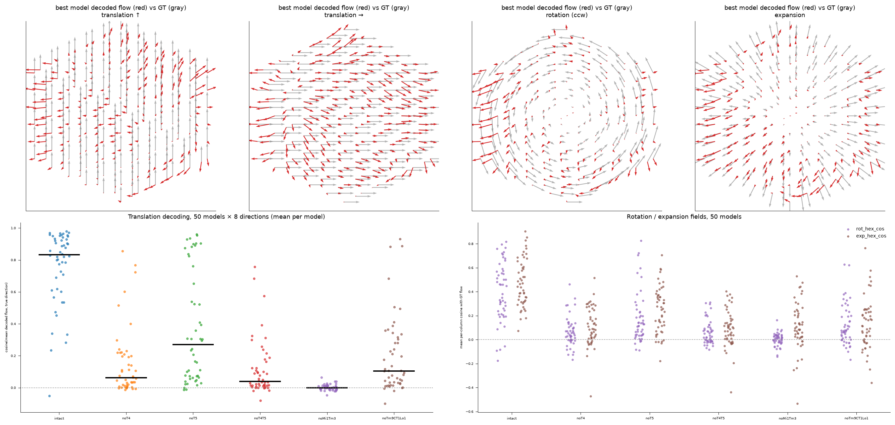

**Figure 11. Optic flow decoded from the simulated networks.**
- *Top:* dense decoded flow of the best model (red, normalised, time-averaged) vs ground truth (gray) for upward and rightward translation, counter-clockwise rotation and expansion of a 1/f texture.
- *Bottom left:* cosine between the mean decoded flow and the true direction, 50 models × 8 directions, intact and with output synapses of the indicated cell types silenced.
- *Bottom right:* per-column agreement for the rotation and expansion fields.

**Intact models (n = 50).**
- Median translation cosine 0.83; median angular error of the mean flow 28°; median per-column cosine 0.58.
- Rotation and expansion fields are recovered with median per-column cosines 0.42 and 0.45. This generalises beyond the training distribution (Sintel) to synthetic stimuli.
- Note that models with *inverted* T4 tuning (e.g. models 004 and 005) still decode flow correctly (cosine 0.93 and 0.95, Fig. 7): the decoder learned a sign-flipped readout. The task alone does not fix the sign of T4/T5 tuning.

**Silencing outputs** (median translation cosine; all p < 10⁻⁹ vs intact, paired Wilcoxon, n = 50):

| silenced | cosine |
|---|---|
| T4 | 0.06 |
| T5 | 0.27 |
| T4 + T5 | 0.04 |
| Mi1 + Tm3 | 0.00 |
| Tm9 + CT1(Lo1) | 0.11 |

Decoded flow depends almost entirely on the ON-motion (T4) pathway and its Mi1/Tm3 drive; the OFF pathway contributes less. This is consistent with weaker T5 DS in most models (§3.3).

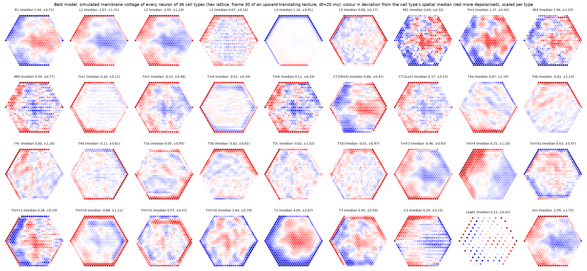

**Figure 12. Predicted voltage of every neuron of 36 cell types of the best model** during upward texture motion (frame 30, dt = 20 ms). Colour = deviation from each type's spatial median; the per-type median and scale are given in the titles.
- L1/L2 are sign-inverted copies of the photoreceptor (R1) image, while Mi1/Tm3 follow R1.
- T4/T5 activity is sparse and motion-dependent.
- The full network state of 45,669 neurons is available for any stimulus with `code/fastsim.py`.

### Supplementary figures

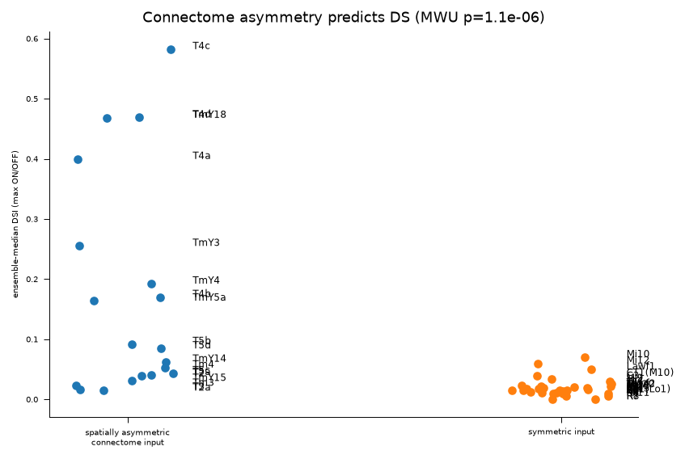

**Figure S1.** Cell types with spatially asymmetric connectome input (flyvis ground-truth list) have higher ensemble-median DSI (one-sided Mann-Whitney U p = 1.1·10⁻⁶).

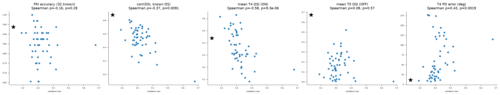

**Figure S2.** Prediction quality vs validation loss (50 models, ★ best model). Lower loss is associated with higher T4 DSI, lower T4 PD error and better DSI–known-DS correlation, but not with polarity accuracy or T5 metrics.

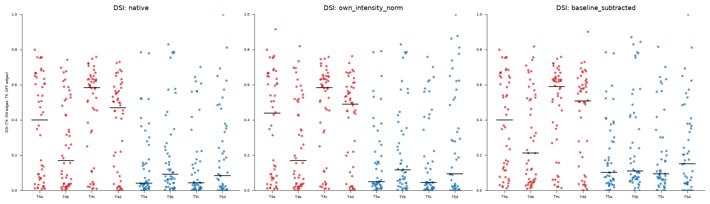

**Figure S3.** T4 and T5 DSI under three definitions (native flyvis; normalisation by the same contrast only; resting-potential subtracted). The low T5 DSI of most models is robust to the definition.

---

## 4. Discussion
**Structure + task → function.** The central claim of connectome-constrained, task-optimised modelling is that wiring and a behavioural objective jointly determine single-neuron response properties. The present re-analysis supports this claim and refines it by separating three classes of predictions.

1. **Predictions carried by the connectome alone.**
   - ON/OFF contrast preference follows from the sign structure of the wiring. Untrained networks with uniform parameters already predict 31/32 known polarities, more than the median trained model (28/32; only 1 of 50 trained models, model 006, gets 32/32).
   - Task optimisation does not improve this property. It *introduces* polarity variability in some types (L3, Mi9, C3, T5a/b, L2), which are bistable across solutions because flow decoding can be achieved with either polarity.
2. **Predictions requiring connectome and task.**
   - Direction selectivity is absent in untrained networks, absent without spatial offsets, and destroyed when sources are shuffled or the learned parameters are re-assigned between types.
   - It emerges only when the task tunes time constants, resting potentials and strengths on top of the measured spatial filters.
   - The mirror experiment shows the division of labour: the connectome sets the *axis* of each T4/T5 subtype's preferred direction, while the trained dynamics provide the delays and nonlinearity that turn asymmetric wiring into selectivity.
   - The mechanism found in the models, with excitatory Mi1/Tm9 drive and temporally offset inhibition from Mi4/CT1(M10) or CT1(Lo1), matches the experimentally proposed three-arm detector of T4/T5. In the models it arises without being specified.
3. **Predictions under-determined by connectome + task.** The sign of a cell's tuning, and the polarity of some inputs, are not uniquely fixed.
   - In 6/50 models T4c is tuned downward instead of upward, because Mi9 has become an ON cell and has taken over the role of Mi4. The causal double dissociation shows that the polarity of the offset inhibitory inputs determines the sign of T4 tuning.
   - The task cannot distinguish these solutions, because the decoder learns a sign-flipped readout: inverted models decode flow as well as correct ones.
   - The ensemble resolves this. The most populated and lowest-loss T4c cluster has the experimentally observed Mi4-ON/Mi9-OFF configuration and upward tuning. This underlines that ensemble statistics, not single models, are the appropriate prediction, and that measuring a few key polarities (here Mi9) would constrain the remaining solution space.

**T5.** Unlike T4, OFF-edge direction selectivity of T5 is weak in most models of this ensemble (median DSI 0.17; 6/50 > 0.3), although the best model is fully T5-selective with correct preferred directions.
- We verified that this is not a metric artefact: native flyvis functions on native simulations give the same values, and alternative definitions do not change the conclusion.
- Flow decoding depends far more on T4 than on T5 (silencing T5 leaves a cosine of 0.27), which suggests that the task, as posed (Sintel flow with augmentations), puts more pressure on the ON pathway.
- Whether this reflects the training data statistics, the OFF-pathway connectome reconstruction, or optimisation variance cannot be decided without retraining. The models therefore predict T5 DS less reliably than T4 DS.

**Parallel motion pathways.** A non-obvious prediction concerns TmY3, TmY5a, TmY13 and TmY18. They are as direction-selective as T4 in many models, yet the connectome shows that they receive no (TmY3/5a/13) or negligible (TmY18, 3 %) T4/T5 input, and they keep their DS when all T4/T5 outputs are silenced. In contrast, TmY4 (60 % T4/T5 input) loses its DS. This is an experimentally testable claim: TmY13/TmY18 motion responses should persist under genetic silencing of T4/T5.

**Limitations.**
1. No model was retrained. The ablations are inference-time perturbations of trained solutions, and they cannot show what a network trained without spatial structure or with shuffled wiring could achieve. Retraining (e.g. a connectome-free, task-only baseline) was beyond the 2-core CPU budget.
2. Flow decoding was tested on synthetic textures, not Sintel (not downloadable here). Flow under perturbation uses the unchanged trained decoder.
3. The learned parameters are poorly reproducible across models (median between-model rank correlation of strengths 0.18). Individual parameter values are therefore not predictions; response properties are.
4. Types without outputs (Mi11, Tm30) are not constrained by the task, and their predictions should be disregarded.
5. The ground truth used for validation is the flyvis curation (polarity of 32 types, DS of 18 types, T4/T5 tuning curves); it does not cover all 65 types.
6. All 50 shipped configurations are identical, so the factors that differentiate the models are not documented in the data.

**Conclusion.** Connectome measurements plus task knowledge are sufficient to predict, *a priori*, the contrast preference and the direction selectivity of the motion pathway's neurons, and to recover the known mechanism of elementary motion detection. Ensemble analysis is essential: it separates robust predictions (polarity; T4 DS and preferred direction; Mi1/Mi4/Mi9/CT1 roles; TmY parallel pathway) from under-determined ones (T5 tuning; Mi9 and L3 polarity; the sign of DS), and it points to the specific measurements that would disambiguate them.

---

## 5. Reproducibility
All code is in `code/` and was run in this order. Every reported number is saved in `outputs/` (CSV/JSON).

| script | purpose | main outputs |
|---|---|---|
| `fastsim.py`, `stimuli.py`, `metrics.py`, `ablations.py`, `textures.py` | libraries: simulator, native-stimulus and native-metric wrappers, perturbations, texture flow | — |
| `01_validate_sim.py`, `01b_validate_edges_metrics.py`, `01c_pd_check.py` | equivalence with flyvis | `01_validation.json`, `01b_validation_edges.json`, `01c_pd_check.json` |
| `02_connectome_params.py` | connectome facts, parameter statistics | `02_connectome_facts.json`, `connectome_*.csv`, `params_ensemble.npz` |
| `03_ensemble_responses.py` | flashes + edges (6 speeds) for 50 models | `ensemble/model_XXX.npz` |
| `04_ablations.py`, `04b_mirror_pd_shift.py` | 10 inference-time conditions × 10 models; PD rotation under mirroring | `ablations/ablation_results.csv`, `ablations/mirror_pd_rotation.json` |
| `05_mechanism.py` (run with `N_MECH_MODELS=10`), `05c_current_timing.py` | silencing, currents, TmY inputs, current latencies | `mechanism/*.csv`, `currents_*.npz`, `mechanism/current_latencies.csv` |
| `06_clusters.py`, `06b_cluster_causal.py` | signed cluster analysis + causal test | `clusters/*.csv`, `cluster_stats.json` |
| `07_flow.py` | texture flow decoding, silencing, snapshots | `flow/flow_results.csv` |
| `08a/08b/08c_*.py` | figures and summary tables | `report/images/*.png`, `ensemble_per_model_summary.csv`, `ablation_summary_table.csv`, `silencing_summary.csv`, `flow_summary.csv` |

**Environment:**
- Python 3.12, torch 2.15 (CPU), flyvis 1.2.0 (installed with `--no-deps`).
- `FLYVIS_ROOT_DIR=/workspace/outputs/flyvis_root`, a copy of `data/flow`, so the read-only data are never written to.
- `code/run_all.sh` chains the long jobs.
- Runtime on 2 CPU cores is ≈ 5 h, dominated by flyvis' one-off edge rendering (≈ 37 min) and by the 50 × 144 edge simulations (≈ 40 min).

