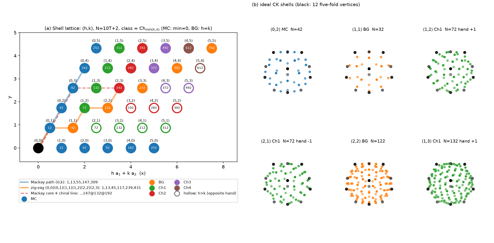
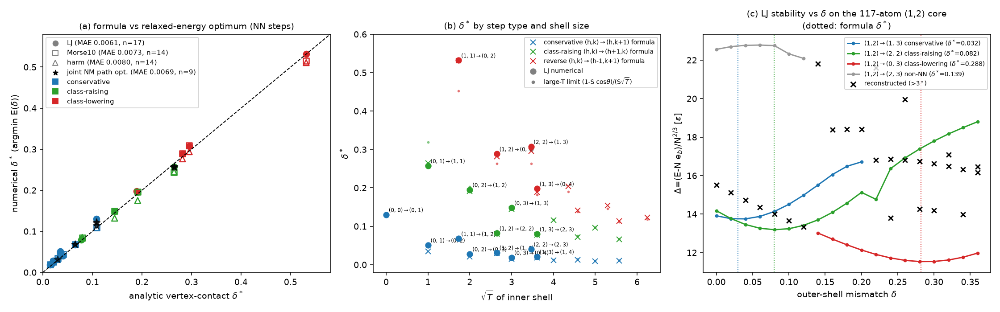
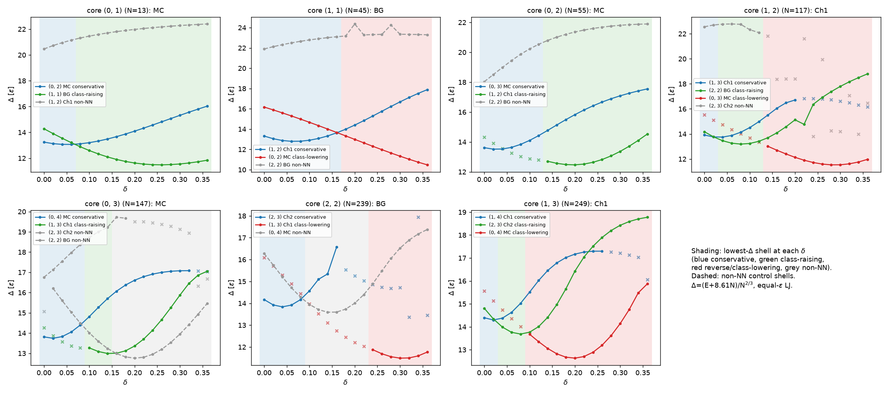
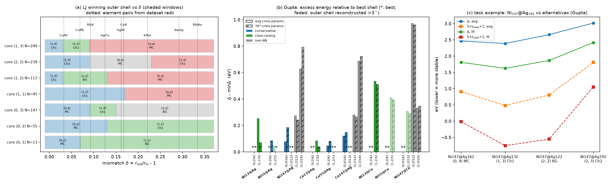
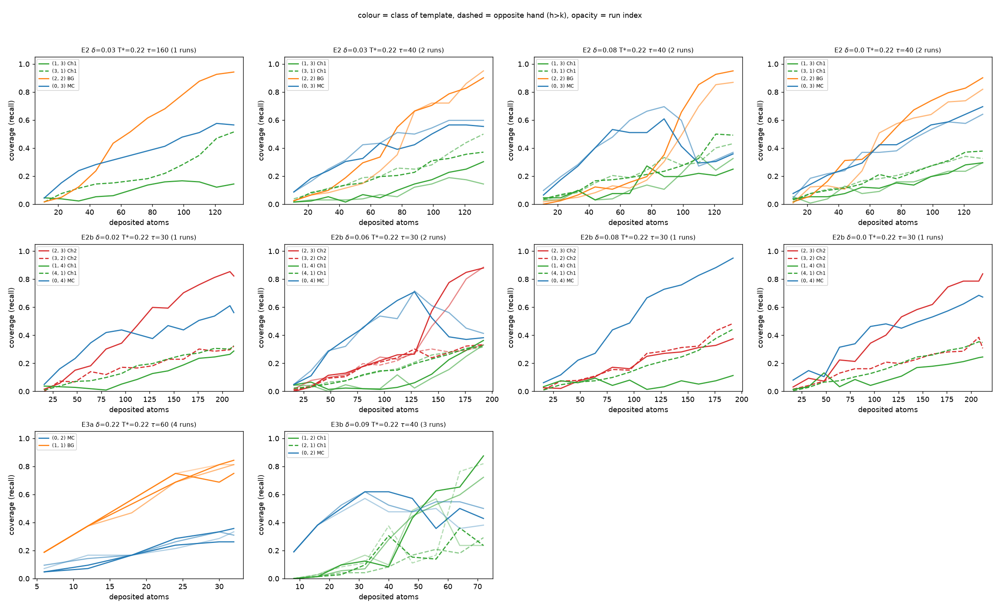
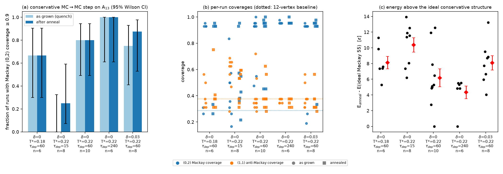
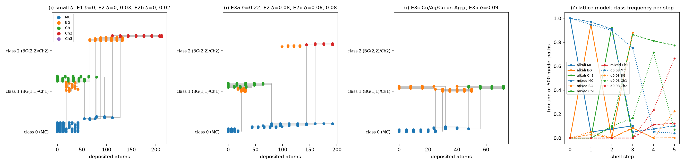
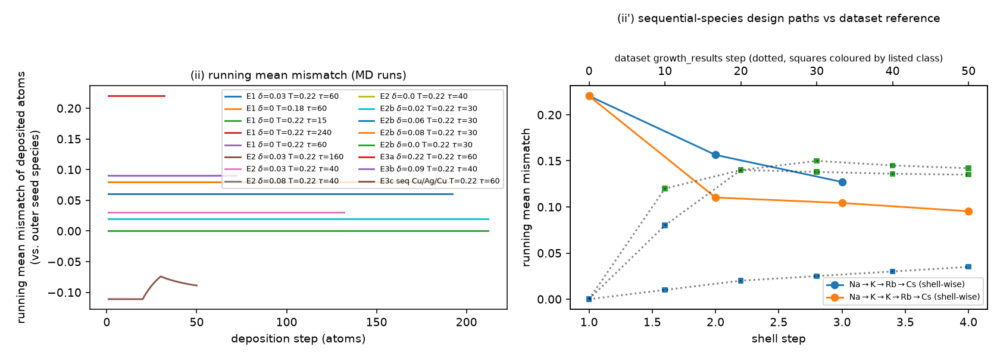
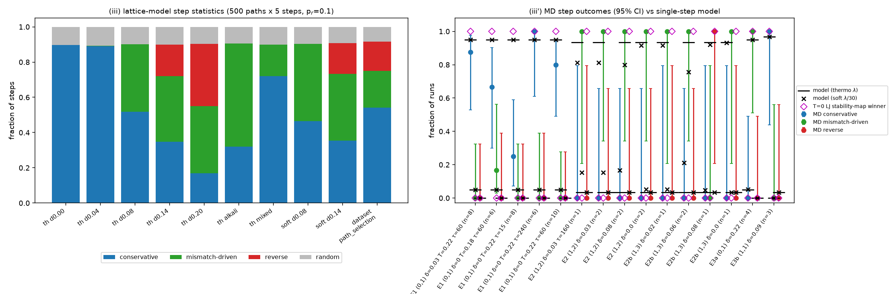
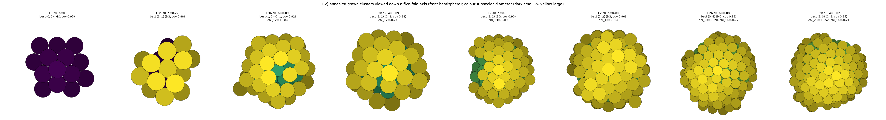

# Packing icosahedral shells into multi-component clusters: hexagonal-lattice paths, optimal size mismatch, and growth-path selection

*Reproduction and extension study. All numbers in tables are generated by `code/build_report.py` from files in `outputs/`.*

---

## Abstract

We rebuild and test a hexagonal-lattice (Caspar–Klug) theory of multi-shell icosahedral aggregates. In this theory every shell is a triangular net folded onto an icosahedron and labelled by lattice coordinates (h,k). Shell sequences are paths on the lattice; chirality and chirality class are properties of where a shell sits on it.

1. **Lattice.** We generate all shells up to (5,5) and check that N = 10T+2 with T = h²+hk+k². The Mackay path (0,k) and the zig-zag path (0,0)→(0,1)→(1,1)→(1,2)→(2,2)→(2,3) reproduce the dataset's magic sequences 1, 13, 55, 147, 309 and 1, 13, 45, 117, 239, 431 exactly. We adopt an explicit class convention, Ch$_{\min(h,k)}$ with MC and BG separated, and audit it against the dataset labels.
2. **Optimal mismatch.** We derive a closed-form *vertex-contact* expression for the optimal size mismatch δ* of a step T→T′. On equal-ε Lennard-Jones clusters (7 cores, up to 461 atoms), the relaxed-energy optima of 17 nearest-neighbour (NN) steps agree with it to a mean absolute error of 0.006. The agreement holds for a short-range Morse potential (0.007), a purely geometric harmonic contact network (0.008), and joint optimisation of whole paths (0.007).
3. **Stability maps.** NN steps are the stable continuation everywhere except two δ windows on the largest cores, where a second-neighbour jump wins.
4. **Real elements.** Applied to dataset radii and checked with Gupta (SMATB) potentials under two cross-parameter sets, the nearest-δ* rule picks the Gupta-optimal shell in 7–8 of 9 Ni/Cu/Ag core–shell cases. Ni$_{147}$@Ag$_{132}$ is preferred over the task's example Ni$_{147}$@Ag$_{192}$ under both sets.
5. **Growth.** Langevin growth simulations (60 runs on 13–249-atom seeds) give four results:
   - **Conservative step on the Mackay seed.** At small mismatch the conservative step is selected on the 13-atom seed: Mackay completion in 8/10 runs at τ_dep = 60 and 6/6 at τ_dep = 240. Its failures are kinetic anti-Mackay traps, which grow to 6/8 runs under fast deposition (τ_dep = 15).
   - **Mismatch-driven class changes at the predicted δ.** We observe MC→BG (4/4), BG→Ch1 (3/3), Ch1→BG(2,2) on a chiral 117-atom seed (2/2 at δ = 0.08) and **Ch1→Ch2, (1,3)→(2,3)**, on a chiral 249-atom seed (2/2 at δ = 0.06, and also at δ = 0.02 and 0).
   - **Hand.** The hand of a new chiral shell is chosen at random on an achiral seed (+,+,−) and **inherited** from a chiral seed (all (2,3) shells have the seed's hand).
   - **Kinetic class-raising bias on chiral seeds.** Here growth never produced the conservative Ch1→Ch1 step, even at δ = 0. Equal-N energy comparisons and thermal-stability runs show that the conservative structure is the stable one (by 17–57 ε, including a 4× slower deposition run), so this is a kinetic bias towards class-raising (h→h+1) steps.

A phenomenological lattice-level stochastic model, parameterised with our own δ* and elastic constants, reproduces the MD outcomes on the small seeds. It misses this kinetic bias, which points to the kinetic ingredient a predictive growth model needs.

---

## 1. Background and objectives

Icosahedral clusters grow by stacking shells. In the hexagonal-lattice picture, a shell is a Caspar–Klug triangulation of the icosahedron, specified by the lattice vector **P** = h**a₁** + k**a₂** of the triangular net:
- T = h²+hk+k²;
- the shell holds N = 10T+2 particles;
- the 12 five-fold vertex particles lie at radius R = S·a·√T, with S = sin(2π/5) = 0.9511 and a the in-shell spacing.

Familiar cases:
- (0,k) shells are Mackay shells (12, 42, 92, 162, …).
- (1,1) is the 32-atom anti-Mackay / Bergman-type shell.
- Shells with h≠k, both non-zero, are chiral: (h,k) and (k,h) are enantiomers.

A multi-component cluster is a **path** on this lattice, with one species per shell. The research questions are:
1. **Which shell sequences are stable** for given particle sizes, and what is the optimal size mismatch δ = d_out/d_in − 1 between adjacent shells?
2. **Which paths are selected in growth**, and are they conservative (class-keeping) or mismatch-driven?
3. **How do these rules apply to real elements**: Na/K/Rb/Cs, and Ni/Cu/Ag with Gupta potentials?

Inputs are the dataset `data/Multi-component Icosahedral Reproduction Data.txt` (lattice coordinates, magic sequences, class labels and colours, radii, tabulated mismatches, growth "benchmark" data) and the reference literature. The dataset is treated as an input to be **tested**, not as ground truth (§6).

---

## 2. Methods

### 2.1 Shell construction (`code/icoshell.py`)
1. Take the triangle (0, **P**, R₆₀**P**) of the unit triangular lattice.
2. Map every lattice point in it, by barycentric coordinates, onto each of the 20 consistently oriented (counter-clockwise from outside) faces of an icosahedron of edge a√T.
3. Remove duplicates on edges and vertices.

The triangle is invariant under the 120° rotation about its centroid, and under the 180° rotation about edge midpoints. The net therefore continues seamlessly across face edges for any (h,k).

Multi-shell clusters stack shells with spacing equal to the particle diameter d_i of each shell. LJ$_{13}$ = -44.3268, LJ$_{55}$ = -279.2485, LJ$_{147}$ = -876.4612 ε (literature −44.3268, −279.2485, −876.4612); max central-difference gradient relative error 1.7e-09

### 2.2 Chirality-class convention (stated assumption)
Write a shell as (m,n), with m = min(h,k) and n = max(h,k):
- m = 0 → **MC** (Mackay, achiral);
- m = n > 0 → **BG** (Bergman/anti-Mackay-type, achiral);
- 0 < m < n → **Ch_m** (chiral).

The class index c = m counts the anti-Mackay (h-raising) steps a path has taken off the Mackay line. The hand is +1 for h<k and −1 for h>k.

Outward NN steps from (h,k) are of three types:
- **conservative**: (h,k+1), class kept, a nearly radial step;
- **class-raising / mismatch-driven**: (h+1,k);
- **class-lowering / reverse**: (h−1,k+1), a tangential step.

The step angle θ is measured between **P** and the step vector. A conservative step keeps the hand of a chiral shell. From an achiral BG shell, (h,h+1) and (h+1,h) are degenerate, so the hand is chosen spontaneously.

### 2.3 Analytic optimal mismatch (derived here)
Within a shell, neighbours touch, so a_i = d_i. We require the 12 vertex particles of consecutive shells to touch radially:

S d′√T′ − S d√T = (d+d′)/2.

With d′ = d(1+δ) this gives

**δ*(T→T′) = [1 − S(√T′ − √T)] / (S√T′ − ½)**,

valid also for the central atom (T=0), where δ* = 1/(2S−1) − 1 = 0.1085.

For large shells, with √T′−√T ≈ cos θ, this reduces to δ* ≈ (1 − S cos θ)/(S√T). So:
- radial (conservative) steps need small mismatch, decaying as T^(-1/2);
- tangential (reverse) steps need large mismatch;
- class-raising steps lie in between.

A *negative* δ* means the outer shell cannot touch the inner one at its vertices for any larger particle. This happens for all second-neighbour jumps such as (0,3)→(2,3).

### 2.4 Numerical optimal mismatch and stability maps (`code/scans.py`, `code/joint_opt.py`)
**Potentials.** Equal-ε pair potentials with pair minimum at r₀ = (d_i+d_j)/2:
- LJ 12-6, full range;
- Morse with ρ = 10 (short range);
- a harmonic contact network, E = Σ(r/r₀−1)², over the contacts of the ideal structure (purely geometric).

**Cores.** Each core (a path) carries its jointly optimised LJ diameters. Cores: central atom, (0,1), (1,1), (0,2), (1,2), (0,3), (2,2), (1,3); sizes 1–249 atoms, giving clusters up to 461 atoms.

**Scans.** For each candidate outer shell, E(δ) is computed after L-BFGS relaxation:
- LJ: δ ∈ [0, 0.36] in steps of 0.02, extended for large δ*;
- Morse and harmonic: δ* ± 0.12 in steps of 0.04.

The minimum is then refined with bounded Brent minimisation. Relaxations in which any outer atom moves by more than 3° are flagged as reconstructions and excluded. Candidates are all outward NN steps, plus one non-NN control per core.

**Stability metric.** Δ = (E + 8.61 N)/N^{2/3}, using the LJ fcc cohesive energy.

**Joint optimisation.** Whole paths (3–5 shells) are optimised by Nelder–Mead over the log-diameters.

### 2.5 Real elements (`code/design.py`, `code/gupta.py`)
**Mismatch convention.** δ = r_out/r_in − 1 from the dataset atomic radii (Na 1.86, K 2.27, Rb 2.48, Cs 2.65, Ag 1.44, Cu 1.28, Ni 1.24 Å).

**Greedy design rule.** Starting from a 13-atom core, choose at each shell the outward NN step whose δ* (LJ numerical where available, formula otherwise) is nearest to the actual δ.

**Gupta (SMATB) test.**
- Pure-metal parameters: Cleri–Rosato.
- Smooth cosine taper of all pair terms between 2.3 and 2.6 r₀. It reproduces the fcc cohesive energies: Ni 4.447, Cu 3.545, Ag 2.960 eV. A first version with a 1.55–1.75 r₀ taper underbound Ni by 0.85 eV/atom and was discarded.
- Gradient verified by central differences (relative error < 4×10⁻⁷).
- Two cross-parameter sets: **avg**, the arithmetic mean of the pure-metal parameters; and **lit**, Ag–Ni and Ag–Cu values recalled from the Ferrando-group literature. The lit set's provenance **could not be verified offline**; it serves as a stronger-binding sensitivity variant.
- Cores: Mackay Ni/Cu, 13, 55 and 147 atoms. Outer shells: all NN candidates plus (2,2) and (2,3) on the 147 core.
- Metrics: Δ = (E + Σ e_coh)/N^{2/3}, and the per-shell-atom excess ε_shell = (E − E_core)/N_shell + e_coh(shell metal).

### 2.6 Growth simulations (`code/md_growth.py`, `code/run_growth_exp.py`)
**Model and integrator.**
- LJ with ε = 1 for all pairs, minimum at (d_i+d_j)/2, cut off at 2.5σ_ij and energy-shifted. Unit masses.
- Langevin BAOAB integrator, Δt = 0.005, γ = 1.
- k-d-tree neighbour list with skin 0.4, rebuilt on displacement.
- Recentring on a robust centre of mass, plus a reflecting wall 4σ beyond the cluster surface that catches evaporated atoms.

**Deposition.** One atom at a time from a random direction, 1.3 d outside the surface, with an inward thermal velocity. Inter-deposition times τ_dep = 15–240 τ, at T* = 0.18–0.22.

**Analysis protocol.**
1. Every 6–16 deposits, the configuration is quenched (L-BFGS) and identified.
2. At the end, the as-grown structure is quenched.
3. The cluster is then annealed for 100 τ at T* and cooled linearly to T* = 0.05 over 100 τ, then quenched.

**Experiments.**
- **E1**: A₁₃ seed + 42 atoms at δ = 0 or 0.03. Tests the conservative MC→MC step, (0,1)→(0,2), against the anti-Mackay (1,1) overlayer. 8–10 runs per condition; τ_dep and T* varied to diagnose kinetics.
- **E3a**: A₁₃ + 32 atoms at δ = 0.22. MC→BG, (0,1)→(1,1).
- **E3b**: A₁₃@B₃₂ (jointly optimised) + 72 atoms at δ = 0.09. BG→Ch1; the hand must be chosen spontaneously.
- **E2**: A₁₃@B₃₂@C₇₂, a chiral (1,2) seed with hand +1, + 132 atoms:
  - δ = 0 and 0.03, predicted conservative (1,3);
  - δ = 0.08, predicted class-raising (2,2);
  - 2 runs each at τ_dep = 40, plus one run at δ = 0.03 with τ_dep = 160.
- **E2b**: the 249-atom (1,3) seed, Ch1 with hand +1:
  - + 192 atoms at δ = 0.06 (2 runs) and δ = 0.08 (1 run), predicted Ch1→Ch2 step (2,3);
  - + 212 atoms at δ = 0 and 0.02 (1 run each), predicted conservative (1,4);
  - τ_dep = 30.
- **E3c**: the dataset's alternating sequence Cu₂₀Ag₁₀Cu₂₀ on an Ag₁₃ seed.

**Identification.**
1. *Frame.* Fit the 12 nearest neighbours of the central atom onto the canonical icosahedron without assuming a permutation: initial two-vector alignments, then iterative nearest-site assignment and Kabsch rotation.
2. *Layer selection.* By deposition index; or radially (all atoms beyond the central 13) for single-species E1.
3. *Template matching.* Layer-atom directions are compared with templates taken from *relaxed* ideal core+shell clusters, using a one-to-one angular match within 0.35 × the template's minimum site separation. This gives recall (coverage), precision and F1 for each candidate. The final shell is the candidate with the highest F1, provided F1 ≥ 0.6.
4. *Chirality index.* (n₊ − n₋)/(n₊ + n₋) over layer atoms more than 8° from the 12 shared vertices. Each such atom is assigned to the nearer enantiomeric template.

Validation on ideal relaxed shells gives coverage 1.0 and chirality index ±1. The cross-check (`outputs/template_crosscheck.json`) shows that for T ≥ 9 the templates share many sites; for example, an ideal (3,1) layer scores recall 0.78 on the (0,3) template. This is why F1 rather than recall is used for final assignment.

### 2.7 Lattice-level stochastic path model (E4, `code/lattice_model.py`; phenomenological)
From shell s, each outward NN step o is weighted by w = exp[−λ N_o (δ − δ*_{s→o})²], where:
- δ*_{s→o} is our LJ value, or the formula where no scan exists;
- λ = βK/2, with K the per-shell-atom curvature of the LJ E(δ) scans. K = 74.7 ε per shell atom (median of 17 quadratic fits), λ = βK/2 = 169.7 at T* = 0.22

A random-step channel with probability p_r = 0.1 picks any NN step. A softened variant (λ/30) mimics kinetic noise. We run 500 paths of 5 shells from the 13-atom icosahedron for constant δ ∈ {0, 0.04, 0.08, 0.14, 0.20}, for the alkali sequence Na→K→Rb→Cs, and for a "mixed" sequence. Each step is classified as conservative, mismatch-driven (class-raising), reverse (class-lowering) or random.

---

## 3. Result 1 — the shell lattice, magic numbers and chirality classes

**Figure 1.** (a) Hexagonal (h,k) lattice up to (5,5), coloured with the dataset's `shell_colors` under our class convention. Hollow symbols mark the opposite hand (h>k). The numbers are N = 10T+2. The Mackay path, the zig-zag path and a Mackay-core-then-chiral path are drawn. (b) Ideal CK shells; black marks the 12 five-fold vertices.

Mackay path cumulative sizes [1, 13, 55, 147, 309] (dataset `mackay_sequence` match: True); zig-zag path [1, 13, 45, 117, 239, 431] (dataset `new_sequence_b5` match: True). Every (h,k) tested gives exactly 10T+2 sites with vertices at S·a·√T. (h,0) and (0,h) produce identical point sets, and (h,k), (k,h) are mirror images with identical distance spectra.

**Table 1.** Shells, sizes and classes (convention A).

| (h,k) | T | N | class | chiral | (h,k) | T | N | class | chiral |
|---|---|---|---|---|---|---|---|---|---|
| (0,1) | 1 | 12 | MC | no | (2,2) | 12 | 122 | BG | no |
| (0,2) | 4 | 42 | MC | no | (2,3) | 19 | 192 | Ch2 | yes |
| (0,3) | 9 | 92 | MC | no | (2,4) | 28 | 282 | Ch2 | yes |
| (0,4) | 16 | 162 | MC | no | (2,5) | 39 | 392 | Ch2 | yes |
| (0,5) | 25 | 252 | MC | no | (3,3) | 27 | 272 | BG | no |
| (1,1) | 3 | 32 | BG | no | (3,4) | 37 | 372 | Ch3 | yes |
| (1,2) | 7 | 72 | Ch1 | yes | (3,5) | 49 | 492 | Ch3 | yes |
| (1,3) | 13 | 132 | Ch1 | yes | (4,4) | 48 | 482 | BG | no |
| (1,4) | 21 | 212 | Ch1 | yes | (4,5) | 61 | 612 | Ch4 | yes |
| (1,5) | 31 | 312 | Ch1 | yes | (5,5) | 75 | 752 | BG | no |

---

## 4. Result 2 — optimal size mismatch

### 4.1 Formula vs relaxed energies

**Figure 2.** (a) Numerical δ* (argmin of relaxed E(δ)) against the analytic vertex-contact δ*, for LJ (filled), Morse ρ=10 (squares), harmonic network (triangles) and joint path optimisation (stars). Colours give the step type. (b) δ* against √T of the inner shell, by step family: formula (×), large-T limit (dots), LJ (filled circles). (c) LJ stability Δ(δ) of the four candidate shells on the 117-atom (1,2) core; dotted lines are formula δ*.

Mean absolute deviation of each method from the formula: LJ 0.0061 (n=17), Morse10 0.0073 (n=14), harm 0.0080 (n=14), joint 0.0069 (n=9), LJ_noncentral 0.0051 (n=16).

The largest deviation (0.022) is the central atom (0,0)→(0,1): LJ gives 0.130 against the formula's 0.109, because second-neighbour attraction compresses the 13-atom icosahedron. Excluding it, the LJ MAE is 0.005.

**Table 2.** Optimal mismatch for all NN steps studied.

| step | type | cos θ | δ* formula | large-T limit | δ* LJ | δ* Morse ρ=10 | δ* harmonic |
|---|---|---|---|---|---|---|---|
| (0,0)→(0,1) | conservative | 1.000 | 0.109 | — | 0.130 | 0.109 | 0.108 |
| (0,1)→(1,1) | class-raising | 0.500 | 0.265 | 0.319 | 0.257 | 0.244 | 0.245 |
| (0,1)→(0,2) | conservative | 1.000 | 0.035 | 0.051 | 0.051 | 0.045 | 0.045 |
| (1,1)→(0,2) | class-lowering | -0.000 | 0.531 | 0.452 | 0.532 | 0.515 | 0.511 |
| (1,1)→(1,2) | conservative | 0.866 | 0.065 | 0.080 | 0.068 | 0.067 | 0.068 |
| (0,2)→(1,2) | class-raising | 0.500 | 0.191 | 0.203 | 0.195 | 0.196 | 0.175 |
| (0,2)→(0,3) | conservative | 1.000 | 0.021 | 0.026 | 0.028 | 0.026 | 0.026 |
| (1,2)→(0,3) | class-lowering | 0.189 | 0.282 | 0.264 | 0.288 | 0.290 | 0.277 |
| (1,2)→(2,2) | class-raising | 0.756 | 0.079 | 0.088 | 0.082 | 0.084 | 0.085 |
| (1,2)→(1,3) | conservative | 0.945 | 0.030 | 0.035 | 0.032 | 0.034 | 0.032 |
| (0,3)→(1,3) | class-raising | 0.500 | 0.145 | 0.149 | 0.148 | 0.149 | 0.132 |
| (0,3)→(0,4) | conservative | 1.000 | 0.015 | 0.017 | 0.019 | 0.019 | 0.019 |
| (2,2)→(1,3) | class-lowering | 0.000 | 0.295 | 0.263 | 0.307 | 0.309 | 0.294 |
| (2,2)→(2,3) | conservative | 0.866 | 0.041 | 0.045 | 0.041 | 0.044 | 0.045 |
| (1,3)→(0,4) | class-lowering | 0.277 | 0.189 | 0.182 | 0.198 | — | — |
| (1,3)→(2,3) | class-raising | 0.693 | 0.078 | 0.083 | 0.080 | — | — |
| (1,3)→(1,4) | conservative | 0.971 | 0.018 | 0.021 | 0.021 | — | — |

**Table 3.** Joint Nelder–Mead optimisation of whole paths, compared with the step-wise formula.

| path | δ (joint NM optimum) | δ (vertex-contact formula) | E_min [ε] |
|---|---|---|---|
| (0,0) → (0,1) → (1,1) | 0.114, 0.259 | 0.109, 0.265 | -242.154 |
| (0,0) → (0,1) → (1,1) → (1,2) | 0.120, 0.256, 0.068 | 0.109, 0.265, 0.065 | -701.411 |
| (0,0) → (0,1) → (1,1) → (1,2) → (1,3) | 0.122, 0.258, 0.069, 0.031 | 0.109, 0.265, 0.065, 0.030 | -1600.089 |

Main points:
1. **Step type sets δ\*, through cos θ.** Conservative steps need δ* ≈ 0.02–0.07 (decaying as T^(-1/2)). Class-raising steps need 0.08–0.27. Reverse/tangential steps need 0.2–0.53.
2. **The ordering is the same in all four models.** For a given core, the three outward NN steps are therefore separated in δ, and the formula predicts the ordering without fitting.
3. **The large-T limit** (1 − S cos θ)/(S√T) agrees with the exact formula to within 0.005 for radial and class-raising steps with T ≥ 9. Tangential (reverse) steps converge more slowly (0.295 vs 0.263 at T = 12).

### 4.2 Stability maps: which outer shell wins

**Figure 3.** LJ stability Δ(δ) of the candidate outer shells on seven cores. Shading marks the lowest-Δ shell at each δ; × marks reconstructed points (excluded).

**Table 4.** Windows of δ in which each shell is the lowest-Δ outer shell.

| core | lowest-Δ outer shell in δ window (LJ grid 0.02) |
|---|---|
| (0, 1) (N=13) | (0, 2) MC: 0.00–0.06; (1, 1) BG: 0.08–0.36 |
| (1, 1) (N=45) | (1, 2) Ch1: 0.00–0.16; (0, 2) MC: 0.18–0.36 |
| (0, 2) (N=55) | (0, 3) MC: 0.00–0.12; (1, 2) Ch1: 0.14–0.36 |
| (1, 2) (N=117) | (1, 3) Ch1: 0.00–0.02; (2, 2) BG: 0.04–0.12; (0, 3) MC: 0.14–0.36 |
| (0, 3) (N=147) | (0, 4) MC: 0.00–0.08; (1, 3) Ch1: 0.10–0.14; (2, 2) BG: 0.16–0.36 |
| (2, 2) (N=239) | (2, 3) Ch2: 0.00–0.08; (0, 4) MC: 0.10–0.22; (1, 3) Ch1: 0.24–0.36 |
| (1, 3) (N=249) | (1, 4) Ch1: 0.00–0.02; (2, 3) Ch2: 0.04–0.08; (0, 4) MC: 0.10–0.36 |

The windows are ordered like the δ* of the corresponding steps (conservative < class-raising < reverse), but they are strongly asymmetric. Class-raising shells have broad windows. The conservative windows on the chiral cores (1,2) and (1,3) are only 0–0.02 wide and end at or *below* the conservative δ* (0.032 and 0.021): already slightly above δ = 0, the class-raising neighbour has a lower Δ. On the cores of 55 atoms or fewer, only NN steps are ever competitive. On the largest cores, second-neighbour **jumps** win in specific windows:
- (0,3)→(2,2) for δ ≳ 0.16;
- (2,2)→(0,4) for 0.10 ≲ δ ≲ 0.22.

Their optima again follow the formula: δ* = 0.202 vs 0.200, and 0.149 vs 0.148. Jumps with negative formula δ* never win at δ > 0; (0,3)→(2,3) and (1,2)→(2,3) are examples.

---

## 5. Real elements and the Gupta test

**Figure 4.** (a) LJ winning outer shell vs δ for seven cores, with the element pairs from the dataset radii marked. (b) Gupta excess energy relative to the best shell, per core/shell metal, for both cross-parameter sets (* = best; faded = outer shell reconstructed). (c) The task example Ni₁₄₇@Ag₁₉₂ against the alternatives.

**Table 5.** Binary 13-atom-core designs from dataset radii (nearest-δ* rule).

| core | shell | δ (radii) | nearest-δ* rule | shell (h,k) | class | δ* of chosen step | LJ stability-window rule |
|---|---|---|---|---|---|---|---|
| Na | K | 0.220 | Na13@K32 | (1,1) | BG | 0.257 | Na13@K32 BG |
| Na | Rb | 0.333 | Na13@Rb32 | (1,1) | BG | 0.257 | Na13@Rb32 BG |
| Na | Cs | 0.425 | Na13@Cs32 | (1,1) | BG | 0.257 | — (δ beyond scan) |
| K | Rb | 0.093 | K13@Rb42 | (0,2) | MC | 0.051 | K13@Rb32 BG |
| K | Cs | 0.167 | K13@Cs32 | (1,1) | BG | 0.257 | K13@Cs32 BG |
| Rb | Cs | 0.069 | Rb13@Cs42 | (0,2) | MC | 0.051 | Rb13@Cs32 BG |
| Ag | Na | 0.292 | Ag13@Na32 | (1,1) | BG | 0.257 | Ag13@Na32 BG |
| Cu | Ag | 0.125 | Cu13@Ag42 | (0,2) | MC | 0.051 | Cu13@Ag32 BG |
| Ni | Ag | 0.161 | Ni13@Ag32 | (1,1) | BG | 0.257 | Ni13@Ag32 BG |
| Ni | Cu | 0.032 | Ni13@Cu42 | (0,2) | MC | 0.051 | Ni13@Cu42 MC |

**Table 6.** Multi-shell designs from species sequences (greedy nearest-δ* rule).

| species sequence | predicted cluster | path | classes | δ actual / δ* per step |
|---|---|---|---|---|
| Na → K → Rb → Cs | Na13@K32@Rb72@Cs122 | (0,1) → (1,1) → (1,2) → (2,2) | MC → BG → Ch1 → BG | 0.220/0.257, 0.093/0.068, 0.069/0.082 |
| Na → K → Cs | Na13@K32@Cs72 | (0,1) → (1,1) → (1,2) | MC → BG → Ch1 | 0.220/0.257, 0.167/0.068 |
| Na → Rb → Cs | Na13@Rb32@Cs72 | (0,1) → (1,1) → (1,2) | MC → BG → Ch1 | 0.333/0.257, 0.069/0.068 |
| Na → K → Rb | Na13@K32@Rb72 | (0,1) → (1,1) → (1,2) | MC → BG → Ch1 | 0.220/0.257, 0.093/0.068 |
| Ni → Cu → Ag | Ni13@Cu42@Ag72 | (0,1) → (0,2) → (1,2) | MC → MC → Ch1 | 0.032/0.051, 0.125/0.195 |
| Ni → Ag | Ni13@Ag32 | (0,1) → (1,1) | MC → BG | 0.161/0.257 |
| Cu → Ag | Cu13@Ag42 | (0,1) → (0,2) | MC → MC | 0.125/0.051 |
| Ni → Cu | Ni13@Cu42 | (0,1) → (0,2) | MC → MC | 0.032/0.051 |
| Na → Na → K | Na13@Na42@K72 | (0,1) → (0,2) → (1,2) | MC → MC → Ch1 | 0.000/0.051, 0.220/0.195 |
| Ni → Ni → Ag | Ni13@Ni42@Ag72 | (0,1) → (0,2) → (1,2) | MC → MC → Ch1 | 0.000/0.051, 0.161/0.195 |
| Ni → Ni → Ni → Ag | Ni13@Ni42@Ni92@Ag132 | (0,1) → (0,2) → (0,3) → (1,3) | MC → MC → MC → Ch1 | 0.000/0.051, 0.000/0.028, 0.161/0.148 |
| Ni → Ni → Cu → Ag | Ni13@Ni42@Cu92@Ag132 | (0,1) → (0,2) → (0,3) → (1,3) | MC → MC → MC → Ch1 | 0.000/0.051, 0.032/0.028, 0.125/0.148 |
| Cu → Cu → Ag | Cu13@Cu42@Ag72 | (0,1) → (0,2) → (1,2) | MC → MC → Ch1 | 0.000/0.051, 0.125/0.195 |
| Na → K → K → Rb → Cs | Na13@K32@K72@Rb122@Cs192 | (0,1) → (1,1) → (1,2) → (2,2) → (2,3) | MC → BG → Ch1 → BG → Ch2 | 0.220/0.257, 0.000/0.068, 0.093/0.082, 0.069/0.041 |

**Table 7.** Gupta energies (pure-metal Mackay energies per atom, eV: Ni13 -2.673, Ni55 -3.356, Ni147 -3.660, Cu13 -2.596, Cu55 -2.966, Cu147 -3.129, Ag13 -2.343, Ag55 -2.582, Ag147 -2.689).

| cross set | cluster | outer | class | step | Δ (eV) | ε_shell (eV/atom) | max shift (°) |
|---|---|---|---|---|---|---|---|
| avg | Ni13@Ag42 | (0,2) | MC | conservative | 1.908 | 0.108 | 0.0 |
| avg | Ni13@Ag32 | (1,1) | BG | class-raising | 2.161 | 0.134 | 0.0 |
| avg | Ni55@Ag92 | (0,3) | MC | conservative | 2.212 | 0.018 | 0.1 |
| avg | Ni55@Ag72 | (1,2) | Ch1 | class-raising | 2.260 | -0.040 | 5.2 |
| avg | Ni147@Ag162 | (0,4) | MC | conservative | 2.464 | -0.019 | 0.2 |
| avg | Ni147@Ag132 | (1,3) | Ch1 | class-raising | 2.385 | -0.104 | 5.4 |
| avg | Ni147@Ag122 | (2,2) | BG | non-NN | 2.659 | -0.039 | 0.9 |
| avg | Ni147@Ag192 | (2,3) | Ch2 | non-NN | 3.014 | 0.161 | 1.5 |
| avg | Cu13@Ag42 | (0,2) | MC | conservative | 1.407 | 0.191 | 0.0 |
| avg | Cu13@Ag32 | (1,1) | BG | class-raising | 1.490 | 0.204 | 0.0 |
| avg | Cu55@Ag92 | (0,3) | MC | conservative | 1.470 | 0.099 | 0.1 |
| avg | Cu55@Ag72 | (1,2) | Ch1 | class-raising | 1.424 | 0.057 | 5.2 |
| avg | Cu147@Ag162 | (0,4) | MC | conservative | 1.544 | 0.058 | 0.2 |
| avg | Cu147@Ag132 | (1,3) | Ch1 | class-raising | 1.422 | -0.003 | 5.4 |
| avg | Cu147@Ag122 | (2,2) | BG | non-NN | 1.703 | 0.081 | 0.9 |
| avg | Cu147@Ag192 | (2,3) | Ch2 | non-NN | 2.110 | 0.216 | 1.4 |
| avg | Ni13@Cu42 | (0,2) | MC | conservative | 2.598 | 0.345 | 0.0 |
| avg | Ni13@Cu32 | (1,1) | BG | class-raising | 3.133 | 0.518 | 0.0 |
| avg | Ni55@Cu92 | (0,3) | MC | conservative | 2.691 | 0.163 | 0.1 |
| avg | Ni55@Cu72 | (1,2) | Ch1 | class-raising | 3.103 | 0.255 | 5.2 |
| avg | Ni147@Cu162 | (0,4) | MC | conservative | 2.758 | 0.065 | 0.1 |
| avg | Ni147@Cu132 | (1,3) | Ch1 | class-raising | 3.066 | 0.116 | 5.5 |
| avg | Ni147@Cu122 | (2,2) | BG | non-NN | 3.730 | 0.326 | 1.0 |
| avg | Ni147@Cu192 | (2,3) | Ch2 | non-NN | 3.091 | 0.181 | 0.9 |
| lit | Ni13@Ag42 | (0,2) | MC | conservative | 1.460 | -0.046 | 0.0 |
| lit | Ni13@Ag32 | (1,1) | BG | class-raising | 1.531 | -0.116 | 0.0 |
| lit | Ni55@Ag92 | (0,3) | MC | conservative | 1.639 | -0.156 | 0.1 |
| lit | Ni55@Ag72 | (1,2) | Ch1 | class-raising | 1.554 | -0.288 | 5.2 |
| lit | Ni147@Ag162 | (0,4) | MC | conservative | 1.807 | -0.204 | 0.3 |
| lit | Ni147@Ag132 | (1,3) | Ch1 | class-raising | 1.622 | -0.351 | 1.7 |
| lit | Ni147@Ag122 | (2,2) | BG | non-NN | 1.865 | -0.311 | 0.9 |
| lit | Ni147@Ag192 | (2,3) | Ch2 | non-NN | 2.415 | 0.009 | 1.7 |
| lit | Cu13@Ag42 | (0,2) | MC | conservative | 1.379 | 0.181 | 0.0 |
| lit | Cu13@Ag32 | (1,1) | BG | class-raising | 1.418 | 0.175 | 0.0 |
| lit | Cu55@Ag92 | (0,3) | MC | conservative | 1.443 | 0.090 | 0.1 |
| lit | Cu55@Ag72 | (1,2) | Ch1 | class-raising | 1.362 | 0.035 | 5.2 |
| lit | Cu147@Ag162 | (0,4) | MC | conservative | 1.516 | 0.050 | 0.2 |
| lit | Cu147@Ag132 | (1,3) | Ch1 | class-raising | 1.368 | -0.021 | 5.4 |
| lit | Cu147@Ag122 | (2,2) | BG | non-NN | 1.634 | 0.057 | 0.8 |
| lit | Cu147@Ag192 | (2,3) | Ch2 | non-NN | 2.089 | 0.211 | 1.5 |
| lit | Ni13@Cu42 | (0,2) | MC | conservative | 2.550 | 0.329 | 0.0 |
| lit | Ni13@Cu32 | (1,1) | BG | class-raising | 3.062 | 0.490 | 0.0 |
| lit | Ni55@Cu92 | (0,3) | MC | conservative | 2.635 | 0.146 | 0.0 |
| lit | Ni55@Cu72 | (1,2) | Ch1 | class-raising | 3.030 | 0.230 | 5.2 |
| lit | Ni147@Cu162 | (0,4) | MC | conservative | 2.697 | 0.047 | 0.1 |
| lit | Ni147@Cu132 | (1,3) | Ch1 | class-raising | 2.991 | 0.092 | 5.5 |
| lit | Ni147@Cu122 | (2,2) | BG | non-NN | 3.658 | 0.302 | 0.9 |
| lit | Ni147@Cu192 | (2,3) | Ch2 | non-NN | 3.043 | 0.168 | 0.9 |

Agreement between the nearest-δ* rule and the Gupta optimum, over 9 core/shell cases: avg: Δ 7/9, ε_shell 8/9, lit: Δ 8/9, ε_shell 8/9.

**Table 7b.** Design rules against the Gupta optima, per system and cross-parameter set.

| system | δ (radii) | cross set | nearest-δ* rule | LJ window rule | Gupta best Δ | Gupta best ε_shell |
|---|---|---|---|---|---|---|
| Ni13@Ag | 0.161 | avg | [1, 1] | [1, 1] | [0, 2] | [0, 2] |
| Ni13@Ag | 0.161 | lit | [1, 1] | [1, 1] | [0, 2] | [1, 1] |
| Ni55@Ag | 0.161 | avg | [1, 2] | [1, 2] | [0, 3] | [1, 2] |
| Ni55@Ag | 0.161 | lit | [1, 2] | [1, 2] | [1, 2] | [1, 2] |
| Ni147@Ag | 0.161 | avg | [1, 3] | [2, 2] | [1, 3] | [1, 3] |
| Ni147@Ag | 0.161 | lit | [1, 3] | [2, 2] | [1, 3] | [1, 3] |
| Cu13@Ag | 0.125 | avg | [0, 2] | [1, 1] | [0, 2] | [0, 2] |
| Cu13@Ag | 0.125 | lit | [0, 2] | [1, 1] | [0, 2] | [1, 1] |
| Cu55@Ag | 0.125 | avg | [1, 2] | [1, 2] | [1, 2] | [1, 2] |
| Cu55@Ag | 0.125 | lit | [1, 2] | [1, 2] | [1, 2] | [1, 2] |
| Cu147@Ag | 0.125 | avg | [1, 3] | [1, 3] | [1, 3] | [1, 3] |
| Cu147@Ag | 0.125 | lit | [1, 3] | [1, 3] | [1, 3] | [1, 3] |
| Ni13@Cu | 0.032 | avg | [0, 2] | [0, 2] | [0, 2] | [0, 2] |
| Ni13@Cu | 0.032 | lit | [0, 2] | [0, 2] | [0, 2] | [0, 2] |
| Ni55@Cu | 0.032 | avg | [0, 3] | [1, 2] | [0, 3] | [0, 3] |
| Ni55@Cu | 0.032 | lit | [0, 3] | [1, 2] | [0, 3] | [0, 3] |
| Ni147@Cu | 0.032 | avg | [0, 4] | [1, 3] | [0, 4] | [0, 4] |
| Ni147@Cu | 0.032 | lit | [0, 4] | [1, 3] | [0, 4] | [0, 4] |

Agreement of the LJ stability-window rule with Gupta: avg: Δ 3/9, ε_shell 4/9, lit: Δ 4/9, ε_shell 6/9.

Observations:
1. **Gupta energies are physically sound.** Pure-metal Mackay energies per atom approach the bulk values with size (e.g. Ni₁₄₇ −3.66 eV/atom against bulk −4.45). For Cu₁₄₇@Ag and Ni₁₄₇@Ag, Δ prefers the chiral anti-Mackay-type (1,3) overlayer. This is consistent with the common observation of anti-Mackay overlayers of Ag on cores of smaller metals.
2. **Ni–Cu (δ = 0.032)** always follows the conservative Mackay path (0,k)→(0,k+1). This holds for both rules and both parameter sets.
3. **The nearest-δ\* rule fails for Ni₁₃@Ag** under both sets (Δ metric), where the actual δ = 0.161 lies almost midway between δ*(0,2) = 0.051 and δ*(1,1) = 0.257. It also fails for Ni₅₅@Ag under the avg set. With the stronger-binding lit Ag–Ni parameters, Ni₁₃@Ag₃₂ becomes the lowest-ε_shell structure.
4. **Ni₁₄₇@Ag₁₉₂ vs Ni₁₄₇@Ag₁₃₂ (task example).** Under both cross-parameter sets, Ni₁₄₇@Ag₁₃₂ (1,3) is the most stable and Ni₁₄₇@Ag₁₉₂ (2,3) the least stable of the four Ag shells, by 0.63 (avg) and 0.79 eV (lit) in Δ and by 0.27 and 0.36 eV per Ag atom in ε_shell. Geometrically, the (2,3) vertex atoms cannot touch the Ni core at any positive mismatch: the vertex-contact δ* of (0,3)→(2,3) is −0.080. The conclusion "Ni₁₄₇@Ag₁₉₂ is not the stable single-shell continuation of Ni₁₄₇ within SMATB" is therefore insensitive to the cross parameters tested, but conditional on the radii and potential.
5. **Reconstructions.** Several Gupta relaxations of anti-Mackay shells on Mackay cores (e.g. (1,2) on 55 and (1,3) on 147, avg set) move outer atoms by more than 3°. These are flagged in Table 7 (faded in Fig. 4b). Their Δ refers to a relaxed, partly reconstructed overlayer rather than the ideal CK shell. This includes the avg-set Ni₁₄₇@Ag₁₃₂ (5.4°); in the lit set the same shell stays intact (1.7°) and is still the best.

---

## 6. Dataset audit

The dataset was checked against our derived geometry and against its own radii.

**Table 8.** Dataset class labels and mismatch ranges against three explicit conventions:
- **A** (adopted): Ch$_{\min}$, BG separate;
- **B**: Ch$_{|h-k|}$;
- **C**: Ch$_c$ with c = min(h,k), BG not separated.

Score: A: 3/10, B: 2/10, C: 5/10.

| dataset item | object | dataset label | conv. A (adopted) | conv. B | conv. C |
|---|---|---|---|---|---|
| multicomponent_clusters Na13@Rb32 outer | N=32 [1, 1] | Ch1 | BG | BG | Ch1 |
| multicomponent_clusters K13@Cs42 outer | N=42 [0, 2] | Ch2 | MC | MC | MC |
| multicomponent_clusters Ag13@Cu45 outer | N=45  | Ch1 | N not 10T+2 | N not 10T+2 | N not 10T+2 |
| initial_seeds Na13@Rb32 | N=32 [1, 1] | Ch1 | BG | BG | Ch1 |
| core 13 of all clusters (MC) | N=12 [0, 1] | MC | MC | MC | MC |
| optimal_mismatch_ranges MC->MC | range 0.03–0.05 | — | ✓ (0, 1)→(0, 2) 0.035; (0, 2)→(0, 3) 0.021; (0, 3)→(0, 4) 0.015 | ✓ (0, 1)→(0, 2) 0.035; (0, 2)→(0, 3) 0.021; (0, 3)→(0, 4) 0.015 | ✓ (0, 1)→(0, 2) 0.035; (0, 2)→(0, 3) 0.021; (0, 3)→(0, 4) 0.015 |
| optimal_mismatch_ranges MC->Ch1 | range 0.12–0.16 | — | ✓ (0, 2)→(1, 2) 0.191; (0, 3)→(1, 3) 0.145; (0, 4)→(1, 4) 0.116 | ✗ (0, 2)→(1, 2) 0.191 | ✓ (0, 1)→(1, 1) 0.265; (0, 2)→(1, 2) 0.191; (0, 3)→(1, 3) 0.145 |
| optimal_mismatch_ranges MC->Ch2 | range 0.19–0.22 | — | ✗ no NN step | ✗ (0, 3)→(1, 3) 0.145 | ✗ no NN step |
| optimal_mismatch_ranges MC->BG | range 0.08–0.10 | — | ✗ (0, 1)→(1, 1) 0.265 | ✗ (0, 1)→(1, 1) 0.265 | ✗ no NN step |
| mismatch_params Ch1->Ch2 0.21 | range 0.19–0.23 | — | ✗ (1, 3)→(2, 3) 0.078; (1, 4)→(2, 4) 0.072 | ✗ (1, 2)→(1, 3) 0.030; (2, 3)→(2, 4) 0.025; (3, 4)→(3, 5) 0.021 | ✗ (1, 2)→(2, 2) 0.079; (1, 3)→(2, 3) 0.078; (1, 4)→(2, 4) 0.072 |

Further findings:
- **Pair mismatches**: Na–Rb listed 0.220 vs radii 0.333; Ag–Cu listed 0.120 vs radii 0.125; Ag–Ni listed 0.150 vs radii 0.161; Cu–Ni listed 0.032 vs radii 0.032; (K/Na from radii = 0.220). The "Na–Rb 0.22" entry equals the Na–K mismatch.
- **"Ag13@Cu45"**: 45 is not 10T+2, so it is not a single shell. Ag₁₃@Cu₄₂ or Ag₁₃@Cu₃₂ are possible; and Cu is *smaller* than Ag, which makes a Cu shell on an Ag core a negative-mismatch case.
- **"K13@Cs42" labelled Ch2**: 42 is the achiral Mackay (0,2) shell. Its mismatch (0.167) would select (1,1) by our rule.
- **Class labels**: no single convention reproduces all labels. Convention C (class index without a separate BG) explains the "Ch1" label of the 32-atom shell, but cannot produce the dataset's own "BG" label. We keep A because it separates chirality from class index; A and C differ only on (h,h) shells.
- **`optimal_mismatch_ranges`**:
  - MC→MC 0.03–0.05 agrees with our (0,1)→(0,2) value of 0.035–0.051.
  - MC→Ch1 0.12–0.16 agrees with (0,3)→(1,3) = 0.145–0.148.
  - MC→BG 0.08–0.10 does not match (0,1)→(1,1) = 0.26.
  - MC→Ch2 is not a NN step under A.
- **`experimental_points`**: given as (T_i, T_{i+1}). T = 3→4 and T = 4→7 are not NN steps ((1,1)→(0,2) is reverse, δ* = 0.53; (0,2)→(1,2) has T 4→7, δ* = 0.19). The listed "theoretical" values therefore do not correspond to our formula for those T pairs.

---

## 7. Result 3 — growth simulations

### 7.1 Overview

**Figure 6.** Coverage (recall) of every candidate template against the number of deposited atoms, for each run (line style = run). Panels: E2 (seed (1,2)), E2b (seed (1,3)), E3a (seed (0,1), δ=0.22) and E3b (seed (1,1), δ=0.09). Recall overlaps between templates are substantial for T ≥ 9 (see §2.6), so only the end points are used for assignment, via F1.

**Table 9.** Growth outcomes per experiment. "Target completed" means (0,2) recall ≥ 0.9 for E1, (1,1) ≥ 0.8 for E3a, and (1,2) or (2,1) ≥ 0.75 for E3b. Classes are F1-based.

| experiment | stage | runs | best-matching shell (count) | target completed (Wilson 95% CI) | class |
|---|---|---|---|---|---|
| E1_d=0.03_T=0.22_tau=60_n=8 | grown | 8 | (0, 2)×6, (1, 1)×2 | 6/8 (0.75, CI 0.41–0.93) | MC×6, unresolved×2 |
| E1_d=0.03_T=0.22_tau=60_n=8 | anneal | 8 | (0, 2)×7, (1, 1)×1 | 7/8 (0.88, CI 0.53–0.98) | MC×7, unresolved×1 |
| E1_d=0_T=0.18_tau=60_n=6 | grown | 6 | (0, 2)×4, (1, 1)×2 | 4/6 (0.67, CI 0.30–0.90) | MC×4, unresolved×2 |
| E1_d=0_T=0.18_tau=60_n=6 | anneal | 6 | (0, 2)×4, (1, 1)×2 | 4/6 (0.67, CI 0.30–0.90) | BG×1, MC×4, unresolved×1 |
| E1_d=0_T=0.22_tau=15_n=8 | grown | 8 | (1, 1)×5, (0, 2)×3 | 0/8 (0.00, CI 0.00–0.32) | MC×1, unresolved×7 |
| E1_d=0_T=0.22_tau=15_n=8 | anneal | 8 | (0, 2)×5, (1, 1)×3 | 2/8 (0.25, CI 0.07–0.59) | MC×2, unresolved×6 |
| E1_d=0_T=0.22_tau=240_n=6 | grown | 6 | (0, 2)×6 | 6/6 (1.00, CI 0.61–1.00) | MC×6 |
| E1_d=0_T=0.22_tau=240_n=6 | anneal | 6 | (0, 2)×6 | 6/6 (1.00, CI 0.61–1.00) | MC×6 |
| E1_d=0_T=0.22_tau=60_n=10 | grown | 10 | (0, 2)×9, (1, 1)×1 | 8/10 (0.80, CI 0.49–0.94) | BG×1, MC×8, unresolved×1 |
| E1_d=0_T=0.22_tau=60_n=10 | anneal | 10 | (0, 2)×8, (1, 1)×2 | 8/10 (0.80, CI 0.49–0.94) | MC×8, unresolved×2 |
| E2_d=0.03_T=0.22_tau=160_n=1 | grown | 1 | (2, 2)×1 | — | BG×1 |
| E2_d=0.03_T=0.22_tau=160_n=1 | anneal | 1 | (2, 2)×1 | — | BG×1 |
| E2_d=0.03_T=0.22_tau=40_n=2 | grown | 2 | (2, 2)×2 | — | BG×2 |
| E2_d=0.03_T=0.22_tau=40_n=2 | anneal | 2 | (2, 2)×2 | — | BG×2 |
| E2_d=0.08_T=0.22_tau=40_n=2 | grown | 2 | (2, 2)×2 | — | BG×2 |
| E2_d=0.08_T=0.22_tau=40_n=2 | anneal | 2 | (2, 2)×2 | — | BG×2 |
| E2_d=0.0_T=0.22_tau=40_n=2 | grown | 2 | (2, 2)×2 | — | BG×2 |
| E2_d=0.0_T=0.22_tau=40_n=2 | anneal | 2 | (2, 2)×2 | — | BG×2 |
| E2b_d=0.02_T=0.22_tau=30_n=1_N=212 | grown | 1 | (2, 3)×1 | — | Ch2×1 |
| E2b_d=0.02_T=0.22_tau=30_n=1_N=212 | anneal | 1 | (2, 3)×1 | — | Ch2×1 |
| E2b_d=0.06_T=0.22_tau=30_n=2_N=192 | grown | 2 | (2, 3)×2 | — | Ch2×2 |
| E2b_d=0.06_T=0.22_tau=30_n=2_N=192 | anneal | 2 | (2, 3)×2 | — | Ch2×2 |
| E2b_d=0.08_T=0.22_tau=30_n=2_N=192 | grown | 1 | (0, 4)×1 | — | MC×1 |
| E2b_d=0.08_T=0.22_tau=30_n=2_N=192 | anneal | 1 | (0, 4)×1 | — | MC×1 |
| E2b_d=0.0_T=0.22_tau=30_n=1_N=212 | grown | 1 | (2, 3)×1 | — | Ch2×1 |
| E2b_d=0.0_T=0.22_tau=30_n=1_N=212 | anneal | 1 | (2, 3)×1 | — | Ch2×1 |
| E3a_d=0.22_T=0.22_tau=60_n=4_N=32 | grown | 4 | (1, 1)×4 | 3/4 (0.75, CI 0.30–0.95) | BG×4 |
| E3a_d=0.22_T=0.22_tau=60_n=4_N=32 | anneal | 4 | (1, 1)×4 | 2/4 (0.50, CI 0.15–0.85) | BG×4 |
| E3b_d=0.09_T=0.22_tau=40_n=3 | grown | 3 | (1, 2)×2, (2, 1)×1 | 2/3 (0.67, CI 0.21–0.94) | Ch1×3 |
| E3b_d=0.09_T=0.22_tau=40_n=3 | anneal | 3 | (1, 2)×2, (2, 1)×1 | 3/3 (1.00, CI 0.44–1.00) | Ch1×3 |
| E3c_T=0.22_tau=60_n=3 | grown | 3 | (1, 1)×2, (0, 2)×1 | 0/3 (0.00, CI 0.00–0.56) | BG×2, unresolved×1 |
| E3c_T=0.22_tau=60_n=3 | anneal | 3 | (1, 1)×3 | 0/3 (0.00, CI 0.00–0.56) | BG×1, unresolved×2 |

### 7.2 E1 — conservative MC→MC step at zero/small mismatch, and its kinetics

**Figure 5.** E1: growth of 42 atoms on an A₁₃ icosahedron. (a) Fraction of runs completing the Mackay (0,2) shell (recall ≥ 0.9), with Wilson 95% CI, for each kinetic condition. (b) Per-run recall of (0,2) and (1,1). (c) Annealed energy relative to the ideal Mackay 55-atom cluster (same truncated LJ).

At δ = 0 the outcome is controlled by the deposition interval:

| τ_dep | Mackay (0,2) completed |
|---|---|
| 15 τ | 0/8 as grown (CI 0–0.32), 2/8 after anneal |
| 60 τ | 8/10 (CI 0.49–0.94) |
| 240 τ | 6/6 (CI 0.61–1.0) |

The mean energy above the ideal Mackay cluster falls correspondingly: 10.4 → 6.2 → 4.3 ε after anneal.

The runs that do not complete the Mackay shell have anti-Mackay-like overlayers. Their best template is (1,1), with F1 < 0.6. The trajectories (Fig. 7, left) show that **every** run (38/38) first builds an anti-Mackay (BG, class 1) island at 15–30 deposited atoms, and that most runs later convert it into the Mackay shell. This is the known anti-Mackay → Mackay overlayer transition of LJ growth.

So **the conservative step is the thermodynamically selected one at δ ≈ 0**, and its failures are kinetic trapping. They are suppressed by slow deposition and enhanced by fast deposition. Lowering T* from 0.22 to 0.18 at τ_dep = 60 reduces completion to 4/6, consistent with reduced mobility. At δ = 0.03 (just below the MC→MC optimum of 0.051) completion is 7/8 (CI 0.53–0.98).

The A₁₃ seed is a single-species core here. At T* = 0.22 the central atom is occasionally exchanged, so identification uses the atom nearest the centre of mass and a radial layer definition.

### 7.3 E3 — mismatch-driven steps from MC and BG seeds; spontaneous hand selection

- **E3a, δ = 0.22.** On A₁₃ (formula δ* of (0,1)→(1,1) = 0.265; LJ window 0.08–0.36), all 4 runs grow the anti-Mackay **(1,1)** shell (BG). Recall is 0.72–0.88, and the best F1 is (1,1) in 4/4. This is the class-raising step MC→BG.
- **E3b, δ = 0.09.** On the achiral BG seed A₁₃@B₃₂ (LJ window of (1,1)→(1,2): 0–0.16), all 3 runs grow a **single-handed (1,2)-type shell** (Ch1), with recall 0.75–0.92. The hand was +1, +1 and −1 (chirality indices +0.84, +0.50 and −0.74). Because (1,2) and (2,1) are degenerate continuations of an achiral seed, the hand is chosen by spontaneous symmetry breaking during island growth. Once chosen, it propagates over the whole shell; no racemic shells were found.

### 7.4 E2 — chiral (1,2) seed: class-raising Ch1→BG(2,2) transition

On the 117-atom seed A₁₃@B₃₂@C₇₂ (hand +1), the LJ stability windows are:
- (1,3): 0–0.02 (conservative);
- (2,2): 0.04–0.12 (class-raising, class index 1→2);
- (0,3): ≥ 0.14 (reverse).

Results:
- **δ = 0.08**: 2/2 runs grow the **(2,2)** shell, with annealed recall 0.96 and 0.88 and F1 0.92 and 0.84. This is a chirality-class transition, Ch1 → BG(2,2): the shell becomes achiral and its class index rises from 1 to 2.
- **δ = 0.03**: 2/2 runs also grow (2,2), not the conservative (1,3).

δ = 0.03 lies within 0.01 of δ*((1,2)→(1,3)) = 0.032, but just outside the Δ-based conservative window (0–0.02). This is not, however, why (2,2) grew; the δ = 0 runs and the equal-N test below settle that.

**Conservative test at δ = 0.** At δ = 0, the (1,3) shell is the lowest-Δ continuation at T = 0. Even so, both runs grew **(2,2)**: annealed recall 0.93 and 0.82, F1 0.89 and 0.79.

**Equal-N energy test.** E2 deposits exactly 132 atoms, the size of the conservative (1,3) shell, so grown and ideal clusters can be compared at the same atom count (`outputs/equalN_energy.json`). The annealed grown clusters (a (2,2) layer plus 10 adatoms) lie *above* the ideal seed+(1,3) cluster by:

| δ | Energy above ideal seed+(1,3) |
|---|---|
| 0 | 36–39 ε |
| 0.03 | 20–28 ε |
| 0.08 | 7–11 ε *below* (grown is lower) |

So the conservative shell is the T = 0 ground state at δ ≤ 0.03, and the class-raising (2,2) shell is the ground state at δ = 0.08.

**Thermal stability.** The ideal seed+(1,3) cluster, run for 200 τ at T* = 0.22 and then cooled, returns to the ideal structure: identical energy, (1,3) recall 1.0 (`outputs/thermal_stability.json`). The conservative structure is therefore thermally stable. Its absence in growth is a **growth-pathway (kinetic) effect**, not an equilibrium one.

**Slow deposition.** The slow-deposition run (τ_dep = 160 τ, four times slower; 1 run) also grows (2, 2) (annealed F1 0.91, recall 0.95), 17.2 ε above the ideal seed+(1,3) cluster. A four-fold slower flux therefore does not restore the conservative step on this seed.

The coverage trajectories (Fig. 6) show that the partial layer at 20–90 deposited atoms is best matched by the (0,3) template. Because of template overlap, this early assignment is not conclusive. The (2,2) recall grows steadily and dominates beyond about 100 deposited atoms.

### 7.5 E2b — chiral (1,3) seed: the Ch1→Ch2 transition and hand inheritance

On the 249-atom seed (outer shell (1,3), Ch1, hand +1), the LJ stability windows are:
- (1,4): 0–0.02 (conservative);
- (2,3): 0.04–0.08 (Ch1→Ch2);
- (0,4): ≥ 0.10 (reverse).

| δ | Runs | Outcome | Annealed F1 / recall | Chirality index χ₂₃ |
|---|---|---|---|---|
| 0.06 (window centre) | 2 | **(2,3), Ch1→Ch2** in both | F1 0.88 / 0.88 (s0) | +0.77 (s0) |
| 0.02 (window edge) | 1 | **(2,3)** rather than conservative (1,4) | F1 0.81 / 0.85 | +0.52 |
| 0.08 (upper edge) | 1 | **(0,4)** Mackay, reverse step Ch1→MC | F1 0.88 / 0.96 | — |
| 0.00 | 1 | **(2, 3)** (F1 0.78, recall 0.82, χ₂₃ +0.50); 57.1 ε above ideal seed+(1,4) at equal N | | |

Run s1 at δ = 0.06 gave (2, 3) again (F1 0.85, recall 0.85, χ₂₃ +0.72).

**Hand inheritance.** In every run that produced (2,3), the chirality index is positive. The grown Ch2 shell has the **same hand as the seed**, and its mirror image (3,2) never formed. This is the lattice prediction: (1,3)→(2,3) is a NN step, while (1,3)→(3,2) is not.

**Equal-N test at δ = 0.02.** 212 atoms were deposited, the size of (1,4). The grown (2,3)+20-adatom cluster lies 47 ε above the ideal seed+(1,4) cluster, so (2,3) is again the kinetically selected, not the lowest-energy, continuation. At δ = 0 the gap is 57 ε. The ideal seed+(1,4) cluster is thermally stable: after 200 τ at T* = 0.22 and cooling it returns to the ideal energy with (1,4) F1 = 1.0 (`outputs/thermal_stability.json`).

**Two-stage layer formation.** The δ = 0.06 trajectory (Fig. 6) shows growth in two stages. A Mackay-like (0,4) partial layer (recall up to 0.7) forms first, then converts collectively into (2,3) at about 130–150 deposited atoms. Early (0,3)/(0,4)-like partial layers occur on both chiral seeds. They suggest that islands initially occupy positions that continue the five-fold Mackay registry at the vertices, and reorganise only once the layer is dense.

### 7.6 Sequential species (dataset alternating sequence)

E3c follows the dataset's `deposition_sequences` entry "Ag13 + Cu": Cu₂₀Ag₁₀Cu₂₀ deposited on an Ag₁₃ seed. The Cu/Ag diameter ratio is 1.28/1.44 = 0.889 (δ = −0.111), with equal-ε LJ, and 3 runs were made.

- No well-defined outer shell forms on the Ag₁₃ frame: the best F1 is (1,1) at 0.49–0.64, which is unresolved.
- The composition analysis (`outputs/E3c_composition.json`) shows why. In all three runs the smaller Cu atoms migrate **into** the core:
  - the central atom becomes Cu;
  - 8–11 of the 13 innermost sites are Cu;
  - the original Ag₁₃ seed atoms are displaced outward (mean distance of Cu from the centre 1.44–1.50, of deposited Ag 1.69–1.74).
- Size alone therefore restores the positive outward mismatch that the lattice theory requires.
- The running mismatch (Fig. 8, E3c curve) is negative throughout, so this sequence is not a valid lattice path. The dataset's "Ag13@Cu45" is likewise not a valid single-shell cluster (45 ≠ 10T+2).

### 7.7 Benchmark-style summaries

**Figure 7.** (i) Dominant shell class against number of deposited atoms, in each MD run. Left: small-δ runs (conservative step predicted), where chiral seeds nevertheless jump to class 2. Middle: class-changing δ. Right: sequential species (E3c) and the BG seed (E3b). Runs are offset vertically for visibility. Colour = class label; y = class index; the seed class is plotted at n = 0. (i′) Lattice-model class frequency per shell step for the alkali sequence, the "mixed" sequence and constant δ = 0.08.

**Figure 8.** (ii) Running mean mismatch of the deposited species relative to the outer seed species, for all MD runs. (ii′) Shell-wise running mean mismatch for alkali design sequences, compared with the dataset's `growth_results` (dotted, squares coloured by the listed class).

**Figure 9.** (iii) Step-type statistics from the lattice model: 500 paths × 5 shells with p_r = 0.1, for the thermodynamic and softened λ, alongside the dataset's `path_selection_stats`. (iii′) MD step outcomes per experiment (Wilson 95% CI), compared with three single-step predictions from the same seed and δ: elastic model with thermodynamic λ (bar), elastic model with λ/30 (×), and the T = 0 LJ stability-map winner (magenta diamond).

**Table 10.** Lattice-model statistics.

| run | conservative | mismatch-driven | reverse | random | most frequent path |
|---|---|---|---|---|---|
| thermo_pr0.0_d0.00 | 1.00 | 0.00 | 0.00 | 0.00 | (0,1) (0,2) (0,3) (0,4) (0,5) (0,6) [500/500] |
| thermo_pr0.0_d0.04 | 1.00 | 0.00 | 0.00 | 0.00 | (0,1) (0,2) (0,3) (0,4) (0,5) (0,6) [500/500] |
| thermo_pr0.0_d0.08 | 0.58 | 0.42 | 0.00 | 0.00 | (0,1) (0,2) (0,3) (0,4) (1,4) (2,4) [443/500] |
| thermo_pr0.0_d0.14 | 0.40 | 0.40 | 0.20 | 0.00 | (0,1) (0,2) (1,2) (2,2) (2,3) (1,4) [261/500] |
| thermo_pr0.0_d0.20 | 0.20 | 0.40 | 0.40 | 0.00 | (0,1) (1,1) (1,2) (0,3) (1,3) (0,4) [251/500] |
| thermo_pr0.0_alkali | 0.33 | 0.67 | 0.00 | 0.00 | (0,1) (1,1) (2,1) (2,2) [261/500] |
| thermo_pr0.0_mixed | 0.80 | 0.20 | 0.00 | 0.00 | (0,1) (0,2) (0,3) (1,3) (1,4) (1,5) [500/500] |
| thermo_pr0.1_d0.00 | 0.90 | 0.00 | 0.00 | 0.10 | (0,1) (0,2) (0,3) (0,4) (0,5) (0,6) [386/500] |
| thermo_pr0.1_d0.04 | 0.89 | 0.00 | 0.00 | 0.11 | (0,1) (0,2) (0,3) (0,4) (0,5) (0,6) [361/500] |
| thermo_pr0.1_d0.08 | 0.52 | 0.38 | 0.00 | 0.10 | (0,1) (0,2) (0,3) (0,4) (1,4) (2,4) [325/500] |
| thermo_pr0.1_d0.14 | 0.35 | 0.37 | 0.18 | 0.10 | (0,1) (0,2) (1,2) (2,2) (2,3) (1,4) [193/500] |
| thermo_pr0.1_d0.20 | 0.17 | 0.38 | 0.35 | 0.10 | (0,1) (1,1) (1,2) (0,3) (1,3) (0,4) [206/500] |
| thermo_pr0.1_alkali | 0.32 | 0.59 | 0.00 | 0.09 | (0,1) (1,1) (1,2) (2,2) [239/500] |
| thermo_pr0.1_mixed | 0.72 | 0.18 | 0.00 | 0.10 | (0,1) (0,2) (0,3) (1,3) (1,4) (1,5) [375/500] |
| soft_pr0.0_d0.00 | 1.00 | 0.00 | 0.00 | 0.00 | (0,1) (0,2) (0,3) (0,4) (0,5) (0,6) [500/500] |
| soft_pr0.0_d0.04 | 0.99 | 0.01 | 0.00 | 0.00 | (0,1) (0,2) (0,3) (0,4) (0,5) (0,6) [488/500] |
| soft_pr0.0_d0.08 | 0.51 | 0.49 | 0.00 | 0.00 | (0,1) (0,2) (0,3) (0,4) (1,4) (2,4) [255/500] |
| soft_pr0.0_d0.14 | 0.40 | 0.40 | 0.20 | 0.00 | (0,1) (0,2) (1,2) (2,2) (3,2) (4,1) [174/500] |
| soft_pr0.0_d0.20 | 0.20 | 0.40 | 0.40 | 0.00 | (0,1) (1,1) (2,1) (0,3) (3,1) (0,4) [250/500] |
| soft_pr0.0_alkali | 0.43 | 0.57 | 0.00 | 0.00 | (0,1) (1,1) (1,2) (2,2) [190/500] |
| soft_pr0.0_mixed | 0.77 | 0.23 | 0.00 | 0.00 | (0,1) (0,2) (0,3) (1,3) (1,4) (1,5) [431/500] |
| soft_pr0.1_d0.00 | 0.90 | 0.00 | 0.00 | 0.09 | (0,1) (0,2) (0,3) (0,4) (0,5) (0,6) [395/500] |
| soft_pr0.1_d0.04 | 0.88 | 0.02 | 0.00 | 0.10 | (0,1) (0,2) (0,3) (0,4) (0,5) (0,6) [379/500] |
| soft_pr0.1_d0.08 | 0.47 | 0.44 | 0.00 | 0.10 | (0,1) (0,2) (0,3) (0,4) (1,4) (2,4) [192/500] |
| soft_pr0.1_d0.14 | 0.35 | 0.38 | 0.17 | 0.09 | (0,1) (0,2) (1,2) (2,2) (3,2) (4,1) [132/500] |
| soft_pr0.1_d0.20 | 0.17 | 0.37 | 0.35 | 0.10 | (0,1) (1,1) (1,2) (0,3) (1,3) (0,4) [191/500] |
| soft_pr0.1_alkali | 0.40 | 0.50 | 0.00 | 0.10 | (0,1) (1,1) (2,1) (2,2) [164/500] |
| soft_pr0.1_mixed | 0.69 | 0.22 | 0.00 | 0.09 | (0,1) (0,2) (0,3) (1,3) (1,4) (1,5) [306/500] |

**Table 11.** MD outcomes against the single-step models.

| MD experiment | seed shell | δ | runs | MD outcomes | elastic model (λ, p_r=0.1) | elastic model (λ/30) | T=0 stability-map winner |
|---|---|---|---|---|---|---|---|
| E1_d=0.03_T=0.22_tau=60_n=8 | (0,1) | 0.03 | 8 | conservative 7, mismatch-driven 0, reverse 0, unresolved 1 | cons 0.95, mism 0.05, reve 0.00 | cons 0.95, mism 0.05, reve 0.00 | (0, 2) (conservative) |
| E1_d=0_T=0.18_tau=60_n=6 | (0,1) | 0.0 | 6 | conservative 4, mismatch-driven 1, reverse 0, unresolved 1 | cons 0.95, mism 0.05, reve 0.00 | cons 0.95, mism 0.05, reve 0.00 | (0, 2) (conservative) |
| E1_d=0_T=0.22_tau=15_n=8 | (0,1) | 0.0 | 8 | conservative 2, mismatch-driven 0, reverse 0, unresolved 6 | cons 0.95, mism 0.05, reve 0.00 | cons 0.95, mism 0.05, reve 0.00 | (0, 2) (conservative) |
| E1_d=0_T=0.22_tau=240_n=6 | (0,1) | 0.0 | 6 | conservative 6, mismatch-driven 0, reverse 0, unresolved 0 | cons 0.95, mism 0.05, reve 0.00 | cons 0.95, mism 0.05, reve 0.00 | (0, 2) (conservative) |
| E1_d=0_T=0.22_tau=60_n=10 | (0,1) | 0.0 | 10 | conservative 8, mismatch-driven 0, reverse 0, unresolved 2 | cons 0.95, mism 0.05, reve 0.00 | cons 0.95, mism 0.05, reve 0.00 | (0, 2) (conservative) |
| E2_d=0.03_T=0.22_tau=160_n=1 | (1,2) | 0.03 | 1 | conservative 0, mismatch-driven 1, reverse 0, unresolved 0 | cons 0.93, mism 0.03, reve 0.03 | cons 0.81, mism 0.15, reve 0.03 | (0, 3) (reverse) |
| E2_d=0.03_T=0.22_tau=40_n=2 | (1,2) | 0.03 | 2 | conservative 0, mismatch-driven 2, reverse 0, unresolved 0 | cons 0.93, mism 0.03, reve 0.03 | cons 0.81, mism 0.15, reve 0.03 | (0, 3) (reverse) |
| E2_d=0.08_T=0.22_tau=40_n=2 | (1,2) | 0.08 | 2 | conservative 0, mismatch-driven 2, reverse 0, unresolved 0 | cons 0.03, mism 0.93, reve 0.03 | cons 0.17, mism 0.80, reve 0.03 | (0, 3) (reverse) |
| E2_d=0.0_T=0.22_tau=40_n=2 | (1,2) | 0.0 | 2 | conservative 0, mismatch-driven 2, reverse 0, unresolved 0 | cons 0.93, mism 0.03, reve 0.03 | cons 0.92, mism 0.05, reve 0.03 | (0, 3) (reverse) |
| E2b_d=0.02_T=0.22_tau=30_n=1_N=212 | (1,3) | 0.02 | 1 | conservative 0, mismatch-driven 1, reverse 0, unresolved 0 | cons 0.93, mism 0.03, reve 0.03 | cons 0.92, mism 0.05, reve 0.03 | (0, 4) (reverse) |
| E2b_d=0.06_T=0.22_tau=30_n=2_N=192 | (1,3) | 0.06 | 2 | conservative 0, mismatch-driven 2, reverse 0, unresolved 0 | cons 0.03, mism 0.93, reve 0.03 | cons 0.21, mism 0.76, reve 0.03 | (0, 4) (reverse) |
| E2b_d=0.08_T=0.22_tau=30_n=2_N=192 | (1,3) | 0.08 | 1 | conservative 0, mismatch-driven 0, reverse 1, unresolved 0 | cons 0.03, mism 0.93, reve 0.03 | cons 0.05, mism 0.92, reve 0.03 | (0, 4) (reverse) |
| E2b_d=0.0_T=0.22_tau=30_n=1_N=212 | (1,3) | 0.0 | 1 | conservative 0, mismatch-driven 1, reverse 0, unresolved 0 | cons 0.93, mism 0.03, reve 0.03 | cons 0.93, mism 0.03, reve 0.03 | (0, 4) (reverse) |
| E3a_d=0.22_T=0.22_tau=60_n=4_N=32 | (0,1) | 0.22 | 4 | conservative 0, mismatch-driven 4, reverse 0, unresolved 0 | cons 0.05, mism 0.95, reve 0.00 | cons 0.05, mism 0.95, reve 0.00 | (1, 1) (mismatch-driven) |
| E3b_d=0.09_T=0.22_tau=40_n=3 | (1,1) | 0.09 | 3 | conservative 3, mismatch-driven 0, reverse 0, unresolved 0 | cons 0.97, mism 0.00, reve 0.03 | cons 0.97, mism 0.00, reve 0.03 | (1, 2) (conservative) |

**Table 12.** Per-run final identification (annealed; F1-based).

| experiment | seed | best shell (F1≥0.6) | F1 of best | recall/precision per template (annealed) | chirality index | E−E(ideal 55) [ε] |
|---|---|---|---|---|---|---|
| E1_d=0.03_T=0.22_tau=60_n=8 | 0 | unresolved (best (1, 1)) | 0.49 | (0, 2) 0.33/0.33, (1, 1) 0.56/0.43 | — | 13.2 |
| E1_d=0.03_T=0.22_tau=60_n=8 | 1 | (0, 2) | 0.95 | (0, 2) 0.95/0.95, (1, 1) 0.31/0.24 | — | 6.6 |
| E1_d=0.03_T=0.22_tau=60_n=8 | 2 | (0, 2) | 0.93 | (0, 2) 0.93/0.93, (1, 1) 0.31/0.24 | — | 8.8 |
| E1_d=0.03_T=0.22_tau=60_n=8 | 3 | (0, 2) | 0.95 | (0, 2) 0.95/0.95, (1, 1) 0.31/0.24 | — | 5.9 |
| E1_d=0.03_T=0.22_tau=60_n=8 | 4 | (0, 2) | 0.98 | (0, 2) 0.98/0.98, (1, 1) 0.38/0.29 | — | 4.0 |
| E1_d=0.03_T=0.22_tau=60_n=8 | 5 | (0, 2) | 0.93 | (0, 2) 0.93/0.93, (1, 1) 0.28/0.21 | — | 9.5 |
| E1_d=0.03_T=0.22_tau=60_n=8 | 6 | (0, 2) | 0.93 | (0, 2) 0.93/0.93, (1, 1) 0.31/0.24 | — | 8.7 |
| E1_d=0.03_T=0.22_tau=60_n=8 | 7 | (0, 2) | 0.95 | (0, 2) 0.95/0.95, (1, 1) 0.38/0.29 | — | 7.7 |
| E1_d=0_T=0.18_tau=60_n=6 | 0 | (0, 2) | 0.95 | (0, 2) 0.95/0.95, (1, 1) 0.38/0.29 | — | 5.3 |
| E1_d=0_T=0.18_tau=60_n=6 | 1 | (0, 2) | 0.93 | (0, 2) 0.93/0.93, (1, 1) 0.31/0.24 | — | 7.4 |
| E1_d=0_T=0.18_tau=60_n=6 | 2 | unresolved (best (1, 1)) | 0.35 | (0, 2) 0.26/0.26, (1, 1) 0.41/0.31 | — | 9.8 |
| E1_d=0_T=0.18_tau=60_n=6 | 3 | (1, 1) | 0.65 | (0, 2) 0.33/0.33, (1, 1) 0.75/0.57 | — | 11.3 |
| E1_d=0_T=0.18_tau=60_n=6 | 4 | (0, 2) | 0.93 | (0, 2) 0.93/0.93, (1, 1) 0.31/0.24 | — | 7.4 |
| E1_d=0_T=0.18_tau=60_n=6 | 5 | (0, 2) | 0.93 | (0, 2) 0.93/0.93, (1, 1) 0.38/0.29 | — | 7.6 |
| E1_d=0_T=0.22_tau=15_n=8 | 0 | unresolved (best (0, 2)) | 0.38 | (0, 2) 0.38/0.38, (1, 1) 0.38/0.29 | — | 11.9 |
| E1_d=0_T=0.22_tau=15_n=8 | 1 | unresolved (best (0, 2)) | 0.55 | (0, 2) 0.55/0.55, (1, 1) 0.59/0.45 | — | 11.6 |
| E1_d=0_T=0.22_tau=15_n=8 | 2 | (0, 2) | 0.93 | (0, 2) 0.93/0.93, (1, 1) 0.31/0.24 | — | 7.3 |
| E1_d=0_T=0.22_tau=15_n=8 | 3 | unresolved (best (1, 1)) | 0.49 | (0, 2) 0.43/0.43, (1, 1) 0.56/0.43 | — | 12.5 |
| E1_d=0_T=0.22_tau=15_n=8 | 4 | unresolved (best (0, 2)) | 0.57 | (0, 2) 0.57/0.57, (1, 1) 0.59/0.45 | — | 13.9 |
| E1_d=0_T=0.22_tau=15_n=8 | 5 | (0, 2) | 0.95 | (0, 2) 0.95/0.95, (1, 1) 0.34/0.26 | — | 6.2 |
| E1_d=0_T=0.22_tau=15_n=8 | 6 | unresolved (best (1, 1)) | 0.46 | (0, 2) 0.21/0.21, (1, 1) 0.53/0.40 | — | 8.0 |
| E1_d=0_T=0.22_tau=15_n=8 | 7 | unresolved (best (1, 1)) | 0.46 | (0, 2) 0.36/0.36, (1, 1) 0.53/0.40 | — | 11.4 |
| E1_d=0_T=0.22_tau=240_n=6 | 0 | (0, 2) | 0.95 | (0, 2) 0.95/0.95, (1, 1) 0.31/0.24 | — | 4.8 |
| E1_d=0_T=0.22_tau=240_n=6 | 1 | (0, 2) | 0.95 | (0, 2) 0.95/0.95, (1, 1) 0.34/0.26 | — | 5.5 |
| E1_d=0_T=0.22_tau=240_n=6 | 2 | (0, 2) | 0.95 | (0, 2) 0.95/0.95, (1, 1) 0.38/0.29 | — | 5.5 |
| E1_d=0_T=0.22_tau=240_n=6 | 3 | (0, 2) | 0.95 | (0, 2) 0.95/0.95, (1, 1) 0.31/0.24 | — | 4.8 |
| E1_d=0_T=0.22_tau=240_n=6 | 4 | (0, 2) | 1.00 | (0, 2) 1.00/1.00, (1, 1) 0.38/0.29 | — | 0.0 |
| E1_d=0_T=0.22_tau=240_n=6 | 5 | (0, 2) | 0.95 | (0, 2) 0.95/0.95, (1, 1) 0.38/0.29 | — | 5.3 |
| E1_d=0_T=0.22_tau=60_n=10 | 0 | (0, 2) | 0.95 | (0, 2) 0.95/0.95, (1, 1) 0.38/0.29 | — | 5.0 |
| E1_d=0_T=0.22_tau=60_n=10 | 1 | (0, 2) | 0.93 | (0, 2) 0.93/0.93, (1, 1) 0.31/0.24 | — | 7.9 |
| E1_d=0_T=0.22_tau=60_n=10 | 2 | unresolved (best (1, 1)) | 0.54 | (0, 2) 0.45/0.45, (1, 1) 0.62/0.48 | — | 12.6 |
| E1_d=0_T=0.22_tau=60_n=10 | 3 | (0, 2) | 0.98 | (0, 2) 0.98/0.98, (1, 1) 0.38/0.29 | — | 2.8 |
| E1_d=0_T=0.22_tau=60_n=10 | 4 | (0, 2) | 0.95 | (0, 2) 0.95/0.95, (1, 1) 0.38/0.29 | — | 5.3 |
| E1_d=0_T=0.22_tau=60_n=10 | 5 | (0, 2) | 0.93 | (0, 2) 0.93/0.93, (1, 1) 0.28/0.21 | — | 6.5 |
| E1_d=0_T=0.22_tau=60_n=10 | 6 | (0, 2) | 0.95 | (0, 2) 0.95/0.95, (1, 1) 0.31/0.24 | — | 4.8 |
| E1_d=0_T=0.22_tau=60_n=10 | 7 | unresolved (best (1, 1)) | 0.49 | (0, 2) 0.45/0.45, (1, 1) 0.56/0.43 | — | 11.9 |
| E1_d=0_T=0.22_tau=60_n=10 | 8 | (0, 2) | 0.95 | (0, 2) 0.95/0.95, (1, 1) 0.38/0.29 | — | 5.1 |
| E1_d=0_T=0.22_tau=60_n=10 | 9 | (0, 2) | 1.00 | (0, 2) 1.00/1.00, (1, 1) 0.38/0.29 | — | 0.0 |
| E2_d=0.03_T=0.22_tau=160_n=1 | 0 | (2, 2) | 0.91 | (1, 3) 0.14/0.14, (3, 1) 0.52/0.52, (2, 2) 0.95/0.88, (0, 3) 0.57/0.39 | chi_13 -0.28 | — |
| E2_d=0.03_T=0.22_tau=40_n=2 | 0 | (2, 2) | 0.87 | (1, 3) 0.29/0.29, (3, 1) 0.40/0.40, (2, 2) 0.90/0.83, (0, 3) 0.59/0.41 | chi_13 -0.09 | — |
| E2_d=0.03_T=0.22_tau=40_n=2 | 1 | (2, 2) | 0.91 | (1, 3) 0.14/0.14, (3, 1) 0.52/0.52, (2, 2) 0.95/0.88, (0, 3) 0.61/0.42 | chi_13 -0.30 | — |
| E2_d=0.08_T=0.22_tau=40_n=2 | 0 | (2, 2) | 0.92 | (1, 3) 0.20/0.20, (3, 1) 0.55/0.55, (2, 2) 0.96/0.89, (0, 3) 0.34/0.23 | chi_13 -0.14 | — |
| E2_d=0.08_T=0.22_tau=40_n=2 | 1 | (2, 2) | 0.84 | (1, 3) 0.31/0.31, (3, 1) 0.43/0.43, (2, 2) 0.88/0.81, (0, 3) 0.41/0.29 | chi_13 +0.02 | — |
| E2_d=0.0_T=0.22_tau=40_n=2 | 0 | (2, 2) | 0.89 | (1, 3) 0.25/0.25, (3, 1) 0.39/0.39, (2, 2) 0.93/0.86, (0, 3) 0.73/0.51 | chi_13 -0.07 | — |
| E2_d=0.0_T=0.22_tau=40_n=2 | 1 | (2, 2) | 0.79 | (1, 3) 0.27/0.27, (3, 1) 0.36/0.36, (2, 2) 0.82/0.76, (0, 3) 0.62/0.43 | chi_13 -0.11 | — |
| E2b_d=0.02_T=0.22_tau=30_n=1_N=212 | 0 | (2, 3) | 0.81 | (2, 3) 0.85/0.77, (3, 2) 0.31/0.28, (1, 4) 0.32/0.32, (4, 1) 0.30/0.30, (0, 4) 0.60/0.46 | chi_23 +0.52, chi_14 -0.21 | — |
| E2b_d=0.06_T=0.22_tau=30_n=2_N=192 | 0 | (2, 3) | 0.88 | (2, 3) 0.88/0.88, (3, 2) 0.33/0.33, (1, 4) 0.34/0.38, (4, 1) 0.31/0.34, (0, 4) 0.38/0.32 | chi_23 +0.77, chi_14 -0.24 | — |
| E2b_d=0.06_T=0.22_tau=30_n=2_N=192 | 1 | (2, 3) | 0.85 | (2, 3) 0.85/0.85, (3, 2) 0.36/0.36, (1, 4) 0.32/0.35, (4, 1) 0.31/0.34, (0, 4) 0.43/0.36 | chi_23 +0.72, chi_14 -0.28 | — |
| E2b_d=0.08_T=0.22_tau=30_n=2_N=192 | 0 | (0, 4) | 0.88 | (2, 3) 0.37/0.37, (3, 2) 0.47/0.47, (1, 4) 0.11/0.12, (4, 1) 0.44/0.48, (0, 4) 0.96/0.81 | chi_23 -0.20, chi_14 -0.77 | — |
| E2b_d=0.0_T=0.22_tau=30_n=1_N=212 | 0 | (2, 3) | 0.78 | (2, 3) 0.82/0.75, (3, 2) 0.33/0.30, (1, 4) 0.26/0.26, (4, 1) 0.34/0.34, (0, 4) 0.69/0.52 | chi_23 +0.50, chi_14 -0.38 | — |
| E3a_d=0.22_T=0.22_tau=60_n=4_N=32 | 0 | (1, 1) | 0.88 | (0, 2) 0.29/0.38, (1, 1) 0.88/0.88 | — | — |
| E3a_d=0.22_T=0.22_tau=60_n=4_N=32 | 1 | (1, 1) | 0.72 | (0, 2) 0.33/0.44, (1, 1) 0.72/0.72 | — | — |
| E3a_d=0.22_T=0.22_tau=60_n=4_N=32 | 2 | (1, 1) | 0.84 | (0, 2) 0.33/0.44, (1, 1) 0.84/0.84 | — | — |
| E3a_d=0.22_T=0.22_tau=60_n=4_N=32 | 3 | (1, 1) | 0.72 | (0, 2) 0.38/0.50, (1, 1) 0.72/0.72 | — | — |
| E3b_d=0.09_T=0.22_tau=40_n=3 | 0 | (1, 2) | 0.92 | (1, 2) 0.92/0.92, (2, 1) 0.19/0.19, (0, 2) 0.31/0.18 | chi_12 +0.84 | — |
| E3b_d=0.09_T=0.22_tau=40_n=3 | 1 | (1, 2) | 0.75 | (1, 2) 0.75/0.75, (2, 1) 0.28/0.28, (0, 2) 0.50/0.29 | chi_12 +0.50 | — |
| E3b_d=0.09_T=0.22_tau=40_n=3 | 2 | (2, 1) | 0.88 | (1, 2) 0.21/0.21, (2, 1) 0.88/0.88, (0, 2) 0.36/0.21 | chi_12 -0.74 | — |
| E3c_T=0.22_tau=60_n=3 | 0 | unresolved (best (1, 1)) | 0.49 | (0, 2) 0.48/0.41, (1, 1) 0.62/0.41 | — | — |
| E3c_T=0.22_tau=60_n=3 | 1 | (1, 1) | 0.64 | (0, 2) 0.40/0.35, (1, 1) 0.81/0.53 | — | — |
| E3c_T=0.22_tau=60_n=3 | 2 | unresolved (best (1, 1)) | 0.59 | (0, 2) 0.45/0.39, (1, 1) 0.75/0.49 | — | — |

**Figure 10.** (iv) Annealed grown clusters viewed down a five-fold axis (front hemisphere only), coloured by species diameter. Titles give the best-matching shell, its recall, and the chirality index.

---

## 8. Discussion

**A single geometric rule organises the statics.**
- The vertex-contact formula δ* = [1 − S(√T′−√T)]/(S√T′ − ½) has no fitted parameters. It predicts the relaxed-energy optimum of every NN step to about 0.005–0.008, for four quite different energy models (long-range LJ, short-range Morse, a contact-only harmonic network, joint multi-shell optimisation).
- The optimal mismatch is therefore essentially a **geometric** property of the lattice step. It is controlled by the step angle through (1 − S cos θ)/(S√T): radial (conservative) steps need small and decreasing δ*, while tangential steps need large δ*.
- This explains the empirical size ladder of multi-component icosahedra. Mackay stacking tolerates only a few per cent of mismatch, which shrinks with size (LJ δ* = 0.051 → 0.028 → 0.019 for the 13-, 55- and 147-atom Mackay cores, and 0.021 for the conservative step on the 249-atom chiral core; Table 2). Anti-Mackay/chiral shells need 0.08–0.27. The zig-zag path (0,1)→(1,1)→(1,2)→(2,2)→(2,3), giving the dataset's 1, 13, 45, 117, 239, 431 sequence, requires the decreasing sequence δ ≈ 0.26, 0.07, 0.08, 0.04. This is exactly the pattern of a Na→K→Rb→Cs-like sequence. Our greedy design reproduces Na₁₃@K₃₂@Rb₇₂@Cs₁₂₂, and Na₁₃@K₃₂@K₇₂@Rb₁₂₂@Cs₁₉₂ when an extra K shell is inserted (Table 6).

**δ\* of a step vs. stability window.**
- δ* (where a given shell fits best) must be distinguished from the window of δ in which that shell is the *lowest-energy* continuation among competitors.
- Window boundaries are not midpoints between neighbouring δ*. They also depend on the reference energy (chemical potential) used to compare shells with different N (`outputs/window_sensitivity.json`). On the 13-atom core, the MC/BG boundary moves from 0.04 to 0.10 as e_b goes from −10 to −6 ε.
- On the chiral (1,2) and (1,3) cores the conservative window stays at δ ≤ 0.02 *for every reference*, even though the conservative δ* is 0.03. The reason is that the class-raising neighbour (δ* ≈ 0.08) has a much broader, deeper basin.
- Two practical rules follow:
  1. Nearest-δ* is a reference-free best-fit rule. It agrees with the Gupta optimum in 7/9 (avg) and 8/9 (lit) Ni/Cu/Ag cases. The LJ-window rule agrees in only 3–6/9, because equal-ε LJ with a single e_b does not capture the metals' different cohesive energies.
  2. Neither rule predicts growth on chiral seeds, which is kinetically biased (see below).

**Growth: conservative preference, mismatch-driven transitions, and chirality.** The MD answers the growth questions as follows.
1. **Conservative step at small mismatch.** On the 13-atom seed the conservative MC→MC step (Mackay completion) is the selected outcome at δ = 0 and δ = 0.03 (8/10, 6/6 and 7/8 runs, depending on kinetics). The anti-Mackay overlayer is a kinetic intermediate that every run passes through; it is trapped only under fast deposition (0/8 at τ_dep = 15).
2. **Mismatch-driven, class-changing steps occur where predicted.** These are MC→BG(1,1) at δ = 0.22 (4/4); BG(1,1)→Ch1(1,2) at δ = 0.09 (3/3); Ch1(1,2)→BG(2,2) at δ = 0.08 (2/2); and **Ch1(1,3)→Ch2(2,3)** at δ = 0.06 (2/2; the centre of its window). At the upper edge of the (2,3) window (δ = 0.08), the reverse step to Mackay (0,4) took over instead. This is a class-lowering transition Ch1→MC, consistent with the window boundary at about 0.08–0.10.
3. **Kinetic bias towards class-raising steps.** On the chiral seeds the conservative steps (1,2)→(1,3) and (1,3)→(1,4) were *never* observed in growth at δ ≤ 0.03. The class-raising shells (2,2) and (2,3) grew instead. The equal-N energy test (`outputs/equalN_energy.json`) shows this is **not** thermodynamic. At δ = 0.03 the grown (2,2)+10-adatom clusters lie 20–28 ε *above* the ideal seed+(1,3) cluster with the same atom count. At δ = 0.02 the grown (2,3)+20-adatom cluster lies 47 ε above seed+(1,4). At δ = 0.08, by contrast, the grown (2,2) structure is 7–11 ε *below* seed+(1,3), so that selection is thermodynamic.
   - The kinetic trap is the same kind as on the 13-atom seed. Islands nucleate first on the hcp-like hollow sites of the h-raising (anti-Mackay-type) continuation, and only a slow or annealed process converts them to the conservative continuation, which needs a closed, coherent layer.
   - On A₁₃, slowing deposition from 15 to 240 τ raised Mackay completion from 0/8 to 6/6. On the 117–249-atom chiral seeds the same deposition rates do not allow the conversion. The slow-deposition run (τ_dep = 160 τ, four times slower; 1 run) also grows (2, 2) (annealed F1 0.91, recall 0.95), 17.2 ε above the ideal seed+(1,3) cluster. A four-fold slower flux therefore does not restore the conservative step on this seed.
4. **Hand.** On an achiral BG seed the hand of the new chiral shell is chosen spontaneously: E3b gave +, +, −. On a chiral seed the class-raising step (1,3)→(2,3) **inherits the seed's hand**: all four (2,3) shells (δ = 0, 0.02 and 0.06 twice) have chirality index +0.50 to +0.77, i.e. the same hand as the seed, and none had the opposite hand (3,2). This is the lattice prediction: (1,3)→(3,2) is not a NN step.

**Implication for "conservative-step preference".** Thermodynamically, at fixed atom number, the conservative step is preferred at small δ on the seeds tested at equal N: the 13-atom MC seed, where the ideal Mackay 55 is the lowest-energy structure, and both Ch1 seeds. The conservative structures are thermally stable at T* = 0.22. Kinetically, the preference is realised only on the small Mackay seed (E1).

On the chiral seeds, layer growth at the accessible deposition rates (τ_dep = 30–160 τ) systematically produces the class-raising neighbour:
- (1,2)→(2,2) at δ = 0, 0.03 and 0.08;
- (1,3)→(2,3) at δ = 0, 0.02 and 0.06.

In other words, **class-raising (h→h+1) steps are kinetically privileged.** Mismatch-driven chirality-class transitions therefore occur *more* readily in growth than the T = 0 energetics suggest. A conservative chiral continuation such as Ch1→Ch1 (1,2)→(1,3) would require near-equilibrium growth: very slow deposition, or repeated annealing near the melting range of the overlayer.

**Lattice model vs. MD.**
- The phenomenological elastic-penalty model, built from our δ* and LJ curvature K ≈ 75 ε per shell atom, reproduces the MD outcomes for the small seeds (E1, E3a, E3b) and for E2 at δ = 0.08.
- It fails for E2 at δ ≤ 0.03 and E2b at δ = 0.02, where MD shows the kinetic class-raising bias. The Δ-based "T = 0 stability-map winner" happens to agree with the MD for E2 at δ = 0.03. The equal-N test shows the agreement is fortuitous: the true T = 0 ground state at fixed N is the conservative shell.
- A quantitative growth model therefore needs a kinetic term favouring h-raising islands, in addition to the thermodynamic weight. This is the role the dataset's "mismatch-driven"/"random" channels play phenomenologically.
- With p_r = 0.1 and moderate δ, the model gives path statistics similar to the dataset's `path_selection_stats`, which are dominated by conservative steps (54%) with 21% mismatch-driven, 17% reverse and 8% random. The match is only qualitative: the dataset does not state its δ or sequence protocol.

**Real elements and the task's examples.**
- **Na₁₃@K₃₂** (δ = 0.220 from the radii) is predicted by both rules and by the LJ maps: an anti-Mackay BG shell on a Mackay core.
- **Ni₁₄₇@Ag₁₉₂** is a second-neighbour jump (0,3)→(2,3) with negative vertex-contact δ*. In our Gupta calculations it is the least stable of the four candidate Ag shells under *both* cross-parameter sets and *both* metrics. Ni₁₄₇@Ag₁₃₂, the Ch1 (1,3) shell with δ* = 0.148 close to the radii mismatch of 0.161, is the most stable.
- This conclusion is robust to the cross-parameter choice (Δ gap 0.63 eV for avg, 0.79 eV for lit). We therefore do not reproduce the task's example at the level of a perfect single shell. A 192-atom Ag shell could still be favoured if intermixing, partial shells or different Ag/Ni size ratios (e.g. DFT-level) were included.
- In contrast, the **Ni₁₃@Ag** case *is* sensitive to the parameters: Mackay (0,2) wins by Δ in both sets, but the anti-Mackay (1,1) shell (Ni₁₃Ag₃₂, reported in the literature as a magic polyicosahedral core–shell cluster) wins by ε_shell with the stronger-binding lit set.

**Size segregation in sequential deposition.** In the dataset's alternating Cu/Ag/Cu deposition on Ag₁₃ (E3c), equal-ε LJ drives the smaller Cu atoms *into* the core in all three runs: the central atom becomes Cu, and 8–11 of the inner 13 sites are Cu. The cluster thereby restores a positive outward mismatch, i.e. a Cu-core/Ag-rich-shell arrangement. A negative mismatch (a smaller shell species) is not a stable path on the lattice. Our δ* values are all positive for NN steps, so sequential designs must deposit species in order of increasing size.

---

## 9. Limitations

1. **Equal-ε LJ.** All LJ stability and growth results use equal pair well depths. This isolates the *geometric* (size) effect, but it ignores chemical driving forces for segregation (surface energy, cohesive-energy differences) and any species-dependent bond strengths. In real systems these can shift both δ* and the winning shell. The Gupta test addresses this only for Ni/Cu/Ag Mackay cores.
2. **Gupta cross parameters.**
   - The "lit" Ag–Ni / Ag–Cu values are recalled, not verified; the Cu–Ni "lit" set is a mixing-rule variant.
   - The Ni/Ag conclusions (Ni₁₃@Ag: Mackay vs anti-Mackay) change with the parameter set and with the stability metric (Δ vs ε_shell).
   - Only perfect core@single-shell structures were relaxed. No global optimisation was done, so reconstructed or intermixed structures may be lower in energy.
3. **Δ normalisation.** Comparing outer shells of different N with Δ = (E − N e_b)/N^{2/3} depends on the reference e_b. Window boundaries between steps whose shells differ in N therefore carry a systematic uncertainty of about ±0.01–0.02 in δ. On the 249-atom core the conservative window (0–0.02) is no wider than this uncertainty.
4. **Growth statistics.**
   - 8–10 runs per E1 condition, 2–4 per E2/E3 condition, and 1–2 per E2b condition. Most CIs are therefore wide; the large-seed results are case studies, not statistics.
   - Equal masses, γ = 1, one temperature schedule, and deposition rates that are orders of magnitude faster than experiment.
   - The final anneal (100 τ + 100 τ cooling) is short compared with true equilibration of 250–450-atom clusters.
   - The kinetic class-raising bias on chiral seeds rests on 1–2 runs per condition and τ_dep ≤ 160 τ. Whether much slower growth recovers the conservative chiral continuation remains open.
5. **Identification.**
   - Template matching on relaxed ideal shells is robust for complete layers. For partial layers of large shells (T ≥ 9) the templates overlap strongly: an ideal (3,1) layer scores recall 0.78 on (0,3). Early-stage assignments in Fig. 6/7 are therefore indicative only.
   - Final assignments use F1 (recall and precision) and are validated on ideal shells.
6. **Class convention.** Ch$_{\min(h,k)}$ is our assumption. The dataset's own labels are internally inconsistent (§6), so "Ch1→Ch2" refers to our convention: the (1,k)→(2,k′) class index change.
7. **Lattice model.** It is phenomenological. Its weights use T = 0 elastic energies and an ad-hoc random channel, and it contains no kinetics (island nucleation, layer-by-layer vs. Stranski–Krastanov growth, intermixing).
8. **Literature access.** Only numpy, scipy and matplotlib were available, so a minimal zlib/Tj PDF extractor was used. It recovered text only from paper_002, a patchy-particle shell self-assembly study; paper_000 and paper_003 yielded no text, and the 15 MB paper_001 was skipped. The paper this task reproduces could therefore not be read. All formulas, conventions and parameters here are derived or chosen independently, and comparisons with "the paper" are made only through the dataset.

---

## 10. Reproducibility

All scripts are in `code/`. Run order:
1. `test_geometry.py`, `joint_opt.py`
2. `scans.py LJ|Morse|harm <cores>`, `gupta.py`, `design.py`, `lattice_model.py`
3. `run_growth_exp.py <experiments>` (or `run_one.py EXP seed`; the job chains are in `chain*.sh`), `reidentify.py`, `template_crosscheck.py`, `equalN_energy.py`, `thermal_stability.py`, `window_sensitivity.py`
4. Figures: `fig_lattice.py`, `fig_mismatch.py`, `fig_elements.py`, `growth_analysis.py`, `fig_benchmark.py`
5. `gen_texts.py`, `build_report.py`. The report text lives in `report_template.md`, `growth_text.md`, `discussion_text.md` and `txt_*.md`; all tables are filled in from `outputs/`.

Raw results, all JSON, are in `outputs/`; per-run growth trajectories and final structures are in `outputs/growth/`. Random seeds are fixed: run s uses rng 1000+s, and the lattice model uses seed 42.
