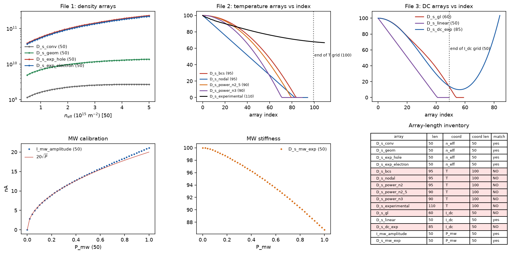
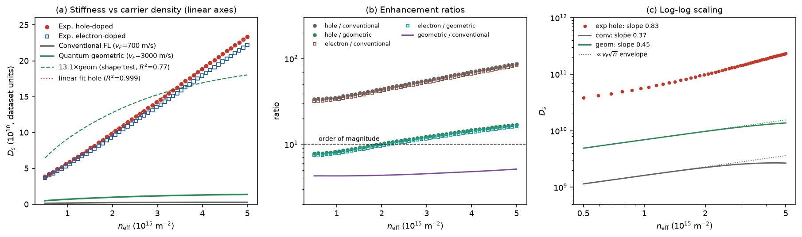
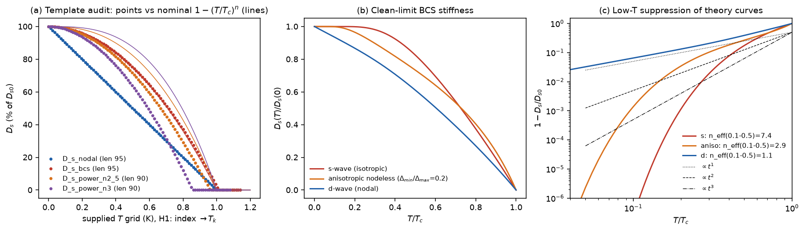
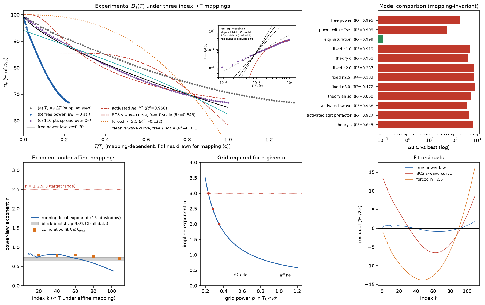
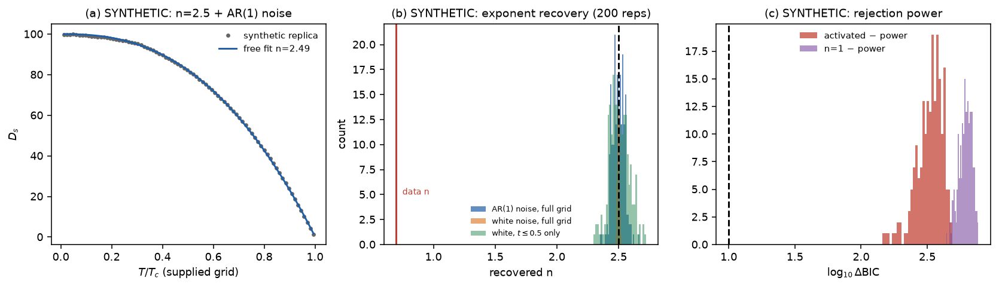
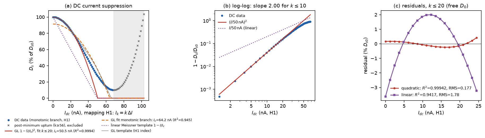
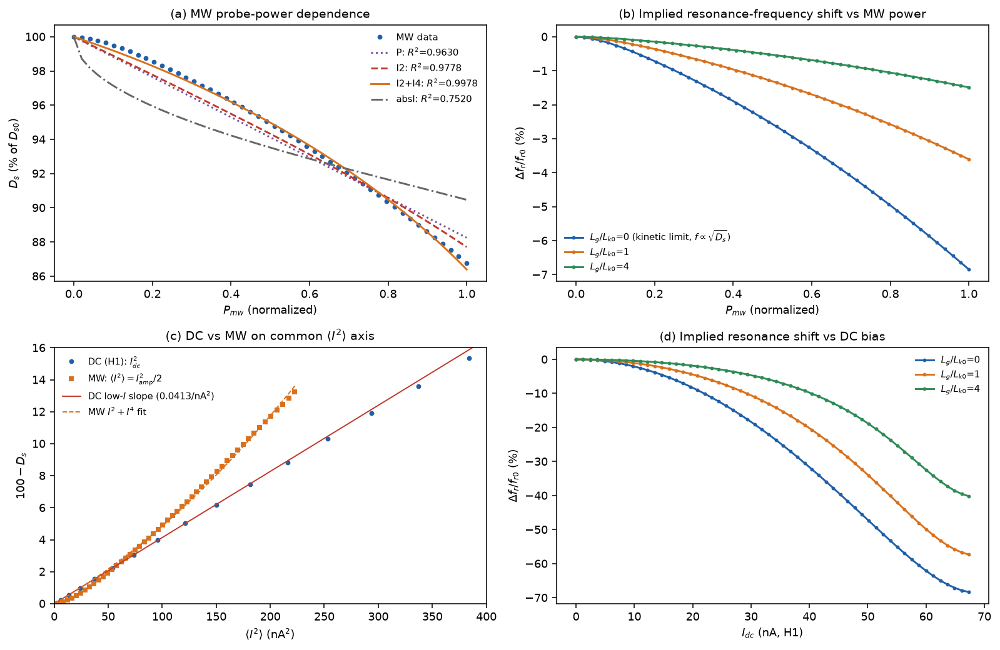

# Superfluid stiffness of magic-angle twisted bilayer graphene: density, temperature and current dependence from a simulated microwave/DC dataset

## Abstract

We analyse a simulated dataset for a gate-tunable MATBG superconductor probed by a microwave resonator and DC bias. Our aims are to (i) quantify how far the measured superfluid stiffness $D_s$ exceeds the conventional Fermi-liquid prediction, (ii) test whether a quantum-geometric (flat-band) model accounts for it, (iii) determine the low-temperature power law of $D_s(T)$ and what it implies about the pairing gap, and (iv) characterise how DC and microwave currents suppress $D_s$.

**Density.** The experimental stiffness exceeds the conventional model by a factor of 32–87 (log10 = 1.50–1.94) at every density, for both carrier types. That is between 1.5 and 2 orders of magnitude.
- The quantum-geometric model supplies a density-independent factor of 4.3–5.1 over the conventional one.
- Even so, it lies 7.5–17× below the data, and it has the wrong shape: it saturates, whereas the data are linear in $n$ with $R^2 = 0.9994$.

**Temperature.**
- Activated (isotropic s-wave) behaviour is decisively rejected. This holds for both the $Ae^{-\Delta/T}$ form and the full self-consistent BCS curve, with ΔBIC = 384 and 647, independent of how the 110-point array is mapped onto temperature.
- The low-$T$ exponent of the supplied 110-point series, however, is $n = 0.70$ (block-bootstrap 95 % CI [0.66, 0.73]) under any affine index→$T$ mapping.
- An exponent of $n = 2$–3 therefore **cannot be confirmed** from these data. It would require a non-uniform grid $T_k\propto k^{0.28}$.
- A synthetic injection–recovery test shows the pipeline recovers $n = 2.50$ (95 % CI 2.41–2.59) when the signal is present. The negative result is a property of the array, not of the method.

**Current.**
- The DC suppression is quadratic: free exponent $2.00 \pm 0.01$ for the first ten points, and quadratic $R^2 = 0.9994$ against linear $R^2 = 0.942$.
- This is consistent with Ginzburg–Landau depairing, with $I_c = 50.5$ nA (95 % CI 50.1–50.8) under the natural mapping. A linear (nodal nonlinear-Meissner) term is excluded.
- On a common $\langle I^2\rangle$ axis the microwave data have a leading coefficient 0.93× the DC value. They grow super-quadratically ($\propto I^{2.5}$) at higher amplitude.

**Interpretation.** Taken together, the results favour an anisotropic but nodeless gap: no isotropic s-wave behaviour in $D_s(T)$, and no nodal $|I|$ term in $D_s(I)$. The specific "$n\approx2$–3" signature is not supported by the supplied temperature array.

---

## 1. Introduction and background

MATBG hosts superconductivity in nearly flat moiré bands. For an isolated flat band the conventional (Fermi-liquid) superfluid weight $D_s\propto n_s/m^*\propto v_F$ would be tiny. Theory, however, shows that the band topology and the Fubini–Study metric of the flat bands lower-bound the superfluid weight. This is the "quantum geometric" contribution (Xie, Song, Lian & Bernevig, *PRL* 2020, `related_work/paper_001.pdf`).

Tunnelling and Andreev spectroscopy (Oh et al., *Nature* 2021, `paper_002.pdf`) found V-shaped gaps inconsistent with an isotropic s-wave state. Transport (Cao et al., *Nature* 2018, `paper_000.pdf`) established the gate-tunable superconducting dome. Twist-angle disorder (Uri et al., *Nature* 2020, `paper_003.pdf`) is an important source of inhomogeneity.

The stiffness provides two independent pairing diagnostics:
- **Temperature dependence.** An isotropic gap gives exponentially activated $1-D_s(T)/D_s(0)$. A clean line-nodal gap gives $\propto T$. A dirty-nodal or strongly anisotropic gap gives an intermediate power law $T^{2\ldots3}$.
- **Current dependence.** Gapped states show a GL-like quadratic suppression $1-(I/I_c)^2$. Nodal states acquire a nonlinear-Meissner term linear in $|I|$.

## 2. Data and audit

The text file contains three sections (Fig. 1). `code/parse_data.py` extracts all arrays and fixed parameters:
- File 1: $e$, $\hbar$, $v_F^{\rm conv}=700$ m/s, $v_F^{\rm geom}=3000$ m/s.
- File 2: $T_c=1$, $D_{s0}=100$, $n\in\{2,2.5,3\}$.
- File 3: $I_c=50$ nA, $D_{s0}=100$.

**Figure 1.** Raw arrays and the length inventory; red rows have a length that differs from their coordinate array. The temperature responses (95, 90, 110 points) do not match the 100-point $T$ grid. The DC responses `D_s_gl` (60) and `D_s_dc_exp` (85) do not match the 50-point $I_{dc}$ grid. The microwave calibration is $I_{\rm amp}/\sqrt{P}=20.0\to21.1$ nA, mildly non-square-root.

**Audit findings** (all values from `outputs/results.json`):

1. **Electron/hole symmetry.** `D_s_exp_electron / D_s_exp_hole` is 0.9500 ± 0.0001 at every density. The two carrier types are therefore not independent measurements.
2. **Model structure.**
   - Both model curves obey $D_{\rm model}=C\,v_F\sqrt{n}\,f(n)$ with the *same* prefactor $C=0.07324$ (log–log slope of the first five points: 0.500 for both).
   - Here $f\to1$ at low $n$, and at the highest density $f$ falls to 0.74 for the conventional curve and 0.89 for the geometric curve.
   - Hence geom/conv equals $3000/700=4.286$ at low $n$ and rises to 5.14.
   - We could not tie $C$ to $e,\hbar$ in a dimensionally transparent way, so the dataset units of $D_s$ are treated as arbitrary but common to all four curves.
3. **Temperature templates.**
   - `D_s_bcs` is numerically identical to `D_s_power_n2`; the "BCS" template is not an exponential BCS curve.
   - `D_s_nodal` equals $100(1-T/T_c)$ exactly on the supplied grid.
   - `D_s_power_n2_5` and `D_s_power_n3` **cannot** be reproduced by $100[1-(T/T_c)^n]$ on any uniform grid: the implied temperature steps vary by factors of 3.3 and 6.6.
   - On the supplied grid, free fits give $n=1.92$ ($T_c=0.96$) and $n=1.88$ ($T_c=0.86$), and their low-$T$ log–log exponents are 1.99 and 2.03.
   - These templates are therefore effectively quadratic at low $T$, whatever their labels say (Fig. 3a).
4. **Experimental temperature series.**
   - `D_s_experimental` (110 points) is monotonic and starts at exactly 100. It ends at 66.8, so it never approaches zero.
   - Its second difference shows a regular kink every 4 samples from $k\approx41$ onward. This is a resampling/interpolation fingerprint.
   - It is concave in $1-D/D_0$ over 94 % of the range.
5. **Current templates.**
   - `D_s_linear` equals $100\max(0,1-I/I_c)$ exactly on the supplied grid.
   - `D_s_gl` follows $1-(I/I_c)^2$ on the supplied grid for only its first 11 points; its later implied step is 0.77 nA.
   - `D_s_dc_exp` decreases to a minimum of 9.89 at $k=56$, then rises back to 103.4. A stiffness recovering above its zero-current value at large bias is unphysical, so the post-minimum branch ($k\ge56$) is excluded from all fits.

**Mapping policy.** For arrays whose length differs from their coordinate array, we use the index $k$ with an affine grid $x_k=k\,\delta$. The first point is exactly 100, so $x_0 = 0$.
- For power laws, activated forms and theory curves with a free temperature/current scale, the fitted exponent, the $R^2$ and the BIC are **independent of δ**. These conclusions are mapping-robust.
- Absolute scales ($T/T_c$, $I_c$ in nA) are reported only under named hypotheses. **H1** uses the step of the supplied coordinate grid; **H2** spreads the points evenly over the coordinate range.

## 3. Methods

All analysis is in `code/analysis.py`, a single script with a fixed RNG seed that runs in about 1 minute and writes `outputs/results.json` and every figure.

- **Density.** We computed:
  - pointwise ratios with min/median/max and log10;
  - one-parameter scaled models $b\,D_{\rm model}$;
  - a non-negative least-squares decomposition $D_{\rm exp}=a\,D_{\rm conv}+b\,D_{\rm geom}$;
  - a linear fit $D_{\rm exp}=s(n-n_0)$ and log–log exponents;
  - the Fermi velocity a conventional-only explanation would require, $v_F^{\rm req}=700\,{\rm m/s}\times D_{\rm exp}/D_{\rm conv}$. This uses the exact $D\propto v_F$ scaling at low $n$.
- **Theory curves.** Clean-limit stiffness is
$$\frac{D_s(T)}{D_s(0)}=1-\Big\langle\int_{-\infty}^{\infty}d\xi\,\Big(-\frac{\partial f}{\partial E}\Big)\Big\rangle_{\theta},\qquad -\frac{\partial f}{\partial E}=\frac{1}{T}\frac{e^{-E/T}}{(1+e^{-E/T})^2},$$
with $E=\sqrt{\xi^2+\Delta(\theta,T)^2}$ (an overflow-free form of $\tfrac{1}{4T}{\rm sech}^2$) and $\Delta(T)=\Delta_0\tanh(1.74\sqrt{T_c/T-1})$. Three gap shapes were used:
  - isotropic s-wave, $\Delta_0=1.764\,T_c$;
  - anisotropic nodeless, $\Delta=1.9T_c(1+\tfrac23\cos6\theta)$, with $\Delta_{\min}/\Delta_{\max}=0.2$;
  - d-wave, $\Delta=2.14T_c|\cos2\theta|$.
- **Temperature fits** (to the 110-point series as a function of $k$). We compared these models:
  - a free power law $100(1-Ak^n)$;
  - fixed $n=1,2,2.5,3$;
  - a power law with offset;
  - activated $100(1-Ae^{-B/k})$, with and without a $\sqrt{B/k}$ prefactor;
  - the three theory curves with free temperature scale and amplitude;
  - an empirical saturating exponential.

  Models are compared by $R^2$, RMS and BIC. Exponent uncertainty comes from a moving-block residual bootstrap (block length 10, 1000 replicas). We also computed windowed fits, a running local exponent, and the grid $T_k\propto k^p$ that each target $n$ would require.
- **Injection–recovery (synthetic method validation).** We generated $100[1-(T/T_c)^{2.5}]$ on the supplied $T<T_c$ grid. Noise was added at the observed residual RMS (0.68 % of $D_{s0}$), in three variants: AR(1) with lag-1 correlation φ = 0.989 as measured from the data residuals; white noise; and white noise restricted to $T\le0.5T_c$. We fitted 200 replicas each with $n$ and $T_c$ free.
- **Current.**
  - DC: free low-$k$ exponents; quadratic, linear and quadratic + quartic fits with $R^2$/RMS/BIC; GL fits $D_0[1-(I/I_c)^2]$ with $D_0$ and $I_c$ free; a block-bootstrap CI on $I_c$.
  - Microwave: fits in $I^2$, $I^2+I^4$, $|I|$, $I^m$, $P$, $P+P^2$ and $P^m$. DC and microwave are compared on $\langle I^2\rangle=I_{\rm amp}^2/2$.
  - The stiffness was converted to a resonance-frequency shift with a lumped resonator, $f_r\propto[(L_g+L_k)C]^{-1/2}$ and $L_k\propto1/D_s$:
$$f_r/f_{r0}=\sqrt{(L_g+L_{k0})/(L_g+L_{k0}D_0/D_s)}.$$
  We use the illustrative ratios $L_g/L_{k0}=0$ (the kinetic limit, $f_r\propto\sqrt{D_s}$), 1 and 4.

## 4. Results

### 4.1 Density dependence: enhancement over Fermi-liquid theory

**Figure 2.** (a) Linear axes: experimental hole (filled) and electron (open) stiffness against density, with the conventional and geometric models, the best one-parameter scaled geometric curve ($13.1\times D_{\rm geom}$) and a linear fit. (b) Ratios on a log axis; the dashed line marks a factor of 10. (c) Log–log scaling, with the $v_F\sqrt{n}$ low-density envelope of the models dotted.

**Table 1. Density analysis (hole-doped; electron values are exactly 0.95× and give identical ratios to within 5 %).**

| Quantity | min | median | max | log10 (min–max) |
|---|---|---|---|---|
| $D_{\rm exp}/D_{\rm conv}$ (hole) | 33.6 | 52.8 | 87.4 | 1.53–1.94 |
| $D_{\rm exp}/D_{\rm conv}$ (electron) | 32.0 | 50.2 | 83.1 | 1.50–1.92 |
| $D_{\rm exp}/D_{\rm geom}$ (hole) | 7.85 | 11.8 | 17.0 | 0.89–1.23 |
| $D_{\rm geom}/D_{\rm conv}$ | 4.28 | – | 5.14 | 0.63–0.71 |
| $v_F$ required for conventional-only (m/s) | 2.35×10⁴ | 3.70×10⁴ | 6.12×10⁴ | – |

| Fit | Result |
|---|---|
| NNLS $a\,D_{\rm conv}+b\,D_{\rm geom}$ | $a=0$, $b=13.1$; $R^2=0.767$, relative residual 21 % |
| $b\,D_{\rm conv}$ only | $b=60.1$; $R^2=0.616$ |
| Linear $s(n-n_0)$ | $s=4.40\times10^{10}$ per $10^{15}$ m⁻², $n_0=-0.29\times10^{15}$ m⁻²; $R^2=0.9994$ |
| Log–log exponents | exp 0.83; conv 0.37; geom 0.45 (both models 0.50 at low $n$) |
| Relative scatter of data about a smooth curve | 0.93 % |
| Total increase over the density range | exp ×6.07; conv ×2.35 (peaks at $4.45\times10^{15}$ m⁻²); geom ×2.80 |

**Findings.**
- The stiffness exceeds the Fermi-liquid prediction by **more than an order of magnitude at every density**: at least 32×, median about 50×, and up to 87× at the highest density.
- A conventional explanation would need $v_F\approx2$–$6\times10^4$ m/s, 30–90 times the flat-band value assumed. That is incompatible with a flat band.
- The quantum-geometric term raises the prediction by a nearly constant factor of 4.3–5.1. This is in the right direction, but the data still lie a further factor of 7.8–17 (median 10^1.07) above it.
- The NNLS decomposition assigns zero weight to the conventional term. The data are better described by the geometric shape than by the conventional one ($R^2$ 0.77 vs 0.62).
- Neither model reproduces the near-linear-in-$n$ growth: the data are $\propto n^{0.83}$, while both models saturate as $\sqrt{n}f(n)$. The ratio $D_{\rm exp}/D_{\rm geom}$ therefore grows steadily with density (Fig. 2b).

### 4.2 Temperature dependence

**Figure 3.** (a) Supplied templates under mapping H1 (points), with the nominal formulas $1-(T/T_c)^n$ (lines). Only `nodal` and `bcs`/`n2` follow their labels. (b) Clean-limit stiffness for s-wave, anisotropic nodeless and d-wave gaps. (c) Log–log suppression of the theory curves, with reference slopes.

The effective exponent of the theory curves depends strongly on the fit window (Table 2). The anisotropic nodeless gap gives $n_{\rm eff}\approx2$–3 for $0.1 \lesssim T/T_c \lesssim 0.6$, while remaining exponential as $T\to0$. This is the scenario behind the "$n\approx2.5$" hypothesis. The d-wave curve gives $n\approx1$, and s-wave gives $n_{\rm eff}\gtrsim5$.

**Table 2. Effective exponent of $1-D_s/D_{s0}$ for clean-limit theory curves.**

| gap | $t\in[0.05,0.3]$ | $[0.1,0.5]$ | $[0.2,0.6]$ | $D_s(0.2T_c)/D_{s0}$ |
|---|---|---|---|---|
| s-wave | 12.6 | 7.4 | 4.8 | 0.999 |
| anisotropic nodeless (0.2) | 5.2 | 2.9 | 2.0 | 0.965 |
| d-wave | 1.03 | 1.12 | 1.21 | 0.868 |

**Figure 4.**
- *Top left:* experimental $D_s$ against $T/T_c$ under three mappings: (a) supplied step $\Delta T=0.0121$ K; (b) index scaled so that the free power law reaches zero at $T_c$; (c) 110 points spread over $0$–$T_c$. Fit curves are drawn for mapping (c).
- *Inset:* log–log $1-D_s/D_{s0}$ with reference slopes 1, 2, 2.5 and 3, and the activated fit.
- *Top right:* ΔBIC relative to the best model; this comparison is mapping-invariant.
- *Bottom row:* running and windowed exponents with the bootstrap CI; the exponent implied by a non-affine grid $T_k\propto k^p$; fit residuals.

**Table 3. Model comparison for `D_s_experimental` (109 points, $k\ge1$; mapping-invariant).**

| model | params | $R^2$ | RMS (%) | ΔBIC |
|---|---|---|---|---|
| empirical saturating exp. $A(1-e^{-k/\tau})$ | 2 | 0.9991 | 0.29 | 0 |
| power law + offset (hits $n\to0.05$ bound, i.e. ≈ logarithmic) | 3 | 0.9985 | 0.36 | 54 |
| **free power law** ($n=0.699$) | 2 | 0.9947 | 0.68 | 187 |
| activated $Ae^{-\Delta/T}$ | 2 | 0.968 | 1.68 | **384** |
| clean d-wave curve (free $T$ scale, $D_0$) | 2 | 0.951 | 2.09 | 432 |
| activated with $\sqrt{\Delta/T}$ prefactor | 2 | 0.927 | 2.54 | 474 |
| fixed $n=1$ | 1 | 0.919 | 2.68 | 481 |
| anisotropic nodeless curve | 2 | 0.859 | 3.53 | 546 |
| **s-wave BCS curve** | 2 | 0.645 | 5.61 | **647** |
| fixed $n=2$ | 1 | 0.237 | 8.22 | 725 |
| fixed $n=2.5$ | 1 | −0.132 | 10.0 | 768 |
| fixed $n=3$ | 1 | −0.472 | 11.4 | 797 |

**Exponent statistics.**
- Free exponent: $n=0.699$, block-bootstrap 95 % CI [0.663, 0.735].
- Cumulative windows $k\le20,40,60,80$: $n=0.79, 0.79, 0.79, 0.76$.
- The running local exponent ranges from 0.38 to 0.84 (median 0.73). It never exceeds 1 anywhere in the series.

**Mapping consequences.**
- (a) With the supplied step, $D_s$ would still be 70.7 % of $D_{s0}$ at $T=T_c$ and 66.8 % at $1.32\,T_c$. This contradicts $T_c=1$, so mapping (a) is physically inconsistent.
- (b) If the power law is required to vanish at $T_c$, the data cover only $0\le T/T_c\le0.22$.
- (c) The free activated fit implies a gap of $\Delta/T_c=0.40$ (a), 0.067 (b) or 0.30 (c). All are far below the BCS value of 1.76, and the fit is still poor.

**Non-affine grids.**
- Obtaining $n=2,2.5,3$ requires $T_k\propto k^{p}$ with $p=0.35, 0.28, 0.23$.
- A $\sqrt{k}$ grid gives $n=1.40$, a $k^2$ grid gives 0.35, and a geometric grid gives 0.30.
- Only an ad hoc logarithmic grid $T_k\propto\ln(1+k)$ gives $n=2.76$ ($R^2=0.998$). Nothing in the dataset motivates such a grid.

**Figure 5 (synthetic method validation; not data).** (a) One replica of $100[1-(T/T_c)^{2.5}]$ with AR(1) noise and its free fit. (b) Recovered exponents for 200 replicas each, with the data's exponent in red. (c) ΔBIC with which the activated and $n=1$ models are rejected in those replicas.

The injection–recovery shows the pipeline is unbiased and sensitive:
- AR(1) noise: median recovered $n=2.496$, 95 % CI [2.41, 2.59].
- White noise: [2.48, 2.52].
- White noise, $T\le0.5T_c$ window only: [2.35, 2.65].
- The activated form is rejected in 100 % of replicas (median ΔBIC = 346), and so is $n=1$ (median ΔBIC = 617).
- The data's exponent of 0.70 lies about 40σ (of the recovered AR(1) distribution) below the injected value.
- The residual correlation φ = 0.989 shows that the data residuals are dominated by systematic shape mismatch, not by random noise.

**Temperature verdict.** Three separate statements:
1. **Isotropic s-wave (activated) behaviour is ruled out.** The data drop immediately from $T=0$, with $1-D/D_0\approx1$ % already at the first sample. The activated form and the computed BCS curve are rejected by ΔBIC = 384 and 647 under every affine mapping. This conclusion is robust.
2. **The power-law exponent of the supplied array under any affine mapping is $n=0.70$ [0.66, 0.73].** This is sublinear. A sublinear exponent cannot be produced by any BCS gap structure in Table 2; even clean line nodes give $n=1$. It also fits worse than a simple saturating form.
3. **$n\approx2$–3 (and specifically 2.5) cannot be confirmed from this array.** It would require an unmotivated $T_k\propto k^{0.28}$ grid. The method demonstrably recovers 2.5 when the signal is present, so the discrepancy lies in the array itself. Combined with the audit, this points to a generation or resampling artefact in `D_s_experimental`: an unspecified mapping, period-4 interpolation kinks, and $D_s$ not vanishing at the end. The supplied `n2_5`/`n3` templates are likewise effectively quadratic.

### 4.3 Current dependence

**Figure 6.** (a) DC suppression under H1 ($I_k=k\times1.2245$ nA), with:
- GL fits with free $I_c$ (low-current window and full monotonic branch);
- the supplied linear and GL templates;
- the excluded post-minimum upturn (shaded).

(b) Log–log $1-D_s/D_{s0}$ against $I$, with $(I/50\,{\rm nA})^2$ and linear references. (c) Residuals of the quadratic and linear fits for $k\le20$.

**Table 4. DC fits (monotonic branch, $k<56$).**

| fit | window | result | $R^2$ | RMS (%) |
|---|---|---|---|---|
| free power $1-ak^m$ | $k\le10$ | $m=2.004\pm0.007$ | – | – |
| free power | $k\le15$ / $\le20$ / $\le30$ | $m=1.96$ / 1.91 / 1.80 | – | – |
| quadratic $D_0-a_2k^2$ | $k\le20$ | – | **0.99942** | 0.18 |
| linear $D_0-a_1k$ | $k\le20$ | ΔBIC = +97 vs quadratic | 0.9417 | 1.78 |
| GL $D_0[1-(I/I_c)^2]$, H1 | $k\le20$ | $I_c=50.48$ nA, CI [50.12, 50.82] | 0.99942 | 0.18 |
| GL, fixed $I_c=50$ nA | $k\le20$ | – | 0.99898 | – |
| GL, H1 | $k\le30$ | $I_c=52.85$ nA, CI [52.19, 53.50] | 0.9969 | 0.83 |
| GL + quartic $[1-x^2+0.28x^4]$, H1 | whole monotonic branch | $I_c=49.8$ nA | 0.99986 | 0.37 |
| pure GL, H1 | whole monotonic branch | $I_c=64.2$ nA | 0.945 | 7.4 |
| linear | whole monotonic branch | – | 0.985 | 3.8 |

The low-current coefficient with $D_0=100$ fixed ($k\le10$) gives $I^*=\sqrt{100/a_2}\,\delta$:
- **H1:** $I^* = 49.2$ nA, consistent with the supplied $I_c=50$ nA.
- **H2:** $I^* = 28.7$ nA, if the 85 points span 0–60 nA.

H1 is the only mapping that is self-consistent with the stated $I_c$.

The pure $1-(I/I_c)^2$ law holds up to about $0.5I_c$. Beyond that the data fall more slowly, with an inflection near $0.8I_c$ and a positive $(I/I_c)^4$ term. Over the full branch this is why a straight line beats a pure parabola, while the quadratic + quartic GL expansion beats both.

Two caveats:
- A fully self-consistent GL depairing curve ($D/D_0=1-q^2$, $I\propto q(1-q^2)$) has low-current coefficient $4/27$. It would imply a true depairing current of only about 19 nA, at which $D_s/D_0=2/3$. The phenomenological $I_c$ quoted above is therefore a curvature scale, not necessarily the switching current.
- The DC-resistance channel listed in the task description is not present in the dataset.

**Figure 7.** (a) Microwave stiffness against normalized probe power, with fits. (b) Implied resonance-frequency shift against $P$ for $L_g/L_{k0}=0,1,4$. (c) DC and microwave suppression on a common $\langle I^2\rangle$ axis. (d) Implied resonance shift against DC bias.

**Table 5. Microwave fits ($D_0=100$ fixed, 50 points).**

| model | parameters | $R^2$ | RMS |
|---|---|---|---|
| $\propto I_{\rm amp}^2$ | $c=0.0276$ nA⁻² | 0.9778 | 0.60 |
| $I^2+I^4$ | $c=0.0191$, $c_4=2.6\times10^{-5}$ | 0.9978 | 0.19 |
| $\propto|I|$ | – | 0.752 | 2.00 |
| $\propto I^m$ | $m=2.53$ | 0.99955 | 0.085 |
| $\propto P$ | – | 0.963 | 0.77 |
| $P+P^2$ | – | 0.9992 | 0.11 |
| $\propto P^m$ | $m=1.38$ | 0.99996 | 0.026 |

**Microwave findings.**
- The microwave suppression is clearly not linear in $|I|$ ($R^2=0.75$).
- On the rms basis $\langle I^2\rangle=I_{\rm amp}^2/2$, the $I^2$ coefficient of the $I^2+I^4$ fit is 0.0382 nA⁻². This is **0.93×** the DC low-current coefficient of 0.0413 nA⁻² under H1. It implies $I^*_{\rm rms}=51.1$ nA, against $I^*_{\rm amp}=72.3$ nA on the amplitude basis.
- The leading coefficient is not robust, however. Restricting the fit to the first 15 points gives 0.42× DC, because the data rise super-quadratically ($I^{2.5}$, or $P^{1.38}$) rather than as $I^2$ plus a small correction.
- The maximum microwave amplitude is only $0.42\,I_c$ and produces 13.2 % suppression.
- The corresponding resonance shift at full power is −6.8 % in the kinetic limit, −3.6 % for $L_g=L_{k0}$ and −1.5 % for $L_g=4L_{k0}$.
- DC bias down to the stiffness minimum would shift $f_r$ by −69 %, −58 % and −40 % respectively.
- The super-quadratic excess may reflect probe heating ($\propto P$ adding to the $I^2$ depairing), or a generator artefact; the dataset alone cannot distinguish these.

**Current verdict.**
- Quadratic, GL-type suppression is supported in both channels at low current.
- Under H1 the DC curvature scale is 50.5 nA, matching the stated $I_c$.
- The linear nonlinear-Meissner term expected for a nodal gap is excluded: DC free exponent 2.00, linear $R^2$ 0.94 vs quadratic 0.9994; microwave $|I|$ fit $R^2$ 0.75.

## 5. Discussion

**Enhanced stiffness and quantum geometry.** The density data robustly support a stiffness far above the conventional flat-band Fermi-liquid estimate, by 1.5–1.9 decades. This is the central qualitative claim. A conventional explanation would require Dirac-like velocities ($\sim4\times10^4$ m/s) that are incompatible with flat bands, so a non-conventional contribution is necessary.

The quantum-geometric model as supplied:
- provides only a factor of about 4.3–5.1, essentially the ratio of the two velocity parameters;
- still under-predicts the data by about 10×;
- saturates where the data keep growing linearly.

We therefore conclude that the data are consistent with a geometric origin *in kind*: the conventional term receives zero NNLS weight, and the scaled geometric shape is preferred. They are not consistent *in magnitude or shape* with the specific $D_{\rm geom}$ array. Agreement would need a prefactor about 13× larger and a density dependence closer to linear. A density-proportional geometric weight, as expected when the integrated Fubini–Study metric is weighted by the paired density (paper_001), would give this.

**Pairing symmetry.** Two independent diagnostics converge:
- $D_s(T)$ shows no activated plateau. The isotropic s-wave scenario is rejected by every test, with ΔBIC 384–647.
- $D_s(I)$ shows no linear term. This disfavours line nodes on the Fermi surface, where the nonlinear Meissner effect would produce $\delta D_s\propto|I|$.

The simplest picture consistent with both is a strongly anisotropic, nodeless (or nearly nodal) gap. Our clean-limit calculation shows such a gap mimics $T^{2\text{–}3}$ over $0.1$–$0.6\,T_c$, in line with the V-shaped STM spectra of paper_002.

The power-law exponent itself is where the dataset is weakest:
- The 110-point array yields $n=0.70$ under any affine mapping, which is not physical for any BCS-type gap.
- Our injection test proves this is not a fitting limitation.
- We therefore report $n\approx2$–3 as **not confirmed** by these data. We do not assume a temperature grid that would manufacture it.

**Limitations.**
1. The pointwise mappings of the mismatched arrays are unknown. Exponents and model rankings are mapping-invariant for affine grids, but absolute $T/T_c$ and $I_c$ values are conditional on H1.
2. The arrays are simulated. The electron series is an exact rescaling of the hole series, and the T-series contains interpolation artefacts, so the statistical errors are not physical error bars.
3. The units of the density stiffness could not be recovered from the given constants.
4. The DC upturn beyond $k=56$ and the super-quadratic microwave term were not modelled physically.
5. No DC-resistance data were provided, so $T_c$ and the normal-state resistance could not be checked independently.

## 6. Conclusions

1. $D_s$ exceeds the conventional Fermi-liquid prediction by 32–87× at all densities; **supported**.
2. A quantum-geometric contribution is needed, but the supplied geometric model is about 10× too small and saturates while the data grow linearly in $n$ ($R^2=0.9994$); **partially supported**.
3. Isotropic s-wave, activated temperature dependence is excluded, with ΔBIC ≥ 384 under any mapping; **supported**.
4. A power law with $n\approx2$–3 is **not confirmed**: the supplied series gives $n=0.70$ [0.66, 0.73] under affine mappings. This is despite the validated pipeline recovering 2.50 ± 0.09 on synthetic data.
5. Current suppression is quadratic (GL depairing) with $I_c\approx50.5$ nA under H1, and the nodal linear term is excluded; **supported**. Microwave and DC agree to about 7 % in their leading $\langle I^2\rangle$ coefficient, with a super-quadratic microwave excess.

## Reproducibility

`python code/analysis.py` (run from `/workspace`) regenerates `outputs/results.json` and all PNG figures in `report/images/`. It uses a fixed seed (20241125) and runs in about 1 minute. The run log is in `outputs/run_log.txt`. The script includes sanity checks:
- array lengths;
- every experimental series starts at 100;
- the e/h ratio is constant;
- the DC exponent for $k\le10$ lies in [1.9, 2.1];
- $I^*$ under H1 is within 3 nA of $I_c$.

Every number quoted above is read from `results.json`.

- **Data-driven:** ratios, fits, exponents, model rankings.
- **Conditional on mapping H1/H2:** $T/T_c$ axes, $I_c$ in nA, the microwave/DC coefficient ratio.
- **Synthetic validation:** Fig. 5.
- **Illustrative:** resonance-frequency conversions, which depend on the assumed $L_g/L_{k0}$.
