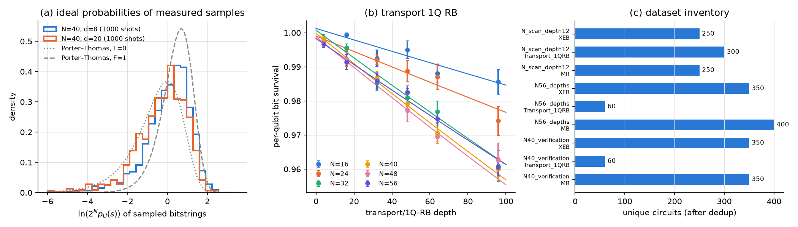
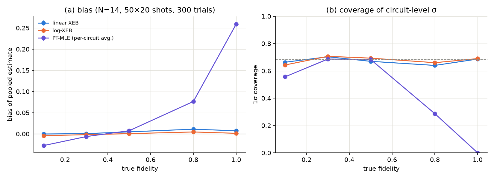
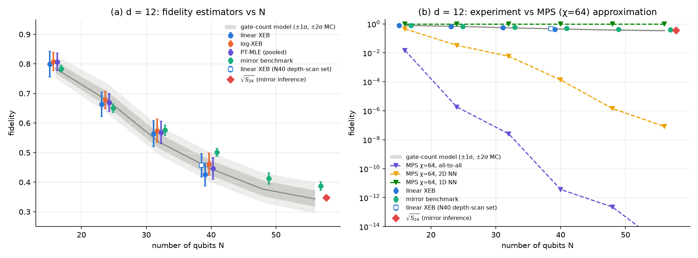
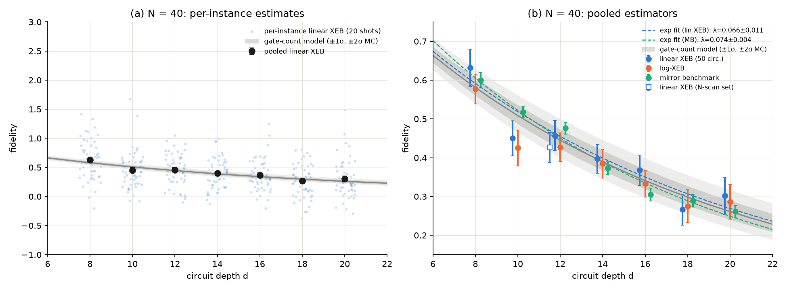
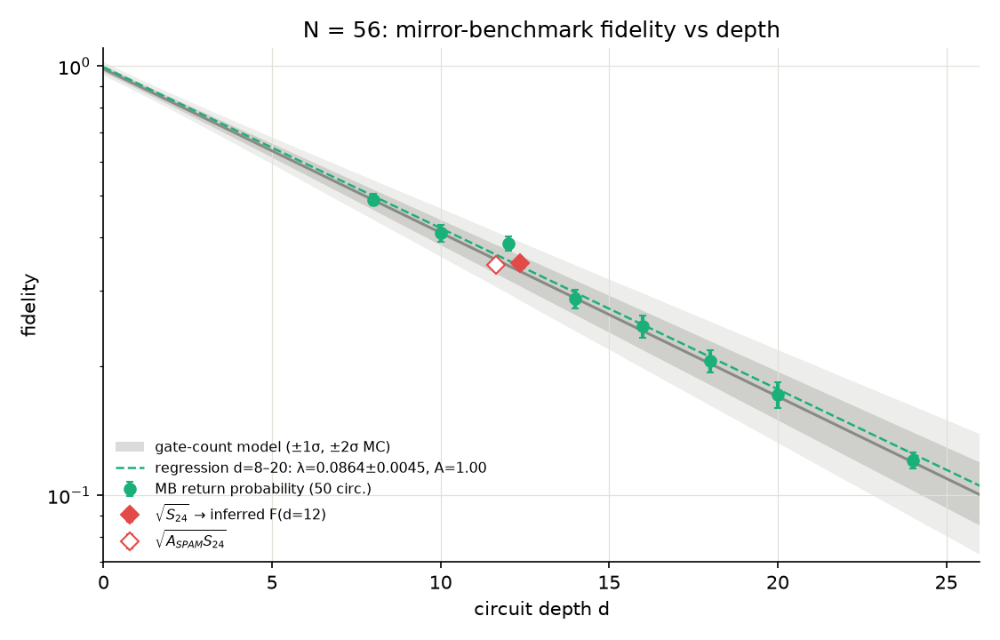
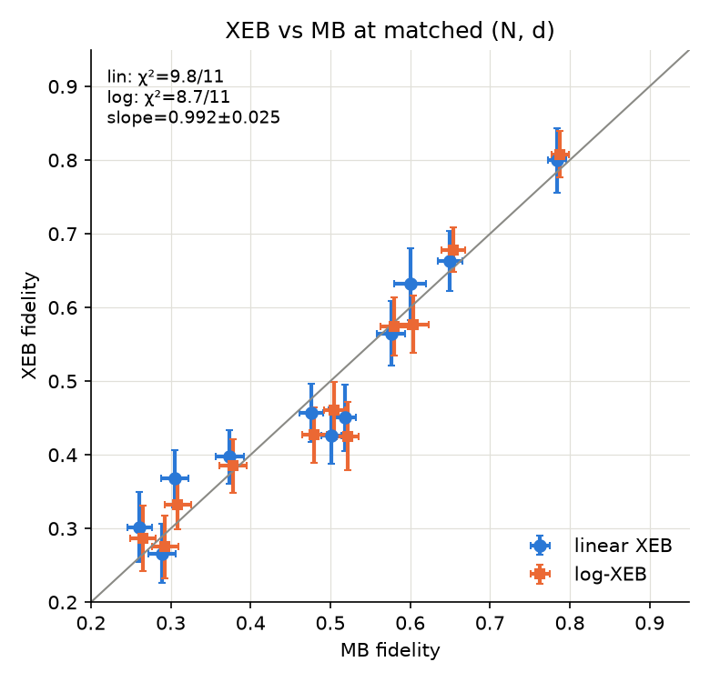
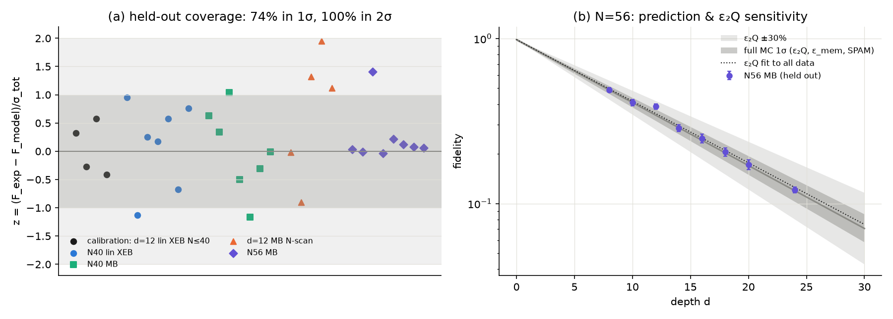
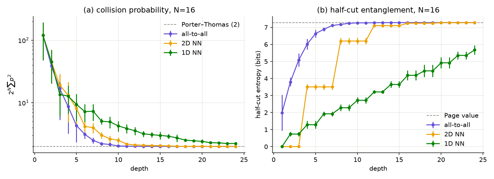
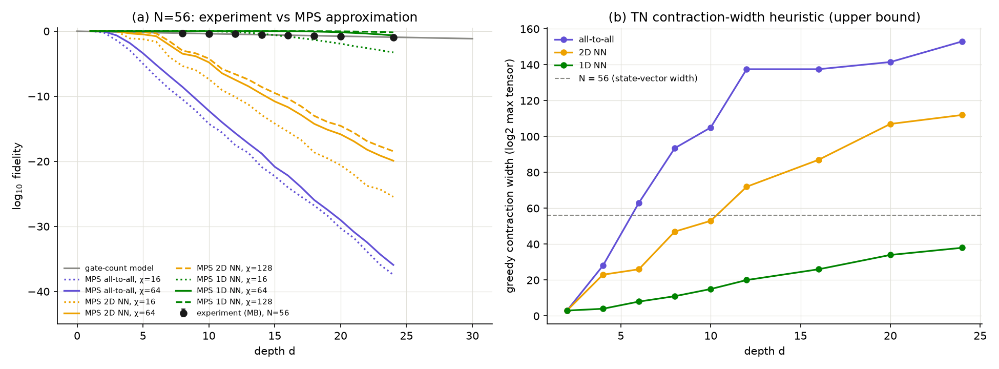

# Fidelity estimation for all-to-all random circuit sampling and the gap to classical approximability

## Abstract

We re-analyse experimental random-circuit-sampling (RCS) data from a trapped-ion processor with all-to-all connectivity. The data cover N = 16–56 qubits, depths d = 8–24 and 50 circuit instances per configuration. For every instance we estimate the circuit fidelity in four ways: linear cross-entropy benchmarking (XEB), logarithmic XEB, a Porter–Thomas maximum-likelihood fit (PT-MLE), and the mirror-benchmark (MB) return probability. Each estimate has a shot-noise uncertainty. Configurations are pooled with a circuit-level bootstrap.

All verifiable configurations are mutually consistent:

- Linear XEB and log-XEB agree with MB at the 11 configurations where both exist (χ² = 9.8/11 and 8.7/11). The fitted slope of XEB on MB is 0.992 ± 0.025.
- At N = 40 the linear-XEB fidelity falls from 0.63 ± 0.05 at d = 8 to 0.30 ± 0.05 at d = 20.
- At d = 12 it falls from 0.80 ± 0.04 at N = 16 to 0.43–0.46 ± 0.04 at N = 40.
- At N = 56, where no ideal amplitudes are available, MB gives F = 0.489 ± 0.014 at d = 8 and F = 0.121 ± 0.005 at d = 24. The per-layer decay is λ = 0.086 ± 0.004.

We also built a gate-count error model. Memory/transport error and SPAM come from transport 1Q randomized benchmarking (RB) in the data. One two-qubit error rate, ε₂Q = (1.98 ± 0.21)×10⁻³, was calibrated on four points only. The model then predicts the 27 held-out fidelities with χ² = 16.6, and 74 % (100 %) of them lie inside the 1σ (2σ) band.

On the classical side, we simulated the same assumed gate family with truncated MPS. At N = 56, all-to-all circuits lose ≈3.9 e-folds of MPS fidelity per layer at χ = 64, versus 0.086 for the hardware. At d = 12 that is a gap of ≈35 e-folds (≈15 decades), growing to ≈80 e-folds at d = 24. 1D nearest-neighbour circuits of the same size and depth are simulated by MPS with χ = 64–128 at *higher* fidelity than the experiment. This reproduces the core claim: high connectivity is what turns a modest-fidelity experiment into one that is far from classical approximability by these methods.

---

## 1. Data and audit

**Inventory.** The data comprise the files `data/results/<family>/<N>_<d>_<type>/N*_d*_r*_<type>_counts.json`. Ideal amplitudes (`*_amplitudes.json`, complex strings, so `ideal_probs` = |a|²) exist for the XEB circuits with N ≤ 40. MB and transport-1Q-RB (TRB) circuits come with a `*_ideal_bitstring.json` target.

**Parsing and deduplication.** Keys are tuple-strings such as `"(0, 1, …)"`, parsed to integer tuples. Files were deduplicated by MD5 hash plus file name. All 160 files in `N_scan_depth12/N56_*` (XEB, MB and TRB) are byte-identical copies of files in `N56_depths`, so they were dropped (`outputs/duplicates_removed.csv`). The two N = 40, d = 12 datasets (`N40_verification` and `N_scan_depth12`) are genuinely different: they share no sampled bitstrings, no amplitude keys and no MB targets. Both were therefore kept, and are reported separately and pooled. After deduplication there are **2,370 unique circuits**.

| family | type | N | d | circuits × shots | ideal info |
|---|---|---|---|---|---|
| N40_verification | XEB | 40 | 8,10,…,20 | 50 × 20 | amplitudes, 20/20 sampled keys matched, **50/50 instances computable at every depth** |
| N40_verification | MB | 40 | 8,…,20 | 50 × 20 | target bitstring |
| N_scan_depth12 | XEB | 16,24,32,40 | 12 | 50 × 20 | amplitudes, 20/20 matched, 50/50 instances |
| N_scan_depth12 | XEB | 48 | 12 | 50 × 20 | none (not verifiable) |
| N_scan_depth12 | MB | 16–48 | 12 | 50 × 20 | target |
| N56_depths | XEB | 56 | 8–20 | 50 × 20 | none |
| N56_depths | MB | 56 | 8–20 | 50 × 20 | target |
| N56_depths | MB | 56 | **24** | **50 × 100** | target |
| all families | TRB | 16–56 | 4,16,32,48,64,96 | 10 × 10 | target |

Full table: `outputs/audit_table.csv`. Every sampled XEB bitstring had an ideal amplitude: 0 missing over 11 × 50 circuits, an assertion enforced in `code/load_data.py`. All 20 shots per circuit were distinct bitstrings.

**The N = 56, d = 24 MB set.** We checked whether its targets relate to the d = 12 instances with the same index r (`code/inspect_mb.py`). They do not:

- The Hamming distance between the d = 24 and d = 12 MB targets is ≈ N/2, ranging from 22 to 38.
- No d = 24 target appears among the d = 12 XEB or MB samples.

The files alone therefore cannot establish whether d = 24 is "the mirror of the depth-12 RCS circuits". The randomised final Pauli frame of mirror circuits would anyway randomise the target. We treat the mirror interpretation as a hypothesis and test it in §3.4.

Figure 1(a) shows the empirical distribution of ln(2ᴺp_U(s)) over the 1000 N = 40 samples at d = 8 and d = 20. It lies between the Porter–Thomas curves for an ideal sampler (F = 1) and a uniform sampler (F = 0), visibly closer to F = 1 at d = 8.

*Figure 1. (a) Ideal log-probabilities of measured bitstrings (N = 40) compared with Porter–Thomas mixtures. (b) Transport 1Q-RB per-qubit bit survival with fits P(d) = ½ + B pᵈ. (c) Circuit inventory after deduplication.*

## 2. Methods

### 2.1 Per-instance estimators (N, d, r)

For circuit U with sampled bitstrings s (counts c_s, n = Σc_s = 20) let x_s = 2ᴺ p_U(s). All averages below are counts-weighted.

- **Linear XEB:** F_lin = ⟨x⟩ − 1, with σ = sd(x)/√n.
- **Log-XEB:** F_log = N ln 2 + γ + ⟨ln p_U(s)⟩ = γ + ⟨ln x⟩, with γ = 0.57722 and σ = sd(ln x)/√n. Under the depolarised Porter–Thomas model p = F p_U + (1−F)2⁻ᴺ, ⟨ln x⟩ = −γ + F, so F_log is unbiased. Its shot variance is (π²/6 − F²)/n, smaller than the linear-XEB variance (1 + 2F − F²)/n.
- **PT-MLE:** F̂ maximises Σ c_s ln(1 − F + F x_s), with the Fisher-information error.
- **Mirror benchmark:** S = c(s*)/n, where s* is the target bitstring, and F_MB = (S − 2⁻ᴺ)/(1 − 2⁻ᴺ). We give a binomial σ and a 68 % Jeffreys interval per circuit.
- **TRB:** the per-qubit bit-survival fraction relative to the target.

All 4,170 per-instance estimates are in `outputs/per_instance_estimates.csv`, with columns family, N, d, r, method, F, sigma (plus hits and Jeffreys intervals for MB).

### 2.2 Pooling per (N, d)

With equal shots per circuit, the pooled estimate is the mean over the 50 circuits. Its uncertainty is a **circuit-level bootstrap** (4,000 resamples of whole circuits). Shots are never resampled inside circuits, because the between-circuit spread already contains the shot noise; a hierarchical bootstrap would double-count it.

The observed between-circuit variance agrees with the pure shot-noise prediction. The median ratio is 1.04 for linear XEB, 0.99 for log-XEB and 1.12 for MB, with ranges 0.83–1.50, 0.75–1.48 and 0.69–1.61. Instance-to-instance fidelity variation is therefore not resolved with 20 shots per circuit.

For PT-MLE we found that *averaging per-circuit MLEs is biased* (§2.3). We therefore use a single MLE over all 1,000 pooled shots ("PT-MLE pooled"), with a 300-resample circuit bootstrap.

### 2.3 Synthetic validation of estimators

We generated 50 random all-to-all circuits with N = 14 and d = 12 (assumed gate set, §2.6). We drew 20 shots per circuit from F p_U + (1 − F)2⁻ᴺ, ran 300 trials per F, and applied the same pooling (`code/synthetic_validation.py`).

Sanity checks:

- The collision value 2ᴺΣp² was 2.008, against 2 for Porter–Thomas.
- A uniform sampler gave ⟨ln x⟩ = −0.579, against −γ = −0.577.
- An ideal sampler gave 0.424, against 1 − γ = 0.423.

Linear and log XEB are unbiased: |bias| ≤ 0.011 for F ∈ [0.1, 1]. Their 1σ coverage is 0.64–0.71 and 2σ coverage 0.93–0.97 (Fig. 7). Per-circuit-averaged PT-MLE is biased upward at high F: +0.076 at F = 0.8 and +0.26 at F = 1, with coverage 0.29 and 0. That is why it reads 0.87 at N = 16 instead of 0.80. The pooled MLE removes this bias, and it agrees with linear and log XEB on the data (Table 1).

*Figure 7. Bias and 1σ coverage of pooled estimators on synthetic depolarised-Porter–Thomas data with the experimental design (50 circuits × 20 shots).*

### 2.4 Transport 1Q-RB and the gate-count model

For each N we fitted P(d) = ½ + B pᵈ to TRB survival, pooling the two N = 40 datasets. We take ε_mem(N) = ¾(1 − p) per qubit per layer and ε_SPAM = ½ − B. Uncertainties come from 800 bootstraps of circuits within each depth.

| N | ε_mem (×10⁻⁴) | ε_SPAM (×10⁻⁴) |
|---|---|---|
| 16 | 2.53 ± 0.67 | −12.7 ± 11.8 |
| 24 | 3.44 ± 0.68 | 9.3 ± 8.5 |
| 32 | 6.14 ± 0.53 | −7.7 ± 7.0 |
| 40 | 6.74 ± 0.44 | 1.5 ± 5.5 |
| 48 | 6.83 ± 0.46 | 11.6 ± 9.7 |
| 56 | 5.78 ± 0.41 | 17.0 ± 9.3 |

Memory/transport error grows with N up to N ≈ 32 and then saturates. SPAM is not resolved per N. Its inverse-variance mean is ε_SPAM = (2.6 ± 3.2)×10⁻⁴ per qubit, used without clipping to zero.

**Model:**

ln F(N, d) = N ln(1 − ε_SPAM) + d [ (N/2) ln(1 − ε₂Q) + N ln(1 − ε_mem(N)) ].

The data contain **no independent two-qubit RB**, so ε₂Q must be calibrated. We fitted it only to the d = 12, N ≤ 40 linear-XEB points (4 points), giving ε₂Q = (1.98 ± 0.21)×10⁻³ with χ² = 0.9/3. Every other dataset is held out and predicted out of sample: N = 40 depth-scan XEB and MB, d = 12 MB for N = 16–56, the N = 56 MB depth scan, and the mirror-inferred point.

For comparison, a fit to all 31 points gives ε₂Q = (1.912 ± 0.028)×10⁻³ with χ²/dof = 51.2/30. The model uncertainty band is a Monte Carlo of 5,000 joint draws of ε₂Q (fit error), ε_mem(N) (per-N bootstrap samples) and ε_SPAM (its standard error). We also show the sensitivity of the prediction to ε₂Q varied by ±30 %.

### 2.5 Depth regression and mirror inference

For a given MB set we fitted ln F = ln A − λd by weighted least squares, with delta-method errors on ln F and the full parameter covariance propagated to predictions. For N = 56 we tested the hypothesis that the d = 24 MB circuits are mirrors of depth-12 circuits (U₁₂ followed by its inverse). Under that hypothesis:

- F₁₂ ≈ √S₂₄, with σ = σ_S/(2√S₂₄);
- SPAM-aware variants are √(A·S₂₄), with A from either the depth-fit intercept or (1 − ε_SPAM)ᴺ.

Under a pure exponential law F = A e^{−λd}, these √ relations hold identically. The test is therefore really a test of multiplicative (exponential) fidelity scaling.

### 2.6 Classical approximability (assumed circuit family)

The actual gates are not in the data. We therefore generated circuits of the same *type*: on every layer, Haar-random SU(2) on every qubit followed by ZZ(π/2) = exp(−iπ/4 Z⊗Z) on a pairing of the qubits. **This gate set is an assumption.** Three pairing geometries were used:

- **all-to-all:** a fresh uniformly random perfect matching each layer;
- **2D NN:** an ABCD pattern on a 7 × 8 grid at N = 56;
- **1D NN:** brickwork.

We ran three diagnostics:

- **(a) Scrambling at N = 16** (exact state vector, 5 seeds): collision value 2ᴺΣp² and half-cut entanglement entropy versus d.
- **(b) Truncated MPS.** Long-range gates are routed by SWAP chains, with the qubit permutation tracked and no swap-back. The MPS fidelity is the product of retained Schmidt weights, F_MPS = Π(1 − δ_i).
  - Validation against exact overlaps at N = 12 and 16 (3 geometries, χ = 4–32, d ≤ 12; `outputs/mps_validation.csv`): the median |ln F_est − ln F_exact| is 0.004 over the 127 cases with F_exact > 10⁻², and the mean bias is −0.017.
  - At N = 56 we ran d ≤ 24 with χ ∈ {16, 32, 64} for all geometries (2 seeds at χ = 64) and χ = 128 for 1D and 2D.
  - We also ran a d = 12 scan over N = 16–56 at χ = 32 and 64.
- **(c) Contraction-width heuristic.** On the line graph of the amplitude tensor network, we took the best of time-ordered and greedy min-degree/min-fill elimination orderings.

All runs together took ≈25 min on 2 cores.

## 3. Results

### 3.1 Fidelity estimates per (N, d)

Table 1 gives pooled estimates (circuit-bootstrap 1σ). The full table, including model σ, depth regression and an inverse-variance "combined" estimate (linear XEB ⊕ MB, independent samples), is in `outputs/fidelity_summary.csv`.

| dataset | N | d | lin XEB | log-XEB | PT-MLE (pooled) | MB | model (MC σ) |
|---|---|---|---|---|---|---|---|
| N-scan | 16 | 12 | 0.800 ± 0.044 | 0.808 ± 0.031 | 0.807 ± 0.029 | 0.784 ± 0.011 | 0.784 ± 0.019 |
| N-scan | 24 | 12 | 0.663 ± 0.041 | 0.678 ± 0.030 | 0.670 ± 0.031 | 0.650 ± 0.015 | 0.677 ± 0.025 |
| N-scan | 32 | 12 | 0.564 ± 0.044 | 0.574 ± 0.039 | 0.568 ± 0.038 | 0.576 ± 0.018 | 0.535 ± 0.025 |
| N-scan | 40 | 12 | 0.426 ± 0.039 | 0.461 ± 0.038 | 0.446 ± 0.036 | 0.501 ± 0.013 | 0.445 ± 0.026 |
| N-scan | 48 | 12 | – | – | – | 0.413 ± 0.019 | 0.377 ± 0.026 |
| N56 | 56 | 12 | – | – | – | 0.387 ± 0.015 | 0.343 ± 0.027 |
| N40 | 40 | 8 | 0.632 ± 0.048 | 0.577 ± 0.039 | 0.571 ± 0.034 | 0.600 ± 0.020 | 0.581 ± 0.023 |
| N40 | 40 | 10 | 0.450 ± 0.045 | 0.425 ± 0.046 | 0.447 ± 0.042 | 0.518 ± 0.014 | 0.508 ± 0.025 |
| N40 | 40 | 12 | 0.457 ± 0.039 | 0.427 ± 0.037 | 0.441 ± 0.032 | 0.476 ± 0.015 | 0.445 ± 0.026 |
| N40 | 40 | 14 | 0.397 ± 0.037 | 0.385 ± 0.037 | 0.390 ± 0.033 | 0.374 ± 0.017 | 0.390 ± 0.026 |
| N40 | 40 | 16 | 0.368 ± 0.039 | 0.333 ± 0.034 | 0.332 ± 0.031 | 0.305 ± 0.017 | 0.341 ± 0.026 |
| N40 | 40 | 18 | 0.266 ± 0.040 | 0.275 ± 0.042 | 0.264 ± 0.038 | 0.289 ± 0.017 | 0.298 ± 0.026 |
| N40 | 40 | 20 | 0.302 ± 0.048 | 0.286 ± 0.044 | 0.286 ± 0.041 | 0.261 ± 0.016 | 0.261 ± 0.025 |
| N56 | 56 | 8 | – | – | – | 0.489 ± 0.014 | 0.488 ± 0.027 |
| N56 | 56 | 10 | – | – | – | 0.409 ± 0.018 | 0.409 ± 0.027 |
| N56 | 56 | 14 | – | – | – | 0.287 ± 0.014 | 0.288 ± 0.027 |
| N56 | 56 | 16 | – | – | – | 0.248 ± 0.015 | 0.242 ± 0.025 |
| N56 | 56 | 18 | – | – | – | 0.206 ± 0.012 | 0.203 ± 0.024 |
| N56 | 56 | 20 | – | – | – | 0.172 ± 0.012 | 0.170 ± 0.022 |
| N56 | 56 | 24 | – | – | – | 0.121 ± 0.005 | 0.120 ± 0.019 |

Pooling the two independent N = 40, d = 12 sets (100 circuits) gives:

- linear XEB 0.442 ± 0.028;
- log-XEB 0.444 ± 0.027;
- MB 0.489 ± 0.010.

Per-instance (N, d, r) estimates have σ ≈ 0.2–0.3 for linear XEB, and individual instances range from −0.4 to +1.7 (Fig. 3a). Single 20-shot instances are thus individually uninformative, and the meaningful fidelity statement is the pooled one. Per-instance linear and log XEB are strongly correlated (ρ = 0.86), because they are computed from the same samples.

### 3.2 d = 12, N scan

*Figure 2. (a) Four fidelity estimators versus N at d = 12, with the gate-count model band (1σ dark, 2σ light; calibrated only on the black linear-XEB points at N ≤ 40) and the mirror-inferred N = 56 point (red diamond). (b) The same experimental data on a log scale against MPS (χ = 64) fidelity for the three geometries.*

The three estimators agree per N:

| N | z(lin − MB) | z(log − MB) |
|---|---|---|
| 16 | 0.35 | 0.73 |
| 24 | 0.31 | 0.85 |
| 32 | −0.24 | −0.04 |
| 40 | −1.84 | −1.00 |

Here z(lin − MB) = (F_lin − F_MB)/√(σ_lin² + σ_MB²). The largest tension is N = 40 in the N-scan set, where MB exceeds linear XEB by 1.8σ; log-XEB and PT-MLE sit between the two.

The fidelity decays approximately exponentially in N: ln F(d = 12) falls by ≈0.020 per qubit. Against the held-out model, the d = 12 MB points have z = −0.01, −0.90, +1.32, +1.95 and +1.12 for N = 16–48, and z = +1.40 at N = 56. MB at d = 12 thus tends to sit slightly above the model, which was calibrated on linear XEB.

### 3.3 N = 40 depth scan

*Figure 3. N = 40 depth scan. (a) Per-instance linear-XEB estimates (all 50 instances per depth) and pooled values. (b) Pooled linear XEB, log-XEB and MB, exponential depth fits, and the held-out model band.*

The depth fits give per-layer decay rates:

| fit | λ per layer | intercept ln A |
|---|---|---|
| linear XEB | 0.066 ± 0.011 | −0.00 ± 0.14 |
| log-XEB | 0.063 ± 0.010 | −0.09 ± 0.13 |
| MB | 0.074 ± 0.004 | 0.09 ± 0.05 |

All three are consistent with each other and with the model's 0.0666 per layer at N = 40. The d = 10 linear-XEB point is low (0.45, against 0.52 for MB at the same depth). The d = 20 point is slightly higher than d = 18. Both deviations are within 1.5σ, so the curve is "non-monotone within errors" only.

### 3.4 N = 56 depth scan and the mirror inference

*Figure 4. N = 56 MB return probability versus depth with the depth regression and the held-out gate-count model. Red diamonds: d = 12 fidelity inferred from the d = 24 set under the mirror hypothesis.*

**Depth regression.** Fitting d = 8–20 gives:

- λ = 0.0864 ± 0.0045 per layer;
- A = e^{−0.005 ± 0.056};
- χ² = 7.3/5.

Extrapolated to d = 24 it predicts 0.125 ± 0.007, matching the measured S₂₄ = 0.1208 ± 0.0051 (z = −0.50). Including d = 24 gives λ = 0.0881 ± 0.0029 per layer.

**Mirror inference.**

| quantity | value |
|---|---|
| √S₂₄ | 0.348 ± 0.007 |
| √(A_reg S₂₄) | 0.347 ± 0.012 |
| √(A_SPAM S₂₄) | 0.345 ± 0.008 |

These agree with the depth regression at d = 12 (0.353 ± 0.006, z = −0.57) and with the gate-count model (0.343 ± 0.027, z = +0.15). They lie **2.4σ below the direct d = 12 MB measurement** (0.387 ± 0.015).

That tension comes from the direct d = 12 point, not from the inference. The d = 12 point sits 2.6σ above the regression fitted without it (0.345 ± 0.006). It is the only N = 56 point that stands out: its model z is +1.4, against |z| ≤ 0.21 for every other N = 56 depth.

Under either reading of the d = 24 set (forward depth 24, or mirror of depth 12), the data support multiplicative, gate-count-like fidelity scaling F(24) ≈ F(12)²/A. That scaling is the basis of the d = 24 claim. Our best estimate for N = 56 at d = 12 is the regression value, 0.353 ± 0.006, and the depth-24 fidelity is ≈0.12.

### 3.5 XEB versus MB

*Figure 5. Pooled XEB against MB at the 11 configurations where both exist.*

At matched (N, d):

- linear XEB and MB give χ² = 9.8 for 11 configurations, and log-XEB and MB give χ² = 8.7;
- the fitted slope of linear XEB on MB through the origin is 0.992 ± 0.025.

MB is therefore a faithful proxy for the XEB fidelity in this regime, which justifies using MB at N = 48 and 56, where amplitudes are not computable. This holds for both the d = 12 and the N = 40 depth-scan families.

### 3.6 Gate-count model: held-out validation and error budget

*Figure 6. (a) z-scores of all experimental points against the model; the calibration set is in black, everything else is held out. (b) N = 56 prediction with the full MC 1σ band, ±30 % ε₂Q sensitivity and the fit to all data.*

**Held-out performance.** For the 27 held-out points:

- 74 % lie within 1σ and 100 % within 2σ, where σ combines model and experimental errors;
- the total χ² is 16.6/27;
- by subset: N40 linear XEB 3.7/7, N40 MB 3.3/7, d = 12 MB N-scan 7.6/5, N56 MB 2.0/8.

With σ_model + σ_exp, the 1σ coverage is somewhat above the nominal 68 %. The model band, which includes the ε₂Q calibration error, is therefore slightly conservative.

**Sensitivity to ε₂Q.** Varying ε₂Q by ±30 % changes the N = 56, d = 24 prediction from 0.120 to between 0.080 (+30 %) and 0.178 (−30 %). The data clearly prefer the calibrated value.

**Error budget per layer.**

| N | λ from ZZ gates | λ from memory/transport | λ total | predicted per-qubit-layer error |
|---|---|---|---|---|
| 40 | 0.0396 (59 %) | 0.0270 (41 %) | 0.0666 | 1.67×10⁻³ |
| 56 | 0.0555 (63 %) | 0.0324 (37 %) | 0.0879 | 1.57×10⁻³ |

SPAM contributes only |ln A| ≈ 0.01. The model's per-qubit-layer error at N = 56 (1.57×10⁻³) agrees with the MB depth regression, λ/N = 1.54×10⁻³.

### 3.7 Classical approximability across geometries

*Figure 8. Exact N = 16 scrambling diagnostics (5 seeds) for the assumed gate family.*

**Scrambling (N = 16).**

- All-to-all circuits reach the Porter–Thomas collision value (2ᴺΣp² = 2.03 at d = 10, 2.009 at d = 12) and the Page half-cut entropy (7.26 against 7.28 bits at d = 10) by d ≈ 10.
- 2D needs d ≈ 16–20 (collision 2.03 at d = 16, entropy 7.24–7.27 at d = 16–20).
- 1D has not converged at d = 24 (collision 2.23, entropy 5.7 bits).

The depths used in the experiment (d ≥ 8) are therefore already in the anti-concentrated, maximally entangling regime only for all-to-all connectivity.

*Figure 9. (a) N = 56: log₁₀ of experimental fidelity (MB) and gate-count model against truncated-MPS fidelity for the three geometries and several bond dimensions. (b) Greedy tensor-network contraction width (log₂ of the largest intermediate tensor; an upper bound on the optimum) for N = 56 amplitudes.*

**MPS at N = 56** (`outputs/classical_gap_summary.csv`). Table 2 gives the per-layer decay of ln F (d = 12–24) and the gap ln F_exp − ln F_MPS in e-folds.

| geometry | χ | ln F_MPS decay per layer | gap at d = 12 | gap at d = 24 |
|---|---|---|---|---|
| all-to-all | 16 | 3.81 | 39.3 | 84.1 |
| all-to-all | 64 | 3.90 | 35.1 | 80.6 |
| 2D NN | 64 | 2.42 | 16.3 | 43.7 |
| 2D NN | 128 | 2.34 | 14.3 | 40.4 |
| 1D NN | 64 | 0.11 | −0.95 | −0.63 |
| 1D NN | 128 | 0.03 | −0.95 | −1.70 |
| **experiment** | – | **0.086** | – | – |

The comparison by geometry:

- **All-to-all.** An MPS with χ = 64 retains F ≈ e^{−36} ≈ 10⁻¹⁶ at d = 12 and ≈10⁻³⁶ at d = 24. The experiment retains 0.35 and 0.12. Doubling χ buys only ≈1–2 e-folds.
- **2D NN.** At d = 12 the MPS fidelity is ≈10⁻⁷, still far below the experiment, but the gap per layer is about half that of all-to-all.
- **1D NN.** MPS with χ ≤ 128 beats the experiment at every depth up to 24 (negative gap).

A crude log-linear extrapolation in log₂χ (`outputs/mps_chi_required.csv`, **extrapolated**) suggests that matching the experimental fidelity would need roughly:

| geometry | depth | χ needed | MPS memory |
|---|---|---|---|
| all-to-all | 8 | ~2¹⁵ | ~10¹² B |
| all-to-all | 12 | ~2²² | ~10¹⁷ B |
| all-to-all | ≥ 16 | > 2²⁸ = 2^{N/2} (exceeds exact representation) | – |
| 2D NN | 12 | ~2¹² | ~10¹¹ B |

The all-to-all requirement at d ≥ 16 means exact state-vector simulation would be needed (2⁵⁶ amplitudes).

The d = 12 N scan (Fig. 2b) shows the same ordering at every N. The all-to-all MPS fidelity falls from 1.5×10⁻² at N = 16 to e^{−35} at N = 56, while the experimental fidelity falls only from 0.80 to 0.35–0.39.

**Contraction width (N = 56, greedy, upper bound).** All-to-all circuits exceed the state-vector width N = 56 already at d = 6 (width 63), reaching 94 at d = 8 and 138 at d = 12. 2D crosses N between d = 10 (53) and d = 12 (72). 1D stays at 38 even at d = 24. A width above N means the greedy ordering is no better than the Schrödinger state vector, so these widths only bound the best TN cost from above.

## 4. Discussion

**Fidelity estimation.** Four estimators that use the data in different ways all agree within errors wherever they can be compared:

- linear XEB (first moment of x);
- log-XEB (log-likelihood, lower variance at high F);
- pooled PT-MLE;
- MB (a different circuit family with no classical simulation required).

The circuit-level bootstrap is validated by synthetic coverage tests, and the shot-noise variance accounts for all of the between-circuit scatter. This makes the extension to N = 48–56 through MB credible. The gate-count model is equally important. With one calibrated parameter fitted to only four N ≤ 40 points, plus RB-derived memory and SPAM errors, it predicts every held-out point, including the N = 56 MB curve up to d = 24 (χ² = 2.0/8). So the N = 56 fidelity is not an extrapolation from the verifiable regime made by the estimator alone. It is corroborated by an independent, component-level error budget, in which two-qubit gates account for ≈60 % of the per-layer error and transport/memory for ≈40 %.

**The gap.** For all-to-all random circuits the experiment loses ≈0.086 e-folds per layer at N = 56. An MPS of practical size loses ≈3.9 per layer, so the gap grows by ≈3.8 e-folds per layer and reaches tens of e-folds at the experimental depths. The same budget of classical resources nearly suffices for 2D circuits at small depth, and fully suffices for 1D circuits, which the MPS simulates *better* than the hardware runs them.

The scrambling and contraction-width diagnostics show why. All-to-all circuits reach Porter–Thomas statistics and volume-law entanglement at d ≈ 8–10, half the depth needed in 2D. Their tensor networks become wider than the state vector by d ≈ 6. This reproduces the paper's central qualitative claim: arbitrary/high connectivity pushes RCS out of reach of approximate simulation at much smaller N·d than lattice geometries, even at experimental fidelity of only 0.1–0.5.

**Limitations.**

1. **Gate set.** The classical analysis uses an assumed gate family (Haar SU(2) plus ZZ(π/2) on random matchings). Real hardware angles and pairings may be somewhat easier or harder.
2. **Spoofing algorithms not tested.** Only MPS (with SWAP routing, which is suboptimal for all-to-all), a greedy contraction-width bound and scrambling diagnostics were tested. We did not test sliced or optimised tensor-network contraction, Pauli-path or noisy-circuit algorithms, or XEB-spoofing approaches that target the estimator rather than the state. Widths are upper bounds. The χ requirements are extrapolations.
3. **No independent two-qubit gate error.** ε₂Q is calibrated on data, but only four points were used, with all other points held out. A sensitivity analysis is provided.
4. **SPAM.** SPAM from TRB is unresolved (consistent with 0). The SPAM-aware mirror variants therefore differ only at the 10⁻² level.
5. **The d = 24 MB construction is not encoded in the files.** The mirror interpretation is a hypothesis. It is consistent with the regression and the model but 2.4σ from the direct d = 12 point, which itself appears to be a ≈2.5σ upward fluctuation.
6. **Instance-level resolution.** With 20 shots per circuit, per-instance fidelities carry σ ≈ 0.25 and are not individually meaningful. Only pooled values resolve the fidelity.

**Bug fixes and corrections made during this work.**

- Averaging per-circuit PT-MLE was found to be biased (synthetic test) and was replaced by a pooled MLE.
- The line-graph time-ordered contraction width exceeds N because of input/output wire bookkeeping. We report the greedy width and use min(N, width) as the effective width.
- Regression prediction variances use the full covariance, v·Cov·vᵀ with v = (1, −d).
- The MPS SVD has a LAPACK `gesvd` fallback.

## 5. Reproducibility

Run all steps with `bash code/run_all.sh` from `/workspace`, using only numpy, scipy, pandas and matplotlib. The full pipeline takes ≈25 min on 2 cores. Seeds are fixed in every script. The steps are:

1. `code/load_data.py`: parsing, deduplication and the audit. Writes `outputs/audit_table.csv` and `outputs/duplicates_removed.csv`.
2. `code/inspect_mb.py`: checks the MB and d = 24 target relations.
3. `code/estimators.py`: per-instance estimates and circuit bootstrap. Writes `outputs/per_instance_estimates.csv` and `outputs/pooled_estimates.csv`.
4. `code/synthetic_validation.py`: writes `outputs/synthetic_validation.csv`.
5. `code/model_analysis.py`: TRB fits, model and MC band, regressions, mirror inference, and XEB-vs-MB. Writes `outputs/trb_fits.csv`, `model_grid.csv`, `model_coverage.csv`, `xeb_vs_mb.csv`, `fidelity_summary.csv` and `model_results.json`.
6. `code/circuits.py` and `code/mps.py` (simulators), with `code/validate_mps.py`, `code/classical_mps.py`, `code/classical_scrambling_tw.py` and `code/classical_gap_summary.py`. Writes `outputs/mps_*.csv`, `scrambling_N16.csv`, `contraction_width_N56.csv`, `classical_gap_summary.csv` and `mps_chi_required.csv`.
7. `code/figures.py`: writes all figures in `report/images/`.
